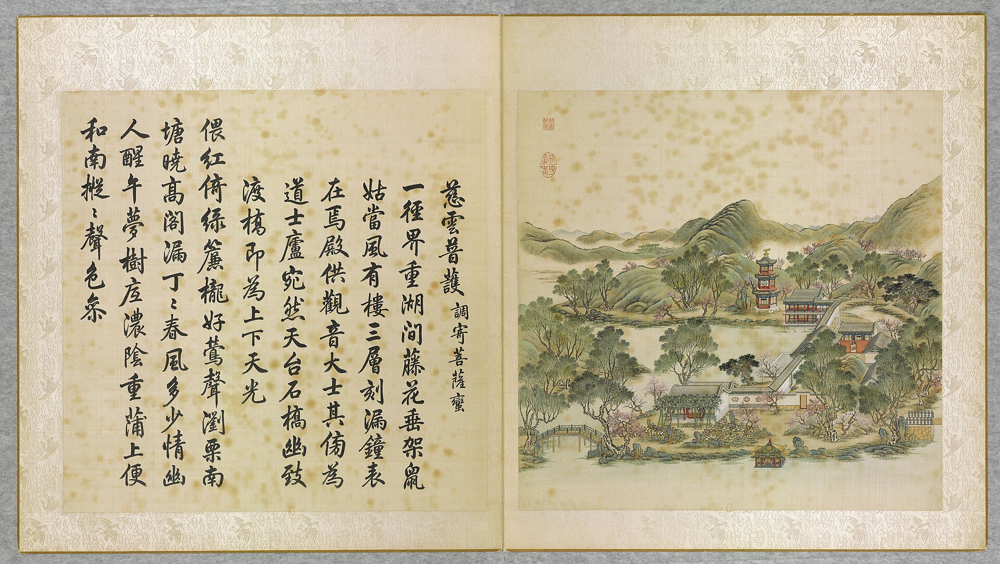

<!-- generated:start (scripts/building_pages.py): do not edit between these markers -->

# YM07-N01: 钟亭 Zhong Ting

Yuanming Yuan

**3D object:** 1 box. Open it: `/reconstruction/3d.html?b=YM07-N01`

**Part of:** YM07 慈云普护

## What we know

- **Name:** 钟亭 Zhong Ting (S01 · confidence B)
- **Garden:** Yuanming Yuan (S01)
- **Type:** pavilion (S01 · confidence B)
- **Destroyed:** 1860 (S01)
- **Position:** 40.00633, 116.28994. S01 sure (S01 · confidence B)
- **Size in the inventory:** 8.6 × 9.1 m. S01 plan px / hall scale (S01)
- **Plan reader's note:** Hexagon, rect=36,30,0. Label at (3368,3214). Not in the inventory (S01) *(research copy, not public)*
- **How it was read:** sure (S01) *(research copy, not public)*
- **Plan pixels:** 3346, 3186 (S01) *(research copy, not public)*

## Our model now

A plain box on the block drawn on the Qing plan S01: position and frontage from the plan, heights and roof from the typology of its hall class. It will be updated as the research goes on.

- **Box:** 8.6 × 9.1 m, pavilion square
- **Heights:** platform 0.48 m, eave 3.68 m, ridge 7.68 m above the ground
- **Roof:** pyramid 攒尖, grey tile
- **Faces:** 176.2° from north
- **Confidence:** B

## Pictures (1)

- **P0007** (likely): 慈雲普護 Ciyun puhu [Nuage de miséricorde pour la bénédiction universelle] (圓明園四十景, 第7景) (1744 (BnF record: 1744年，清朝乾隆九年)). https://commons.wikimedia.org/wiki/File%3A%E5%9C%93%E6%98%8E%E5%9C%92%E5%9B%9B%E5%8D%81%E6%99%AF._%E7%AC%AC%E4%B8%83%E6%99%AF_%28%E4%B8%8A%E5%86%8C%EF%BC%8C%E7%AC%AC%E4%B8%83%E5%B9%85%E5%9B%BE%29%2C_%E6%85%88%E9%9B%B2%E6%99%AE%E8%AD%B7_-_%28%E6%B8%85%29%E5%94%90%E5%B2%B1%E3%80%81%E6%B2%88%E6%BA%90%E5%90%88%E7%95%AB_%3B_%28%E4%B9%BE%E9%9A%86%E5%90%9F%E8%AF%97%EF%BC%8C%E6%B1%AA%E7%94%B1%E6%95%A6%E4%BB%A3%E4%B9%A6%29Ciyun_puhu_-_%28Qing%29Tang_Dai%2C_Shen_Yuan_he_hua_-_btv1b55008359p.jpg

  

## Texts and drawings (2)

- **E1263** (description, guess): Scene 7, 慈云普护 Ciyun Puhu, Island of Shrines. 1934 · p.80 · S02. https://archive.org/details/historyofpekings00malo
  > A three-storied bell tower with a sun dial on its south front, and shrines to Buddha, to the God of War, and to the Dragon King were grouped around a cove on the west side of this small island.
  Three-storey bell tower with a sundial on the south front and shrines to Buddha, the God of War and the Dragon King, round a cove on the west side.
- **E1266** (description, likely): 释圆明园慈云普护之多神殿. post n.d. · lswh · S337. http://iqh.ruc.edu.cn/old/qdhjylyjzx/xszl/ylfj/38163bb8aee541e2b80b63a5b0149e22.htm
  慈云普护 Ciyun Puhu, north shore of 后湖, 120 x 90 m, 800 m2 of buildings. A temple garden for several faiths: 欢喜佛场 for Buddha, a tower with 观音 above and 关帝 below, and the 龙王殿 for 昭福龙王. Cites a 1794 repair list giving three bays with a three-bay rear annex for 欢喜佛场.

**On the plan:** Drawn on the plan of the gardens (S01), labelled 钟亭. https://artmuseum.princeton.edu/collections/objects/138657

## Evidence for the set of buildings

- Evidence for the whole compound 慈云普护: see YM07
- Reconstructions and comparables for the whole garden, 圆明园 Yuanming Yuan: see GARDEN-YM
- Standing buildings comparable to a square pavilion (not this building): see CLASS-pavilion_square

## Open questions

None that name it.

<!-- generated:end -->

## Notes

<!-- Yours: regeneration never touches this part. It goes on the public site; what you write below a line holding only %% private %% stays in the research copy. -->
