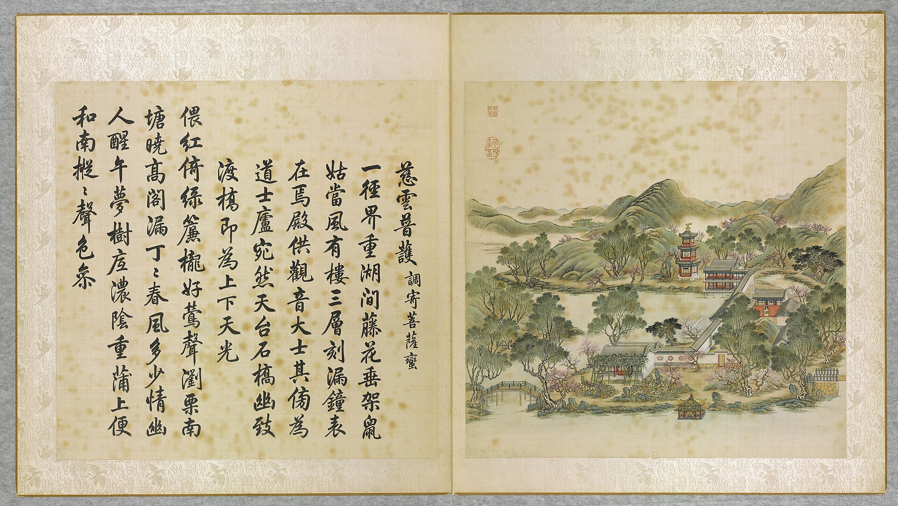
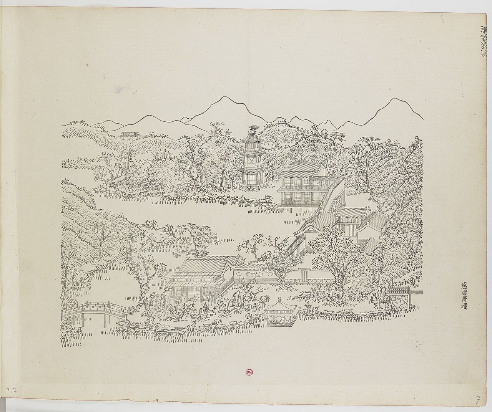
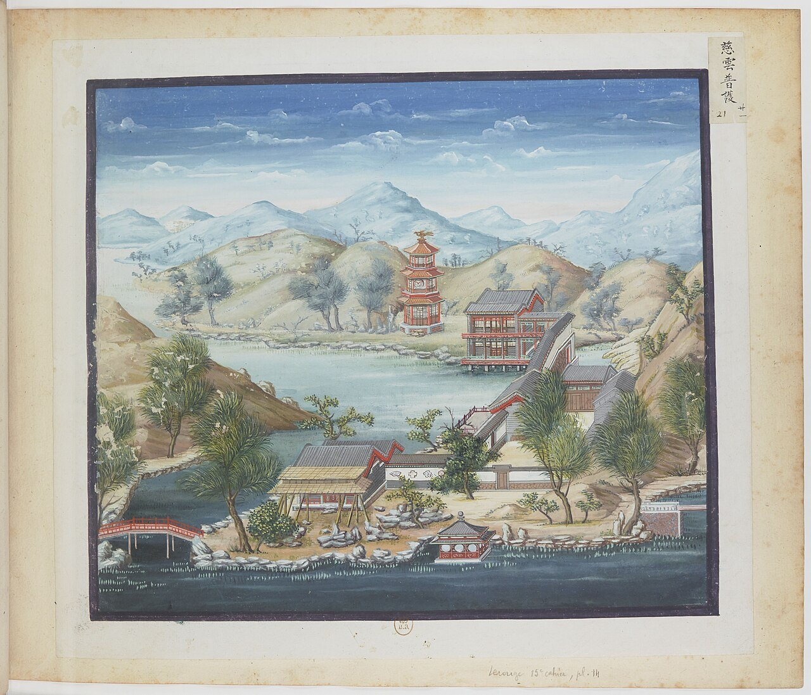
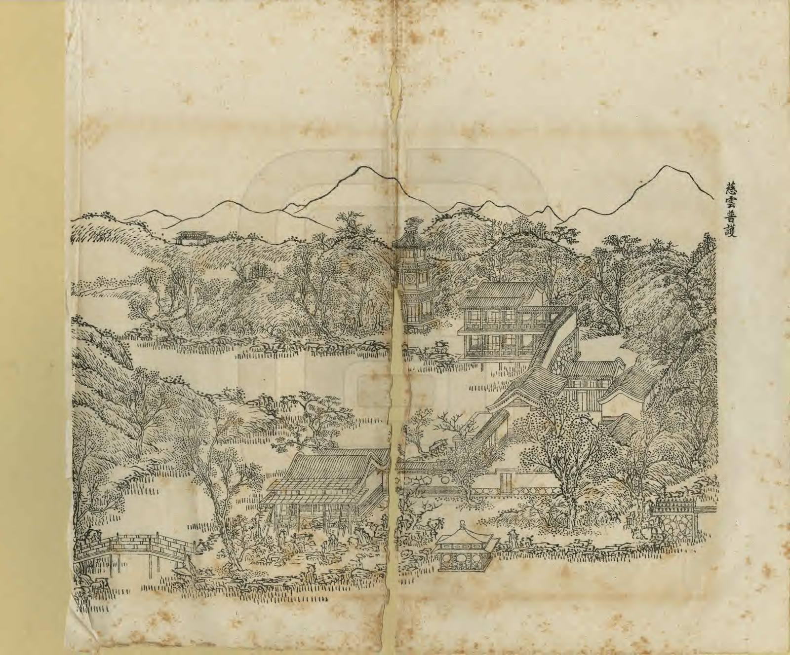
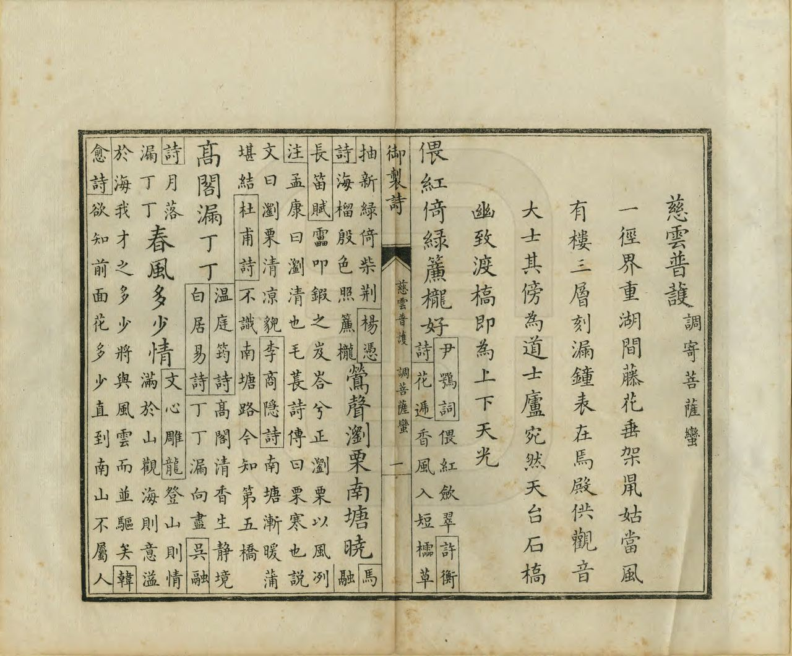
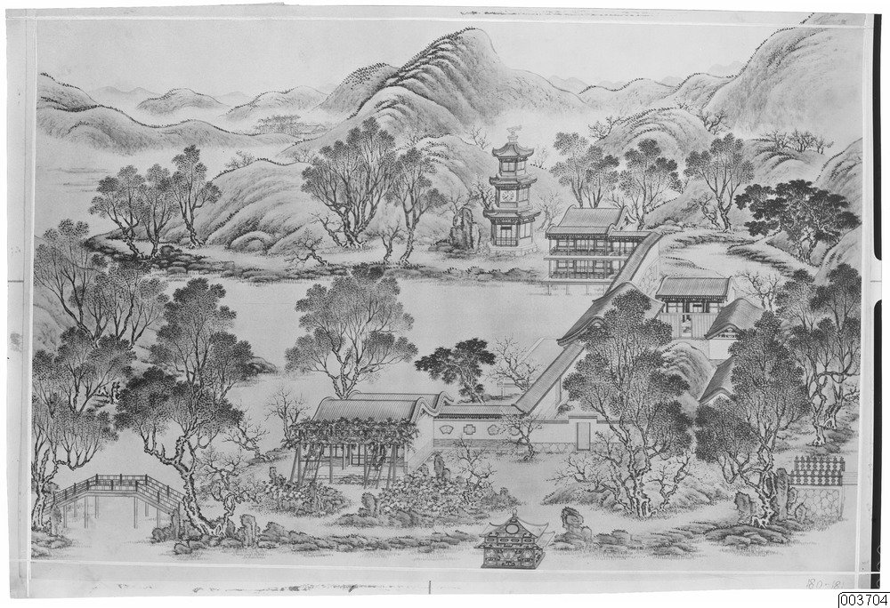
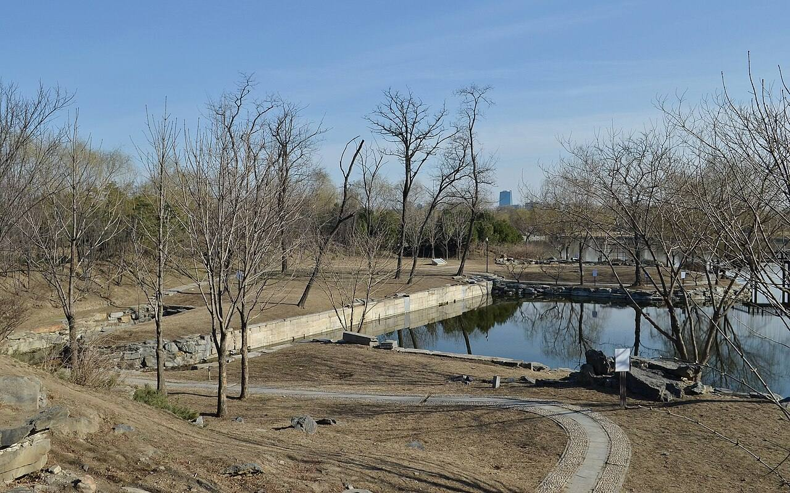
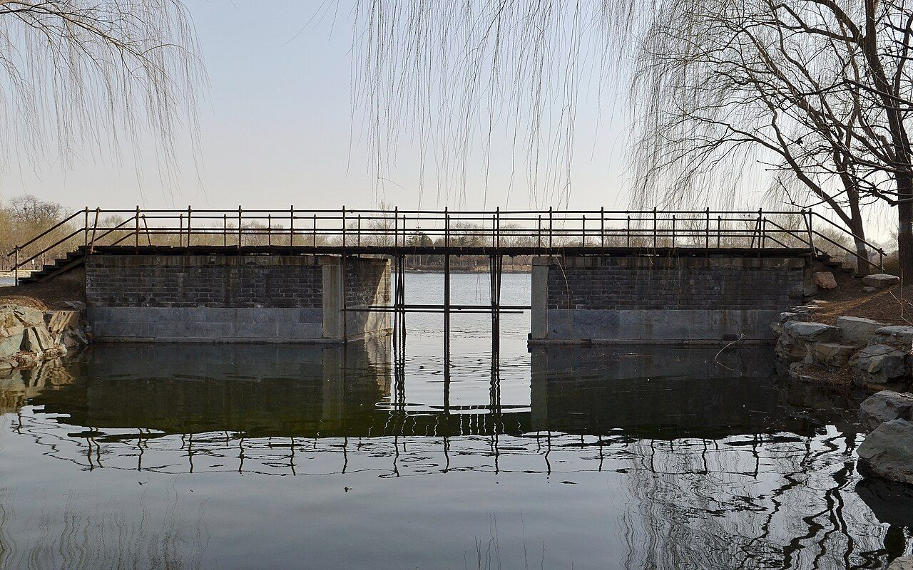
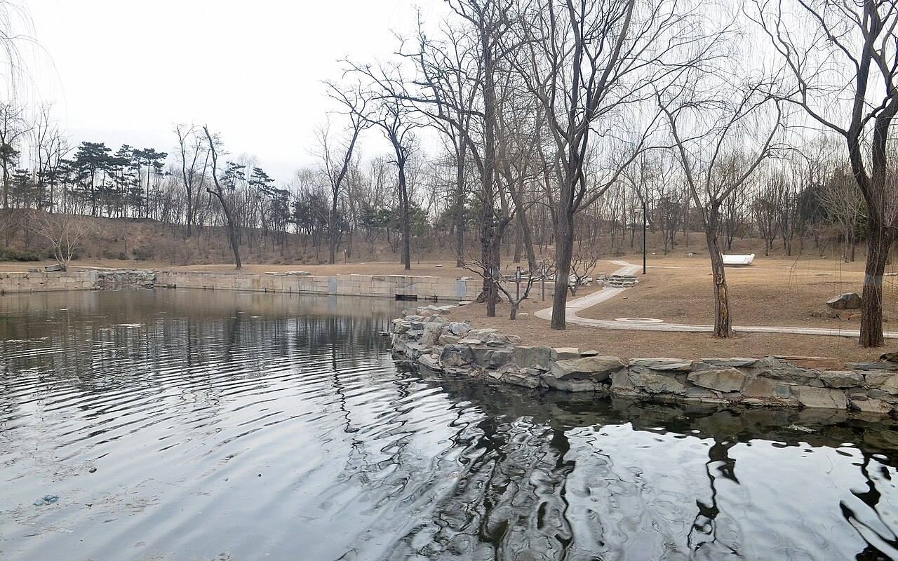

<!-- generated:start (scripts/building_pages.py): do not edit between these markers -->

# YM07: 慈云普护 Ciyun Puhu

Island of Shrines (Merciful Clouds Universally Protecting) · Yuanming Yuan

**3D object:** 7 boxes. Open it: `/reconstruction/3d.html?b=YM07`

## What we know

- **Name:** 慈云普护 Ciyun Puhu (S05, S02, S08, S41, S01 · confidence B)
- **English:** Island of Shrines (Merciful Clouds Universally Protecting) (S05, S02, S08, S41, S01)
- **Garden:** Yuanming Yuan (S05, S02, S08, S41, S01)
- **Type:** scene (S05, S02, S08, S41, S01 · confidence B)
- **Changed:** Differs on later plans (S41) (S05, S02, S08, S41, S01)
- **Destroyed:** 1860 (S05, S02, S08, S41, S01)
- **Position:** 40.00622, 116.29006. S01 sure (S01 · confidence B)
- **Note:** Album does not show the 1860 state here (S41). (S05, S02, S08, S41, S01)
- **Plan reader's note:** Label at (3386,3321); 钟亭, 欢喜佛场 and 如祈应祷 also legible (S01) *(research copy, not public)*
- **How it was read:** sure (S01) *(research copy, not public)*
- **Plan pixels:** 3392, 3243 (S01) *(research copy, not public)*

## Our model now

7 boxes stand in this compound, 7 on blocks drawn on the plan, 0 assumed. Its halls are listed below.

## Inside it (8)

- YM07-01 欢喜佛场
- YM07-02 慈云普护楼
- YM07-03 龙王殿
- YM07-B0589
- YM07-B0617
- YM07-B0644
- YM07-N01 钟亭
- YM07-N02 如祈应祷

## Pictures (9)

- **P0007** (sure): 慈雲普護 Ciyun puhu [Nuage de miséricorde pour la bénédiction universelle] (圓明園四十景, 第7景) (1744 (BnF record: 1744年，清朝乾隆九年)). https://commons.wikimedia.org/wiki/File%3A%E5%9C%93%E6%98%8E%E5%9C%92%E5%9B%9B%E5%8D%81%E6%99%AF._%E7%AC%AC%E4%B8%83%E6%99%AF_%28%E4%B8%8A%E5%86%8C%EF%BC%8C%E7%AC%AC%E4%B8%83%E5%B9%85%E5%9B%BE%29%2C_%E6%85%88%E9%9B%B2%E6%99%AE%E8%AD%B7_-_%28%E6%B8%85%29%E5%94%90%E5%B2%B1%E3%80%81%E6%B2%88%E6%BA%90%E5%90%88%E7%95%AB_%3B_%28%E4%B9%BE%E9%9A%86%E5%90%9F%E8%AF%97%EF%BC%8C%E6%B1%AA%E7%94%B1%E6%95%A6%E4%BB%A3%E4%B9%A6%29Ciyun_puhu_-_%28Qing%29Tang_Dai%2C_Shen_Yuan_he_hua_-_btv1b55008359p.jpg

  

- **P0067** (sure): 中国皇帝的宫殿与庙宇. 第7幅图, 慈雲普護 - (清)孙祜、沈源Ciyun puhu - (Qing)Sun Hu, Shen Yuan (1745 (Commons, from the BnF record)). https://commons.wikimedia.org/wiki/File%3A%E4%B8%AD%E5%9B%BD%E7%9A%87%E5%B8%9D%E7%9A%84%E5%AE%AB%E6%AE%BF%E4%B8%8E%E5%BA%99%E5%AE%87._%E7%AC%AC7%E5%B9%85%E5%9B%BE%2C_%E6%85%88%E9%9B%B2%E6%99%AE%E8%AD%B7_-_%28%E6%B8%85%29%E5%AD%99%E7%A5%9C%E3%80%81%E6%B2%88%E6%BA%90Ciyun_puhu_-_%28Qing%29Sun_Hu%2C_Shen_Yuan_-_btv1b105206718.jpg

  

- **P0121** (sure): 海淀(镇)：中国皇帝的行宫. 第21幅图, 慈雲普護Ciyun puhu (1750-1792 (BnF, cb43831905b; ex coll. Bertin)). https://commons.wikimedia.org/wiki/File%3A%E6%B5%B7%E6%B7%80%28%E9%95%87%29%EF%BC%9A%E4%B8%AD%E5%9B%BD%E7%9A%87%E5%B8%9D%E7%9A%84%E8%A1%8C%E5%AE%AB._%E7%AC%AC21%E5%B9%85%E5%9B%BE%2C_%E6%85%88%E9%9B%B2%E6%99%AE%E8%AD%B7Ciyun_puhu_-_btv1b105206646.jpg

  

- **P0238** (sure): 慈雲普護 Ciyun Puhu (御製圓明園圖詠, 1887 石印本, 上卷 (Commons 卷一), 第7景; printed title in the right margin of the picture) (光緒十三年 1887 (Commons/NLC record; colophon 光緒十三年七月天津石印書屋 in the SSID copy, S98 PDF p.2); design after the woodblock of 1745 by 孫祜 Sun Hu and 沈源 Shen Yuan). https://commons.wikimedia.org/wiki/File%3ANLC403-312001107375-14035_%E7%A6%A6%E5%88%B6%E5%9C%93%E6%98%8E%E5%9C%92%E5%9C%96%E8%A9%A0_%E5%8D%B7%E4%B8%80.pdf?page=51

  

- **P0514** (sure): 慈雲普護 Ciyun Puhu: 乾隆 Qianlong's preface and poem with the courtiers' commentary, 御製圓明園圖詠 1887 (poem 1744 (乾隆九年); this printing 1887). https://commons.wikimedia.org/wiki/File%3ANLC403-312001107375-14035_%E7%A6%A6%E5%88%B6%E5%9C%93%E6%98%8E%E5%9C%92%E5%9C%96%E8%A9%A0_%E5%8D%B7%E4%B8%80.pdf?page=52

  

- **P0203** (sure): Sirén, Enligt text under Pl. 180-181 Kinas trädgårdar Vol. I: Yuanming yuan. Tz’u Yün P’u Hu (Ci Yun Pu Hu), ”Barmhärtiga Moln Beskyddande Allt”. En anläggning bestående av tre små tempel, h (undated by holder; Sirén's second trip 1921-23 for this group). http://kulturarvsdata.se/SMVK-OM/Bildarkiv/198813 Research-only: link card.

  

- **P0372** (sure): 慈云普护遗址 20130324.JPG (2013-03-24 16:01:22 (Commons DateTimeOriginal)). https://commons.wikimedia.org/wiki/File:%E6%85%88%E4%BA%91%E6%99%AE%E6%8A%A4%E9%81%97%E5%9D%80_20130324.JPG

  

- **P0447** (sure): 一孔桥 20130323.JPG (2013-03-23 16:19:06 (Commons DateTimeOriginal)). https://commons.wikimedia.org/wiki/File:%E4%B8%80%E5%AD%94%E6%A1%A5_20130323.JPG

  

- **P0448** (sure): 慈云普护遗址 20130318.JPG (2013-03-18 16:38:05 (Commons DateTimeOriginal)). https://commons.wikimedia.org/wiki/File:%E6%85%88%E4%BA%91%E6%99%AE%E6%8A%A4%E9%81%97%E5%9D%80_20130318.JPG

  

## Texts and drawings (14)

- **E1255** (poem, sure): 御製慈雲普䕶詞（調寄菩薩蠻）（圓明園四十景詩）. 1744 (乾隆九年) · printed in S05 j80:36b-37a · S40. https://github.com/kanripo/KR2k0036/blob/master/KR2k0036_080.txt
  > 乾隆九年 御製慈雲普䕶詞（調寄菩薩蠻） 一徑界重湖間藤花垂架鼠姑當風有樓三層刻漏鐘表在焉殿供觀音大士其傍為道士廬宛然天台石橋幽致渡橋即為上下天光偎紅倚緑簾櫳好鶯聲瀏栗南塘曉高閣漏丁丁春風多少情 幽人醒午夢樹底濃隂重蒲上便和南樅樅聲色參
  A path runs between two lakes, with wisteria on trellises and peonies. A three-storey tower houses a water clock and chiming clocks; the hall serves Guanyin, a Daoist hut stands beside it, and a bridge like the one at Tiantai crosses to 上下天光.
- **E1260** (text, sure): 日下舊聞考 慈云普护. 1780s (乾隆 敕撰) · j80:35b-36b · S05. https://github.com/kanripo/KR2k0036/blob/master/KR2k0036_080.txt
  > 碧桐書院之西為慈雲普䕶前殿南臨後湖三楹為歡喜佛塲其北樓宇三楹有慈雲普䕶額上奉觀音大士下祀關聖帝君東偏為龍王殿祀圓明園昭福龍王（圓明園冊）臣等謹按慈雲普䕶四十景之一也與歡喜佛塲額皆世宗御書龍王殿額曰如祈應禱關帝殿額曰昭明宇宙皆世宗御書又龍王殿額曰功宣普潤聨曰正中徳備乾符應利濟恩敷解澤流皇上御書
  West of 碧桐書院 on the Back Lake 後湖: a three-bay front hall (歡喜佛塲), a three-bay tower with Guanyin above and Guandi below, and an eastern 龍王殿 for the garden's 昭福 dragon king.
- **E1256** (poem, sure): 慈云普护: 乾隆九年 poem of the Qianlong Emperor. 乾隆九年 (1744), date from the compilation · p.153 item (1), under 慈云普护 · S360. https://www.yuanmingyuanpark.cn/xs/yjbg/202007/P020200730387572832602.pdf#page=153
  > 偎红倚绿帘栊好，莺声浏栗南塘晓。高阁漏丁丁春风，多少情幽人醒午梦。树底浓阴重，蒲上便和南，枞枞声色参。
  Poem of the Qianlong Emperor at 慈云普护, 1744. Year as given by the compilation.
- **E1257** (poem, sure): 慈云普护: 嘉庆元年 poem of the Jiaqing Emperor. 嘉庆元年 (1796), date from the compilation · p.154 item (2), under 慈云普护 · S360. https://www.yuanmingyuanpark.cn/xs/yjbg/202007/P020200730387572832602.pdf#page=154
  > 环绕莲台下，皈依般若禅。慈云布三界，法雨散诸天。溉润敷多稼，醍醐沃福田。杨枝祈遍洒，鉴此寸心虔。
  Poem of the Jiaqing Emperor at 慈云普护, 1796. Year as given by the compilation.
- **E1258** (poem, sure): 慈云普护瞻礼. 嘉庆二年 (1797) · v2 p.18, under 慈云普护; source ref 1-233 · S361. https://www.yuanmingyuanpark.cn/xs/yjbg/202008/P020200803382343267004.pdf#page=21
  > 层阁临湖景象幽，瓣香虔谒为民求。消魔敬愿大雄力，早释圣皇宵旰愁。湖北教匪刘之协等以左道煽惑愚民，经官兵剿捕，窜逸稽诛，致秦蜀匪徒间有闻风窃发，并阑入豫境。统兵大臣等层层剿洗，在穽之兽，自无虞漏网。惟为时已久，皇父盼望献俘，露布宵旰，倍殷悬廑。惟仰冀大雄威力，速清魔障，以纾圣虑焦劳尔。
  Poem 慈云普护瞻礼 by the Jiaqing Emperor, 1797, filed by the editors under 慈云普护.
- **E1259** (poem, sure): 慈云普护: 嘉庆三年 poem of the Jiaqing Emperor. 嘉庆三年 (1798), date from the compilation · p.154 item (3), under 慈云普护 · S360. https://www.yuanmingyuanpark.cn/xs/yjbg/202007/P020200730387572832602.pdf#page=154
  > 示慈应感神州遍，天竺海南迹总同。紫竹香云飘物外，绿杨甘露滴虚空。境随心转诸缘扰，想自因生六道通。毕竟形骸归土木，现身说法警愚蒙。
  Poem of the Jiaqing Emperor at 慈云普护, 1798. Year as given by the compilation.
- **E1261** (text, sure): Qing record, overview item 91. 道光十九年十一月 (1839) · p.25, 综述 item 91 · S360. https://www.yuanmingyuanpark.cn/xs/yjbg/202007/P020200730387572832602.pdf#page=25
  > 该首领太监等均著留发当差，有年老不愿留发者，听其在原处当差，终身而止，亦不必上殿念经。
  1839 order ending the use of eunuchs as monks at the garden's temples, naming 慈云普护, 舍卫城, 永日堂, 广育宫, 关帝庙, 法慧寺, 河神庙.
- **E1263** (description, sure): Scene 7, 慈云普护 Ciyun Puhu, Island of Shrines. 1934 · p.80 · S02. https://archive.org/details/historyofpekings00malo
  > A three-storied bell tower with a sun dial on its south front, and shrines to Buddha, to the God of War, and to the Dragon King were grouped around a cove on the west side of this small island.
  Three-storey bell tower with a sundial on the south front and shrines to Buddha, the God of War and the Dragon King, round a cove on the west side.
- **E1216** (description, sure): Site status table, about 2011: remains tidied up. c. 2011 · 系列06 repost, status table · S356. https://blog.sina.com.cn/s/blog_c27029650101itzz.html
  A blogger's table of what was then visible. These scenes have building remains that have been cleared and tidied. Dated about 2011, so digs since then are not reflected.
- **E1264** (description, sure): 慈云普护 龙王殿, 关帝殿 (S47 section 2.1). 2012, citing archive and Qing texts · pp.110; table rows 1-2 · S47. https://www.dpm.org.cn/Uploads/File/2018/06/15/u5b23730ae0e5a.pdf
  East side hall of 慈云普护 is the dragon-king hall: three bays, hanging gable, facing west, with a front terrace and the plaque 如祈应祷. The two-storey building north of it had Guanyin above and Guandi below; a Qianlong note puts a Daoist cell beside it. Table dates both to Kangxi.
- **E1266** (description, sure): 释圆明园慈云普护之多神殿. post n.d. · lswh · S337. http://iqh.ruc.edu.cn/old/qdhjylyjzx/xszl/ylfj/38163bb8aee541e2b80b63a5b0149e22.htm
  慈云普护 Ciyun Puhu, north shore of 后湖, 120 x 90 m, 800 m2 of buildings. A temple garden for several faiths: 欢喜佛场 for Buddha, a tower with 观音 above and 关帝 below, and the 龙王殿 for 昭福龙王. Cites a 1794 repair list giving three bays with a three-bay rear annex for 欢喜佛场.
- **E1262** (description, sure): 圆明园百景史事分景汇编: 慈云普护. 1744-1798 · from p.153, under 慈云普护 · S360. https://www.yuanmingyuanpark.cn/xs/yjbg/202007/P020200730387572832602.pdf#page=153
  慈云普护: 3 dated items, 1744-1798, of which 3 poems (Qianlong, Jiaqing). First dated 1744, last dated 1798.
- **E1265** (description, sure): 圆明园五朝御制诗文集注 v2, editors' note on 慈云普护. 2020 edition · v2 p.17 · S361. https://www.yuanmingyuanpark.cn/xs/yjbg/202008/P020200803382343267004.pdf#page=20
  A temple garden on the north shore: main hall to Guanyin above and Guandi below, a dragon-king hall to the east, a hexagonal bell tower. Eunuch monks served here until 1839.
- **E1267** (drawing, sure): 《国家图书馆藏样式雷图档·圆明园卷初编》: 慈云普护. mostly 道光, 咸丰, 同治 per the publisher · 初编 目录: 慈云普护, p.226 · S13. https://www.nlcpress.com/ProductView.aspx?Id=7642
  The printed facsimile of the National Library of China's Yangshi Lei sheets has a section on this place at p.226 (1 pages, section length worked out from the next heading); sheet titles and numbers are in the volume, ordered from a library.

**On the plan:** Drawn on the plan of the gardens (S01), labelled 慈云普护. https://artmuseum.princeton.edu/collections/objects/138657

## Open questions

- Q1: Target state
- Q26: Forms

<!-- generated:end -->

## Notes

<!-- Yours: regeneration never touches this part. It goes on the public site; what you write below a line holding only %% private %% stays in the research copy. -->
