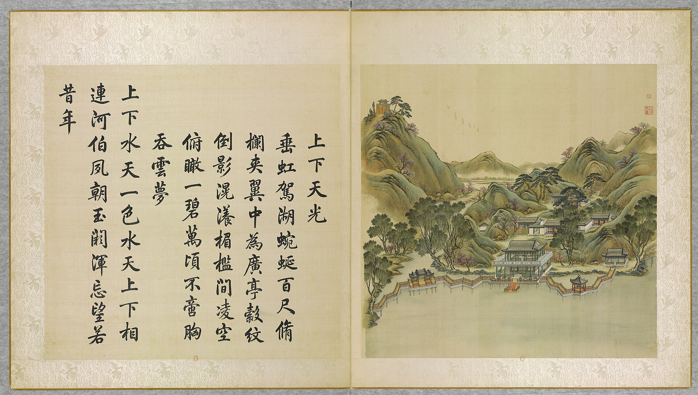

<!-- generated:start (scripts/building_pages.py): do not edit between these markers -->

# YM08-03: 奇赏亭 Qishang Ting

Yuanming Yuan

**3D object:** none yet.

**Part of:** YM08 上下天光

## What we know

- **Name:** 奇赏亭 Qishang Ting (S05 · confidence B)
- **Garden:** Yuanming Yuan (S05)
- **Type:** pavilion (S05 · confidence B)
- **Destroyed:** 1860 (S05)
- **Position:** Not placed: the name was not found on the plan.
- **Note:** hexagonal. 1744 poem: 垂虹駕湖 [j80:38a]; Malone p.80 zig-zag bridges carry them. (S05)

## Our model now

No box in the 3D view: the plan shows no building here, or a plot, water, a hill or a name only.

## Pictures (1)

- **P0008** (likely): 上下天光 Shangxia tianguang [Clarté céleste en haut et ici-bas] (圓明園四十景, 第8景) (1744 (BnF record: 1744年，清朝乾隆九年)). https://commons.wikimedia.org/wiki/File%3A%E5%9C%93%E6%98%8E%E5%9C%92%E5%9B%9B%E5%8D%81%E6%99%AF._%E7%AC%AC%E5%85%AB%E6%99%AF_%28%E4%B8%8A%E5%86%8C%EF%BC%8C%E7%AC%AC%E5%85%AB%E5%B9%85%E5%9B%BE%29%2C_%E4%B8%8A%E4%B8%8B%E5%A4%A9%E5%85%89_-_%28%E6%B8%85%29%E5%94%90%E5%B2%B1%E3%80%81%E6%B2%88%E6%BA%90%E5%90%88%E7%95%AB_%3B_%28%E4%B9%BE%E9%9A%86%E5%90%9F%E8%AF%97%EF%BC%8C%E6%B1%AA%E7%94%B1%E6%95%A6%E4%BB%A3%E4%B9%A6%29Shangxia_tianguang_-_%28Qing%29Tang_Dai%2C_Shen_Yuan_he_hua_-_btv1b550083602.jpg

  

## Texts and drawings (2)

- **E1272** (text, sure): 日下舊聞考 上下天光. 1780s (乾隆 敕撰) · j80:37a-37b · S05. https://github.com/kanripo/KR2k0036/blob/master/KR2k0036_080.txt
  > 慈雲普䕶之西臨湖有樓上下各三楹為上下天光左右各有六方亭後為平安院（圓明園冊）臣等謹按上下天光四十景之一也額為皇上御書聨曰雲水澄鮮一㡧波光開罨畫煙嵐杳藹四圍山色浸分奩亦御書右六方亭額曰飲和及平安院額皆世宗御書左六方亭額曰竒賞皇上御書
  West of 慈雲普䕶 on the lake: a tower of three bays on two floors called 上下天光, a six-sided pavilion on each side (飲和, 竒賞), and 平安院 behind.
- **E1274** (description, likely): Scene 8, 上下天光 Shangxia Tianguang, Island of the Zig-zag Bridges. 1934 · p.80 · S02. https://archive.org/details/historyofpekings00malo
  > The main building was built on piles over the water, by which the name is explained. Long zig-zag bridges extended east and west from this building.
  Main building on piles over the water; long zigzag bridges east and west; a hexagonal pavilion on the eastern bridge, a three-bay pavilion on the bridge to the next island west.

## Evidence for the set of buildings

- Evidence for the whole compound 上下天光: see YM08
- Reconstructions and comparables for the whole garden, 圆明园 Yuanming Yuan: see GARDEN-YM

## Open questions

None that name it.

<!-- generated:end -->

## Notes

<!-- Yours: regeneration never touches this part. It goes on the public site; what you write below a line holding only %% private %% stays in the research copy. -->
