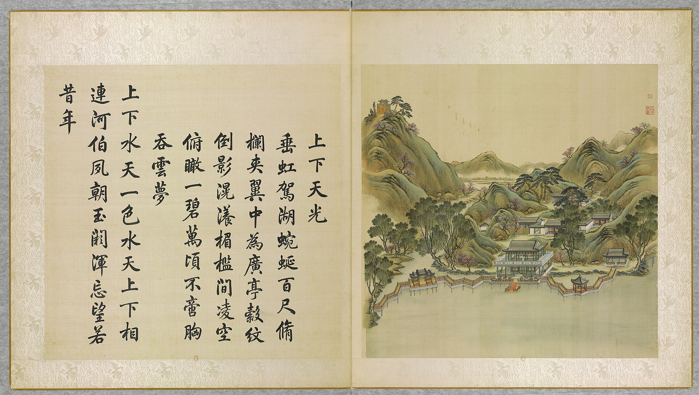
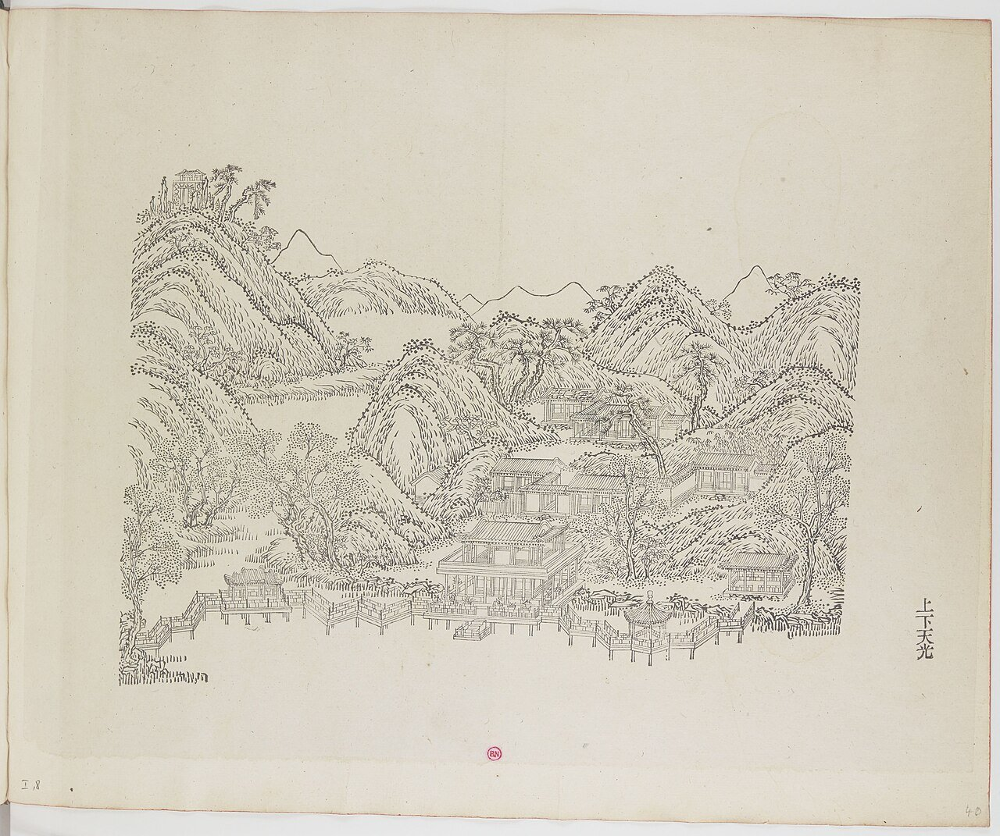
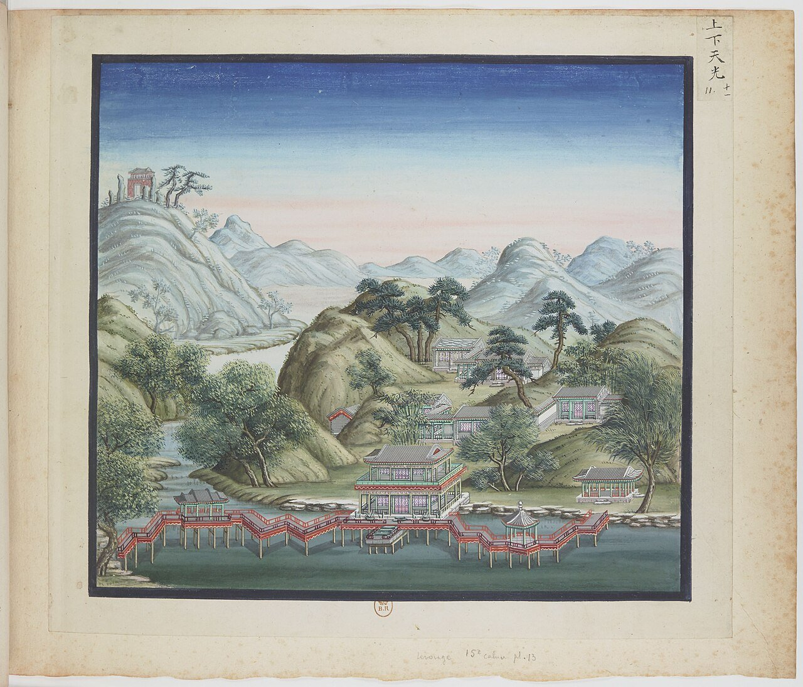
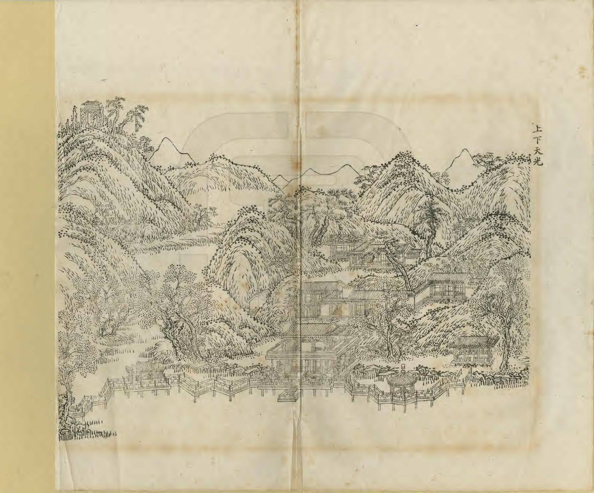
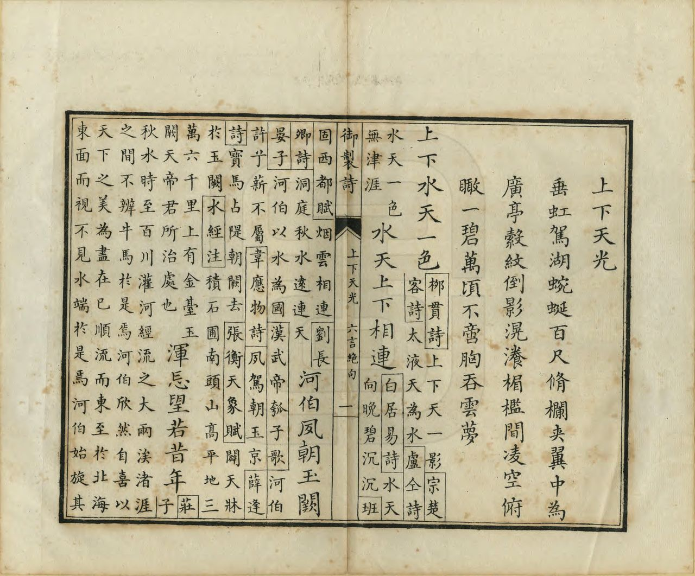
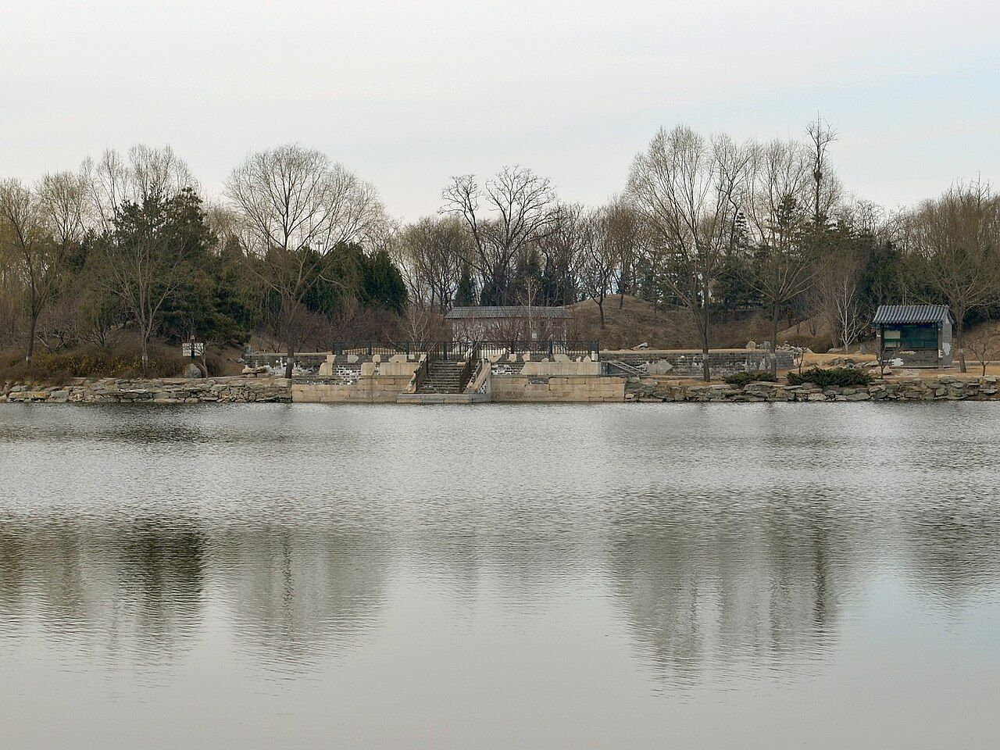
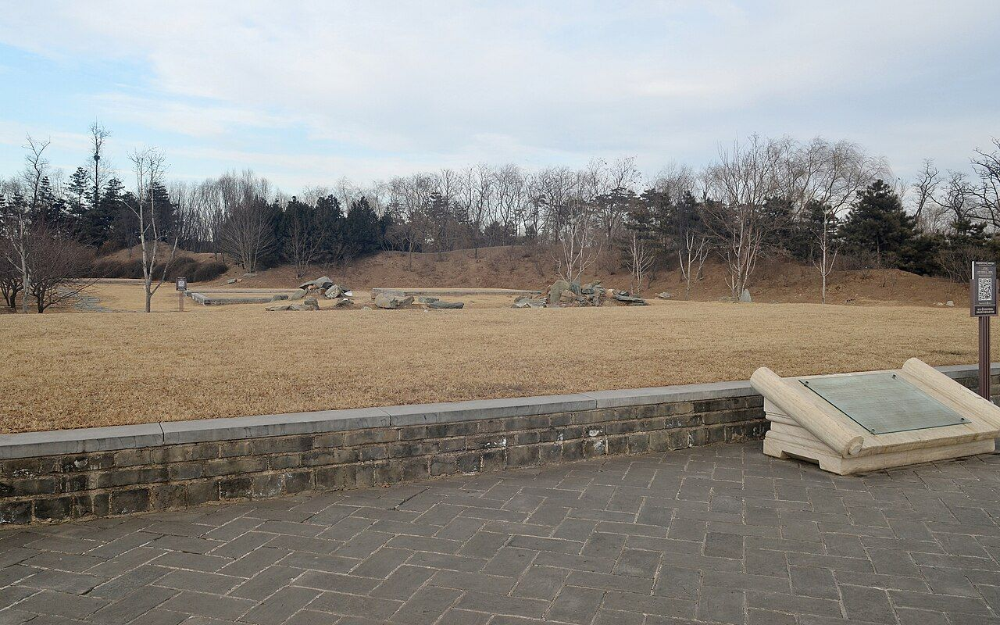
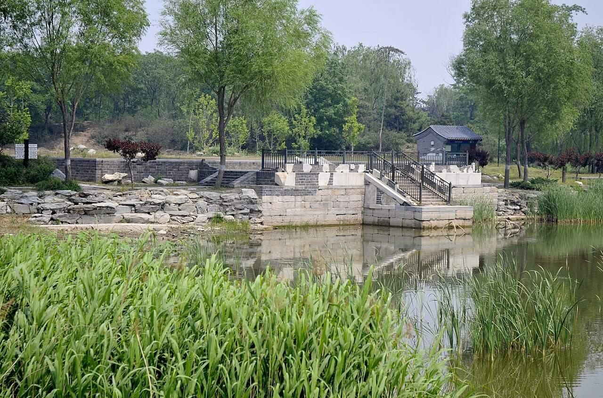

<!-- generated:start (scripts/building_pages.py): do not edit between these markers -->

# YM08: 上下天光 Shangxia Tianguang

The Island of the Zig-zag Bridges (Heavenly Light Above and Below) · Yuanming Yuan

**3D object:** 6 boxes. Open it: `/reconstruction/3d.html?b=YM08`

## What we know

- **Name:** 上下天光 Shangxia Tianguang (S05, S02, S08, S41, S42, S01, S361 · confidence B)
- **English:** The Island of the Zig-zag Bridges (Heavenly Light Above and Below) (S05, S02, S08, S41, S42, S01, S361)
- **Garden:** Yuanming Yuan (S05, S02, S08, S41, S42, S01, S361)
- **Type:** scene (S05, S02, S08, S41, S42, S01, S361 · confidence B)
- **Built:** 雍正初年 (S42); 1726 (S05, S02, S08, S41, S42, S01, S361)
- **Changed:** Daoguang: upper floor enclosed, square pavilion, 值房院 and west hall added (S42); bridge pavilions changed (S41) (S05, S02, S08, S41, S42, S01, S361)
- **Destroyed:** 1860 (S05, S02, S08, S41, S42, S01, S361)
- **Position:** 40.00545, 116.28938. S01 sure (S01 · confidence B)
- **Note:** Album does not show the 1860 state here (S41). (S05, S02, S08, S41, S42, S01, S361)
- **Plan reader's note:** Label on the lake at (3028,3663), hall on the north shore (S01) *(research copy, not public)*
- **How it was read:** sure (S01) *(research copy, not public)*
- **Plan pixels:** 3058, 3577 (S01) *(research copy, not public)*

## Our model now

6 boxes stand in this compound, 6 on blocks drawn on the plan, 0 assumed. Its halls are listed below.

## Inside it (5)

- YM08-01 上下天光楼
- YM08-02 饮和亭
- YM08-03 奇赏亭
- YM08-04 平安院
- YM08-AC009

## Pictures (8)

- **P0008** (sure): 上下天光 Shangxia tianguang [Clarté céleste en haut et ici-bas] (圓明園四十景, 第8景) (1744 (BnF record: 1744年，清朝乾隆九年)). https://commons.wikimedia.org/wiki/File%3A%E5%9C%93%E6%98%8E%E5%9C%92%E5%9B%9B%E5%8D%81%E6%99%AF._%E7%AC%AC%E5%85%AB%E6%99%AF_%28%E4%B8%8A%E5%86%8C%EF%BC%8C%E7%AC%AC%E5%85%AB%E5%B9%85%E5%9B%BE%29%2C_%E4%B8%8A%E4%B8%8B%E5%A4%A9%E5%85%89_-_%28%E6%B8%85%29%E5%94%90%E5%B2%B1%E3%80%81%E6%B2%88%E6%BA%90%E5%90%88%E7%95%AB_%3B_%28%E4%B9%BE%E9%9A%86%E5%90%9F%E8%AF%97%EF%BC%8C%E6%B1%AA%E7%94%B1%E6%95%A6%E4%BB%A3%E4%B9%A6%29Shangxia_tianguang_-_%28Qing%29Tang_Dai%2C_Shen_Yuan_he_hua_-_btv1b550083602.jpg

  

- **P0099** (sure): 中国皇帝的宫殿与庙宇. 第40幅图, 上下天光 - (清)孙祜、沈源Shangxia tianguang - (Qing)Sun Hu, Shen Yuan (1745 (Commons, from the BnF record)). https://commons.wikimedia.org/wiki/File%3A%E4%B8%AD%E5%9B%BD%E7%9A%87%E5%B8%9D%E7%9A%84%E5%AE%AB%E6%AE%BF%E4%B8%8E%E5%BA%99%E5%AE%87._%E7%AC%AC40%E5%B9%85%E5%9B%BE%2C_%E4%B8%8A%E4%B8%8B%E5%A4%A9%E5%85%89_-_%28%E6%B8%85%29%E5%AD%99%E7%A5%9C%E3%80%81%E6%B2%88%E6%BA%90Shangxia_tianguang_-_%28Qing%29Sun_Hu%2C_Shen_Yuan_-_btv1b10520672q.jpg

  

- **P0111** (sure): 海淀(镇)：中国皇帝的行宫. 第11幅图, 上下天光Shangxia tianguang (1750-1792 (BnF, cb43831905b; ex coll. Bertin)). https://commons.wikimedia.org/wiki/File%3A%E6%B5%B7%E6%B7%80%28%E9%95%87%29%EF%BC%9A%E4%B8%AD%E5%9B%BD%E7%9A%87%E5%B8%9D%E7%9A%84%E8%A1%8C%E5%AE%AB._%E7%AC%AC11%E5%B9%85%E5%9B%BE%2C_%E4%B8%8A%E4%B8%8B%E5%A4%A9%E5%85%89Shangxia_tianguang_-_btv1b10520712m.jpg

  

- **P0239** (sure): 上下天光 Shangxia Tianguang (御製圓明園圖詠, 1887 石印本, 上卷 (Commons 卷一), 第8景; printed title in the right margin of the picture) (光緒十三年 1887 (Commons/NLC record; colophon 光緒十三年七月天津石印書屋 in the SSID copy, S98 PDF p.2); design after the woodblock of 1745 by 孫祜 Sun Hu and 沈源 Shen Yuan). https://commons.wikimedia.org/wiki/File%3ANLC403-312001107375-14035_%E7%A6%A6%E5%88%B6%E5%9C%93%E6%98%8E%E5%9C%92%E5%9C%96%E8%A9%A0_%E5%8D%B7%E4%B8%80.pdf?page=54

  

- **P0515** (sure): 上下天光 Shangxia Tianguang: 乾隆 Qianlong's preface and poem with the courtiers' commentary, 御製圓明園圖詠 1887 (poem 1744 (乾隆九年); this printing 1887). https://commons.wikimedia.org/wiki/File%3ANLC403-312001107375-14035_%E7%A6%A6%E5%88%B6%E5%9C%93%E6%98%8E%E5%9C%92%E5%9C%96%E8%A9%A0_%E5%8D%B7%E4%B8%80.pdf?page=55

  

- **P0373** (sure): 上下天光遗址 20130318.JPG (2013-03-18 15:40:29 (Commons DateTimeOriginal)). https://commons.wikimedia.org/wiki/File:%E4%B8%8A%E4%B8%8B%E5%A4%A9%E5%85%89%E9%81%97%E5%9D%80_20130318.JPG

  

- **P0449** (sure): 上下天光遗址 20130201.jpg (2013-02-01 16:06:01 (Commons DateTimeOriginal)). https://commons.wikimedia.org/wiki/File:%E4%B8%8A%E4%B8%8B%E5%A4%A9%E5%85%89%E9%81%97%E5%9D%80_20130201.jpg

  

- **P0642** (sure): 上下天光遗址 (Taken on 27 May 2011 (Commons)). https://commons.wikimedia.org/wiki/File:%E4%B8%8A%E4%B8%8B%E5%A4%A9%E5%85%89%E9%81%97%E5%9D%80_-_panoramio.jpg

  

## Texts and drawings (18)

- **E1268** (poem, sure): 御製上下天光詩（圓明園四十景詩）. 1744 (乾隆九年) · printed in S05 j80:37b-38a · S40. https://github.com/kanripo/KR2k0036/blob/master/KR2k0036_080.txt
  > 乾隆九年 御製上下天光詩 垂虹駕湖蜿蜒百尺修欄夾翼中為廣亭縠紋倒影滉瀁楣檻間凌空俯瞰一碧萬頃不啻胸吞雲夢 上下天水一色水天上下相連河伯夙朝玉闕渾忘望若昔年
  A long bridge of about a hundred chi crosses the lake between railings, with a broad pavilion in the middle. Ripples reflect on the lintels, and from above the green water seems endless, wider than the marshes of Yunmeng.
- **E1272** (text, sure): 日下舊聞考 上下天光. 1780s (乾隆 敕撰) · j80:37a-37b · S05. https://github.com/kanripo/KR2k0036/blob/master/KR2k0036_080.txt
  > 慈雲普䕶之西臨湖有樓上下各三楹為上下天光左右各有六方亭後為平安院（圓明園冊）臣等謹按上下天光四十景之一也額為皇上御書聨曰雲水澄鮮一㡧波光開罨畫煙嵐杳藹四圍山色浸分奩亦御書右六方亭額曰飲和及平安院額皆世宗御書左六方亭額曰竒賞皇上御書
  West of 慈雲普䕶 on the lake: a tower of three bays on two floors called 上下天光, a six-sided pavilion on each side (飲和, 竒賞), and 平安院 behind.
- **E1282** (poem, sure): 上下天光. 乾隆九年 (1744) · v2 p.20, under 上下天光; source ref 2-683 · S361. https://www.yuanmingyuanpark.cn/xs/yjbg/202008/P020200803382343267004.pdf#page=23
  > 垂虹架湖，蜿蜒百尺。修栏夹翼，中为广亭。縠纹倒影，滉漾楣槛间。凌空俯瞰，一碧万顷，不啻胸吞云梦。上下天水一色，水天上下相连。河伯夙朝玉阙，浑忘望若昔年。
  Poem 上下天光 by the Qianlong Emperor, 1744, filed by the editors under 上下天光.
- **E1269** (poem, sure): 上下天光: 嘉庆三年 poem of the Jiaqing Emperor. 嘉庆三年 (1798), date from the compilation · p.152 item (1), under 上下天光 · S360. https://www.yuanmingyuanpark.cn/xs/yjbg/202007/P020200730387572832602.pdf#page=152
  > 碧彻澄空敞，清光印水宽。风迥叠绿绮，日射漾金澜。波阔虚奁展，尘消明镜观。安心欲如是，鉴物得其端。”此景名取自范仲淹《岳阳楼记》“上下天光，一碧万顷”句。乾隆九年（1744）御制“上下天光”诗云：“上下水天一色，水天上下相连。河伯夙朝玉阙，浑忘望若昔年。”诗序曰：“垂虹驾湖，蜿蜒百尺，修栏夹翼，中为广亭。縠纹倒影，滉漾楣槛间。凌空俯瞰，一碧万顷，不啻胸吞云梦。”北宋庆历四年（1044）的春天，范仲淹受朋友的嘱托为重修的岳阳楼写一篇纪念文章，这就是千古传诵的名篇《岳阳楼记》。在文章中，范仲淹看到洞庭湖波澜壮阔、横无际涯的壮观景象，便写下“上下天光，一碧万顷”的文字，来表达洞庭湖水天相接的辽阔胜景。圆明园上下天光是一处临水园林景观，通过这一景名，清帝将后湖比作洞庭湖，以一种抽象化、文学化的方式来表现后湖的壮美。当此美景，范仲淹想到“先天下之忧而忧，后天下之乐而乐
  Poem of the Jiaqing Emperor at 上下天光, 1798, on the view. Year as given by the compilation.
- **E1283** (poem, sure): 上下天光. 嘉庆三年 (1798) · v2 p.20, under 上下天光; source ref 1-324 · S361. https://www.yuanmingyuanpark.cn/xs/yjbg/202008/P020200803382343267004.pdf#page=23
  > 碧彻澄空敞，清光印水宽。风回叠绿绮，日射漾金澜。波阔虚奁展，尘消明镜观。安心欲如是，鉴物得其端。
  Poem 上下天光 by the Jiaqing Emperor, 1798, filed by the editors under 上下天光.
- **E1270** (poem, sure): 上下天光: 道光八年 poem of the Daoguang Emperor. 道光八年 (1828), date from the compilation · p.152 item (2), under 上下天光 · S360. https://www.yuanmingyuanpark.cn/xs/yjbg/202007/P020200730387572832602.pdf#page=152
  > 高楼明暖喜春阳，一鉴澄 清上下光。午荫迟迟度危槛，和暄景象正舒长。雨水节过暖不遥，山腰积雪未全消。园中花事如相约，转瞬杨枝拂小桥。
  Poem of the Daoguang Emperor at 上下天光, 1828, on the view. Year as given by the compilation.
- **E1271** (poem, sure): 上下天光: 咸丰六年 poem of the Xianfeng Emperor. 咸丰六年 (1856), date from the compilation · p.153 item (10), under 上下天光 · S360. https://www.yuanmingyuanpark.cn/xs/yjbg/202007/P020200730387572832602.pdf#page=153
  > 平湖鶔望夏如秋，竟日滂沱酒未休。烟色四园迷远岸，泉声万斛泻高楼。云飞南浦情无极，帘卷西山句好酬。千里阴睛虽有异，久征将士使子愁。
  Poem of the Xianfeng Emperor at 上下天光, 1856, on the view. Year as given by the compilation.
- **E1274** (description, sure): Scene 8, 上下天光 Shangxia Tianguang, Island of the Zig-zag Bridges. 1934 · p.80 · S02. https://archive.org/details/historyofpekings00malo
  > The main building was built on piles over the water, by which the name is explained. Long zig-zag bridges extended east and west from this building.
  Main building on piles over the water; long zigzag bridges east and west; a hexagonal pavilion on the eastern bridge, a three-bay pavilion on the bridge to the next island west.
- **E1216** (description, sure): Site status table, about 2011: remains tidied up. c. 2011 · 系列06 repost, status table · S356. https://blog.sina.com.cn/s/blog_c27029650101itzz.html
  A blogger's table of what was then visible. These scenes have building remains that have been cleared and tidied. Dated about 2011, so digs since then are not reflected.
- **E1276** (description, likely): 圆明园景点建筑命名对古代文学遗产的继承与发展. post n.d. · lswh · S337. http://iqh.ruc.edu.cn/old/qdhjylyjzx/xszl/jzys/dede1cad62ea454f85d22aca8ad15328.htm
  How scene and hall names come from literature: 上下天光 from 范仲淹, 杏花春馆 from 杜牧, 武陵春色 from 陶渊明, 坐石临流 from 兰亭, and 丰乐轩 and 顺木天 from 柳宗元. It also quotes the 陶渊明 line 平畴交远风. It places 丰乐轩, three bays facing north, in the 紫碧山房 scene.
- **E1273** (description, sure): 圆明园百景史事分景汇编: 上下天光. 1798-1856 · from p.152, under 上下天光 · S360. https://www.yuanmingyuanpark.cn/xs/yjbg/202007/P020200730387572832602.pdf#page=152
  上下天光: 10 dated items, 1798-1856, of which 10 poems (Jiaqing, Daoguang, Xianfeng); recurring themes: the view, snow, boating. First dated 1798, last dated 1856.
- **E1275** (description, sure): 圆明园五朝御制诗文集注 v2, editors' note on 上下天光. 2020 edition · v2 p.20 · S361. https://www.yuanmingyuanpark.cn/xs/yjbg/202008/P020200803382343267004.pdf#page=23
  Finished 1726: a two-storey three-bay open tower on the lake with a terrace and bent bridges carrying two hexagonal pavilions, 饮和 and 奇赏. By Daoguang's reign the bridges and 平安院 seem gone and a three-bay hall 心镜澄观 was added.
- **E1277** (drawing, sure): 上下天光总平面图 (图名: 涵月楼). 道光六至七年 (record converts this as 1825-1826) · 国家图书馆善本部 样式雷排架028-5-1号 · S310. https://www.mhymy.com/dasl/ysltd/5107.html
  Reworked Daoguang-period base sheet of the whole scene with three layers of change in ink, vermilion and white-out over the tower, terrace and hills; 748x495 mm. No image here; the site may ask a small payment for the full record.
- **E1278** (drawing, sure): 《国家图书馆藏样式雷图档·圆明园卷初编》: 上下天光. mostly 道光, 咸丰, 同治 per the publisher · 初编 目录: 上下天光, no page printed, before p.226 · S13. https://www.nlcpress.com/ProductView.aspx?Id=7642
  The printed facsimile of the National Library of China's Yangshi Lei sheets has a section on this place at an unstated page; sheet titles and numbers are in the volume, ordered from a library.
- **E1279** (drawing, sure): 上下天光楼平面详图 (图名: 无). 道光朝 · 国家图书馆善本部 样式雷排架028-5-3号 · S310. https://www.mhymy.com/dasl/ysltd/5109.html
  Daoguang-period survey sheet of the Shangxia Tianguang tower in two layers, ground plan with a pasted upper-floor plan, columns, doors, windows and interior fittings; 365x273 mm, ink with yellow slips (rest of record paywalled). No image here; the site may ask a small payment for the full record.
- **E2470** (drawing, likely): 样式雷烫样 of the Tongzhi repair of Yuanming Yuan (list by site). 同治 (1873-74) for most, per the report · Lei family models, now chiefly 故宫博物院; the report does not give numbers · S920. https://www.thepaper.cn/newsDetail_forward_2201516
  The Lei family card models cover Yuanming Yuan, Wanchun Yuan, the Summer Palace and others; most of the Yuanming Yuan ones were made for Tongzhi's repair: the whole central (九洲清晏) axis, 泉石自娱, 同乐堂, 上下天光, 思顺堂, 天地一家春; in the north 恒春堂, 课农轩, 廓然大公; in the south 勤政殿; in the west 万方安和. Period objects of 1873-74, not of 1860: they show the Tongzhi design, which kept many old names but changed forms.
- **E0548** (plan, likely): 三幅样式雷圆明园河道全图辨析. 2024-06-18 post · NLC 043-001, -002, -003 · S337. http://iqh.ruc.edu.cn/old/qdhjylyjzx/xszl/jzys/59b83e20f7ab4840b746a6208a550939.htm
  Dates three NLC Yangshi Lei water-course plans (about 1:2000) by the changes they show. It lists dated works: 1803 channel from 宁和镇 to 秀清村; 1810 镜远洲 at 平湖秋月; 1811 恒春堂; after 1828 清晖阁 replaced by 湛静斋; 1831 慎德堂; 1836 九州清晏殿 reduced to five bays with 同道堂 added west; 1846 洞天深处 four courts to two.
- **E1280** (archaeology, sure): 上下天光区域考古勘探报告. n.d. · mhymy 档案史料 12739, free part · S152. https://www.mhymy.com/dasl/12739.html
  The report's opening gives 10,500 m2 of site and 1,600 m2 of buildings. Early Yongzheng had only the two-storey tower and a timber bridge pavilion; under Daoguang the upper floor was closed in and a square pavilion, a service court and an open hall were added. Tower and terrace 29.97 x 18.69 m, upper bays 8.64 m wide.

**On the plan:** Drawn on the plan of the gardens (S01), labelled 上下天光. https://artmuseum.princeton.edu/collections/objects/138657

## Reconstructions by others (7)

Modern interpretation, not evidence.
- **R0048** (3D model, sure): 上下天光 reconstruction: 如意桥 railing and the two pavilions. 贺艳 and team, 数字圆明园 team, as the report states, 2022 report. https://www.tsinghua.edu.cn/info/1182/97060.htm Research-only: link card.
- **R0009** (3D model, likely): 《“再造”一个圆明园》, Tsinghua news. 郭黛姮, 贺艳 and team, 清华大学; 清城睿现. https://www.tsinghua.edu.cn/info/1182/39662.htm Research-only: link card.
- **R0114** (drawing, sure): Abb. 7-10, 上下天光 Shangxia Tianguang (Szene 108) on a Lei drawing of 1827, the Lei map, Gong Wu Ju map, He map. Shuang Zhang, TU Berlin, 2004. https://doi.org/10.14279/depositonce-566 Research-only: link card.
- **R0148** (physical model, likely): 样式雷烫样 Yangshi Lei card models of Yuanmingyuan: 泉石自娱, 同乐堂, 上下天光, 思顺堂, 天地一家春, 恒春堂, 课农轩, 廓然大公, 勤政殿, 万方安和. 雷氏 Lei family holdings, shown in 故宫 exhibition 营缮之道 《单士元》, Tongzhi period for most, per the report. https://www.thepaper.cn/newsDetail_forward_2201516 Research-only: link card.
- **R0031** (video, sure, search index only): [央美]九洲区域复原视频. 中央美术学院圆明园研究中心 (央美 tag; the page names it, per search extract). https://www.mhymy.com/szfy/fysp/14948.html Research-only: link card.
- **R0039** (paper figure, sure, search index only): 再现·圆明园——上下天光. 贺艳 (清华大学, as the extract states), 清华大学, 2012. https://www.mhymy.com/xsjl/qklw/9505.html Research-only: link card.
- **R0192** (game or community build, likely): 中园--上下天光. yyb666, 2023. https://sketchfab.com/3d-models/7d0bedbdef96434fa3c068c395a1f9e3 Research-only: link card.

## Evidence for the set of buildings

- Reconstructions and comparables for the whole garden, 圆明园 Yuanming Yuan: see GARDEN-YM

## Open questions

- Q1: Target state
- Q9: Bay counts, plan against text
- Q17: Halls in the texts and not on the plan
- Q51: Reading the Yangshi Lei records
- Q56: Reconstructions against the period evidence

<!-- generated:end -->

## Notes

<!-- Yours: regeneration never touches this part. It goes on the public site; what you write below a line holding only %% private %% stays in the research copy. -->
