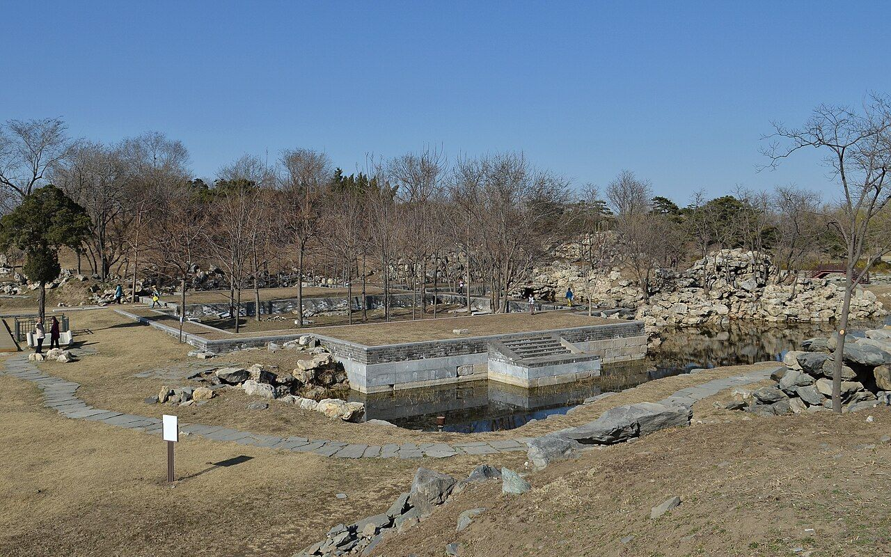

<!-- generated:start (scripts/building_pages.py): do not edit between these markers -->

# YM09-01: 春雨轩 Chunyu Xuan

Yuanming Yuan

**3D object:** 1 box. Open it: `/reconstruction/3d.html?b=YM09-01`

**Part of:** YM09 杏花春馆

## What we know

- **Name:** 春雨轩 Chunyu Xuan (S05, S41, S06, S01, S337, S360, S361 · confidence B)
- **Garden:** Yuanming Yuan (S05, S41, S06, S01, S337, S360, S361)
- **Type:** other (S05, S41, S06, S01, S337, S360, S361 · confidence B)
- **Built:** 乾隆二十年 1755 (S41) (S05, S41, S06, S01, S337, S360, S361)
- **Destroyed:** survived 1860 fire per 1873 survey (S06); survived 1860; lost around 1900 (S05, S41, S06, S01, S337, S360, S361)
- **Position:** 40.00526, 116.28805. S01 sure (S01 · confidence B)
- **Bays:** 5x2 on the plan (S05, S41, S06, S01, S337, S360, S361)
- **Size in the inventory:** 19.9 × 17.8 m. S01 plan px / hall scale (S01)
- **Note:** Not in the 1744 album. S42: scene also collectively 春雨轩. (S05, S41, S06, S01, S337, S360, S361)
- **Plan reader's note:** Label (2496,3670). Chamfered platform north of it. B0674 south of the court is a 5-bay gate on a causeway (S01) *(research copy, not public)*
- **How it was read:** sure (S01) *(research copy, not public)*
- **Plan pixels:** 2504, 3602 (S01) *(research copy, not public)*

## Our model now

On the block drawn on the Qing plan S01: position and frontage from the plan, heights and roof from the typology of its hall class, its form drawn by the hall kit. It will be updated as the research goes on.

- **Box:** 17.93 × 13.69 m, main hall
- **Heights:** platform 0.7 m, eave 4.4 m, ridge 9.09 m above the ground
- **Roof:** hip-and-gable 歇山, rolled ridge 卷棚, grey tile
- **Faces:** 173.4° from north
- **Fit:** reduced towards the size drawn on the plan, to stand clear of its neighbours or the water; moved 0.1 m
- **Drawn:** by the hall kit: 5 bays, the middle widest, a porch front and back, steps on the front, 歇山 hip-and-gable with a rolled ridge 卷棚, grey tile, a painted beam under the eave. Drawn from the typology of its hall class, not from a picture of this hall (assumed, C).
- **Confidence:** B

## Pictures (1)

- **P0375** (sure): 杏花春馆遗址02 20130324.JPG (2013-03-24 15:37:48 (Commons DateTimeOriginal)). https://commons.wikimedia.org/wiki/File:%E6%9D%8F%E8%8A%B1%E6%98%A5%E9%A6%86%E9%81%97%E5%9D%8002_20130324.JPG

  

## Texts and drawings (8)

- **E1296** (text, sure): 日下舊聞考 杏花春馆. 1780s (乾隆 敕撰) · j81:1a-1b · S05. https://github.com/kanripo/KR2k0036/blob/master/KR2k0036_081.txt
  > 上下天光之西折而南度橋為杏花春館西北為春雨軒軒西為杏花村村南為磵壑餘清春雨軒後東為鏡水齋西北室為抑齋又西為翠微堂（圓明園冊）臣等謹按杏花春館四十景之一也額為世宗御書館旁峰石上刋御製杏花春館詩春雨軒内額曰蕙氣清隂後厦聯曰生機對物觀其妙義府因心獲所寜與鏡水齋抑齋翠微堂諸額皆御書
  Across a bridge south-west of 上下天光: 杏花春館 with 春雨軒, 杏花村, 磵壑餘清, 鏡水齋, 抑齋 and 翠微堂. A Qianlong poem is cut in the rock beside it.
- **E0451** (text, sure): 圆明园遗址的遗产价值与申遗构想: the buildings left after 1860, citing 刘敦桢 1933. post n.d. · ylfj, note 34: 刘敦桢, 同治重修圆明园史料, 营造学社汇刊 1933(2) · S337. http://iqh.ruc.edu.cn/old/qdhjylyjzx/xszl/ylfj/9a322b5384ab4c17af0dd577d4f96ca6.htm
  Lists 17 buildings left after the burning of 1860, after 刘敦桢: 紫碧山房, 顺木天, 鱼跃鸢飞, 课农轩, 藏舟坞, 慎修思永, 知过堂, 双鹤斋, 蓬岛瑶台, 魁星楼, 文昌阁, 林渊锦镜, 春雨轩; 海岳开襟; 庄严法界, 正觉寺 and a 大宫门 in 万春园. The paper's aim is to hold any new display to this 1860 state.
- **E1287** (poem, sure): 杏花春馆: 乾隆二十年 poem of the Qianlong Emperor. 乾隆二十年 (1755), date from the compilation · p.147 item (2), under 杏花春馆 · S360. https://www.yuanmingyuanpark.cn/xs/yjbg/202007/P020200730387572832602.pdf#page=147
  > 识喜闻元圣，为书号得禾。春膏今岁庆，别殿落成歌。后乐诚堪志，先忧竟若何。名因当时易，趣爱此间多。藻缋寜须亟，清闲每一过。如斯愿振古，六幕永绥和。
  Qianlong, 1755, on the completion of 春雨轩.
- **E1311** (poem, sure): 春雨轩. 乾隆二十三年 (1758) · v2 p.27, under 杏花春馆; source ref 6-585 · S361. https://www.yuanmingyuanpark.cn/xs/yjbg/202008/P020200803382343267004.pdf#page=30
  > 积素流光映彩灯，上元今岁景偏增。若论春雪如春雨，便庆食升有四升
  Poem 春雨轩 by the Qianlong Emperor, 1758, filed by the editors under 杏花春馆.
- **E1310** (poem, likely): 春雨轩小坐因而成咏. 乾隆二十一年 (1756) · v2 p.26, under 杏花春馆; source ref 6-422 · S361. https://www.yuanmingyuanpark.cn/xs/yjbg/202008/P020200803382343267004.pdf#page=29
  > 去岁春雨好，轩成因名之。今年春亦雨，清跸方东移。归来已夏月，始佳后愆期。侵寻亟待泽，霑足幸今兹。砌葩鲜以馨，屏林华且滋。所喜不在此，开畦绕前墀。菜甲既勃生，麦穗方饱垂。学圃岂鄙哉，验农亦因斯。先是虽慰志，后来复愿时。
  Poem 春雨轩小坐因而成咏 by the Qianlong Emperor, 1756, filed by the editors under 杏花春馆.
- **E1302** (description, likely): 杏花春馆 土地祠 (S47 section 2.2). 2012, citing archive and Qing texts · pp.110, 126-128; table row 3 · S47. https://www.dpm.org.cn/Uploads/File/2018/06/15/u5b23730ae0e5a.pdf
  The main earth-god shrine of the garden, south-west of 杏花春馆, one bay, facing east, called 春雨轩土地庙 in the file of 1858. Xianfeng granted its two deities titles in February 1858, added tablets and a stele, and set spring and autumn rites. Palace file gives the measures in Qing feet; the shrine still received offerings in 1861.
- **E1303** (description, sure): 圆明园五朝御制诗文集注 v2, editors' note on 杏花春馆. 2020 edition · v2 p.25 · S361. https://www.yuanmingyuanpark.cn/xs/yjbg/202008/P020200803382343267004.pdf#page=28
  First a vegetable plot, plaque of 1727. 春雨轩 was added in 1755; around it 涧壑余清, 得树亭, 杏花村, 土地庙, 镜水斋, 吟籁亭, the gate 渊镜/屏岩, 抑斋, 翠微堂, 绿云酣. The editors say 春雨轩 and others survived 1860, and were lost around 1900.
- **E2262** (plan, sure): 圆明园新证, 端木泓: dated additions shown on plan 1704. post n.d. · tables 1 and 2 · S337. http://iqh.ruc.edu.cn/old/qdhjylyjzx/xszl/xstl/1c9094aef4f041148f15883c7c266cb9.htm
  Tables of when things were added, drawn from archives to date the plan's layers: 藻园 1752, 廓然大公 eight views 1754, 春雨轩 1755, 藏密楼 1758, 多稼轩 ten views 1759, 紫碧山房 1760, 安澜园 and 澄练楼 1763, 若帆之阁 1764, 汇万总春之庙 1769, 文源阁 1775, 法源楼 1779; after: 兰亭八柱 1779, 知过堂 1782, 课农轩 1816, 涵月楼 1827. The most useful single dating table found.

**On the plan:** Drawn on the plan of the gardens (S01), labelled 春雨轩, 5x2 cells. https://artmuseum.princeton.edu/collections/objects/138657

## Evidence for the set of buildings

- Evidence for the whole compound 杏花春馆: see YM09
- Reconstructions and comparables for the whole garden, 圆明园 Yuanming Yuan: see GARDEN-YM
- Standing buildings comparable to a main hall (not this building): see CLASS-main_hall

## Open questions

- Q1: Target state
- Q47: How much burned, and when
- Q94: YM09 and YM33

<!-- generated:end -->

## Notes

<!-- Yours: regeneration never touches this part. It goes on the public site; what you write below a line holding only %% private %% stays in the research copy. -->
