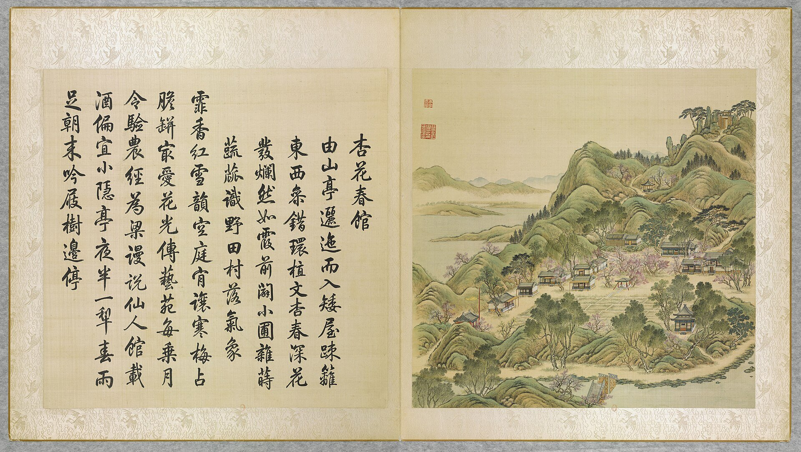

<!-- generated:start (scripts/building_pages.py): do not edit between these markers -->

# YM09-02: 杏花村 Xinghua Cun

Yuanming Yuan

**3D object:** 1 box. Open it: `/reconstruction/3d.html?b=YM09-02`

**Part of:** YM09 杏花春馆

## What we know

- **Name:** 杏花村 Xinghua Cun (S05, S01 · confidence B)
- **Garden:** Yuanming Yuan (S05, S01)
- **Type:** other (S05, S01 · confidence B)
- **Destroyed:** 1860 (S05, S01)
- **Position:** 40.00506, 116.28776. S01 sure (S01 · confidence B)
- **Bays:** 6x1 on the plan (S05, S01)
- **Size in the inventory:** 17.5 × 5.4 m. S01 plan px / hall scale (S01)
- **Plan reader's note:** Label (2361,3738) (S01) *(research copy, not public)*
- **How it was read:** sure (S01) *(research copy, not public)*
- **Plan pixels:** 2376, 3681 (S01) *(research copy, not public)*

## Our model now

On the block drawn on the Qing plan S01: position and frontage from the plan, heights and roof from the typology of its hall class, its form drawn by the hall kit. It will be updated as the research goes on.

- **Box:** 15.85 × 4.18 m, main hall
- **Heights:** platform 0.7 m, eave 4.4 m, ridge 6.29 m above the ground
- **Roof:** gable 硬山 or 悬山, rolled ridge 卷棚, grey tile
- **Faces:** 173.4° from north
- **Fit:** reduced towards the size drawn on the plan, to stand clear of its neighbours or the water; moved 1.5 m
- **Drawn:** by the hall kit: 6 bays, the middle widest, steps on the front, 悬山 overhanging gable with a rolled ridge 卷棚, grey tile, a painted beam under the eave. From its own figures and readings where the dossier gives them (roof read: halls.csv S08 A; tiles read: halls.csv S08 A), the rest from the typology of its hall class.
- **Confidence:** B

## Pictures (1)

- **P0009** (likely): 杏花春館 Xinghua chunguan [Pavillon de printemps des Fleurs d'abricotier] (圓明園四十景, 第9景) (1744 (BnF record: 1744年，清朝乾隆九年)). https://commons.wikimedia.org/wiki/File%3A%E5%9C%93%E6%98%8E%E5%9C%92%E5%9B%9B%E5%8D%81%E6%99%AF._%E7%AC%AC%E4%B9%9D%E6%99%AF_%28%E4%B8%8A%E5%86%8C%EF%BC%8C%E7%AC%AC%E4%B9%9D%E5%B9%85%E5%9B%BE%29%2C_%E6%9D%8F%E8%8A%B1%E6%98%A5%E9%A4%A8_-_%28%E6%B8%85%29%E5%94%90%E5%B2%B1%E3%80%81%E6%B2%88%E6%BA%90%E5%90%88%E7%95%AB_%3B_%28%E4%B9%BE%E9%9A%86%E5%90%9F%E8%AF%97%EF%BC%8C%E6%B1%AA%E7%94%B1%E6%95%A6%E4%BB%A3%E4%B9%A6%29Xinghua_chunguan_-_%28Qing%29Tang_Dai%2C_Shen_Yuan_he_hua_-_btv1b55008361h.jpg

  

## Texts and drawings (3)

- **E1296** (text, sure): 日下舊聞考 杏花春馆. 1780s (乾隆 敕撰) · j81:1a-1b · S05. https://github.com/kanripo/KR2k0036/blob/master/KR2k0036_081.txt
  > 上下天光之西折而南度橋為杏花春館西北為春雨軒軒西為杏花村村南為磵壑餘清春雨軒後東為鏡水齋西北室為抑齋又西為翠微堂（圓明園冊）臣等謹按杏花春館四十景之一也額為世宗御書館旁峰石上刋御製杏花春館詩春雨軒内額曰蕙氣清隂後厦聯曰生機對物觀其妙義府因心獲所寜與鏡水齋抑齋翠微堂諸額皆御書
  Across a bridge south-west of 上下天光: 杏花春館 with 春雨軒, 杏花村, 磵壑餘清, 鏡水齋, 抑齋 and 翠微堂. A Qianlong poem is cut in the rock beside it.
- **E1301** (description, sure): Scene 9, 杏花春馆 Xinghua Chunguan. 1934 · p.80 · S02. https://archive.org/details/historyofpekings00malo
  > This island bears the highest hill in the Yuan Ming Yuan with the possible exception of the hill of rocks in the very northwest corner. It is crowned by a stone gateway,
  The highest hill except perhaps the rock hill in the north-west corner, crowned by a stone gateway, with the apricot village at its south foot. Note 32: the album shows rustic buildings, a well and vegetable plots; the later Official Map a lake instead of the plots and more buildings instead of the well.
- **E1303** (description, sure): 圆明园五朝御制诗文集注 v2, editors' note on 杏花春馆. 2020 edition · v2 p.25 · S361. https://www.yuanmingyuanpark.cn/xs/yjbg/202008/P020200803382343267004.pdf#page=28
  First a vegetable plot, plaque of 1727. 春雨轩 was added in 1755; around it 涧壑余清, 得树亭, 杏花村, 土地庙, 镜水斋, 吟籁亭, the gate 渊镜/屏岩, 抑斋, 翠微堂, 绿云酣. The editors say 春雨轩 and others survived 1860, and were lost around 1900.

**On the plan:** Drawn on the plan of the gardens (S01), labelled 杏花村, 6x1 cells. https://artmuseum.princeton.edu/collections/objects/138657

## Evidence for the set of buildings

- Evidence for the whole compound 杏花春馆: see YM09
- Reconstructions and comparables for the whole garden, 圆明园 Yuanming Yuan: see GARDEN-YM
- Standing buildings comparable to a main hall (not this building): see CLASS-main_hall

## Open questions

None that name it.

<!-- generated:end -->

## Notes

<!-- Yours: regeneration never touches this part. It goes on the public site; what you write below a line holding only %% private %% stays in the research copy. -->
