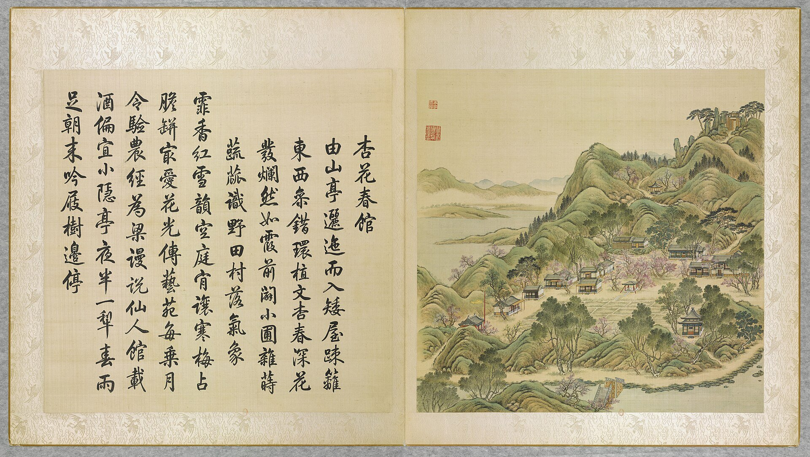

<!-- generated:start (scripts/building_pages.py): do not edit between these markers -->

# YM09-07: 土地祠 Tudi Ci

Yuanming Yuan

**3D object:** 1 box. Open it: `/reconstruction/3d.html?b=YM09-07`

**Part of:** YM09 杏花春馆

## What we know

- **Name:** 土地祠 Tudi Ci (S47, S01 · confidence B)
- **Garden:** Yuanming Yuan (S47, S01)
- **Type:** temple (S47, S01 · confidence B)
- **Changed:** 1858: titles conferred, new tablets and stele (S47, S01)
- **Destroyed:** 1860 (S47, S01)
- **Position:** 40.00472, 116.28768. S01 guess (S01 · confidence C)
- **Bays:** 1 in the texts (S47, S01)
- **Size in the inventory:** 3.2 × 3.36 m. text (see notes) (S01)
- **Roof:** hanging gable 悬山, ridge with finials, banner pole in front (S47, S01)
- **Where the text puts it:** 杏花春馆西南 东向 (S47) (S47, S01) *(research copy, not public)*
- **Note:** S47: 面宽一丈 3.20 m, 屋身进深一丈五寸 3.36 m, 廊1.12 m; title granted 1858. (S47, S01)
- **Plan reader's note:** 土地祠: small one-bay box in the SW, rect=22,24,0 (S01) *(research copy, not public)*
- **How it was read:** guess (S01) *(research copy, not public)*
- **Plan pixels:** 2323, 3845 (S01) *(research copy, not public)*

## Our model now

A plain box on the block drawn on the Qing plan S01: position and frontage from the plan, heights and roof from the typology of its hall class. It will be updated as the research goes on.

- **Box:** 5.7 × 6.6 m, pavilion square
- **Heights:** platform 0.48 m, eave 3.68 m, ridge 6.33 m above the ground
- **Roof:** gable 硬山 or 悬山, grey tile
- **Faces:** 83.2° from north
- **Confidence:** C

## Pictures (1)

- **P0009** (likely): 杏花春館 Xinghua chunguan [Pavillon de printemps des Fleurs d'abricotier] (圓明園四十景, 第9景) (1744 (BnF record: 1744年，清朝乾隆九年)). https://commons.wikimedia.org/wiki/File%3A%E5%9C%93%E6%98%8E%E5%9C%92%E5%9B%9B%E5%8D%81%E6%99%AF._%E7%AC%AC%E4%B9%9D%E6%99%AF_%28%E4%B8%8A%E5%86%8C%EF%BC%8C%E7%AC%AC%E4%B9%9D%E5%B9%85%E5%9B%BE%29%2C_%E6%9D%8F%E8%8A%B1%E6%98%A5%E9%A4%A8_-_%28%E6%B8%85%29%E5%94%90%E5%B2%B1%E3%80%81%E6%B2%88%E6%BA%90%E5%90%88%E7%95%AB_%3B_%28%E4%B9%BE%E9%9A%86%E5%90%9F%E8%AF%97%EF%BC%8C%E6%B1%AA%E7%94%B1%E6%95%A6%E4%BB%A3%E4%B9%A6%29Xinghua_chunguan_-_%28Qing%29Tang_Dai%2C_Shen_Yuan_he_hua_-_btv1b55008361h.jpg

  

## Texts and drawings (4)

- **E0499** (description, sure): 三类 形制, 山墙 红色 (S47 section 3). 2012, citing archive and Qing texts · pp.121-123 · S47. https://www.dpm.org.cn/Uploads/File/2018/06/15/u5b23730ae0e5a.pdf
  S47 sorts the shrines in three types by form and notes that on the album the gable walls of seven of them are painted red, against grey or white on other buildings: 瑞应宫, 太岁坛, the 杏花春馆 earth shrine, the 北远山村 and 涵虚朗鉴 dragon shrines, 广育宫 and 多宝阁. A colour rule usable for the models.
- **E1302** (description, sure): 杏花春馆 土地祠 (S47 section 2.2). 2012, citing archive and Qing texts · pp.110, 126-128; table row 3 · S47. https://www.dpm.org.cn/Uploads/File/2018/06/15/u5b23730ae0e5a.pdf
  The main earth-god shrine of the garden, south-west of 杏花春馆, one bay, facing east, called 春雨轩土地庙 in the file of 1858. Xianfeng granted its two deities titles in February 1858, added tablets and a stele, and set spring and autumn rites. Palace file gives the measures in Qing feet; the shrine still received offerings in 1861.
- **E1315** (description, sure): 1861 年 五处上供 (S47 section 4). 2012, citing archive and Qing texts · p.126, citing S60 p.600 · S47. https://www.dpm.org.cn/Uploads/File/2018/06/15/u5b23730ae0e5a.pdf
  In the fifth month of 1861 offerings were still made at five surviving places: the 春雨轩 earth-god shrine, 吕祖亭 at 双鹤斋, the 观音庵 at 课农轩, and 河神庙 and 惠济祠 of Qichun Yuan. It says only that these were standing and in use after the fire.
- **E1303** (description, sure): 圆明园五朝御制诗文集注 v2, editors' note on 杏花春馆. 2020 edition · v2 p.25 · S361. https://www.yuanmingyuanpark.cn/xs/yjbg/202008/P020200803382343267004.pdf#page=28
  First a vegetable plot, plaque of 1727. 春雨轩 was added in 1755; around it 涧壑余清, 得树亭, 杏花村, 土地庙, 镜水斋, 吟籁亭, the gate 渊镜/屏岩, 抑斋, 翠微堂, 绿云酣. The editors say 春雨轩 and others survived 1860, and were lost around 1900.

**On the plan:** Drawn on the plan of the gardens (S01) with no label: a building stood here, its name unknown. https://artmuseum.princeton.edu/collections/objects/138657

## Evidence for the set of buildings

- Evidence for the whole compound 杏花春馆: see YM09
- Reconstructions and comparables for the whole garden, 圆明园 Yuanming Yuan: see GARDEN-YM
- Standing buildings comparable to a square pavilion (not this building): see CLASS-pavilion_square

## Open questions

None that name it.

<!-- generated:end -->

## Notes

<!-- Yours: regeneration never touches this part. It goes on the public site; what you write below a line holding only %% private %% stays in the research copy. -->
