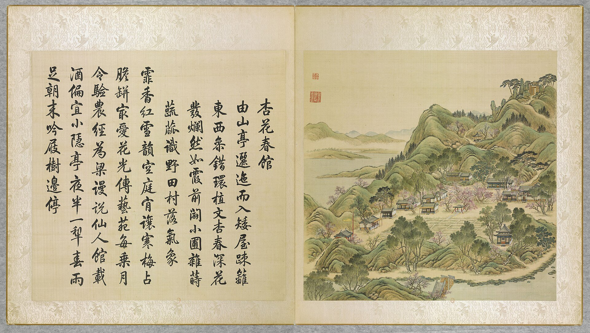
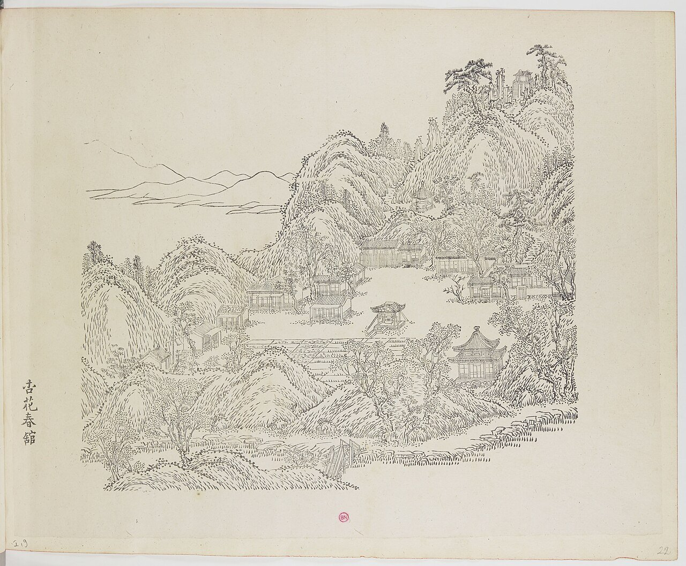
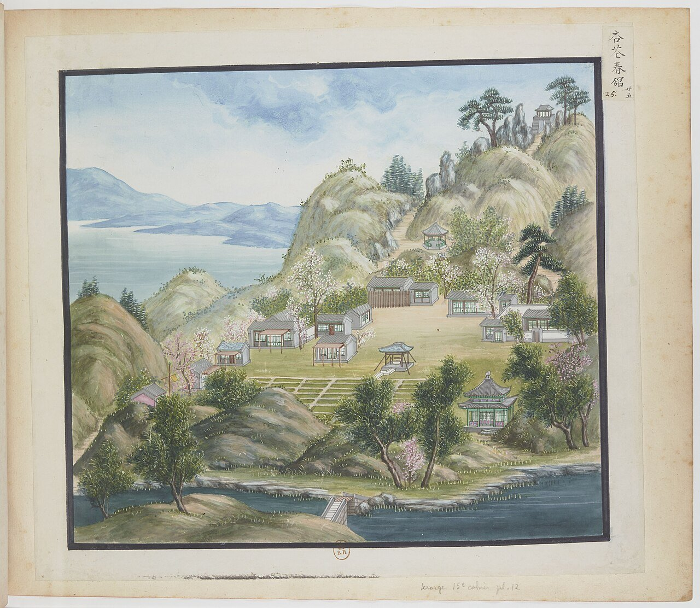
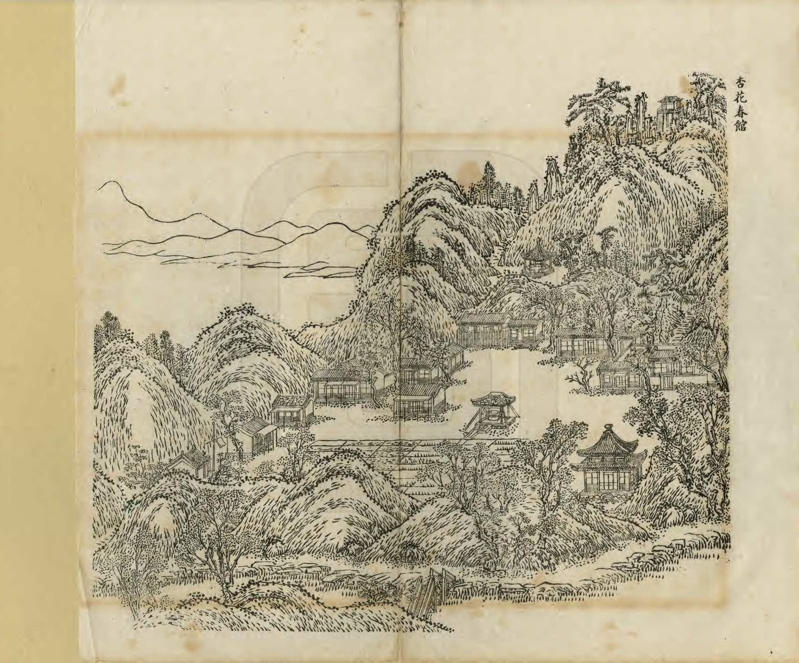
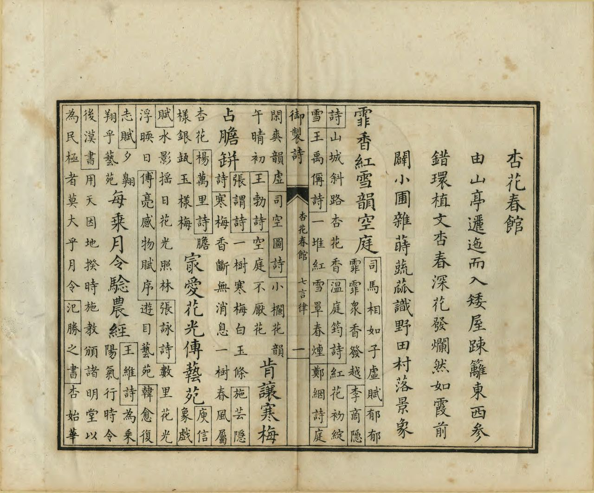
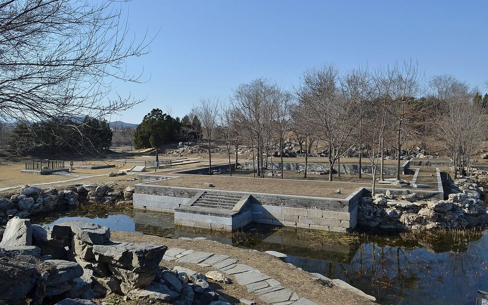
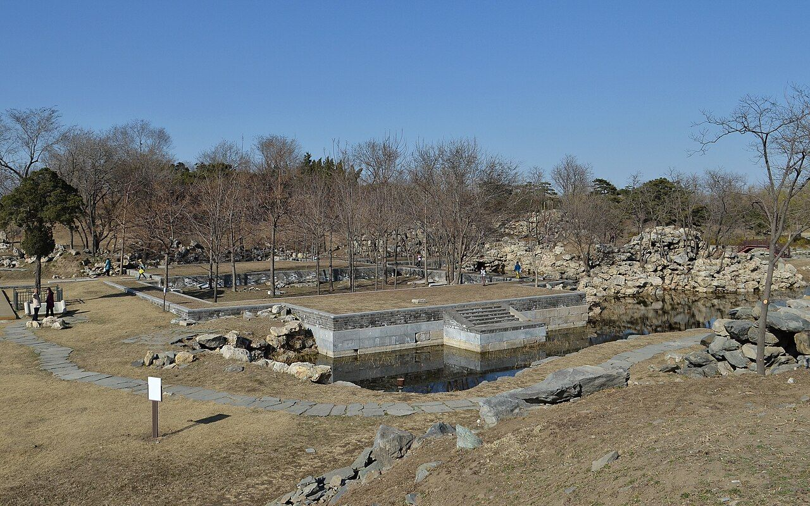
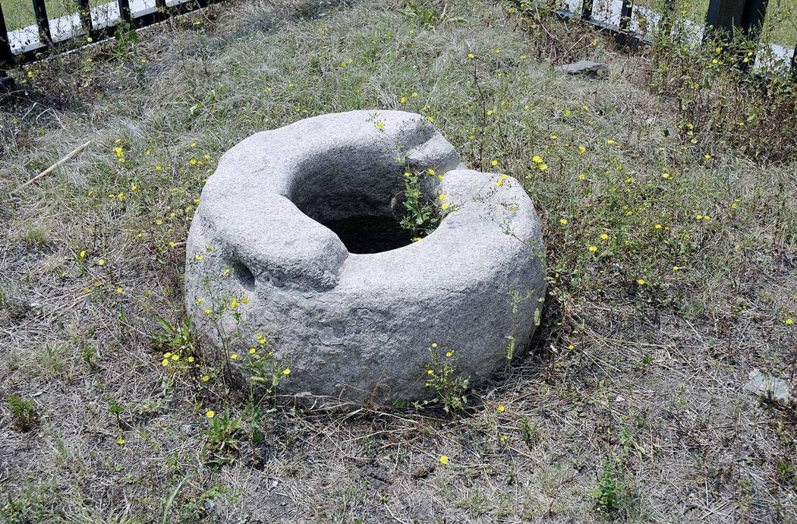

<!-- generated:start (scripts/building_pages.py): do not edit between these markers -->

# YM09: 杏花春馆 Xinghua Chunguan

The Village of Apricot Blossoms (the Springtime Lodge of Apricot Blossoms) · Yuanming Yuan

**3D object:** 16 boxes. Open it: `/reconstruction/3d.html?b=YM09`

## What we know

- **Name:** 杏花春馆 Xinghua Chunguan (S05, S02, S08, S41, S42, S01, S340 · confidence B)
- **English:** The Village of Apricot Blossoms (the Springtime Lodge of Apricot Blossoms) (S05, S02, S08, S41, S42, S01, S340)
- **Garden:** Yuanming Yuan (S05, S02, S08, S41, S42, S01, S340)
- **Type:** scene (S05, S02, S08, S41, S42, S01, S340 · confidence B)
- **Built:** 康熙年间 初名菜圃 (S42); Kangxi, as the 菜圃 (S05, S02, S08, S41, S42, S01, S340)
- **Changed:** 1755 春雨轩 and 涧壑余清 built over the vegetable beds (S41); Malone p.80 n.: official map shows a lake and more buildings. (S05, S02, S08, S41, S42, S01, S340)
- **Destroyed:** 1860; 杏花春馆 and 春雨轩 on the 1873 survival list (S06) (S05, S02, S08, S41, S42, S01, S340)
- **Position:** 40.00526, 116.28805. S01 sure (S01 · confidence B)
- **Note:** Album does not show the 1860 state here (S41). (S05, S02, S08, S41, S42, S01, S340)
- **Plan reader's note:** Label at (2793,3898) on the east rock lobe; 春雨轩 杏花村 翠微堂 legible (S01) *(research copy, not public)*
- **How it was read:** sure (S01) *(research copy, not public)*
- **Plan pixels:** 2504, 3602 (S01) *(research copy, not public)*

## Our model now

16 boxes stand in this compound, 16 on blocks drawn on the plan, 0 assumed. Its halls are listed below.

## Inside it (17)

- YM09-01 春雨轩
- YM09-02 杏花村
- YM09-03 涧壑余清
- YM09-04 镜水斋
- YM09-05 抑斋
- YM09-06 翠微堂
- YM09-07 土地祠
- YM09-08 屏岩
- YM09-09 绿云酣
- YM09-AC010
- YM09-B0659
- YM09-B0661
- YM09-B0671
- YM09-B0672
- YM09-B0674
- YM09-N01 渊镜
- YM09-N02 敞厅

## Pictures (9)

- **P0009** (sure): 杏花春館 Xinghua chunguan [Pavillon de printemps des Fleurs d'abricotier] (圓明園四十景, 第9景) (1744 (BnF record: 1744年，清朝乾隆九年)). https://commons.wikimedia.org/wiki/File%3A%E5%9C%93%E6%98%8E%E5%9C%92%E5%9B%9B%E5%8D%81%E6%99%AF._%E7%AC%AC%E4%B9%9D%E6%99%AF_%28%E4%B8%8A%E5%86%8C%EF%BC%8C%E7%AC%AC%E4%B9%9D%E5%B9%85%E5%9B%BE%29%2C_%E6%9D%8F%E8%8A%B1%E6%98%A5%E9%A4%A8_-_%28%E6%B8%85%29%E5%94%90%E5%B2%B1%E3%80%81%E6%B2%88%E6%BA%90%E5%90%88%E7%95%AB_%3B_%28%E4%B9%BE%E9%9A%86%E5%90%9F%E8%AF%97%EF%BC%8C%E6%B1%AA%E7%94%B1%E6%95%A6%E4%BB%A3%E4%B9%A6%29Xinghua_chunguan_-_%28Qing%29Tang_Dai%2C_Shen_Yuan_he_hua_-_btv1b55008361h.jpg

  

- **P0082** (sure): 中国皇帝的宫殿与庙宇. 第22幅图, 杏花春館 - (清)孙祜、沈源Xinghua chunguan - (Qing)Sun Hu, Shen Yuan (1745 (Commons, from the BnF record)). https://commons.wikimedia.org/wiki/File%3A%E4%B8%AD%E5%9B%BD%E7%9A%87%E5%B8%9D%E7%9A%84%E5%AE%AB%E6%AE%BF%E4%B8%8E%E5%BA%99%E5%AE%87._%E7%AC%AC22%E5%B9%85%E5%9B%BE%2C_%E6%9D%8F%E8%8A%B1%E6%98%A5%E9%A4%A8_-_%28%E6%B8%85%29%E5%AD%99%E7%A5%9C%E3%80%81%E6%B2%88%E6%BA%90Xinghua_chunguan_-_%28Qing%29Sun_Hu%2C_Shen_Yuan_-_btv1b105206735.jpg

  

- **P0125** (sure): 海淀(镇)：中国皇帝的行宫. 第25幅图, 杏花春館Xinghua chunguan (1750-1792 (BnF, cb43831905b; ex coll. Bertin)). https://commons.wikimedia.org/wiki/File%3A%E6%B5%B7%E6%B7%80%28%E9%95%87%29%EF%BC%9A%E4%B8%AD%E5%9B%BD%E7%9A%87%E5%B8%9D%E7%9A%84%E8%A1%8C%E5%AE%AB._%E7%AC%AC25%E5%B9%85%E5%9B%BE%2C_%E6%9D%8F%E8%8A%B1%E6%98%A5%E9%A4%A8Xinghua_chunguan_-_btv1b10520665n.jpg

  

- **P0240** (sure): 杏花春館 Xinghua Chunguan (御製圓明園圖詠, 1887 石印本, 上卷 (Commons 卷一), 第9景; printed title in the right margin of the picture) (光緒十三年 1887 (Commons/NLC record; colophon 光緒十三年七月天津石印書屋 in the SSID copy, S98 PDF p.2); design after the woodblock of 1745 by 孫祜 Sun Hu and 沈源 Shen Yuan). https://commons.wikimedia.org/wiki/File%3ANLC403-312001107375-14035_%E7%A6%A6%E5%88%B6%E5%9C%93%E6%98%8E%E5%9C%92%E5%9C%96%E8%A9%A0_%E5%8D%B7%E4%B8%80.pdf?page=57

  

- **P0516** (sure): 杏花春館 Xinghua Chunguan: 乾隆 Qianlong's preface and poem with the courtiers' commentary, 御製圓明園圖詠 1887 (poem 1744 (乾隆九年); this printing 1887). https://commons.wikimedia.org/wiki/File%3ANLC403-312001107375-14035_%E7%A6%A6%E5%88%B6%E5%9C%93%E6%98%8E%E5%9C%92%E5%9C%96%E8%A9%A0_%E5%8D%B7%E4%B8%80.pdf?page=58

  

- **P0374** (sure): 杏花春馆遗址01 20130324.JPG (2013-03-24 15:50:23 (Commons DateTimeOriginal)). https://commons.wikimedia.org/wiki/File:%E6%9D%8F%E8%8A%B1%E6%98%A5%E9%A6%86%E9%81%97%E5%9D%8001_20130324.JPG

  

- **P0375** (sure): 杏花春馆遗址02 20130324.JPG (2013-03-24 15:37:48 (Commons DateTimeOriginal)). https://commons.wikimedia.org/wiki/File:%E6%9D%8F%E8%8A%B1%E6%98%A5%E9%A6%86%E9%81%97%E5%9D%8002_20130324.JPG

  

- **P0450** (likely): 杏花春馆的古井 - panoramio.jpg (Taken on 27 May 2011 (Commons DateTimeOriginal)). https://commons.wikimedia.org/wiki/File:%E6%9D%8F%E8%8A%B1%E6%98%A5%E9%A6%86%E7%9A%84%E5%8F%A4%E4%BA%95_-_panoramio.jpg

  

- **P0795** (likely): 洁白世界 - White World - 2012.12 - panoramio.jpg (Taken on 21 December 2012 (Commons file page)). https://commons.wikimedia.org/wiki/File:%E6%B4%81%E7%99%BD%E4%B8%96%E7%95%8C_-_White_World_-_2012.12_-_panoramio.jpg

## Texts and drawings (33)

- **E1285** (poem, sure): 御製杏花春館詩（圓明園四十景詩）. 1744 (乾隆九年) · printed in S05 j81:1b-2a · S40. https://github.com/kanripo/KR2k0036/blob/master/KR2k0036_081.txt
  > 乾隆九年 御製杏花春館詩 由山亭邐迤而入矮屋疎籬東西參錯環植文杏春深花發爛然如霞前闢小圃雜蒔蔬蓏識野田村落景象 霏香紅雪韻空庭肯讓寒梅占膽瓶最愛花光傳藝苑每乗月令驗農經為梁謾説仙人館載酒偏宜小隠亭夜半一犁春雨足朝來吟屐樹邊停
  Past a hill pavilion: low cottages and sparse fences among apricot trees that glow like rosy cloud in late spring. A small plot of mixed vegetables in front gives the look of a farm village.
- **E1296** (text, sure): 日下舊聞考 杏花春馆. 1780s (乾隆 敕撰) · j81:1a-1b · S05. https://github.com/kanripo/KR2k0036/blob/master/KR2k0036_081.txt
  > 上下天光之西折而南度橋為杏花春館西北為春雨軒軒西為杏花村村南為磵壑餘清春雨軒後東為鏡水齋西北室為抑齋又西為翠微堂（圓明園冊）臣等謹按杏花春館四十景之一也額為世宗御書館旁峰石上刋御製杏花春館詩春雨軒内額曰蕙氣清隂後厦聯曰生機對物觀其妙義府因心獲所寜與鏡水齋抑齋翠微堂諸額皆御書
  Across a bridge south-west of 上下天光: 杏花春館 with 春雨軒, 杏花村, 磵壑餘清, 鏡水齋, 抑齋 and 翠微堂. A Qianlong poem is cut in the rock beside it.
- **E1284** (poem, likely): 世宗 菜圃 (園景十二詠). before 1723 (雍邸集, printed as written while a prince) · KR4f0002_026:4a · S200. https://github.com/kanripo/KR4f0002/blob/master/KR4f0002_026.txt
  > 菜圃 鑿地新開圃因川曲引泉碧畦一雨過青壤百蔬妍潔愛沾晨露鮮宜潤晚烟倚亭閒佇覽生意用忻然
  Prince's poem on a vegetable garden newly dug with water led from the stream. 杏花春館 has a vegetable plot in its 1744 preface; the identity is an inference.
- **E1295** (poem, likely): 世宗 沿湖遊覽至菜圃作. 雍正 (四宜堂集, undated) · KR4f0002_029:5a · S200. https://github.com/kanripo/KR4f0002/blob/master/KR4f0002_029.txt
  > 沿湖遊覽至菜圃作 一行白鷺引舟行十畝紅蕖觧笑迎疊澗湍流清俗念平湖烟景動閒情竹蔵茅舎踈籬遶蝶聚𤓰畦晚照明最是小園饒野致菜花香裏轆轤聲
  Going by boat along the lake to the vegetable garden: white egrets, red lotus, thatched huts and melon beds, with the sound of a well sweep.
- **E1286** (poem, sure): 杏花春馆: 乾隆十六年 poem of the Qianlong Emperor. 乾隆十六年 (1751), date from the compilation · p.147 item (6), under 杏花春馆 · S360. https://www.yuanmingyuanpark.cn/xs/yjbg/202007/P020200730387572832602.pdf#page=147
  > 文轩号春雨，雨后恰纔来。谋目惟芳润，因心得静陪。菜畦樊问处，杏埒董林材。（是处 昔名菜圃，即四十景中杏花春馆也。）为底多吟绪，沾膏实快哉。
  Poem of the Qianlong Emperor at 杏花春馆, 1751, on rain and the view. Year as given by the compilation.
- **E1287** (poem, sure): 杏花春馆: 乾隆二十年 poem of the Qianlong Emperor. 乾隆二十年 (1755), date from the compilation · p.147 item (2), under 杏花春馆 · S360. https://www.yuanmingyuanpark.cn/xs/yjbg/202007/P020200730387572832602.pdf#page=147
  > 识喜闻元圣，为书号得禾。春膏今岁庆，别殿落成歌。后乐诚堪志，先忧竟若何。名因当时易，趣爱此间多。藻缋寜须亟，清闲每一过。如斯愿振古，六幕永绥和。
  Qianlong, 1755, on the completion of 春雨轩.
- **E1288** (poem, sure): 镜水斋: 乾隆二十一年 poem of the Qianlong Emperor. 乾隆二十一年 (1756), date from the compilation · p.151 item (1), under 镜水斋 · S360. https://www.yuanmingyuanpark.cn/xs/yjbg/202007/P020200730387572832602.pdf#page=151
  > 形若菱花澄若空，妍媸不示自临中。无于水监于民监，周诰分明验异同。
  Poem of the Qianlong Emperor at 镜水斋, 1756. Year as given by the compilation.
- **E1310** (poem, sure): 春雨轩小坐因而成咏. 乾隆二十一年 (1756) · v2 p.26, under 杏花春馆; source ref 6-422 · S361. https://www.yuanmingyuanpark.cn/xs/yjbg/202008/P020200803382343267004.pdf#page=29
  > 去岁春雨好，轩成因名之。今年春亦雨，清跸方东移。归来已夏月，始佳后愆期。侵寻亟待泽，霑足幸今兹。砌葩鲜以馨，屏林华且滋。所喜不在此，开畦绕前墀。菜甲既勃生，麦穗方饱垂。学圃岂鄙哉，验农亦因斯。先是虽慰志，后来复愿时。
  Poem 春雨轩小坐因而成咏 by the Qianlong Emperor, 1756, filed by the editors under 杏花春馆.
- **E1289** (poem, sure): 翠微堂: 乾隆二十二年 poem of the Qianlong Emperor. 乾隆二十二年 (1757), date from the compilation · p.152 item (1), under 翠微堂 · S360. https://www.yuanmingyuanpark.cn/xs/yjbg/202007/P020200730387572832602.pdf#page=152
  > 倚岩树古绿阴森，朴室悠然称道心。开著近西窗远望，西山也见翠㣲深。
  Poem of the Qianlong Emperor at 翠微堂, 1757. Year as given by the compilation.
- **E1311** (poem, sure): 春雨轩. 乾隆二十三年 (1758) · v2 p.27, under 杏花春馆; source ref 6-585 · S361. https://www.yuanmingyuanpark.cn/xs/yjbg/202008/P020200803382343267004.pdf#page=30
  > 积素流光映彩灯，上元今岁景偏增。若论春雪如春雨，便庆食升有四升
  Poem 春雨轩 by the Qianlong Emperor, 1758, filed by the editors under 杏花春馆.
- **E1290** (poem, sure): 得树亭: 乾隆二十五年 poem of the Qianlong Emperor. 乾隆二十五年 (1760), date from the compilation · p.152 item (1), under 得树亭 · S360. https://www.yuanmingyuanpark.cn/xs/yjbg/202007/P020200730387572832602.pdf#page=152
  > 倚树构亭称得树，树宾亭主是谁分。安名立字诚何定，莫若忘机坐绿云。
  Poem of the Qianlong Emperor at 得树亭, 1760, on the view. Year as given by the compilation.
- **E1291** (poem, sure): 镜水斋: 乾隆二十六年 poem of the Qianlong Emperor. 乾隆二十六年 (1761), date from the compilation · p.151 item (2), under 镜水斋 · S360. https://www.yuanmingyuanpark.cn/xs/yjbg/202007/P020200730387572832602.pdf#page=151
  > 铜鉴衣冠正，人鉴善恶知。闲斋名镜水，清浊别于兹。
  Poem of the Qianlong Emperor at 镜水斋, 1761. Year as given by the compilation.
- **E1312** (poem, sure): 镜水斋. 乾隆三十七年 (1772) · v2 p.31, under 杏花春馆; source ref 11-249 · S361. https://www.yuanmingyuanpark.cn/xs/yjbg/202008/P020200803382343267004.pdf#page=34
  > 朴斋近临沼，上下总含空。印月宁嫌冻，不波那碍风。宜吟真是趣，付物只由公。谁曰无于水，于民此正同。
  Poem 镜水斋 by the Qianlong Emperor, 1772, filed by the editors under 杏花春馆.
- **E1292** (poem, sure): 杏花春馆: 乾隆四十八年 poem of the Qianlong Emperor. 乾隆四十八年 (1783), date from the compilation · p.148 item (12), under 杏花春馆 · S360. https://www.yuanmingyuanpark.cn/xs/yjbg/202007/P020200730387572832602.pdf#page=148
  > 春雨今年实最沾，可能无句向轩拈。静宜昨往今应偿，（昨三月廿七日雨适，以往香山未咏。）优渥恩深惕更兼。含润花光红暎砌，成阴树影绿侵帘。铨曺引见暂称少，三百方经计弊廉。
  Poem of the Qianlong Emperor at 杏花春馆, 1783. Year as given by the compilation.
- **E1293** (poem, sure): 翠微堂: 乾隆五十四年 poem of the Qianlong Emperor. 乾隆五十四年 (1789), date from the compilation · p.152 item (2), under 翠微堂 · S360. https://www.yuanmingyuanpark.cn/xs/yjbg/202007/P020200730387572832602.pdf#page=152
  > 翠微弗及顶，乃以真山言。假山惟培塿，于堂何有焉。然而开窗望，西山固目前。岚霭缈青气，翠而微且妍。蒀郁揽真佳，得句宜其间。
  Poem of the Qianlong Emperor at 翠微堂, 1789. Year as given by the compilation.
- **E1313** (poem, sure): 镜水斋. 乾隆五十五年 (1790) · v2 p.34, under 杏花春馆; source ref 17-169 · S361. https://www.yuanmingyuanpark.cn/xs/yjbg/202008/P020200803382343267004.pdf#page=37
  > 水裔斋名镜，镜斋都借水。水固擅其能，镜斋则所尔。然而其所中，宾主又分矣。斋宾镜实主，炽然殊彼此。既思斋有实，镜乃虚名比。于此名实间，炙毂辨难拟。谁能去安排，忘言悟至理。
  Poem 镜水斋 by the Qianlong Emperor, 1790, filed by the editors under 杏花春馆.
- **E1314** (poem, sure): 翠微堂. 乾隆五十九年 (1794) · v2 p.35, under 杏花春馆; source ref 18-705 · S361. https://www.yuanmingyuanpark.cn/xs/yjbg/202008/P020200803382343267004.pdf#page=38
  > 翠微本以言山耳，谁谓陆堂亦有之。突兀庭枝未吐叶，循名正合是斯时。
  Poem 翠微堂 by the Qianlong Emperor, 1794, filed by the editors under 杏花春馆.
- **E1294** (poem, sure): 镜水斋: 嘉庆三年 poem of the Jiaqing Emperor. 嘉庆三年 (1798), date from the compilation · p.152 item (7), under 镜水斋 · S360. https://www.yuanmingyuanpark.cn/xs/yjbg/202007/P020200730387572832602.pdf#page=152
  > 临水名斋水作镜，鉴已鉴人总持正。至清不可蔽浮尘，大圆内澈修本性。即境且为如是观，绿柳夭桃纷掩映。凭槛俯照见须眉，风光上已宜游咏。
  Poem of the Jiaqing Emperor at 镜水斋, 1798. Year as given by the compilation.
- **E1301** (description, sure): Scene 9, 杏花春馆 Xinghua Chunguan. 1934 · p.80 · S02. https://archive.org/details/historyofpekings00malo
  > This island bears the highest hill in the Yuan Ming Yuan with the possible exception of the hill of rocks in the very northwest corner. It is crowned by a stone gateway,
  The highest hill except perhaps the rock hill in the north-west corner, crowned by a stone gateway, with the apricot village at its south foot. Note 32: the album shows rustic buildings, a well and vegetable plots; the later Official Map a lake instead of the plots and more buildings instead of the well.
- **E1216** (description, sure): Site status table, about 2011: remains tidied up. c. 2011 · 系列06 repost, status table · S356. https://blog.sina.com.cn/s/blog_c27029650101itzz.html
  A blogger's table of what was then visible. These scenes have building remains that have been cleared and tidied. Dated about 2011, so digs since then are not reflected.
- **E1302** (description, sure): 杏花春馆 土地祠 (S47 section 2.2). 2012, citing archive and Qing texts · pp.110, 126-128; table row 3 · S47. https://www.dpm.org.cn/Uploads/File/2018/06/15/u5b23730ae0e5a.pdf
  The main earth-god shrine of the garden, south-west of 杏花春馆, one bay, facing east, called 春雨轩土地庙 in the file of 1858. Xianfeng granted its two deities titles in February 1858, added tablets and a stele, and set spring and autumn rites. Palace file gives the measures in Qing feet; the shrine still received offerings in 1861.
- **E1276** (description, likely): 圆明园景点建筑命名对古代文学遗产的继承与发展. post n.d. · lswh · S337. http://iqh.ruc.edu.cn/old/qdhjylyjzx/xszl/jzys/dede1cad62ea454f85d22aca8ad15328.htm
  How scene and hall names come from literature: 上下天光 from 范仲淹, 杏花春馆 from 杜牧, 武陵春色 from 陶渊明, 坐石临流 from 兰亭, and 丰乐轩 and 顺木天 from 柳宗元. It also quotes the 陶渊明 line 平畴交远风. It places 丰乐轩, three bays facing north, in the 紫碧山房 scene.
- **E1297** (description, sure): 圆明园百景史事分景汇编: 杏花春馆. 1751-1820 · from p.147, under 杏花春馆 · S360. https://www.yuanmingyuanpark.cn/xs/yjbg/202007/P020200730387572832602.pdf#page=147
  The 1755 poem marks the completion of 春雨轩, named for a good spring rain, and a note of 1796 repeats it; most poems watch the rain and fields. 杏花春馆: 33 dated items, 1751-1820, of which 33 poems (Qianlong, Jiaqing); recurring themes: the harvest, the view, rain. First dated 1751, last dated 1820.
- **E1298** (description, sure): 圆明园百景史事分景汇编: 镜水斋. 1756-1798 · from p.151, under 杏花春馆 · S360. https://www.yuanmingyuanpark.cn/xs/yjbg/202007/P020200730387572832602.pdf#page=151
  镜水斋: 7 dated items, 1756-1798, of which 7 poems (Qianlong, Jiaqing). First dated 1756, last dated 1798.
- **E1299** (description, sure): 圆明园百景史事分景汇编: 翠微堂. 1757-1789 · from p.152, under 杏花春馆 · S360. https://www.yuanmingyuanpark.cn/xs/yjbg/202007/P020200730387572832602.pdf#page=152
  翠微堂: 2 dated items, 1757-1789, of which 2 poems (Qianlong). First dated 1757, last dated 1789.
- **E1300** (description, sure): 圆明园百景史事分景汇编: 得树亭. 1760-1760 · from p.152, under 杏花春馆 · S360. https://www.yuanmingyuanpark.cn/xs/yjbg/202007/P020200730387572832602.pdf#page=152
  得树亭: 1 dated items, 1760-1760, of which 1 poems (Qianlong); recurring themes: the view. First dated 1760, last dated 1760.
- **E1303** (description, sure): 圆明园五朝御制诗文集注 v2, editors' note on 杏花春馆. 2020 edition · v2 p.25 · S361. https://www.yuanmingyuanpark.cn/xs/yjbg/202008/P020200803382343267004.pdf#page=28
  First a vegetable plot, plaque of 1727. 春雨轩 was added in 1755; around it 涧壑余清, 得树亭, 杏花村, 土地庙, 镜水斋, 吟籁亭, the gate 渊镜/屏岩, 抑斋, 翠微堂, 绿云酣. The editors say 春雨轩 and others survived 1860, and were lost around 1900.
- **E1304** (description, sure, search index only): 杏花春馆 scene card. n.d. · mhymy jqjs 3871 · S340. https://www.mhymy.com/ymss/jqjs/3871.html
  North-west of 后湖, flat ground ringed by water. First the 菜圃 vegetable garden, also called 春雨轩, Kangxi date; a hill over ten metres high rises on the north.
- **E1305** (drawing, sure): 杏花春馆总平面图. 道光十一至二十年 (record prints 131-1840) · 国家图书馆善本部 样028-1号 · S310. https://www.mhymy.com/dasl/ysltd/8065.html
  Base plan of the Xinghua Chunguan scene, 1831-40; the record misprints the start year. No image here; the site may ask a small payment for the full record.
- **E1306** (drawing, sure): 《国家图书馆藏样式雷图档·圆明园卷初编》: 杏花春馆. mostly 道光, 咸丰, 同治 per the publisher · 初编 目录: 杏花春馆, pp.202-225 · S13. https://www.nlcpress.com/ProductView.aspx?Id=7642
  The printed facsimile of the National Library of China's Yangshi Lei sheets has a section on this place at pp.202-225 (24 pages, section length worked out from the next heading); sheet titles and numbers are in the volume, ordered from a library.
- **E2470** (drawing, likely): 样式雷烫样 of the Tongzhi repair of Yuanming Yuan (list by site). 同治 (1873-74) for most, per the report · Lei family models, now chiefly 故宫博物院; the report does not give numbers · S920. https://www.thepaper.cn/newsDetail_forward_2201516
  The Lei family card models cover Yuanming Yuan, Wanchun Yuan, the Summer Palace and others; most of the Yuanming Yuan ones were made for Tongzhi's repair: the whole central (九洲清晏) axis, 泉石自娱, 同乐堂, 上下天光, 思顺堂, 天地一家春; in the north 恒春堂, 课农轩, 廓然大公; in the south 勤政殿; in the west 万方安和. Period objects of 1873-74, not of 1860: they show the Tongzhi design, which kept many old names but changed forms.
- **E1307** (plan, sure): 杏花春馆 东 河桶 敞厅. 2009 · section 综述 · S337. http://iqh.ruc.edu.cn/old/qdhjylyjzx/xszl/hwyj/f075d549d1d94c89bc870ce17d7f8eb1.htm
  The Palace Museum 三园河道图 shows a three-bay open hall on the channel east of 杏花春馆, which the Guimet plan omits.
- **E1308** (archaeology, sure): 杏花春馆 屏岩, 绿云酣: excavated. 2020 · section 三.2 · S41. http://iqh.ruc.edu.cn/old/qdhjylyjzx/xszl/jzys/8eef05885c3e4279ae0132f1a37a13c9.htm
  Excavation found the small city-gate 屏岩 at the top right of the album leaf, with its four corner stones in place and its road, and the hexagonal pavilion 绿云酣 half way up the hill with its rubble base and brick bench walls with post holes. Album leaf and ground agree.

**On the plan:** Drawn on the plan of the gardens (S01), labelled 杏花春馆. https://artmuseum.princeton.edu/collections/objects/138657

## Reconstructions by others (3)

Modern interpretation, not evidence.
- **R0009** (3D model, likely): 《“再造”一个圆明园》, Tsinghua news. 郭黛姮, 贺艳 and team, 清华大学; 清城睿现. https://www.tsinghua.edu.cn/info/1182/39662.htm Research-only: link card.
- **R0031** (video, sure, search index only): [央美]九洲区域复原视频. 中央美术学院圆明园研究中心 (央美 tag; the page names it, per search extract). https://www.mhymy.com/szfy/fysp/14948.html Research-only: link card.
- **R0040** (paper figure, sure, search index only): 再现·圆明园——杏花春馆. 贺艳 (清华大学, as the extract states), 清华大学, 2012. https://www.mhymy.com/xsjl/qklw/9548.html Research-only: link card.

## Evidence for the set of buildings

- Reconstructions and comparables for the whole garden, 圆明园 Yuanming Yuan: see GARDEN-YM

## Open questions

- Q1: Target state
- Q45: Halls in the texts with no row
- Q93: YM09
- Q94: YM09 and YM33
- Q99: Wolseley (S240), M'Ghee (S242), Loch (S244)
- Q119: Digs

<!-- generated:end -->

## Notes

<!-- Yours: regeneration never touches this part. It goes on the public site; what you write below a line holding only %% private %% stays in the research copy. -->
