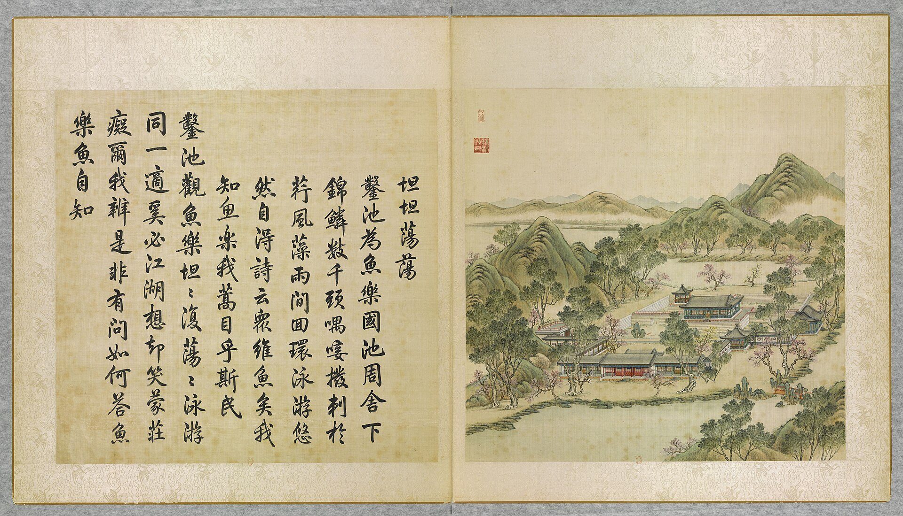

<!-- generated:start (scripts/building_pages.py): do not edit between these markers -->

# YM10-04: 知鱼亭 Zhiyu Ting

Yuanming Yuan

**3D object:** 1 box. Open it: `/reconstruction/3d.html?b=YM10-04`

**Part of:** YM10 坦坦荡荡

## What we know

- **Name:** 知鱼亭 Zhiyu Ting (S05, S01 · confidence B)
- **Garden:** Yuanming Yuan (S05, S01)
- **Type:** pavilion (S05, S01 · confidence B)
- **Destroyed:** 1860 (S05, S01)
- **Position:** 40.00427, 116.28794. S01 likely (S01 · confidence B)
- **Bays:** 1x1 on the plan (S05, S01)
- **Size in the inventory:** 5.5 × 6.9 m. S01 plan px / hall scale (S01)
- **Plan reader's note:** 知鱼亭: square kiosk in the north-west pond cell, corridor from the cross wall. Text 东北 but this is north-west (S01) *(research copy, not public)*
- **How it was read:** likely (S01) *(research copy, not public)*
- **Plan pixels:** 2396, 4088 (S01) *(research copy, not public)*

## Our model now

A plain box on the block drawn on the Qing plan S01: position and frontage from the plan, heights and roof from the typology of its hall class. It will be updated as the research goes on.

- **Box:** 5.5 × 6.9 m, pavilion square
- **Heights:** platform 0.48 m, eave 3.68 m, ridge 6.24 m above the ground
- **Roof:** pyramid 攒尖, grey tile
- **Faces:** 173.5° from north
- **Confidence:** B

## Pictures (1)

- **P0010** (guess): 坦坦蕩蕩 Tantan dangdang [Sérénité et épanouissement] (圓明園四十景, 第10景) (1744 (BnF record: 1744年，清朝乾隆九年)). https://commons.wikimedia.org/wiki/File%3A%E5%9C%93%E6%98%8E%E5%9C%92%E5%9B%9B%E5%8D%81%E6%99%AF._%E7%AC%AC%E5%8D%81%E6%99%AF_%28%E4%B8%8A%E5%86%8C%2C_%E7%AC%AC%E5%8D%81%E5%B9%85%E5%9B%BE%29%2C_%E5%9D%A6%E5%9D%A6%E8%95%A9%E8%95%A9_-_%28%E6%B8%85%29%E5%94%90%E5%B2%B1%E3%80%81%E6%B2%88%E6%BA%90%E5%90%88%E7%95%AB_%3B_%28%E4%B9%BE%E9%9A%86%E5%90%9F%E8%AF%97%EF%BC%8C%E6%B1%AA%E7%94%B1%E6%95%A6%E4%BB%A3%E4%B9%A6%29Tantan_dangdang_-_%28Qing%29Tang_Dai%2C_Shen_Yuan_he_hua_-_btv1b55008323r.jpg

  

## Texts and drawings (2)

- **E1327** (text, sure): 日下舊聞考 坦坦荡荡. 1780s (乾隆 敕撰) · j81:2b-3a · S05. https://github.com/kanripo/KR2k0036/blob/master/KR2k0036_081.txt
  > 杏花春館之西度碧瀾橋為坦坦蕩蕩三楹前宇為素心堂後宇為光風霽月堂東北為知魚亭又東北為萃景齋西北為雙佳齋（圓明園冊）臣等謹按坦坦蕩蕩四十景之一也額為皇上御書聨曰源頭句詠朱夫子池上居同白樂天素心堂内額曰清虚靜泰與光風霽月萃景齋諸額皆御書知魚亭及雙佳齋額世宗御書萃景齋石上刋御製坦坦蕩蕩詩
  West over the 碧瀾橋: 坦坦蕩蕩 of three bays, 素心堂 in front, 光風霽月堂 behind, with 知魚亭, 萃景齋 and 雙佳齋 around. The poem is cut on a rock at 萃景齋.
- **E1343** (poem, likely): 知鱼亭待月（328）. year not parsed · v2 p.44, under 坦坦荡荡 · S361. https://www.yuanmingyuanpark.cn/xs/yjbg/202008/P020200803382343267004.pdf#page=47
  > 传呼不用上林丞，傍水登临远郁蒸。解渴漫调金掌露，清心胜饮玉壶冰。知鱼亭畔观鱼跃，得月台前望月升。烟敛碧池星汉皎，玉栏高处尽堪凭。
  Poem 知鱼亭待月（328） by the  Emperor, filed by the editors under 坦坦荡荡.

**On the plan:** Drawn on the plan of the gardens (S01) with no label, 1x1 cells: a building stood here, its name unknown. https://artmuseum.princeton.edu/collections/objects/138657

## Evidence for the set of buildings

- Evidence for the whole compound 坦坦荡荡: see YM10
- Reconstructions and comparables for the whole garden, 圆明园 Yuanming Yuan: see GARDEN-YM
- Standing buildings comparable to a square pavilion (not this building): see CLASS-pavilion_square

## Open questions

None that name it.

<!-- generated:end -->

## Notes

<!-- Yours: regeneration never touches this part. It goes on the public site; what you write below a line holding only %% private %% stays in the research copy. -->
