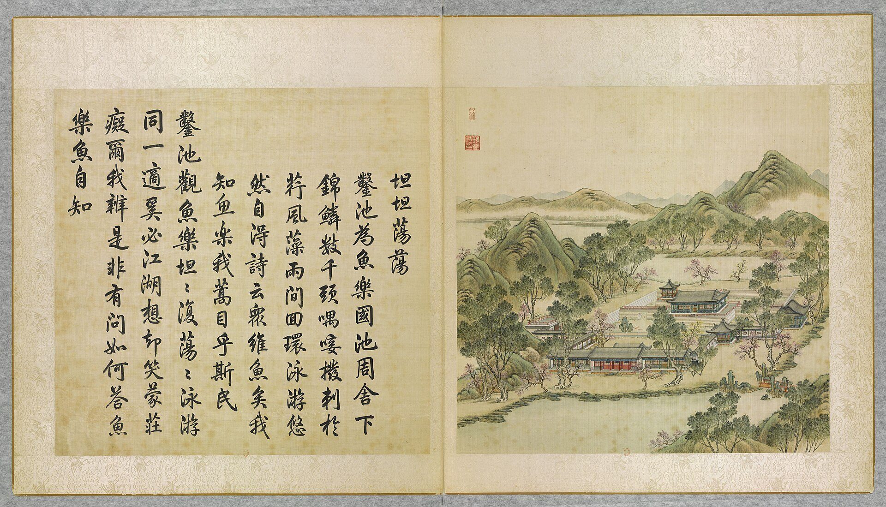
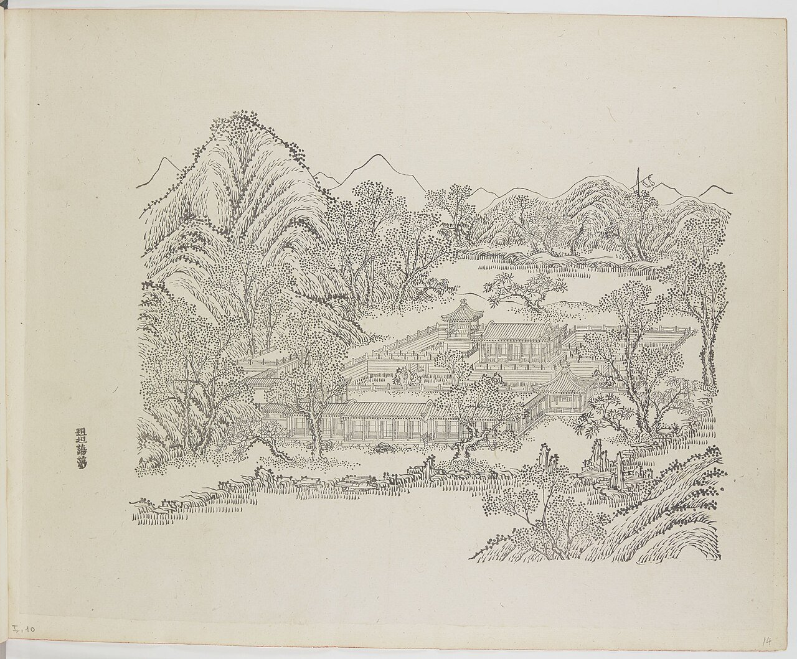
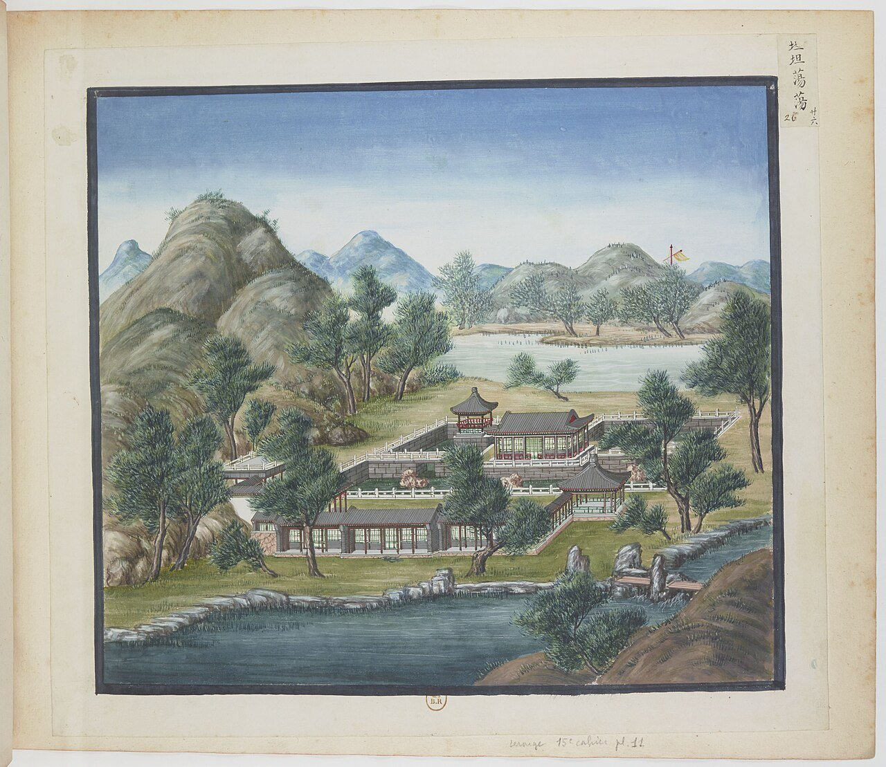
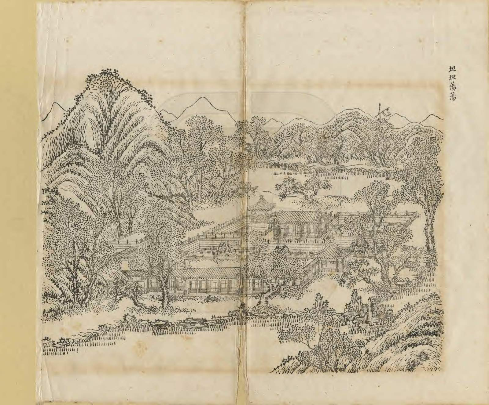
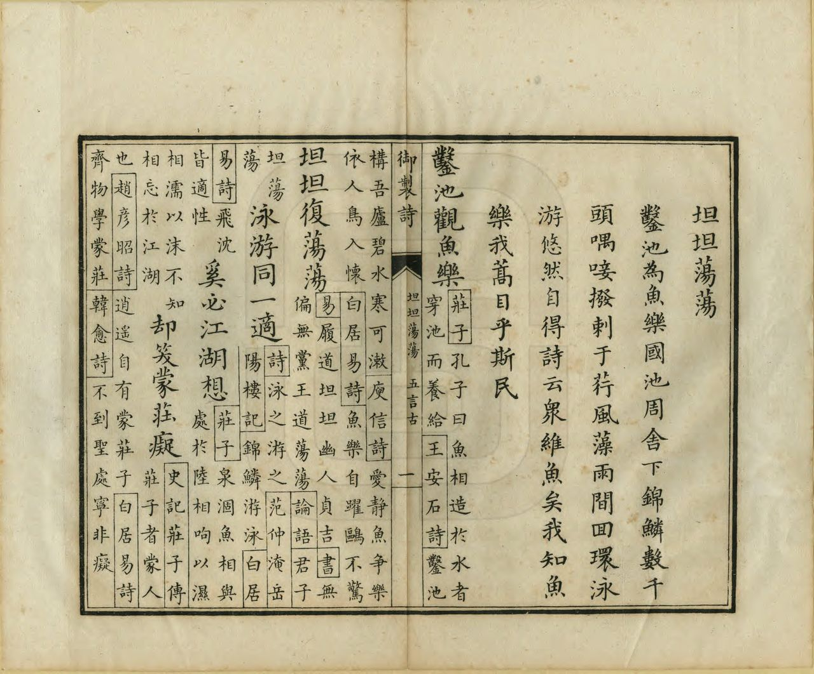
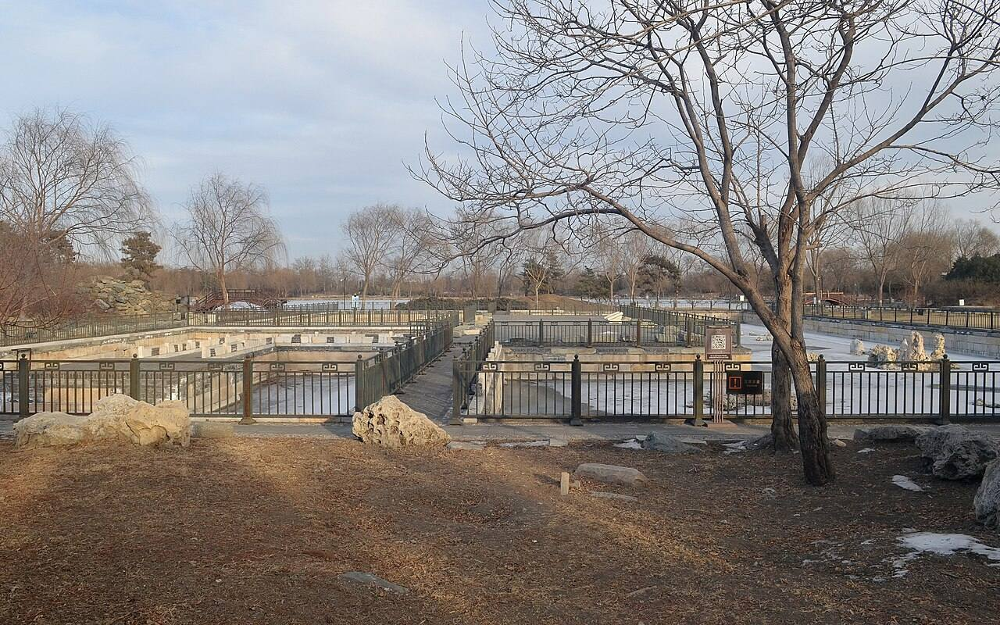
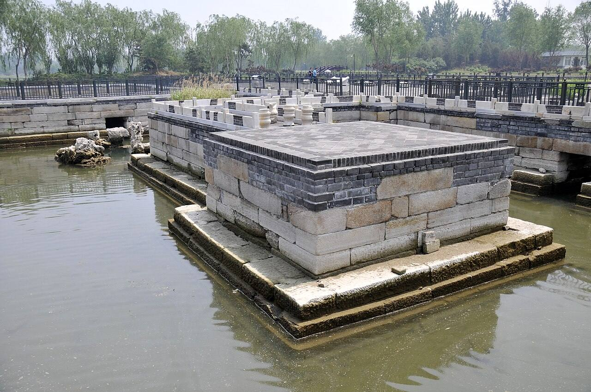

<!-- generated:start (scripts/building_pages.py): do not edit between these markers -->

# YM10: 坦坦荡荡 Tantan Dangdang

The Tank (Tranquil and Vast) · Yuanming Yuan

**3D object:** 10 boxes. Open it: `/reconstruction/3d.html?b=YM10`

## What we know

- **Name:** 坦坦荡荡 Tantan Dangdang (S05, S02, S08, S41, S42, S01, S340 · confidence A)
- **English:** The Tank (Tranquil and Vast) (S05, S02, S08, S41, S42, S01, S340)
- **Garden:** Yuanming Yuan (S05, S02, S08, S41, S42, S01, S340)
- **Type:** scene (S05, S02, S08, S41, S42, S01, S340 · confidence A)
- **Built:** 康熙后叶 初称金鱼池; 定名 乾隆四年 1739 (S42); late Kangxi, as 金鱼池; named 1739 (S05, S02, S08, S41, S42, S01, S340)
- **Changed:** Pool reshaped from 卍 to a rectangle shortly before 1744 (S41) (S05, S02, S08, S41, S42, S01, S340)
- **Destroyed:** 1860 (S05, S02, S08, S41, S42, S01, S340)
- **Position:** 40.00380, 116.28832. S01 sure (S01 · confidence B)
- **Plan reader's note:** Label at (2528,4400) written 坦:荡: with ditto marks (S01) *(research copy, not public)*
- **How it was read:** sure (S01) *(research copy, not public)*
- **Plan pixels:** 2519, 4348 (S01) *(research copy, not public)*

## Our model now

10 boxes stand in this compound, 10 on blocks drawn on the plan, 0 assumed. Its halls are listed below.

## Inside it (15)

- YM10-01 坦坦荡荡殿
- YM10-02 素心堂
- YM10-03 光风霁月堂
- YM10-04 知鱼亭
- YM10-05 萃景斋
- YM10-06 双佳斋
- YM10-07 半亩园
- YM10-08 碧澜桥
- YM10-B0736
- YM10-B0737
- YM10-B0738
- YM10-B0756
- YM10-B0758
- YM10-B0772
- YM10-B0773

## Pictures (7)

- **P0010** (sure): 坦坦蕩蕩 Tantan dangdang [Sérénité et épanouissement] (圓明園四十景, 第10景) (1744 (BnF record: 1744年，清朝乾隆九年)). https://commons.wikimedia.org/wiki/File%3A%E5%9C%93%E6%98%8E%E5%9C%92%E5%9B%9B%E5%8D%81%E6%99%AF._%E7%AC%AC%E5%8D%81%E6%99%AF_%28%E4%B8%8A%E5%86%8C%2C_%E7%AC%AC%E5%8D%81%E5%B9%85%E5%9B%BE%29%2C_%E5%9D%A6%E5%9D%A6%E8%95%A9%E8%95%A9_-_%28%E6%B8%85%29%E5%94%90%E5%B2%B1%E3%80%81%E6%B2%88%E6%BA%90%E5%90%88%E7%95%AB_%3B_%28%E4%B9%BE%E9%9A%86%E5%90%9F%E8%AF%97%EF%BC%8C%E6%B1%AA%E7%94%B1%E6%95%A6%E4%BB%A3%E4%B9%A6%29Tantan_dangdang_-_%28Qing%29Tang_Dai%2C_Shen_Yuan_he_hua_-_btv1b55008323r.jpg

  

- **P0074** (sure): 中国皇帝的宫殿与庙宇. 第14幅图, 坦坦蕩蕩 - (清)孙祜、沈源Tantan dangdang - (Qing)Sun Hu, Shen Yuan (1745 (Commons, from the BnF record)). https://commons.wikimedia.org/wiki/File%3A%E4%B8%AD%E5%9B%BD%E7%9A%87%E5%B8%9D%E7%9A%84%E5%AE%AB%E6%AE%BF%E4%B8%8E%E5%BA%99%E5%AE%87._%E7%AC%AC14%E5%B9%85%E5%9B%BE%2C_%E5%9D%A6%E5%9D%A6%E8%95%A9%E8%95%A9_-_%28%E6%B8%85%29%E5%AD%99%E7%A5%9C%E3%80%81%E6%B2%88%E6%BA%90Tantan_dangdang_-_%28Qing%29Sun_Hu%2C_Shen_Yuan_-_btv1b105206752.jpg

  

- **P0126** (sure): 海淀(镇)：中国皇帝的行宫. 第26幅图, 坦坦蕩蕩Tantan dangdang (1750-1792 (BnF, cb43831905b; ex coll. Bertin)). https://commons.wikimedia.org/wiki/File%3A%E6%B5%B7%E6%B7%80%28%E9%95%87%29%EF%BC%9A%E4%B8%AD%E5%9B%BD%E7%9A%87%E5%B8%9D%E7%9A%84%E8%A1%8C%E5%AE%AB._%E7%AC%AC26%E5%B9%85%E5%9B%BE%2C_%E5%9D%A6%E5%9D%A6%E8%95%A9%E8%95%A9Tantan_dangdang_-_btv1b105206663.jpg

  

- **P0241** (sure): 坦坦蕩蕩 Tantan Dangdang (御製圓明園圖詠, 1887 石印本, 上卷 (Commons 卷一), 第10景; printed title in the right margin of the picture) (光緒十三年 1887 (Commons/NLC record; colophon 光緒十三年七月天津石印書屋 in the SSID copy, S98 PDF p.2); design after the woodblock of 1745 by 孫祜 Sun Hu and 沈源 Shen Yuan). https://commons.wikimedia.org/wiki/File%3ANLC403-312001107375-14035_%E7%A6%A6%E5%88%B6%E5%9C%93%E6%98%8E%E5%9C%92%E5%9C%96%E8%A9%A0_%E5%8D%B7%E4%B8%80.pdf?page=61

  

- **P0517** (sure): 坦坦蕩蕩 Tantan Dangdang: 乾隆 Qianlong's preface and poem with the courtiers' commentary, 御製圓明園圖詠 1887 (poem 1744 (乾隆九年); this printing 1887). https://commons.wikimedia.org/wiki/File%3ANLC403-312001107375-14035_%E7%A6%A6%E5%88%B6%E5%9C%93%E6%98%8E%E5%9C%92%E5%9C%96%E8%A9%A0_%E5%8D%B7%E4%B8%80.pdf?page=62

  

- **P0376** (sure): 坦坦荡荡遗址01 20130201.jpg (2013-02-01 16:12:56 (Commons DateTimeOriginal)). https://commons.wikimedia.org/wiki/File:%E5%9D%A6%E5%9D%A6%E8%8D%A1%E8%8D%A1%E9%81%97%E5%9D%8001_20130201.jpg

  

- **P0377** (sure): 坦坦荡荡遗址 - panoramio.jpg (Taken on 27 May 2011 (Commons DateTimeOriginal)). https://commons.wikimedia.org/wiki/File:%E5%9D%A6%E5%9D%A6%E8%8D%A1%E8%8D%A1%E9%81%97%E5%9D%80_-_panoramio.jpg

  

## Texts and drawings (32)

- **E1317** (poem, sure): 御製坦坦蕩蕩詩（圓明園四十景詩）. 1744 (乾隆九年) · printed in S05 j81:3a-3b · S40. https://github.com/kanripo/KR2k0036/blob/master/KR2k0036_081.txt
  > 乾隆九年 御製坦坦蕩蕩詩 鑿池為魚樂國池周舍下錦鱗數千頭喁唼撥刺于荇風藻雨間囘環泳游悠然自得詩云衆維魚矣我知魚樂我蒿目乎斯民 鑿池觀魚樂坦坦復蕩蕩泳游同一適奚必江湖想却笑䝉莊癡爾我辨是非有問如何答魚樂魚自知
  A pool dug to be a 'kingdom of happy fish', with buildings around it and thousands of bright carp among the waterweed. The fish at ease turn his thought to the people's welfare.
- **E1327** (text, sure): 日下舊聞考 坦坦荡荡. 1780s (乾隆 敕撰) · j81:2b-3a · S05. https://github.com/kanripo/KR2k0036/blob/master/KR2k0036_081.txt
  > 杏花春館之西度碧瀾橋為坦坦蕩蕩三楹前宇為素心堂後宇為光風霽月堂東北為知魚亭又東北為萃景齋西北為雙佳齋（圓明園冊）臣等謹按坦坦蕩蕩四十景之一也額為皇上御書聨曰源頭句詠朱夫子池上居同白樂天素心堂内額曰清虚靜泰與光風霽月萃景齋諸額皆御書知魚亭及雙佳齋額世宗御書萃景齋石上刋御製坦坦蕩蕩詩
  West over the 碧瀾橋: 坦坦蕩蕩 of three bays, 素心堂 in front, 光風霽月堂 behind, with 知魚亭, 萃景齋 and 雙佳齋 around. The poem is cut on a rock at 萃景齋.
- **E1316** (poem, likely): 世宗 金魚池 (園景十二詠). before 1723 (雍邸集, printed as written while a prince) · KR4f0002_026:4a-4b · S200. https://github.com/kanripo/KR4f0002/blob/master/KR4f0002_026.txt
  > 金魚池 甃地成卍字注水蓄文魚藻映十分翠欄圍四面虚泳游溪漲後潑剌月明初物性悠然適臨觀意亦舒
  Prince's poem on the Goldfish Pool, with a brick floor laid in the shape of the 卍 sign, water and four-sided railings. 坦坦蕩蕩 is the fish-pool scene of 1744; the identity is an inference, and this early 卍 layout is worth comparing with the plan.
- **E1318** (poem, sure): 素心堂: 乾隆二十四年 poem of the Qianlong Emperor. 乾隆二十四年 (1759), date from the compilation · p.145 item (1), under 素心堂 · S360. https://www.yuanmingyuanpark.cn/xs/yjbg/202007/P020200730387572832602.pdf#page=145
  > 山不在高水亦澄，秀兼山水趣偏胜。静参倪筦禽鱼适，悦可襟怀翰墨凭。征 士爱他即景句，羲经得我素心朋。虽然未敢眈闲逸，肯构恒斯励继绳。
  Poem of the Qianlong Emperor at 素心堂, 1759, on visits to the dowager. Year as given by the compilation.
- **E1341** (poem, sure): 素心堂. 乾隆二十五年 (1760) · v2 p.46, under 坦坦荡荡; source ref 7-327 · S361. https://www.yuanmingyuanpark.cn/xs/yjbg/202008/P020200803382343267004.pdf#page=49
  > 书堂最为古，秋令又而今。松竹自良友，缥缃实素心。荷风清拂座，蕙露馥濡襟。散步延幽赏，莎蛩三两吟。
  Poem 素心堂 by the Qianlong Emperor, 1760, filed by the editors under 坦坦荡荡.
- **E1319** (poem, sure): 坦坦荡荡: 乾隆二十六年 poem of the Qianlong Emperor. 乾隆二十六年 (1761), date from the compilation · p.145 item (1), under 坦坦荡荡 · S360. https://www.yuanmingyuanpark.cn/xs/yjbg/202007/P020200730387572832602.pdf#page=145
  > 演漾披琳沼，豁庨敞网轩。息躬喜疏朗，游目鲜嚣烦。俯仰四临具，括包一理存。无私参义府，顺应涤情源。玩物寜堪贵，甄心略可论。嘉兹君子德，倬彼圣人言。
  Poem of the Qianlong Emperor at 坦坦荡荡, 1761, on the view. Year as given by the compilation.
- **E1320** (poem, sure): 碧澜亭: 乾隆二十九年 poem of the Qianlong Emperor. 乾隆二十九年 (1764), date from the compilation · p.146 item (1), under 碧澜亭 · S360. https://www.yuanmingyuanpark.cn/xs/yjbg/202007/P020200730387572832602.pdf#page=146
  > 池亭绨几对南薫，轻拂波光 练影分。今日几闲宜底事，便当异水一成文。
  Poem of the Qianlong Emperor at 碧澜亭, 1764, on the view. Year as given by the compilation.
- **E1321** (poem, sure): 碧澜亭: 乾隆三十一年 poem of the Qianlong Emperor. 乾隆三十一年 (1766), date from the compilation · p.147 item (2), under 碧澜亭 · S360. https://www.yuanmingyuanpark.cn/xs/yjbg/202007/P020200730387572832602.pdf#page=147
  > 新水生波漾碧澜，轻鯈来往喜池寛。即斯与物皆春意，何必投竿倚石栏。
  Poem of the Qianlong Emperor at 碧澜亭, 1766, on the view. Year as given by the compilation.
- **E1322** (poem, sure): 素心堂: 乾隆三十二年 poem of the Qianlong Emperor. 乾隆三十二年 (1767), date from the compilation · p.146 item (2), under 素心堂 · S360. https://www.yuanmingyuanpark.cn/xs/yjbg/202007/P020200730387572832602.pdf#page=146
  > 古屋园中咫尺近，一年堂上几回临。乍欣此日观佳景，都为宜时霈好霖。香喷缥缃插架润，响调琴瑟挂檐斟。在兹试问相应句，祇有祈农是素心。
  Poem of the Qianlong Emperor at 素心堂, 1767. Year as given by the compilation.
- **E1342** (poem, sure): 题素心堂. 乾隆三十五年 (1770) · v2 p.46, under 坦坦荡荡; source ref 10-688 · S361. https://www.yuanmingyuanpark.cn/xs/yjbg/202008/P020200803382343267004.pdf#page=49
  > 翠跸返行辕，芳辰驻御园。岂无花石赏，惟廑耙梨翻。颇厌招风柳，安求树背蘐。当春多望雨，正合素心存。
  Poem 题素心堂 by the Qianlong Emperor, 1770, filed by the editors under 坦坦荡荡.
- **E1344** (poem, sure): 萃景斋口号. 乾隆五十二年 (1787) · v3 p.35, under 别有洞天; source ref 16-710 · S361. https://www.yuanmingyuanpark.cn/xs/yjbg/202008/P020200803382569071850.pdf#page=38
  > 砌草墙桃意与融，若为之绿若为红。芸斋萃者似无尽，原自不离方寸中。
  Poem 萃景斋口号 by the Qianlong Emperor, 1787, filed by the editors under 别有洞天.
- **E1345** (poem, sure): 萃景斋. 乾隆五十三年 (1788) · v2 p.48, under 坦坦荡荡; source ref 16-893 · S361. https://www.yuanmingyuanpark.cn/xs/yjbg/202008/P020200803382343267004.pdf#page=51
  > 闲斋额萃景，自因搅景佳。佳景必在春，而春望雨皆。桃李那在目，麰麦常存怀。即今雨霑足，满志舒眉才。复恐一念间，敬怠循环来。五字以铭心，佳景原付斋。
  Poem 萃景斋 by the Qianlong Emperor, 1788, filed by the editors under 坦坦荡荡.
- **E1323** (poem, sure): 碧澜亭: 乾隆六十年 poem of the Qianlong Emperor. 乾隆六十年 (1795), date from the compilation · p.147 item (4), under 碧澜亭 · S360. https://www.yuanmingyuanpark.cn/xs/yjbg/202007/P020200730387572832602.pdf#page=147
  > 虚为水即实为冰，虚实何尝有定称。输与空空四柱者，水冰虚实听其仍。
  Poem of the Qianlong Emperor at 碧澜亭, 1795, on the view. Year as given by the compilation.
- **E1324** (poem, sure): 坦坦荡荡: 嘉庆二年 poem of the Jiaqing Emperor. 嘉庆二年 (1797), date from the compilation · p.145 item (3), under 坦坦荡荡 · S360. https://www.yuanmingyuanpark.cn/xs/yjbg/202007/P020200730387572832602.pdf#page=145
  > 天怀存坦荡，与物鲜经营。虚朗光风敞，圆灵霁月明。熏陶非有染，因付本无成。寥阔大公意，皎如宝鉴呈。
  Poem of the Jiaqing Emperor at 坦坦荡荡, 1797, on the view. Year as given by the compilation.
- **E1325** (poem, sure): 坦坦荡荡: 嘉庆三年 poem of the Jiaqing Emperor. 嘉庆三年 (1798), date from the compilation · p.145 item (4), under 坦坦荡荡 · S360. https://www.yuanmingyuanpark.cn/xs/yjbg/202007/P020200730387572832602.pdf#page=145
  > 君子坦荡荡，天怀本至清。无欲观其妙，笑彼空蝇营。如镜光极朗，如水波最平。虚已受众物，忠恕知群情。涵养寸田茂，不使稂莠生。学问代耘耨，礼义以犂耕。精采自焕发，其本归存诚。
  Poem of the Jiaqing Emperor at 坦坦荡荡, 1798, on the view. Year as given by the compilation.
- **E1326** (poem, sure): 素心堂: 嘉庆二十四年 poem of the Jiaqing Emperor. 嘉庆二十四年 (1819), date from the compilation · p.146 item (11), under 素心堂 · S360. https://www.yuanmingyuanpark.cn/xs/yjbg/202007/P020200730387572832602.pdf#page=146
  > 考命继大统，夙夜矢敬钦。繁华性相远，实予之素心。所本在经籍，有暇即探寻。内省果不疚，外诱奚能侵。守成除妄想，惕若天难谌。君民情贯注，交泰孚惠深。
  Poem of the Jiaqing Emperor at 素心堂, 1819. Year as given by the compilation.
- **E1328** (text, sure): Qing record naming 半亩园. 道光十九年十月 (1839) · p.143 item (135), under 山高水长 · S360. https://www.yuanmingyuanpark.cn/xs/yjbg/202007/P020200730387572832602.pdf#page=143
  > 道光十九年十月丙戌，道光帝奉皇太后幸山高水长，阅精捷营阵式，幸半亩园，进膳。
  After a troop review at 山高水长, Daoguang took the dowager to dine at 半亩园, in use in 1839.
- **E1343** (poem, sure): 知鱼亭待月（328）. year not parsed · v2 p.44, under 坦坦荡荡 · S361. https://www.yuanmingyuanpark.cn/xs/yjbg/202008/P020200803382343267004.pdf#page=47
  > 传呼不用上林丞，傍水登临远郁蒸。解渴漫调金掌露，清心胜饮玉壶冰。知鱼亭畔观鱼跃，得月台前望月升。烟敛碧池星汉皎，玉栏高处尽堪凭。
  Poem 知鱼亭待月（328） by the  Emperor, filed by the editors under 坦坦荡荡.
- **E1332** (description, sure): Scene 10, 坦坦荡荡 Tantan Dangdang, the Tank. 1934 · p.80 · S02. https://archive.org/details/historyofpekings00malo
  > A rectangular tank with a building in the middle of it, called Kuang Feng Chai Yueh, or Bright Wind and Narrow Moon, approached by bridges from all four sides, distinguishes this island.
  A rectangular fish tank with 光风霁月 in the middle, bridged on all four sides. The stocking with big red goldfish is Malone's inference ("no doubt"), not a report.
- **E1216** (description, sure): Site status table, about 2011: remains tidied up. c. 2011 · 系列06 repost, status table · S356. https://blog.sina.com.cn/s/blog_c27029650101itzz.html
  A blogger's table of what was then visible. These scenes have building remains that have been cleared and tidied. Dated about 2011, so digs since then are not reflected.
- **E1334** (description, sure): 半亩园 in 坦坦荡荡. 2021 · section 1.17 · S43. https://www.yuanmingyuanpark.cn/xs/yjbg/202108/t20210831_4483509.html
  Five-bay hall with galleries front and back. Small plays were staged here on dates of 1852 and 1856, so a stage of some kind stood or was put up.
- **E1454** (description, likely): 圆明园漫记, 宋广波. n.d. · essay · S335. https://www.aisixiang.com/data/141347.html
  A walker's essay. It says the base of 万方安和 and the goldfish pond of 坦坦荡荡 were dug and repaired in 2004 and were basically intact. It lists 澹怀堂, 含经堂 and 养雀笼 as the digs of its time. Lead only, not a report.
- **E1329** (description, sure): 圆明园百景史事分景汇编: 素心堂. 1759-1819 · from p.145, under 坦坦荡荡 · S360. https://www.yuanmingyuanpark.cn/xs/yjbg/202007/P020200730387572832602.pdf#page=145
  素心堂: 11 dated items, 1759-1819, of which 11 poems (Qianlong, Jiaqing); recurring themes: visits to the dowager. First dated 1759, last dated 1819.
- **E1330** (description, sure): 圆明园百景史事分景汇编: 坦坦荡荡. 1761-1798 · from p.145, under 坦坦荡荡 · S360. https://www.yuanmingyuanpark.cn/xs/yjbg/202007/P020200730387572832602.pdf#page=145
  坦坦荡荡: 3 dated items, 1761-1798, of which 3 poems (Qianlong, Jiaqing); recurring themes: the view. First dated 1761, last dated 1798.
- **E1331** (description, sure): 圆明园百景史事分景汇编: 碧澜亭. 1764-1795 · from p.146, under 坦坦荡荡 · S360. https://www.yuanmingyuanpark.cn/xs/yjbg/202007/P020200730387572832602.pdf#page=146
  碧澜亭: 4 dated items, 1764-1795, of which 4 poems (Qianlong); recurring themes: the view. First dated 1764, last dated 1795.
- **E1333** (description, sure): 圆明园五朝御制诗文集注 v2, editors' note on 坦坦荡荡. 2020 edition · v2 p.44 · S361. https://www.yuanmingyuanpark.cn/xs/yjbg/202008/P020200803382343267004.pdf#page=47
  The goldfish pool on the west shore: gate hall of five bays 素心堂 with a three-bay annex, 半亩园 east, 澹怀堂 west, 知鱼亭, 萃景斋, 双佳斋, and the five-bay 光风霁月 in mid-pool.
- **E1335** (description, sure, search index only): 坦坦荡荡 scene card. n.d. · mhymy jqjs 3880 · S340. https://www.mhymy.com/ymss/jqjs/3880.html
  West shore of 后湖, late Kangxi, first the 金鱼池 goldfish pond, named in 1739. An island with a central fish pool ringed by halls, earth mounds on west and north.
- **E1336** (drawing, sure): 坦坦荡荡总平面图. 道光二十年至咸丰八年 (1840-1858) · 国家图书馆善本部 样024-2号 · S310. https://www.mhymy.com/dasl/ysltd/11163.html
  Presentation ground plan of the Tantan Dangdang scene, 415x403 mm, ink and light colour with a pasted slip, 1840-58, close to the target state. No image here; the site may ask a small payment for the full record.
- **E2483** (drawing, sure): 坦坦荡荡平面图 (图名: 坦坦荡荡). 道光二十年至咸丰八年 (1840-1858) · 国家图书馆善本部 样024-4号 · S310. https://www.mhymy.com/dasl/ysltd/7726.html
  Measured survey plan (底样、踏勘实测图), 738x654 mm, ink, of the goldfish-pond scene, 1840-58: a state close to 1860. Distinct from 样024-2 (E1336).
- **E1337** (drawing, sure): 《国家图书馆藏样式雷图档·圆明园卷初编》: 坦坦荡荡. mostly 道光, 咸丰, 同治 per the publisher · 初编 目录: 坦坦荡荡, pp.177-193 · S13. https://www.nlcpress.com/ProductView.aspx?Id=7642
  The printed facsimile of the National Library of China's Yangshi Lei sheets has a section on this place at pp.177-193 (17 pages, section length worked out from the next heading); sheet titles and numbers are in the volume, ordered from a library.
- **E1338** (drawing, likely): 半亩园平面图. 国家图书馆善本部 样024-6号 · S310. https://www.mhymy.com/dasl/ysltd/7766.html
  Plan of Banmu Yuan; shelf 024 is the Tantan Dangdang shelf, so the tie to that scene is an inference from the number. No image here; the site may ask a small payment for the full record.
- **E1339** (archaeology, sure): 修复1860: 坦坦荡荡 绣墩, 思永斋 tiles. 2019 · news, 陈辉 · S334. https://news.ifeng.com/c/7ma60W4GZjB
  The restoration project for excavated sherds (about 100,000 pieces of porcelain) chose objects with known find spots: a blue-and-white porcelain stool from 坦坦荡荡 Tantan Dangdang, known locally as 金鱼池 the goldfish pond, and blue-and-white tiles from 思永斋 Siyong Zhai.

**On the plan:** Drawn on the plan of the gardens (S01), labelled 坦坦荡荡. https://artmuseum.princeton.edu/collections/objects/138657

## Reconstructions by others (2)

Modern interpretation, not evidence.
- **R0051** (3D model, sure): Laser scanning and virtual fitting of the 西洋楼 stones; 碧澜桥 repaired. 肖金亮, 郭黛姮 and team, 北京清华同衡规划设计研究院 建筑与城市遗产研究所. https://www.tsinghua.edu.cn/info/1182/46587.htm Research-only: link card.
- **R0041** (paper figure, sure, search index only): 再现·圆明园——坦坦荡荡. 贺艳 (清华大学, as the extract states), 清华大学, 2012. https://www.mhymy.com/xsjl/qklw/9571.html Research-only: link card.

## Surviving comparable buildings, not this building (1)

- **T010** 濠濮间 Haopu Jian, 北海 Beihai. Comparable: same court, era or type, confidence C, standing: yes. Small enclosed pool, bridge and pavilion on a Zhuangzi theme Basis: S05 j.81 f.2b: 坦坦荡荡 is a pond for watching fish, with 知鱼亭; the poem turns on knowing the joy of fish. S422: 濠濮间, a small waterside pavilion with a winding bridge, shut off by rocks; S431 (snippet): 1759. The shared Zhuangzi reference to fish is my reading: S422 gives it for 知乐濠 at Xiangshan. https://zh.wikipedia.org/wiki/北海公园
  - P0585: 濠濮间 1. https://commons.wikimedia.org/wiki/File:%E6%BF%A0%E6%BF%AE%E9%97%B4_1.jpg

## Evidence for the set of buildings

- Reconstructions and comparables for the whole garden, 圆明园 Yuanming Yuan: see GARDEN-YM

## Open questions

- Q45: Halls in the texts with no row

<!-- generated:end -->

## Notes

<!-- Yours: regeneration never touches this part. It goes on the public site; what you write below a line holding only %% private %% stays in the research copy. -->
