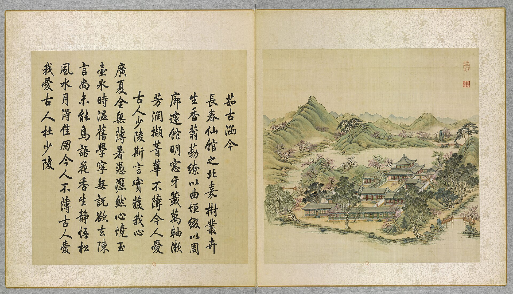

<!-- generated:start (scripts/building_pages.py): do not edit between these markers -->

# YM11-02: 韶景轩 Shaojing Xuan

Yuanming Yuan

**3D object:** 1 box. Open it: `/reconstruction/3d.html?b=YM11-02`

**Part of:** YM11 茹古涵今

## What we know

- **Name:** 韶景轩 Shaojing Xuan (S05, S02, S01, S360, S08 · confidence B)
- **Garden:** Yuanming Yuan (S05, S02, S01, S360, S08)
- **Type:** other (S05, S02, S01, S360, S08 · confidence B)
- **Built:** by 1776 (first dated item) (S05, S02, S01, S360, S08)
- **Destroyed:** 1860 (S05, S02, S01, S360, S08)
- **Position:** 40.00341, 116.28838. S01 sure (S01 · confidence B)
- **Bays:** 5 per side in the texts / 5x5 on the plan (S05, S02, S01, S360, S08)
- **Size in the inventory:** 23.2 × 27.5 m. S01 plan px / hall scale (S01)
- **Roof:** 重檐 double (S02 p.80: double roof) (S05, S02, S01, S360, S08)
- **Note:** Malone p.80: square, 8 columns a side. roof: double eaves with pyramidal top (square plan) (S08, P0011 (leaf); S02 p.80). (S05, S02, S01, S360, S08)
- **Plan reader's note:** 四面各五楹 with a central well: matches exactly (S01) *(research copy, not public)*
- **How it was read:** sure (S01) *(research copy, not public)*
- **Plan pixels:** 2520, 4553 (S01) *(research copy, not public)*

## Our model now

On the block drawn on the Qing plan S01: position and frontage from the plan, heights and roof from the typology of its hall class, its form drawn by the hall kit. It will be updated as the research goes on.

- **Box:** 22.43 × 25.2 m, main hall
- **Heights:** platform 0.7 m, eave 4.4 m, ridge 7.28 m above the ground
- **Roof:** hip-and-gable 歇山, double eaves 重檐, 3 parallel rolls 勾连搭, grey tile
- **Faces:** 174° from north
- **Fit:** reduced towards the size drawn on the plan, to stand clear of its neighbours or the water
- **Drawn:** by the hall kit: 5 bays, the middle widest, a porch front and back, steps on the front, 歇山 hip-and-gable, double eaves 重檐, grey tile, a painted beam under the eave. From its own figures and readings where the dossier gives them (roof read: buildings.csv B), the rest from the typology of its hall class.
- **Confidence:** B

## Pictures (1)

- **P0011** (likely): 茹古涵今 Rugu hanjin [Assimiler le passé pour embrasser le présent] (圓明園四十景, 第11景) (1744 (BnF record: 1744年，清朝乾隆九年)). https://commons.wikimedia.org/wiki/File%3A%E5%9C%93%E6%98%8E%E5%9C%92%E5%9B%9B%E5%8D%81%E6%99%AF._%E7%AC%AC%E5%8D%81%E4%B8%80%E6%99%AF_%28%E4%B8%8A%E5%86%8C%EF%BC%8C%E7%AC%AC%E5%8D%81%E4%B8%80%E5%B9%85%E5%9B%BE%29%2C_%E8%8C%B9%E5%8F%A4%E6%B6%B5%E4%BB%8A_-_%28%E6%B8%85%29%E5%94%90%E5%B2%B1%E3%80%81%E6%B2%88%E6%BA%90%E5%90%88%E7%95%AB_%3B_%28%E4%B9%BE%E9%9A%86%E5%90%9F%E8%AF%97%EF%BC%8C%E6%B1%AA%E7%94%B1%E6%95%A6%E4%BB%A3%E4%B9%A6%29Rugu_hanjin_-_%28Qing%29Tang_Dai%2C_Shen_Yuan_he_hua_-_btv1b550083246.jpg

  

## Texts and drawings (9)

- **E1354** (text, sure): 日下舊聞考 茹古涵今. 1780s (乾隆 敕撰) · j81:3b-4a · S05. https://github.com/kanripo/KR2k0036/blob/master/KR2k0036_081.txt
  > 坦坦蕩蕩之南為茹古涵今五楹南向其後方殿為韶景軒四面各五楹韶景軒前東為茂育齋西為竹香齋又北為靜通齋（圓圓明園册）臣等謹按茹古涵今四十景之一也額為皇上御書韶景軒額恭懸軒内其外南簷額曰喜接南薰東簷額曰景麗東皇西簷額曰翠生西嶺北簷額曰清風北户與竹香齋額皆御書茂育齋静通齋額皆世宗御書
  South of 坦坦蕩蕩: the five-bay 茹古涵今 facing south; behind it the square 韶景軒 of five bays per side, with a plaque on each of its four eaves; 茂育齋, 竹香齋 and 靜通齋 around it.
- **E1349** (poem, sure): 韶景轩: 乾隆四十一年 poem of the Qianlong Emperor. 乾隆四十一年 (1776), date from the compilation · p.130 item (1), under 韶景轩 · S360. https://www.yuanmingyuanpark.cn/xs/yjbg/202007/P020200730387572832602.pdf#page=130
  > 京畿齐甸历巡辕，望雨每为心郁烦。雨足人归春过了，轩中韶景意恒存。
  Poem of the Qianlong Emperor at 韶景轩, 1776, on remembering his forebears. Year as given by the compilation.
- **E1350** (poem, sure): 韶景轩: 乾隆四十二年 poem of the Qianlong Emperor. 乾隆四十二年 (1777), date from the compilation · p.130 item (2), under 韶景轩 · S360. https://www.yuanmingyuanpark.cn/xs/yjbg/202007/P020200730387572832602.pdf#page=130
  > 书轩成已四十年，久矣题额曰韶景。向弗频莅兹偶临，丗载春光付轩领。喜新厌旧率人情，未能免俗吾应省。宣毫江砚绨几陈，遂以摛词窗移影。堂堂九十迅如斯，有为法䆒谁为永。
  Poem of the Qianlong Emperor at 韶景轩, 1777, on remembering his forebears. Year as given by the compilation.
- **E1363** (poem, sure): 韶景轩. 嘉庆三年 (1798) · v2 p.58, under 茹古涵今; source ref 1-311 · S361. https://www.yuanmingyuanpark.cn/xs/yjbg/202008/P020200803382343267004.pdf#page=61
  > 万汇沐帝恩，御园韶景富。山水含清晖，花柳开锦绣。东郊始农功，稼穑祈繁茂。圣人敬授时，青阳敷在宥。寅承惠民衷，寰区锡仁寿。
  Poem 韶景轩 by the Jiaqing Emperor, 1798, filed by the editors under 茹古涵今.
- **E1353** (poem, sure): 韶景轩: 嘉庆二十五年 poem of the Jiaqing Emperor. 嘉庆二十五年 (1820), date from the compilation · p.130 item (4), under 韶景轩 · S360. https://www.yuanmingyuanpark.cn/xs/yjbg/202007/P020200730387572832602.pdf#page=130
  > 佳日临轩骀荡春，楣悬御额焕三辰，庭心旭蔼筛林影，水面风来漾縠尘。长养收藏咸运化，飞潜动植普怀新。无涯韶景芳园布，敬授人时体昊仁。
  Poem of the Jiaqing Emperor at 韶景轩, 1820. Year as given by the compilation.
- **E1362** (poem, likely): 于韶景轩作歌. 乾隆四十年 (1775) · v2 p.57, under 茹古涵今; source ref 12-665 · S361. https://www.yuanmingyuanpark.cn/xs/yjbg/202008/P020200803382343267004.pdf#page=60
  > 韶景轩故我题名，由来三十余年已。曾未拈毫一经咏，斯亦荒略殊甚耳。既而思之颇有说，日用不知系传旨。莫不饮食孰知味，君子之道诚鲜矣。
  Poem 于韶景轩作歌 by the Qianlong Emperor, 1775, filed by the editors under 茹古涵今.
- **E1357** (description, likely): Scene 11, 茹古涵今 Rugu Hanjin. 1934 · p.80 · S02. https://archive.org/details/historyofpekings00malo
  > A square building, with eight columns on a side and a double roof, dominates this group of many courtyards, just west of the Emperor's private apartments.
  A square double-roofed hall, eight columns a side, in many courtyards west of 九洲清晏. Malone does not name it; the plan and Rixia place the square hall as 韶景轩.
- **E1356** (description, sure): 圆明园百景史事分景汇编: 韶景轩. 1776-1820 · from p.130, under 茹古涵今 · S360. https://www.yuanmingyuanpark.cn/xs/yjbg/202007/P020200730387572832602.pdf#page=130
  韶景轩: 4 dated items, 1776-1820, of which 4 poems (Qianlong, Jiaqing); recurring themes: remembering his forebears. First dated 1776, last dated 1820.
- **E2476** (drawing, sure): 韶景轩室内装修平面图 (图名: 韶景轩). 不详; record suggests 嘉庆二十四年 (1819) · 国家图书馆善本部 样023-3号 · S310. https://www.mhymy.com/dasl/ysltd/10403.html
  Two-storey interior plan of 韶景轩 (茹古涵今), 258x245 mm, red and ink, working sheet; a paste-over shows the upper floor. A square central void with a gallery all round upstairs, four-leaf doors in the north and south central bays, a two-flight L-shaped stair in the west. The record ties it to the 1819 order 揭瓦大亭，更改装修.

**On the plan:** Drawn on the plan of the gardens (S01), labelled 韶景轩, 5x5 cells. https://artmuseum.princeton.edu/collections/objects/138657

## Evidence for the set of buildings

- Evidence for the whole compound 茹古涵今: see YM11
- Reconstructions and comparables for the whole garden, 圆明园 Yuanming Yuan: see GARDEN-YM
- Standing buildings comparable to a main hall (not this building): see CLASS-main_hall

## Open questions

- Q52: Smaller conflicts

<!-- generated:end -->

## Notes

<!-- Yours: regeneration never touches this part. It goes on the public site; what you write below a line holding only %% private %% stays in the research copy. -->
