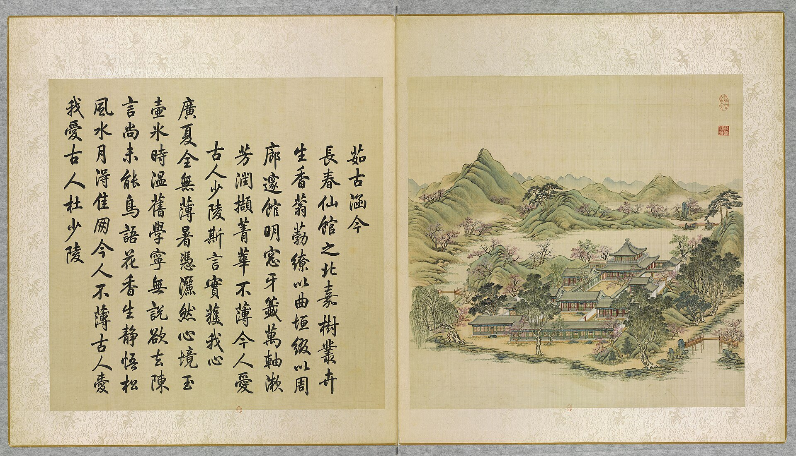
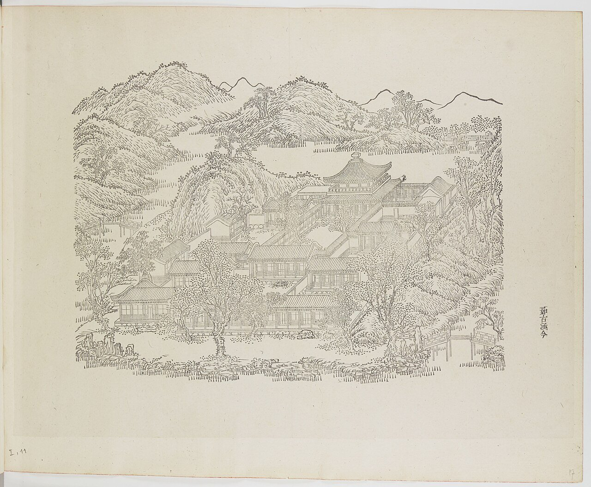
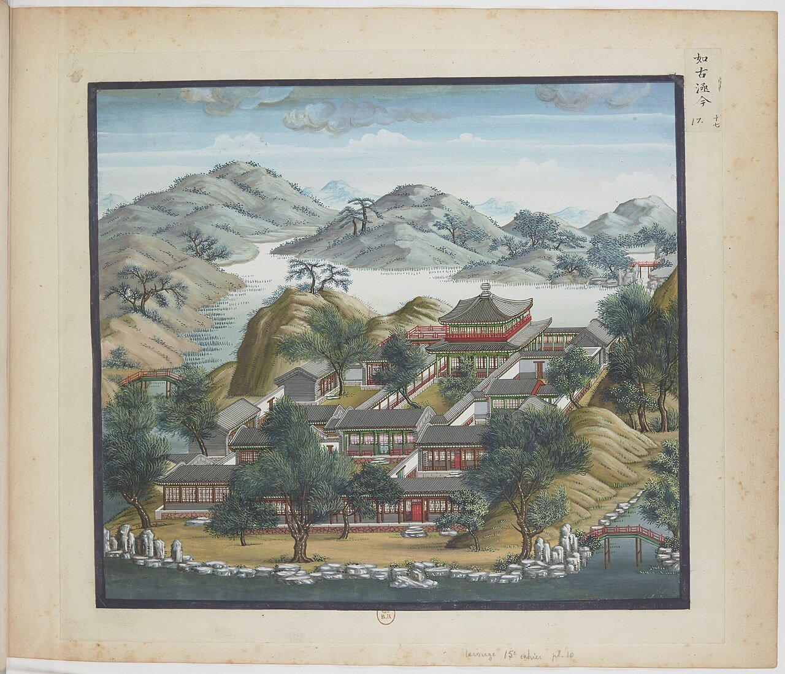
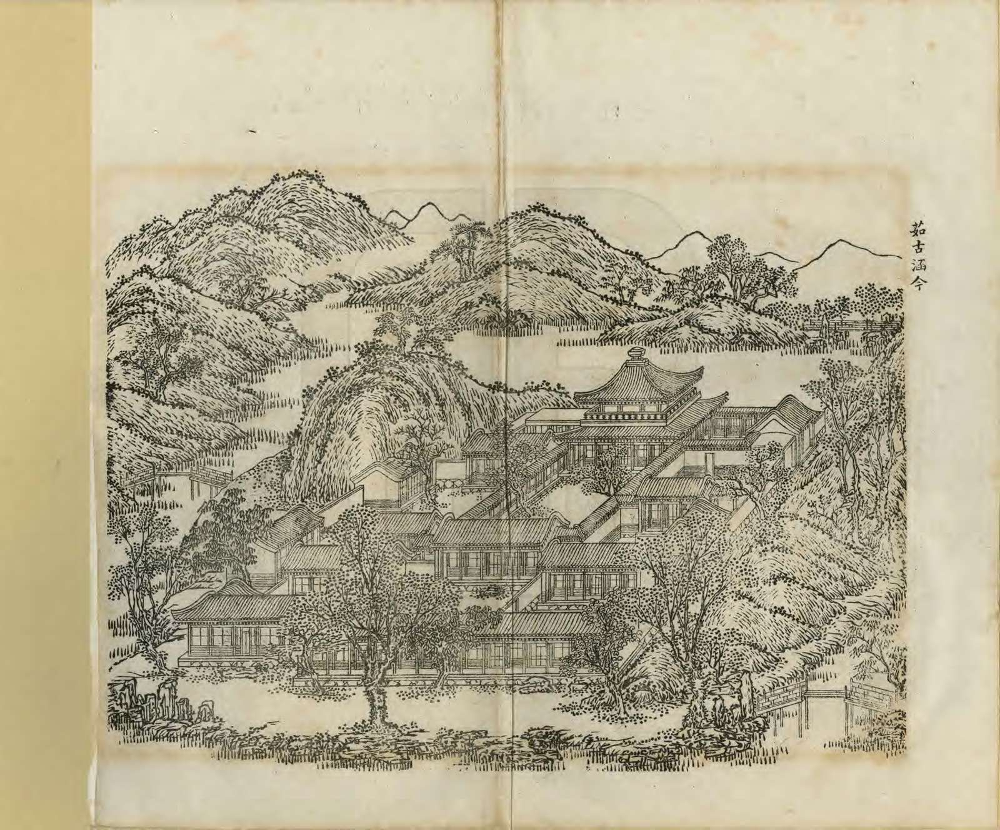
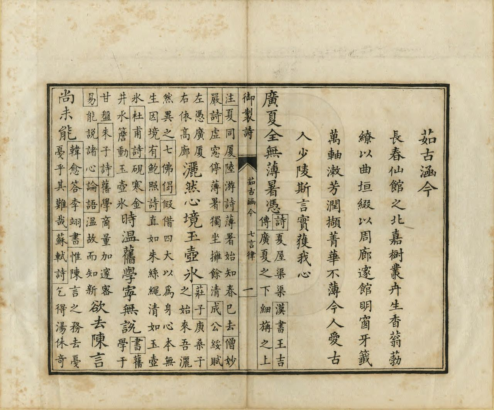
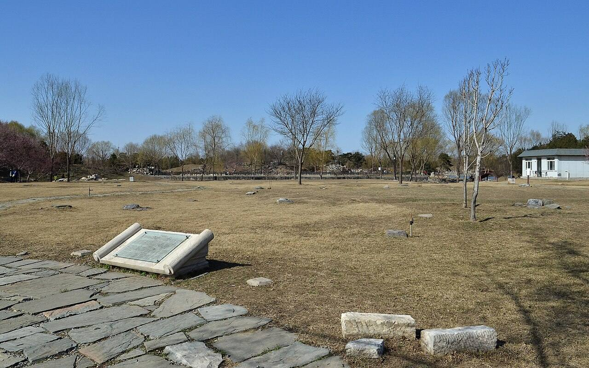

<!-- generated:start (scripts/building_pages.py): do not edit between these markers -->

# YM11: 茹古涵今 Rugu Hanjin

Ju Ku Han Chin (Seize the Old; It Contains the Present) · Yuanming Yuan

**3D object:** 15 boxes. Open it: `/reconstruction/3d.html?b=YM11`

## What we know

- **Name:** 茹古涵今 Rugu Hanjin (S05, S02, S08, S42, S01 · confidence A)
- **English:** Ju Ku Han Chin (Seize the Old; It Contains the Present) (S05, S02, S08, S42, S01)
- **Garden:** Yuanming Yuan (S05, S02, S08, S42, S01)
- **Type:** scene (S05, S02, S08, S42, S01 · confidence A)
- **Destroyed:** 1860 (S05, S02, S08, S42, S01)
- **Position:** 40.00310, 116.28844. S01 likely (S01 · confidence B)
- **Note:** S42: 亦总称韶景轩; 占地9000 m2, 建筑面积3300 m2. (S05, S02, S08, S42, S01)
- **Plan reader's note:** Label faint (pale ink) at (2521,4769); 韶景轩 dark and sure at (2510,4680) (S01) *(research copy, not public)*
- **How it was read:** likely (S01) *(research copy, not public)*
- **Plan pixels:** 2526, 4721 (S01) *(research copy, not public)*

## Our model now

15 boxes stand in this compound, 15 on blocks drawn on the plan, 0 assumed. Its halls are listed below.

## Inside it (15)

- YM11-01 茹古涵今殿
- YM11-02 韶景轩
- YM11-03 茂育斋
- YM11-04 竹香斋
- YM11-05 静通斋
- YM11-AC001
- YM11-B0801
- YM11-B0833
- YM11-B0855
- YM11-B0856
- YM11-B0860
- YM11-B0861
- YM11-B0862
- YM11-B0898
- YM11-B0899

## Pictures (6)

- **P0011** (sure): 茹古涵今 Rugu hanjin [Assimiler le passé pour embrasser le présent] (圓明園四十景, 第11景) (1744 (BnF record: 1744年，清朝乾隆九年)). https://commons.wikimedia.org/wiki/File%3A%E5%9C%93%E6%98%8E%E5%9C%92%E5%9B%9B%E5%8D%81%E6%99%AF._%E7%AC%AC%E5%8D%81%E4%B8%80%E6%99%AF_%28%E4%B8%8A%E5%86%8C%EF%BC%8C%E7%AC%AC%E5%8D%81%E4%B8%80%E5%B9%85%E5%9B%BE%29%2C_%E8%8C%B9%E5%8F%A4%E6%B6%B5%E4%BB%8A_-_%28%E6%B8%85%29%E5%94%90%E5%B2%B1%E3%80%81%E6%B2%88%E6%BA%90%E5%90%88%E7%95%AB_%3B_%28%E4%B9%BE%E9%9A%86%E5%90%9F%E8%AF%97%EF%BC%8C%E6%B1%AA%E7%94%B1%E6%95%A6%E4%BB%A3%E4%B9%A6%29Rugu_hanjin_-_%28Qing%29Tang_Dai%2C_Shen_Yuan_he_hua_-_btv1b550083246.jpg

  

- **P0077** (sure): 中国皇帝的宫殿与庙宇. 第17幅图, 茹古涵今 - (清)孙祜、沈源Rugu hanjin - (Qing)Sun Hu, Shen Yuan (1745 (Commons, from the BnF record)). https://commons.wikimedia.org/wiki/File%3A%E4%B8%AD%E5%9B%BD%E7%9A%87%E5%B8%9D%E7%9A%84%E5%AE%AB%E6%AE%BF%E4%B8%8E%E5%BA%99%E5%AE%87._%E7%AC%AC17%E5%B9%85%E5%9B%BE%2C_%E8%8C%B9%E5%8F%A4%E6%B6%B5%E4%BB%8A_-_%28%E6%B8%85%29%E5%AD%99%E7%A5%9C%E3%80%81%E6%B2%88%E6%BA%90Rugu_hanjin_-_%28Qing%29Sun_Hu%2C_Shen_Yuan_-_btv1b10520674m.jpg

  

- **P0117** (sure): 海淀(镇)：中国皇帝的行宫. 第17幅图, 如古涵今(茹古涵今)Rugu hanjin (1750-1792 (BnF, cb43831905b; ex coll. Bertin)). https://commons.wikimedia.org/wiki/File%3A%E6%B5%B7%E6%B7%80%28%E9%95%87%29%EF%BC%9A%E4%B8%AD%E5%9B%BD%E7%9A%87%E5%B8%9D%E7%9A%84%E8%A1%8C%E5%AE%AB._%E7%AC%AC17%E5%B9%85%E5%9B%BE%2C_%E5%A6%82%E5%8F%A4%E6%B6%B5%E4%BB%8A%28%E8%8C%B9%E5%8F%A4%E6%B6%B5%E4%BB%8A%29Rugu_hanjin_-_btv1b10520667j.jpg

  

- **P0242** (sure): 茹古涵今 Rugu Hanjin (御製圓明園圖詠, 1887 石印本, 上卷 (Commons 卷一), 第11景; printed title in the right margin of the picture) (光緒十三年 1887 (Commons/NLC record; colophon 光緒十三年七月天津石印書屋 in the SSID copy, S98 PDF p.2); design after the woodblock of 1745 by 孫祜 Sun Hu and 沈源 Shen Yuan). https://commons.wikimedia.org/wiki/File%3ANLC403-312001107375-14035_%E7%A6%A6%E5%88%B6%E5%9C%93%E6%98%8E%E5%9C%92%E5%9C%96%E8%A9%A0_%E5%8D%B7%E4%B8%80.pdf?page=64

  

- **P0518** (sure): 茹古涵今 Rugu Hanjin: 乾隆 Qianlong's preface and poem with the courtiers' commentary, 御製圓明園圖詠 1887 (poem 1744 (乾隆九年); this printing 1887). https://commons.wikimedia.org/wiki/File%3ANLC403-312001107375-14035_%E7%A6%A6%E5%88%B6%E5%9C%93%E6%98%8E%E5%9C%92%E5%9C%96%E8%A9%A0_%E5%8D%B7%E4%B8%80.pdf?page=65

  

- **P0378** (sure): 茹古涵今 20130324.JPG (2013-03-24 14:53:50 (Commons DateTimeOriginal)). https://commons.wikimedia.org/wiki/File:%E8%8C%B9%E5%8F%A4%E6%B6%B5%E4%BB%8A_20130324.JPG

  

## Texts and drawings (21)

- **E1347** (poem, sure): 御製茹古涵今詩（圓明園四十景詩）. 1744 (乾隆九年) · printed in S05 j81:4a-4b · S40. https://github.com/kanripo/KR2k0036/blob/master/KR2k0036_081.txt
  > 乾隆九年 御製茹古涵今詩 長春仙館之北嘉樹叢卉生香蓊葧繚以曲垣綴以周廊邃館明忩牙籖萬軸潄芳潤擷菁華不薄今人愛古人少陵斯言實獲我心 廣厦全無薄暑憑灑然心鏡玉壺氷時温舊學寜無説欲去陳言尚未能鳥語花香生静悟松風水月得佳朋今人不薄古人愛我愛古人杜少陵
  North of 長春仙館: scented trees within a winding wall and encircling galleries, deep rooms with bright windows and ten thousand books. He takes up 杜甫's line about not slighting the moderns while loving the ancients.
- **E1354** (text, sure): 日下舊聞考 茹古涵今. 1780s (乾隆 敕撰) · j81:3b-4a · S05. https://github.com/kanripo/KR2k0036/blob/master/KR2k0036_081.txt
  > 坦坦蕩蕩之南為茹古涵今五楹南向其後方殿為韶景軒四面各五楹韶景軒前東為茂育齋西為竹香齋又北為靜通齋（圓圓明園册）臣等謹按茹古涵今四十景之一也額為皇上御書韶景軒額恭懸軒内其外南簷額曰喜接南薰東簷額曰景麗東皇西簷額曰翠生西嶺北簷額曰清風北户與竹香齋額皆御書茂育齋静通齋額皆世宗御書
  South of 坦坦蕩蕩: the five-bay 茹古涵今 facing south; behind it the square 韶景軒 of five bays per side, with a plaque on each of its four eaves; 茂育齋, 竹香齋 and 靜通齋 around it.
- **E1348** (poem, sure): 静通斋: 乾隆四十年 poem of the Qianlong Emperor. 乾隆四十年 (1775), date from the compilation · p.130 item (1), under 静通斋 · S360. https://www.yuanmingyuanpark.cn/xs/yjbg/202007/P020200730387572832602.pdf#page=130
  > 天地贞元运大公，澄观理亦易为穷。纷兹动植含春意，孰不权舆静以通。
  Poem of the Qianlong Emperor at 静通斋, 1775, on reading. Year as given by the compilation.
- **E1362** (poem, sure): 于韶景轩作歌. 乾隆四十年 (1775) · v2 p.57, under 茹古涵今; source ref 12-665 · S361. https://www.yuanmingyuanpark.cn/xs/yjbg/202008/P020200803382343267004.pdf#page=60
  > 韶景轩故我题名，由来三十余年已。曾未拈毫一经咏，斯亦荒略殊甚耳。既而思之颇有说，日用不知系传旨。莫不饮食孰知味，君子之道诚鲜矣。
  Poem 于韶景轩作歌 by the Qianlong Emperor, 1775, filed by the editors under 茹古涵今.
- **E1349** (poem, sure): 韶景轩: 乾隆四十一年 poem of the Qianlong Emperor. 乾隆四十一年 (1776), date from the compilation · p.130 item (1), under 韶景轩 · S360. https://www.yuanmingyuanpark.cn/xs/yjbg/202007/P020200730387572832602.pdf#page=130
  > 京畿齐甸历巡辕，望雨每为心郁烦。雨足人归春过了，轩中韶景意恒存。
  Poem of the Qianlong Emperor at 韶景轩, 1776, on remembering his forebears. Year as given by the compilation.
- **E1350** (poem, sure): 韶景轩: 乾隆四十二年 poem of the Qianlong Emperor. 乾隆四十二年 (1777), date from the compilation · p.130 item (2), under 韶景轩 · S360. https://www.yuanmingyuanpark.cn/xs/yjbg/202007/P020200730387572832602.pdf#page=130
  > 书轩成已四十年，久矣题额曰韶景。向弗频莅兹偶临，丗载春光付轩领。喜新厌旧率人情，未能免俗吾应省。宣毫江砚绨几陈，遂以摛词窗移影。堂堂九十迅如斯，有为法䆒谁为永。
  Poem of the Qianlong Emperor at 韶景轩, 1777, on remembering his forebears. Year as given by the compilation.
- **E1364** (poem, sure): 静通斋. 乾隆四十二年 (1777) · v2 p.57, under 茹古涵今; source ref 12-958 · S361. https://www.yuanmingyuanpark.cn/xs/yjbg/202008/P020200803382343267004.pdf#page=60
  > 人情盖与止水同，澄之则清淆则浊。淆为动而澄为静，动斯扰矣静斯觉。楣端两字额静通，是义诚宜细研榷。苟非物来而顺应，未足言通劳把捉。
  Poem 静通斋 by the Qianlong Emperor, 1777, filed by the editors under 茹古涵今.
- **E1351** (poem, sure): 静通斋: 乾隆五十四年 poem of the Qianlong Emperor. 乾隆五十四年 (1789), date from the compilation · p.131 item (3), under 静通斋 · S360. https://www.yuanmingyuanpark.cn/xs/yjbg/202007/P020200730387572832602.pdf#page=131
  > 濓溪太极说，圣人常主静。通书更注之，明通理堪省。内外交相养，无欲挈要领。斋额仰奎文（斋额乃皇考所题也），不敏愿勉黾。
  Poem of the Qianlong Emperor at 静通斋, 1789, on reading. Year as given by the compilation.
- **E1365** (poem, sure): 静通斋. 乾隆五十四年 (1789) · v2 p.58, under 茹古涵今; source ref 17-36 · S361. https://www.yuanmingyuanpark.cn/xs/yjbg/202008/P020200803382343267004.pdf#page=61
  > 濂溪太极说，圣人常主静。通书更注之，明通理堪省。内外交相养，无欲挈要领。
  Poem 静通斋 by the Qianlong Emperor, 1789, filed by the editors under 茹古涵今.
- **E1352** (poem, sure): 静通斋: 乾隆五十九年 poem of the Qianlong Emperor. 乾隆五十九年 (1794), date from the compilation · p.131 item (4), under 静通斋 · S360. https://www.yuanmingyuanpark.cn/xs/yjbg/202007/P020200730387572832602.pdf#page=131
  > 静通岂谓廊相接，理具濓溪太极图。中正及仁义以定，立人极合主斯夫。
  Poem of the Qianlong Emperor at 静通斋, 1794, on reading. Year as given by the compilation.
- **E1363** (poem, sure): 韶景轩. 嘉庆三年 (1798) · v2 p.58, under 茹古涵今; source ref 1-311 · S361. https://www.yuanmingyuanpark.cn/xs/yjbg/202008/P020200803382343267004.pdf#page=61
  > 万汇沐帝恩，御园韶景富。山水含清晖，花柳开锦绣。东郊始农功，稼穑祈繁茂。圣人敬授时，青阳敷在宥。寅承惠民衷，寰区锡仁寿。
  Poem 韶景轩 by the Jiaqing Emperor, 1798, filed by the editors under 茹古涵今.
- **E1353** (poem, sure): 韶景轩: 嘉庆二十五年 poem of the Jiaqing Emperor. 嘉庆二十五年 (1820), date from the compilation · p.130 item (4), under 韶景轩 · S360. https://www.yuanmingyuanpark.cn/xs/yjbg/202007/P020200730387572832602.pdf#page=130
  > 佳日临轩骀荡春，楣悬御额焕三辰，庭心旭蔼筛林影，水面风来漾縠尘。长养收藏咸运化，飞潜动植普怀新。无涯韶景芳园布，敬授人时体昊仁。
  Poem of the Jiaqing Emperor at 韶景轩, 1820. Year as given by the compilation.
- **E1357** (description, sure): Scene 11, 茹古涵今 Rugu Hanjin. 1934 · p.80 · S02. https://archive.org/details/historyofpekings00malo
  > A square building, with eight columns on a side and a double roof, dominates this group of many courtyards, just west of the Emperor's private apartments.
  A square double-roofed hall, eight columns a side, in many courtyards west of 九洲清晏. Malone does not name it; the plan and Rixia place the square hall as 韶景轩.
- **E1011** (description, sure): Site status table, about 2011: nothing visible, or built over. c. 2011 · 系列06 repost, status table · S356. https://blog.sina.com.cn/s/blog_c27029650101itzz.html
  Same table. In it the first group shows no visible remains; 得全阁, 流香渚, 凤麟洲, 涵秋馆, 蔚藻堂, 中和堂, 敷春堂 and 心镜轩 have service buildings on them, and 含晖楼, 澄心堂, 延寿寺, 清夏堂 and 喜雨山房 are occupied by other institutions. 澹泊宁静 and several others have been dug since, so this is out of date for them.
- **E1355** (description, sure): 圆明园百景史事分景汇编: 静通斋. 1775-1794 · from p.130, under 茹古涵今 · S360. https://www.yuanmingyuanpark.cn/xs/yjbg/202007/P020200730387572832602.pdf#page=130
  静通斋: 4 dated items, 1775-1794, of which 4 poems (Qianlong); recurring themes: reading. First dated 1775, last dated 1794.
- **E1356** (description, sure): 圆明园百景史事分景汇编: 韶景轩. 1776-1820 · from p.130, under 茹古涵今 · S360. https://www.yuanmingyuanpark.cn/xs/yjbg/202007/P020200730387572832602.pdf#page=130
  韶景轩: 4 dated items, 1776-1820, of which 4 poems (Qianlong, Jiaqing); recurring themes: remembering his forebears. First dated 1776, last dated 1820.
- **E1358** (description, sure): 圆明园五朝御制诗文集注 v2, editors' note on 茹古涵今. 2020 edition · v2 p.56 · S361. https://www.yuanmingyuanpark.cn/xs/yjbg/202008/P020200803382343267004.pdf#page=59
  For books and study: a seven-bay gate, five-bay front hall, and 韶景轩, five bays on each of four sides with four plaques, then 茂育斋, 竹香斋, 静通斋.
- **E1359** (description, sure, search index only): 茹古涵今 scene card. n.d. · mhymy jqjs 3851 · S340. https://www.mhymy.com/ymss/jqjs/3851.html
  Also called 韶景轩, south of 坦坦荡荡, 9,000 m2 with a dense 3,300 m2 of buildings, around a large square hall of the same name.
- **E2476** (drawing, sure): 韶景轩室内装修平面图 (图名: 韶景轩). 不详; record suggests 嘉庆二十四年 (1819) · 国家图书馆善本部 样023-3号 · S310. https://www.mhymy.com/dasl/ysltd/10403.html
  Two-storey interior plan of 韶景轩 (茹古涵今), 258x245 mm, red and ink, working sheet; a paste-over shows the upper floor. A square central void with a gallery all round upstairs, four-leaf doors in the north and south central bays, a two-flight L-shaped stair in the west. The record ties it to the 1819 order 揭瓦大亭，更改装修.
- **E1360** (drawing, sure): 茹古涵今总平面图. 道光十一至二十年 (1831-1840) · 国家图书馆善本部 样023-1号 · S310. https://www.mhymy.com/dasl/ysltd/10408.html
  Base plan of the Rugu Hanjin scene, also called Shaojing Xuan 韶景轩, 1831-40. No image here; the site may ask a small payment for the full record.
- **E1361** (drawing, sure): 《国家图书馆藏样式雷图档·圆明园卷初编》: 茹古涵今. mostly 道光, 咸丰, 同治 per the publisher · 初编 目录: 茹古涵今, pp.115-125 · S13. https://www.nlcpress.com/ProductView.aspx?Id=7642
  The printed facsimile of the National Library of China's Yangshi Lei sheets has a section on this place at pp.115-125 (11 pages, section length worked out from the next heading); sheet titles and numbers are in the volume, ordered from a library.

**On the plan:** Drawn on the plan of the gardens (S01), labelled 茹古涵今. https://artmuseum.princeton.edu/collections/objects/138657

## Reconstructions by others (1)

Modern interpretation, not evidence.
- **R0031** (video, sure, search index only): [央美]九洲区域复原视频. 中央美术学院圆明园研究中心 (央美 tag; the page names it, per search extract). https://www.mhymy.com/szfy/fysp/14948.html Research-only: link card.

## Evidence for the set of buildings

- Reconstructions and comparables for the whole garden, 圆明园 Yuanming Yuan: see GARDEN-YM

## Open questions

- Q9: Bay counts, plan against text

<!-- generated:end -->

## Notes

<!-- Yours: regeneration never touches this part. It goes on the public site; what you write below a line holding only %% private %% stays in the research copy. -->
