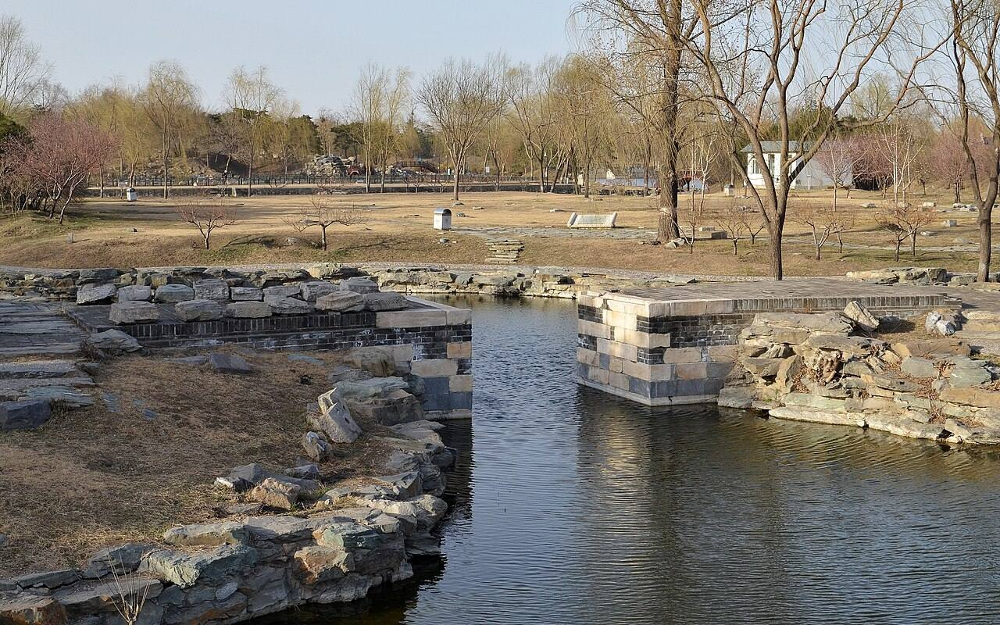
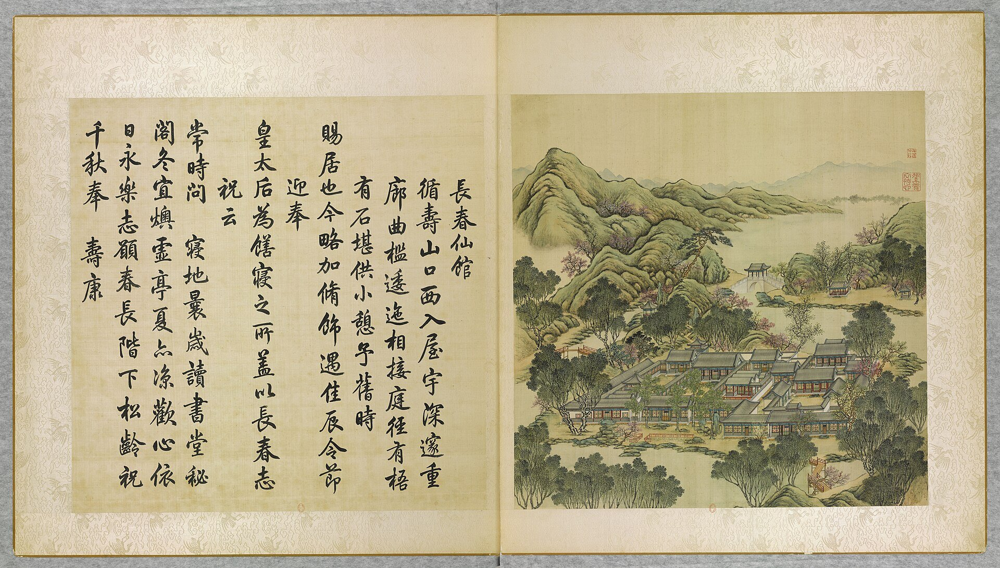

<!-- generated:start (scripts/building_pages.py): do not edit between these markers -->

# YM12-11: 鸣玉溪桥 Mingyuxi Qiao

Yuanming Yuan

**3D object:** none yet.

**Part of:** YM12 长春仙馆

## What we know

- **Name:** 鸣玉溪桥 Mingyuxi Qiao (S41 · confidence B)
- **Garden:** Yuanming Yuan (S41)
- **Type:** bridge (S41 · confidence B)
- **Destroyed:** 1860 (S41)
- **Position:** Not placed: the name was not found on the plan.
- **Roof:** 卷棚歇山 (bridge pavilion, S41) (S41)
- **Where the text puts it:** 长春仙馆岛北部 (S41) (S41) *(research copy, not public)*
- **Note:** 单孔发券石拱桥, 桥亭三间 卷棚歇山; remains excavated (S41). (S41)

## Our model now

No box in the 3D view: the plan shows no building here, or a plot, water, a hill or a name only.

## Pictures (2)

- **P0380** (sure): 鸣玉溪桥 20130323.JPG (2013-03-23 16:52:06 (Commons DateTimeOriginal)). https://commons.wikimedia.org/wiki/File:%E9%B8%A3%E7%8E%89%E6%BA%AA%E6%A1%A5_20130323.JPG

  

- **P0012** (guess): 長春仙館 Changchun xianguan [Pavillon d'immortalité du Printemps éternel] (圓明園四十景, 第12景) (1744 (BnF record: 1744年，清朝乾隆九年)). https://commons.wikimedia.org/wiki/File%3A%E5%9C%93%E6%98%8E%E5%9C%92%E5%9B%9B%E5%8D%81%E6%99%AF._%E7%AC%AC%E5%8D%81%E4%BA%8C%E6%99%AF_%28%E4%B8%8A%E5%86%8C%EF%BC%8C%E7%AC%AC%E5%8D%81%E4%BA%8C%E5%B9%85%E5%9B%BE%29%2C_%E9%95%B7%E6%98%A5%E4%BB%99%E9%A4%A8_-_%28%E6%B8%85%29%E5%94%90%E5%B2%B1%E3%80%81%E6%B2%88%E6%BA%90%E5%90%88%E7%95%AB_%3B_%28%E4%B9%BE%E9%9A%86%E5%90%9F%E8%AF%97%EF%BC%8C%E6%B1%AA%E7%94%B1%E6%95%A6%E4%BB%A3%E4%B9%A6%29Changchun_xianguan_-_%28Qing%29Tang_Dai%2C_Shen_Yuan_he_hua_-_btv1b55008325n.jpg

  

## Texts and drawings (0)

None of its own.

## Evidence for the set of buildings

- Evidence for the whole compound 长春仙馆: see YM12
- Reconstructions and comparables for the whole garden, 圆明园 Yuanming Yuan: see GARDEN-YM

**Searched and not found:** No text or drawing names it in 日下旧闻考 j80-82, the Qianlong poems on Kanripo, 養吉齋叢錄, Malone 1934, the witnesses of 1860, what search indexes show of the Yangshi Lei drawings.

## Open questions

None that name it.

<!-- generated:end -->

## Notes

<!-- Yours: regeneration never touches this part. It goes on the public site; what you write below a line holding only %% private %% stays in the research copy. -->
