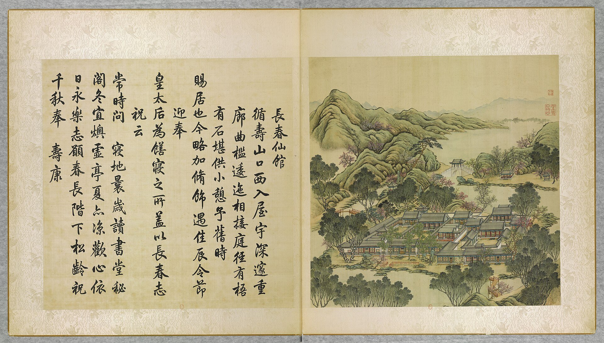
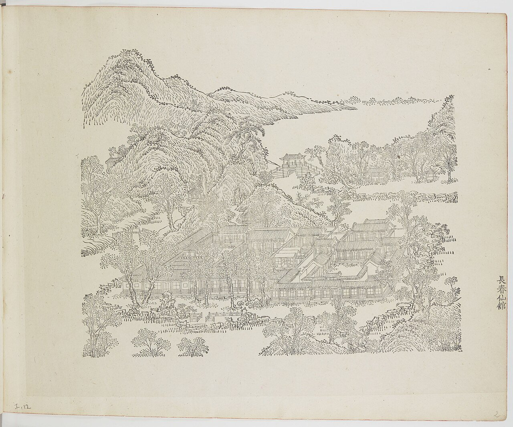
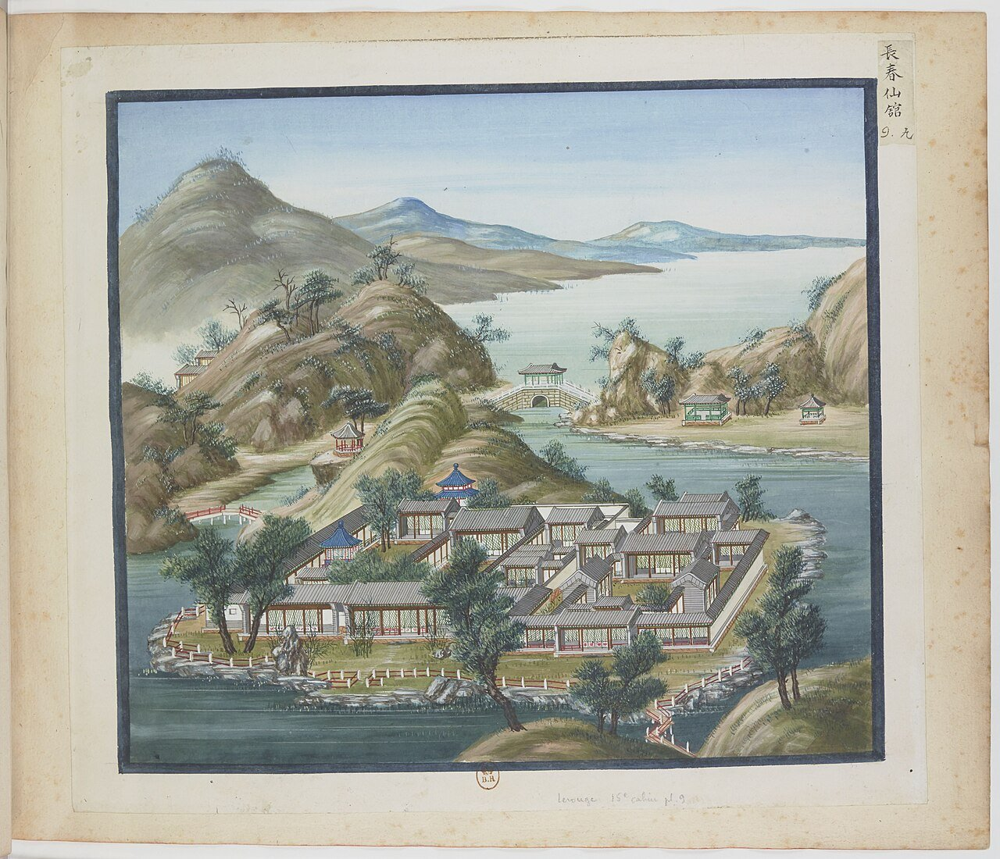
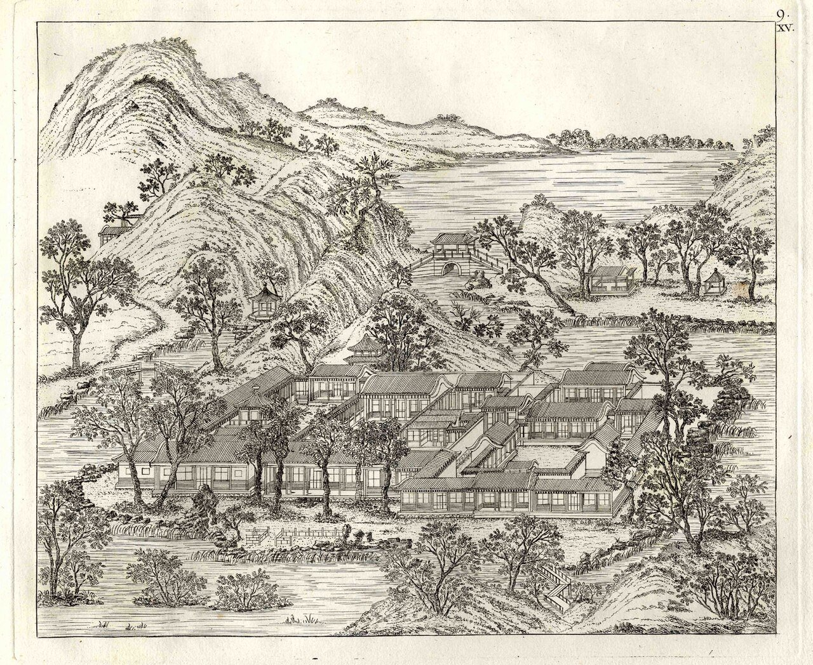
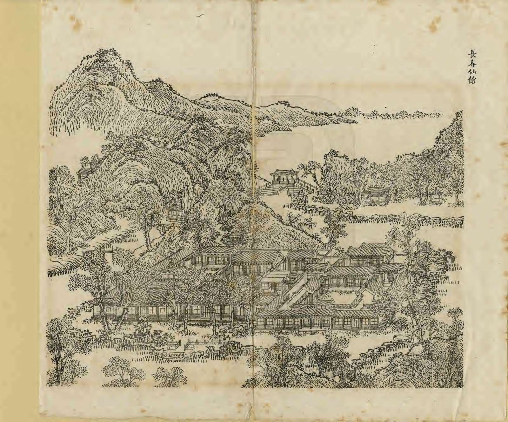
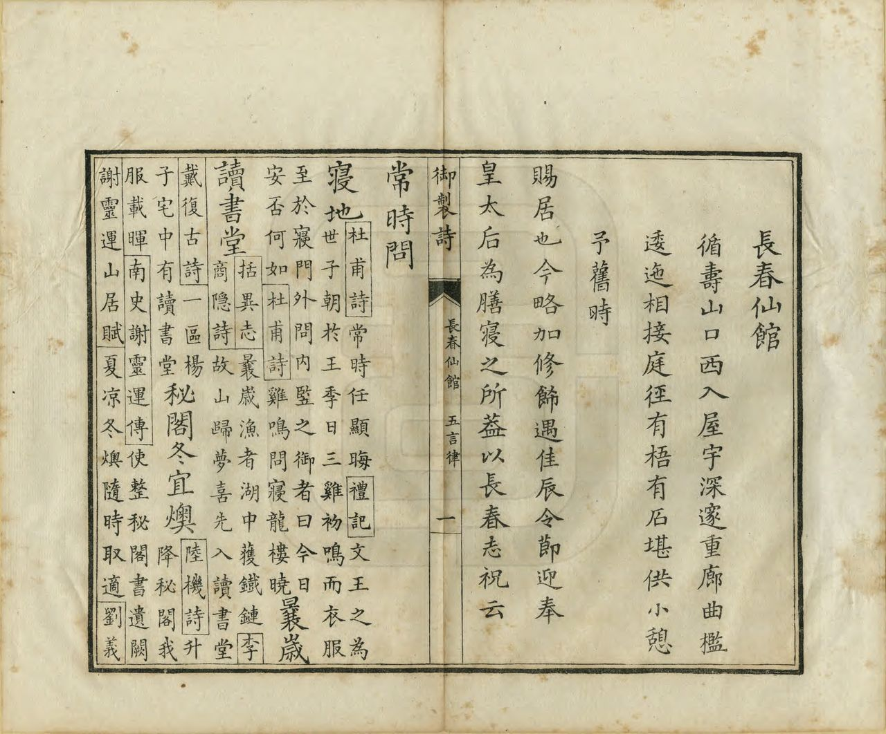
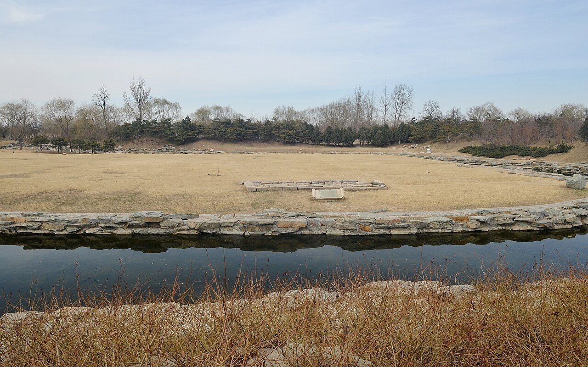
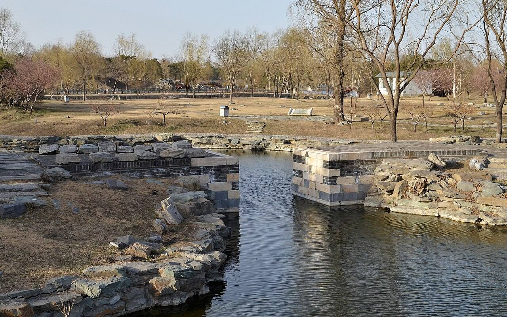

<!-- generated:start (scripts/building_pages.py): do not edit between these markers -->

# YM12: 长春仙馆 Changchun Xianguan

The Long Spring Lodge of the Immortal · Yuanming Yuan

**3D object:** 15 boxes. Open it: `/reconstruction/3d.html?b=YM12`

## What we know

- **Name:** 长春仙馆 Changchun Xianguan (S05, S02, S08, S42, S43, S01, S340 · confidence A)
- **English:** The Long Spring Lodge of the Immortal (S05, S02, S08, S42, S43, S01, S340)
- **Garden:** Yuanming Yuan (S05, S02, S08, S42, S43, S01, S340)
- **Type:** scene (S05, S02, S08, S42, S43, S01, S340 · confidence A)
- **Built:** 不晚于雍正四年 1726, 初名莲花馆 (S42;S43); by 1726, as 莲花馆 (S05, S02, S08, S42, S43, S01, S340)
- **Destroyed:** 1860 (S05, S02, S08, S42, S43, S01, S340)
- **Position:** 40.00205, 116.28868. S01 sure (S01 · confidence B)
- **Note:** Qianlong's lodging as prince; later for the empress dowager [j81:5a-b]. (S05, S02, S08, S42, S43, S01, S340)
- **Plan reader's note:** Blue 12 at (2540,5465). Inner island only; outer bank compounds are NEW-05 and NEW-04 (S01) *(research copy, not public)*
- **How it was read:** sure (S01) *(research copy, not public)*
- **Plan pixels:** 2551, 5284 (S01) *(research copy, not public)*

## Our model now

15 boxes stand in this compound, 15 on blocks drawn on the plan, 0 assumed. Its halls are listed below.

## Inside it (20)

- YM12-01 门
- YM12-02 正殿 藤影花丛
- YM12-03 绿荫轩
- YM12-04 丽景轩
- YM12-05 含碧堂
- YM12-06 林虚桂静
- YM12-07 古香斋
- YM12-08 抑斋
- YM12-09 墨池云
- YM12-10 随安室
- YM12-11 鸣玉溪桥
- YM12-B0982
- YM12-B1014
- YM12-B1019
- YM12-B1021
- YM12-B1022
- YM12-B1048
- YM12-B1049
- YM12-B1051
- YM12-N01 长春仙馆

## Pictures (9)

- **P0012** (sure): 長春仙館 Changchun xianguan [Pavillon d'immortalité du Printemps éternel] (圓明園四十景, 第12景) (1744 (BnF record: 1744年，清朝乾隆九年)). https://commons.wikimedia.org/wiki/File%3A%E5%9C%93%E6%98%8E%E5%9C%92%E5%9B%9B%E5%8D%81%E6%99%AF._%E7%AC%AC%E5%8D%81%E4%BA%8C%E6%99%AF_%28%E4%B8%8A%E5%86%8C%EF%BC%8C%E7%AC%AC%E5%8D%81%E4%BA%8C%E5%B9%85%E5%9B%BE%29%2C_%E9%95%B7%E6%98%A5%E4%BB%99%E9%A4%A8_-_%28%E6%B8%85%29%E5%94%90%E5%B2%B1%E3%80%81%E6%B2%88%E6%BA%90%E5%90%88%E7%95%AB_%3B_%28%E4%B9%BE%E9%9A%86%E5%90%9F%E8%AF%97%EF%BC%8C%E6%B1%AA%E7%94%B1%E6%95%A6%E4%BB%A3%E4%B9%A6%29Changchun_xianguan_-_%28Qing%29Tang_Dai%2C_Shen_Yuan_he_hua_-_btv1b55008325n.jpg

  

- **P0062** (sure): 中国皇帝的宫殿与庙宇. 第2幅图, 長春仙館 - (清)孙祜、沈源Changchun xianguan - (Qing)Sun Hu, Shen Yuan (1745 (Commons, from the BnF record)). https://commons.wikimedia.org/wiki/File%3A%E4%B8%AD%E5%9B%BD%E7%9A%87%E5%B8%9D%E7%9A%84%E5%AE%AB%E6%AE%BF%E4%B8%8E%E5%BA%99%E5%AE%87._%E7%AC%AC2%E5%B9%85%E5%9B%BE%2C_%E9%95%B7%E6%98%A5%E4%BB%99%E9%A4%A8_-_%28%E6%B8%85%29%E5%AD%99%E7%A5%9C%E3%80%81%E6%B2%88%E6%BA%90Changchun_xianguan_-_%28Qing%29Sun_Hu%2C_Shen_Yuan_-_btv1b10520676h.jpg

  

- **P0109** (sure): 海淀(镇)：中国皇帝的行宫. 第9幅图, 長春仙館Changchun xianguan (1750-1792 (BnF, cb43831905b; ex coll. Bertin)). https://commons.wikimedia.org/wiki/File%3A%E6%B5%B7%E6%B7%80%28%E9%95%87%29%EF%BC%9A%E4%B8%AD%E5%9B%BD%E7%9A%87%E5%B8%9D%E7%9A%84%E8%A1%8C%E5%AE%AB._%E7%AC%AC9%E5%B9%85%E5%9B%BE%2C_%E9%95%B7%E6%98%A5%E4%BB%99%E9%A4%A8Changchun_xianguan_-_btv1b105206680.jpg

  

- **P0143** (likely): Le Rouge, Jardins anglo-chinois, sheet with 圆明园长春仙馆圖 (between 1781 and 1786 (Commons)). https://commons.wikimedia.org/wiki/File%3AGeorges_Louis_Le_Rouge_Jardins_anglo-chinois_G_0427_III_Garten_des_Kaisers_von_China_1.jpg

  

- **P0243** (sure): 長春仙館 Changchun Xianguan (御製圓明園圖詠, 1887 石印本, 上卷 (Commons 卷一), 第12景; printed title in the right margin of the picture) (光緒十三年 1887 (Commons/NLC record; colophon 光緒十三年七月天津石印書屋 in the SSID copy, S98 PDF p.2); design after the woodblock of 1745 by 孫祜 Sun Hu and 沈源 Shen Yuan). https://commons.wikimedia.org/wiki/File%3ANLC403-312001107375-14035_%E7%A6%A6%E5%88%B6%E5%9C%93%E6%98%8E%E5%9C%92%E5%9C%96%E8%A9%A0_%E5%8D%B7%E4%B8%80.pdf?page=67

  

- **P0519** (sure): 長春仙館 Changchun Xianguan: 乾隆 Qianlong's preface and poem with the courtiers' commentary, 御製圓明園圖詠 1887 (poem 1744 (乾隆九年); this printing 1887). https://commons.wikimedia.org/wiki/File%3ANLC403-312001107375-14035_%E7%A6%A6%E5%88%B6%E5%9C%93%E6%98%8E%E5%9C%92%E5%9C%96%E8%A9%A0_%E5%8D%B7%E4%B8%80.pdf?page=68

  

- **P0379** (sure): 长春仙馆 20130318.JPG (2013-03-18 15:10:02 (Commons DateTimeOriginal)). https://commons.wikimedia.org/wiki/File:%E9%95%BF%E6%98%A5%E4%BB%99%E9%A6%86_20130318.JPG

  

- **P0380** (sure): 鸣玉溪桥 20130323.JPG (2013-03-23 16:52:06 (Commons DateTimeOriginal)). https://commons.wikimedia.org/wiki/File:%E9%B8%A3%E7%8E%89%E6%BA%AA%E6%A1%A5_20130323.JPG

  

- **P0789** (guess): 散落在山坡的石构件 - panoramio.jpg (Taken on 27 May 2011 (Commons file page)). https://commons.wikimedia.org/wiki/File:%E6%95%A3%E8%90%BD%E5%9C%A8%E5%B1%B1%E5%9D%A1%E7%9A%84%E7%9F%B3%E6%9E%84%E4%BB%B6_-_panoramio.jpg

## Texts and drawings (75)

- **E1367** (poem, sure): 御製古香齋題壁. 1741 (乾隆六年) · j81:6b · S05. https://github.com/kanripo/KR2k0036/blob/master/KR2k0036_081.txt
  > 乾隆六年御製古香齋題壁　書屋誠清絶翛然水石邊時來聴泉響獨坐愛巖懸日永人偏静齋深爽更延忘言翻舊卷髣髴話當年
  Short poem written on the wall of 古香齋: the sound of spring water, an overhanging rock and quiet.
- **E1368** (poem, sure): 御製題抑齋. 1742 (乾隆七年) · j81:7a · S05. https://github.com/kanripo/KR2k0036/blob/master/KR2k0036_081.txt
  > 乾隆七年御製題抑齋　忩紗浸緑鳥聲頻拂拂花香户外新座有蘭言文作篆壁留箏字額題銀偶然得句緣新意長自耽書是宿因慙愧當年齋内客劈箋煮茗一閒身
  Short poem on 抑齋, its window and plaque.
- **E1369** (poem, sure): 御製長春仙館詩（圓明園四十景詩）. 1744 (乾隆九年) · printed in S05 j81:5b-6a · S40. https://github.com/kanripo/KR2k0036/blob/master/KR2k0036_081.txt
  > 乾隆九年 御製長春仙館詩 循壽山口西入屋宇深䆳重廊曲檻逶迤相接庭徑有梧有石堪供小憩予舊時賜居也今畧加修飾遇佳辰令節迎奉皇太后為膳寢之所盖以長春志祝云 常時問寢地曩嵗讀書堂祕閣冬宜燠虚亭夜亦涼歡心依日永樂志願春長階下松齡祝千秋奉夀康
  Entered from the mouth of 壽山 going west: deep buildings joined by winding galleries, and a court of paulownia and rock. This was his residence as a prince; he now uses it to house and feed his mother on festival days, and the name is a wish for her long life.
- **E1376** (poem, sure): 御製隨安室四詠（有序）. 1767 (乾隆三十二年) · j81:7b-8a · S05. https://github.com/kanripo/KR2k0036/blob/master/KR2k0036_081.txt
  > 乾隆三十二年御製隨安室四詠（有序）　隨安室青宫時書屋名也盖所遇而安昔時藉以淑已而已今則四海之廣兆民之衆無不欲其隨時隨地而安抑亦難矣故凡宫禁園庭仍以是名之觸目警心亦識其安之艱致云爾　安土詩　處處隨安室都因安土成築期基永固肯構乃恢宏愛物易辭繫樂天禮義精重（去聲）居堪絜矩藉亦念民情　又安忩詩　安忩向朱鳥作牖亦青龍春意階前草夏隂簷際松月光淡秋宇雪色積冬峯攬景固無盡闢明訓獨宗　又安琴詩　攫醳雖弗解琴牀綴景安短長量（去聲）桐展妥帖倚蘭看騶忌言堪繹泉明趣可觀禮經著操縵古道復應難（古之人於六藝皆所學今則執一且不能相去何甚逺哉）又安仁詩　固是隨所遇心安實在仁昔惟胞與切（張子曰民吾同胞物吾與也夫誰不當存此量乎）今更恫瘝親履泰還防否綏豐亦有貧于斯恒惕息順豫覺難臻
  Four poems on 隨安室, the name of his study as heir, which he repeated across palaces and gardens as a reminder of how hard it is to make the whole realm secure.
- **E1379** (poem, sure): 御製抑齋詩. 1774 (乾隆三十九年) · j81:7a-7b · S05. https://github.com/kanripo/KR2k0036/blob/master/KR2k0036_081.txt
  > 乾隆三十九年御製抑齋詩　長春仙館中齋額泐青宫（長春仙館予為皇子時所居也顔書室曰抑齋與重華宫西廂同即位後凡園亭行館有可静憩觀書者率以押齋為額）到處兹數典坐來惟恧躬業修徳進未昔日此人同祇有抑然志庶幾如武公
  Late poem on 抑齋: named for his study as a prince in 長春仙館.
- **E1404** (text, sure): 日下舊聞考 长春仙馆. 1780s (乾隆 敕撰) · j81:5a-5b · S05. https://github.com/kanripo/KR2k0036/blob/master/KR2k0036_081.txt
  > 茹古涵今之南為長春仙館門三楹正殿五楹後殿為緑䕃軒正殿西廊後為麗景軒（圓明園冊）臣等謹按長春仙館為皇上舊時賜居四十景之一也其後恭值佳辰令節迎奉安輿駐居斯館殿額與緑䕃軒麗景軒諸額皆御書殿内聨曰安輿歡洽宜春永慶節誠依愛日長亦御書
  South of 茹古涵今: 長春仙館, a three-bay gate and five-bay main hall, 緑䕃軒 behind and 麗景軒 to the west. The note says this was Qianlong's own residence as a prince, later used to receive his mother on festival days.
- **E1405** (text, sure): 日下舊聞考 长春仙馆. 1780s (乾隆 敕撰) · j81:6a-6b · S05. https://github.com/kanripo/KR2k0036/blob/master/KR2k0036_081.txt
  > 長春仙館之西為含碧堂五楹堂後為林虚桂静左為古香齋其東楹有閣為抑齋林虚桂静東稍南為墨池雲後有殿為隨安室（圓明園冊）臣等謹按含碧堂諸額皆皇上御書
  West of 長春仙館: the five-bay 含碧堂, with 林虚桂静, 古香齋, 抑齋 in its east bay, 墨池雲, and 隨安室 at the rear.
- **E1426** (poem, sure): 御製 題含碧堂（長春仙館中舊時書室也）. 1761 (御製詩三集) · KR4f0005_177:15a-15b · S201. https://github.com/kanripo/KR4f0005/blob/master/KR4f0005_177.txt
  > 題含碧堂（長春仙館中舊時書室也） 書屋倚滄池盈窓漾緑漪水温冬不凍（是䖏水温冬常不凍）夏□月来時靜可澄觀物動常引搆思卅年前所作都大取於斯
  A note that 含碧堂 stands by a pool in 長春仙館 whose warm water does not freeze in winter. It was his study thirty years before.
- **E0433** (text, sure): 徐樹鈞 圓明園詞序. 1871 (同治十年立秋), recording a visit of 四月十日 · preface, whole · S203. https://www.douban.com/group/topic/46378693/
  > 圆明园在京城西，出平则门三十里，畅春园北里许，世宗皇帝藩邸赐园也。圣祖常游豫西郊，次于丹棱沜，乐其川原，因明武清侯李伟清华园旧址，筑畅春园，藩邸赐园，故在其旁。雍正三年，乃大宫殿朝署之规以避暑听政，前临西山，环以西湖。湖水发源玉泉山，曰瓮山，度宫墙东流入清河，《水经注》所谓“蓟县西湖，绿水澄澹，燕之旧池”者也。东流为洗马沟，东南合高梁之水，故鱼稻饶衍，陂泉交绮。高宗皇帝嗣位，海宇殷阗，八方无事，每岁缔构，专饰园居。大驾南巡，流览湖山风景之胜，图画以归，若海宁安澜园、江宁瞻园、钱塘小有天园、吴县狮子林，皆仿其制，增制园中。列景四十，以四字题匾者为一胜区，一区之内，斋馆无数。复东拓长春，西辟清漪，离宫别馆，月榭风亭，属之西山，所费不计亿万。园地多明权珰别业，或传崇祯末，诸奄皆以珍宝窟宅于兹，乾隆间浚池，发金银数百万，时国运方兴，地不爱宝，上心悦豫，殚精构造，曲尽游观之妙，元明以来，未之闻也。每岁夏幸园中，冬初还宫，内廷大臣，赐第相望，文武侍从，并直园林，入直奏对，昕夕往来，络绎道路，历雍乾嘉道，百余年于兹矣。文宗初，粤寇踞金陵，盗贼蜂起，上初即位，求直言，得胜保、曾国藩、袁甲三三臣，既以塞 、程、徐、陆，先朝重望，相继倾覆，始擢用前言事者，各畀重任，三臣支柱，贼不犯畿。然迭胜迭败，东南数省，蹂躏无完土，上悯苍生之颠沛，慨左右之无人。九年冬，郊宿于斋宫，夜分痛哭，侍臣凄恻。大考翰詹，以宣室前席发题，忧心焦思，伤于祸乱，然后稍自抑解，寄于文酒。以宫中行止有节，尤喜园居，冬至入宫，初正即出。时园中传有四春之宠，皆汉女，分居亭馆，所谓杏花春、武陵春、牡丹春、海棠春者也。然上明于料兵，委权阃外，超次用人，海内称哲。而部寺诸臣，无所磨励，颇袭旧敝。晚得肃顺，敢言自任，故委以谋议。先是道光二十年，英吉利夷船，至广东香港，求通商不得，又以烧烟起衅，执政议和，予海关税银千八百万。英夷请立约，广督耆英，与期十年。届期而徐广缙督两广，夷使至广州，拒不许入，以受封爵，夷酋恨焉，志入广州。咸丰元 [ 九 ] 年，英吉利、法兰西、美利坚各国，乘粤寇鸱张，中国多故，复以轮舶直入大沽台。王僧格林沁，托团练之名，焚其二船，尽击走之。夷人知大皇帝无意于战，特臣民之私愤，乃潜至海岸，买马数千，募群盗为军，半年而成，再犯天津，称西洋马队，闻者恐栗，夷马步登岸，我未陈而敌骑长驱矣。十年六 [ 八 ] 月十六日，上方园居，闻夷骑至通州，仓卒率后嫔幸热河，道路初无供帐，途出密云，御食豆乳麦粥而已。十七日，英夷帅叩东便门，或有闭城者，闻炮而开，王公请和，和议将定。十九日，夷人至圆明园宫门，管园大臣文丰当门说止之，夷兵已去。文都统知奸民将起，环问守卫禁兵，无一在者，乃自索马还内，投福海死。奸人乘时纵火，入宫劫掠，夷人从之，各园皆火发，三昼夜不熄，非独我无官府诘问，夷帅亦不能知也。初英夷使臣巴夏里，已拘刑部，和议成，以礼释囚。于是巴夏里与英帅，各陈兵仗至礼部，订约五十七条，予以海关税银三千六百万，而夷人抵偿圆明园银二十万。王公奏言，未敢斥夷，文丰与主事惠丰，同死于园，不称殉节，但言遭兵燹而已。十一年七月，文宗晏驾热河，今上即位，奉两宫皇太后还京，垂帘十载，巨寇削平。而夷人通商江海，往来贸易，设通商王大臣，以接夷使。然常言：“某省士民毁天主教堂，某省不行其教，某省民教构衅。”日以难我，应之不暇，盖岌岌乎华夷杂处，又忽忽十有一年。园居荒墟，鞠为茂草，西山大寺，夷妇深居，予旅京师，恻然不敢过也。同治十年春，同年王壬父重至辇下，追话旧游，张子雨珊亦以计偕来，约访故宫，因驻守参将廖承恩许为道主。四月十日，命仆马同过绣漪桥，寻清漪园遗迹，颓垣断瓦，零乱榛芜，宫树苍苍，水鸣呜咽。由辇路登廓如亭，南望万寿山，但见牧童樵子，往来林莽间。暮从昆明湖归，桥上铜犀卧荆棘中，犀背御铭，琅然可诵。明日访守园者，得董监，自言：“年七十有余，自道光初入寺园中，今秩五品，居福园门旁。”导予等从瓦砾中，循出入贤良门而北，指勤政、光明、寿山、太和四殿遗址，前湖圆明寝殿五楹，后为奉三无私殿、九州清晏殿各七楹，坏壁犹立，拾级可寻。董监言：“东为天地一家春，后居也，西为乐安和，诸妃嫔贵人居也，洞天深处，皇子居也。清辉殿为文宗重建，与五福堂、镂月开云台、朗吟阁皆不可复识。”镂月开云者，即所谓牡丹春者也。世宗为皇子时，迎圣祖至赐园，而高宗年十二，以皇孙召侍左右，三天子福寿冠前古，集于一堂，高宗后制诗，尝夸乐之。经其废基，裴回惄焉。东渡湖，为苏堤、长春仙馆、藻园，又北为月地云居、舍卫城、日天琳宇、水木明瑟、濂溪乐处，仅约略指视所在。东北至香雪廊，阶前茅荻萧萧，废池可辩，有老监奉茶自石畔出，讶客所从来，颇似桃源人逢渔郎也。渡桥循福海西行，为平湖秋月，水光溶溶，一泻千顷。望蓬岛瑶台，岛上殿宇，犹存数楹，惜无方舟不达。其下流水潺湲，激石成响，董监示予：“此管园大臣文公死所也。”西北至双鹤斋，又西过规月桥，登绮吟堂，经采芝径，折而东，仍出双鹤斋。园中残毁几遍，独存此为劫灰之余，乱草侵阶，窗棂宛在，尤动人禾黍悲耳。双鹤斋西，为溪月松风，翠柏苍藤，沿流覆道，斜日在林，有老宫人驱羊豕下来。东过碧桐书院，地跨池上，东为金鳌，西为玉蝀，坊楔犹存。又东去，皆败坏难寻，遂不复往。莫色沈沈，栖乌乱飞，揖董监，出福园门，还于廖宅。廖，沣州人，字枫亭，少从塞尚阿、僧格林沁军，亦能言行间事，感予来游，颇尽宾主之欢。既夕言归，则礼部放榜日也。雨珊既落第南去，予与壬父每相过从，念言园游，辄惘惘不自得。壬父又曰：“园之盛时，纯皇勒记，必殷殷踵事之戒，然仁宗始罢南幸，宣宗尤忧国贫，秋狝之礼，辍而不举。惟夫张弛之道宜及，嘉道时，补纯皇倦勤之功，而内外大臣，惟务慎节，监司宽厚，牧令昏庸，讳盗容奸，以为安静。八卦妖徒，连兵十载，无生天主，教目滋繁，由游民轻法，刑废不用故也。江淮行宫，既皆斥卖，国之所患，岂在乏财。”又曰：“燕地经安史戎马之迹，爰及辽金，近沙漠之风矣。明太宗以燕王旧居，不务改宅，仍而至今，地利竭矣。又园居单外，非所以驻万乘，废而不居，盖亦时宜。” 予曰：“然，前年御史德泰，请按户亩鳞次捐输，复修园宫。大臣以侈端将启，请旨切责，谪戍未行，愤悔自死。自此莫敢言园居者。而比年备办大婚，费已千万，结彩宫门，至十余万，公奏朝廷动用钱粮，婚以成礼，岂在华饰，若前明户部司官得以谏争，予且建言矣。又予闻慈安太后在文宗时，有脱簪之谏，《关雎》《车舝》之贤，中兴之由也。又园宫未焚前一岁，妖言传上坐寝殿，见白须老翁，自称园神，请辞而去，上梦中加神二品阶，明日，至祠谕祀之，未一期而园毁，岂能定欤？子能诗者，达于政事，曷以风人之意，备《繁霜》《云汉》之采？”于是壬父为《圆明园词》一篇。而周学士（即大学士周祖培）、潘侍郎见之，并叹其伤心感人，笔墨通于情性。予以此诗可传后来，虑夫代远年逝，传闻失实，词中所述，罔有征者，乃为文以序之。同治十年立秋日，长沙徐树钧撰。
  A walk through the ruins eleven years after the destruction, guided by an old eunuch who had served since the 1820s. It says which sites could still be read, and that 雙鶴齋 with its surroundings alone stood, as did some rooms on 蓬島瑶臺 and the 金鼇 and 玉蝀 arches. Its account of 1860 credits the first fires to local robbers, which differs from the British and French record in S02.
- **E1366** (poem, sure): 古香斋: 乾隆六年 poem of the Qianlong Emperor. 乾隆六年 (1741), date from the compilation · p.174 item (1), under 古香斋 · S360. https://www.yuanmingyuanpark.cn/xs/yjbg/202007/P020200730387572832602.pdf#page=174
  > 书屋诚清絶，翛然水石边。时来聴泉响，独坐爱岩悬。日永人偏静，斋深爽更延。忘言翻旧巻，髣髴话当年。
  Poem of the Qianlong Emperor at 古香斋, 1741, on reading. Year as given by the compilation.
- **E1431** (poem, sure): 古香斋题壁. 乾隆六年 (1741) · v2 p.60, under 长春仙馆; source ref 1-474 · S361. https://www.yuanmingyuanpark.cn/xs/yjbg/202008/P020200803382343267004.pdf#page=63
  > 书屋诚清绝，翛然水石边。时来听泉响，独坐爱岩悬。日永人偏静，斋深爽更延。忘言翻旧卷，仿佛话当年。
  Poem 古香斋题壁 by the Qianlong Emperor, 1741, filed by the editors under 长春仙馆.
- **E1370** (poem, sure): 长春仙馆: 乾隆九年 poem of the Qianlong Emperor. 乾隆九年 (1744), date from the compilation · p.163 item (41), under 长春仙馆 · S360. https://www.yuanmingyuanpark.cn/xs/yjbg/202007/P020200730387572832602.pdf#page=163
  > 寝地曩岁读书堂，秘阁冬宜燠虚亭，夏亦凉欢心依日，永乐志愿春长阶下松龄祝千秋奉寿康。
  Poem of the Qianlong Emperor at 长春仙馆, 1744. Year as given by the compilation.
- **E1371** (poem, sure): 长春仙馆: 乾隆十三年 poem of the Qianlong Emperor. 乾隆十三年 (1748), date from the compilation · p.164 item (49), under 长春仙馆 · S360. https://www.yuanmingyuanpark.cn/xs/yjbg/202007/P020200730387572832602.pdf#page=164
  > 芳园同驻行春跸，邃阁孤搴掩月帷，睫眼此来非昔往，惊心今日忆前时，榭柳台花依旧荣，触怀无处不伤情，柔桑正值新蚕候，黄鸟惟传子夜声，谁云常住不迁流，信是光阴逝水遒，二十年来消底事，长春仙馆顿长秋（忆自雍正七年，蒙皇考赐居是处，即位后仍为后宴息之所，至今盖二十年矣，年节伏腊，即奉皇太后暂居于此）
  Poem of the Qianlong Emperor at 长春仙馆, 1748. Year as given by the compilation.
- **E1432** (poem, sure): 古香斋. 乾隆二十年 (1755) · v2 p.61, under 长春仙馆; source ref 5-339 · S361. https://www.yuanmingyuanpark.cn/xs/yjbg/202008/P020200803382343267004.pdf#page=64
  > 到处书斋号古香，每因稽古自徬徨。三谟二典分明在，扞格施行空望洋。
  Poem 古香斋 by the Qianlong Emperor, 1755, filed by the editors under 长春仙馆.
- **E1437** (poem, sure): 长春仙馆得句. 乾隆二十四年 (1759) · v2 p.61, under 长春仙馆; source ref 6-743 · S361. https://www.yuanmingyuanpark.cn/xs/yjbg/202008/P020200803382343267004.pdf#page=64
  > 朅思仙馆一临诸，芸几兰闺信洒如。忧乐向来成底事，诗书无射合相于。松间雅爱风延爽，竹里仍看月入虚。廿四年前闲景概，只宜分付绿纱疏。
  Poem 长春仙馆得句 by the Qianlong Emperor, 1759, filed by the editors under 长春仙馆.
- **E1372** (poem, sure): 含碧堂: 乾隆二十六年 poem of the Qianlong Emperor. 乾隆二十六年 (1761), date from the compilation · p.173 item (1), under 含碧堂 · S360. https://www.yuanmingyuanpark.cn/xs/yjbg/202007/P020200730387572832602.pdf#page=173
  > 书屋倚沧池，盈窗漾绿漪。水温冬不冻（是处水温冬常不冻），夏爽月来时。静可澄观物，动常引构思。卅年前所作，都大取于斯。
  Poem of the Qianlong Emperor at 含碧堂, 1761. Year as given by the compilation.
- **E1373** (poem, sure): 鸣玉溪: 乾隆二十六年 poem of the Qianlong Emperor. 乾隆二十六年 (1761), date from the compilation · p.180 item (1), under 鸣玉溪 · S360. https://www.yuanmingyuanpark.cn/xs/yjbg/202007/P020200730387572832602.pdf#page=180
  > 高水盈科自就下，泠泠韵出玉鸣溪。问珩已致王孙诮，祗有林泉无碍题。
  Poem of the Qianlong Emperor at 鸣玉溪, 1761, on the view. Year as given by the compilation.
- **E1438** (poem, sure): 题长春仙馆. 乾隆二十六年 (1761) · v2 p.61, under 长春仙馆; source ref 8-439 · S361. https://www.yuanmingyuanpark.cn/xs/yjbg/202008/P020200803382343267004.pdf#page=64
  > 旧室何来仙馆号，长春缘识圣人名。敬思仁也今天下，偶忆闲哉昔玉京。对景那能仍独乐，翻书惟是惭躬行。宜晴宜雨农功协，花木今才一遣情。
  Poem 题长春仙馆 by the Qianlong Emperor, 1761, filed by the editors under 长春仙馆.
- **E1374** (poem, sure): 抑斋: 乾隆二十九年 poem of the Qianlong Emperor. 乾隆二十九年 (1764), date from the compilation · p.173 item (1), under 抑斋 · S360. https://www.yuanmingyuanpark.cn/xs/yjbg/202007/P020200730387572832602.pdf#page=173
  > 青宫旧题额，懿戒儆怀吾。书室每仍以，初心敢忘乎。威仪审缜密，严正谨㢘隅。一再尊闻揆，惟増愧恧俱。
  Poem of the Qianlong Emperor at 抑斋, 1764, on reading. Year as given by the compilation.
- **E1375** (poem, sure): 随安室: 乾隆三十一年 poem of the Qianlong Emperor. 乾隆三十一年 (1766), date from the compilation · p.176 item (1), under 随安室 · S360. https://www.yuanmingyuanpark.cn/xs/yjbg/202007/P020200730387572832602.pdf#page=176
  > 随所遇皆安，廓如志欲寛。当年原觉易，今日始知难。一已励宵旰，万民筹馑寒。泰然实艰致，敢惜寸心殚。
  Poem of the Qianlong Emperor at 随安室, 1766, on reading and daily residence there. Year as given by the compilation.
- **E1435** (poem, sure): 随安室四咏 有序. 乾隆三十二年 (1767) · v2 p.63, under 长春仙馆; source ref 9-283 · S361. https://www.yuanmingyuanpark.cn/xs/yjbg/202008/P020200803382343267004.pdf#page=66
  > 随安室，青宫时书屋名也。盖所遇而安，昔时藉以淑己而已。今则四海之广，兆民之众，无不欲其随时随地而安，抑亦难矣。故凡宫禁园庭仍以是名之，触目警心，亦识其安
  Poem 随安室四咏 有序 by the Qianlong Emperor, 1767, filed by the editors under 长春仙馆.
- **E1377** (poem, sure): 长春仙馆: 乾隆三十七年 poem of the Qianlong Emperor. 乾隆三十七年 (1772), date from the compilation · p.166 item (84), under 长春仙馆 · S360. https://www.yuanmingyuanpark.cn/xs/yjbg/202007/P020200730387572832602.pdf#page=166
  > 乘春庆节侍思斋，半月灯筵度已皆，清道又将返芝辇，前园（畅春园在南因谓之前园）恒以奉萱阶，闹余眼界豁尘境，静里心芽茁道荄，爱日不知何所托，讵宁王谢互言怀。
  Poem of the Qianlong Emperor at 长春仙馆, 1772. Year as given by the compilation.
- **E1378** (poem, sure): 随安室: 乾隆三十八年 poem of the Qianlong Emperor. 乾隆三十八年 (1773), date from the compilation · p.176 item (3), under 随安室 · S360. https://www.yuanmingyuanpark.cn/xs/yjbg/202007/P020200730387572832602.pdf#page=176
  > 题额何湏屡易新，（昔在青宫时尝以随安颜室御极，后凡宫内及御园避暑山荘书室率循其名。）两言咀嚼意诚亲。旧名寓以随所遇，今志廑斯安在民。惟帝其难敢弗慎，知依乃逸体应仁。室如刮目云相待，却自惭为犹昔人。
  Poem of the Qianlong Emperor at 随安室, 1773, on reading and daily residence there. Year as given by the compilation.
- **E1380** (poem, sure): 抑斋: 乾隆三十九年 poem of the Qianlong Emperor. 乾隆三十九年 (1774), date from the compilation · p.173 item (2), under 抑斋 · S360. https://www.yuanmingyuanpark.cn/xs/yjbg/202007/P020200730387572832602.pdf#page=173
  > 长春仙馆中，斋额泐青宫。（长春仙馆予为皇子时所居也。颜书室曰抑斋与重华宫西厢同。即位后凡园亭行馆有可静憩。观书者率以抑斋为额。 ）到处兹数典，坐来惟恧躬。业修德进未，昔日此人同。祗有抑然志，庶几如武公。
  Poem of the Qianlong Emperor at 抑斋, 1774, on reading. Year as given by the compilation.
- **E1433** (poem, sure): 抑斋. 乾隆四十六年 (1781) · v2 p.66, under 长春仙馆; source ref 14-474 · S361. https://www.yuanmingyuanpark.cn/xs/yjbg/202008/P020200803382343267004.pdf#page=69
  > 昔读武公诗，书斋因额之。威仪德隅凛，敬慎远犹思。饬己臻尚未，治人艰可知。如云警既耄，将亦逮其时。正月廿三日，圣母忌辰，于长春仙馆礼佛作（14-484）未敢居然奉神御，
  Poem 抑斋 by the Qianlong Emperor, 1781, filed by the editors under 长春仙馆.
- **E1381** (poem, sure): 抑斋: 乾隆四十八年 poem of the Qianlong Emperor. 乾隆四十八年 (1783), date from the compilation · p.173 item (5), under 抑斋 · S360. https://www.yuanmingyuanpark.cn/xs/yjbg/202007/P020200730387572832602.pdf#page=173
  > 伯玉使人于孔子，嘉其改过未能乎。抑之六十余年者（予名此斋盖六十余年矣），试问学臻抑也无。
  Poem of the Qianlong Emperor at 抑斋, 1783, on reading. Year as given by the compilation.
- **E1436** (poem, sure): 随安室叠癸巳旧作韵. 乾隆四十八年 (1783) · v2 p.67, under 长春仙馆; source ref 14-770 · S361. https://www.yuanmingyuanpark.cn/xs/yjbg/202008/P020200803382343267004.pdf#page=70
  > 旧室阅时到似新，随安意趣反躬亲。几曾纯粹臻修己，惟是忧勤劳爱民。讵敢旰宵懈无逸，由来学问在求仁。长年只愿人如昔，却恐翻为日退人
  Poem 随安室叠癸巳旧作韵 by the Qianlong Emperor, 1783, filed by the editors under 长春仙馆.
- **E1382** (poem, sure): 古香斋: 乾隆五十二年 poem of the Qianlong Emperor. 乾隆五十二年 (1787), date from the compilation · p.175 item (3), under 古香斋 · S360. https://www.yuanmingyuanpark.cn/xs/yjbg/202007/P020200730387572832602.pdf#page=175
  > 到处书斋颜古香，取名六十一年长。（予自雍正五年移住重华宫，即以东厢为古香斋践阼。后凡御园山荘佳处无不以是为名，屈指六十一年矣。）几曾书史得真味，祗觉昔今度幻光。修已蓬心惟有愧，治人蒿目更无方。对时又值春和候，汉诏勤民那可忘。
  Poem of the Qianlong Emperor at 古香斋, 1787, on reading. Year as given by the compilation.
- **E1427** (poem, sure): 含碧堂. 乾隆五十四年 (1789) · v2 p.68, under 长春仙馆; source ref 17-31 · S361. https://www.yuanmingyuanpark.cn/xs/yjbg/202008/P020200803382343267004.pdf#page=71
  > 溪堂临水此临冰，莫谓寻名弗相应。一碧岂曾有两色，其间堪会动和凝。
  Poem 含碧堂 by the Qianlong Emperor, 1789, filed by the editors under 长春仙馆.
- **E1383** (poem, sure): 鸣玉溪: 乾隆五十六年 poem of the Qianlong Emperor. 乾隆五十六年 (1791), date from the compilation · p.180 item (2), under 鸣玉溪 · S360. https://www.yuanmingyuanpark.cn/xs/yjbg/202007/P020200730387572832602.pdf#page=180
  > 溪流有高下，溊濈奏悠声。往来清聆间，拟之以玉鸣。冰湖本无知，戛击人谓呈。偶因启静思，名号太纷生。无过一水耳，屈指不尽称。琴瑟言其响，瀑布言其形。鸣玉则两兼，响与形合幷。似此炙毂辨，莫若忘言聴。
  Poem of the Qianlong Emperor at 鸣玉溪, 1791, on the view. Year as given by the compilation.
- **E1384** (poem, sure): 古香斋: 乾隆五十七年 poem of the Qianlong Emperor. 乾隆五十七年 (1792), date from the compilation · p.175 item (4), under 古香斋 · S360. https://www.yuanmingyuanpark.cn/xs/yjbg/202007/P020200730387572832602.pdf#page=175
  > 重华斋额泐东厢（雍正五年皇考命予居重华宫，因颜其东厢曰古香斋践阼。后凡御园山庄佳处多以此名斋，以志弗忘），处处题斯志弗忘。却是简编一披古，即惭言行有何香。
  Poem of the Qianlong Emperor at 古香斋, 1792, on reading. Year as given by the compilation.
- **E1428** (poem, sure): 含碧堂. 乾隆五十九年 (1794) · v2 p.69, under 长春仙馆; source ref 18-703 · S361. https://www.yuanmingyuanpark.cn/xs/yjbg/202008/P020200803382343267004.pdf#page=72
  > 岸裔溪堂在，溪冰犹冻中。流澌仍待碧，薄凌渐呈融。晰理始于象，看标可识衷。额檐曰含者，其义藴无穷。
  Poem 含碧堂 by the Qianlong Emperor, 1794, filed by the editors under 长春仙馆.
- **E1385** (poem, sure): 丽景轩: 嘉庆元年 poem of the Jiaqing Emperor. 嘉庆元年 (1796), date from the compilation · p.172 item (1), under 丽景轩 · S360. https://www.yuanmingyuanpark.cn/xs/yjbg/202007/P020200730387572832602.pdf#page=172
  > 仲春喜得雨如膏，丽景天成不易遭。润透平畴盈一尺，波添曲沼涨三篙。桃蹊湿雾含朱靥，柳岸凝烟拓翠绦。慰矣钦哉增感惕，力田终岁念民劳。
  Poem of the Jiaqing Emperor at 丽景轩, 1796, on the view. Year as given by the compilation.
- **E1386** (poem, sure): 春好轩: 嘉庆元年 poem of the Jiaqing Emperor. 嘉庆元年 (1796), date from the compilation · p.181 item (1), under 春好轩 · S360. https://www.yuanmingyuanpark.cn/xs/yjbg/202007/P020200730387572832602.pdf#page=181
  > 四时春最佳，得雨春益好。土膏既和融，耕作今年早。足食小民安，稼穑为国宝。润景畅园林，延揽舒怀抱。卉木吐清芬，池塘茁新草。咸若遂生机，发育蒙大造。农事始基之，西成兆温饱。开轩爱景光，芸编静探讨。嘉名实副兹，敬感中心祷。
  Poem of the Jiaqing Emperor at 春好轩, 1796, on the harvest. Year as given by the compilation.
- **E1387** (poem, sure): 林虚桂静: 嘉庆元年 poem of the Jiaqing Emperor. 嘉庆元年 (1796), date from the compilation · p.172 item (1), under 林虚桂静 · S360. https://www.yuanmingyuanpark.cn/xs/yjbg/202007/P020200730387572832602.pdf#page=172
  > 春林发育含生意，桂树宜秋漫品题。自是月中常茂密，广寒有路玉绳低。
  Poem of the Jiaqing Emperor at 林虚桂静, 1796, on the view. Year as given by the compilation.
- **E1388** (poem, sure): 绿荫轩: 嘉庆元年 poem of the Jiaqing Emperor. 嘉庆元年 (1796), date from the compilation · p.171 item (1), under 绿荫轩 · S360. https://www.yuanmingyuanpark.cn/xs/yjbg/202007/P020200730387572832602.pdf#page=171
  > 众绿满芳园，品汇含生意。轩庭嘉树繁，清阴一亩地。好鸟出谷来，枝头呼朋类。物各乐其常，肖翘生机遂。对境有所思，所思在农事。冬雪虽优沾，春膏未蒙赐。东作方届期，土润耕犁试。溥䕃九有民，丰收诚上瑞。关心切旰宵，惕惕勤抚字。仰瞻霄汉间，凝盼云容萃。
  Poem of the Jiaqing Emperor at 绿荫轩, 1796, on the view. Year as given by the compilation.
- **E1389** (poem, sure): 绿荫轩: 嘉庆元年 poem of the Jiaqing Emperor. 嘉庆元年 (1796), date from the compilation · p.171 item (2), under 绿荫轩 · S360. https://www.yuanmingyuanpark.cn/xs/yjbg/202007/P020200730387572832602.pdf#page=171
  > 今春好雨繁，生意酣众绿。嘉荫满轩前，卉木清芬足。入夏泽偶愆，仲月仍连属。长养恰及时，深幸甘膏沐。繁滋沃黍禾，余润及花竹。省岁谷用成，寸心怀甸服。兵销百室盈，年登万宝熟。捷音即日来，苗格功成速。谆训戒满盈，敬俟天锡福。
  Poem of the Jiaqing Emperor at 绿荫轩, 1796, on the view. Year as given by the compilation.
- **E1390** (poem, sure): 随安室: 嘉庆元年 poem of the Jiaqing Emperor. 嘉庆元年 (1796), date from the compilation · p.177 item (9), under 随安室 · S360. https://www.yuanmingyuanpark.cn/xs/yjbg/202007/P020200730387572832602.pdf#page=177
  > 书室额随安，仙馆诚福地。顾名悦天和，境遇皆顺意。圆镜湛然明，物来随所治。蒙恩赐新居，斯干肯构义。（随安室之名，皇父书额，予蒙恩赐居此室。每绎斯干之诗，知竹苞松茂之朴雅，予惟日凛敬，承以期副堂构之义。）兢业存寸衷，固守金瓯器。顾畏凛渊冰，勤思安处置。仰窥圣化深，薄德慎厥位。朝夕聆训言，四端心敬志。（皇父敬天法祖，勤政爱民，日举四端以示训，勉子臣仰体慈怀，朝夕服膺永矣遵守。 ）
  Poem of the Jiaqing Emperor at 随安室, 1796, on reading and daily residence there. Year as given by the compilation.
- **E1434** (poem, sure): 墨池云. 嘉庆元年 (1796) · v2 p.73, under 长春仙馆; source ref 1-114 · S361. https://www.yuanmingyuanpark.cn/xs/yjbg/202008/P020200803382343267004.pdf#page=76
  > 摹帖明窗下，云烟袅墨池。毫端仙彩发，纸上露华滋。砚静诗初就，瓯香心自怡。风光修禊节，逸趣缅羲之。
  Poem 墨池云 by the Jiaqing Emperor, 1796, filed by the editors under 长春仙馆.
- **E1391** (poem, sure): 丽景轩: 嘉庆二年 poem of the Jiaqing Emperor. 嘉庆二年 (1797), date from the compilation · p.172 item (2), under 丽景轩 · S360. https://www.yuanmingyuanpark.cn/xs/yjbg/202007/P020200730387572832602.pdf#page=172
  > 韶华富丽布亭台，廿四番风渐欲来。岭缀祥霙时玉荫，水含绮旭晓冰开。阳坡已觉柔莎织，暖坞无须羯鼓催。更喜郊原多润泽，绿盈宿麦畅栽培。
  Poem of the Jiaqing Emperor at 丽景轩, 1797, on the view. Year as given by the compilation.
- **E1392** (poem, sure): 含碧堂: 嘉庆二年 poem of the Jiaqing Emperor. 嘉庆二年 (1797), date from the compilation · p.174 item (6), under 含碧堂 · S360. https://www.yuanmingyuanpark.cn/xs/yjbg/202007/P020200730387572832602.pdf#page=174
  > 蔼蔼艳阳节候暖，堂下玉兰开渐满。和风甘雨应昌期，每岁向荣发仙馆。白毫光彻天葩盈，玉塔层叠如琢琼。梨云掩映雕栏侧，银辉一片印晶莹。长春福地栽培久，八十余年帝泽厚。树人树木同绎思，小子深惧神器守。 （国家至计首在任人，作养栽培一树百获此孟氏以乔木比世臣也。抚兹嘉树每一绎思不胜棫朴梓材之望。）长春馆五福堂，韶华佳丽四照光。（长春仙馆含碧堂及五福堂皆有玉兰树，予幼相曾赐居五福堂。）此花常作寿者相，千秋万岁扬芬芳。
  Poem of the Jiaqing Emperor at 含碧堂, 1797, on the view. Year as given by the compilation.
- **E1393** (poem, sure): 春好轩: 嘉庆二年 poem of the Jiaqing Emperor. 嘉庆二年 (1797), date from the compilation · p.181 item (4), under 春好轩 · S360. https://www.yuanmingyuanpark.cn/xs/yjbg/202007/P020200730387572832602.pdf#page=181
  > 春好自题额，今春颇不佳。悼亡难置念，望雨又萦怀。蜀宼尚稽讨，楚氛未靖霾。（川省达州匪徒滋事，宜绵等已由秦入蜀，屡奏殱贼多名，郧襄教匪逆首亦穷蹙入山。官军四面环攻，自无虞漏纲。但为时已久，尚稽蒇功，奏凯喜音日殷盼望。）洗兵先灭贼，继润遍根荄。
  Poem of the Jiaqing Emperor at 春好轩, 1797, on rain. Year as given by the compilation.
- **E1394** (poem, sure): 林虚桂静: 嘉庆二年 poem of the Jiaqing Emperor. 嘉庆二年 (1797), date from the compilation · p.172 item (2), under 林虚桂静 · S360. https://www.yuanmingyuanpark.cn/xs/yjbg/202007/P020200730387572832602.pdf#page=172
  > 灿灿玉镜辉，皎皎广寒阙。坐对觉生凉，清光逼毛发。住世偶遇缘，万古一轮月。摩荡益晶莹，与日互出没。晦朔弦朢分，旋转无休歇。丽天瞻夜明，秉阴象发越。久玩漏已深，素彩回丛樾。桂华渐销沈，恐致吴刚掘。只影照虚帷，仰空频咄咄。
  Poem of the Jiaqing Emperor at 林虚桂静, 1797, on the view. Year as given by the compilation.
- **E1395** (poem, sure): 藤影花丛: 嘉庆二年 poem of the Jiaqing Emperor. 嘉庆二年 (1797), date from the compilation · p.179 item (1), under 藤影花丛 · S360. https://www.yuanmingyuanpark.cn/xs/yjbg/202007/P020200730387572832602.pdf#page=179
  > 藤影当春拓，花丛待雨催。庭前多胜赏，砌右得清陪。印月枝微布，临风蕊渐开。即欣生气满，艳丽徧亭台。
  Poem of the Jiaqing Emperor at 藤影花丛, 1797, on the view. Year as given by the compilation.
- **E1423** (poem, sure): 绿荫轩. 嘉庆二年 (1797) · v2 p.81, under 长春仙馆; source ref 1-207 · S361. https://www.yuanmingyuanpark.cn/xs/yjbg/202008/P020200803382343267004.pdf#page=84
  > 春光敷上林，陈根荫众绿。滋培畅发生，昨冬雪优沃。青阳肇东郊，土牛例从俗。占丰验芒神，早兆仓箱足。所期雨应时，层霄降珠玉。叠润利初耕，穑事方连属。轩名愿副兹，溥博和甘浴。
  Poem 绿荫轩 by the Jiaqing Emperor, 1797, filed by the editors under 长春仙馆.
- **E1424** (poem, sure): 绿荫轩感赋. 嘉庆二年 (1797) · v2 p.83, under 长春仙馆; source ref 1-216 · S361. https://www.yuanmingyuanpark.cn/xs/yjbg/202008/P020200803382343267004.pdf#page=86
  > 上苑依然韶景敷，观花泪眼转模糊。只鸥傍岸盟难结，独鹤当轩骨益臞。冉冉浮筠绿节挺，苍苍古柏翠云扶。闲庭嘉荫仍铺遍，昨岁今春事迥殊。
  Poem 绿荫轩感赋 by the Jiaqing Emperor, 1797, filed by the editors under 长春仙馆.
- **E1429** (poem, sure): 戏题林虚桂静. 嘉庆二年 (1797) · v2 p.82, under 长春仙馆; source ref 1-207 · S361. https://www.yuanmingyuanpark.cn/xs/yjbg/202008/P020200803382343267004.pdf#page=85
  > 天上传根月殿，禁林涵育浓醇。曾种广寒不老，移来仙馆长春。
  Poem 戏题林虚桂静 by the Jiaqing Emperor, 1797, filed by the editors under 长春仙馆.
- **E1396** (poem, sure): 春好轩: 嘉庆三年 poem of the Jiaqing Emperor. 嘉庆三年 (1798), date from the compilation · p.181 item (6), under 春好轩 · S360. https://www.yuanmingyuanpark.cn/xs/yjbg/202007/P020200730387572832602.pdf#page=181
  > 四序首春溥帝仁，长春福地春更好。郊原向暖土膏融，预识今年东作早。沐泽那居茀禄宜，檐楣随处瞻天藻。授时深愿韶景和，兵戢农兴罢征讨。（入春来田畴虽不虞干燥，惟近京雪泽，未沾西南亦时有捷章，而教匪逆渠未获。今已节交惊蛰，东作方与伫盼凶渠就缚，俾兵皆归伍，而民各安农，抚序逃檐不胜殷缱。 ）
  Poem of the Jiaqing Emperor at 春好轩, 1798. Year as given by the compilation.
- **E1397** (poem, sure): 绿荫轩: 嘉庆三年 poem of the Jiaqing Emperor. 嘉庆三年 (1798), date from the compilation · p.172 item (9), under 绿荫轩 · S360. https://www.yuanmingyuanpark.cn/xs/yjbg/202007/P020200730387572832602.pdf#page=172
  > 韶华溥荫轩庭足，砌下依稀见新绿。今春节候速常年，尤企农兴甘雨沃。圣人调御协气舒，勤政孜孜日训予。太和旁达化愚蠢，欣看驿奏擒凶渠。
  Poem of the Jiaqing Emperor at 绿荫轩, 1798, on the view. Year as given by the compilation.
- **E1398** (poem, sure): 藤影花丛: 嘉庆三年 poem of the Jiaqing Emperor. 嘉庆三年 (1798), date from the compilation · p.179 item (2), under 藤影花丛 · S360. https://www.yuanmingyuanpark.cn/xs/yjbg/202007/P020200730387572832602.pdf#page=179
  > 藤影临风牵旧碧，花丛映日拓新红。卷舒卉木原无意，旋转生成总化工。
  Poem of the Jiaqing Emperor at 藤影花丛, 1798, on the view. Year as given by the compilation.
- **E1399** (poem, sure): 藤影花丛: 嘉庆三年 poem of the Jiaqing Emperor. 嘉庆三年 (1798), date from the compilation · p.179 item (3), under 藤影花丛 · S360. https://www.yuanmingyuanpark.cn/xs/yjbg/202007/P020200730387572832602.pdf#page=179
  > 文轩仰题额，四字景该全。藤影到春密，花丛映日鲜。缘墙阴合匝，照座馥清妍。植物邀宸赏，滋培近百年。
  Poem of the Jiaqing Emperor at 藤影花丛, 1798, on the view. Year as given by the compilation.
- **E1400** (poem, sure): 鸣玉溪: 嘉庆三年 poem of the Jiaqing Emperor. 嘉庆三年 (1798), date from the compilation · p.180 item (9), under 鸣玉溪 · S360. https://www.yuanmingyuanpark.cn/xs/yjbg/202007/P020200730387572832602.pdf#page=180
  > 清浪涵云迥，空明净远天。纔过白苹渚，重泛木栏船。弄影排征雁，横霞落野鸢。波光四五尺，鼓棹俯伦涟。
  Poem of the Jiaqing Emperor at 鸣玉溪, 1798, on boating. Year as given by the compilation.
- **E1425** (poem, sure): 丽景轩歌. 嘉庆三年 (1798) · v2 p.94, under 长春仙馆; source ref 1-306 · S361. https://www.yuanmingyuanpark.cn/xs/yjbg/202008/P020200803382343267004.pdf#page=97
  > 韶华九十敷春籥，太和翔洽皇仁博。无边丽景展芳园，卉木滋荣正东作。青阳斡运启三农，又继昨年千万钟。锡福要荒庆绥屡，念征旸雨愿皆从。行庆元夕惠藩国，奕禩钦承为法则。伫看露布络绎来，大武绩赢咏七德。
  Poem 丽景轩歌 by the Jiaqing Emperor, 1798, filed by the editors under 长春仙馆.
- **E1401** (poem, sure): 丽景轩: 嘉庆七年 poem of the Jiaqing Emperor. 嘉庆七年 (1802), date from the compilation · p.172 item (4), under 丽景轩 · S360. https://www.yuanmingyuanpark.cn/xs/yjbg/202007/P020200730387572832602.pdf#page=172
  > 由来多丽属青阳，啿啿群生万汇昌。卉木川原成锦绣，佳哉大块焕文章。
  Poem of the Jiaqing Emperor at 丽景轩, 1802, on the view. Year as given by the compilation.
- **E1402** (poem, sure): 含碧堂: 嘉庆七年 poem of the Jiaqing Emperor. 嘉庆七年 (1802), date from the compilation · p.174 item (10), under 含碧堂 · S360. https://www.yuanmingyuanpark.cn/xs/yjbg/202007/P020200730387572832602.pdf#page=174
  > 三阳地底回和律，新水沦涟泮旧冰。映日晶莹消冱冻，因风团结暂坚凝。冲凌小艇环前浦，负浪游鱼陟几层。聚则为冰散则水，观斯即可悟傅灯。
  Poem of the Jiaqing Emperor at 含碧堂, 1802. Year as given by the compilation.
- **E1403** (poem, sure): 林虚桂静: 嘉庆十年 poem of the Jiaqing Emperor. 嘉庆十年 (1805), date from the compilation · p.172 item (3), under 林虚桂静 · S360. https://www.yuanmingyuanpark.cn/xs/yjbg/202007/P020200730387572832602.pdf#page=172
  > 春园花事畅东皇，玉树 亭亭袅淡妆。素萼纷敷摇雪影，银葩层叠逗清香。临风散馥烟笼艳，入夜含辉月有光。梅韵兰心同雅致，坚待洁白傲群芳。
  Poem of the Jiaqing Emperor at 林虚桂静, 1805, on the view. Year as given by the compilation.
- **E1430** (poem, sure): 林虚桂静. 嘉庆十四年 (1809) · v2 p.109, under 长春仙馆; source ref 4-175 · S361. https://www.yuanmingyuanpark.cn/xs/yjbg/202008/P020200803382343267004.pdf#page=112
  > 霜点寒林叶半黄，虚笼云影逗曦光。团圞金粟桂飘馥，攒族粉针菊缀芳。静体化机相代谢，潜修本性慎行藏。居安弥谨戒盈满，贞固庶几衍泽长。
  Poem 林虚桂静 by the Jiaqing Emperor, 1809, filed by the editors under 长春仙馆.
- **E1417** (description, sure): Scene 12, 长春仙馆 Changchun Xianguan. 1934 · p.80 · S02. https://archive.org/details/historyofpekings00malo
  > Just west of the Main Audience Hall lies this group of buildings where Ch'ien Lung studied before he came to the throne. Later he repaired it, and he sometimes entertained his mother there.
  West of 正大光明. Qianlong studied here as prince, repaired it later, and sometimes entertained his mother here. It gave its name to 长春园 (p.98).
- **E1011** (description, sure): Site status table, about 2011: nothing visible, or built over. c. 2011 · 系列06 repost, status table · S356. https://blog.sina.com.cn/s/blog_c27029650101itzz.html
  Same table. In it the first group shows no visible remains; 得全阁, 流香渚, 凤麟洲, 涵秋馆, 蔚藻堂, 中和堂, 敷春堂 and 心镜轩 have service buildings on them, and 含晖楼, 澄心堂, 延寿寺, 清夏堂 and 喜雨山房 are occupied by other institutions. 澹泊宁静 and several others have been dug since, so this is out of date for them.
- **E1406** (description, sure): 圆明园百景史事分景汇编: 长春仙馆. 1738-1820 · from p.160, under 长春仙馆 · S360. https://www.yuanmingyuanpark.cn/xs/yjbg/202007/P020200730387572832602.pdf#page=160
  Hongli's residence as a prince from 1729. A note in his elegy of 1748 says that after his accession his empress used it, and the dowager stayed here at festivals. Jiaqing was lodged here from 1796 under the retired Qianlong. 长春仙馆: 126 dated items, 1738-1820, of which 40 poems and 86 court records (Qianlong, Jiaqing); recurring themes: visits to the dowager, daily residence there, the view. First dated 1738, last dated 1820.
- **E1407** (description, sure): 圆明园百景史事分景汇编: 古香斋. 1741-1805 · from p.174, under 长春仙馆 · S360. https://www.yuanmingyuanpark.cn/xs/yjbg/202007/P020200730387572832602.pdf#page=174
  A note of 1787 says he took the name from the east room of 重华宫, where he lived from 1727. 古香斋: 15 dated items, 1741-1805, of which 15 poems (Qianlong, Jiaqing); recurring themes: reading, remembering his forebears. First dated 1741, last dated 1805.
- **E1408** (description, sure): 圆明园百景史事分景汇编: 含碧堂. 1761-1802 · from p.173, under 长春仙馆 · S360. https://www.yuanmingyuanpark.cn/xs/yjbg/202007/P020200730387572832602.pdf#page=173
  A note of 1797 mentions magnolia trees here and at 五福堂. 含碧堂: 10 dated items, 1761-1802, of which 10 poems (Qianlong, Jiaqing); recurring themes: the view. First dated 1761, last dated 1802.
- **E1409** (description, sure): 圆明园百景史事分景汇编: 鸣玉溪. 1761-1798 · from p.180, under 长春仙馆 · S360. https://www.yuanmingyuanpark.cn/xs/yjbg/202007/P020200730387572832602.pdf#page=180
  鸣玉溪: 9 dated items, 1761-1798, of which 9 poems (Qianlong, Jiaqing); recurring themes: boating, the view. First dated 1761, last dated 1798.
- **E1410** (description, sure): 圆明园百景史事分景汇编: 抑斋. 1764-1783 · from p.173, under 长春仙馆 · S360. https://www.yuanmingyuanpark.cn/xs/yjbg/202007/P020200730387572832602.pdf#page=173
  Qianlong's study here as a prince; a note of 1774 says he reused the name in his other gardens. 抑斋: 5 dated items, 1764-1783, of which 5 poems (Qianlong); recurring themes: reading. First dated 1764, last dated 1783.
- **E1411** (description, sure): 圆明园百景史事分景汇编: 随安室. 1766-1809 · from p.176, under 长春仙馆 · S360. https://www.yuanmingyuanpark.cn/xs/yjbg/202007/P020200730387572832602.pdf#page=176
  Named by Qianlong as a prince and, Jiaqing's note says, his sleeping room; Jiaqing was lodged here from 1796. 随安室: 24 dated items, 1766-1809, of which 24 poems (Qianlong, Jiaqing); recurring themes: daily residence there, reading, rain. First dated 1766, last dated 1809.
- **E1412** (description, sure): 圆明园百景史事分景汇编: 丽景轩. 1796-1802 · from p.172, under 长春仙馆 · S360. https://www.yuanmingyuanpark.cn/xs/yjbg/202007/P020200730387572832602.pdf#page=172
  丽景轩: 4 dated items, 1796-1802, of which 4 poems (Jiaqing); recurring themes: the view. First dated 1796, last dated 1802.
- **E1413** (description, sure): 圆明园百景史事分景汇编: 春好轩. 1796-1798 · from p.180, under 长春仙馆 · S360. https://www.yuanmingyuanpark.cn/xs/yjbg/202007/P020200730387572832602.pdf#page=180
  春好轩: 8 dated items, 1796-1798, of which 8 poems (Jiaqing); recurring themes: the harvest, rain. First dated 1796, last dated 1798.
- **E1414** (description, sure): 圆明园百景史事分景汇编: 林虚桂静. 1796-1805 · from p.172, under 长春仙馆 · S360. https://www.yuanmingyuanpark.cn/xs/yjbg/202007/P020200730387572832602.pdf#page=172
  林虚桂静: 3 dated items, 1796-1805, of which 3 poems (Jiaqing); recurring themes: the view. First dated 1796, last dated 1805.
- **E1415** (description, sure): 圆明园百景史事分景汇编: 绿荫轩. 1796-1798 · from p.171, under 长春仙馆 · S360. https://www.yuanmingyuanpark.cn/xs/yjbg/202007/P020200730387572832602.pdf#page=171
  绿荫轩: 9 dated items, 1796-1798, of which 9 poems (Jiaqing); recurring themes: the view. First dated 1796, last dated 1798.
- **E1416** (description, sure): 圆明园百景史事分景汇编: 藤影花丛. 1797-1798 · from p.179, under 长春仙馆 · S360. https://www.yuanmingyuanpark.cn/xs/yjbg/202007/P020200730387572832602.pdf#page=179
  藤影花丛: 3 dated items, 1797-1798, of which 3 poems (Jiaqing); recurring themes: the view. First dated 1797, last dated 1798.
- **E1418** (description, sure): 圆明园五朝御制诗文集注 v2, editors' note on 长春仙馆. 2020 edition · v2 p.60 · S361. https://www.yuanmingyuanpark.cn/xs/yjbg/202008/P020200803382343267004.pdf#page=63
  Begun 1726 as 莲花馆; Hongli's lodging as prince, then the dowager's festival lodging (she died here in the first month of 1777), Jiaqing's for his first three years, and later consorts'. Gate of three bays, a five-bay hall; 绿荫轩, 丽景轩, 春好轩, 墨云池, 随安室, 林虚桂静, 含碧堂, 古香斋, 抑斋, 藤影花丛, 凭流亭.
- **E1419** (description, sure, search index only): 长春仙馆 scene card. n.d. · mhymy jqjs 3873 · S340. https://www.mhymy.com/ymss/jqjs/3873.html
  West of 正大光明, south of 茹古涵今, against the south wall, a garden within a garden. Built by 1726, first called 莲花馆.
- **E1420** (drawing, sure): 长春仙馆总平面图 (图名: 长春仙馆地盘画样). 道光十一至十七年 (1831-1837) · 国家图书馆善本部 样016-3号 · S310. https://www.mhymy.com/dasl/ysltd/8755.html
  Presentation ground plan of the Changchun Xianguan scene, 1176x913 mm, red and ink with red and yellow slips, 1831-37. No image here; the site may ask a small payment for the full record.
- **E1421** (drawing, sure): 《国家图书馆藏样式雷图档·圆明园卷初编》: 长春仙馆. mostly 道光, 咸丰, 同治 per the publisher · 初编 目录: 长春仙馆, pp.126-156 · S13. https://www.nlcpress.com/ProductView.aspx?Id=7642
  The printed facsimile of the National Library of China's Yangshi Lei sheets has a section on this place at pp.126-156 (31 pages, section length worked out from the next heading); sheet titles and numbers are in the volume, ordered from a library.
- **E1422** (drawing, sure): 长春仙馆地盘画样全图. 国家图书馆 国图016-0001-02 · S13. https://book.douban.com/review/10163867/
  Cited in the printed volume's preface, with about 135 halls and rooms; number as printed there.

**On the plan:** Drawn on the plan of the gardens (S01), labelled 长春仙馆. https://artmuseum.princeton.edu/collections/objects/138657

## Reconstructions by others (3)

Modern interpretation, not evidence.
- **R0073** (3D model, likely): 《圆明园四十景数字化复原及应用》. 圆明园管理处 with 中央美院, 圆明园管理处; 中央美术学院, 2025. https://news.bjd.com.cn/2026/10/16/11997513.shtml Research-only: link card.
- **R0308** (paper figure, sure): 《圆明园新证》: reading of Palace Museum plan No. 1704, stripped of its later paste-ups to the Qianlong layout of about 1779. . http://iqh.ruc.edu.cn/old/qdhjylyjzx/xszl/xstl/1c9094aef4f041148f15883c7c266cb9.htm Research-only: link card.
- **R0310** (paper figure, likely): 《“样式雷”图与圆明园》: survey of about 1700 Yangshi Lei plans, naming scenes changed after 1744. assumed: the author of 《圆明园变迁史探微》. http://iqh.ruc.edu.cn/old/qdhjylyjzx/xszl/ylfj/7c89633b1d0247b7bd91da2ff25c61f8.htm Research-only: link card.

## Surviving comparable buildings, not this building (1)

- **T011** 松鹤斋 Songhe Zhai, 避暑山庄 Chengde. Comparable: same court, era or type, confidence B, standing: yes. Residence of a dowager in the garden: seven court depth Basis: S05 j.81 f.5a-b: 长春仙馆 was Qianlong's early home; on feasts his mother was brought to stay here. S422: 松鹤斋, seven courts, 1749, built for the empress dowager. https://github.com/kanripo/KR2k0036

## Evidence for the set of buildings

- Reconstructions and comparables for the whole garden, 圆明园 Yuanming Yuan: see GARDEN-YM

## Open questions

- Q9: Bay counts, plan against text
- Q45: Halls in the texts with no row
- Q129: The brief says the album views are roughly from the south
- Q134: YM12

<!-- generated:end -->

## Notes

<!-- Yours: regeneration never touches this part. It goes on the public site; what you write below a line holding only %% private %% stays in the research copy. -->
