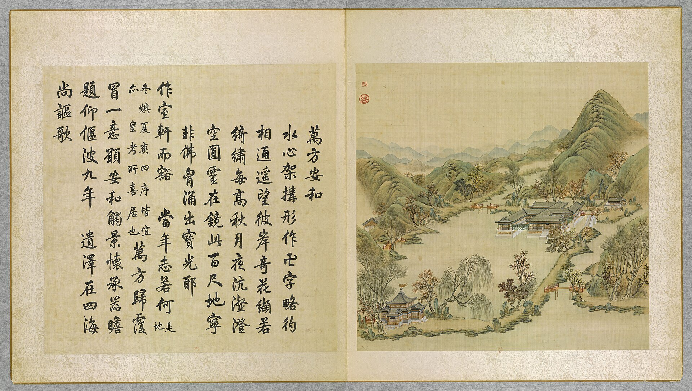

<!-- generated:start (scripts/building_pages.py): do not edit between these markers -->

# YM13-10: 十字亭 Shizi Ting

Yuanming Yuan

**3D object:** 1 box. Open it: `/reconstruction/3d.html?b=YM13-10`

**Part of:** YM13 万方安和

## What we know

- **Name:** 十字亭 Shizi Ting (S02, S06, S01 · confidence B)
- **Garden:** Yuanming Yuan (S02, S06, S01)
- **Type:** pavilion (S02, S06, S01 · confidence B)
- **Destroyed:** survived 1860 per 1873 survey (S06) (S02, S06, S01)
- **Position:** 40.00384, 116.28665. S01 sure (S01 · confidence B)
- **Size in the inventory:** 10.5 × 10.3 m. S01 plan px / hall scale (S01)
- **Where the text puts it:** At the south end of the lake (S02 p.81) (S02, S06, S01) *(research copy, not public)*
- **Note:** Malone: cross-shaped small building. 文昌阁 also placed here by S06. (S02, S06, S01)
- **Plan reader's note:** Cross-shaped pavilion in its own round bay, rect=44,34,0. Label (1880,4232) (S01) *(research copy, not public)*
- **How it was read:** sure (S01) *(research copy, not public)*
- **Plan pixels:** 1857, 4242 (S01) *(research copy, not public)*

## Our model now

On the block drawn on the Qing plan S01: position and frontage from the plan, heights and roof from the typology of its hall class, its form drawn by the hall kit. It will be updated as the research goes on.

- **Box:** 10.5 × 10.3 m, pavilion square
- **Heights:** platform 0.48 m, eave 3.68 m, ridge 8.04 m above the ground
- **Roof:** pyramid 攒尖, grey tile
- **Faces:** 172.8° from north
- **Drawn:** by the hall kit: 3 bays, the middle widest, steps on the front, 攒尖 pyramid, grey tile, a painted beam under the eave. From its own figures and readings where the dossier gives them (tiles read: halls.csv S08 A), the rest from the typology of its hall class.
- **Confidence:** B

## Pictures (1)

- **P0013** (likely): 萬方安和 Wanfang anhe [Paix et concorde aux dix mille horizons] (圓明園四十景, 第13景) (1744 (BnF record: 1744年，清朝乾隆九年)). https://commons.wikimedia.org/wiki/File%3A%E5%9C%93%E6%98%8E%E5%9C%92%E5%9B%9B%E5%8D%81%E6%99%AF._%E7%AC%AC%E5%8D%81%E4%B8%89%E6%99%AF_%28%E4%B8%8A%E5%86%8C%EF%BC%8C%E7%AC%AC%E5%8D%81%E4%B8%89%E5%B9%85%E5%9B%BE%29%2C_%E8%90%AC%E6%96%B9%E5%AE%89%E5%92%8C_-_%28%E6%B8%85%29%E5%94%90%E5%B2%B1%E3%80%81%E6%B2%88%E6%BA%90%E5%90%88%E7%95%AB_%3B_%28%E4%B9%BE%E9%9A%86%E5%90%9F%E8%AF%97%EF%BC%8C%E6%B1%AA%E7%94%B1%E6%95%A6%E4%BB%A3%E4%B9%A6%29Wanfang_anhe_-_%28Qing%29Tang_Dai%2C_Shen_Yuan_he_hua_-_btv1b550083263.jpg

  

## Texts and drawings (3)

- **E1450** (description, sure): Scene 13, 万方安和 Wanfang Anhe, the Swastika Building. 1934 · p.81 · S02. https://archive.org/details/historyofpekings00malo
  > The building in the form of a swastika, a symbol which is used as a Chinese character meaning ten thousand, and also Buddha's heart, is built on a foundation of brick and stone and is entirely surrounded by water.
  卍-plan building on a brick and stone foundation, entirely in water. At the south end of the lake a much smaller building in the form of a cross, the character for ten. Yongzheng often came here, says Qianlong's poem.
- **E1451** (description, likely): 圆明园五朝御制诗文集注 v2, editors' note on 万方安和. 2020 edition · v2 p.117 · S361. https://www.yuanmingyuanpark.cn/xs/yjbg/202008/P020200803382343267004.pdf#page=120
  Of 1727, built in the water in the shape of a 卍, with named rooms on each arm (the note lists them all). 平安院 lies north-east by a bridge, and a large double-eaved cross-shaped pavilion on the south shore.
- **E1453** (description, sure, search index only): 圆明园新证—万方安和考, 端木泓. n.d. · journal article, earlier fetch · S357. 
  Reads 万方安和 as a Buddhist cosmic diagram: the 万字房 at its heart, the 十字亭 as a node, and the long hall of 山高水长 as an answering stroke. Only the abstract was seen; no stable link kept.

**On the plan:** Drawn on the plan of the gardens (S01), labelled 十字亭. https://artmuseum.princeton.edu/collections/objects/138657

## Evidence for the set of buildings

- Evidence for the whole compound 万方安和: see YM13
- Reconstructions and comparables for the whole garden, 圆明园 Yuanming Yuan: see GARDEN-YM
- Standing buildings comparable to a square pavilion (not this building): see CLASS-pavilion_square

## Open questions

- Q92: YM13-10 十字亭

<!-- generated:end -->

## Notes

<!-- Yours: regeneration never touches this part. It goes on the public site; what you write below a line holding only %% private %% stays in the research copy. -->
