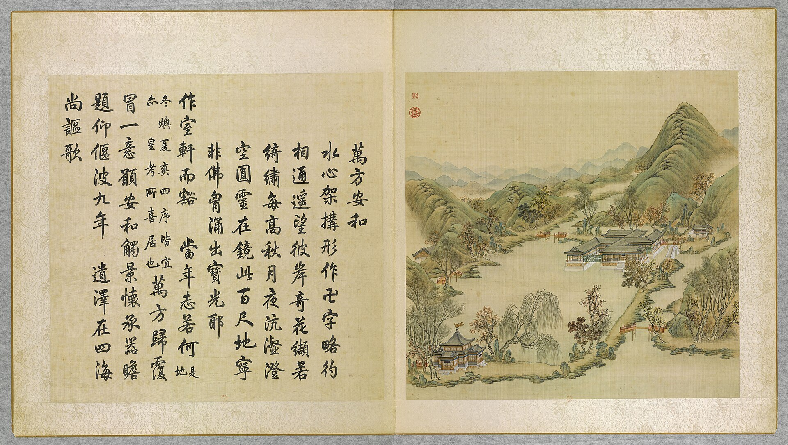
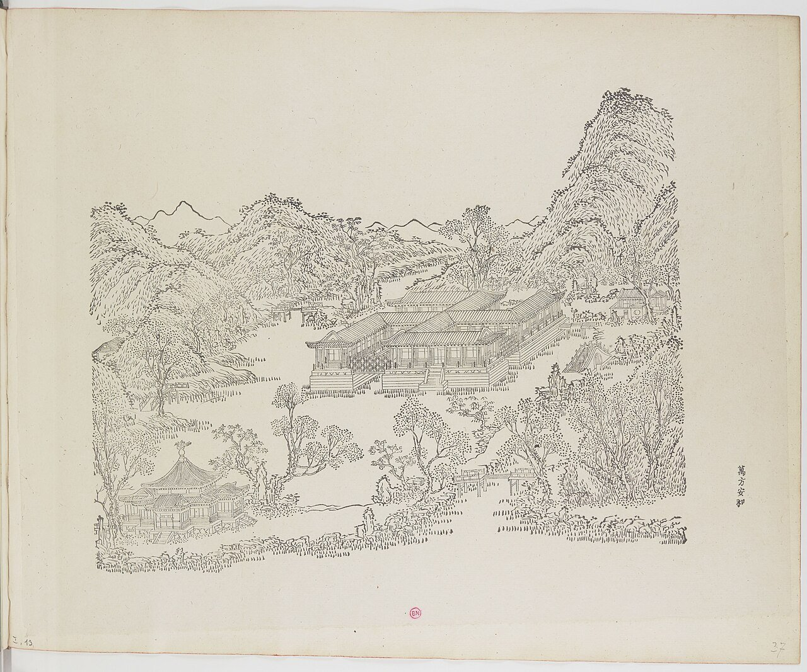
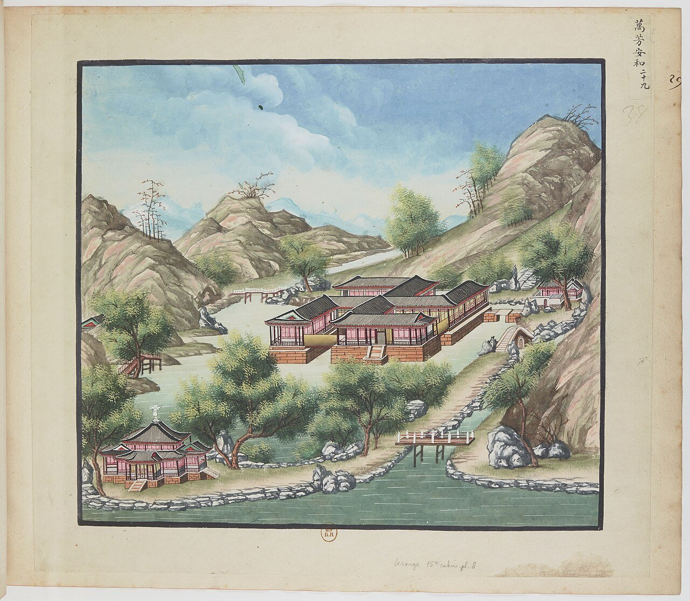
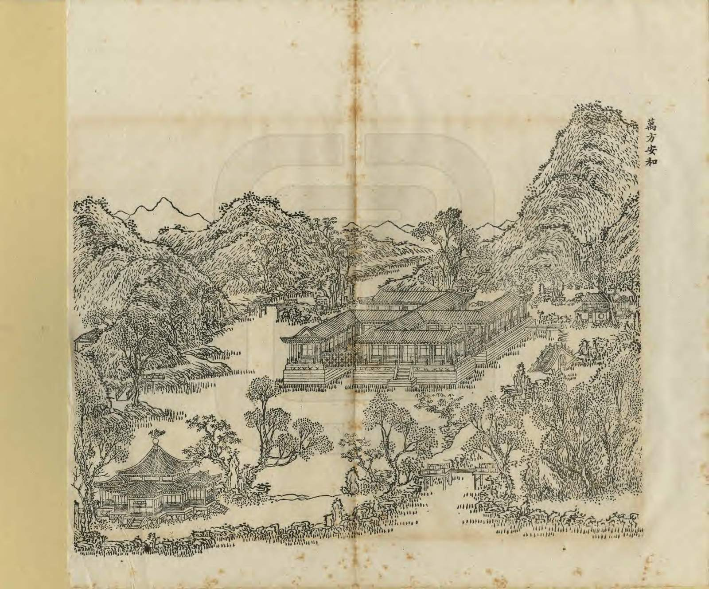
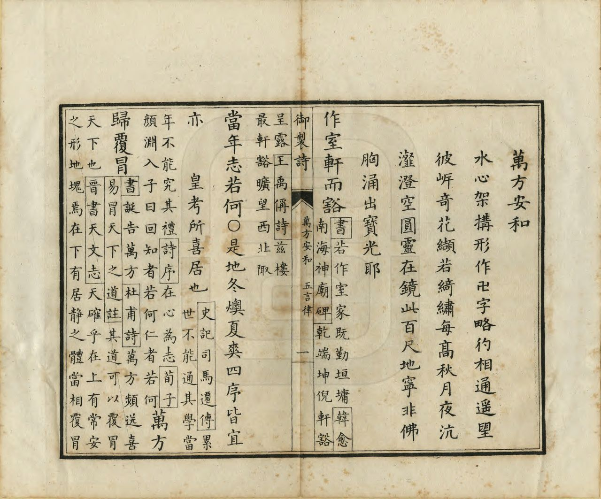
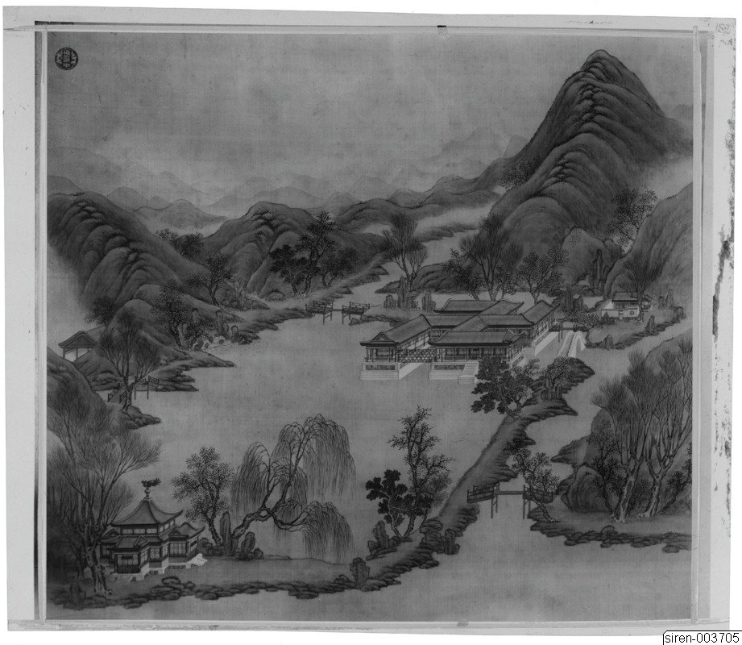
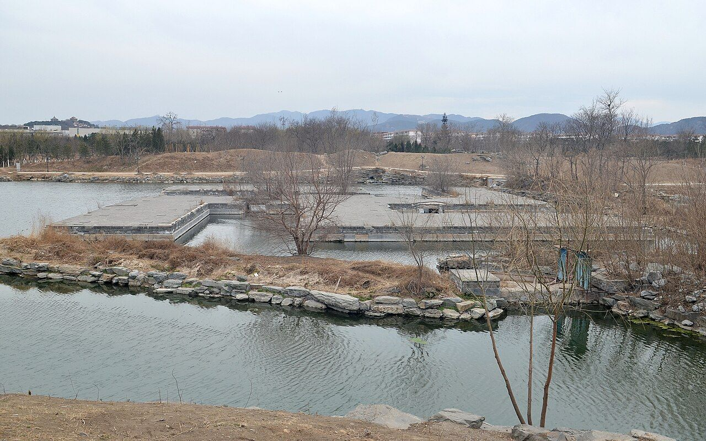

<!-- generated:start (scripts/building_pages.py): do not edit between these markers -->

# YM13: 万方安和 Wanfang Anhe

Swastika Building (Peace and Harmony Everywhere) · Yuanming Yuan

**3D object:** 8 boxes. Open it: `/reconstruction/3d.html?b=YM13`

## What we know

- **Name:** 万方安和 Wanfang Anhe (S05, S02, S08, S42, S43, S01, S361 · confidence A)
- **English:** Swastika Building (Peace and Harmony Everywhere) (S05, S02, S08, S42, S43, S01, S361)
- **Garden:** Yuanming Yuan (S05, S02, S08, S42, S43, S01, S361)
- **Type:** scene (S05, S02, S08, S42, S43, S01, S361 · confidence A)
- **Built:** 雍正初年 (S42;S43); before 1744; Yongzheng lived here (poem note); 1727 (S05, S02, S08, S42, S43, S01, S361)
- **Destroyed:** 1860; a 十字亭 on the 1873 survival list (S06) (S05, S02, S08, S42, S43, S01, S361)
- **Position:** 40.00567, 116.28670. S01 sure (S01 · confidence B)
- **Lead on its size, from a modern study, not used in the model:** Rockery by digital model, as surviving: straight length about 20.997 m, width about 7.395 m, height about 2.604 m (S594, Results, overall scale). (confidence B)
- **Note:** Plaques in parts of the 卍: 正室 南面 etc. Poem 1764 lists nine four-character parts [j81:10b-12a]. S06: 33 bays. Theatre in the west arm by 1727 (S43). (S05, S02, S08, S42, S43, S01, S361)
- **Plan reader's note:** Blue 13 at (1930,3440). Swastika building stands in the lake R0032; polygon takes it plus the north land lobe with B0561. 十字亭 at the south end of the lake (1857,4242) lies outside (S01) *(research copy, not public)*
- **How it was read:** sure (S01) *(research copy, not public)*
- **Plan pixels:** 2005, 3340 (S01) *(research copy, not public)*

## Our model now

8 boxes stand in this compound, 8 on blocks drawn on the plan, 0 assumed. Its halls are listed below.

## Inside it (11)

- YM13-01 万方安和 南面正室
- YM13-02 佳气迎人
- YM13-03 四方宁静
- YM13-04 碧溪一带
- YM13-05 山水清音
- YM13-06 神洲三岛
- YM13-07 高山流水
- YM13-08 枕流漱石
- YM13-09 洞天深处
- YM13-10 十字亭
- YM13-B0561

## Pictures (7)

- **P0013** (sure): 萬方安和 Wanfang anhe [Paix et concorde aux dix mille horizons] (圓明園四十景, 第13景) (1744 (BnF record: 1744年，清朝乾隆九年)). https://commons.wikimedia.org/wiki/File%3A%E5%9C%93%E6%98%8E%E5%9C%92%E5%9B%9B%E5%8D%81%E6%99%AF._%E7%AC%AC%E5%8D%81%E4%B8%89%E6%99%AF_%28%E4%B8%8A%E5%86%8C%EF%BC%8C%E7%AC%AC%E5%8D%81%E4%B8%89%E5%B9%85%E5%9B%BE%29%2C_%E8%90%AC%E6%96%B9%E5%AE%89%E5%92%8C_-_%28%E6%B8%85%29%E5%94%90%E5%B2%B1%E3%80%81%E6%B2%88%E6%BA%90%E5%90%88%E7%95%AB_%3B_%28%E4%B9%BE%E9%9A%86%E5%90%9F%E8%AF%97%EF%BC%8C%E6%B1%AA%E7%94%B1%E6%95%A6%E4%BB%A3%E4%B9%A6%29Wanfang_anhe_-_%28Qing%29Tang_Dai%2C_Shen_Yuan_he_hua_-_btv1b550083263.jpg

  

- **P0096** (sure): 中国皇帝的宫殿与庙宇. 第37幅图, 萬方安和 - (清)孙祜、沈源Wanfang anhe - (Qing)Sun Hu, Shen Yuan (1745 (Commons, from the BnF record)). https://commons.wikimedia.org/wiki/File%3A%E4%B8%AD%E5%9B%BD%E7%9A%87%E5%B8%9D%E7%9A%84%E5%AE%AB%E6%AE%BF%E4%B8%8E%E5%BA%99%E5%AE%87._%E7%AC%AC37%E5%B9%85%E5%9B%BE%2C_%E8%90%AC%E6%96%B9%E5%AE%89%E5%92%8C_-_%28%E6%B8%85%29%E5%AD%99%E7%A5%9C%E3%80%81%E6%B2%88%E6%BA%90Wanfang_anhe_-_%28Qing%29Sun_Hu%2C_Shen_Yuan_-_btv1b10520677z.jpg

  

- **P0129** (sure): 海淀(镇)：中国皇帝的行宫. 第29幅图, 萬方安和Wanfang anhe (1750-1792 (BnF, cb43831905b; ex coll. Bertin)). https://commons.wikimedia.org/wiki/File%3A%E6%B5%B7%E6%B7%80%28%E9%95%87%29%EF%BC%9A%E4%B8%AD%E5%9B%BD%E7%9A%87%E5%B8%9D%E7%9A%84%E8%A1%8C%E5%AE%AB._%E7%AC%AC29%E5%B9%85%E5%9B%BE%2C_%E8%90%AC%E6%96%B9%E5%AE%89%E5%92%8CWanfang_anhe_-_btv1b10520694f.jpg

  

- **P0244** (sure): 萬方安和 Wanfang Anhe (御製圓明園圖詠, 1887 石印本, 上卷 (Commons 卷一), 第13景; printed title in the right margin of the picture) (光緒十三年 1887 (Commons/NLC record; colophon 光緒十三年七月天津石印書屋 in the SSID copy, S98 PDF p.2); design after the woodblock of 1745 by 孫祜 Sun Hu and 沈源 Shen Yuan). https://commons.wikimedia.org/wiki/File%3ANLC403-312001107375-14035_%E7%A6%A6%E5%88%B6%E5%9C%93%E6%98%8E%E5%9C%92%E5%9C%96%E8%A9%A0_%E5%8D%B7%E4%B8%80.pdf?page=70

  

- **P0520** (sure): 萬方安和 Wanfang Anhe: 乾隆 Qianlong's preface and poem with the courtiers' commentary, 御製圓明園圖詠 1887 (poem 1744 (乾隆九年); this printing 1887). https://commons.wikimedia.org/wiki/File%3ANLC403-312001107375-14035_%E7%A6%A6%E5%88%B6%E5%9C%93%E6%98%8E%E5%9C%92%E5%9C%96%E8%A9%A0_%E5%8D%B7%E4%B8%80.pdf?page=71

  

- **P0204** (sure): Sirén, Enligt text under Pl. 182 Kinas trädgårdar Vol. I: Yuanmingyuan. Wan Fan An He, ”Fred och Harmoni överallt.” En byggnad på svastikaformad grundplan, resande sig ur vattnet. Svastikan  (undated by holder; Sirén's second trip 1921-23 for this group). http://kulturarvsdata.se/SMVK-OM/Bildarkiv/198814 Research-only: link card.

  

- **P0381** (sure): 万方安和遗址 20130318.JPG (2013-03-18 17:02:30 (Commons DateTimeOriginal)). https://commons.wikimedia.org/wiki/File:%E4%B8%87%E6%96%B9%E5%AE%89%E5%92%8C%E9%81%97%E5%9D%80_20130318.JPG

  

## Texts and drawings (28)

- **E1441** (poem, sure): 御製萬方安和詩（圓明園四十景詩）. 1744 (乾隆九年) · printed in S05 j81:9b-10a · S40. https://github.com/kanripo/KR2k0036/blob/master/KR2k0036_081.txt
  > 乾隆九年 御製萬方安和詩 水心架搆形作卍字畧彴相通遙望彼岸竒花纈若綺繡每高秋月夜沆瀣澄空圓靈在鏡此百尺地寜非佛胸涌出寳光耶 作室軒而豁當年志若何（是地冬燠夏爽四序皆宜亦皇考所喜居也）萬方歸覆冒一意願安和觸景懷承器瞻題仰偃波九年遺澤在四海尚謳歌
  Built out in the water in the form of a 卍, with small bridges to the shore and rare flowers on the far bank. On clear autumn nights under the moon the building seems to radiate the Buddha's light.
- **E1442** (poem, sure): 御製萬方安和九詠（有序）. 1764 (乾隆二十九年) · j81:10a-12a · S05. https://github.com/kanripo/KR2k0036/blob/master/KR2k0036_081.txt
  > 乾隆二十九年御製萬方安和九詠（有序）　圓明園西首於湖上築室作卍字形萬方安和其總名也為四十景之一迴廊面面各標勝概曲折向背輒復不同就四言標榜者得景凡九皆我皇考御筆也其二三言者尚不在此數夫室一區耳而為景不可勝計豈誠㸃綴之擅天巧哉於以見聖人之會心無窮又以見聖人之制度有節是予小子所當敬法也各成近體以誌遐思　肯構見於牆安和願萬方十三年宵旰千百載金湯卓爾吾由末瞠乎敢不蘉明堂設稽古左个在青陽（是額懸於卍字東南方為向陽正室即以此統名之右萬方安和）　向西旋轉北步近室之中東接函闗氣南來虞舜風迎人仰霽色愛物體淵衷夫子得於五温良象獨崇（右佳氣迎人）　四面近通廊中間正且方周旋皆中（去聲）矩鎮靜似持綱憶昔求安志於今豈敢忘要惟祈嵗稔民庶共平康（右四方寜静）　東向俯長溪溪煙入牖低氣蒸銀沆瀣界是碧玻瓈秋月蘆花渚春風栁線隄於何識常住翹首睇璇題（右碧溪一帶）　山峙水常流清音樂志投籟從風處峭響自石邊遒摶戛寜須藉宫商得概不崇情契仁知然豈忘先憂（右山水清音）　室中亦有樓仙榜揭神洲雲自棟梁寫風從忩户流簫曾聞子晉袖可挹浮邱那似劉家帝空勞海上舟（右神洲三島）　疏泉還叠石位置儼天然境與塵凡隔景供軒榭全崇高標嶺岫流動帶淪漣那數期牙奏心存解愠絃（右高山流水）　枕潄高人操因差轉得竒洗流耳雅合礪石齒偏宜易象占肥遯詩風詠樂飢渴賢别有託駒谷繾殷思（右枕流潄石）　武夷窮九曲方識洞天佳仿彿虹橋架依稀毛竹排益深斯致逺惟静與為諧欲會凝神抱緣澄出治懷（右洞天深處）
  Nine poems on the four-character plaques of the 卍-shaped building, by Yongzheng's hand. They give the layout: 萬方安和 at the south-east in the sunny main room, 佳氣迎人, 四方寜静 at the centre, 碧溪一帶, 山水清音, 神洲三島, 高山流水, 枕流潄石 and 洞天深處.
- **E1447** (text, sure): 日下舊聞考 万方安和. 1780s (乾隆 敕撰) · j81:9a-9b · S05. https://github.com/kanripo/KR2k0036/blob/master/KR2k0036_081.txt
  > 萬方安和在杏花春館西北建宇池中形如卍字（圓明園冊）臣等謹按萬方安和四十景之一南面正室額也東西内宇曰對溪山曰佳氣迎人卍字中宇曰四方寜静西面曰觀妙音曰枕流潄石曰洞天深處東面曰安然曰一爐香曰碧溪一帶曰山水清音北面曰滌塵心曰神洲三島曰高山流水皆世宗御書又南面西厦額曰凝神曰静寄東面曰澄觀正中聨曰四海昇平承帝眷萬幾兢業亮天工皆皇上御書
  North-west of 杏花春館, built in the water in the shape of the 卍 sign. The note reads out the plaques wing by wing, south, east, west, north and centre, which gives the plan of the building, and says who wrote each.
- **E1439** (poem, sure): 万方安和. 乾隆九年 (1744) · v2 p.118, under 万方安和; source ref 2-684 · S361. https://www.yuanmingyuanpark.cn/xs/yjbg/202008/P020200803382343267004.pdf#page=121
  > 水心架构，形作卍字。略彴相通，遥望彼岸，奇花缬若绮绣。毎髙秋月夜，沆瀣澄空，圆灵在镜。此百尺地，宁非佛胸涌出宝光耶！作室轩而豁，当年志若何
  Poem 万方安和 by the Qianlong Emperor, 1744, filed by the editors under 万方安和.
- **E1440** (poem, sure): 万方安和: 乾隆九年 poem of the Qianlong Emperor. 乾隆九年 (1744), date from the compilation · p.188 item (2), under 万方安和 · S360. https://www.yuanmingyuanpark.cn/xs/yjbg/202007/P020200730387572832602.pdf#page=188
  > 作室轩而豁，当年志若何。万方归覆冒，一意愿安和。触景怀承器，瞻题仰偃波。九年遗泽在，四海尚讴歌。
  Poem of the Qianlong Emperor at 万方安和, 1744. Year as given by the compilation.
- **E1460** (poem, sure): 佳气迎人. 乾隆二十九年 (1764) · v2 p.119, under 万方安和 · S361. https://www.yuanmingyuanpark.cn/xs/yjbg/202008/P020200803382343267004.pdf#page=122
  > 向西旋转北，步近室之中。东接函关气，南来虞舜风。迎人仰霁色，爱物体渊衷。夫子得于五，温良象独崇。
  Poem 佳气迎人 by the Qianlong Emperor, 1764, filed by the editors under 万方安和.
- **E1462** (poem, sure): 四方宁静. 乾隆二十九年 (1764) · v2 p.119, under 万方安和 · S361. https://www.yuanmingyuanpark.cn/xs/yjbg/202008/P020200803382343267004.pdf#page=122
  > 四面尽通廊，中间正且方。周旋皆中矩，镇静似持纲。忆昔求安志，于今岂敢忘。要惟祈岁稔，民庶共平康。
  Poem 四方宁静 by the Qianlong Emperor, 1764, filed by the editors under 万方安和.
- **E1463** (poem, sure): 碧溪一带. 乾隆二十九年 (1764) · v2 p.119, under 万方安和 · S361. https://www.yuanmingyuanpark.cn/xs/yjbg/202008/P020200803382343267004.pdf#page=122
  > 东向俯长溪，溪烟入牖低。气蒸银沆瀣，界是碧玻璃。秋月芦花渚，春风柳线隄。于何识常住，翘首睇璇题。
  Poem 碧溪一带 by the Qianlong Emperor, 1764, filed by the editors under 万方安和.
- **E1465** (poem, sure): 山水清音. 乾隆二十九年 (1764) · v2 p.120, under 万方安和 · S361. https://www.yuanmingyuanpark.cn/xs/yjbg/202008/P020200803382343267004.pdf#page=123
  > 山峙水常流，清音乐志投。籁从风处峭，响自石边遒。搏戛宁须藉，宫商得概不。崇情契仁知，然岂忘先忧。
  Poem 山水清音 by the Qianlong Emperor, 1764, filed by the editors under 万方安和.
- **E1466** (poem, sure): 神洲三岛. 乾隆二十九年 (1764) · v2 p.120, under 万方安和 · S361. https://www.yuanmingyuanpark.cn/xs/yjbg/202008/P020200803382343267004.pdf#page=123
  > 室中亦有楼，仙榜揭神洲。云自栋梁写，风从窗户流。箫曾闻子晋，袖可挹浮邱。那似刘家帝，空劳海上舟。
  Poem 神洲三岛 by the Qianlong Emperor, 1764, filed by the editors under 万方安和.
- **E1467** (poem, sure): 高山流水. 乾隆二十九年 (1764) · v2 p.120, under 万方安和 · S361. https://www.yuanmingyuanpark.cn/xs/yjbg/202008/P020200803382343267004.pdf#page=123
  > 疏泉还叠石，位置俨天然。境与尘凡隔，景供轩榭全。崇高标岭岫，流动带沦涟。那数期牙奏，心存解愠弦。
  Poem 高山流水 by the Qianlong Emperor, 1764, filed by the editors under 万方安和.
- **E1468** (poem, sure): 枕流漱石. 乾隆二十九年 (1764) · v2 p.120, under 万方安和 · S361. https://www.yuanmingyuanpark.cn/xs/yjbg/202008/P020200803382343267004.pdf#page=123
  > 枕漱高人操，因差转得奇。洗流耳雅合，砺石齿偏宜。易象占肥遯，诗风咏乐饥。渴贤别有托，驹谷缱殷思。
  Poem 枕流漱石 by the Qianlong Emperor, 1764, filed by the editors under 万方安和.
- **E1469** (poem, sure): 洞天深处. 乾隆二十九年 (1764) · v2 p.121, under 万方安和 · S361. https://www.yuanmingyuanpark.cn/xs/yjbg/202008/P020200803382343267004.pdf#page=124
  > 武夷穷九曲，方识洞天佳。仿佛虹桥架，依稀毛竹排。益深斯致远，惟静与为谐。欲会凝神抱，缘澄出治怀。
  Poem 洞天深处 by the Qianlong Emperor, 1764, filed by the editors under 万方安和.
- **E1443** (poem, sure): 万方安和: 嘉庆九年 poem of the Jiaqing Emperor. 嘉庆九年 (1804), date from the compilation · p.190 item (25), under 万方安和 · S360. https://www.yuanmingyuanpark.cn/xs/yjbg/202007/P020200730387572832602.pdf#page=190
  > 仰额承先志，为君心力殚。万方咸抚育，三省幸平安。（安亿兆于万方，和玉烛于四气，大君体天出治之本也。前此偏隅微祲，幸就涤除正以义者，悉可育以仁矣。同我太平庶副子，勅几御宇之志耳。）化俗绥群庶，移风勉众官。持盈守遗训，曷敢忘艰难。
  Poem of the Jiaqing Emperor at 万方安和, 1804, on daily residence there. Year as given by the compilation.
- **E1444** (poem, sure): 万方安和: 嘉庆十年 poem of the Jiaqing Emperor. 嘉庆十年 (1805), date from the compilation · p.190 item (26), under 万方安和 · S360. https://www.yuanmingyuanpark.cn/xs/yjbg/202007/P020200730387572832602.pdf#page=190
  > 敬绎宪皇题额治功，愿溥万方庶民成俗化被力田。逢年事臧大，法昭垂奕世。小子率由旧章肯构思艰图易，继述勉迪前光。（额为皇祖御题，义至深远。子小子率循彝训期与万方黎庶永庆安和，今岁各省年岁丰稔者，多河工获奏。安澜京师甫交冬序，即得透雪寅承眷佑，益励继绳。 ）
  Poem of the Jiaqing Emperor at 万方安和, 1805. Year as given by the compilation.
- **E1445** (poem, sure): 万方安和轩秋日作（351）. year not parsed · v2 p.117, under 万方安和 · S361. https://www.yuanmingyuanpark.cn/xs/yjbg/202008/P020200803382343267004.pdf#page=120
  > 霜飚飒飒度枫林，红叶如花碧水浔。每感金行成物品，常推道念格人心。翱翔彼鸟呼群乐，含哺吾民鼓腹吟。四野喜看农事毕，聿修百职政维今。
  Poem 万方安和轩秋日作（351） by the  Emperor, filed by the editors under 万方安和.
- **E1446** (poem, likely, search index only): 清吳省蘭書聖製萬方安和詩 冊, Wu Shenglan's calligraphy of the emperor's poem on 萬方安和. Qing · NPM-故書000885, Commons PDF · S70. https://commons.wikimedia.org/wiki/File:NPM-%E6%95%85%E6%9B%B8000885_%E6%B8%85%E5%90%B3%E7%9C%81%E8%98%AD%E6%9B%B8%E8%81%96%E8%A3%BD%E8%90%AC%E6%96%B9%E5%AE%89%E5%92%8C%E8%A9%A9_%E5%86%8A.pdf
  Found by title in a Commons search; file not opened. May be the 万方安和九咏 asked about: unproven. Licence not read.
- **E1449** (description, sure): Six paintings, V: 万方安和 Wanfang Anhe. before 1799 · pp.204-205, Tableau V · S258. https://archive.org/details/BIUSante_40644
  > Huit pavillons composent ce groupe; on pourroit représenter leur entrelacement par deux Z qui se croisent à angle droit dans leur milieu,
  The 卍 building in water, described by someone unaware of its meaning: eight identical pavilions, two Z shapes crossing at a centre, with bridges.
- **E1450** (description, sure): Scene 13, 万方安和 Wanfang Anhe, the Swastika Building. 1934 · p.81 · S02. https://archive.org/details/historyofpekings00malo
  > The building in the form of a swastika, a symbol which is used as a Chinese character meaning ten thousand, and also Buddha's heart, is built on a foundation of brick and stone and is entirely surrounded by water.
  卍-plan building on a brick and stone foundation, entirely in water. At the south end of the lake a much smaller building in the form of a cross, the character for ten. Yongzheng often came here, says Qianlong's poem.
- **E1216** (description, sure): Site status table, about 2011: remains tidied up. c. 2011 · 系列06 repost, status table · S356. https://blog.sina.com.cn/s/blog_c27029650101itzz.html
  A blogger's table of what was then visible. These scenes have building remains that have been cleared and tidied. Dated about 2011, so digs since then are not reflected.
- **E1452** (description, sure): 万字房的“前世”与“重生”: scene size. 2023 rev. · mhymy xsjl 14213 · S113. https://www.mhymy.com/xsjl/14213.html
  Scene 205 x 130 m, begun early Yongzheng, on the west of 后湖, with east and west shores shaped like opposed 如意.
- **E1454** (description, likely): 圆明园漫记, 宋广波. n.d. · essay · S335. https://www.aisixiang.com/data/141347.html
  A walker's essay. It says the base of 万方安和 and the goldfish pond of 坦坦荡荡 were dug and repaired in 2004 and were basically intact. It lists 澹怀堂, 含经堂 and 养雀笼 as the digs of its time. Lead only, not a report.
- **E1448** (description, sure): 圆明园百景史事分景汇编: 万方安和. 1744-1824 · from p.188, under 万方安和 · S360. https://www.yuanmingyuanpark.cn/xs/yjbg/202007/P020200730387572832602.pdf#page=188
  The compiler dates it to early Yongzheng, as 万字房; it was Yongzheng's favourite residence and the place of Qianlong's Duanwu dinners for the dowager. 万方安和: 37 dated items, 1744-1824, of which 22 poems and 15 court records (Qianlong, Jiaqing, Daoguang); recurring themes: visits to the dowager, daily residence there, state papers. First dated 1744, last dated 1824.
- **E1451** (description, sure): 圆明园五朝御制诗文集注 v2, editors' note on 万方安和. 2020 edition · v2 p.117 · S361. https://www.yuanmingyuanpark.cn/xs/yjbg/202008/P020200803382343267004.pdf#page=120
  Of 1727, built in the water in the shape of a 卍, with named rooms on each arm (the note lists them all). 平安院 lies north-east by a bridge, and a large double-eaved cross-shaped pavilion on the south shore.
- **E1453** (description, sure, search index only): 圆明园新证—万方安和考, 端木泓. n.d. · journal article, earlier fetch · S357. 
  Reads 万方安和 as a Buddhist cosmic diagram: the 万字房 at its heart, the 十字亭 as a node, and the long hall of 山高水长 as an answering stroke. Only the abstract was seen; no stable link kept.
- **E1455** (drawing, sure): 《国家图书馆藏样式雷图档·圆明园卷初编》: 万方安和. mostly 道光, 咸丰, 同治 per the publisher · 初编 目录: 万方安和, pp.194-201 · S13. https://www.nlcpress.com/ProductView.aspx?Id=7642
  The printed facsimile of the National Library of China's Yangshi Lei sheets has a section on this place at pp.194-201 (8 pages, section length worked out from the next heading); sheet titles and numbers are in the volume, ordered from a library.
- **E1456** (drawing, sure, search index only): 万方安和总平面图 (圆明园万方安和地盘全样). 乾嘉时期 · 国家图书馆善本部 样053-1-2号 = 国图053-0001-02 · S310. https://www.mhymy.com/dasl/ysltd/7980.html
  Presentation plan of the Wanfang Anhe scene, Qianlong-Jiaqing period, 33 halls on a swastika plan per the printed volume's preface (S13). No image here; the site may ask a small payment for the full record.
- **E1457** (drawing, sure, search index only): 圆明园万方安和殿 烫样. 同治年间 · 故宫博物院 · S326. https://m.thepaper.cn/detail/31695388
  Paper model of the Wanfang Anhe hall made for Tongzhi's repair project, for the emperor and Empress Dowager Cixi to review, so after the target state; also shown at the Hong Kong Palace Museum in 2024.

**On the plan:** Drawn on the plan of the gardens (S01), labelled 万方安和. https://artmuseum.princeton.edu/collections/objects/138657

## Reconstructions by others (14)

Modern interpretation, not evidence.
- **R0105** (paper figure, sure): Fig. 3, Live photos and panoramic images of Wanfang Anhe Rockery. Xinchen Li, Xiaoxiao He, Yuqing Xiao, Shizhen Jia, Ke Qin, China Agricultural University, 2024. https://www.nature.com/articles/s40494-024-01213-5#Fig3
- **R0106** (paper figure, sure): Fig. 4, connection points, triangular mesh model, point-cloud slice of Wanfang Anhe Rockery. Xinchen Li, Xiaoxiao He, Yuqing Xiao, Shizhen Jia, Ke Qin, China Agricultural University, 2024. https://www.nature.com/articles/s40494-024-01213-5#Fig4
- **R0107** (paper figure, sure): Fig. 6, Region division of Wanfang Anhe Rockery. Xinchen Li, Xiaoxiao He, Yuqing Xiao, Shizhen Jia, Ke Qin, China Agricultural University, 2024. https://www.nature.com/articles/s40494-024-01213-5#Fig6
- **R0111** (paper figure, sure): Fig. 8, Hierarchical division of Region B of Wanfang Anhe Rockery. Xinchen Li, Xiaoxiao He, Yuqing Xiao, Shizhen Jia, Ke Qin, China Agricultural University, 2024. https://www.nature.com/articles/s40494-024-01213-5#Fig8
- **R0088** (render, likely): 万方安和, image 753 in a gallery. posted 2019. https://www.thepaper.cn/newsDetail_forward_3323921 Research-only: link card.
- **R0049** (3D model, sure): Early student 3D model of 万方安和. students of 郭黛姮, 清华大学建筑学院, after 2000. https://www.tsinghua.edu.cn/info/1182/97060.htm Research-only: link card.
- **R0289** (physical model, sure): 烫样, Model of the Hall of Universal Peace (万方安和) in Yuan Ming Yuan. 样式房 Imperial Architecture Studio, Yangshi Lei, 故宫博物院 Palace Museum, 1873-1874. https://www.hkpm.org.hk/en/exhibition/the-hong-kong-jockey-club-series-yuan-ming-yuan-art-and-culture-of-an-imperial-garden-palace Research-only: link card.
- **R0148** (physical model, likely): 样式雷烫样 Yangshi Lei card models of Yuanmingyuan: 泉石自娱, 同乐堂, 上下天光, 思顺堂, 天地一家春, 恒春堂, 课农轩, 廓然大公, 勤政殿, 万方安和. 雷氏 Lei family holdings, shown in 故宫 exhibition 营缮之道 《单士元》, Tongzhi period for most, per the report. https://www.thepaper.cn/newsDetail_forward_2201516 Research-only: link card.
- **R0186** (paper figure, sure): 【圆明园】系列02 圆明园复原图欣赏. yaffin (blog name), 新浪博客, c. 2011. https://blog.sina.com.cn/s/blog_65fec3ab0100siah.html Research-only: link card.
- **R0001** (paper figure, sure): 万字房的“前世”与“重生”, 梦回圆明园. 梦回圆明园, 2023 rev.. https://www.mhymy.com/xsjl/14213.html Research-only: link card.
- **R0108** (paper figure, sure): Fig. 12, viewing line and position, Beihai reference, ornamental effect at Wanfang Anhe. Xinchen Li, Xiaoxiao He, Yuqing Xiao, Shizhen Jia, Ke Qin, China Agricultural University, 2024. https://www.nature.com/articles/s40494-024-01213-5#Fig12 Research-only: link card.
- **R0112** (paper figure, sure): Fig. 5, Viewing angle and viewing distance of Wanfang Anhe Rockery. Xinchen Li, Xiaoxiao He, Yuqing Xiao, Shizhen Jia, Ke Qin, China Agricultural University, 2024. https://www.nature.com/articles/s40494-024-01213-5#Fig5 Research-only: link card.
- **R0034** (video, sure, search index only): [央美]万方安和复原视频. 吴晓敏, 陈东, per mhymy xsjl 14213 as summarised in a search extract, 中央美术学院圆明园研究中心 (央美 tag; the page names it, per search extract). https://www.mhymy.com/szfy/fysp/14188.html Research-only: link card.
- **R0104** (paper figure, sure, search index only): Constructive analysis and digital 3D reconstruction of the Yuanmingyuan Ruins: Wanfanganhe Pavilion (Virtual Archaeology Review 13(27)). Yan Chen, Federico Luis del Blanco Garcia, 2022. https://polipapers.upv.es/index.php/var/article/view/16523 Research-only: link card.

## Surviving comparable buildings, not this building (2)

- **T012** 万字廊 (淑清院) Wanzi Lang, Shuqing Yuan, 中南海 Zhongnanhai. Comparable: same court, era or type, confidence C, standing: partly. Swastika plan as a gallery only Basis: S422: 万字廊 listed in the Qianlong garden; 1949 changes noted; S05 j.81 f.10a on ours: a building like 卍 on water. https://zh.wikipedia.org/wiki/中南海
- **T013** 碧螺亭 Biluo Ting, 宁寿宫花园 故宫. Comparable: same court, era or type, confidence C, standing: yes. Roof on an odd plan, not 卍 Basis: S422: plum-blossom plan on five columns, double eave, 1772: another Qianlong shape-plan. https://zh.wikipedia.org/wiki/宁寿宫花园

## Evidence for the set of buildings

- Reconstructions and comparables for the whole garden, 圆明园 Yuanming Yuan: see GARDEN-YM

## Open questions

- Q26: Forms
- Q51: Reading the Yangshi Lei records

<!-- generated:end -->

## Notes

<!-- Yours: regeneration never touches this part. It goes on the public site; what you write below a line holding only %% private %% stays in the research copy. -->
