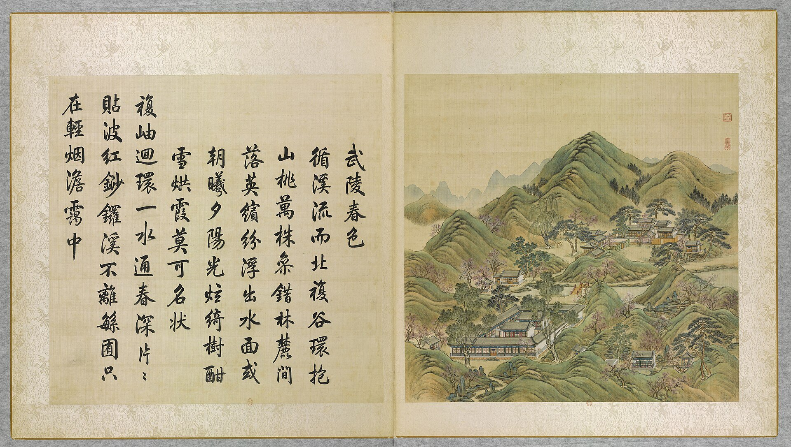
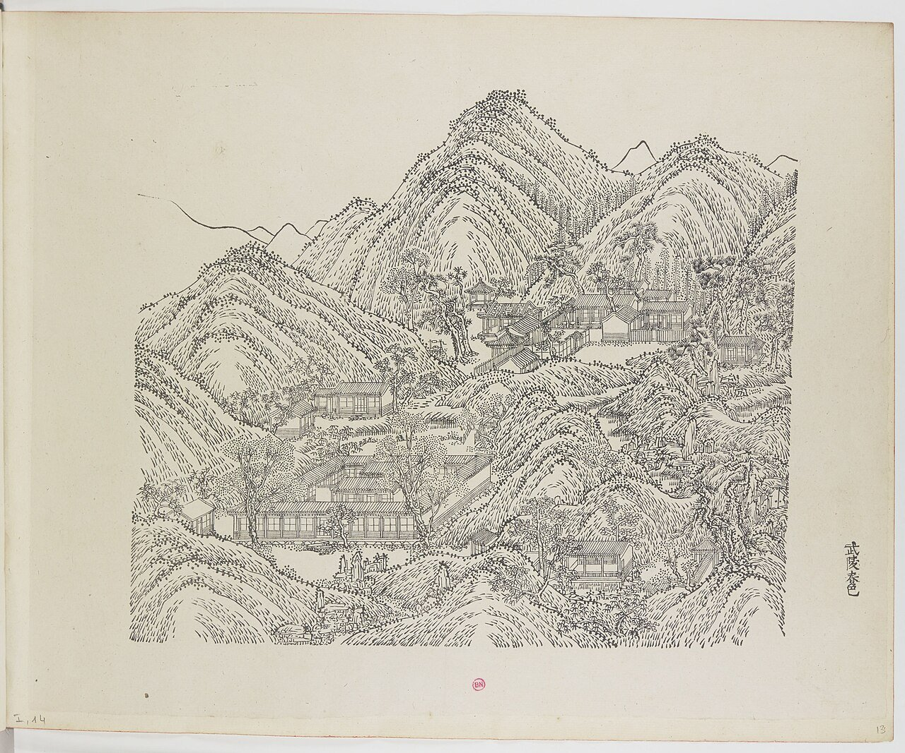
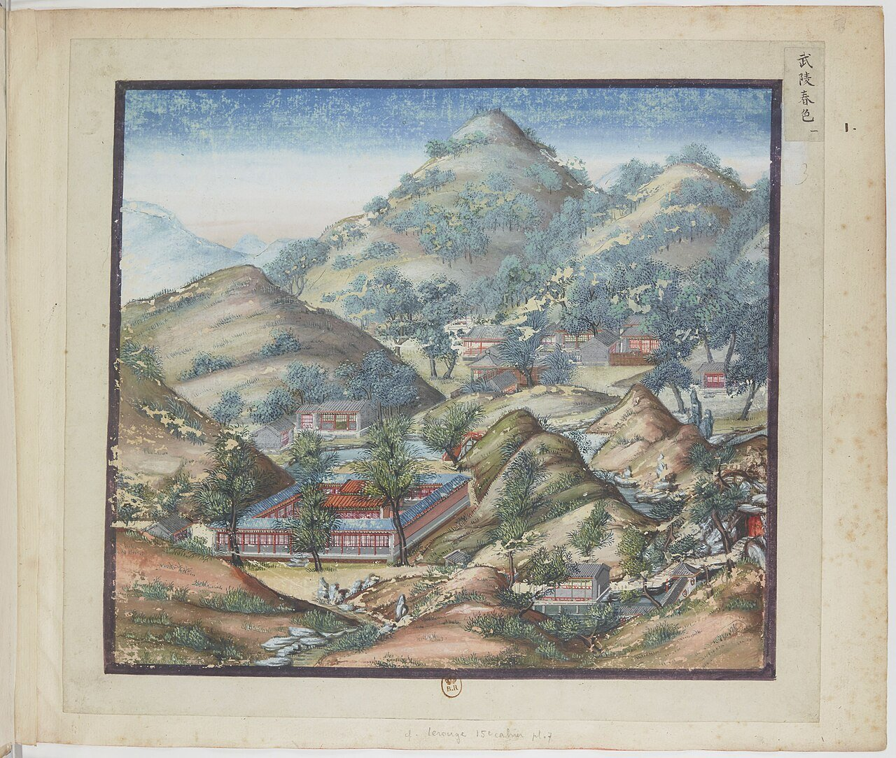
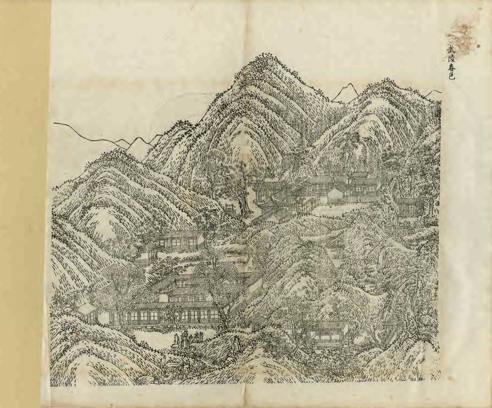
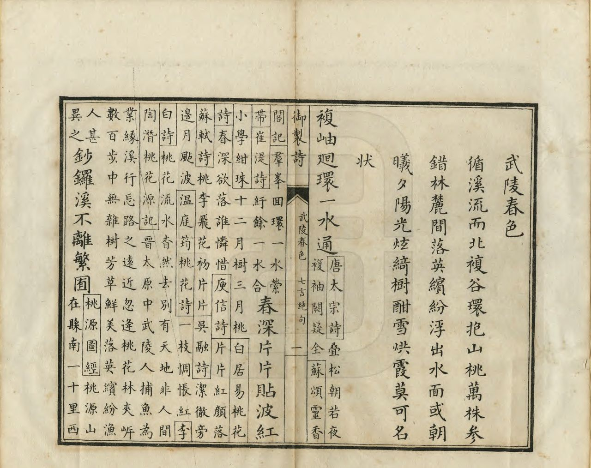

<!-- generated:start (scripts/building_pages.py): do not edit between these markers -->

# YM14: 武陵春色 Wuling Chunse

Peach Blossom Cave (Spring Colors at Wu Ling) · Yuanming Yuan

**3D object:** 24 boxes. Open it: `/reconstruction/3d.html?b=YM14`

## What we know

- **Name:** 武陵春色 Wuling Chunse (S05, S02, S08, S41, S42, S43, S01, S200, S340, S361 · confidence A)
- **English:** Peach Blossom Cave (Spring Colors at Wu Ling) (S05, S02, S08, S41, S42, S43, S01, S200, S340, S361)
- **Written on the plan:** 桃花洞 (S01 · confidence A)
- **Garden:** Yuanming Yuan (S05, S02, S08, S41, S42, S43, S01, S200, S340, S361)
- **Type:** scene (S05, S02, S08, S41, S42, S43, S01, S200, S340, S361 · confidence A)
- **Built:** 建于1720年前, 初名桃花坞 (S42); by 1722: 桃花塢 and 壺中天 named in a prince's poems (雍邸集); before 1720, as 桃花坞; 1726 (S05, S02, S08, S41, S42, S43, S01, S200, S340, S361)
- **Changed:** 桃花坞 theatre added 1811 (S43); differs on later plans (S41); 1726 (雍正四年): Qianlong studies here and names it 樂善堂; earlier the whole was 桃花塢 (S05, S02, S08, S41, S42, S43, S01, S200, S340, S361)
- **Destroyed:** 1860 (S05, S02, S08, S41, S42, S43, S01, S200, S340, S361)
- **Position:** 40.00635, 116.28736. S01 likely (S01 · confidence B)
- **Note:** Qianlong studied here 1726 as 樂善堂 [j81:13a]. Album does not show the 1860 state here (S41). 武陵春色, earlier 桃花坞 as a whole (S05, j81:13a). (S05, S02, S08, S41, S42, S43, S01, S200, S340, S361)
- **Plan reader's note:** Rock ridge island plus 全璧堂 walled court to the NW and 桃花洞 rocks. Walled court runs north of my box to y about 2715: halls there left to the reader of that area (S01) *(research copy, not public)*
- **How it was read:** likely (S01) *(research copy, not public)*
- **Plan pixels:** 2301, 3056 (S01) *(research copy, not public)*

## Our model now

24 boxes stand in this compound, 24 on blocks drawn on the plan, 0 assumed. Its halls are listed below.

## Inside it (33)

- YM14-01 壶中天 石洞
- YM14-02 壶中日月长
- YM14-03 天然佳妙
- YM14-04 洞天日月多佳景
- YM14-05 全璧堂
- YM14-06 小隐栖迟亭
- YM14-07 清秀亭
- YM14-08 清会亭
- YM14-09 桃花坞
- YM14-10 清水濯缨
- YM14-11 桃源深处
- YM14-12 绾春轩
- YM14-13 品诗堂
- YM14-14 恒春堂
- YM14-15 壶中仙籁戏台
- YM14-AW001
- YM14-B0393
- YM14-B0394
- YM14-B0395
- YM14-B0404
- YM14-B0405
- YM14-B0406
- YM14-B0425
- YM14-B0426
- YM14-B0427
- YM14-B0428
- YM14-B0478
- YM14-B0479
- YM14-B0480
- YM14-B0481
- YM14-B0529
- YM14-B0530
- YM14-B0543

## Pictures (5)

- **P0014** (sure): 武陵春色 Wuling chunse [Couleurs du printemps à Wuling] (圓明園四十景, 第14景) (1744 (BnF record: 1744年，清朝乾隆九年)). https://commons.wikimedia.org/wiki/File%3A%E5%9C%93%E6%98%8E%E5%9C%92%E5%9B%9B%E5%8D%81%E6%99%AF._%E7%AC%AC%E5%8D%81%E5%9B%9B%E6%99%AF_%28%E4%B8%8A%E5%86%8C%EF%BC%8C%E7%AC%AC%E5%8D%81%E5%9B%9B%E5%B9%85%E5%9B%BE%29%2C_%E6%AD%A6%E9%99%B5%E6%98%A5%E8%89%B2_-_%28%E6%B8%85%29%E5%94%90%E5%B2%B1%E3%80%81%E6%B2%88%E6%BA%90%E5%90%88%E7%95%AB_%3B_%28%E4%B9%BE%E9%9A%86%E5%90%9F%E8%AF%97%EF%BC%8C%E6%B1%AA%E7%94%B1%E6%95%A6%E4%BB%A3%E4%B9%A6%29Wuling_chunse_-_%28Qing%29Tang_Dai%2C_Shen_Yuan_he_hua_-_btv1b55008327j.jpg

  

- **P0073** (sure): 中国皇帝的宫殿与庙宇. 第13幅图, 武陵春色 - (清)孙祜、沈源Wuling chunse - (Qing)Sun Hu, Shen Yuan (1745 (Commons, from the BnF record)). https://commons.wikimedia.org/wiki/File%3A%E4%B8%AD%E5%9B%BD%E7%9A%87%E5%B8%9D%E7%9A%84%E5%AE%AB%E6%AE%BF%E4%B8%8E%E5%BA%99%E5%AE%87._%E7%AC%AC13%E5%B9%85%E5%9B%BE%2C_%E6%AD%A6%E9%99%B5%E6%98%A5%E8%89%B2_-_%28%E6%B8%85%29%E5%AD%99%E7%A5%9C%E3%80%81%E6%B2%88%E6%BA%90Wuling_chunse_-_%28Qing%29Sun_Hu%2C_Shen_Yuan_-_btv1b10520678d.jpg

  

- **P0101** (sure): 海淀(镇)：中国皇帝的行宫. 第1幅图, 武陵春色Wuling chunse (1750-1792 (BnF, cb43831905b; ex coll. Bertin)). https://commons.wikimedia.org/wiki/File%3A%E6%B5%B7%E6%B7%80%28%E9%95%87%29%EF%BC%9A%E4%B8%AD%E5%9B%BD%E7%9A%87%E5%B8%9D%E7%9A%84%E8%A1%8C%E5%AE%AB._%E7%AC%AC1%E5%B9%85%E5%9B%BE%2C_%E6%AD%A6%E9%99%B5%E6%98%A5%E8%89%B2Wuling_chunse_-_btv1b10520695w.jpg

  

- **P0245** (sure): 武陵春色 Wuling Chunse (御製圓明園圖詠, 1887 石印本, 上卷 (Commons 卷一), 第14景; printed title in the right margin of the picture) (光緒十三年 1887 (Commons/NLC record; colophon 光緒十三年七月天津石印書屋 in the SSID copy, S98 PDF p.2); design after the woodblock of 1745 by 孫祜 Sun Hu and 沈源 Shen Yuan). https://commons.wikimedia.org/wiki/File%3ANLC403-312001107375-14035_%E7%A6%A6%E5%88%B6%E5%9C%93%E6%98%8E%E5%9C%92%E5%9C%96%E8%A9%A0_%E5%8D%B7%E4%B8%80.pdf?page=73

  

- **P0521** (sure): 武陵春色 Wuling Chunse: 乾隆 Qianlong's preface and poem with the courtiers' commentary, 御製圓明園圖詠 1887 (poem 1744 (乾隆九年); this printing 1887). https://commons.wikimedia.org/wiki/File%3ANLC403-312001107375-14035_%E7%A6%A6%E5%88%B6%E5%9C%93%E6%98%8E%E5%9C%92%E5%9C%96%E8%A9%A0_%E5%8D%B7%E4%B8%80.pdf?page=74

  

## Texts and drawings (51)

- **E1491** (text, sure): 御製樂善堂記. before 1735 (a prince, undated in S05) · j81:13b-14b · S05. https://github.com/kanripo/KR2k0036/blob/master/KR2k0036_081.txt
  > 御製樂善堂記　凡人之性未嘗不善仁義禮智全備於我所謂得天地之正氣而為人也然而智愚賢不肖之分者氣拘之私誘之遂日以蔽錮而昏昧有能復其性者鮮矣人能自强不息以復性為功已有善念擴而充之人有善事喜而從之則本性呈露而有馨香之徳矣是故明徳之馨勝於黍稷芝蘭鮑魚與之俱化未有樂善而不能修徳者也余有書屋數間清爽幽静山水之趣琴鶴之玩時呈於前菜圃數畦桃花滿林堪以娯目顔之曰樂善堂者盖取大舜樂取於人以為善之意也夫孝弟仁義乃所謂善也人能孝以養親弟以敬長仁以恤下義以事上樂而行之時時無怠則能因物付物以事處事而完所性之本體矣是故大舜聖人也猶存虚受之心聞一善言若決江河漢文帝嘗問東平王在國何事最樂王曰為善最樂余雖不敏然頼皇父之明訓師友之切磋於大舜之善與人同雖有志而未逮而東平王之為善最樂則不敢不勉焉是為記（文御製集）
  Essay of his youth on the name 樂善堂 given to his study among peach trees. Mainly moral; it mentions a few rooms, vegetable plots and a peach wood. Printed from his collected prose.
- **E1472** (poem, sure): 御製武陵春色詩（圓明園四十景詩）. 1744 (乾隆九年) · printed in S05 j81:14b-15a · S40. https://github.com/kanripo/KR2k0036/blob/master/KR2k0036_081.txt
  > 乾隆九年 御製武陵春色詩 循溪流而北複谷環抱山桃萬株參錯林麓間落英繽紛浮出水面或朝曦夕陽光炫綺樹酣雪烘霞莫可名狀 複岫迴環一水通春深片片貼波紅鈔鑼溪不離緐囿只在輕煙淡靄中
  Following the stream north into a ring of valleys, ten thousand peach trees stand scattered on the slopes and fallen petals float on the water. Morning and evening light make the trees blaze beyond description.
- **E1492** (text, sure): 日下舊聞考 武陵春色. 1780s (乾隆 敕撰) · j81:12b-13b · S05. https://github.com/kanripo/KR2k0036/blob/master/KR2k0036_081.txt
  > 萬方安和後度橋折而東稍北石洞之南為武陵春色池北軒為壺中日月長東為天然佳妙其南厦為洞天日月多佳景武陵春色之西為全璧堂東南亭為小隠棲遲堂後由山口入東為清秀亭西為清會亭北為桃花塢塢之西室為清水濯纓又西稍北為桃源深處塢東為綰春軒軒東北為品詩堂（圓明園冊）臣等謹按武陵春色額為皇上御書四十景之一也舊總名桃花塢雍正四年皇上讀書于此顔曰樂善堂旋移居長春仙館武陵春色石洞内額曰壺中天與壺中日月長天然佳妙洞天日月多佳景小隠棲遲清秀清會亭桃花塢清水濯纓桃源深處諸額皆世宗御書全璧堂綰春軒品詩堂諸額皇上御書
  East over a bridge behind 萬方安和, past a rock tunnel: 武陵春色 with 壺中日月長, 天然佳妙, 全璧堂, 小隠棲遲, 清秀亭, 清會亭, 桃花塢, 清水濯纓, 桃源深處, 綰春軒 and 品詩堂. Once named 桃花塢 as a whole; Qianlong read here from 雍正四年 (1726) and called it 樂善堂, then moved to 長春仙館.
- **E1470** (poem, sure): 世宗 壺中天 (園景十二詠). before 1723 (雍邸集, printed as written while a prince) · KR4f0002_026:4b · S200. https://github.com/kanripo/KR4f0002/blob/master/KR4f0002_026.txt
  > 壺中天 峯峻疑無路雲深却有扉鶴閑時獨唳花静不輕飛洞裏春長駐壺中月更輝一潭空似鏡碧色動簾衣
  Prince's poem on the 'Heaven in a Gourd': a path through a peak and a mirror-like pool. Rixia j81:13a gives 壺中天 as the plaque in the rock tunnel of 武陵春色.
- **E1471** (poem, sure): 世宗 桃花塢 (園景十二詠). before 1723 (雍邸集, printed as written while a prince) · KR4f0002_026:3b · S200. https://github.com/kanripo/KR4f0002/blob/master/KR4f0002_026.txt
  > 桃花塢 水南通曲港水北入廽溪綘雪侵衣艶赬霞遶屋低影迷棲棟燕聲杳隔林鷄檻外風微起飄零錦墮泥
  Prince's poem on the peach bank, with streams running south and north. Rixia j81:13a confirms 武陵春色 was first called 桃花塢.
- **E1490** (poem, sure): 世宗 桃花塢即景. 雍正 (四宜堂集, undated) · KR4f0002_029:3a-3b · S200. https://github.com/kanripo/KR4f0002/blob/master/KR4f0002_029.txt
  > 桃花塢即景 禁園宜雨復宜晴别館春深枕簟清數片落花驚午夢一聲漁唱惹閒情暫移榻向松間坐恰聴禽来竹裡鳴惟有東風知我意滿池新綠浪紋生
  Yongzheng on a spring stay at 桃花塢, in a poem from his collected works: rain and sun, a fisherman's song, a couch moved under the pines.
- **E1473** (poem, sure): 武陵春色. 乾隆九年 (1744) · v2 p.133, under 武陵春色; source ref 2-684 · S361. https://www.yuanmingyuanpark.cn/xs/yjbg/202008/P020200803382343267004.pdf#page=136
  > 循溪流而北，复谷环抱。山桃万株，参错林麓间。落英缤纷，浮出水面，或朝曦夕阳，光炫绮树，酣雪烘霞，莫可名状。复岫回环一水通，春深片片贴波红。钞锣溪不离繁囿，只在轻烟淡霭中。
  Poem 武陵春色 by the Qianlong Emperor, 1744, filed by the editors under 武陵春色.
- **E1474** (poem, sure): 武陵春色: 乾隆九年 poem of the Qianlong Emperor. 乾隆九年 (1744), date from the compilation · p.203 item (1), under 武陵春色 · S360. https://www.yuanmingyuanpark.cn/xs/yjbg/202007/P020200730387572832602.pdf#page=203
  > 复岫回环一水通，春深片片贴波红。钞锣溪不离繁囿，只在轻烟淡霭中。
  Poem of the Qianlong Emperor at 武陵春色, 1744, on snow. Year as given by the compilation.
- **E1475** (poem, sure): 品诗堂: 乾隆三十五年 poem of the Qianlong Emperor. 乾隆三十五年 (1770), date from the compilation · p.205 item (1), under 品诗堂 · S360. https://www.yuanmingyuanpark.cn/xs/yjbg/202007/P020200730387572832602.pdf#page=205
  > 四十年前此乐闲，倚吟清课绿窗间。偶然旧集重披检，祇合従头一例删。
  Poem of the Qianlong Emperor at 品诗堂, 1770, on remembering his forebears. Year as given by the compilation.
- **E1476** (poem, sure): 桃花坞: 乾隆三十五年 poem of the Qianlong Emperor. 乾隆三十五年 (1770), date from the compilation · p.204 item (3), under 桃花坞 · S360. https://www.yuanmingyuanpark.cn/xs/yjbg/202007/P020200730387572832602.pdf#page=204
  > 山桃开最早，江国拟梅花。韵亦含风细，影原照水斜。遐怀武陵曲，浓迭赤城霞。缅想赐居日，流阴暗自嗟。
  Poem of the Qianlong Emperor at 桃花坞, 1770, on remembering his forebears and the view. Year as given by the compilation.
- **E1477** (poem, sure): 绾春轩: 乾隆三十五年 poem of the Qianlong Emperor. 乾隆三十五年 (1770), date from the compilation · p.206 item (1), under 绾春轩 · S360. https://www.yuanmingyuanpark.cn/xs/yjbg/202007/P020200730387572832602.pdf#page=206
  > 一树垂杨阴满院，芸帷棐几称吟慿。不堪对雪道韫拟，何必当年张绪曾。栉栉云中凉月漏，蒙蒙晓际澹烟凝。青丝窣地几千尺，绾得春光许尔能。
  Poem of the Qianlong Emperor at 绾春轩, 1770, on the view. Year as given by the compilation.
- **E1509** (poem, sure): 绾春轩口号. 乾隆三十五年 (1770) · v2 p.134, under 武陵春色; source ref 10-720 · S361. https://www.yuanmingyuanpark.cn/xs/yjbg/202008/P020200803382343267004.pdf#page=137
  > 百尺垂丝绿影铺，敞轩逭暑坐斯须。忽然拟向长条问，流水春光绾得无。
  Poem 绾春轩口号 by the Qianlong Emperor, 1770, filed by the editors under 武陵春色.
- **E1478** (poem, sure): 桃花坞: 乾隆三十九年 poem of the Qianlong Emperor. 乾隆三十九年 (1774), date from the compilation · p.204 item (4), under 桃花坞 · S360. https://www.yuanmingyuanpark.cn/xs/yjbg/202007/P020200730387572832602.pdf#page=204
  > 赐居西北御园隈， （是处为予十四五六岁时所居之地）葺治乘闲偶一来。少小情怀昔悠矣，惕乾朝夕此殷哉。绿铺砌草步如毯，白绽山桃讶似梅。本是坞名拟呉下，（苏州阊门内有桃花坞，其地传为唐寅故居。今为市文房之所，不以桃著。此虽袭用其名，而桃花之盛颇堪核实也。）便疑雪海亦苏台。
  Poem of the Qianlong Emperor at 桃花坞, 1774, on remembering his forebears and the view. Year as given by the compilation.
- **E1511** (poem, sure): 品诗堂口号. 乾隆三十九年 (1774) · v2 p.134, under 武陵春色; source ref 12-544 · S361. https://www.yuanmingyuanpark.cn/xs/yjbg/202008/P020200803382343267004.pdf#page=137
  > 此曾敬业此摛词，旧集今翻拟弃遗。岂不虑为失故步，大都结习合忘之。
  Poem 品诗堂口号 by the Qianlong Emperor, 1774, filed by the editors under 武陵春色.
- **E1479** (poem, sure): 桃花坞: 乾隆四十一年 poem of the Qianlong Emperor. 乾隆四十一年 (1776), date from the compilation · p.204 item (5), under 桃花坞 · S360. https://www.yuanmingyuanpark.cn/xs/yjbg/202007/P020200730387572832602.pdf#page=204
  > 年前立春已半月，气早昌昌生意勃。孟月甫届下之澣，即见山桃花欲发。虽以闰月定四时，盈缩长短原人为。人为实不出天定，万物菀枯各自知。闻之金阊亦有此，唐寅辈逞材 华美。（苏州闾门内有桃花坞，其地有桃花庵即唐寅旧居。）四度南巡阙访曾，流水行云而已矣。
  Poem of the Qianlong Emperor at 桃花坞, 1776, on the view. Year as given by the compilation.
- **E1480** (poem, sure): 绾春轩: 乾隆四十一年 poem of the Qianlong Emperor. 乾隆四十一年 (1776), date from the compilation · p.206 item (3), under 绾春轩 · S360. https://www.yuanmingyuanpark.cn/xs/yjbg/202007/P020200730387572832602.pdf#page=206
  > 书轩亦絶胜，棐几傥来凭。旧学温何有，（是处在桃花坞中为青年时书室）新知契几曾。砌花红雨过，庭树绿阴増。春意去杳矣，问谁绾得能。
  Poem of the Qianlong Emperor at 绾春轩, 1776, on reading and remembering his forebears. Year as given by the compilation.
- **E1512** (poem, sure): 品诗堂. 乾隆四十一年 (1776) · v2 p.135, under 武陵春色; source ref 12-820 · S361. https://www.yuanmingyuanpark.cn/xs/yjbg/202008/P020200803382343267004.pdf#page=138
  > 昔日书堂到以闲，吟风弄月忆其间。品诗设欲循名者，先合从吾旧集删。绾春轩（12-882）书轩亦绝胜，棐几傥来凭
  Poem 品诗堂 by the Qianlong Emperor, 1776, filed by the editors under 武陵春色.
- **E1510** (poem, sure): 绾春轩口号. 乾隆四十七年 (1782) · v2 p.136, under 武陵春色; source ref 14-606 · S361. https://www.yuanmingyuanpark.cn/xs/yjbg/202008/P020200803382343267004.pdf#page=139
  > 柳色微黄未作丝，春光春意已如斯。举头偶见檐前额，欲问将何以绾之。
  Poem 绾春轩口号 by the Qianlong Emperor, 1782, filed by the editors under 武陵春色.
- **E1481** (poem, sure): 品诗堂: 乾隆五十年 poem of the Qianlong Emperor. 乾隆五十年 (1785), date from the compilation · p.205 item (6), under 品诗堂 · S360. https://www.yuanmingyuanpark.cn/xs/yjbg/202007/P020200730387572832602.pdf#page=205
  > 吾无所好好为诗，亦弗知诗为何品。古论诗者有恒言，或得贫贱或坎坛。二者于我原独无，则我诗不入品审。四集三万余首成，（御制诗初集四千一百余首，二集八千四百余首，三集一万一千七百余首，兹四集编至癸夘年止九千七百余首，合计共三万四千余首。 ）躁人辞多知过甚。
  Poem of the Qianlong Emperor at 品诗堂, 1785. Year as given by the compilation.
- **E1482** (poem, sure): 品诗堂: 乾隆五十二年 poem of the Qianlong Emperor. 乾隆五十二年 (1787), date from the compilation · p.205 item (7), under 品诗堂 · S360. https://www.yuanmingyuanpark.cn/xs/yjbg/202007/P020200730387572832602.pdf#page=205
  > 品诗非谓品诗阶（谓品其等级也），触目知为诗品皆（谓触目会心皆供诗之品料也）。岂似三唐 分甲乙，由来万物入情怀。大都乐在臣民泰，亦每忧于旸雨乖。四集吟成三万首，（御制诗己刻者，自丙辰编至癸卯共四集凡三万四千余首。其自甲辰至丙午三年中又约得二千余首矣。）辞多那免躁人侪。
  Poem of the Qianlong Emperor at 品诗堂, 1787, on reading. Year as given by the compilation.
- **E1483** (poem, sure): 绾春轩: 乾隆五十三年 poem of the Qianlong Emperor. 乾隆五十三年 (1788), date from the compilation · p.206 item (5), under 绾春轩 · S360. https://www.yuanmingyuanpark.cn/xs/yjbg/202007/P020200730387572832602.pdf#page=206
  > 偶来绾春轩，遂绎绾之义。或以注曰统，或以训为系。其解虽不同，总具惜之意。绾韵复同挽，放翁诗曾寄。居然先获心，协此额轩志。小憩仲月初，韶光未昌炽。风拂柳丝丝，大似循名试。善解坤初爻，履霜坚冰至。
  Poem of the Qianlong Emperor at 绾春轩, 1788, on the view. Year as given by the compilation.
- **E1506** (poem, sure): 桃花坞. 乾隆五十三年 (1788) · v4 p.370, under 春熙院 · S361. https://www.yuanmingyuanpark.cn/xs/yjbg/202008/P020200803382796786124.pdf#page=373
  > 水南通曲港，水北入迴溪。绛雪侵衣艳，赪霞绕屋低。影迷栖栋燕，声杳隔林鸡。檻外风微起，飘零锦坠泥。
  Poem 桃花坞 by the Qianlong Emperor, 1788, filed by the editors under 春熙院.
- **E1484** (poem, sure): 武陵春色: 嘉庆元年 poem of the Jiaqing Emperor. 嘉庆元年 (1796), date from the compilation · p.203 item (2), under 武陵春色 · S360. https://www.yuanmingyuanpark.cn/xs/yjbg/202007/P020200730387572832602.pdf#page=203
  > 曲涧逶迤漾碧流，绯桃夹岸引轻舟。仙寰终作世间相，胜景雅宜天上游。柳拂和风鸣好鸟，波翻暖旭浴晴鸥。虽欣畿甸含春泽，更望甘膏遍九州岛。
  Poem of the Jiaqing Emperor at 武陵春色, 1796, on the view. Year as given by the compilation.
- **E1485** (poem, sure): 壶中天: 嘉庆二年 poem of the Jiaqing Emperor. 嘉庆二年 (1797), date from the compilation · p.204 item (1), under 壶中天 · S360. https://www.yuanmingyuanpark.cn/xs/yjbg/202007/P020200730387572832602.pdf#page=204
  > 山环水抱径窃窱，洞壑嵚崎忽昏晓。披萝沿磴下平坡，仰观俯察天地小。佛语须弥一芥藏，壶中仙术传长房。法心平等容众物，虚受由来不可量。暖敷上苑消寒凛，深幸春膏兆年稔。趁闲几暇偶豫游，夹岸绯桃又成锦。清时无复避世人，渔父奚劳重问津。寻幽小住兴尽返，花开花谢忘冬春。
  Poem of the Jiaqing Emperor at 壶中天, 1797, on the view. Year as given by the compilation.
- **E1486** (poem, sure): 恒春堂: 嘉庆十六年 poem of the Jiaqing Emperor. 嘉庆十六年 (1811), date from the compilation · p.206 item (1), under 恒春堂 · S360. https://www.yuanmingyuanpark.cn/xs/yjbg/202007/P020200730387572832602.pdf#page=206
  > 御园都福境，亿载庆恒春。皎日影辉牖，明霞光映津。林留枫锦艳，阶恋菊香新。朗洁黄绵暖，迟迟昼漏伸。
  Jiaqing, 1811, on the new hall in 武陵春色, as captioned by the compilation.
- **E1513** (poem, sure): 题恒春堂. 嘉庆十七年 (1812) · v2 p.140, under 武陵春色; source ref 5-176 · S361. https://www.yuanmingyuanpark.cn/xs/yjbg/202008/P020200803382343267004.pdf#page=143
  > 福地开先大圣人，圆明万古庆恒春。溪崖卉木含真意，生长收藏本至仁。浦漾晴波风缓叠，庭多佳树荫常新。卷阿游咏承前泽，敷锡时思及兆民。
  Poem 题恒春堂 by the Jiaqing Emperor, 1812, filed by the editors under 武陵春色.
- **E1487** (poem, sure): 恒春堂: 嘉庆十八年 poem of the Jiaqing Emperor. 嘉庆十八年 (1813), date from the compilation · p.207 item (2), under 恒春堂 · S360. https://www.yuanmingyuanpark.cn/xs/yjbg/202007/P020200730387572832602.pdf#page=207
  > 御园胜境晚年承，燕喜韶春庆有恒。柳岸碧萦波澹沲，莎阶青接石崚嶒。风摇渚影前溪叠，旭丽林光远岫凝。花信几番舒卉木，阳和茂对景清澄。
  Poem of the Jiaqing Emperor at 恒春堂, 1813, on the view. Year as given by the compilation.
- **E1514** (poem, sure): 恒春堂. 嘉庆十八年 (1813) · v2 p.141, under 武陵春色; source ref 5-224 · S361. https://www.yuanmingyuanpark.cn/xs/yjbg/202008/P020200803382343267004.pdf#page=144
  > 御园胜境万年承，燕喜韶春庆有恒。柳岸碧萦波澹沲，莎阶青接石崚嶒。风摇渚影前溪叠，旭丽林光远岫凝。花信几番舒卉木，阳和茂对景清澄。
  Poem 恒春堂 by the Jiaqing Emperor, 1813, filed by the editors under 武陵春色.
- **E1488** (poem, sure): 恒春堂: 嘉庆二十五年 poem of the Jiaqing Emperor. 嘉庆二十五年 (1820), date from the compilation · p.207 item (12), under 恒春堂 · S360. https://www.yuanmingyuanpark.cn/xs/yjbg/202007/P020200730387572832602.pdf#page=207
  > 岁首雁臣集，绥怀典有恒。四和敷四极，三素兆三登。中外胥宁静，邦家凛继绳。开韶上元近，依例 命观灯。
  Poem of the Jiaqing Emperor at 恒春堂, 1820, on lanterns and fireworks and theatre. Year as given by the compilation.
- **E1489** (poem, sure): 武陵春色: 道光四年 poem of the Daoguang Emperor. 道光四年 (1824), date from the compilation · p.203 item (3), under 武陵春色 · S360. https://www.yuanmingyuanpark.cn/xs/yjbg/202007/P020200730387572832602.pdf#page=203
  > 几树夭桃灿涧湄，芳华灼灼 暮春时。临风省识无言意，映水高低态更奇。岸草含青柳散丝，绯桃特特逞丰姿。浑如舟入武陵路，不见渔人问阿谁。
  Poem of the Daoguang Emperor at 武陵春色, 1824, on the view. Year as given by the compilation.
- **E1505** (poem, sure): 仲秋月夜题于清会亭（336）. year not parsed · v2 p.208, under 濂溪乐处 · S361. https://www.yuanmingyuanpark.cn/xs/yjbg/202008/P020200803382343267004.pdf#page=211
  > 深沉院宇桂香浮，寂寂溪园色相幽。静向庭中持佛偈，闲来月下泛扁舟。云迷入梦林间鹤，浪逐忘机水面鸥。对此清光神会处，岸芦汀蓼一天秋。
  Poem 仲秋月夜题于清会亭（336） by the  Emperor, filed by the editors under 濂溪乐处.
- **E1507** (poem, sure): 桃花坞即景（333）. year not parsed · v2 p.132, under 武陵春色 · S361. https://www.yuanmingyuanpark.cn/xs/yjbg/202008/P020200803382343267004.pdf#page=135
  > 禁园宜雨复宜晴，别馆春深枕簟清。数片落花惊午梦，一声渔唱惹闲情。暂移榻向松间坐，恰听禽来竹里鸣。惟有东风知我意，满池新绿浪纹生。
  Poem 桃花坞即景（333） by the  Emperor, filed by the editors under 武陵春色.
- **E1508** (poem, sure): 桃源深处（334）. year not parsed · v2 p.132, under 武陵春色 · S361. https://www.yuanmingyuanpark.cn/xs/yjbg/202008/P020200803382343267004.pdf#page=135
  > 溪外每闻犬吠，林间日听莺声。漫问武陵何处，且来此地移情。
  Poem 桃源深处（334） by the  Emperor, filed by the editors under 武陵春色.
- **E1499** (description, sure): Scene 14, 武陵春色 Wuling Chunse, Peach Blossom Cave. 1934 · p.81 · S02. https://archive.org/details/historyofpekings00malo
  > On the east side of this group of buildings a canal runs through a cave under the hill, and out on the other side.
  Over the bridge north of 万方安和. Qianlong studied here as prince before moving to 长春仙馆. A canal passes through a cave under the hill on the east side.
- **E2451** (description, guess): Swinhoe: the park behind the residence, a building in a lake, a rock cavern, lama temples. 1860 · pp.301-302 · S241. https://archive.org/details/narrativeofnorth00swin
  > Here a solitary building would rise fairy-like from the centre of a lake, reflecting its image on the limpid blue liquid in which it seemed to float, and then a sloping path would carry you into the heart of a mysterious cavern artificially formed of rockery, and leading out on to a grotto in the bosom of another lake. [...] Just within the walls that encircled the grounds on the right and left were large handsome llama temples with yellow tiled roofs.
  A walk of 7 October 1860 behind the main building: pebbled paths, groves, lakes, summer-houses, bridges, herds of deer; a lone building in the middle of a lake (万方安和 or 蓬岛瑶台 would fit: a guess), a rock cavern opening on a grotto in another lake (the cave of 武陵春色 would fit: a guess), and yellow-tiled lama temples just inside the walls. He gives the wall circuit as about twelve miles.
- **E1011** (description, sure): Site status table, about 2011: nothing visible, or built over. c. 2011 · 系列06 repost, status table · S356. https://blog.sina.com.cn/s/blog_c27029650101itzz.html
  Same table. In it the first group shows no visible remains; 得全阁, 流香渚, 凤麟洲, 涵秋馆, 蔚藻堂, 中和堂, 敷春堂 and 心镜轩 have service buildings on them, and 含晖楼, 澄心堂, 延寿寺, 清夏堂 and 喜雨山房 are occupied by other institutions. 澹泊宁静 and several others have been dug since, so this is out of date for them.
- **E2468** (description, sure): 武陵春色样式雷图 (record text). record 2020-22 · mhymy dasl/ysltd/2812 · S310. https://www.mhymy.com/dasl/ysltd/2812.html
  Short record: built before 康熙五十九年 (1720) as 桃花坞; a rock tunnel in the south-east reached by boat; halls 壶中日月长 (five-bay open hall north of the pool), 天然佳妙, 洞天日月多佳景, 桃源深处, 绾春轩, 品诗堂. No sheet data.
- **E1501** (description, sure): 壶中仙籁 戏台 at 恒春堂. 2021 · section 1.8 · S43. https://www.yuanmingyuanpark.cn/xs/yjbg/202108/t20210831_4483509.html
  Two-storey stage in a court of 恒春堂, hip-and-gable with double eaves, facing north, three bays each way, plaques 天上云璈 below or above and 壶中仙籁; five bays of dressing rooms in two rolls behind it. Plays on record 1819 and 1839.
- **E2495** (description, likely): List of the excavated sites of the Yuanmingyuan, 1994-2024 (贾贯峰, 圆明园研究 83). 2024-11-11 · section on the site museum, para. starting 圆明园是我国第一批国家考古遗址公园 · S946. https://www.yuanmingyuanpark.cn/xs/ktsb/202411/t20241111_4732355.html
  Since the first formal digs at 藻园 and 十三所 in 1994, the important sites excavated are 含经堂, 澹怀堂, 大宫门, 养雀笼, 谐奇趣, 海晏堂, 远瀛观, 桃花洞, 如园, 紫碧山房, 舍卫城 and 澹泊宁静 (written just as the 2024 文源阁 dig ended). The site museum is to centre on 正觉寺, with a planned museum at 大宫门.
- **E1276** (description, likely): 圆明园景点建筑命名对古代文学遗产的继承与发展. post n.d. · lswh · S337. http://iqh.ruc.edu.cn/old/qdhjylyjzx/xszl/jzys/dede1cad62ea454f85d22aca8ad15328.htm
  How scene and hall names come from literature: 上下天光 from 范仲淹, 杏花春馆 from 杜牧, 武陵春色 from 陶渊明, 坐石临流 from 兰亭, and 丰乐轩 and 顺木天 from 柳宗元. It also quotes the 陶渊明 line 平畴交远风. It places 丰乐轩, three bays facing north, in the 紫碧山房 scene.
- **E1493** (description, sure): 圆明园百景史事分景汇编: 武陵春色. 1744-1824 · from p.203, under 武陵春色 · S360. https://www.yuanmingyuanpark.cn/xs/yjbg/202007/P020200730387572832602.pdf#page=203
  武陵春色: 3 dated items, 1744-1824, of which 3 poems (Qianlong, Jiaqing, Daoguang); recurring themes: the view, snow. First dated 1744, last dated 1824.
- **E1494** (description, sure): 圆明园百景史事分景汇编: 品诗堂. 1770-1797 · from p.205, under 武陵春色 · S360. https://www.yuanmingyuanpark.cn/xs/yjbg/202007/P020200730387572832602.pdf#page=205
  品诗堂: 10 dated items, 1770-1797, of which 10 poems (Qianlong, Jiaqing); recurring themes: reading, remembering his forebears. First dated 1770, last dated 1797.
- **E1495** (description, sure): 圆明园百景史事分景汇编: 桃花坞. 1770-1798 · from p.204, under 武陵春色 · S360. https://www.yuanmingyuanpark.cn/xs/yjbg/202007/P020200730387572832602.pdf#page=204
  The compiler says this was the Yongzheng name of 武陵春色. A poem of 1770 says Hongli lived here early in that reign, before moving to 长春仙馆. 桃花坞: 6 dated items, 1770-1798, of which 6 poems (Qianlong, Jiaqing); recurring themes: the view, remembering his forebears. First dated 1770, last dated 1798.
- **E1496** (description, sure): 圆明园百景史事分景汇编: 绾春轩. 1770-1788 · from p.206, under 武陵春色 · S360. https://www.yuanmingyuanpark.cn/xs/yjbg/202007/P020200730387572832602.pdf#page=206
  绾春轩: 5 dated items, 1770-1788, of which 5 poems (Qianlong); recurring themes: the view, reading, remembering his forebears. First dated 1770, last dated 1788.
- **E1497** (description, sure): 圆明园百景史事分景汇编: 壶中天. 1797-1797 · from p.204, under 武陵春色 · S360. https://www.yuanmingyuanpark.cn/xs/yjbg/202007/P020200730387572832602.pdf#page=204
  壶中天: 1 dated items, 1797-1797, of which 1 poems (Jiaqing); recurring themes: the view. First dated 1797, last dated 1797.
- **E1498** (description, sure): 圆明园百景史事分景汇编: 恒春堂. 1811-1820 · from p.206, under 武陵春色 · S360. https://www.yuanmingyuanpark.cn/xs/yjbg/202007/P020200730387572832602.pdf#page=206
  Added to 武陵春色 by Jiaqing in 1811, with a stage inside; he came for plays and lanterns as late as 1820. 恒春堂: 12 dated items, 1811-1820, of which 12 poems (Jiaqing); recurring themes: the view, theatre, state papers. First dated 1811, last dated 1820.
- **E1500** (description, sure): 圆明园五朝御制诗文集注 v2, editors' note on 武陵春色. 2020 edition · v2 p.132 · S361. https://www.yuanmingyuanpark.cn/xs/yjbg/202008/P020200803382343267004.pdf#page=135
  Finished 1726, after the Peach Blossom Spring; first 桃花坞, where young Hongli lived, renamed 1744. By boat up the stream through the cave 壶中天 to a pool with its halls; then 全璧堂, five-bay 天君泰然, 清秀亭, 清会亭, 桃花坞, 清水濯缨, 桃源深处, 绾春轩, 品诗堂, and 恒春堂 for theatre under Jiaqing.
- **E1502** (description, sure, search index only): 武陵春色 scene card. n.d. · mhymy jqjs 11640 · S340. https://www.mhymy.com/ymss/jqjs/11640.html
  Before 1720, first 桃花坞. Qianlong lived here as a prince. Peach trees; a rock tunnel in the south-east reached by boat, the 桃花洞.
- **E1503** (drawing, sure): 《国家图书馆藏样式雷图档·圆明园卷初编》: 武陵春色. mostly 道光, 咸丰, 同治 per the publisher · 初编 目录: 武陵春色, pp.267-286 · S13. https://www.nlcpress.com/ProductView.aspx?Id=7642
  The printed facsimile of the National Library of China's Yangshi Lei sheets has a section on this place at pp.267-286 (20 pages, section length worked out from the next heading); sheet titles and numbers are in the volume, ordered from a library.
- **E1504** (drawing, sure, search index only): 武陵春色样式雷图. S310. https://www.mhymy.com/dasl/ysltd/2812.html
  Yangshi Lei drawing of Wuling Chunse; shelf number and date not seen in the extract. No image here; the site may ask a small payment for the full record.
- **E0363** (archaeology, likely): 揭秘圆明园考古, 华西都市报 via 中证网. 2017-07-10 · news, 张中华 and 张利芳 · S140. https://cs.com.cn/ssgs/gssc/201707/t20170710_5365575.html
  Three large campaigns since 1996 yielded over 50,000 finds. The campaign from 2012 dug 桃花洞, 大宫门, 养雀笼, the 海晏堂 water tower and 远瀛观. At 如园 Ru Yuan, the best-preserved of these sites and the first imitation of a Jiangnan garden dug here (19,000 m2 site, 2,800 m2 buildings, 3,800 m2 opened), diggers found 芝兰室, 云萝山馆, 听泉榭, 延清堂, 含碧楼, 挹霞亭, 观丰榭, 引胜轩, rockery, paths and shores, and burnt famille-rose floor tiles in 延清堂.

**On the plan:** Drawn on the plan of the gardens (S01), labelled 桃花洞. https://artmuseum.princeton.edu/collections/objects/138657

## Reconstructions by others (1)

Modern interpretation, not evidence.
- **R0116** (drawing, sure): Abb. 13, 武陵春色 Wuling Chunse (Szene 117), Lageplan und Grundriss. Shuang Zhang, TU Berlin, 2004. https://doi.org/10.14279/depositonce-566 Research-only: link card.

## Evidence for the set of buildings

- Reconstructions and comparables for the whole garden, 圆明园 Yuanming Yuan: see GARDEN-YM

## Open questions

- Q1: Target state
- Q97: Swinhoe pp.301-302 (7 October 1860)
- Q99: Wolseley (S240), M'Ghee (S242), Loch (S244)
- Q119: Digs

<!-- generated:end -->

## Notes

<!-- Yours: regeneration never touches this part. It goes on the public site; what you write below a line holding only %% private %% stays in the research copy. -->
