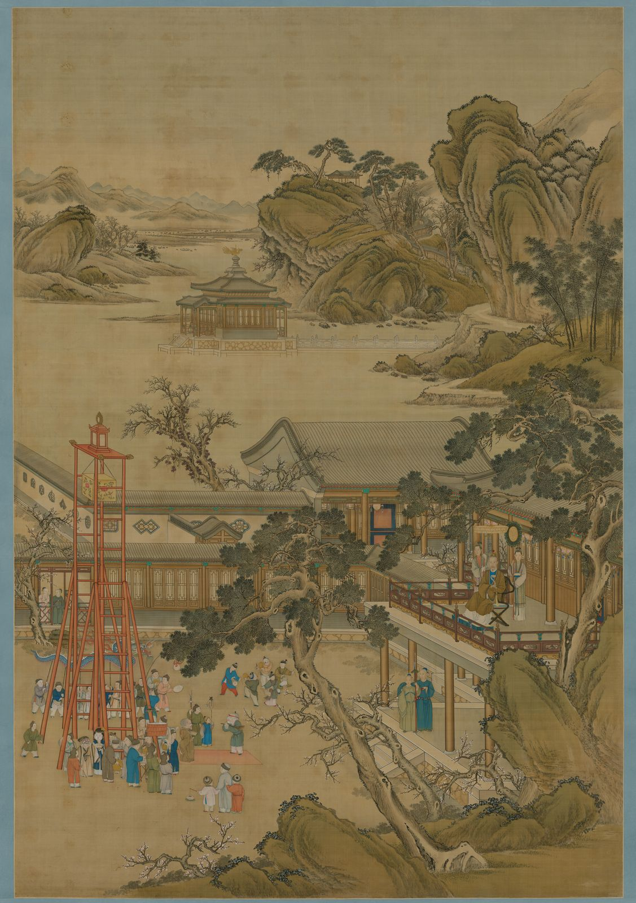

<!-- generated:start (scripts/building_pages.py): do not edit between these markers -->

# YM15-01: 山高水长楼 Shangao Shuichang Lou

Yuanming Yuan

**3D object:** 1 box. Open it: `/reconstruction/3d.html?b=YM15-01`

**Part of:** YM15 山高水长

## What we know

- **Name:** 山高水长楼 Shangao Shuichang Lou (S05, S02, S06, S01, S360, S361 · confidence B)
- **Written on the plan:** 山高水长 (S01 · confidence B)
- **Garden:** Yuanming Yuan (S05, S02, S06, S01, S360, S361)
- **Type:** tower (S05, S02, S06, S01, S360, S361 · confidence B)
- **Built:** by 1738 (first dated item) (S05, S02, S06, S01, S360, S361)
- **Destroyed:** 1860 (S05, S02, S06, S01, S360, S361)
- **Position:** 40.00375, 116.28593. S01 sure (S01 · confidence B)
- **Bays:** 9 in the texts / 9x1 on the plan (S05, S02, S06, S01, S360, S361)
- **Size in the inventory:** 39.5 × 10.0 m. S01 plan px / hall scale (S01)
- **Storeys:** 2 (S05, S02, S06, S01, S360, S361)
- **Note:** Malone p.83 two-storey, east side of the field; S06 两层五楹. Ladies on upper floor 1795. bays: 9, facing west, rolled hip-gable, two storeys (S361, v2 p.147). (S05, S02, S06, S01, S360, S361)
- **Plan reader's note:** 9 bays west-facing: matches text exactly. (S01) *(research copy, not public)*
- **How it was read:** sure (S01) *(research copy, not public)*
- **Plan pixels:** 1564, 4250 (S01) *(research copy, not public)*

## Our model now

A plain box on the block drawn on the Qing plan S01: position and frontage from the plan, heights and roof from the typology of its hall class. It will be updated as the research goes on.

- **Box:** 36.26 × 7.61 m, storeyed hall
- **Heights:** platform 0.45 m, eave 5.95 m, ridge 8.8 m above the ground
- **Roof:** hip-and-gable 歇山, rolled ridge 卷棚, grey tile
- **Faces:** 262.5° from north
- **Fit:** reduced towards the size drawn on the plan, to stand clear of its neighbours or the water
- **Confidence:** B

## Pictures (1)

- **P0279** (likely): 乾隆帝元宵行乐图轴 The Qianlong Emperor Celebrating the Lantern Festival (ca. 1750-1755 (S261); Commons: Qing dynasty). https://commons.wikimedia.org/wiki/File:%E4%B9%BE%E9%9A%86%E5%B8%9D%E5%85%83%E5%AE%B5%E8%A1%8C%E4%B9%90%E5%9B%BE%E8%BD%B4.png

  

## Texts and drawings (13)

- **E1519** (text, sure): 日下舊聞考 山高水长. 1780s (乾隆 敕撰) · j81:15a-18a · S05. https://github.com/kanripo/KR2k0036/blob/master/KR2k0036_081.txt
  > 萬方安和西南為山高水長樓西向九楹後擁連岡前帶河流中央地勢平衍凡數頃（圓明園冊）臣等謹按山高水長四十景之一也額為皇上御書左楹横碣上恭刋乾隆十七年上諭詳見國朝宫室碑隂刋乾隆四十三年上諭恭録卷内其地為外藩朝正錫宴及平時侍衞較射之所每嵗燈節則陳火戱於此乾隆四十三年五月二十八日奉上諭朕恭閱太宗文皇帝實錄天聰四年二月上諭羣臣曰昨攻取永平城大臣阿山葉臣與猛士廿四人冒火奮力登城乃我國第一等驍勇人也其廿四人䝉上天眷佑幸俱無恙次日召伊等進見朕心愴然幾不能忍此等猛士與巴圖魯薩木哈圖及他處先登驍勇出衆之人前已有㫖後遇攻城勿令再登及攻昌黎縣薩木哈圖又復與焉以後此等捐軀建功之人勿得再令攻城但當在諸貝勒固山額真左右遇衆對敵之時與之同進若彼欲自攻城亦當止之即或厮卒中有一二次率先登城立功者亦不可再令攻城以示朕愛惜材勇之意仰見我祖宗開創艱難於戰勝攻取時仁恩恤下無微不至是以人思感勵敵愾効忠所向克㨗開疆定業肇造鴻圖貽謀垂裕之道寔在於是朕臨御以來平定凖部回部及蕩平兩金川我旗營勁旅中鼓勇先登攻堅拔柵者固不乏人即綠營中亦間有出衆奮勉者一經將軍等具奏即賞以巴圖魯號用示奬勵而伊等倍加感奮凡遇攻奪碉寨仍復超衆爭先以圖報効其間屢建功績者固多而因冒險傷殞者亦復不少朕每為矜憫䀌然於懷兹紬繹祖訓驍勇立功之人毋令再登益敬服大聖人之用心非孫臣所能見及也今武功告蕆函夏謐寧繼此不願復有用兵之事但兵可百年不用不可一日不備而謨訓昭垂法良意美亦不可一日或忘用是敬錄聖諭明白宣示我君臣當共恪守以垂久逺且使我世世子孫懋繼前規勉思善述以鞏億萬載丕丕基其欽承毋忽
  South-west of 萬方安和: a nine-bay tower 山高水長 facing west, hills behind, a stream in front and several qing of level ground. Foreign princes were feasted here at New Year, guards practised archery, and fireworks were shown at the Lantern Festival. The stele carries the full 1778 edict on sparing the bravest soldiers.
- **E1521** (text, sure): 養吉齋叢錄 卷十三. mid-19th c. (printed 1890s), on earlier reigns · 卷十三, line 931 of the corpus file · S202. https://raw.githubusercontent.com/garychowcmu/daizhigev20/master/%E5%8F%B2%E8%97%8F/%E5%BF%97%E5%AD%98%E8%AE%B0%E5%BD%95/%E5%85%BB%E5%90%89%E6%96%8B%E4%B8%9B%E5%BD%95.txt
  > 山高水长楼名。在圆明园之西，俗呼西厂。地势宽敞，宜陈火戏。每岁正月十九日，例有筵宴，奉宸实司其事。是日侍卫处请派大臣管西南门，善扑营进撩跤名单，掌仪司进玩艺名单。有西洋千秋、罗汉堆塔、旧子音曲、善扑营花跤、高丽跟头诸名目，点出某项则预备。
  山高水長, known as the West Yard, on wide ground in the west of the garden, used for fireworks and a banquet on the nineteenth of the first month with wrestlers and acrobats listed by name.
- **E1516** (poem, sure): 山高水长: 乾隆二十四年 poem of the Qianlong Emperor. 乾隆二十四年 (1759), date from the compilation · p.132 item (29), under 山高水长 · S360. https://www.yuanmingyuanpark.cn/xs/yjbg/202007/P020200730387572832602.pdf#page=132
  > 委羽来经五月程，上元盛典值都城，得教饼节观灯火，为示怀柔洽众情，陪臣数已较前多，更见亲支遣洛那。（俄罗斯苏尔统为阿布赉汗之侄，在其台吉中分最 亲，因专遣朝觐，）邀赏慢须惜繁费。（来人多则赏物多，外夷见小习气皆然，）古来服远几经么，化城蜃阁无边幻，翠火明灯依旧新，亦有花翎曾至者，解称两度沐恩人。（陪臣内有伯克讷者，前年入觐得邀宠章之锡，今再至即戴所赐花翎，意殊自喜示荣侣伴，）虹光百道烛层霄，信有龙门婪尾烧，漫诮重儓増顿置，上元屈指纔旬朝。
  Poem of the Qianlong Emperor at 山高水长, 1759, on lanterns and fireworks. Year as given by the compilation.
- **E1517** (poem, sure): 山高水长: 乾隆三十二年 poem of the Qianlong Emperor. 乾隆三十二年 (1767), date from the compilation · p.133 item (40), under 山高水长 · S360. https://www.yuanmingyuanpark.cn/xs/yjbg/202007/P020200730387572832602.pdf#page=133
  > 七番节夕始今夕。（上元节自十三日为始，张灯火过燕九始收凡七日，）至养无文亦备文， 元佑张镫率成例，开元聴政尚惟勤，西楼又喜观金炬，东壁先升碾碧旻，庆益繁滋年益茂，永承任膝永欣欣。
  Poem of the Qianlong Emperor at 山高水长, 1767, on lanterns and fireworks. Year as given by the compilation.
- **E1537** (poem, sure): 山高水长. 嘉庆二年 (1797) · v2 p.150, under 山高水长; source ref 1-278 · S361. https://www.yuanmingyuanpark.cn/xs/yjbg/202008/P020200803382343267004.pdf#page=153
  > 山水钟灵秀，还孚仁智心。清波泛长渚，叠嶂现高岑。崱屴云开岫，溟濛烟羃林。澄澄明百里，袅袅耸千寻。荡漾汀洲远，萦纡洞壑深。雅游乘胜日，素节九秋临。
  Poem 山高水长 by the Jiaqing Emperor, 1797, filed by the editors under 山高水长.
- **E1518** (poem, sure): 山高水长: 咸丰五年 poem of the Xianfeng Emperor. 咸丰五年 (1855), date from the compilation · p.145 item (152), under 山高水长 · S360. https://www.yuanmingyuanpark.cn/xs/yjbg/202007/P020200730387572832602.pdf#page=145
  > 几睱乘时试火鎗，我朝武备制精良。斗星用妙分毫末，心手功纯得意刚。命中惟凭初审侯，施机亦戒太求详。土墙西苑奎章在，（山高水长有乾隆年间所筑土墙，并刻圣制土墙诗，盖因御处神鎗而作也。）敬绍鸿规习莫忘。
  Xianfeng, 1855, on gun practice; his note mentions Qianlong's earth wall with his poem carved on it.
- **E1538** (poem, likely): 恭和圣制御园山高水长锡宴外藩作元韵. 嘉庆三年 (1798) · v2 p.151, under 山高水长; source ref 1-306 · S361. https://www.yuanmingyuanpark.cn/xs/yjbg/202008/P020200803382343267004.pdf#page=154
  > 圣德怀柔临万国，开韶锡宴吉辰佳。梯航奉朔朝正会，山海来王沐泽皆。春布园林风乍转，雪敷畿甸麦方谐。应期尤愿喜音至，俘逆仰纾太上怀。
  Poem 恭和圣制御园山高水长锡宴外藩作元韵 by the Jiaqing Emperor, 1798, filed by the editors under 山高水长.
- **E1525** (description, sure): Scene 15, 山高水长 Shangao Shuichang, the Drill Field. 1934 · p.83 · S02. https://archive.org/details/historyofpekings00malo
  > The largest open field in the Yuan Ming Yuan was near the southwest corner of the garden. On the east side stood a two-story building from which the Emperor, his officials, and the ladies of the court could view the archery contests,
  Largest open field, with a two-storey viewing building on the east, used for archery, feasts for embassies and fireworks. Dutch embassy here January-February 1795. Across the stream a half-mile straight horse run from the round tower in the north to 藻园 in the south; by the round tower a small shrine to General Liu Meng (per Jung Hua).
- **E1528** (description, sure): 圆明园山高水长武帐宴探析. 2015 · lswh · S337. http://iqh.ruc.edu.cn/old/qdhjylyjzx/xszl/wxda/6437c7cd02cc4108910a6d1f7014a16b.htm
  From archives, poems and the Manchu 夷使档: from Yongzheng, 山高水长 Shangao Shuichang, in the south-west corner, was where Mongol nobles were received, in a great tent feast. It follows the staging of the banquet for Dzungar envoys under Qianlong.
- **E1523** (description, sure): 圆明园百景史事分景汇编: 山高水长. 1738-1860 · from p.131, under 山高水长 · S360. https://www.yuanmingyuanpark.cn/xs/yjbg/202007/P020200730387572832602.pdf#page=131
  Open ground and tower for lantern and fireworks nights, with large tents for feasting Mongol princes and foreign envoys. A note of 1855 mentions the earth wall of Qianlong's reign with his poem carved, used for gun practice. 山高水长: 155 dated items, 1738-1860, of which 19 poems and 136 court records (Qianlong, Jiaqing, Daoguang, Xianfeng); recurring themes: banquets, the view, rain. First dated 1738, last dated 1860.
- **E1529** (description, sure): 圆明园五朝御制诗文集注 v2, editors' note on 山高水长. 2020 edition · v2 p.147 · S361. https://www.yuanmingyuanpark.cn/xs/yjbg/202008/P020200803382343267004.pdf#page=150
  Feasting ground and archery field: a west-facing nine-bay tower of 1726, first 引见楼, rear court with side halls, landing at a cross pavilion. A slanted riding track before it and an earth target wall to the north-west. The thirteen courts 十三所 to the south-east served the firework nights, seven in all from the 13th to the 19th of the first month.
- **E1531** (description, sure, search index only): 山高水长 scene card. n.d. · mhymy jqjs 3877 · S340. https://www.mhymy.com/ymss/jqjs/3877.html
  South-west corner: a tower facing the Western Hills, flat open ground. Where envoys were feasted, guards shot, and fireworks were shown at the lantern festival.
- **E1534** (drawing, sure, search index only): 山高水长楼平面图. ysltd/11498 (topic list card only; 排架 not seen) · S310. https://www.mhymy.com/dasl/ysltd/11498.html
  Record titled as a plan of the 山高水长 Shangao Shuichang tower; its list card only introduces the scene, so the sheet's date and state were not seen because the record page refused this server.

**On the plan:** Drawn on the plan of the gardens (S01), labelled 山高水长, 9x1 cells. https://artmuseum.princeton.edu/collections/objects/138657

## Evidence for the set of buildings

- Evidence for the whole compound 山高水长: see YM15

## Open questions

None that name it.

<!-- generated:end -->

## Notes

<!-- Yours: regeneration never touches this part. It goes on the public site; what you write below a line holding only %% private %% stays in the research copy. -->
