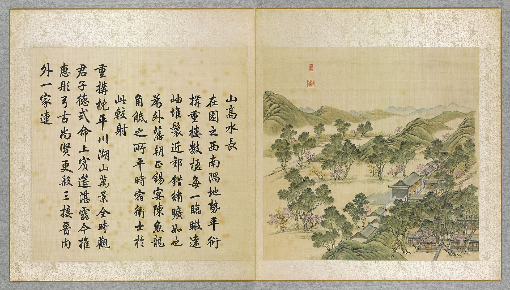

<!-- generated:start (scripts/building_pages.py): do not edit between these markers -->

# YM15-02: 十三所 Shisan Suo

Yuanming Yuan

**3D object:** 1 box. Open it: `/reconstruction/3d.html?b=YM15-02`

**Part of:** YM15 山高水长

## What we know

- **Name:** 十三所 Shisan Suo (S06, S42, S01 · confidence B)
- **Garden:** Yuanming Yuan (S06, S42, S01)
- **Type:** other (S06, S42, S01 · confidence B)
- **Destroyed:** 1860 (S06, S42, S01)
- **Position:** 40.00236, 116.28667. S01 sure (S01 · confidence B)
- **Where the text puts it:** 东 (S06) (S06, S42, S01) *(research copy, not public)*
- **Note:** Also in the 藻园 survey area (S42 11828); princes' lodgings per S06. (S06, S42, S01)
- **Plan reader's note:** Label inside my box; the stack of 9 walled courts is x 1640-1735, y 4660-5440, straddles my west edge (S01) *(research copy, not public)*
- **How it was read:** sure (S01) *(research copy, not public)*
- **Plan pixels:** 1763, 5015 (S01) *(research copy, not public)*

## Our model now

Assumed: a position is known and no block is drawn, so a small default box stands there. Confidence C.

- **Box:** 9 × 6.5 m, small house
- **Heights:** platform 0.45 m, eave 3.2 m, ridge 5.43 m above the ground
- **Roof:** gable 硬山 or 悬山, rolled ridge 卷棚, grey tile
- **Faces:** 175° from north
- **Fit:** reduced towards the size drawn on the plan, to stand clear of its neighbours or the water; moved 4.5 m
- **Water:** stands partly over the water layer: on piers or on a bank too thin for the layer to show
- **Confidence:** C, assumed

## Pictures (1)

- **P0015** (guess): 山髙水長 Shangao shuichang [Élevées les montagnes, inépuisable l'eau] (圓明園四十景, 第15景) (1744 (BnF record: 1744年，清朝乾隆九年)). https://commons.wikimedia.org/wiki/File%3A%E5%9C%93%E6%98%8E%E5%9C%92%E5%9B%9B%E5%8D%81%E6%99%AF_-_%28%E6%B8%85%29%E5%94%90%E5%B2%B1%E3%80%81%E6%B2%88%E6%BA%90%E5%90%88%E7%95%AB_%3B_%28%E4%B9%BE%E9%9A%86%E5%90%9F%E8%AF%97%EF%BC%8C%E6%B1%AA%E7%94%B1%E6%95%A6%E4%BB%A3%E4%B9%A6%29_-_btv1b55008362z_%28046_of_124%29.jpg

  

## Texts and drawings (2)

- **E1529** (description, likely): 圆明园五朝御制诗文集注 v2, editors' note on 山高水长. 2020 edition · v2 p.147 · S361. https://www.yuanmingyuanpark.cn/xs/yjbg/202008/P020200803382343267004.pdf#page=150
  Feasting ground and archery field: a west-facing nine-bay tower of 1726, first 引见楼, rear court with side halls, landing at a cross pavilion. A slanted riding track before it and an earth target wall to the north-west. The thirteen courts 十三所 to the south-east served the firework nights, seven in all from the 13th to the 19th of the first month.
- **E1536** (archaeology, likely): 十三所: surveyed 1994. survey from 1994-08-31 · mhymy 档案史料 11828, free part · S156. https://www.mhymy.com/dasl/11828.html
  The 1994 survey names 十三所 as one of three sites probed, with 藻园 and 山高水长. The paying part of the report holds the results: not read. The same words in the texts row are tied to YM73 and YM15; here to the hall YM15-02.

**On the plan:** Drawn on the plan of the gardens (S01), labelled 十三所. https://artmuseum.princeton.edu/collections/objects/138657

## Evidence for the set of buildings

- Evidence for the whole compound 山高水长: see YM15
- Reconstructions and comparables for the whole garden, 圆明园 Yuanming Yuan: see GARDEN-YM

## Open questions

None that name it.

<!-- generated:end -->

## Notes

<!-- Yours: regeneration never touches this part. It goes on the public site; what you write below a line holding only %% private %% stays in the research copy. -->
