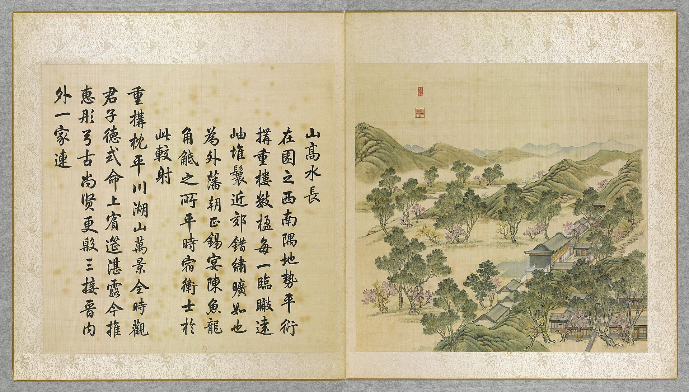
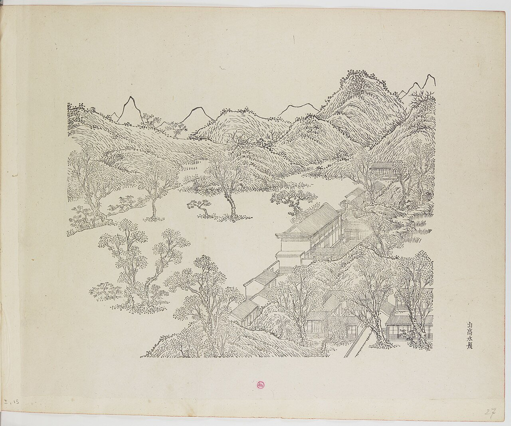
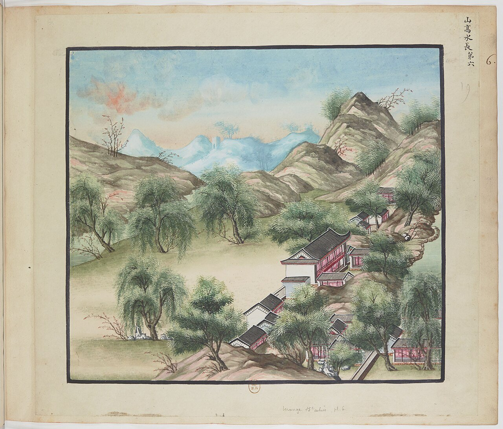
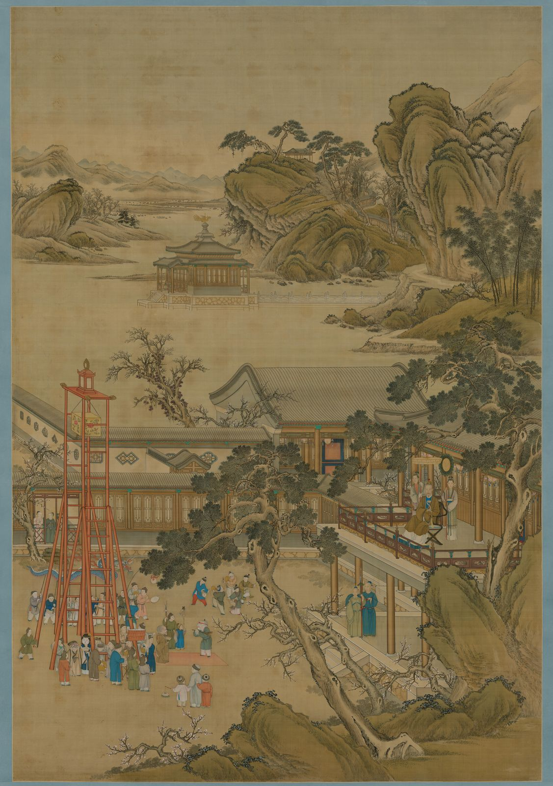
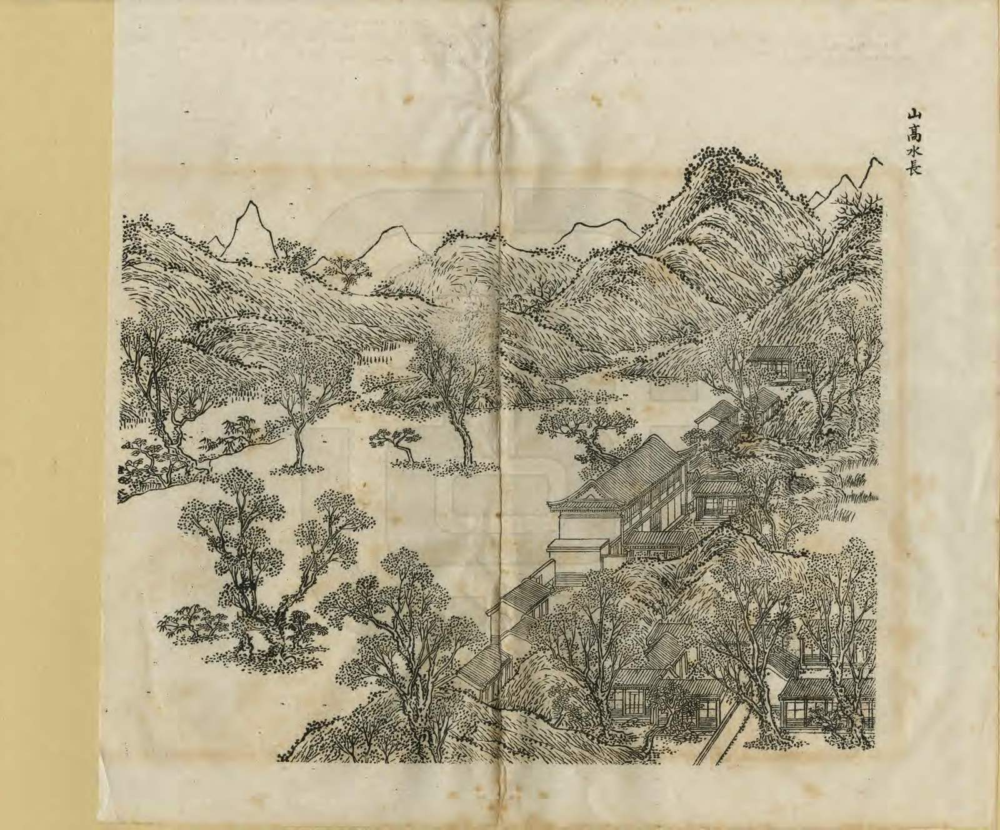
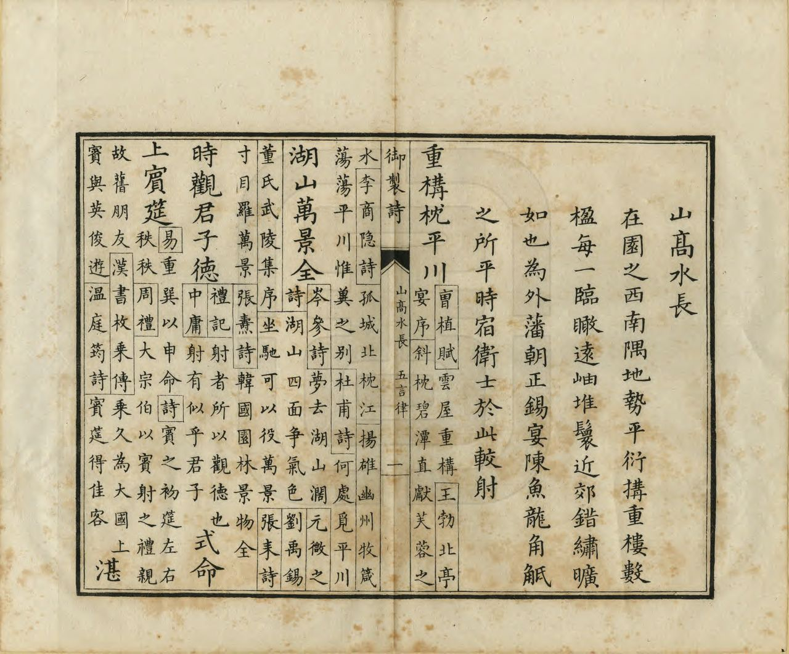

<!-- generated:start (scripts/building_pages.py): do not edit between these markers -->

# YM15: 山高水长 Shangao Shuichang

The Drill Field (Hills High and Waters Long) · Yuanming Yuan

**3D object:** 10 boxes. Open it: `/reconstruction/3d.html?b=YM15`

## What we know

- **Name:** 山高水长 Shangao Shuichang (S05, S02, S08, S01, S361 · confidence A)
- **English:** The Drill Field (Hills High and Waters Long) (S05, S02, S08, S01, S361)
- **Garden:** Yuanming Yuan (S05, S02, S08, S01, S361)
- **Type:** scene (S05, S02, S08, S01, S361 · confidence A)
- **Built:** 1726 (S05, S02, S08, S01, S361)
- **Destroyed:** 1860 (S05, S02, S08, S01, S361)
- **Position:** 40.00375, 116.28593. S01 sure (S01 · confidence B)
- **Note:** 外藩朝正錫宴, 侍衞較射, 燈節 火戲 [j81:15b-16a]. Dutch embassy 1795 (S02 p.83). (S05, S02, S08, S01, S361)
- **Plan reader's note:** Label in a rectangular platform on the west side of B0733. Polygon = the hall group; the drill field itself is region R0011 to the west (Malone 15 Drill Field). 马道 horse track labelled at (1425,4250). (S01) *(research copy, not public)*
- **How it was read:** sure (S01) *(research copy, not public)*
- **Plan pixels:** 1564, 4249 (S01) *(research copy, not public)*

## Our model now

10 boxes stand in this compound, 9 on blocks drawn on the plan, 1 assumed. Its halls are listed below.

## Inside it (10)

- YM15-01 山高水长楼
- YM15-02 十三所
- YM15-B0712
- YM15-B0723
- YM15-B0734
- YM15-B0735
- YM15-B0753
- YM15-B0754
- YM15-B0755
- YM15-B0767

## Pictures (6)

- **P0015** (sure): 山髙水長 Shangao shuichang [Élevées les montagnes, inépuisable l'eau] (圓明園四十景, 第15景) (1744 (BnF record: 1744年，清朝乾隆九年)). https://commons.wikimedia.org/wiki/File%3A%E5%9C%93%E6%98%8E%E5%9C%92%E5%9B%9B%E5%8D%81%E6%99%AF_-_%28%E6%B8%85%29%E5%94%90%E5%B2%B1%E3%80%81%E6%B2%88%E6%BA%90%E5%90%88%E7%95%AB_%3B_%28%E4%B9%BE%E9%9A%86%E5%90%9F%E8%AF%97%EF%BC%8C%E6%B1%AA%E7%94%B1%E6%95%A6%E4%BB%A3%E4%B9%A6%29_-_btv1b55008362z_%28046_of_124%29.jpg

  

- **P0087** (sure): 中国皇帝的宫殿与庙宇. 第27幅图, 山高水長 - (清)孙祜、沈源Shangao shuichang - (Qing)Sun Hu, Shen Yuan (1745 (Commons, from the BnF record)). https://commons.wikimedia.org/wiki/File%3A%E4%B8%AD%E5%9B%BD%E7%9A%87%E5%B8%9D%E7%9A%84%E5%AE%AB%E6%AE%BF%E4%B8%8E%E5%BA%99%E5%AE%87._%E7%AC%AC27%E5%B9%85%E5%9B%BE%2C_%E5%B1%B1%E9%AB%98%E6%B0%B4%E9%95%B7_-_%28%E6%B8%85%29%E5%AD%99%E7%A5%9C%E3%80%81%E6%B2%88%E6%BA%90Shangao_shuichang_-_%28Qing%29Sun_Hu%2C_Shen_Yuan_-_btv1b105206807.jpg

  

- **P0106** (sure): 海淀(镇)：中国皇帝的行宫. 第6幅图, 山髙水長Shangao shuichang (1750-1792 (BnF, cb43831905b; ex coll. Bertin)). https://commons.wikimedia.org/wiki/File%3A%E6%B5%B7%E6%B7%80%28%E9%95%87%29%EF%BC%9A%E4%B8%AD%E5%9B%BD%E7%9A%87%E5%B8%9D%E7%9A%84%E8%A1%8C%E5%AE%AB._%E7%AC%AC6%E5%B9%85%E5%9B%BE%2C_%E5%B1%B1%E9%AB%99%E6%B0%B4%E9%95%B7Shangao_shuichang_-_btv1b10520696b.jpg

  

- **P0279** (likely): 乾隆帝元宵行乐图轴 The Qianlong Emperor Celebrating the Lantern Festival (ca. 1750-1755 (S261); Commons: Qing dynasty). https://commons.wikimedia.org/wiki/File:%E4%B9%BE%E9%9A%86%E5%B8%9D%E5%85%83%E5%AE%B5%E8%A1%8C%E4%B9%90%E5%9B%BE%E8%BD%B4.png

  

- **P0246** (sure): 山高水長 Shangao Shuichang (御製圓明園圖詠, 1887 石印本, 上卷 (Commons 卷一), 第15景; printed title in the right margin of the picture) (光緒十三年 1887 (Commons/NLC record; colophon 光緒十三年七月天津石印書屋 in the SSID copy, S98 PDF p.2); design after the woodblock of 1745 by 孫祜 Sun Hu and 沈源 Shen Yuan). https://commons.wikimedia.org/wiki/File%3ANLC403-312001107375-14035_%E7%A6%A6%E5%88%B6%E5%9C%93%E6%98%8E%E5%9C%92%E5%9C%96%E8%A9%A0_%E5%8D%B7%E4%B8%80.pdf?page=76

  

- **P0522** (sure): 山高水長 Shangao Shuichang: 乾隆 Qianlong's preface and poem with the courtiers' commentary, 御製圓明園圖詠 1887 (poem 1744 (乾隆九年); this printing 1887). https://commons.wikimedia.org/wiki/File%3ANLC403-312001107375-14035_%E7%A6%A6%E5%88%B6%E5%9C%93%E6%98%8E%E5%9C%92%E5%9C%96%E8%A9%A0_%E5%8D%B7%E4%B8%80.pdf?page=77

  

## Texts and drawings (31)

- **E1515** (poem, sure): 御製山髙水長詩（圓明園四十景詩）. 1744 (乾隆九年) · printed in S05 j81:18a · S40. https://github.com/kanripo/KR2k0036/blob/master/KR2k0036_081.txt
  > 乾隆九年 御製山髙水長詩 在園之西南隅地勢平衍構重樓數楹每一臨瞰逺岫堆鬟近郊錯繡曠如也為外藩朝正錫宴陳魚龍角觝之所平時宿衞士於此較射 重構枕平川湖山萬景全時觀君子徳式命上賓筵湛露今推惠彤弓古尚賢更殷三接晉内外一家連
  In the south-west corner, on level ground: a multi-bay tower with far hills and near fields in view. Foreign princes come here for the New Year feast with acrobats and wrestling, and in ordinary times the guards practise archery.
- **E1519** (text, sure): 日下舊聞考 山高水长. 1780s (乾隆 敕撰) · j81:15a-18a · S05. https://github.com/kanripo/KR2k0036/blob/master/KR2k0036_081.txt
  > 萬方安和西南為山高水長樓西向九楹後擁連岡前帶河流中央地勢平衍凡數頃（圓明園冊）臣等謹按山高水長四十景之一也額為皇上御書左楹横碣上恭刋乾隆十七年上諭詳見國朝宫室碑隂刋乾隆四十三年上諭恭録卷内其地為外藩朝正錫宴及平時侍衞較射之所每嵗燈節則陳火戱於此乾隆四十三年五月二十八日奉上諭朕恭閱太宗文皇帝實錄天聰四年二月上諭羣臣曰昨攻取永平城大臣阿山葉臣與猛士廿四人冒火奮力登城乃我國第一等驍勇人也其廿四人䝉上天眷佑幸俱無恙次日召伊等進見朕心愴然幾不能忍此等猛士與巴圖魯薩木哈圖及他處先登驍勇出衆之人前已有㫖後遇攻城勿令再登及攻昌黎縣薩木哈圖又復與焉以後此等捐軀建功之人勿得再令攻城但當在諸貝勒固山額真左右遇衆對敵之時與之同進若彼欲自攻城亦當止之即或厮卒中有一二次率先登城立功者亦不可再令攻城以示朕愛惜材勇之意仰見我祖宗開創艱難於戰勝攻取時仁恩恤下無微不至是以人思感勵敵愾効忠所向克㨗開疆定業肇造鴻圖貽謀垂裕之道寔在於是朕臨御以來平定凖部回部及蕩平兩金川我旗營勁旅中鼓勇先登攻堅拔柵者固不乏人即綠營中亦間有出衆奮勉者一經將軍等具奏即賞以巴圖魯號用示奬勵而伊等倍加感奮凡遇攻奪碉寨仍復超衆爭先以圖報効其間屢建功績者固多而因冒險傷殞者亦復不少朕每為矜憫䀌然於懷兹紬繹祖訓驍勇立功之人毋令再登益敬服大聖人之用心非孫臣所能見及也今武功告蕆函夏謐寧繼此不願復有用兵之事但兵可百年不用不可一日不備而謨訓昭垂法良意美亦不可一日或忘用是敬錄聖諭明白宣示我君臣當共恪守以垂久逺且使我世世子孫懋繼前規勉思善述以鞏億萬載丕丕基其欽承毋忽
  South-west of 萬方安和: a nine-bay tower 山高水長 facing west, hills behind, a stream in front and several qing of level ground. Foreign princes were feasted here at New Year, guards practised archery, and fireworks were shown at the Lantern Festival. The stele carries the full 1778 edict on sparing the bravest soldiers.
- **E1520** (text, sure): 檐曝雜記 卷一. c. 1800, on the Qianlong years · line 45 of the corpus file · S213. https://github.com/garychowcmu/daizhigev20/blob/master/史藏/志存记录/檐曝杂记.txt
  > ○烟火上元夕，西厂舞灯、放烟火最盛。清晨先于圆明园宫门列烟火数十架，药线徐引燃，成界画栏杆五色。每架将完，中复烧出宝塔楼阁之类，并有笼鸽及喜鹊数十在盒中乘火飞出者。未、申之交，驾至西厂。先有八旗骗马诸戏：或一足立鞍凳而驰者；或两足立马背而驰者；或扳马鞍步行而并马驰者；或两人对面驰来，各在马上腾身互换者；或甲腾出，乙在马上戴甲于首而驰者，曲尽马上之奇。日既夕，则楼前舞灯者三千人列队焉，口唱《太平歌》，各执彩灯，循环进止，各依其缀兆，一转旋则三千人排成一“太”字，再转成“平”字，以次作“万”、“岁”字，又以次合成“太平万岁”字，所谓“太平万岁字当中”也。舞罢，则烟火大发，其声如雷霆，火光烛半空，但见千万红鱼奋迅跳跃于云海内，极天下之奇观矣。
  Lantern Festival in the Qianlong years: fireworks first before the main gate, then the emperor at 西廠 山高水長 from mid-afternoon, with Banner trick-riding. An eyewitness of those years.
- **E1346** (text, sure): 宣宗實錄: 半亩园, 1833. 道光十九年九月 (nearest heading in the corpus copy) · 丙戌 entry, corpus copy · S208. https://github.com/garychowcmu/daizhigev20/blob/master/史藏/别史/清实录道光朝实录.txt
  > 上奉皇太后幸山高水长。阅精捷营阵式。幸半亩园。进膳。
  The Emperor takes the Dowager to 山高水长 to see the 精捷营 drill, and to lunch at 半亩园. Nearby halls, so the 半亩园 of 坦坦荡荡 is meant.
- **E1521** (text, sure): 養吉齋叢錄 卷十三. mid-19th c. (printed 1890s), on earlier reigns · 卷十三, line 931 of the corpus file · S202. https://raw.githubusercontent.com/garychowcmu/daizhigev20/master/%E5%8F%B2%E8%97%8F/%E5%BF%97%E5%AD%98%E8%AE%B0%E5%BD%95/%E5%85%BB%E5%90%89%E6%96%8B%E4%B8%9B%E5%BD%95.txt
  > 山高水长楼名。在圆明园之西，俗呼西厂。地势宽敞，宜陈火戏。每岁正月十九日，例有筵宴，奉宸实司其事。是日侍卫处请派大臣管西南门，善扑营进撩跤名单，掌仪司进玩艺名单。有西洋千秋、罗汉堆塔、旧子音曲、善扑营花跤、高丽跟头诸名目，点出某项则预备。
  山高水長, known as the West Yard, on wide ground in the west of the garden, used for fireworks and a banquet on the nineteenth of the first month with wrestlers and acrobats listed by name.
- **E1522** (text, sure): 竹葉亭雜記. early 19th c. · line 153 of the corpus file · S211. https://github.com/garychowcmu/daizhigev20/blob/master/史藏/志存记录/竹叶亭杂记.txt
  > 朝鲜国遣使年贡有例赏，由礼部具奏。新正宴紫光阁，又例有加赏。及该使臣在圆明园献诗，复有加赏国王及使臣物件，俱由军机具奏，在山高水长颁给。
  Gifts to Korean envoys for poems were handed out at 山高水長.
- **E1516** (poem, sure): 山高水长: 乾隆二十四年 poem of the Qianlong Emperor. 乾隆二十四年 (1759), date from the compilation · p.132 item (29), under 山高水长 · S360. https://www.yuanmingyuanpark.cn/xs/yjbg/202007/P020200730387572832602.pdf#page=132
  > 委羽来经五月程，上元盛典值都城，得教饼节观灯火，为示怀柔洽众情，陪臣数已较前多，更见亲支遣洛那。（俄罗斯苏尔统为阿布赉汗之侄，在其台吉中分最 亲，因专遣朝觐，）邀赏慢须惜繁费。（来人多则赏物多，外夷见小习气皆然，）古来服远几经么，化城蜃阁无边幻，翠火明灯依旧新，亦有花翎曾至者，解称两度沐恩人。（陪臣内有伯克讷者，前年入觐得邀宠章之锡，今再至即戴所赐花翎，意殊自喜示荣侣伴，）虹光百道烛层霄，信有龙门婪尾烧，漫诮重儓増顿置，上元屈指纔旬朝。
  Poem of the Qianlong Emperor at 山高水长, 1759, on lanterns and fireworks. Year as given by the compilation.
- **E1517** (poem, sure): 山高水长: 乾隆三十二年 poem of the Qianlong Emperor. 乾隆三十二年 (1767), date from the compilation · p.133 item (40), under 山高水长 · S360. https://www.yuanmingyuanpark.cn/xs/yjbg/202007/P020200730387572832602.pdf#page=133
  > 七番节夕始今夕。（上元节自十三日为始，张灯火过燕九始收凡七日，）至养无文亦备文， 元佑张镫率成例，开元聴政尚惟勤，西楼又喜观金炬，东壁先升碾碧旻，庆益繁滋年益茂，永承任膝永欣欣。
  Poem of the Qianlong Emperor at 山高水长, 1767, on lanterns and fireworks. Year as given by the compilation.
- **E1537** (poem, sure): 山高水长. 嘉庆二年 (1797) · v2 p.150, under 山高水长; source ref 1-278 · S361. https://www.yuanmingyuanpark.cn/xs/yjbg/202008/P020200803382343267004.pdf#page=153
  > 山水钟灵秀，还孚仁智心。清波泛长渚，叠嶂现高岑。崱屴云开岫，溟濛烟羃林。澄澄明百里，袅袅耸千寻。荡漾汀洲远，萦纡洞壑深。雅游乘胜日，素节九秋临。
  Poem 山高水长 by the Jiaqing Emperor, 1797, filed by the editors under 山高水长.
- **E1538** (poem, sure): 恭和圣制御园山高水长锡宴外藩作元韵. 嘉庆三年 (1798) · v2 p.151, under 山高水长; source ref 1-306 · S361. https://www.yuanmingyuanpark.cn/xs/yjbg/202008/P020200803382343267004.pdf#page=154
  > 圣德怀柔临万国，开韶锡宴吉辰佳。梯航奉朔朝正会，山海来王沐泽皆。春布园林风乍转，雪敷畿甸麦方谐。应期尤愿喜音至，俘逆仰纾太上怀。
  Poem 恭和圣制御园山高水长锡宴外藩作元韵 by the Jiaqing Emperor, 1798, filed by the editors under 山高水长.
- **E1328** (text, sure): Qing record naming 半亩园. 道光十九年十月 (1839) · p.143 item (135), under 山高水长 · S360. https://www.yuanmingyuanpark.cn/xs/yjbg/202007/P020200730387572832602.pdf#page=143
  > 道光十九年十月丙戌，道光帝奉皇太后幸山高水长，阅精捷营阵式，幸半亩园，进膳。
  After a troop review at 山高水长, Daoguang took the dowager to dine at 半亩园, in use in 1839.
- **E1518** (poem, sure): 山高水长: 咸丰五年 poem of the Xianfeng Emperor. 咸丰五年 (1855), date from the compilation · p.145 item (152), under 山高水长 · S360. https://www.yuanmingyuanpark.cn/xs/yjbg/202007/P020200730387572832602.pdf#page=145
  > 几睱乘时试火鎗，我朝武备制精良。斗星用妙分毫末，心手功纯得意刚。命中惟凭初审侯，施机亦戒太求详。土墙西苑奎章在，（山高水长有乾隆年间所筑土墙，并刻圣制土墙诗，盖因御处神鎗而作也。）敬绍鸿规习莫忘。
  Xianfeng, 1855, on gun practice; his note mentions Qianlong's earth wall with his poem carved on it.
- **E1524** (description, sure): 玉明 侍游御園記 (in 蕉軒隨錄). 1856 (咸豐六年七月二十一日) · 蕉軒隨錄, 御園侍游 (line 336 of the corpus file) · S210. https://github.com/garychowcmu/daizhigev20/blob/master/史藏/志存记录/蕉轩随录.txt
  > ◎御园侍游玉将军（明）有《侍游御园记》，成竹坪同年（林）曾属予代作跋语，恭书于后。按，《记》云：“咸丰六年秋七月二十一日，奉旨：本日散朝后，著玉明、肃顺自备鞍马，午初一刻进西南门，在山高水长伺候。有顷，上从内乘船，至山高水长后阁扇下船，出前门，谕玉明、肃顺暨珠勒亨、西拉布、托云、德勒格尔、伊勒东阿等脱去外褂。上乘马，命七臣随行。自山高水长游藻园，至厂地，过汇芳书院，复由紫碧山房至鱼跃鸢飞少坐。过蕊珠宫门，至黄花磴进茶毕，往西洋楼海宴堂，至转马台，过小角门，至狮子林清淑斋赏饭。左右四卓，命七臣坐，并奉温谕可饱食，非外边筵宴比也。上命膳房先给七臣面各一器，上进面，复进饭，颁赏御用菜蔬，七臣叩头谢。上进粥，复赏粥毕。随驾起行，由宝相寺、法慧寺、谐奇趣过明春门，至雷峰夕照马头，坐如在天上船，游福海。上命笔砚作诗毕，至渊氵亭镜澈马头下船。进丽春门骑马，由旧园东墙根过敷春堂，游西大堤汉城关，至含辉楼下马，命七臣散归。玉明自道光十一年由侍卫擢厕御前二十余年，仰邀优渥，得遍瞻御园盛景。欣感之余，谨作记以纪荣遇。”
  A rare first-hand record of a day in the garden four years before its destruction. The emperor takes seven officials by a named route from 山高水長 through 藻園, 彚芳書院, 紫碧山房 and 魚躍鳶飛, past 蕊珠宫門, on to 海宴堂 in the 西洋樓, a meal at 清淑齋 in 獅子林, 寳相寺, 法慧寺, 諧奇趣, by boat on 福海, then 敷春堂 and 含暉楼. All were standing then.
- **E1525** (description, sure): Scene 15, 山高水长 Shangao Shuichang, the Drill Field. 1934 · p.83 · S02. https://archive.org/details/historyofpekings00malo
  > The largest open field in the Yuan Ming Yuan was near the southwest corner of the garden. On the east side stood a two-story building from which the Emperor, his officials, and the ladies of the court could view the archery contests,
  Largest open field, with a two-storey viewing building on the east, used for archery, feasts for embassies and fireworks. Dutch embassy here January-February 1795. Across the stream a half-mile straight horse run from the round tower in the north to 藻园 in the south; by the round tower a small shrine to General Liu Meng (per Jung Hua).
- **E1526** (description, sure): Van Braam, Dutch embassy, January-February 1795. 1934 · pp.167-170 · S02. https://archive.org/details/historyofpekings00malo
  > They are very numerous, of small dimensions, neatly furnished in the Chinese taste, and containing a few books and some very valuable curiosities. Three only of these apartments can boast of European time-pieces.
  Audience in a Tartar tent on the open space at the Drill Field; sled rides along frozen canals; goldfish of 15 inches and more; the emperor's rooms as quoted. They were not allowed to see the European buildings, and had seen twenty drawings of them in Canton. Told of a garden 300 li round with 36 residences; Malone calls this exaggerated.
- **E1011** (description, sure): Site status table, about 2011: nothing visible, or built over. c. 2011 · 系列06 repost, status table · S356. https://blog.sina.com.cn/s/blog_c27029650101itzz.html
  Same table. In it the first group shows no visible remains; 得全阁, 流香渚, 凤麟洲, 涵秋馆, 蔚藻堂, 中和堂, 敷春堂 and 心镜轩 have service buildings on them, and 含晖楼, 澄心堂, 延寿寺, 清夏堂 and 喜雨山房 are occupied by other institutions. 澹泊宁静 and several others have been dug since, so this is out of date for them.
- **E1527** (description, sure): 山高水长 祈雨坛 (S47 section 2). 2012, citing archive and Qing texts · p.118 · S47. https://www.dpm.org.cn/Uploads/File/2018/06/15/u5b23730ae0e5a.pdf
  Temporary altars too: Jiaqing set a rain altar at 山高水长 in the sixth month of 1812, Yongzheng a travel altar under the new 太平台 behind 深柳读书堂, and Xianfeng paid respects at 奉三无私.
- **E1528** (description, sure): 圆明园山高水长武帐宴探析. 2015 · lswh · S337. http://iqh.ruc.edu.cn/old/qdhjylyjzx/xszl/wxda/6437c7cd02cc4108910a6d1f7014a16b.htm
  From archives, poems and the Manchu 夷使档: from Yongzheng, 山高水长 Shangao Shuichang, in the south-west corner, was where Mongol nobles were received, in a great tent feast. It follows the staging of the banquet for Dzungar envoys under Qianlong.
- **E2465** (description, sure): 山高水长平面图 (record text). record 2020-22 · mhymy dasl/ysltd/7326 · S310. https://www.mhymy.com/dasl/ysltd/7326.html
  Record on 山高水长 (the 西厂): the field c. 460 x 280 m, 12.88 ha, building area c. 2,500 m2; used for banquets for Mongol and other princes, archery, and the Lantern Festival fireworks. No drawing number in the free part.
- **E1530** (description, likely): 圆明园蒙古包形制考. 2020-07-30 · 圆明园官网 yjbg t20200730_4416789 · S338. https://www.yuanmingyuanpark.cn/xs/yjbg/202007/t20200730_4416789.html
  Studies three types of court yurt used in the garden, from texts and court paintings. Relevant to the tents at 山高水长.
- **E0512** (description, likely): 朱强, 圆明园核心功能景区的园林化特征试析, 圆明园研究 (issue page dated 2026-02-03). 2026-02-03 · xs/ktsb/202602/t20260203_4804592; abstract read · S338. https://www.yuanmingyuanpark.cn/xs/ktsb/202602/t20260203_4804592.html
  Reconstructs the five core functions of the main garden (outer court, government, residence, ritual, military display) and reads each area's garden design against comparable sites. Only the abstract was read; the scene ties are my reading of those five functions.
- **E1523** (description, sure): 圆明园百景史事分景汇编: 山高水长. 1738-1860 · from p.131, under 山高水长 · S360. https://www.yuanmingyuanpark.cn/xs/yjbg/202007/P020200730387572832602.pdf#page=131
  Open ground and tower for lantern and fireworks nights, with large tents for feasting Mongol princes and foreign envoys. A note of 1855 mentions the earth wall of Qianlong's reign with his poem carved, used for gun practice. 山高水长: 155 dated items, 1738-1860, of which 19 poems and 136 court records (Qianlong, Jiaqing, Daoguang, Xianfeng); recurring themes: banquets, the view, rain. First dated 1738, last dated 1860.
- **E1529** (description, sure): 圆明园五朝御制诗文集注 v2, editors' note on 山高水长. 2020 edition · v2 p.147 · S361. https://www.yuanmingyuanpark.cn/xs/yjbg/202008/P020200803382343267004.pdf#page=150
  Feasting ground and archery field: a west-facing nine-bay tower of 1726, first 引见楼, rear court with side halls, landing at a cross pavilion. A slanted riding track before it and an earth target wall to the north-west. The thirteen courts 十三所 to the south-east served the firework nights, seven in all from the 13th to the 19th of the first month.
- **E1531** (description, sure, search index only): 山高水长 scene card. n.d. · mhymy jqjs 3877 · S340. https://www.mhymy.com/ymss/jqjs/3877.html
  South-west corner: a tower facing the Western Hills, flat open ground. Where envoys were feasted, guards shot, and fireworks were shown at the lantern festival.
- **E1453** (description, likely, search index only): 圆明园新证—万方安和考, 端木泓. n.d. · journal article, earlier fetch · S357. 
  Reads 万方安和 as a Buddhist cosmic diagram: the 万字房 at its heart, the 十字亭 as a node, and the long hall of 山高水长 as an answering stroke. Only the abstract was seen; no stable link kept.
- **E1534** (drawing, sure): 山高水长楼平面图. 道光十一年 (1831) · 国家图书馆善本部 样018-4-1号 · S310. https://www.mhymy.com/dasl/ysltd/11498.html
  Record titled as a plan of the 山高水长 Shangao Shuichang tower; its list card only introduces the scene, so the sheet's date and state were not seen because the record page refused this server.
- **E1532** (drawing, sure): 《国家图书馆藏样式雷图档·圆明园卷初编》: 山高水长. mostly 道光, 咸丰, 同治 per the publisher · 初编 目录: 山高水长, pp.157-172 · S13. https://www.nlcpress.com/ProductView.aspx?Id=7642
  The printed facsimile of the National Library of China's Yangshi Lei sheets has a section on this place at pp.157-172 (16 pages, section length worked out from the next heading); sheet titles and numbers are in the volume, ordered from a library.
- **E1535** (drawing, sure): 引见楼前蒙古包及焰火布置平面图. 乾隆年间 · 国家图书馆善本部 样018-1号 · S310. https://www.mhymy.com/dasl/ysltd/9779.html
  Qianlong-period base plan of seven Mongol tents and the fireworks set up before the tower at Shangao Shuichang, 656x405 mm, ink and light colour. No image here; the site may ask a small payment for the full record.
- **E1533** (drawing, sure, search index only): 山高水长楼平面图. S310. https://www.mhymy.com/dasl/ysltd/7326.html
  Plan of the Shangao Shuichang tower, listed in the site's index; own page URL, shelf number and date not seen. No image here; the site may ask a small payment for the full record.
- **E1536** (archaeology, sure): 十三所: surveyed 1994. survey from 1994-08-31 · mhymy 档案史料 11828, free part · S156. https://www.mhymy.com/dasl/11828.html
  The 1994 survey names 十三所 as one of three sites probed, with 藻园 and 山高水长. The paying part of the report holds the results: not read. The same words in the texts row are tied to YM73 and YM15; here to the hall YM15-02.
- **E2263** (archaeology, sure): 圆明园藻园遗址考古发掘报告. survey from 1994-08-31 · mhymy 档案史料 11828, free part · S156. https://www.mhymy.com/dasl/11828.html
  Survey occasioned by a planned miniature-garden project of 1994 (about 130,000 m2), of which 110,000 m2 was probed, chiefly 藻园 Zao Yuan, 十三所 and 山高水长 Shangao Shuichang. 藻园's buildings lie around a boat dock in an L plan, about 105 m north-south by 95 m east-west.

**On the plan:** Drawn on the plan of the gardens (S01), labelled 山高水长. https://artmuseum.princeton.edu/collections/objects/138657

## Reconstructions by others (2)

Modern interpretation, not evidence.
- **R0031** (video, sure, search index only): [央美]九洲区域复原视频. 中央美术学院圆明园研究中心 (央美 tag; the page names it, per search extract). https://www.mhymy.com/szfy/fysp/14948.html Research-only: link card.
- **R0062** (paper figure, guess): 圆明园蒙古包形制考. posted by 圆明园管理处, posted 2020. https://www.yuanmingyuanpark.cn/xs/yjbg/202007/t20200730_4416789.html Research-only: link card.

## Surviving comparable buildings, not this building (1)

- **T014** 万树园 Wanshu Yuan (Garden of Ten Thousand Trees), 避暑山庄 Chengde. Comparable: same court, era or type, confidence B, standing: partly. A flat open field for receiving outer princes; tents; fireworks. Not a building form Basis: S05 j.81 f.18a: 山高水长 「为外藩朝正锡宴，陈鱼龙角觝之所」, for feasts to outer princes and shows. Search summary (exhibition text): at 万树园 the emperor received Mongol princes and envoys in tents; Castiglione and others painted it. https://github.com/kanripo/KR2k0036
  - P0657: 亜東印画輯 07 044 "萬樹園（熱河山莊苑）". https://commons.wikimedia.org/wiki/File:%E4%BA%9C%E6%9D%B1%E5%8D%B0%E7%94%BB%E8%BC%AF_07_044_%22%E8%90%AC%E6%A8%B9%E5%9C%92%EF%BC%88%E7%86%B1%E6%B2%B3%E5%B1%B1%E8%8E%8A%E8%8B%91%EF%BC%89%22.jpg
  - P0658: 萬樹園賜宴圖. https://commons.wikimedia.org/wiki/File:%E8%90%AC%E6%A8%B9%E5%9C%92%E8%B3%9C%E5%AE%B4%E5%9C%96.jpg

## Evidence for the set of buildings

- Reconstructions and comparables for the whole garden, 圆明园 Yuanming Yuan: see GARDEN-YM

## Open questions

- Q8: Known errors of S01
- Q26: Forms
- Q99: Wolseley (S240), M'Ghee (S242), Loch (S244)
- Q119: Digs
- Q125: Geotagged Commons coverage is thin
- Q129: The brief says the album views are roughly from the south
- Q189: The western plain stays unanchored

<!-- generated:end -->

## Notes

<!-- Yours: regeneration never touches this part. It goes on the public site; what you write below a line holding only %% private %% stays in the research copy. -->
