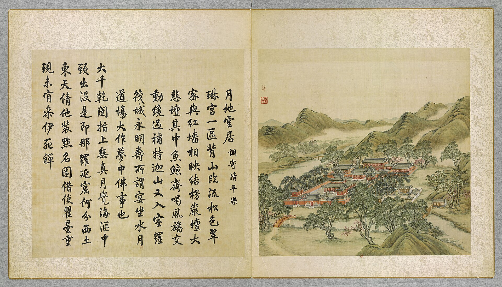

<!-- generated:start (scripts/building_pages.py): do not edit between these markers -->

# YM16-04: 后楼 Hou lou

Yuanming Yuan

**3D object:** 2 boxes. Open it: `/reconstruction/3d.html?b=YM16-04`

**Part of:** YM16 月地云居

## What we know

- **Name:** 后楼 Hou lou (S05, S01 · confidence B)
- **Garden:** Yuanming Yuan (S05, S01)
- **Type:** temple (S05, S01 · confidence B)
- **Destroyed:** 1860 (S05, S01)
- **Position:** 40.00715, 116.28394. S01 likely (S01 · confidence B)
- **Bays:** 7 in the texts / 6x1 on the plan (S05, S01)
- **Size in the inventory:** 27.8 × 9.7 m. S01 plan px / hall scale (S01)
- **Storeys:** 2 (S05, S01)
- **Note:** 簷額 蓮花法藏 (S05, S01)
- **Plan reader's note:** 后楼 seven bays per text. Wings B0417, B0418, B0423, B0424. (S01) *(research copy, not public)*
- **How it was read:** likely (S01) *(research copy, not public)*
- **Plan pixels:** 988, 2498 (S01) *(research copy, not public)*

## Our model now

On the block drawn on the Qing plan S01: position and frontage from the plan, heights and roof from the typology of its hall class, its form drawn by the hall kit. It will be updated as the research goes on.

- **1 ×:** storeyed hall: 24.48 × 9.7 m, eave 5.95 m, ridge 9.17 m
- **1 ×:** storeyed hall: 22.08 × 9.91 m, eave 5.95 m, ridge 9.17 m
- **Drawn:** by the hall kit; 2 of 2 drawn from the typology of their hall class, not from a picture of these halls
- **Confidence:** B

## Pictures (1)

- **P0016** (likely): 月地雲居 Yuedi yunju [Hameau dans les nuées sous la clarté de la lune] (圓明園四十景, 第16景) (1744 (BnF record: 1744年，清朝乾隆九年)). https://commons.wikimedia.org/wiki/File%3A%E5%9C%93%E6%98%8E%E5%9C%92%E5%9B%9B%E5%8D%81%E6%99%AF_-_%28%E6%B8%85%29%E5%94%90%E5%B2%B1%E3%80%81%E6%B2%88%E6%BA%90%E5%90%88%E7%95%AB_%3B_%28%E4%B9%BE%E9%9A%86%E5%90%9F%E8%AF%97%EF%BC%8C%E6%B1%AA%E7%94%B1%E6%95%A6%E4%BB%A3%E4%B9%A6%29_-_btv1b55008362z_%28049_of_124%29.jpg

  

## Texts and drawings (2)

- **E1540** (text, sure): 日下舊聞考 月地云居. 1780s (乾隆 敕撰) · j81:18b-19a · S05. https://github.com/kanripo/KR2k0036/blob/master/KR2k0036_081.txt
  > 山髙水長之北度橋由山口入梵刹一區為月地雲居殿五楹前殿方式四面各五楹後樓上下各七楹月地雲居之東為法源樓又東為静室西度橋折而北為劉猛將軍廟（圓明園册）臣等謹按月地雲居四十景之一額為皇上御書山門額曰清浄地前殿額曰妙證無聲後樓簷額曰蓮花法藏與法源樓静室諸額皆御書
  North of 山高水長, through a gap in the hills: a Buddhist precinct, 月地雲居, with a five-bay hall, a square front hall of five bays per side and a seven-bay two-storey rear tower. 法源樓 and a 静室 to the east, 劉猛將軍廟 to the north-west.
- **E1541** (description, likely): Scene 16, 月地云居 Yuedi Yunju. 1934 · p.83 · S02. https://archive.org/details/historyofpekings00malo
  > It had a wall around the courtyard, central and side gates, drum tower, and bell tower in the center, a large square building with eight columns on each side and a double roof, two pavilions covering stone tablets, and at the rear a two-story building, possibly a library of Buddhist scriptures, and several other buildings.
  A temple to the Buddha of Three Worlds, with a smaller temple just east. Layout from n.37, read from the picture and the plan. Through the pines one saw the round fort and the far hills.

**On the plan:** Drawn on the plan of the gardens (S01) with no label, 6x1 cells: a building stood here, its name unknown. https://artmuseum.princeton.edu/collections/objects/138657

## Evidence for the set of buildings

- Evidence for the whole compound 月地云居: see YM16
- Reconstructions and comparables for the whole garden, 圆明园 Yuanming Yuan: see GARDEN-YM
- Standing buildings comparable to a storeyed hall (not this building): see CLASS-storeyed_hall

## Open questions

None that name it.

<!-- generated:end -->

## Notes

<!-- Yours: regeneration never touches this part. It goes on the public site; what you write below a line holding only %% private %% stays in the research copy. -->
