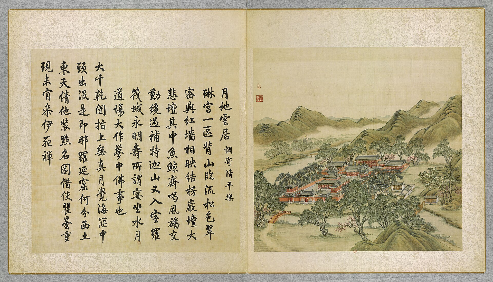
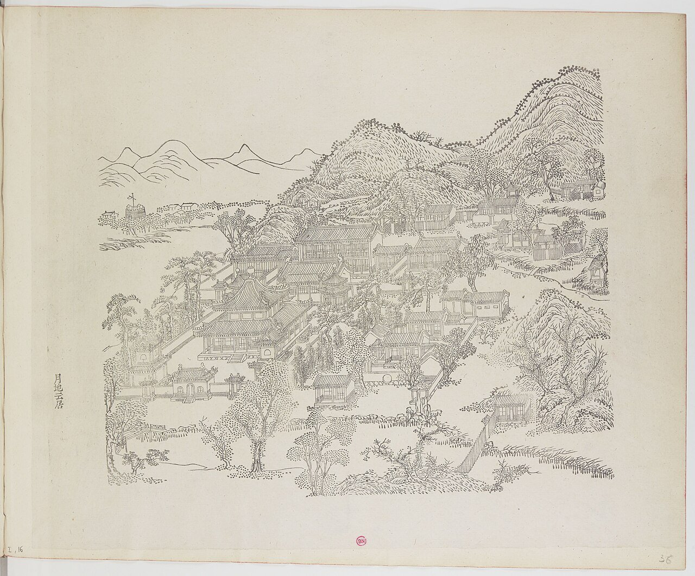
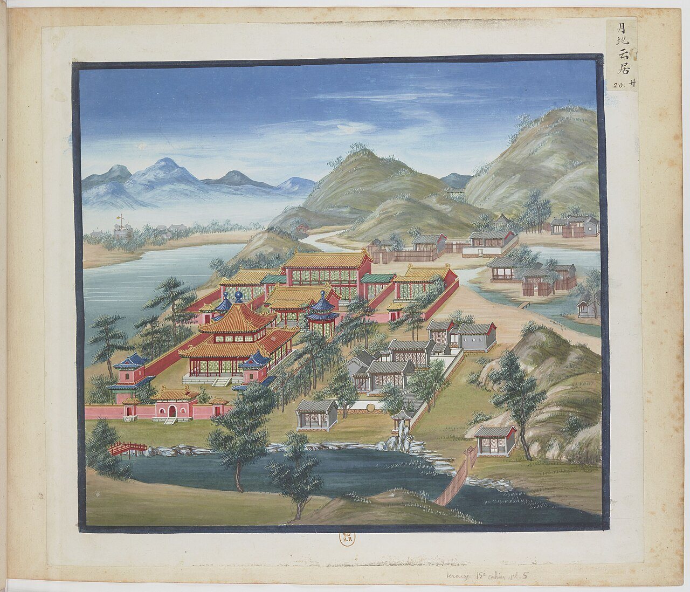
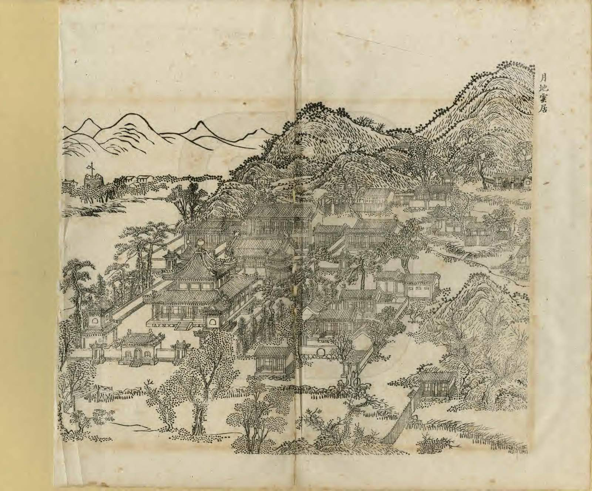
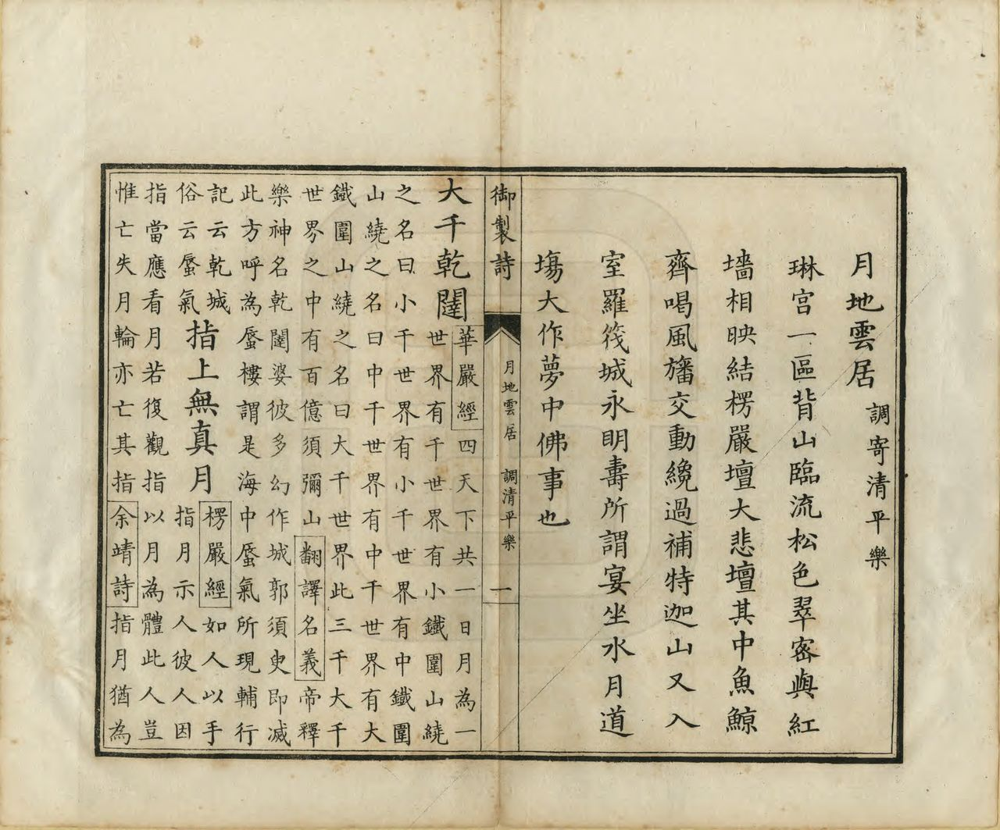

<!-- generated:start (scripts/building_pages.py): do not edit between these markers -->

# YM16: 月地云居 Yuedi Yunju

Yueh Ti Yun Chu (Dwelling of the Moon, Earth, and Clouds) · Yuanming Yuan

**3D object:** 25 boxes. Open it: `/reconstruction/3d.html?b=YM16`

## What we know

- **Name:** 月地云居 Yuedi Yunju (S05, S02, S08, S41, S42, S01 · confidence B)
- **English:** Yueh Ti Yun Chu (Dwelling of the Moon, Earth, and Clouds) (S05, S02, S08, S41, S42, S01)
- **Written on the plan:** 三世佛殿 / 都罡殿 / 法源楼 (S01 · confidence B)
- **Garden:** Yuanming Yuan (S05, S02, S08, S41, S42, S01)
- **Type:** scene (S05, S02, S08, S41, S42, S01 · confidence B)
- **Built:** 旧称清净地 (S42) (S05, S02, S08, S41, S42, S01)
- **Changed:** Differs on later plans (S41) (S05, S02, S08, S41, S42, S01)
- **Destroyed:** 1860 (S05, S02, S08, S41, S42, S01)
- **Position:** 40.00645, 116.28404. S01 likely (S01 · confidence B)
- **Note:** Album does not show the 1860 state here (S41). (S05, S02, S08, S41, S42, S01)
- **Plan reader's note:** Scene name not written; plan labels and plan form match the text and Malone 16 (Buddha of Three Worlds, large square hall). Liu Meng shrine is split off as NEW-ym_west-01. (S01) *(research copy, not public)*
- **How it was read:** likely (S01) *(research copy, not public)*
- **Plan pixels:** 987, 2824 (S01) *(research copy, not public)*

## Our model now

25 boxes stand in this compound, 25 on blocks drawn on the plan, 0 assumed. Its halls are listed below.

## Inside it (23)

- YM16-01 山门
- YM16-02 前殿 方殿
- YM16-03 正殿
- YM16-04 后楼
- YM16-05 法源楼
- YM16-06 静室
- YM16-07 刘猛将军庙
- YM16-08 魁星楼
- YM16-AW005
- YM16-AW006
- YM16-AW009
- YM16-AW010
- YM16-AW011
- YM16-B0417
- YM16-B0418
- YM16-B0421
- YM16-B0423
- YM16-B0424
- YM16-B0467
- YM16-B0468
- YM16-B0504
- YM16-B0505
- YM16-B0506

## Pictures (5)

- **P0016** (sure): 月地雲居 Yuedi yunju [Hameau dans les nuées sous la clarté de la lune] (圓明園四十景, 第16景) (1744 (BnF record: 1744年，清朝乾隆九年)). https://commons.wikimedia.org/wiki/File%3A%E5%9C%93%E6%98%8E%E5%9C%92%E5%9B%9B%E5%8D%81%E6%99%AF_-_%28%E6%B8%85%29%E5%94%90%E5%B2%B1%E3%80%81%E6%B2%88%E6%BA%90%E5%90%88%E7%95%AB_%3B_%28%E4%B9%BE%E9%9A%86%E5%90%9F%E8%AF%97%EF%BC%8C%E6%B1%AA%E7%94%B1%E6%95%A6%E4%BB%A3%E4%B9%A6%29_-_btv1b55008362z_%28049_of_124%29.jpg

  

- **P0095** (sure): 中国皇帝的宫殿与庙宇. 第36幅图, 月地云居 - (清)孙祜、沈源Yuedi yunju - (Qing)Sun Hu, Shen Yuan (1745 (Commons, from the BnF record)). https://commons.wikimedia.org/wiki/File%3A%E4%B8%AD%E5%9B%BD%E7%9A%87%E5%B8%9D%E7%9A%84%E5%AE%AB%E6%AE%BF%E4%B8%8E%E5%BA%99%E5%AE%87._%E7%AC%AC36%E5%B9%85%E5%9B%BE%2C_%E6%9C%88%E5%9C%B0%E4%BA%91%E5%B1%85_-_%28%E6%B8%85%29%E5%AD%99%E7%A5%9C%E3%80%81%E6%B2%88%E6%BA%90Yuedi_yunju_-_%28Qing%29Sun_Hu%2C_Shen_Yuan_-_btv1b10520679v.jpg

  

- **P0120** (sure): 海淀(镇)：中国皇帝的行宫. 第20幅图, 月地云居Yuedi yunju (1750-1792 (BnF, cb43831905b; ex coll. Bertin)). https://commons.wikimedia.org/wiki/File%3A%E6%B5%B7%E6%B7%80%28%E9%95%87%29%EF%BC%9A%E4%B8%AD%E5%9B%BD%E7%9A%87%E5%B8%9D%E7%9A%84%E8%A1%8C%E5%AE%AB._%E7%AC%AC20%E5%B9%85%E5%9B%BE%2C_%E6%9C%88%E5%9C%B0%E4%BA%91%E5%B1%85Yuedi_yunju_-_btv1b10520697s.jpg

  

- **P0247** (sure): 月地雲居 Yuedi Yunju (御製圓明園圖詠, 1887 石印本, 上卷 (Commons 卷一), 第16景; printed title in the right margin of the picture) (光緒十三年 1887 (Commons/NLC record; colophon 光緒十三年七月天津石印書屋 in the SSID copy, S98 PDF p.2); design after the woodblock of 1745 by 孫祜 Sun Hu and 沈源 Shen Yuan). https://commons.wikimedia.org/wiki/File%3ANLC403-312001107375-14035_%E7%A6%A6%E5%88%B6%E5%9C%93%E6%98%8E%E5%9C%92%E5%9C%96%E8%A9%A0_%E5%8D%B7%E4%B8%80.pdf?page=79

  

- **P0523** (sure): 月地雲居 Yuedi Yunju: 乾隆 Qianlong's preface and poem with the courtiers' commentary, 御製圓明園圖詠 1887 (poem 1744 (乾隆九年); this printing 1887). https://commons.wikimedia.org/wiki/File%3ANLC403-312001107375-14035_%E7%A6%A6%E5%88%B6%E5%9C%93%E6%98%8E%E5%9C%92%E5%9C%96%E8%A9%A0_%E5%8D%B7%E4%B8%80.pdf?page=80

  

## Texts and drawings (17)

- **E1539** (poem, sure): 御製月地雲居詞（調寄清平樂）琳宫一區背山臨流松色翠密與紅橋相映結楞嚴壇大悲壇其中魚鯨齊喝風旛交動纔過補特迦山又入室羅筏城永明夀所謂宴坐水月道場大作夢中佛事也（圓明園四十景詩）. 1744 (乾隆九年) · printed in S05 j81:19a-19b · S40. https://github.com/kanripo/KR2k0036/blob/master/KR2k0036_081.txt
  > 乾隆九年 御製月地雲居詞（調寄清平樂）琳宫一區背山臨流松色翠密與紅橋相映結楞嚴壇大悲壇其中魚鯨齊喝風旛交動纔過補特迦山又入室羅筏城永明夀所謂宴坐水月道場大作夢中佛事也 大千乾闥指上無真月覺海漚中頭出没是即那羅延窟 何分西土東天倩他裝㸃名園借使瞿曇重現未肯參伊死禪
  A Buddhist precinct backed by hill and fronting a stream, its dense pines against a red bridge, with Surangama and Great Compassion altars inside. He likens passing it to moving from Potalaka to Sravasti, and quotes 永明壽 on doing Buddha's work in a dream.
- **E1540** (text, sure): 日下舊聞考 月地云居. 1780s (乾隆 敕撰) · j81:18b-19a · S05. https://github.com/kanripo/KR2k0036/blob/master/KR2k0036_081.txt
  > 山髙水長之北度橋由山口入梵刹一區為月地雲居殿五楹前殿方式四面各五楹後樓上下各七楹月地雲居之東為法源樓又東為静室西度橋折而北為劉猛將軍廟（圓明園册）臣等謹按月地雲居四十景之一額為皇上御書山門額曰清浄地前殿額曰妙證無聲後樓簷額曰蓮花法藏與法源樓静室諸額皆御書
  North of 山高水長, through a gap in the hills: a Buddhist precinct, 月地雲居, with a five-bay hall, a square front hall of five bays per side and a seven-bay two-storey rear tower. 法源樓 and a 静室 to the east, 劉猛將軍廟 to the north-west.
- **E0433** (text, sure): 徐樹鈞 圓明園詞序. 1871 (同治十年立秋), recording a visit of 四月十日 · preface, whole · S203. https://www.douban.com/group/topic/46378693/
  > 圆明园在京城西，出平则门三十里，畅春园北里许，世宗皇帝藩邸赐园也。圣祖常游豫西郊，次于丹棱沜，乐其川原，因明武清侯李伟清华园旧址，筑畅春园，藩邸赐园，故在其旁。雍正三年，乃大宫殿朝署之规以避暑听政，前临西山，环以西湖。湖水发源玉泉山，曰瓮山，度宫墙东流入清河，《水经注》所谓“蓟县西湖，绿水澄澹，燕之旧池”者也。东流为洗马沟，东南合高梁之水，故鱼稻饶衍，陂泉交绮。高宗皇帝嗣位，海宇殷阗，八方无事，每岁缔构，专饰园居。大驾南巡，流览湖山风景之胜，图画以归，若海宁安澜园、江宁瞻园、钱塘小有天园、吴县狮子林，皆仿其制，增制园中。列景四十，以四字题匾者为一胜区，一区之内，斋馆无数。复东拓长春，西辟清漪，离宫别馆，月榭风亭，属之西山，所费不计亿万。园地多明权珰别业，或传崇祯末，诸奄皆以珍宝窟宅于兹，乾隆间浚池，发金银数百万，时国运方兴，地不爱宝，上心悦豫，殚精构造，曲尽游观之妙，元明以来，未之闻也。每岁夏幸园中，冬初还宫，内廷大臣，赐第相望，文武侍从，并直园林，入直奏对，昕夕往来，络绎道路，历雍乾嘉道，百余年于兹矣。文宗初，粤寇踞金陵，盗贼蜂起，上初即位，求直言，得胜保、曾国藩、袁甲三三臣，既以塞 、程、徐、陆，先朝重望，相继倾覆，始擢用前言事者，各畀重任，三臣支柱，贼不犯畿。然迭胜迭败，东南数省，蹂躏无完土，上悯苍生之颠沛，慨左右之无人。九年冬，郊宿于斋宫，夜分痛哭，侍臣凄恻。大考翰詹，以宣室前席发题，忧心焦思，伤于祸乱，然后稍自抑解，寄于文酒。以宫中行止有节，尤喜园居，冬至入宫，初正即出。时园中传有四春之宠，皆汉女，分居亭馆，所谓杏花春、武陵春、牡丹春、海棠春者也。然上明于料兵，委权阃外，超次用人，海内称哲。而部寺诸臣，无所磨励，颇袭旧敝。晚得肃顺，敢言自任，故委以谋议。先是道光二十年，英吉利夷船，至广东香港，求通商不得，又以烧烟起衅，执政议和，予海关税银千八百万。英夷请立约，广督耆英，与期十年。届期而徐广缙督两广，夷使至广州，拒不许入，以受封爵，夷酋恨焉，志入广州。咸丰元 [ 九 ] 年，英吉利、法兰西、美利坚各国，乘粤寇鸱张，中国多故，复以轮舶直入大沽台。王僧格林沁，托团练之名，焚其二船，尽击走之。夷人知大皇帝无意于战，特臣民之私愤，乃潜至海岸，买马数千，募群盗为军，半年而成，再犯天津，称西洋马队，闻者恐栗，夷马步登岸，我未陈而敌骑长驱矣。十年六 [ 八 ] 月十六日，上方园居，闻夷骑至通州，仓卒率后嫔幸热河，道路初无供帐，途出密云，御食豆乳麦粥而已。十七日，英夷帅叩东便门，或有闭城者，闻炮而开，王公请和，和议将定。十九日，夷人至圆明园宫门，管园大臣文丰当门说止之，夷兵已去。文都统知奸民将起，环问守卫禁兵，无一在者，乃自索马还内，投福海死。奸人乘时纵火，入宫劫掠，夷人从之，各园皆火发，三昼夜不熄，非独我无官府诘问，夷帅亦不能知也。初英夷使臣巴夏里，已拘刑部，和议成，以礼释囚。于是巴夏里与英帅，各陈兵仗至礼部，订约五十七条，予以海关税银三千六百万，而夷人抵偿圆明园银二十万。王公奏言，未敢斥夷，文丰与主事惠丰，同死于园，不称殉节，但言遭兵燹而已。十一年七月，文宗晏驾热河，今上即位，奉两宫皇太后还京，垂帘十载，巨寇削平。而夷人通商江海，往来贸易，设通商王大臣，以接夷使。然常言：“某省士民毁天主教堂，某省不行其教，某省民教构衅。”日以难我，应之不暇，盖岌岌乎华夷杂处，又忽忽十有一年。园居荒墟，鞠为茂草，西山大寺，夷妇深居，予旅京师，恻然不敢过也。同治十年春，同年王壬父重至辇下，追话旧游，张子雨珊亦以计偕来，约访故宫，因驻守参将廖承恩许为道主。四月十日，命仆马同过绣漪桥，寻清漪园遗迹，颓垣断瓦，零乱榛芜，宫树苍苍，水鸣呜咽。由辇路登廓如亭，南望万寿山，但见牧童樵子，往来林莽间。暮从昆明湖归，桥上铜犀卧荆棘中，犀背御铭，琅然可诵。明日访守园者，得董监，自言：“年七十有余，自道光初入寺园中，今秩五品，居福园门旁。”导予等从瓦砾中，循出入贤良门而北，指勤政、光明、寿山、太和四殿遗址，前湖圆明寝殿五楹，后为奉三无私殿、九州清晏殿各七楹，坏壁犹立，拾级可寻。董监言：“东为天地一家春，后居也，西为乐安和，诸妃嫔贵人居也，洞天深处，皇子居也。清辉殿为文宗重建，与五福堂、镂月开云台、朗吟阁皆不可复识。”镂月开云者，即所谓牡丹春者也。世宗为皇子时，迎圣祖至赐园，而高宗年十二，以皇孙召侍左右，三天子福寿冠前古，集于一堂，高宗后制诗，尝夸乐之。经其废基，裴回惄焉。东渡湖，为苏堤、长春仙馆、藻园，又北为月地云居、舍卫城、日天琳宇、水木明瑟、濂溪乐处，仅约略指视所在。东北至香雪廊，阶前茅荻萧萧，废池可辩，有老监奉茶自石畔出，讶客所从来，颇似桃源人逢渔郎也。渡桥循福海西行，为平湖秋月，水光溶溶，一泻千顷。望蓬岛瑶台，岛上殿宇，犹存数楹，惜无方舟不达。其下流水潺湲，激石成响，董监示予：“此管园大臣文公死所也。”西北至双鹤斋，又西过规月桥，登绮吟堂，经采芝径，折而东，仍出双鹤斋。园中残毁几遍，独存此为劫灰之余，乱草侵阶，窗棂宛在，尤动人禾黍悲耳。双鹤斋西，为溪月松风，翠柏苍藤，沿流覆道，斜日在林，有老宫人驱羊豕下来。东过碧桐书院，地跨池上，东为金鳌，西为玉蝀，坊楔犹存。又东去，皆败坏难寻，遂不复往。莫色沈沈，栖乌乱飞，揖董监，出福园门，还于廖宅。廖，沣州人，字枫亭，少从塞尚阿、僧格林沁军，亦能言行间事，感予来游，颇尽宾主之欢。既夕言归，则礼部放榜日也。雨珊既落第南去，予与壬父每相过从，念言园游，辄惘惘不自得。壬父又曰：“园之盛时，纯皇勒记，必殷殷踵事之戒，然仁宗始罢南幸，宣宗尤忧国贫，秋狝之礼，辍而不举。惟夫张弛之道宜及，嘉道时，补纯皇倦勤之功，而内外大臣，惟务慎节，监司宽厚，牧令昏庸，讳盗容奸，以为安静。八卦妖徒，连兵十载，无生天主，教目滋繁，由游民轻法，刑废不用故也。江淮行宫，既皆斥卖，国之所患，岂在乏财。”又曰：“燕地经安史戎马之迹，爰及辽金，近沙漠之风矣。明太宗以燕王旧居，不务改宅，仍而至今，地利竭矣。又园居单外，非所以驻万乘，废而不居，盖亦时宜。” 予曰：“然，前年御史德泰，请按户亩鳞次捐输，复修园宫。大臣以侈端将启，请旨切责，谪戍未行，愤悔自死。自此莫敢言园居者。而比年备办大婚，费已千万，结彩宫门，至十余万，公奏朝廷动用钱粮，婚以成礼，岂在华饰，若前明户部司官得以谏争，予且建言矣。又予闻慈安太后在文宗时，有脱簪之谏，《关雎》《车舝》之贤，中兴之由也。又园宫未焚前一岁，妖言传上坐寝殿，见白须老翁，自称园神，请辞而去，上梦中加神二品阶，明日，至祠谕祀之，未一期而园毁，岂能定欤？子能诗者，达于政事，曷以风人之意，备《繁霜》《云汉》之采？”于是壬父为《圆明园词》一篇。而周学士（即大学士周祖培）、潘侍郎见之，并叹其伤心感人，笔墨通于情性。予以此诗可传后来，虑夫代远年逝，传闻失实，词中所述，罔有征者，乃为文以序之。同治十年立秋日，长沙徐树钧撰。
  A walk through the ruins eleven years after the destruction, guided by an old eunuch who had served since the 1820s. It says which sites could still be read, and that 雙鶴齋 with its surroundings alone stood, as did some rooms on 蓬島瑶臺 and the 金鼇 and 玉蝀 arches. Its account of 1860 credits the first fires to local robbers, which differs from the British and French record in S02.
- **E1552** (poem, sure): 鸿慈永诂: 乾隆九年 poem of the Qianlong Emperor. 乾隆九年 (1744), date from the compilation · p.192 item (1), under 鸿慈永诂 · S360. https://www.yuanmingyuanpark.cn/xs/yjbg/202007/P020200730387572832602.pdf#page=192
  > 原庙衣冠古昔沿，天兴神御至今传。有承秩秩斯为美，对越昭昭俨在天。春露秋霜兴感切，瞻云就日致孚乾。式思曩昔含饴泽，敢缺因时献果虔？实实閟宫龙接宇，深深元寝凤翔筵。羮墙如见依灵囿，朔望来斋比奉先。扣器黄金仍两序，冷箫白玉备宫悬。万年佑启垂谟烈，继序兢兢矢勉旃。
  Poem of the Qianlong Emperor at 鸿慈永诂, 1744. Year as given by the compilation.
- **E1553** (poem, sure): 鸿慈永诂: 乾隆二十五年 poem of the Qianlong Emperor. 乾隆二十五年 (1760), date from the compilation · p.192 item (3), under 鸿慈永诂 · S360. https://www.yuanmingyuanpark.cn/xs/yjbg/202007/P020200730387572832602.pdf#page=192
  > 东陵回待谒西陵，冷节偏逢感不胜。神御拜瞻思色笑，宗藩陪叩视甞烝。 （近支诸王及皇子等并随行礼）冷淘槐叶诗传好，春雨杏花绘比能。敢向园亭酬景物，对时惟是凛绳承。
  Poem of the Qianlong Emperor at 鸿慈永诂, 1760. Year as given by the compilation.
- **E1548** (poem, sure): 静室. 乾隆三十四年 (1769) · v2 p.157, under 月地云居; source ref 10-522 · S361. https://www.yuanmingyuanpark.cn/xs/yjbg/202008/P020200803382343267004.pdf#page=160
  > 诸动本乎静，耽静即动时。寂寂物尽忘，幢幢朋从思。静固我所愿，其如酬万几。应而有不纷，澄而非无为。哲人方能是，企焉吾将希。
  Poem 静室 by the Qianlong Emperor, 1769, filed by the editors under 月地云居.
- **E1554** (poem, sure): 鸿慈永诂: 嘉庆六年 poem of the Jiaqing Emperor. 嘉庆六年 (1801), date from the compilation · p.193 item (7), under 鸿慈永诂 · S360. https://www.yuanmingyuanpark.cn/xs/yjbg/202007/P020200730387572832602.pdf#page=193
  > 清明拜叩卅余年，怆覩慈容西室悬。（安佑宫向曾供奉圣祖仁皇帝、世宗宪皇帝圣容，每遇清明节恭随皇考行礼，岁以为常，今已度二十七月。敬奉皇考圣容悬于西室展拜，实深悲慕）永佑（寺）寿皇（殿）典仍旧， （城内寿皇殿及避暑山庄永佑寺后楼皆恭奉皇考圣容于西室）祖功宗德考承先。三朝遗泽悲弓剑，九叩微忱谒几筵。物阜民安祈赐佑，敬承大业凛仔肩。
  Poem of the Jiaqing Emperor at 鸿慈永诂, 1801. Year as given by the compilation.
- **E1549** (poem, sure): 静室. 嘉庆二十二年 (1817) · v2 p.157, under 月地云居; source ref 6-368 · S361. https://www.yuanmingyuanpark.cn/xs/yjbg/202008/P020200803382343267004.pdf#page=160
  > 心静事不淆，枢机蕴一室。养正勿偏敧，内省涵宥密。储才佐邦家，用舍戒轻率。官民果相亲，上下咸安谧。此愿岂能孚，予衷勉求实。交泰普大廷，治功渐详悉。
  Poem 静室 by the Jiaqing Emperor, 1817, filed by the editors under 月地云居.
- **E1541** (description, sure): Scene 16, 月地云居 Yuedi Yunju. 1934 · p.83 · S02. https://archive.org/details/historyofpekings00malo
  > It had a wall around the courtyard, central and side gates, drum tower, and bell tower in the center, a large square building with eight columns on each side and a double roof, two pavilions covering stone tablets, and at the rear a two-story building, possibly a library of Buddhist scriptures, and several other buildings.
  A temple to the Buddha of Three Worlds, with a smaller temple just east. Layout from n.37, read from the picture and the plan. Through the pines one saw the round fort and the far hills.
- **E1011** (description, sure): Site status table, about 2011: nothing visible, or built over. c. 2011 · 系列06 repost, status table · S356. https://blog.sina.com.cn/s/blog_c27029650101itzz.html
  Same table. In it the first group shows no visible remains; 得全阁, 流香渚, 凤麟洲, 涵秋馆, 蔚藻堂, 中和堂, 敷春堂 and 心镜轩 have service buildings on them, and 含晖楼, 澄心堂, 延寿寺, 清夏堂 and 喜雨山房 are occupied by other institutions. 澹泊宁静 and several others have been dug since, so this is out of date for them.
- **E1542** (description, sure): 月地云居 魁星楼 (S47 section 2.3). 2012, citing archive and Qing texts · p.111; table row 5 · S47. https://www.dpm.org.cn/Uploads/File/2018/06/15/u5b23730ae0e5a.pdf
  Beside 刘猛将军庙 the album shows a round brick platform with two small one-bay shrines and yellow banners; the survey of 1933 draws an octagon there and calls it 魁星楼. Standing in the 1873 list of 13 surviving buildings. Before 1744 by the album; near the west wall.
- **E1560** (description, sure): 圆明园百景史事分景汇编: 鸿慈永诂. 1744-1856 · from p.192, under 鸿慈永诂 · S360. https://www.yuanmingyuanpark.cn/xs/yjbg/202007/P020200730387572832602.pdf#page=192
  The compiler's note on 安佑宫: modelled on 寿皇殿, nine bays, double-eaved hip-gable roof, yellow glazed tile, with two glazed archways and pairs of 华表 before it; Kangxi's image in the centre, Yongzheng east, Qianlong west. It also says that Yongzheng's image was first kept at 月地云居. 鸿慈永诂: 16 dated items, 1744-1856, of which 15 poems and 1 court records (Qianlong, Jiaqing, Daoguang, Xianfeng). First dated 1744, last dated 1856.
- **E1543** (description, sure): 圆明园五朝御制诗文集注 v2, editors' note on 月地云居. 2020 edition · v2 p.156 · S361. https://www.yuanmingyuanpark.cn/xs/yjbg/202008/P020200803382343267004.pdf#page=159
  First 仙香苑, in 1730 乐志山庄, a residence of Yongzheng. Under Qianlong it held his father's image with the name 安佑宫; when the new temple rose to the north it became a Buddhist temple. Gate 清净地, front hall five bays on each side, rear tower of seven; 戒定慧, 法源楼, where the Sixth Panchen lodged in 1780.
- **E1544** (description, sure, search index only): 月地云居 scene card. n.d. · mhymy jqjs 11637 · S340. https://www.mhymy.com/ymss/jqjs/11637.html
  South-west; formerly 清净地. Yongzheng's portrait was kept here until 安佑宫 was built; then a temple was added and the place renamed. Marked as having remains.
- **E1546** (drawing, sure): 《国家图书馆藏样式雷图档·圆明园卷初编》: 月地云居. mostly 道光, 咸丰, 同治 per the publisher · 初编 目录: 月地云居, pp.287-292 · S13. https://www.nlcpress.com/ProductView.aspx?Id=7642
  The printed facsimile of the National Library of China's Yangshi Lei sheets has a section on this place at pp.287-292 (6 pages, section length worked out from the next heading); sheet titles and numbers are in the volume, ordered from a library.
- **E1545** (drawing, sure, search index only): 月地云居总平面图 (图名: 清净地全样). 乾隆四十四年 (1779) 之后 · 国家图书馆善本部 样019-1号 · S310. https://www.mhymy.com/dasl/ysltd/8154.html
  Base plan of the Yuedi Yunju scene after 1779, 1235x875 mm, ink and light colour, with additions on the east such as the Fayuan tower. No image here; the site may ask a small payment for the full record.
- **E1547** (drawing, sure, search index only): 月地云居样式雷图. S310. https://www.mhymy.com/dasl/ysltd/2971.html
  Older record of a drawing of Yuedi Yunju, title seen as a link on an archived page, not opened. No image here; the site may ask a small payment for the full record.

**On the plan:** Drawn on the plan of the gardens (S01), labelled 三世佛殿 / 都罡殿 / 法源楼. https://artmuseum.princeton.edu/collections/objects/138657

## Reconstructions by others (1)

Modern interpretation, not evidence.
- **R0301** (AR/VR, likely): 时光巴士, hydrogen XR bus with transparent screens. Jeff Smith and Steve Petersen, Chrono Craft, 圆明园管理处, 2024. https://arinsider.co/?p=25138 Research-only: link card.

## Surviving comparable buildings, not this building (1)

- **T015** 小西天 (极乐世界殿) Xiaoxi Tian, Jile Shijie Hall, 北海 Beihai. Comparable: same court, era or type, confidence C, standing: yes. Square-plan Buddhist hall of the court Basis: S05 j.81 f.18b: 月地云居 has a 前殿 「方式，四面各五楹」, square. Search summary (blog): 小西天 has a square hall under a pyramid roof, glazed gates on four sides. https://blog.udn.com/JulianCWang/127561911
  - P0636: 小西天 1. https://commons.wikimedia.org/wiki/File:%E5%B0%8F%E8%A5%BF%E5%A4%A9_1.jpg

## Evidence for the set of buildings

- Reconstructions and comparables for the whole garden, 圆明园 Yuanming Yuan: see GARDEN-YM

## Open questions

- Q1: Target state
- Q18: Plan labels vs text names at 藻园, 月地云居, 日天琳宇 etc

<!-- generated:end -->

## Notes

<!-- Yours: regeneration never touches this part. It goes on the public site; what you write below a line holding only %% private %% stays in the research copy. -->
