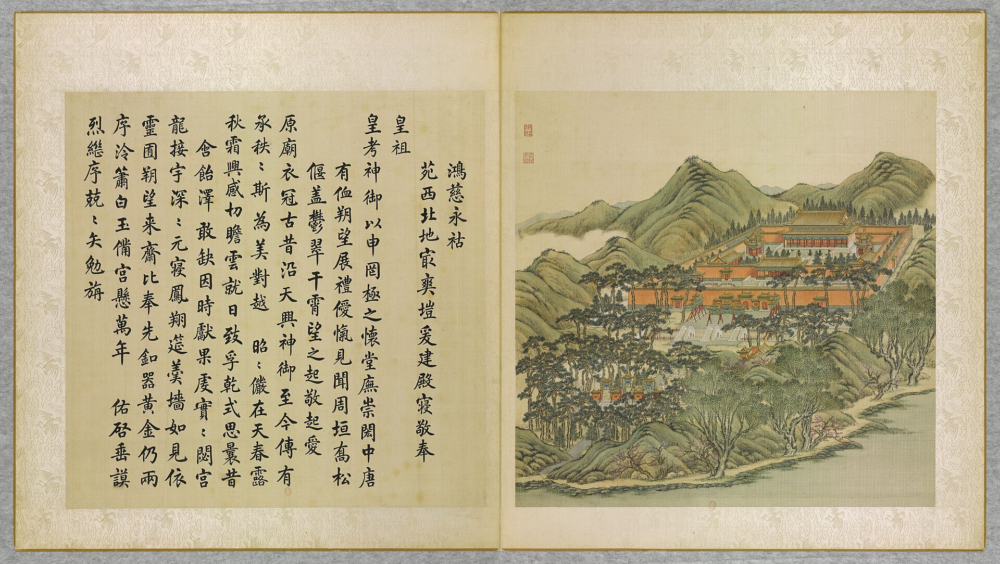

<!-- generated:start (scripts/building_pages.py): do not edit between these markers -->

# YM17-06: 安佑门 Anyou Men

Yuanming Yuan

**3D object:** 1 box. Open it: `/reconstruction/3d.html?b=YM17-06`

**Part of:** YM17 鸿慈永祜

## What we know

- **Name:** 安佑门 Anyou Men (S05, S02, S01 · confidence B)
- **Garden:** Yuanming Yuan (S05, S02, S01)
- **Type:** gate (S05, S02, S01 · confidence B)
- **Destroyed:** 1860 (S05, S02, S01)
- **Position:** 40.00952, 116.28370. S01 likely (S01 · confidence B)
- **Bays:** 5 in the texts / 5x2 on the plan (S05, S02, S01)
- **Size in the inventory:** 14.6 × 10.0 m. S01 plan px / hall scale (S01)
- **Note:** S02 p.85: 3 middle gates in the outer wall, stone qilin; yellow-tiled red wall. (S05, S02, S01)
- **Plan reader's note:** Gate on inner wall, on a terrace. (S01) *(research copy, not public)*
- **How it was read:** likely (S01) *(research copy, not public)*
- **Plan pixels:** 988, 1374 (S01) *(research copy, not public)*

## Our model now

A plain box on the block drawn on the Qing plan S01: position and frontage from the plan, heights and roof from the typology of its hall class. It will be updated as the research goes on.

- **Box:** 14.6 × 10 m, gate hall
- **Heights:** platform 0.77 m, eave 4.47 m, ridge 8.04 m above the ground
- **Roof:** hip-and-gable 歇山, rolled ridge 卷棚, grey tile
- **Faces:** 177.2° from north
- **Confidence:** B

## Pictures (1)

- **P0017** (likely): 鴻慈永祜 Hongci yonghu [Incommensurable Miséricorde pour une bénédiction éternelle] (圓明園四十景, 第17景) (1744 (BnF record: 1744年，清朝乾隆九年)). https://commons.wikimedia.org/wiki/File%3A%E5%9C%93%E6%98%8E%E5%9C%92%E5%9B%9B%E5%8D%81%E6%99%AF._%E7%AC%AC%E5%8D%81%E4%B8%83%E6%99%AF_%28%E4%B8%8A%E5%86%8C%EF%BC%8C%E7%AC%AC%E5%8D%81%E4%B8%83%E5%B9%85%E5%9B%BE%29%2C_%E9%B4%BB%E6%85%88%E6%B0%B8%E7%A5%9C_-_%28%E6%B8%85%29%E5%94%90%E5%B2%B1%E3%80%81%E6%B2%88%E6%BA%90%E5%90%88%E7%95%AB_%3B_%28%E4%B9%BE%E9%9A%86%E5%90%9F%E8%AF%97%EF%BC%8C%E6%B1%AA%E7%94%B1%E6%95%A6%E4%BB%A3%E4%B9%A6%29Hongci_yonghu_-_%28Qing%29Tang_Dai%2C_Shen_Yuan_he_hua_-_btv1b55008330t.jpg

  

## Texts and drawings (2)

- **E1556** (text, sure): 日下舊聞考 鸿慈永祜. 1780s (乾隆 敕撰) · j81:19b-21b · S05. https://github.com/kanripo/KR2k0036/blob/master/KR2k0036_081.txt
  > 月地雲居之後循山徑入為鴻慈永祜安佑宫前琉璃坊座南面額也左右石華表各一坊南及東西復有三坊環列其南為月河橋又東南為致孚殿三楹西向宫門五楹南向為安佑門門前白玉石橋三座左右井亭各一朝房各五楹門内重檐正殿九楹為安佑宫殿内中龕敬奉聖祖仁皇帝聖容左龕敬奉世宗憲皇帝聖容左右配殿各五楹碑亭各一燎亭各一（圓明園冊）臣等謹按安佑宫建自乾隆七年皇上恭仿夀皇殿之制敬奉聖祖世宗聖容嵗時朔望瞻禮于兹鴻慈永祜為四十景之一坊北面額曰燕翼長詒鴻慈永祜之前三坊南曰羮牆愾慕曰雲日瞻依東曰勲華式煥曰謨烈重光西曰德配清寧曰功隆作述殿内中龕額曰音容儼在左龕額曰陟降在兹與安佑門安佑宫額皆御書致孚殿内恭刋乾隆七年御筆敬錄世宗圓明園記並御製圓明園後記記文已恭載前卷内
  The imperial ancestral precinct. Glazed archways with named faces, two stone columns and a 月河橋, the three-bay 致孚殿, the five-bay 安佑門 with three marble bridges, well pavilions and court rooms; inside, the double-eaved nine-bay 安佑宫 with portraits of Kangxi and Yongzheng, five-bay side halls, stele and burner pavilions. Built 乾隆七年 (1742) after 壽皇殿.
- **E1563** (description, sure): 鸿慈永祜: moat, gates and the two walls. 1934 · p.85 · S02. https://archive.org/details/historyofpekings00malo
  > The moat is crossed by five marble bridges, the center one of which is intended for the Emperor alone. Beyond the bridges three pailous form a kind of screen before the gates in the outer wall of the shrine, and the stone figures of two ch'i lin guard the three middle gates
  From the pillars the path passes a small sacrifice building to five marble bridges, three pailou, two stone qilin, five gates in a red wall with yellow glazed coping. Between outer and inner red walls: waiting rooms, a second moat with three bridges and two side bridges, two covered wells, and a marble terrace with the inner gate.

**On the plan:** Drawn on the plan of the gardens (S01), labelled 安佑门, 5x2 cells. https://artmuseum.princeton.edu/collections/objects/138657

## Evidence for the set of buildings

- Evidence for the whole compound 鸿慈永祜: see YM17
- Reconstructions and comparables for the whole garden, 圆明园 Yuanming Yuan: see GARDEN-YM
- Standing buildings comparable to a gate hall (not this building): see CLASS-gate_hall

## Open questions

None that name it.

<!-- generated:end -->

## Notes

<!-- Yours: regeneration never touches this part. It goes on the public site; what you write below a line holding only %% private %% stays in the research copy. -->
