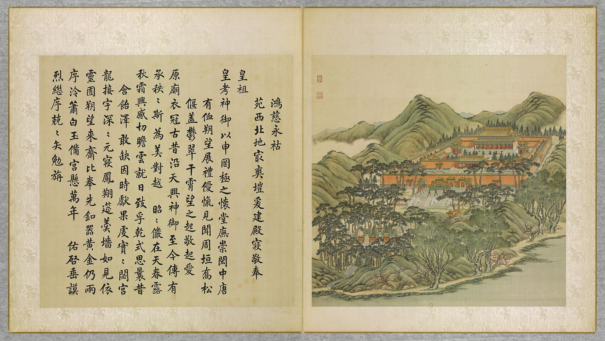

<!-- generated:start (scripts/building_pages.py): do not edit between these markers -->

# YM17-10: 安佑宫 Anyou Gong

Yuanming Yuan

**3D object:** 1 box. Open it: `/reconstruction/3d.html?b=YM17-10`

**Part of:** YM17 鸿慈永祜

## What we know

- **Name:** 安佑宫 Anyou Gong (S05, S02, S06, S01, S122, S360 · confidence B)
- **Garden:** Yuanming Yuan (S05, S02, S06, S01, S122, S360)
- **Type:** temple (S05, S02, S06, S01, S122, S360 · confidence B)
- **Destroyed:** 1860 (S05, S02, S06, S01, S122, S360)
- **Position:** 40.00999, 116.28368. S01 likely (S01 · confidence B)
- **Bays:** 9 in the texts / 9x3 on the plan (S05, S02, S06, S01, S122, S360)
- **Size in the inventory:** 34 × 20.5 m. stated in a source (S01)
- **Roof:** 重檐 double eaves; S06 歇山 (S05, S02, S06, S01, S122, S360)
- **Tiles:** 黄琉璃 yellow glazed (S02 p.88 n.; S06) (S05, S02, S06, S01, S122, S360)
- **Note:** Malone n.: 10 pillars across the front, 40 in all. On a marble terrace, 5 stairs. 為室九 [j81:23a]. Kangxi centre, Yongzheng east; Qianlong added later (S06). double-eaved hip-gable (S360, p.192 lead). (S05, S02, S06, S01, S122, S360)
- **Plan reader's note:** 9 bays match text; Malone 40 pillars. Label not adjacent. (S01) *(research copy, not public)*
- **How it was read:** likely (S01) *(research copy, not public)*
- **Plan pixels:** 994, 1143 (S01) *(research copy, not public)*

## Our model now

The ancestral temple 安佑宫 as S01 draws its layout and S05 names its halls (1742-43, after 寿皇殿): the hall of nine bays on S01's grid of ten by four columns (Malone counted forty pillars), double-eaved 歇山 in yellow tile after the leaf of 1744, on its marble terrace with five flights; the gate 安佑门, the two walls, the two moats with five bridges each, the three timber archways, the glazed archway and the four 华表 as S01, S05, Malone and the leaf give them. Every height, the smaller buildings' forms and all ornament are C.

- **Layout:** As S01 draws it (re-read in Round 27 in plan pixels, B): from the four 华表 round the glazed archway in the south, past 致孚殿, over the outer moat to the forecourt, the outer wall, the court between the walls with the inner moat, 安佑门 in the inner wall and the inner court with the hall at its back; one axis through them
- **安佑宫:** Nine bays (S05 重檐正殿九楹, A) on S01's ten column lines and four rows, about 30 x 14 m between the end columns (B; Malone counted ten pillars across the front and forty in all, B); a porch at the front, red lattice doors in every bay, red columns, green-blue beams under both eaves (the leaf, A); double-eaved 歇山 in yellow glazed tile (the leaf, A; S360, Malone, B); the plaque 安佑宫 in Qianlong's hand (S05, A); the column 4.6 m from the leaf's proportion, the roofs' rise C
- **Terrace:** One marble terrace under the hall and before it, T-shaped as S01 draws it, with five flights, three at the front and one on each side of the 月台 (S01; Malone's five stairs, B); the middle flight with the dragon-and-cloud ramp stone, 1.30 m wide (S943: one of its stones is at Peking University, B); white balustrades (the leaf, A); its height 1.6 m C; two censers, two cranes and two deer before the hall (S361, Malone, B; their forms and places C)
- **Inner court:** The side halls 配殿 of five bays, yellow 歇山 (S05, A; the leaf; S01), the two octagonal stele pavilions with double eaves (S05, Malone, the leaf; S01's octagons), the two green-glazed burners (S05, Malone, B; form C); a way on the axis (C); the court's trees are the planting's (the leaf's rows of small conifers)
- **安佑门:** Five bays (S05, A), single-eave 歇山 in yellow tile (the leaf, A), its doors in the middle row on the inner wall's line (S01, B), on a marble terrace with a balustrade and three flights (Malone, the leaf, B; its size C); the plaque 安佑门 (S05, A)
- **Walls:** Two red walls with yellow glazed coping (Malone, B; the leaf paints them vermilion), 72 x 61 m and 96 x 100 m as S01 draws them (B); a small gate either side of 安佑门 (S01; the leaf); the outer wall's five gates: three glazed arched gates in the middle and a smaller gate each side (Malone, S01, the leaf; B), a gate of three bays on the north side (S01); heights C
- **Between the walls:** The inner moat, a moon river with three marble bridges before the gate and one at each side (S05, A; Malone, B; S01's channel and breaks: water of Round 27), its lining and railings C; the waiting rooms 朝房 of five bays (S05, A; form C); two well pavilions (S05, Malone; form C); in the north corners two walled yards with long ranges (S01; unnamed, C)
- **Forecourt:** The two stone qilin on their bases before the three middle gates (Malone; S943: 1.74 m on bases 0.98 m high, 1.41 x 1.95 m; S01's squares; B; the beast's form C); the three timber archways 三坊 with red posts held by diagonal props and small yellow roofs (S05, A, with their six faces named; the leaf, A; S01's bars), their heights C; paved (the leaf)
- **Outer moat:** The U-shaped moat 月河 round the forecourt (S05, A; S01's band: water of Round 27) with five marble bridges, the middle one for the emperor (Malone, B); three arched bridges with white balustrades and red railings along the banks as the leaf paints them (A); the two end bridges and the lining C
- **致孚殿:** Three bays facing west in a red-walled yard, yellow tile (S05, A; the leaf, A; S01's yard and cells, B); inside, the carved text of Yongzheng's 圆明园记 (S05 j81:21b; not drawn); heights C
- **Glazed archway and 华表:** 鸿慈永祜坊 (S05, A): three gates with glazed frames and yellow roofs between four short red walls with round glazed panels (Malone, B; the leaf, A), 13.7 m as S01 draws it (B), its heights C; the four marble 华表 at the corners of a square of 30 m (Malone, S01: B), 8 m high on octagonal bases 1.24 m high (S980, B), the dragon, cloud board, dew plate and beast after the photograph of about 1882 (P0196) and the pair at Peking University (C for their sizes)
- **What survives:** The 华表: two at Peking University, two before the old National Library (moved 1925; S980); the qilin pair at Peking University (S943); one ramp stone at Peking University, its pair at the east gate of 颐和园 (S943). The masonry was pulled down under the Republic (S02 p.218); no dig of the platform has been published
- **Assumed:** Every height (the terrace 1.6 m, the hall's column 4.6 m and its roofs, the gates', walls', archways' and pavilions' heights), the porches, the brackets, the corner ranges, the waiting rooms', wells' and burners' forms, the bronzes, the qilin's and 华表's carving, the bridges' form, the linings and railings: the classes, the Qing manual and the leaf (C, the pale tint with conf=1)

## Pictures (1)

- **P0017** (likely): 鴻慈永祜 Hongci yonghu [Incommensurable Miséricorde pour une bénédiction éternelle] (圓明園四十景, 第17景) (1744 (BnF record: 1744年，清朝乾隆九年)). https://commons.wikimedia.org/wiki/File%3A%E5%9C%93%E6%98%8E%E5%9C%92%E5%9B%9B%E5%8D%81%E6%99%AF._%E7%AC%AC%E5%8D%81%E4%B8%83%E6%99%AF_%28%E4%B8%8A%E5%86%8C%EF%BC%8C%E7%AC%AC%E5%8D%81%E4%B8%83%E5%B9%85%E5%9B%BE%29%2C_%E9%B4%BB%E6%85%88%E6%B0%B8%E7%A5%9C_-_%28%E6%B8%85%29%E5%94%90%E5%B2%B1%E3%80%81%E6%B2%88%E6%BA%90%E5%90%88%E7%95%AB_%3B_%28%E4%B9%BE%E9%9A%86%E5%90%9F%E8%AF%97%EF%BC%8C%E6%B1%AA%E7%94%B1%E6%95%A6%E4%BB%A3%E4%B9%A6%29Hongci_yonghu_-_%28Qing%29Tang_Dai%2C_Shen_Yuan_he_hua_-_btv1b55008330t.jpg

  

## Texts and drawings (11)

- **E1555** (text, sure): 御製安佑宫碑文. c. 1743 (蕆事於癸亥, in the text) · j81:21b-24a · S05. https://github.com/kanripo/KR2k0036/blob/master/KR2k0036_081.txt
  > 御製安佑宫碑文　序昭穆以祀其先祖有功而宗有徳建報本之義為萬古之經者宗廟之制三代以上即有之繼人之志述人之事者所當謹也設裳衣以如其生朔有酌而望有獻盡事親之禮抒不匱之思者原廟之制西漢以來始有之繼人之志述人之事者弗敢廢也後世神御殿亦猶漢原廟之義耶然漢之原廟不過月出衣冠一遊耳至宋之時乃有神御之名蓋奉安列朝御容所也上元結燈樓寒食設秋千其視漢為己備矣而崇建徧郡國奉祀或禪院識者多議其非禮焉我皇祖聖祖仁皇帝在位六十餘年恩澤旁覃僻邑窮谷圓頂方趾之衆飲其德而不知子孫臣庶躬被教育者宜其謳歌慨慕而無已思也是以雍正元年我皇考世宗憲皇帝謹就大内夀皇殿奉安御容朔望瞻禮牲新時薦而於皇祖所幸暢春園亦陳薦如禮非輕為此創舉也我皇祖有非常之澤及天下是以皇考合天下之情亦以非常之禮報之有漢宋備物備禮之誠而無宋代徧及郡國祀繁致䙝之譏也予小子嬛嬛在疚顧諟皇考之陟降勅明旦凛紹庭良法美政布在方冊者謹守而弗敢失既就夀皇殿東室䖍奉皇考御容以配皇祖念兹圓明園我皇考向日遊觀在囿在沼之地也其何忍恝視爰擇爽塏之地具殿廡之規為室九敬奉皇祖御容於中奉皇考配東一室匪惟予小子罔極之思羮牆之慕藉以稍抒亦欲使後世子孫凜覲揚之志勤堂構之基所謂禮以義起有其舉之莫敢廢也鳩工於乾隆庚午而蕆事於癸亥所司以碑文請乃序其事如左而繫之以詩懿兹苑囿皇考所作土階茅茨遵堯之約匪誇丹雘有窅谿壑匪沸管絃有唳雲鶴詎美之求惟聖所樂我龍受之中心惕若宅是廣居九有是度祖武斯繩宏規敢畧爰相其地載斟載酌爰創其模載經載落廟貌巖巖堂皇綽綽有閑楹旅有梴松桷周之以郛其郛嶽嶽環之以池其池㶁㶁其水何有鳶飛魚躍其宇何有網軒珠箔神御孔安心乎莫莫來覲來齋曰望曰朔於萬斯年予誠永託
  Stele text of 安佑宫: traces ancestral halls from antiquity through Han and Song, recalls Yongzheng's installing Kangxi's portrait in 壽皇殿 in 雍正元年 (1723), and explains why he built this nine-room hall in his father's garden. The printed start year 庚午 cannot stand, as its end is 癸亥 (1743).
- **E1556** (text, sure): 日下舊聞考 鸿慈永祜. 1780s (乾隆 敕撰) · j81:19b-21b · S05. https://github.com/kanripo/KR2k0036/blob/master/KR2k0036_081.txt
  > 月地雲居之後循山徑入為鴻慈永祜安佑宫前琉璃坊座南面額也左右石華表各一坊南及東西復有三坊環列其南為月河橋又東南為致孚殿三楹西向宫門五楹南向為安佑門門前白玉石橋三座左右井亭各一朝房各五楹門内重檐正殿九楹為安佑宫殿内中龕敬奉聖祖仁皇帝聖容左龕敬奉世宗憲皇帝聖容左右配殿各五楹碑亭各一燎亭各一（圓明園冊）臣等謹按安佑宫建自乾隆七年皇上恭仿夀皇殿之制敬奉聖祖世宗聖容嵗時朔望瞻禮于兹鴻慈永祜為四十景之一坊北面額曰燕翼長詒鴻慈永祜之前三坊南曰羮牆愾慕曰雲日瞻依東曰勲華式煥曰謨烈重光西曰德配清寧曰功隆作述殿内中龕額曰音容儼在左龕額曰陟降在兹與安佑門安佑宫額皆御書致孚殿内恭刋乾隆七年御筆敬錄世宗圓明園記並御製圓明園後記記文已恭載前卷内
  The imperial ancestral precinct. Glazed archways with named faces, two stone columns and a 月河橋, the three-bay 致孚殿, the five-bay 安佑門 with three marble bridges, well pavilions and court rooms; inside, the double-eaved nine-bay 安佑宫 with portraits of Kangxi and Yongzheng, five-bay side halls, stele and burner pavilions. Built 乾隆七年 (1742) after 壽皇殿.
- **E1557** (text, likely): 文宗實錄 咸豐二年六月. 1852 (咸豐二年六月) · 實錄卷之六十三 · S207. https://github.com/garychowcmu/daizhigev20/blob/master/史藏/别史/清实录咸丰朝实录.txt
  > 上诣安佑宫行礼。○诣绮春园、皇贵太妃前行礼。○御正大光明殿。王以下文武大臣官员、蒙古王贝勒等、行庆贺礼。○幸同乐园。赐王公大臣蒙古王贝勒等食。
  The emperor's birthday round in 1852: rites at 安佑宫, the consort at 綺春園, congratulations in 正大光明殿 and a feast at 同樂園. The halls in use eight years before the end.
- **E1558** (text, likely): 養吉齋叢錄 卷七. mid-19th c. (printed 1890s), on earlier reigns · 卷七, line 410 of the corpus file · S202. https://raw.githubusercontent.com/garychowcmu/daizhigev20/master/%E5%8F%B2%E8%97%8F/%E5%BF%97%E5%AD%98%E8%AE%B0%E5%BD%95/%E5%85%BB%E5%90%89%E6%96%8B%E4%B8%9B%E5%BD%95.txt
  > 雍正元年，于大内寿皇殿及畅春园奉安圣祖御容。乾隆初，就寿皇殿东室奉世宗御容。复于圆明园创殿庑之规为九室，东一室奉世宗御容，所谓安佑宫也。惟时太祖、太宗、世祖及列后圣容，皆于体仁阁尊藏，无展谒献祭之礼。十五年，恭奉列祖列后圣容于寿皇殿，如奉先殿昭穆次序，皆南向按室悬像，行献祭礼。翌日，收奉于殿左之衍庆殿，左曰衍庆，右曰延禧。比祧庙之制。每岁除夕恭悬，元旦瞻拜。嗣后，列宗列后皆于此奉安神御。
  Summary of the portrait halls: 壽皇殿, 暢春園 and then nine rooms in 圓明園, called 安佑宫.
- **E1559** (text, likely): 養吉齋叢錄 卷七. mid-19th c. (printed 1890s), on earlier reigns · 卷七, line 411 of the corpus file · S202. https://raw.githubusercontent.com/garychowcmu/daizhigev20/master/%E5%8F%B2%E8%97%8F/%E5%BF%97%E5%AD%98%E8%AE%B0%E5%BD%95/%E5%85%BB%E5%90%89%E6%96%8B%E4%B8%9B%E5%BD%95.txt
  > 按：寿皇殿向止三楹，乾隆庚午重建，一视安佑宫之制。工成于六月望日，重安神御。
  壽皇殿 had only three bays, and was rebuilt in 乾隆庚午 (1750) on the model of 安佑宫.
- **E1567** (poem, likely): 清明日拜谒安佑宫. 乾隆二十四年 (1759) · v2 p.160, under 鸿慈永祜; source ref 6-709 · S361. https://www.yuanmingyuanpark.cn/xs/yjbg/202008/P020200803382343267004.pdf#page=163
  > 昨岁寿皇思莫穷，今年寒食御园中。亲支率领谒安佑，驹影推迁信幻空。已觉烟含隄柳绿，谁怜风妬坞桃红。东西瞻眺二陵邈，不隔精诚一念通。
  Poem 清明日拜谒安佑宫 by the Qianlong Emperor, 1759, filed by the editors under 鸿慈永祜.
- **E1554** (poem, likely): 鸿慈永诂: 嘉庆六年 poem of the Jiaqing Emperor. 嘉庆六年 (1801), date from the compilation · p.193 item (7), under 鸿慈永诂 · S360. https://www.yuanmingyuanpark.cn/xs/yjbg/202007/P020200730387572832602.pdf#page=193
  > 清明拜叩卅余年，怆覩慈容西室悬。（安佑宫向曾供奉圣祖仁皇帝、世宗宪皇帝圣容，每遇清明节恭随皇考行礼，岁以为常，今已度二十七月。敬奉皇考圣容悬于西室展拜，实深悲慕）永佑（寺）寿皇（殿）典仍旧， （城内寿皇殿及避暑山庄永佑寺后楼皆恭奉皇考圣容于西室）祖功宗德考承先。三朝遗泽悲弓剑，九叩微忱谒几筵。物阜民安祈赐佑，敬承大业凛仔肩。
  Poem of the Jiaqing Emperor at 鸿慈永诂, 1801. Year as given by the compilation.
- **E1568** (poem, likely): 清明日安佑宫瞻礼泣述. 嘉庆十九年 (1814) · v2 p.162, under 鸿慈永祜; source ref 5-345 · S361. https://www.yuanmingyuanpark.cn/xs/yjbg/202008/P020200803382343267004.pdf#page=165
  > 鼎成十六年，孺慕与岁积。春露复秋霜，亲谒珠邱地。去秋至蓟西，忽逢大变异。宗庙关系深，定乱亟旋跸。挥涕望裕陵，抒虔伸痛思。我考怜儿愚，内外昭荫庇。三月贼全除，民安靖戎事。欲展谢恩仪，又恐劳车骑。庶姓力役繁，比户多憔悴。仰体爱民心，竭诚勉抚字。清明瞻圣容，九叩霑双泪。魂梦恋云山，述哀五言记。去岁，展谒西陵，未至裕陵。原定于木兰旋跸时，敬诣珠邱，泣申孺慕。不意九月中，回至蓟西，突有大逆肆扰禁城之事。时距桥山，仅隔两程，然往返稍濡时日。京师为宗社重地，定乱靖民，势不容缓。不得已，遥向东北虔叩，默展悲忱。即日回轸，于十九日抵京。维时逆首业经就缚，宫禁贼党搜捕肃清，人心大定。京南齐、豫勾结匪徒，先经命将前往，以次剿平。其大股屯据滑县，至腊月内，全数扫除。此皆皇考牖启藐躬，不啻隐垂指示，用能迅除妖孽，内外均安也。自邪匪底定之后，复有陕省莠民，乘机窃发。幸滑县先已克平，命疆臣宿将，即移胜兵搜缉。至本年二月内，一律荡涤，不遗余孽，戎事得以全蒇。每岁清明前后，率皆亲诣松楸，以纾霜露之感。兹更仰承鸿佑，尤应虔叩恩慈。惟是上年师出畿南，未免有妨民事，若再因銮辂经行，重烦力役，转非皇考仁爱斯民之意。爰即敬诣安佑宫，肃诚瞻礼，稍伸哀愫。云山在望，心与俱驰矣。
  Poem 清明日安佑宫瞻礼泣述 by the Jiaqing Emperor, 1814, filed by the editors under 鸿慈永祜.
- **E1562** (description, sure): 鸿慈永祜: inner court and 安佑宫 Anyou Gong. 1934 · pp.86-88 · S02. https://archive.org/details/historyofpekings00malo
  > The An Yu Kung, or Palace of Peace and Help, was the name of the large Ancestral Shrine which rose on this terrace.
  Inner court: waiting rooms, two green-glazed incense burners, pines, two double-roofed pavilions over marble steles. Main hall on a marble terrace with five stairs, the middle one carved with dragons; incense burners and bronze birds and animals. Ten pillars across the front, forty in all, double roof of yellow glazed tile (n.38). Built 1742 at 600,000 taels (Tse Li vol. xviii p.30; Attiret 1743). Tablets and portraits of Kangxi and Yongzheng.
- **E1564** (description, sure): 圆明园五朝御制诗文集注 v2, editors' note on 鸿慈永祜. 2020 edition · v2 p.159 · S361. https://www.yuanmingyuanpark.cn/xs/yjbg/202008/P020200803382343267004.pdf#page=162
  The ancestral temple, finished 1743 after 寿皇殿. Outer arch, 致孚殿 with the carved 圆明园记, a moon-river bridge, three arches, a five-bay gate, the nine-bay double-eaved hall in yellow tile; side halls, stele pavilions and bronze deer and cranes before it. Five imperial images in time.
- **E1560** (description, likely): 圆明园百景史事分景汇编: 鸿慈永诂. 1744-1856 · from p.192, under 鸿慈永诂 · S360. https://www.yuanmingyuanpark.cn/xs/yjbg/202007/P020200730387572832602.pdf#page=192
  The compiler's note on 安佑宫: modelled on 寿皇殿, nine bays, double-eaved hip-gable roof, yellow glazed tile, with two glazed archways and pairs of 华表 before it; Kangxi's image in the centre, Yongzheng east, Qianlong west. It also says that Yongzheng's image was first kept at 月地云居. 鸿慈永诂: 16 dated items, 1744-1856, of which 15 poems and 1 court records (Qianlong, Jiaqing, Daoguang, Xianfeng). First dated 1744, last dated 1856.

**On the plan:** Drawn on the plan of the gardens (S01), labelled 安佑宫, 9x3 cells. https://artmuseum.princeton.edu/collections/objects/138657

## Evidence for the set of buildings

- Evidence for the whole compound 鸿慈永祜: see YM17
- Reconstructions and comparables for the whole garden, 圆明园 Yuanming Yuan: see GARDEN-YM
- Standing buildings comparable to a temple hall (not this building): see CLASS-temple_hall

## Open questions

- Q25: Other dates
- Q26: Forms
- Q52: Smaller conflicts
- Q59: Twin claims to hold loosely
- Q116: YM41 大宫门 and YM17 安佑宫
- Q119: Digs
- Q159: Commons files the bronze qilin before 仁寿殿 at 颐和园 (Category:Statue of Qilin (Hall of Benevo
- Q160: S818 (PKU page) says three 安佑宫 华表 went to Yenching in 1925 and the fourth to the city
- Q185: Typology, 石华表 YM17-02
- Q198: The album's hills are too tall
- Q296: The heights of 安佑宫. (Round 27)
- Q298: 安佑宫's size on S01 against its rank. (Round 27)

<!-- generated:end -->

## Notes

<!-- Yours: regeneration never touches this part. It goes on the public site; what you write below a line holding only %% private %% stays in the research copy. -->
