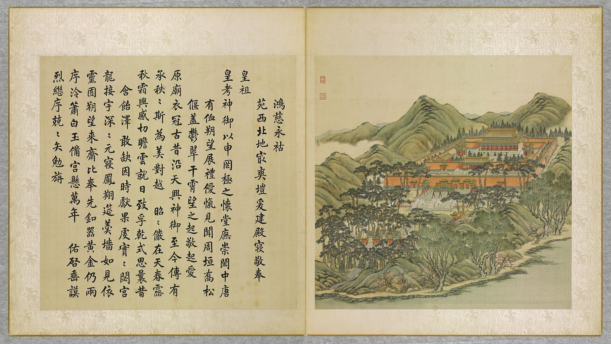
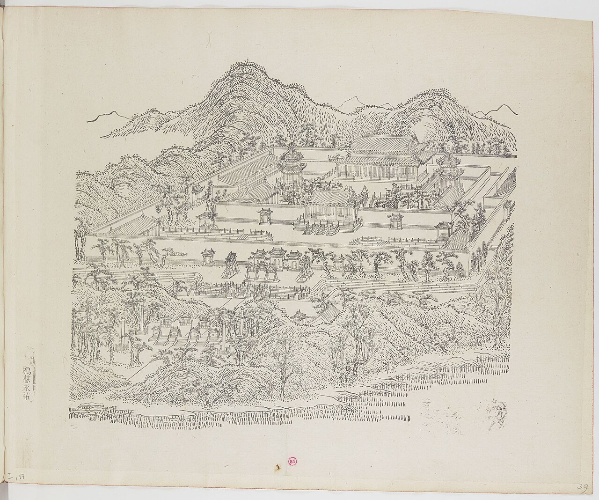
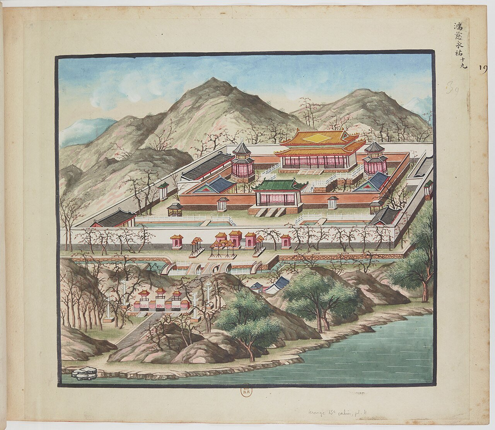
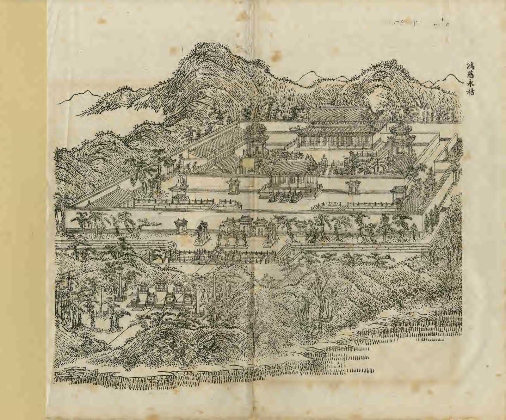
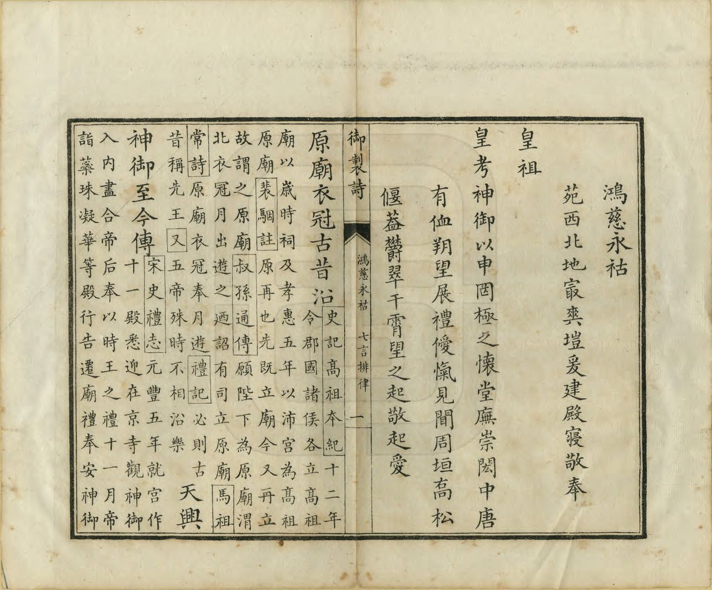
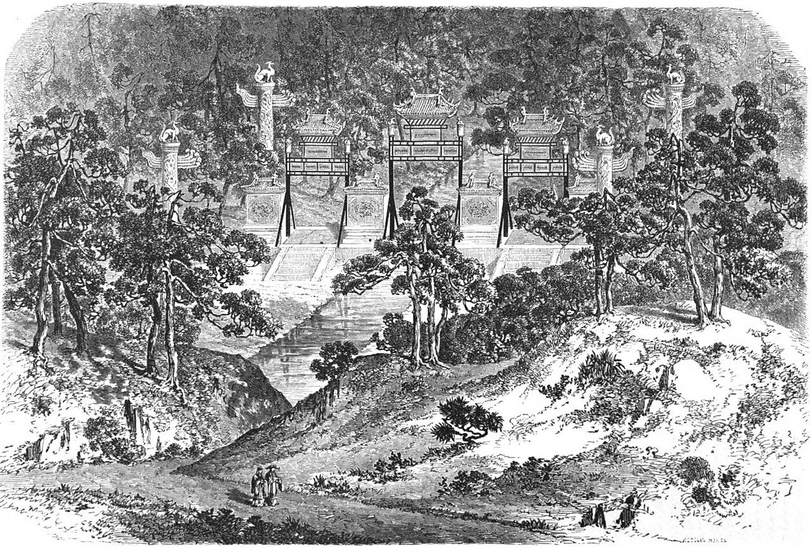
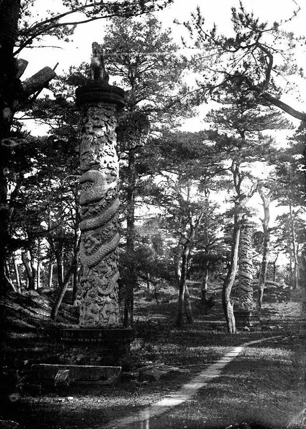
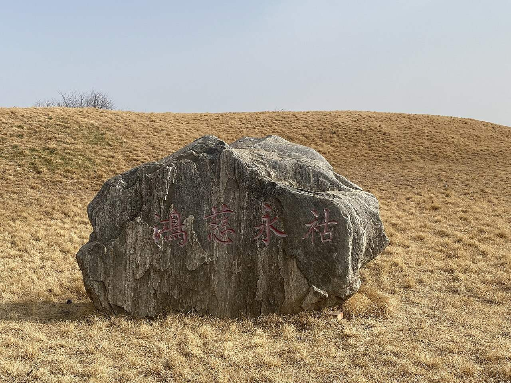

<!-- generated:start (scripts/building_pages.py): do not edit between these markers -->

# YM17: 鸿慈永祜 Hongci Yonghu

The Ancestral Shrine (Vast Compassion and Eternal Blessing) · Yuanming Yuan

**3D object:** 17 boxes. Open it: `/reconstruction/3d.html?b=YM17`

## What we know

- **Name:** 鸿慈永祜 Hongci Yonghu (S05, S02, S08, S01, S361 · confidence A)
- **English:** The Ancestral Shrine (Vast Compassion and Eternal Blessing) (S05, S02, S08, S01, S361)
- **Written on the plan:** 鸿慈永祜 / 安佑宫 (S01 · confidence A)
- **Garden:** Yuanming Yuan (S05, S02, S08, S01, S361)
- **Type:** scene (S05, S02, S08, S01, S361 · confidence A)
- **Built:** 乾隆七年 1742 [j81:20b]; S02 p.88 same; stele 癸亥 1743 finish [j81:23b] (S05, S02, S08, S01, S361)
- **Destroyed:** 1860; masonry ruins pulled down later (S02 p.218) (S05, S02, S08, S01, S361)
- **Position:** 40.00999, 116.28368. S01 sure (S01 · confidence B)
- **Note:** Same compound as 安佑宫. Cost 600,000 taels (Attiret 1743 via S02 p.88). 恭仿壽皇殿之制. (S05, S02, S08, S01, S361)
- **Plan reader's note:** Faint 鸿慈永祜 in the inner court (1005,1295) and 安佑宫 at (1000,1473). Polygon runs south to take in the pailou and four pillars on the peninsula (Malone p.84-85). (S01) *(research copy, not public)*
- **How it was read:** sure (S01) *(research copy, not public)*
- **Plan pixels:** 993, 1143 (S01) *(research copy, not public)*

## Our model now

17 boxes stand in this compound, 17 on blocks drawn on the plan, 0 assumed. Its halls are listed below.

## Inside it (18)

- YM17-01 鸿慈永祜坊
- YM17-02 石华表
- YM17-03 三坊
- YM17-04 月河桥
- YM17-05 致孚殿
- YM17-06 安佑门
- YM17-07 白玉石桥
- YM17-08 井亭
- YM17-09 朝房
- YM17-10 安佑宫
- YM17-11 配殿
- YM17-12 碑亭
- YM17-13 燎亭
- YM17-AW012
- YM17-AW013
- YM17-B0156
- YM17-B0158
- YM17-N01

## Pictures (9)

- **P0017** (sure): 鴻慈永祜 Hongci yonghu [Incommensurable Miséricorde pour une bénédiction éternelle] (圓明園四十景, 第17景) (1744 (BnF record: 1744年，清朝乾隆九年)). https://commons.wikimedia.org/wiki/File%3A%E5%9C%93%E6%98%8E%E5%9C%92%E5%9B%9B%E5%8D%81%E6%99%AF._%E7%AC%AC%E5%8D%81%E4%B8%83%E6%99%AF_%28%E4%B8%8A%E5%86%8C%EF%BC%8C%E7%AC%AC%E5%8D%81%E4%B8%83%E5%B9%85%E5%9B%BE%29%2C_%E9%B4%BB%E6%85%88%E6%B0%B8%E7%A5%9C_-_%28%E6%B8%85%29%E5%94%90%E5%B2%B1%E3%80%81%E6%B2%88%E6%BA%90%E5%90%88%E7%95%AB_%3B_%28%E4%B9%BE%E9%9A%86%E5%90%9F%E8%AF%97%EF%BC%8C%E6%B1%AA%E7%94%B1%E6%95%A6%E4%BB%A3%E4%B9%A6%29Hongci_yonghu_-_%28Qing%29Tang_Dai%2C_Shen_Yuan_he_hua_-_btv1b55008330t.jpg

  

- **P0098** (sure): 中国皇帝的宫殿与庙宇. 第39幅图, 鴻慈永祜 - (清)孙祜、沈源Hongci yonghu - (Qing)Sun Hu, Shen Yuan (1745 (Commons, from the BnF record)). https://commons.wikimedia.org/wiki/File%3A%E4%B8%AD%E5%9B%BD%E7%9A%87%E5%B8%9D%E7%9A%84%E5%AE%AB%E6%AE%BF%E4%B8%8E%E5%BA%99%E5%AE%87._%E7%AC%AC39%E5%B9%85%E5%9B%BE%2C_%E9%B4%BB%E6%85%88%E6%B0%B8%E7%A5%9C_-_%28%E6%B8%85%29%E5%AD%99%E7%A5%9C%E3%80%81%E6%B2%88%E6%BA%90Hongci_yonghu_-_%28Qing%29Sun_Hu%2C_Shen_Yuan_-_btv1b10520681p.jpg

  

- **P0119** (sure): 海淀(镇)：中国皇帝的行宫. 第19幅图, 鴻慈永祜Hongci yonghu (1750-1792 (BnF, cb43831905b; ex coll. Bertin)). https://commons.wikimedia.org/wiki/File%3A%E6%B5%B7%E6%B7%80%28%E9%95%87%29%EF%BC%9A%E4%B8%AD%E5%9B%BD%E7%9A%87%E5%B8%9D%E7%9A%84%E8%A1%8C%E5%AE%AB._%E7%AC%AC19%E5%B9%85%E5%9B%BE%2C_%E9%B4%BB%E6%85%88%E6%B0%B8%E7%A5%9CHongci_yonghu_-_btv1b105206987.jpg

  

- **P0248** (sure): 鴻慈永祜 Hongci Yonghu (御製圓明園圖詠, 1887 石印本, 上卷 (Commons 卷一), 第17景; printed title in the right margin of the picture) (光緒十三年 1887 (Commons/NLC record; colophon 光緒十三年七月天津石印書屋 in the SSID copy, S98 PDF p.2); design after the woodblock of 1745 by 孫祜 Sun Hu and 沈源 Shen Yuan). https://commons.wikimedia.org/wiki/File%3ANLC403-312001107375-14035_%E7%A6%A6%E5%88%B6%E5%9C%93%E6%98%8E%E5%9C%92%E5%9C%96%E8%A9%A0_%E5%8D%B7%E4%B8%80.pdf?page=82

  

- **P0524** (sure): 鴻慈永祜 Hongci Yonghu: 乾隆 Qianlong's preface and poem with the courtiers' commentary, 御製圓明園圖詠 1887 (poem 1744 (乾隆九年); this printing 1887). https://commons.wikimedia.org/wiki/File%3ANLC403-312001107375-14035_%E7%A6%A6%E5%88%B6%E5%9C%93%E6%98%8E%E5%9C%92%E5%9C%96%E8%A9%A0_%E5%8D%B7%E4%B8%80.pdf?page=83

  

- **P0144** (likely): Le Tour du monde 10: Triumphal arches at the entrance of the Palace favored by Heaven, p. 99 (1 July 1864 (Commons)). https://commons.wikimedia.org/wiki/File%3ALe_Tour_du_monde-10-p099.jpg

  

- **P0196** (likely): Historical image of Anyougong ruins (file name) (around 1882 (Commons description)). https://commons.wikimedia.org/wiki/File%3AHistorical_image_of_Anyougong_ruins_in_the_Yuanmingyuan.jpg

  

- **P0195** (likely): Anyougong gate ruins (安佑宫 gate, file name) (not stated). https://commons.wikimedia.org/wiki/File%3AAnyougong_gate_ruins_of_the_Yuanmingyuan.jpg Research-only: link card.
- **P0382** (sure): 圆明园鸿慈永祜石碑.jpg (2022-03-13 (Commons DateTimeOriginal)). https://commons.wikimedia.org/wiki/File:%E5%9C%86%E6%98%8E%E5%9B%AD%E9%B8%BF%E6%85%88%E6%B0%B8%E7%A5%9C%E7%9F%B3%E7%A2%91.jpg

  

## Texts and drawings (25)

- **E1555** (text, sure): 御製安佑宫碑文. c. 1743 (蕆事於癸亥, in the text) · j81:21b-24a · S05. https://github.com/kanripo/KR2k0036/blob/master/KR2k0036_081.txt
  > 御製安佑宫碑文　序昭穆以祀其先祖有功而宗有徳建報本之義為萬古之經者宗廟之制三代以上即有之繼人之志述人之事者所當謹也設裳衣以如其生朔有酌而望有獻盡事親之禮抒不匱之思者原廟之制西漢以來始有之繼人之志述人之事者弗敢廢也後世神御殿亦猶漢原廟之義耶然漢之原廟不過月出衣冠一遊耳至宋之時乃有神御之名蓋奉安列朝御容所也上元結燈樓寒食設秋千其視漢為己備矣而崇建徧郡國奉祀或禪院識者多議其非禮焉我皇祖聖祖仁皇帝在位六十餘年恩澤旁覃僻邑窮谷圓頂方趾之衆飲其德而不知子孫臣庶躬被教育者宜其謳歌慨慕而無已思也是以雍正元年我皇考世宗憲皇帝謹就大内夀皇殿奉安御容朔望瞻禮牲新時薦而於皇祖所幸暢春園亦陳薦如禮非輕為此創舉也我皇祖有非常之澤及天下是以皇考合天下之情亦以非常之禮報之有漢宋備物備禮之誠而無宋代徧及郡國祀繁致䙝之譏也予小子嬛嬛在疚顧諟皇考之陟降勅明旦凛紹庭良法美政布在方冊者謹守而弗敢失既就夀皇殿東室䖍奉皇考御容以配皇祖念兹圓明園我皇考向日遊觀在囿在沼之地也其何忍恝視爰擇爽塏之地具殿廡之規為室九敬奉皇祖御容於中奉皇考配東一室匪惟予小子罔極之思羮牆之慕藉以稍抒亦欲使後世子孫凜覲揚之志勤堂構之基所謂禮以義起有其舉之莫敢廢也鳩工於乾隆庚午而蕆事於癸亥所司以碑文請乃序其事如左而繫之以詩懿兹苑囿皇考所作土階茅茨遵堯之約匪誇丹雘有窅谿壑匪沸管絃有唳雲鶴詎美之求惟聖所樂我龍受之中心惕若宅是廣居九有是度祖武斯繩宏規敢畧爰相其地載斟載酌爰創其模載經載落廟貌巖巖堂皇綽綽有閑楹旅有梴松桷周之以郛其郛嶽嶽環之以池其池㶁㶁其水何有鳶飛魚躍其宇何有網軒珠箔神御孔安心乎莫莫來覲來齋曰望曰朔於萬斯年予誠永託
  Stele text of 安佑宫: traces ancestral halls from antiquity through Han and Song, recalls Yongzheng's installing Kangxi's portrait in 壽皇殿 in 雍正元年 (1723), and explains why he built this nine-room hall in his father's garden. The printed start year 庚午 cannot stand, as its end is 癸亥 (1743).
- **E1550** (poem, sure): 御製鴻慈永祜詩（圓明園四十景詩）. 1744 (乾隆九年) · printed in S05 j81:24a-25a · S40. https://github.com/kanripo/KR2k0036/blob/master/KR2k0036_081.txt
  > 乾隆九年 御製鴻慈永祜詩 苑西北地最爽塏爰建殿寢敬奉皇祖皇考神御以申罔極之懷堂廡崇閎中唐有侐朔望展禮僾愾見聞周垣喬松偃蓋鬱翠干霄望之起敬起愛 原廟衣冠古昔沿天興神御至今傳有承秩秩斯為美對越昭昭儼在天春露秋霜興感切瞻雲就日致孚乾式思曩昔含飴澤敢缺因時獻果䖍實實閟宫龍接宇深深元寢鳯翔筵羮牆如見依靈囿朔望來齋比奉先釦器黄金仍兩序泠簫白玉備宫懸萬年佑啟垂謨烈繼序兢兢矢勉旃
  On the highest, driest ground in the north-west of the garden, halls were built for the images of his grandfather and father. Halls and galleries are lofty and still; he holds rites on the first and fifteenth of each month, and old pines around the walls reach the clouds.
- **E1556** (text, sure): 日下舊聞考 鸿慈永祜. 1780s (乾隆 敕撰) · j81:19b-21b · S05. https://github.com/kanripo/KR2k0036/blob/master/KR2k0036_081.txt
  > 月地雲居之後循山徑入為鴻慈永祜安佑宫前琉璃坊座南面額也左右石華表各一坊南及東西復有三坊環列其南為月河橋又東南為致孚殿三楹西向宫門五楹南向為安佑門門前白玉石橋三座左右井亭各一朝房各五楹門内重檐正殿九楹為安佑宫殿内中龕敬奉聖祖仁皇帝聖容左龕敬奉世宗憲皇帝聖容左右配殿各五楹碑亭各一燎亭各一（圓明園冊）臣等謹按安佑宫建自乾隆七年皇上恭仿夀皇殿之制敬奉聖祖世宗聖容嵗時朔望瞻禮于兹鴻慈永祜為四十景之一坊北面額曰燕翼長詒鴻慈永祜之前三坊南曰羮牆愾慕曰雲日瞻依東曰勲華式煥曰謨烈重光西曰德配清寧曰功隆作述殿内中龕額曰音容儼在左龕額曰陟降在兹與安佑門安佑宫額皆御書致孚殿内恭刋乾隆七年御筆敬錄世宗圓明園記並御製圓明園後記記文已恭載前卷内
  The imperial ancestral precinct. Glazed archways with named faces, two stone columns and a 月河橋, the three-bay 致孚殿, the five-bay 安佑門 with three marble bridges, well pavilions and court rooms; inside, the double-eaved nine-bay 安佑宫 with portraits of Kangxi and Yongzheng, five-bay side halls, stele and burner pavilions. Built 乾隆七年 (1742) after 壽皇殿.
- **E1557** (text, sure): 文宗實錄 咸豐二年六月. 1852 (咸豐二年六月) · 實錄卷之六十三 · S207. https://github.com/garychowcmu/daizhigev20/blob/master/史藏/别史/清实录咸丰朝实录.txt
  > 上诣安佑宫行礼。○诣绮春园、皇贵太妃前行礼。○御正大光明殿。王以下文武大臣官员、蒙古王贝勒等、行庆贺礼。○幸同乐园。赐王公大臣蒙古王贝勒等食。
  The emperor's birthday round in 1852: rites at 安佑宫, the consort at 綺春園, congratulations in 正大光明殿 and a feast at 同樂園. The halls in use eight years before the end.
- **E1558** (text, sure): 養吉齋叢錄 卷七. mid-19th c. (printed 1890s), on earlier reigns · 卷七, line 410 of the corpus file · S202. https://raw.githubusercontent.com/garychowcmu/daizhigev20/master/%E5%8F%B2%E8%97%8F/%E5%BF%97%E5%AD%98%E8%AE%B0%E5%BD%95/%E5%85%BB%E5%90%89%E6%96%8B%E4%B8%9B%E5%BD%95.txt
  > 雍正元年，于大内寿皇殿及畅春园奉安圣祖御容。乾隆初，就寿皇殿东室奉世宗御容。复于圆明园创殿庑之规为九室，东一室奉世宗御容，所谓安佑宫也。惟时太祖、太宗、世祖及列后圣容，皆于体仁阁尊藏，无展谒献祭之礼。十五年，恭奉列祖列后圣容于寿皇殿，如奉先殿昭穆次序，皆南向按室悬像，行献祭礼。翌日，收奉于殿左之衍庆殿，左曰衍庆，右曰延禧。比祧庙之制。每岁除夕恭悬，元旦瞻拜。嗣后，列宗列后皆于此奉安神御。
  Summary of the portrait halls: 壽皇殿, 暢春園 and then nine rooms in 圓明園, called 安佑宫.
- **E1559** (text, sure): 養吉齋叢錄 卷七. mid-19th c. (printed 1890s), on earlier reigns · 卷七, line 411 of the corpus file · S202. https://raw.githubusercontent.com/garychowcmu/daizhigev20/master/%E5%8F%B2%E8%97%8F/%E5%BF%97%E5%AD%98%E8%AE%B0%E5%BD%95/%E5%85%BB%E5%90%89%E6%96%8B%E4%B8%9B%E5%BD%95.txt
  > 按：寿皇殿向止三楹，乾隆庚午重建，一视安佑宫之制。工成于六月望日，重安神御。
  壽皇殿 had only three bays, and was rebuilt in 乾隆庚午 (1750) on the model of 安佑宫.
- **E1551** (poem, sure): 鸿慈永祜. 乾隆九年 (1744) · v2 p.159, under 鸿慈永祜; source ref 2-685 · S361. https://www.yuanmingyuanpark.cn/xs/yjbg/202008/P020200803382343267004.pdf#page=162
  > 苑西北，地最爽垲。爰建殿寝，敬奉皇祖、皇考神御，以申罔极之怀。堂庑崇闳，中唐有侐。朔望展礼，僾忾见闻。周垣乔松偃盖，郁翠干霄，望之起敬起爱。原庙衣冠古昔沿，天兴神御至今传。有承秩秩斯为美，对越昭昭俨在天。春露秋霜兴感切，瞻云就日致孚乾。式思曩昔含饴泽，敢缺因时献果虔。实实閟宫龙接宇，深深元寝凤翔筵。羮墙如见依灵囿，朔望来斋比奉先。釦器黄金仍两序，泠箫白玉备宫悬。万年佑启垂谟烈，继序兢兢矢勉旃。
  Poem 鸿慈永祜 by the Qianlong Emperor, 1744, filed by the editors under 鸿慈永祜.
- **E1552** (poem, sure): 鸿慈永诂: 乾隆九年 poem of the Qianlong Emperor. 乾隆九年 (1744), date from the compilation · p.192 item (1), under 鸿慈永诂 · S360. https://www.yuanmingyuanpark.cn/xs/yjbg/202007/P020200730387572832602.pdf#page=192
  > 原庙衣冠古昔沿，天兴神御至今传。有承秩秩斯为美，对越昭昭俨在天。春露秋霜兴感切，瞻云就日致孚乾。式思曩昔含饴泽，敢缺因时献果虔？实实閟宫龙接宇，深深元寝凤翔筵。羮墙如见依灵囿，朔望来斋比奉先。扣器黄金仍两序，冷箫白玉备宫悬。万年佑启垂谟烈，继序兢兢矢勉旃。
  Poem of the Qianlong Emperor at 鸿慈永诂, 1744. Year as given by the compilation.
- **E1567** (poem, sure): 清明日拜谒安佑宫. 乾隆二十四年 (1759) · v2 p.160, under 鸿慈永祜; source ref 6-709 · S361. https://www.yuanmingyuanpark.cn/xs/yjbg/202008/P020200803382343267004.pdf#page=163
  > 昨岁寿皇思莫穷，今年寒食御园中。亲支率领谒安佑，驹影推迁信幻空。已觉烟含隄柳绿，谁怜风妬坞桃红。东西瞻眺二陵邈，不隔精诚一念通。
  Poem 清明日拜谒安佑宫 by the Qianlong Emperor, 1759, filed by the editors under 鸿慈永祜.
- **E1553** (poem, sure): 鸿慈永诂: 乾隆二十五年 poem of the Qianlong Emperor. 乾隆二十五年 (1760), date from the compilation · p.192 item (3), under 鸿慈永诂 · S360. https://www.yuanmingyuanpark.cn/xs/yjbg/202007/P020200730387572832602.pdf#page=192
  > 东陵回待谒西陵，冷节偏逢感不胜。神御拜瞻思色笑，宗藩陪叩视甞烝。 （近支诸王及皇子等并随行礼）冷淘槐叶诗传好，春雨杏花绘比能。敢向园亭酬景物，对时惟是凛绳承。
  Poem of the Qianlong Emperor at 鸿慈永诂, 1760. Year as given by the compilation.
- **E1554** (poem, sure): 鸿慈永诂: 嘉庆六年 poem of the Jiaqing Emperor. 嘉庆六年 (1801), date from the compilation · p.193 item (7), under 鸿慈永诂 · S360. https://www.yuanmingyuanpark.cn/xs/yjbg/202007/P020200730387572832602.pdf#page=193
  > 清明拜叩卅余年，怆覩慈容西室悬。（安佑宫向曾供奉圣祖仁皇帝、世宗宪皇帝圣容，每遇清明节恭随皇考行礼，岁以为常，今已度二十七月。敬奉皇考圣容悬于西室展拜，实深悲慕）永佑（寺）寿皇（殿）典仍旧， （城内寿皇殿及避暑山庄永佑寺后楼皆恭奉皇考圣容于西室）祖功宗德考承先。三朝遗泽悲弓剑，九叩微忱谒几筵。物阜民安祈赐佑，敬承大业凛仔肩。
  Poem of the Jiaqing Emperor at 鸿慈永诂, 1801. Year as given by the compilation.
- **E1568** (poem, sure): 清明日安佑宫瞻礼泣述. 嘉庆十九年 (1814) · v2 p.162, under 鸿慈永祜; source ref 5-345 · S361. https://www.yuanmingyuanpark.cn/xs/yjbg/202008/P020200803382343267004.pdf#page=165
  > 鼎成十六年，孺慕与岁积。春露复秋霜，亲谒珠邱地。去秋至蓟西，忽逢大变异。宗庙关系深，定乱亟旋跸。挥涕望裕陵，抒虔伸痛思。我考怜儿愚，内外昭荫庇。三月贼全除，民安靖戎事。欲展谢恩仪，又恐劳车骑。庶姓力役繁，比户多憔悴。仰体爱民心，竭诚勉抚字。清明瞻圣容，九叩霑双泪。魂梦恋云山，述哀五言记。去岁，展谒西陵，未至裕陵。原定于木兰旋跸时，敬诣珠邱，泣申孺慕。不意九月中，回至蓟西，突有大逆肆扰禁城之事。时距桥山，仅隔两程，然往返稍濡时日。京师为宗社重地，定乱靖民，势不容缓。不得已，遥向东北虔叩，默展悲忱。即日回轸，于十九日抵京。维时逆首业经就缚，宫禁贼党搜捕肃清，人心大定。京南齐、豫勾结匪徒，先经命将前往，以次剿平。其大股屯据滑县，至腊月内，全数扫除。此皆皇考牖启藐躬，不啻隐垂指示，用能迅除妖孽，内外均安也。自邪匪底定之后，复有陕省莠民，乘机窃发。幸滑县先已克平，命疆臣宿将，即移胜兵搜缉。至本年二月内，一律荡涤，不遗余孽，戎事得以全蒇。每岁清明前后，率皆亲诣松楸，以纾霜露之感。兹更仰承鸿佑，尤应虔叩恩慈。惟是上年师出畿南，未免有妨民事，若再因銮辂经行，重烦力役，转非皇考仁爱斯民之意。爰即敬诣安佑宫，肃诚瞻礼，稍伸哀愫。云山在望，心与俱驰矣。
  Poem 清明日安佑宫瞻礼泣述 by the Jiaqing Emperor, 1814, filed by the editors under 鸿慈永祜.
- **E1561** (description, sure): Scene 17, 鸿慈永祜 Hongci Yonghu: pillars and pailou at the south end. 1934 · pp.83-85 · S02. https://archive.org/details/historyofpekings00malo
  > These four marble pillars, about twenty feet high, were deeply carved with dragons, water,
  In a small hollow between hills at the south end of the peninsula: a glazed pailou of four short walls and three gates, with four marble pillars about 20 ft high, about 100 ft apart, at the corners of a square round it. Malone says the woodcut shows them clearly, the Paris paintings hide them in pines.
- **E1562** (description, sure): 鸿慈永祜: inner court and 安佑宫 Anyou Gong. 1934 · pp.86-88 · S02. https://archive.org/details/historyofpekings00malo
  > The An Yu Kung, or Palace of Peace and Help, was the name of the large Ancestral Shrine which rose on this terrace.
  Inner court: waiting rooms, two green-glazed incense burners, pines, two double-roofed pavilions over marble steles. Main hall on a marble terrace with five stairs, the middle one carved with dragons; incense burners and bronze birds and animals. Ten pillars across the front, forty in all, double roof of yellow glazed tile (n.38). Built 1742 at 600,000 taels (Tse Li vol. xviii p.30; Attiret 1743). Tablets and portraits of Kangxi and Yongzheng.
- **E1563** (description, sure): 鸿慈永祜: moat, gates and the two walls. 1934 · p.85 · S02. https://archive.org/details/historyofpekings00malo
  > The moat is crossed by five marble bridges, the center one of which is intended for the Emperor alone. Beyond the bridges three pailous form a kind of screen before the gates in the outer wall of the shrine, and the stone figures of two ch'i lin guard the three middle gates
  From the pillars the path passes a small sacrifice building to five marble bridges, three pailou, two stone qilin, five gates in a red wall with yellow glazed coping. Between outer and inner red walls: waiting rooms, a second moat with three bridges and two side bridges, two covered wells, and a marble terrace with the inner gate.
- **E1011** (description, sure): Site status table, about 2011: nothing visible, or built over. c. 2011 · 系列06 repost, status table · S356. https://blog.sina.com.cn/s/blog_c27029650101itzz.html
  Same table. In it the first group shows no visible remains; 得全阁, 流香渚, 凤麟洲, 涵秋馆, 蔚藻堂, 中和堂, 敷春堂 and 心镜轩 have service buildings on them, and 含晖楼, 澄心堂, 延寿寺, 清夏堂 and 喜雨山房 are occupied by other institutions. 澹泊宁静 and several others have been dug since, so this is out of date for them.
- **E0500** (description, sure): 贾珺, 圆明三园中的祀庙祠宇建筑探析, 故宫博物院院刊 2012(3). 2012 · PDF, earlier fetch · S47. https://www.dpm.org.cn/Uploads/File/2018/06/15/u5b23730ae0e5a.pdf
  A survey of the 33 shrines of the three gardens, with dates and forms: ancestor halls, flower god and dragon king temples, 河神庙, 关帝庙. The first thing to read for small temples with little else. Assigned here by type, not checked per temple.
- **E0512** (description, likely): 朱强, 圆明园核心功能景区的园林化特征试析, 圆明园研究 (issue page dated 2026-02-03). 2026-02-03 · xs/ktsb/202602/t20260203_4804592; abstract read · S338. https://www.yuanmingyuanpark.cn/xs/ktsb/202602/t20260203_4804592.html
  Reconstructs the five core functions of the main garden (outer court, government, residence, ritual, military display) and reads each area's garden design against comparable sites. Only the abstract was read; the scene ties are my reading of those five functions.
- **E1560** (description, sure): 圆明园百景史事分景汇编: 鸿慈永诂. 1744-1856 · from p.192, under 鸿慈永诂 · S360. https://www.yuanmingyuanpark.cn/xs/yjbg/202007/P020200730387572832602.pdf#page=192
  The compiler's note on 安佑宫: modelled on 寿皇殿, nine bays, double-eaved hip-gable roof, yellow glazed tile, with two glazed archways and pairs of 华表 before it; Kangxi's image in the centre, Yongzheng east, Qianlong west. It also says that Yongzheng's image was first kept at 月地云居. 鸿慈永诂: 16 dated items, 1744-1856, of which 15 poems and 1 court records (Qianlong, Jiaqing, Daoguang, Xianfeng). First dated 1744, last dated 1856.
- **E1564** (description, sure): 圆明园五朝御制诗文集注 v2, editors' note on 鸿慈永祜. 2020 edition · v2 p.159 · S361. https://www.yuanmingyuanpark.cn/xs/yjbg/202008/P020200803382343267004.pdf#page=162
  The ancestral temple, finished 1743 after 寿皇殿. Outer arch, 致孚殿 with the carved 圆明园记, a moon-river bridge, three arches, a five-bay gate, the nine-bay double-eaved hall in yellow tile; side halls, stele pavilions and bronze deer and cranes before it. Five imperial images in time.
- **E1745** (description, sure, search index only): 鱼跃鸢飞; 西峰秀色; 鸿慈永祜; 日天琳宇; 汇芳书院; 蓬岛瑶台; 廓然大公 (search-index text). n.d. · mhymy jqjs, tag and ysltd pages · S340. https://www.mhymy.com/ymss/jqjs/ymy
  Short notes: 鱼跃鸢飞 inside 大北门, Yongzheng, about 2,500 m2; 西峰秀色 on an islet north of 舍卫城, 1728, open only west toward the hills; 安佑宫 1740-43, its marble columns now at Peking University and the National Library; 日天琳宇 the 佛楼, early Yongzheng; 汇芳书院 1742; 廓然大公 320 x 160 m, lost in 1900.
- **E1544** (description, likely, search index only): 月地云居 scene card. n.d. · mhymy jqjs 11637 · S340. https://www.mhymy.com/ymss/jqjs/11637.html
  South-west; formerly 清净地. Yongzheng's portrait was kept here until 安佑宫 was built; then a temple was added and the place renamed. Marked as having remains.
- **E1565** (drawing, sure): 《国家图书馆藏样式雷图档·圆明园卷初编》: 鸿慈永祜（安佑宫）. mostly 道光, 咸丰, 同治 per the publisher · 初编 目录: 鸿慈永祜（安佑宫）, pp.362-386 · S13. https://www.nlcpress.com/ProductView.aspx?Id=7642
  The printed facsimile of the National Library of China's Yangshi Lei sheets has a section on this place at pp.362-386 (25 pages, section length worked out from the next heading); sheet titles and numbers are in the volume, ordered from a library.
- **E1566** (drawing, sure, search index only): 安佑宫室内布置图 (图名: 安佑宫供器尺寸及殿底样). 咸丰朝 · 国家图书馆善本部 样035-4-2号 · S310. https://www.mhymy.com/dasl/ysltd/7659.html
  Xianfeng-period base sheet in ink of the Anyou Gong hall with the sizes of its ritual vessels, 478x257 mm. No image here; the site may ask a small payment for the full record.
- **E1086** (plan, sure, search index only): Yangshi Lei plan cards on 梦回圆明园: 勤政殿平面图, 西峰秀色总平面图, 安佑宫室内布置图, 映清斋平面图, 绮春园宫门区平面图, 敷春堂殿平面图, 敷春堂东南所平面图, 涵秋馆地盘图, 四宜书屋(绮春园)平面图, 河道泊岸总平面图, 长春园样式雷河道图, 西洋楼水法图, 御制廓然大公八景诗图. Qing · dasl/ysltd: 11009, 11099, 7659, 9716, 7496, 12232, 9879, 7704, 13985, 9509, 6902, 7643; dasl 11675 · S340. https://www.mhymy.com/dasl/ysltd/11009.html
  Titles seen in the index, drawings not opened. Pattern: https://www.mhymy.com/dasl/ysltd/<id>.html.

**On the plan:** Drawn on the plan of the gardens (S01), labelled 鸿慈永祜 / 安佑宫. https://artmuseum.princeton.edu/collections/objects/138657

## Open questions

None that name it.

<!-- generated:end -->

## Notes

<!-- Yours: regeneration never touches this part. It goes on the public site; what you write below a line holding only %% private %% stays in the research copy. -->
