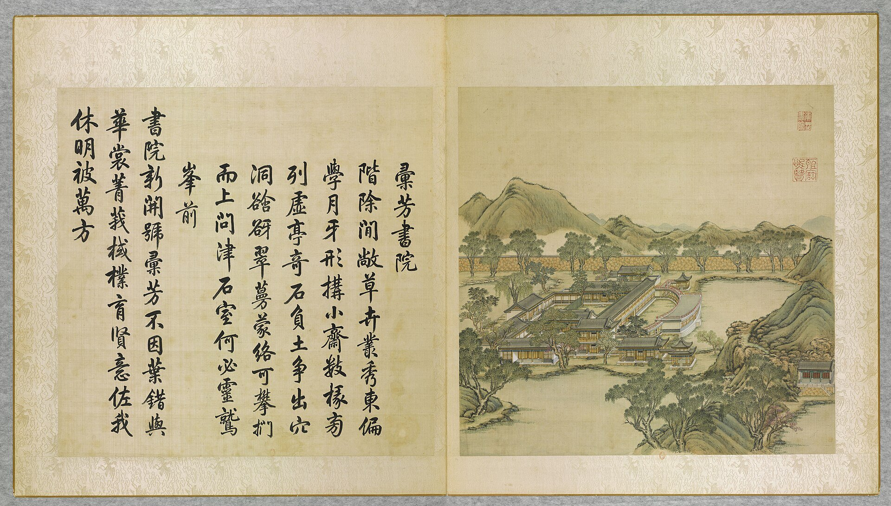

<!-- generated:start (scripts/building_pages.py): do not edit between these markers -->

# YM18-05: 眉月轩 Meiyue Xuan

Yuanming Yuan

**3D object:** 1 box. Open it: `/reconstruction/3d.html?b=YM18-05`

**Part of:** YM18 汇芳书院

## What we know

- **Name:** 眉月轩 Meiyue Xuan (S05, S02, S01 · confidence B)
- **Garden:** Yuanming Yuan (S05, S02, S01)
- **Type:** other (S05, S02, S01 · confidence B)
- **Destroyed:** 1860 (S05, S02, S01)
- **Position:** 40.01037, 116.28598. S01 likely (S01 · confidence B)
- **Bays:** 9x1 on the plan (S05, S02, S01)
- **Size in the inventory:** 32.8 × 13.8 m. S01 plan px / hall scale (S01)
- **Note:** Crescent plan, 東偏學月牙形 [j81:26b]; S02 p.88. (S05, S02, S01)
- **Plan reader's note:** Curved hall on a pool; Malone p.88 wide curve on the edge of a pool. (S01) *(research copy, not public)*
- **How it was read:** likely (S01) *(research copy, not public)*
- **Plan pixels:** 1894, 1088 (S01) *(research copy, not public)*

## Our model now

On the block drawn on the Qing plan S01: position and frontage from the plan, heights and roof from the typology of its hall class, its form drawn by the hall kit. It will be updated as the research goes on.

- **Box:** 30.1 × 12.02 m, grand hall
- **Heights:** platform 0.59 m, eave 4.76 m, ridge 9.01 m above the ground
- **Roof:** hip-and-gable 歇山, rolled ridge 卷棚, grey tile
- **Faces:** 79.8° from north
- **Fit:** reduced towards the size drawn on the plan, to stand clear of its neighbours or the water; moved 4.5 m
- **Drawn:** by the hall kit: 9 bays, the middle widest, a porch all round, steps on the front, 歇山 hip-and-gable with a rolled ridge 卷棚, grey tile, bracket sets 斗拱 as a painted band. Drawn from the typology of its hall class, not from a picture of this hall (assumed, C).
- **Confidence:** B

## Pictures (1)

- **P0018** (likely): 彚芳書院 Huifang shuyuan [Académie où se rassemblent les vertueux] (圓明園四十景, 第18景) (1744 (BnF record: 1744年，清朝乾隆九年)). https://commons.wikimedia.org/wiki/File%3A%E5%9C%93%E6%98%8E%E5%9C%92%E5%9B%9B%E5%8D%81%E6%99%AF._%E7%AC%AC%E5%8D%81%E5%85%AB%E6%99%AF_%28%E4%B8%8A%E5%86%8C%EF%BC%8C%E7%AC%AC%E5%8D%81%E5%85%AB%E5%B9%85%E5%9B%BE%29%2C_%E5%BD%9A%E8%8A%B3%E6%9B%B8%E9%99%A2_-_%28%E6%B8%85%29%E5%94%90%E5%B2%B1%E3%80%81%E6%B2%88%E6%BA%90%E5%90%88%E7%95%AB_%3B_%28%E4%B9%BE%E9%9A%86%E5%90%9F%E8%AF%97%EF%BC%8C%E6%B1%AA%E7%94%B1%E6%95%A6%E4%BB%A3%E4%B9%A6%29Huifang_shuyuan_-_%28Qing%29Tang_Dai%2C_Shen_Yuan_he_hua_-_btv1b550083318.jpg

  

## Texts and drawings (3)

- **E1584** (text, sure): 日下舊聞考 汇芳书院. 1780s (乾隆 敕撰) · j81:25b-26b · S05. https://github.com/kanripo/KR2k0036/blob/master/KR2k0036_081.txt
  > 鴻慈永祜東垣外徑連岡三重度橋而東則彚芳書院也内宇為抒藻軒後為涵逺齋齋前西垣内為翠照樓東垣内為倬雲樓又東為眉月軒倬雲樓南稍東為隨安室又東敞宇三楹為問津逾溪橋數武有石坊為斷橋殘雪（圓明園册）臣等謹按彚芳書院四十景之一額為皇上御書倬雲樓中楹額曰竹深荷淨與院内諸額皆御書涵逺齋内聨曰寳案凝香圖書陳道法仙臺麗景晴雨驗耕桑亦御書問津額為世宗御書
  East of the wall of 鴻慈永祜, over three ridges: 彚芳書院 with 抒藻軒, 涵逺齋, 翠照樓, 倬雲樓, 眉月軒, 隨安室, the three-bay 問津, and a stone arch 斷橋殘雪 beyond a footbridge.
- **E1600** (poem, sure): 眉月轩. 乾隆二十六年 (1761) · v2 p.169, under 汇芳书院; source ref 8-443 · S361. https://www.yuanmingyuanpark.cn/xs/yjbg/202008/P020200803382343267004.pdf#page=172
  > 临水疏轩曲若眉，人犹未当月犹之。那更法善资神术，即看当前七宝池。
  Poem 眉月轩 by the Qianlong Emperor, 1761, filed by the editors under 汇芳书院.
- **E1601** (poem, likely): 题眉月轩. 乾隆五十六年 (1791) · v2 p.172, under 汇芳书院; source ref 17-318 · S361. https://www.yuanmingyuanpark.cn/xs/yjbg/202008/P020200803382343267004.pdf#page=175
  > 临湖有文轩，强半圆而椭。思何称可方，眉月名以我。过望更移东，恰似见于左。天光冰影间，同异言胥琐。是谓三即一，无可无不可。
  Poem 题眉月轩 by the Qianlong Emperor, 1791, filed by the editors under 汇芳书院.

**On the plan:** Drawn on the plan of the gardens (S01) with no label, 9x1 cells: a building stood here, its name unknown. https://artmuseum.princeton.edu/collections/objects/138657

## Evidence for the set of buildings

- Evidence for the whole compound 汇芳书院: see YM18
- Reconstructions and comparables for the whole garden, 圆明园 Yuanming Yuan: see GARDEN-YM
- Standing buildings comparable to a grand hall (not this building): see CLASS-grand_hall

## Open questions

- Q200: H0021 濂溪乐处外山 and 眉月轩

<!-- generated:end -->

## Notes

<!-- Yours: regeneration never touches this part. It goes on the public site; what you write below a line holding only %% private %% stays in the research copy. -->
