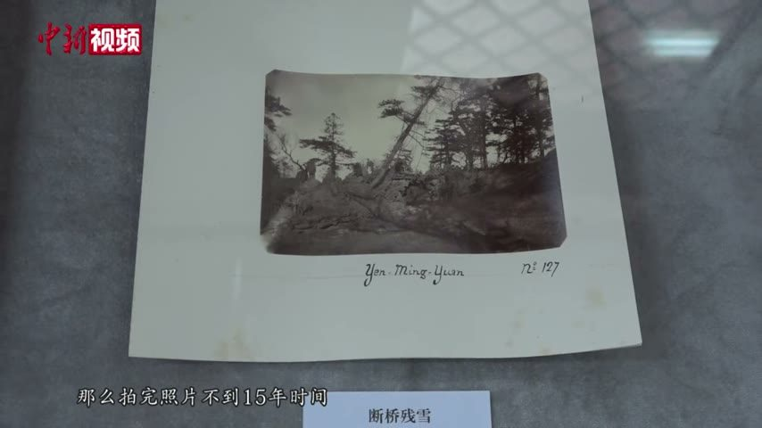

<!-- generated:start (scripts/building_pages.py): do not edit between these markers -->

# YM18-08: 断桥残雪 Duanqiao Canxue

Yuanming Yuan

**3D object:** 1 box. Open it: `/reconstruction/3d.html?b=YM18-08`

**Part of:** YM18 汇芳书院

## What we know

- **Name:** 断桥残雪 Duanqiao Canxue (S05, S01 · confidence B)
- **Garden:** Yuanming Yuan (S05, S01)
- **Type:** gate (S05, S01 · confidence B)
- **Destroyed:** 1860 (S05, S01)
- **Position:** 40.01026, 116.28712. S01 sure (S01 · confidence B)
- **Size in the inventory:** 6.0 × 2.4 m. S01 plan px / hall scale (S01)
- **Note:** stone pailou (S05, S01)
- **Plan reader's note:** Stone archway, bar. rect=25,8,-90 (S01) *(research copy, not public)*
- **How it was read:** sure (S01) *(research copy, not public)*
- **Plan pixels:** 2328, 1199 (S01) *(research copy, not public)*

## Our model now

A plain box on the block drawn on the Qing plan S01: position and frontage from the plan, heights and roof from the typology of its hall class. It will be updated as the research goes on.

- **Box:** 6 × 2.4 m, gate hall
- **Heights:** platform 0.77 m, eave 4.47 m, ridge 6.38 m above the ground
- **Roof:** hip-and-gable 歇山, rolled ridge 卷棚, grey tile
- **Faces:** 83.8° from north
- **Confidence:** B

## Pictures (1)

- **P0714** (likely): 断桥残雪 (exhibition label); mount inscribed Yen-Ming-Yuan Nº 177 (1882, as said in the clip by 刘阳 Liu Yang (S650); S651 gives 1882 for Semalle). https://commons.wikimedia.org/wiki/File:2021-02-24_圆明园中西建筑如何过渡_未彻底损毁前珍贵影像公布.webm Research-only: link card.

  

## Texts and drawings (3)

- **E1584** (text, sure): 日下舊聞考 汇芳书院. 1780s (乾隆 敕撰) · j81:25b-26b · S05. https://github.com/kanripo/KR2k0036/blob/master/KR2k0036_081.txt
  > 鴻慈永祜東垣外徑連岡三重度橋而東則彚芳書院也内宇為抒藻軒後為涵逺齋齋前西垣内為翠照樓東垣内為倬雲樓又東為眉月軒倬雲樓南稍東為隨安室又東敞宇三楹為問津逾溪橋數武有石坊為斷橋殘雪（圓明園册）臣等謹按彚芳書院四十景之一額為皇上御書倬雲樓中楹額曰竹深荷淨與院内諸額皆御書涵逺齋内聨曰寳案凝香圖書陳道法仙臺麗景晴雨驗耕桑亦御書問津額為世宗御書
  East of the wall of 鴻慈永祜, over three ridges: 彚芳書院 with 抒藻軒, 涵逺齋, 翠照樓, 倬雲樓, 眉月軒, 隨安室, the three-bay 問津, and a stone arch 斷橋殘雪 beyond a footbridge.
- **E1604** (poem, sure): 断桥残雪. 乾隆二十八年 (1763) · v2 p.170, under 汇芳书院; source ref 8-733 · S361. https://www.yuanmingyuanpark.cn/xs/yjbg/202008/P020200803382343267004.pdf#page=173
  > 在昔桥头密雪铺，举头见额忆西湖。春巡几度曾来往，乃识西湖此不殊。
  Poem 断桥残雪 by the Qianlong Emperor, 1763, filed by the editors under 汇芳书院.
- **E1592** (description, sure): 圆明园百景史事分景汇编: 断桥残雪. undated · from p.211, under 汇芳书院 · S360. https://www.yuanmingyuanpark.cn/xs/yjbg/202007/P020200730387572832602.pdf#page=211
  The compiler describes a bridge of rough stone over a stream east of 汇芳书院, in 1753 likened by Qianlong to the one on West Lake. 断桥残雪: short note in the compilation, no dated items.

**On the plan:** Drawn on the plan of the gardens (S01), labelled 断桥残雪. https://artmuseum.princeton.edu/collections/objects/138657

## Evidence for the set of buildings

- Evidence for the whole compound 汇芳书院: see YM18
- Reconstructions and comparables for the whole garden, 圆明园 Yuanming Yuan: see GARDEN-YM
- Standing buildings comparable to a gate hall (not this building): see CLASS-gate_hall

## Open questions

- Q54: Timber buildings standing in 1882 (Round 5)

<!-- generated:end -->

## Notes

<!-- Yours: regeneration never touches this part. It goes on the public site; what you write below a line holding only %% private %% stays in the research copy. -->
