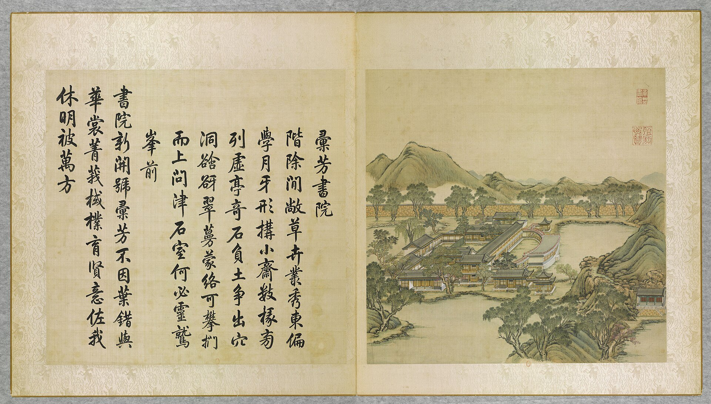
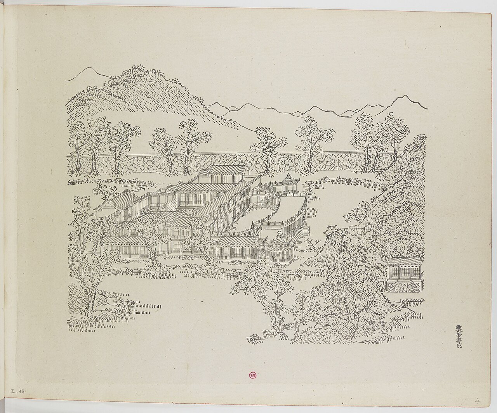
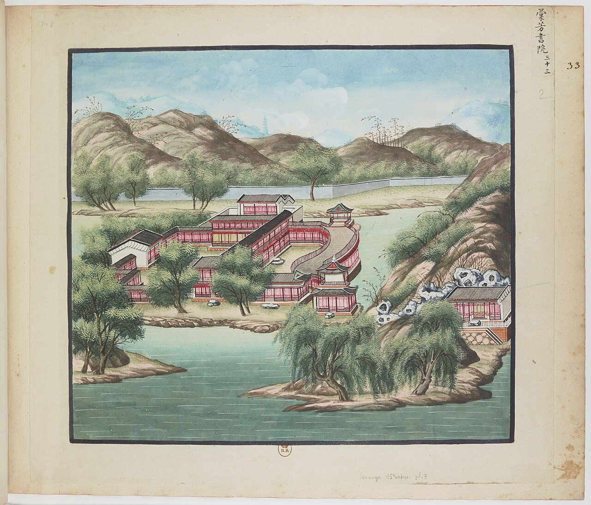
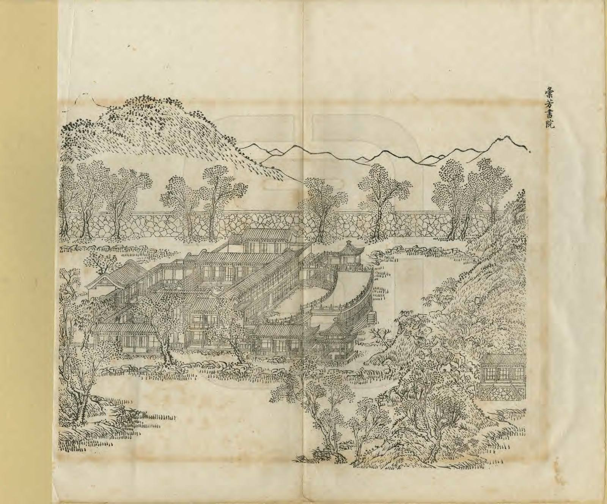
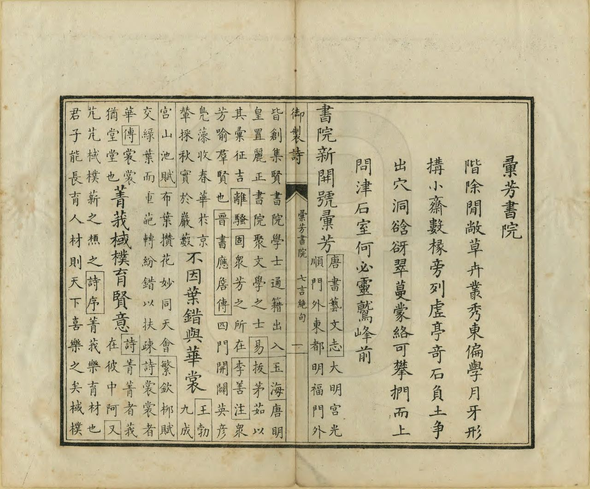

<!-- generated:start (scripts/building_pages.py): do not edit between these markers -->

# YM18: 汇芳书院 Huifang Shuyuan

The Library of Collected Fragrance · Yuanming Yuan

**3D object:** 14 boxes. Open it: `/reconstruction/3d.html?b=YM18`

## What we know

- **Name:** 汇芳书院 Huifang Shuyuan (S05, S02, S08, S43, S01, S361 · confidence A)
- **English:** The Library of Collected Fragrance (S05, S02, S08, S43, S01, S361)
- **Garden:** Yuanming Yuan (S05, S02, S08, S43, S01, S361)
- **Type:** scene (S05, S02, S08, S43, S01, S361 · confidence A)
- **Built:** 乾隆七年 1742 (S43) (S05, S02, S08, S43, S01, S361)
- **Destroyed:** 1860 (S05, S02, S08, S43, S01, S361)
- **Position:** 40.01025, 116.28559. S01 sure (S01 · confidence B)
- **Plan reader's note:** Label at (1740,1310) below the front block. Polygon includes the crescent pool and 问津, 断桥残雪. (S01) *(research copy, not public)*
- **How it was read:** sure (S01) *(research copy, not public)*
- **Plan pixels:** 1738, 1127 (S01) *(research copy, not public)*

## Our model now

14 boxes stand in this compound, 14 on blocks drawn on the plan, 0 assumed. Its halls are listed below.

## Inside it (14)

- YM18-01 抒藻轩
- YM18-02 涵远斋
- YM18-03 翠照楼
- YM18-04 倬云楼
- YM18-05 眉月轩
- YM18-06 随安室
- YM18-07 问津
- YM18-08 断桥残雪
- YM18-AW015
- YM18-AW016
- YM18-B0100
- YM18-B0132
- YM18-B0185
- YM18-N01 汇芳书院

## Pictures (5)

- **P0018** (sure): 彚芳書院 Huifang shuyuan [Académie où se rassemblent les vertueux] (圓明園四十景, 第18景) (1744 (BnF record: 1744年，清朝乾隆九年)). https://commons.wikimedia.org/wiki/File%3A%E5%9C%93%E6%98%8E%E5%9C%92%E5%9B%9B%E5%8D%81%E6%99%AF._%E7%AC%AC%E5%8D%81%E5%85%AB%E6%99%AF_%28%E4%B8%8A%E5%86%8C%EF%BC%8C%E7%AC%AC%E5%8D%81%E5%85%AB%E5%B9%85%E5%9B%BE%29%2C_%E5%BD%9A%E8%8A%B3%E6%9B%B8%E9%99%A2_-_%28%E6%B8%85%29%E5%94%90%E5%B2%B1%E3%80%81%E6%B2%88%E6%BA%90%E5%90%88%E7%95%AB_%3B_%28%E4%B9%BE%E9%9A%86%E5%90%9F%E8%AF%97%EF%BC%8C%E6%B1%AA%E7%94%B1%E6%95%A6%E4%BB%A3%E4%B9%A6%29Huifang_shuyuan_-_%28Qing%29Tang_Dai%2C_Shen_Yuan_he_hua_-_btv1b550083318.jpg

  

- **P0064** (sure): 中国皇帝的宫殿与庙宇. 第4幅图, 彚芳書院 - (清)孙祜、沈源Huifang shuyuan - (Qing)Sun Hu, Shen Yuan (1745 (Commons, from the BnF record)). https://commons.wikimedia.org/wiki/File%3A%E4%B8%AD%E5%9B%BD%E7%9A%87%E5%B8%9D%E7%9A%84%E5%AE%AB%E6%AE%BF%E4%B8%8E%E5%BA%99%E5%AE%87._%E7%AC%AC4%E5%B9%85%E5%9B%BE%2C_%E5%BD%9A%E8%8A%B3%E6%9B%B8%E9%99%A2_-_%28%E6%B8%85%29%E5%AD%99%E7%A5%9C%E3%80%81%E6%B2%88%E6%BA%90Huifang_shuyuan_-_%28Qing%29Sun_Hu%2C_Shen_Yuan_-_btv1b105206824.jpg

  

- **P0133** (sure): 海淀(镇)：中国皇帝的行宫. 第33幅图, 彚芳書院Huifang shuyuan (1750-1792 (BnF, cb43831905b; ex coll. Bertin)). https://commons.wikimedia.org/wiki/File%3A%E6%B5%B7%E6%B7%80%28%E9%95%87%29%EF%BC%9A%E4%B8%AD%E5%9B%BD%E7%9A%87%E5%B8%9D%E7%9A%84%E8%A1%8C%E5%AE%AB._%E7%AC%AC33%E5%B9%85%E5%9B%BE%2C_%E5%BD%9A%E8%8A%B3%E6%9B%B8%E9%99%A2Huifang_shuyuan_-_btv1b105207043.jpg

  

- **P0249** (sure): 彙芳書院 Huifang Shuyuan (御製圓明園圖詠, 1887 石印本, 上卷 (Commons 卷一), 第18景; printed title in the right margin of the picture) (光緒十三年 1887 (Commons/NLC record; colophon 光緒十三年七月天津石印書屋 in the SSID copy, S98 PDF p.2); design after the woodblock of 1745 by 孫祜 Sun Hu and 沈源 Shen Yuan). https://commons.wikimedia.org/wiki/File%3ANLC403-312001107375-14035_%E7%A6%A6%E5%88%B6%E5%9C%93%E6%98%8E%E5%9C%92%E5%9C%96%E8%A9%A0_%E5%8D%B7%E4%B8%80.pdf?page=87

  

- **P0525** (sure): 彙芳書院 Huifang Shuyuan: 乾隆 Qianlong's preface and poem with the courtiers' commentary, 御製圓明園圖詠 1887 (poem 1744 (乾隆九年); this printing 1887). https://commons.wikimedia.org/wiki/File%3ANLC403-312001107375-14035_%E7%A6%A6%E5%88%B6%E5%9C%93%E6%98%8E%E5%9C%92%E5%9C%96%E8%A9%A0_%E5%8D%B7%E4%B8%80.pdf?page=88

  

## Texts and drawings (41)

- **E1569** (poem, sure): 御製彚芳書院詩（圓明園四十景詩）. 1744 (乾隆九年) · printed in S05 j81:26b · S40. https://github.com/kanripo/KR2k0036/blob/master/KR2k0036_081.txt
  > 乾隆九年 御製彚芳書院詩 階除閒敞草卉叢秀東偏學月牙形搆小齋數椽旁列虚亭竒石負土爭出穴洞谽谺翠蔓䝉絡可攀捫而上問津石室何必靈鷲峰前 書院新開號彚芳不因葉錯與華裳菁莪棫樸育賢意佐我休明被萬方
  An open court of grass and flowers. To the east a small crescent-shaped study with pavilions beside it, and rocks full of caves, hung with creeper, that can be climbed up to 問津 'Asking the Ford'.
- **E1584** (text, sure): 日下舊聞考 汇芳书院. 1780s (乾隆 敕撰) · j81:25b-26b · S05. https://github.com/kanripo/KR2k0036/blob/master/KR2k0036_081.txt
  > 鴻慈永祜東垣外徑連岡三重度橋而東則彚芳書院也内宇為抒藻軒後為涵逺齋齋前西垣内為翠照樓東垣内為倬雲樓又東為眉月軒倬雲樓南稍東為隨安室又東敞宇三楹為問津逾溪橋數武有石坊為斷橋殘雪（圓明園册）臣等謹按彚芳書院四十景之一額為皇上御書倬雲樓中楹額曰竹深荷淨與院内諸額皆御書涵逺齋内聨曰寳案凝香圖書陳道法仙臺麗景晴雨驗耕桑亦御書問津額為世宗御書
  East of the wall of 鴻慈永祜, over three ridges: 彚芳書院 with 抒藻軒, 涵逺齋, 翠照樓, 倬雲樓, 眉月軒, 隨安室, the three-bay 問津, and a stone arch 斷橋殘雪 beyond a footbridge.
- **E1602** (poem, sure): 问津. 乾隆八年 (1743) · v2 p.168, under 汇芳书院; source ref 2-579 · S361. https://www.yuanmingyuanpark.cn/xs/yjbg/202008/P020200803382343267004.pdf#page=171
  > 昔有刘子骥，慨然思问津。太守胡为者，澄渊欲淆尘。俗远莸作兰，心营桂是榛。退之乃达士，亦谓神仙人。不独桃源然，东坡慧眼真。实有钞锣溪，孰不撰良辰。
  Poem 问津 by the Qianlong Emperor, 1743, filed by the editors under 汇芳书院.
- **E1570** (poem, sure): 汇芳书院: 乾隆九年 poem of the Qianlong Emperor. 乾隆九年 (1744), date from the compilation · p.208 item (1), under 汇芳书院 · S360. https://www.yuanmingyuanpark.cn/xs/yjbg/202007/P020200730387572832602.pdf#page=208
  > 书院新开号汇芳，不因叶错与华裳。菁莪栻朴育贤意，佐我休明被万方。
  Poem of the Qianlong Emperor at 汇芳书院, 1744. Year as given by the compilation.
- **E1605** (poem, sure): 汇芳书院. 乾隆九年 (1744) · v2 p.168, under 汇芳书院; source ref 2-685 · S361. https://www.yuanmingyuanpark.cn/xs/yjbg/202008/P020200803382343267004.pdf#page=171
  > 阶除闲敞，草卉丛秀。东偏学月牙形，构小斋数椽。旁列虚亭，奇石负土争出，穴洞谽谺，翠蔓濛络，可攀扪而上。问津石室，何必灵鹫峰前？书院新开号汇芳，不因叶错与华裳。菁莪棫朴育贤意，佐我休明被万方。
  Poem 汇芳书院 by the Qianlong Emperor, 1744, filed by the editors under 汇芳书院.
- **E1571** (poem, sure): 抒藻轩: 乾隆二十五年 poem of the Qianlong Emperor. 乾隆二十五年 (1760), date from the compilation · p.209 item (1), under 抒藻轩 · S360. https://www.yuanmingyuanpark.cn/xs/yjbg/202007/P020200730387572832602.pdf#page=209
  > 天工绘事锦春罗，江砚宣毫供玩哦。子美集中翻小様，赋诗又道不须多。
  Poem of the Qianlong Emperor at 抒藻轩, 1760. Year as given by the compilation.
- **E1572** (poem, sure): 抒藻轩: 乾隆二十六年 poem of the Qianlong Emperor. 乾隆二十六年 (1761), date from the compilation · p.209 item (2), under 抒藻轩 · S360. https://www.yuanmingyuanpark.cn/xs/yjbg/202007/P020200730387572832602.pdf#page=209
  > 荟芳书院里书室，餍饫优游皆合宜。水态山容伴静憩，礼园义圃引清思。即看韶景成章处，可识天工抒藻时。绨几闲吟那更藉。象陈无妄是吾师。
  Poem of the Qianlong Emperor at 抒藻轩, 1761, on reading. Year as given by the compilation.
- **E1600** (poem, sure): 眉月轩. 乾隆二十六年 (1761) · v2 p.169, under 汇芳书院; source ref 8-443 · S361. https://www.yuanmingyuanpark.cn/xs/yjbg/202008/P020200803382343267004.pdf#page=172
  > 临水疏轩曲若眉，人犹未当月犹之。那更法善资神术，即看当前七宝池。
  Poem 眉月轩 by the Qianlong Emperor, 1761, filed by the editors under 汇芳书院.
- **E1604** (poem, sure): 断桥残雪. 乾隆二十八年 (1763) · v2 p.170, under 汇芳书院; source ref 8-733 · S361. https://www.yuanmingyuanpark.cn/xs/yjbg/202008/P020200803382343267004.pdf#page=173
  > 在昔桥头密雪铺，举头见额忆西湖。春巡几度曾来往，乃识西湖此不殊。
  Poem 断桥残雪 by the Qianlong Emperor, 1763, filed by the editors under 汇芳书院.
- **E1573** (poem, sure): 涵远斋: 乾隆三十八年 poem of the Qianlong Emperor. 乾隆三十八年 (1773), date from the compilation · p.209 item (1), under 涵远斋 · S360. https://www.yuanmingyuanpark.cn/xs/yjbg/202007/P020200730387572832602.pdf#page=209
  > 开窗足纳虚，因以名涌远。虽云景无穷，然弗出一苑。寰区里难计，总廑方寸宛。吏治与民生，奚莫 非应管。其远为若何，其艰惟自忖。
  Poem of the Qianlong Emperor at 涵远斋, 1773, on state papers. Year as given by the compilation.
- **E1598** (poem, sure): 涵远斋. 乾隆三十八年 (1773) · v2 p.170, under 汇芳书院; source ref 11-435 · S361. https://www.yuanmingyuanpark.cn/xs/yjbg/202008/P020200803382343267004.pdf#page=173
  > 开窗足纳虚，因以名涵远。虽云景无穷，然弗出一苑。寰区里难计，总廑方寸宛。吏治与民生，奚莫非应管。其远为若何，其艰惟自忖。
  Poem 涵远斋 by the Qianlong Emperor, 1773, filed by the editors under 汇芳书院.
- **E1574** (poem, sure): 倬云楼: 乾隆三十九年 poem of the Qianlong Emperor. 乾隆三十九年 (1774), date from the compilation · p.211 item (1), under 倬云楼 · S360. https://www.yuanmingyuanpark.cn/xs/yjbg/202007/P020200730387572832602.pdf#page=211
  > 总在一区书院中，安名立字各无同。倬云若问即景句，幸释宣忧赖化工。
  Poem of the Qianlong Emperor at 倬云楼, 1774, on the view. Year as given by the compilation.
- **E1575** (poem, sure): 汇芳书院: 乾隆三十九年 poem of the Qianlong Emperor. 乾隆三十九年 (1774), date from the compilation · p.208 item (2), under 汇芳书院 · S360. https://www.yuanmingyuanpark.cn/xs/yjbg/202007/P020200730387572832602.pdf#page=208
  > 一年未必两三过，半为少闲半景多。彚得春芳待谁赏，徙来夏首引予哦。役心谋目免则孰，厌旧喜新嘲任他。壁上题将阅廿载，笑兹把笔复为何？
  Poem of the Qianlong Emperor at 汇芳书院, 1774, on the view. Year as given by the compilation.
- **E1576** (poem, sure): 涵远斋: 乾隆三十九年 poem of the Qianlong Emperor. 乾隆三十九年 (1774), date from the compilation · p.210 item (2), under 涵远斋 · S360. https://www.yuanmingyuanpark.cn/xs/yjbg/202007/P020200730387572832602.pdf#page=210
  > 斋自构轩后，而却名涵远。岂不栋宇遮，不遮亦自宛。指固蔽泰山，兴可飞阆苑。以此有弗怡，捷音盼早晩。
  Poem of the Qianlong Emperor at 涵远斋, 1774, on the view. Year as given by the compilation.
- **E1596** (poem, sure): 抒藻轩. 乾隆三十九年 (1774) · v2 p.171, under 汇芳书院; source ref 12-578 · S361. https://www.yuanmingyuanpark.cn/xs/yjbg/202008/P020200803382343267004.pdf#page=174
  > 文轩书院里，松植已成鱗。潇洒尘氛远，精良笔砚陈。窗曦原似故，砌卉又从新。擘纸将抒藻，澹华期返淳。
  Poem 抒藻轩 by the Qianlong Emperor, 1774, filed by the editors under 汇芳书院.
- **E1599** (poem, sure): 题涵远斋. 乾隆五十一年 (1786) · v2 p.171, under 汇芳书院; source ref 16-599 · S361. https://www.yuanmingyuanpark.cn/xs/yjbg/202008/P020200803382343267004.pdf#page=174
  > 斋近御湖遥，湖光漾数顷。因以涵远名，涵远意堪省。虽云有波澜，其渊本至静。一心应万物，可能于是等。更以忆南方，春雨霑诚幸。继此可时若，冀解吾民眚。心与波同远，所涵异殊迥。
  Poem 题涵远斋 by the Qianlong Emperor, 1786, filed by the editors under 汇芳书院.
- **E1597** (poem, sure): 抒藻轩志愧. 乾隆五十五年 (1790) · v2 p.172, under 汇芳书院; source ref 17-175 · S361. https://www.yuanmingyuanpark.cn/xs/yjbg/202008/P020200803382343267004.pdf#page=175
  > 既以识六义，抒藻谁能无。然而难言之，讵在雕虫乎。修辞立其诚，方为君子儒。至于临政治，尤在戒欢娱。华藻或邻斯，投好将承趋。羲经有明训，吉人辞寡夫。四集三万章，是诚应愧吾。
  Poem 抒藻轩志愧 by the Qianlong Emperor, 1790, filed by the editors under 汇芳书院.
- **E1601** (poem, sure): 题眉月轩. 乾隆五十六年 (1791) · v2 p.172, under 汇芳书院; source ref 17-318 · S361. https://www.yuanmingyuanpark.cn/xs/yjbg/202008/P020200803382343267004.pdf#page=175
  > 临湖有文轩，强半圆而椭。思何称可方，眉月名以我。过望更移东，恰似见于左。天光冰影间，同异言胥琐。是谓三即一，无可无不可。
  Poem 题眉月轩 by the Qianlong Emperor, 1791, filed by the editors under 汇芳书院.
- **E1577** (poem, sure): 倬云楼: 乾隆五十八年 poem of the Qianlong Emperor. 乾隆五十八年 (1793), date from the compilation · p.211 item (2), under 倬云楼 · S360. https://www.yuanmingyuanpark.cn/xs/yjbg/202007/P020200730387572832602.pdf#page=211
  > 齐云王氏记曾提，（齐云楼见王禹，偁黄冈竹楼记。楼在苏州府，丁丑南巡杂咏，吴下古迹曾有诗。）是倬无心用拟题。（御园中诸题率皆用，内廷翰林所拟。）历久已忘如忽耳，即今偶见乃夔兮。白诗晚寄潇而洒，周雅旱同咨与赍。此际初春胥异彼，聊因七字寓闲跻。
  Poem of the Qianlong Emperor at 倬云楼, 1793, on the view. Year as given by the compilation.
- **E1578** (poem, sure): 问津: 嘉庆元年 poem of the Jiaqing Emperor. 嘉庆元年 (1796), date from the compilation · p.210 item (1), under 问津 · S360. https://www.yuanmingyuanpark.cn/xs/yjbg/202007/P020200730387572832602.pdf#page=210
  > 观水须探本，寻源必问津。平湖涵暖旭，仙镜庆长春。洞口苔痕叠，溪湄浪影皴。停舟穿石径，欲访武陵人。
  Poem of the Jiaqing Emperor at 问津, 1796, on the view. Year as given by the compilation.
- **E1606** (poem, sure): 汇芳书院. 嘉庆元年 (1796) · v2 p.174, under 汇芳书院; source ref 1-110 · S361. https://www.yuanmingyuanpark.cn/xs/yjbg/202008/P020200803382343267004.pdf#page=177
  > 廿四番风应候扬，东皇布令汇群芳。桃源洞口霞迷影，金谷园中雨浥香。种植总蒙恩浩荡，栽培都感泽汪洋。托根福地诚仙卉，若木齐辉岁月长。
  Poem 汇芳书院 by the Jiaqing Emperor, 1796, filed by the editors under 汇芳书院.
- **E1579** (poem, sure): 问津: 嘉庆二年 poem of the Jiaqing Emperor. 嘉庆二年 (1797), date from the compilation · p.211 item (3), under 问津 · S360. https://www.yuanmingyuanpark.cn/xs/yjbg/202007/P020200730387572832602.pdf#page=211
  > 绯桃千百树，夹岸太纷繁。破萼风前漾，飘英雨后翻。艳同金谷墅，境异武陵源。海上有仙阙，问津意别存。
  Poem of the Jiaqing Emperor at 问津, 1797, on the view. Year as given by the compilation.
- **E1580** (poem, sure): 问津: 嘉庆三年 poem of the Jiaqing Emperor. 嘉庆三年 (1798), date from the compilation · p.211 item (6), under 问津 · S360. https://www.yuanmingyuanpark.cn/xs/yjbg/202007/P020200730387572832602.pdf#page=211
  > 漫访桃源避世人，偶来寻景问芳津。溯洄濠濮知鱼乐，俯察仰观趣味真。
  Poem of the Jiaqing Emperor at 问津, 1798, on the view. Year as given by the compilation.
- **E1603** (poem, sure): 问津. 嘉庆三年 (1798) · v2 p.176, under 汇芳书院; source ref 1-321 · S361. https://www.yuanmingyuanpark.cn/xs/yjbg/202008/P020200803382343267004.pdf#page=179
  > 圣代应无辟世人，渔舟漫问武陵津。渊明隐喻自肥遁，秦国未闻有逸民。
  Poem 问津 by the Jiaqing Emperor, 1798, filed by the editors under 汇芳书院.
- **E1581** (poem, sure): 抒藻轩: 嘉庆十九年 poem of the Jiaqing Emperor. 嘉庆十九年 (1814), date from the compilation · p.209 item (6), under 抒藻轩 · S360. https://www.yuanmingyuanpark.cn/xs/yjbg/202007/P020200730387572832602.pdf#page=209
  > 六经奥义汇群芳，抒藻辉腾东辟光。图治临民必有本，研磨取益在缣缃。髫岁从师味古书，就将勤学度居诸。典谟训诰资为政，念昔先言日勉予。
  Poem of the Jiaqing Emperor at 抒藻轩, 1814, on reading. Year as given by the compilation.
- **E1582** (poem, sure): 涵远斋: 嘉庆二十三年 poem of the Jiaqing Emperor. 嘉庆二十三年 (1818), date from the compilation · p.210 item (7), under 涵远斋 · S360. https://www.yuanmingyuanpark.cn/xs/yjbg/202007/P020200730387572832602.pdf#page=210
  > 治民奥旨六经涵，敷教公明凛奉三。近悦远来在德化，返求诸已自心探。四极舆图荒服遥，远人安静近漓浇。愧予德薄难成治，吏玩民顽俗敝凋。
  Poem of the Jiaqing Emperor at 涵远斋, 1818, on state papers. Year as given by the compilation.
- **E1583** (poem, sure): 汇芳书院: 道光三年 poem of the Daoguang Emperor. 道光三年 (1823), date from the compilation · p.209 item (11), under 汇芳书院 · S360. https://www.yuanmingyuanpark.cn/xs/yjbg/202007/P020200730387572832602.pdf#page=209
  > 为爱园中夏景宜，南熏习习透纱帷。书斋水绕清如许，林幄窗含翠可知。风静新蝉鸣尚涩，竹深幽鸟韵偏迟。西峰亟望云光合，溥济甘霖应候施。
  Poem of the Daoguang Emperor at 汇芳书院, 1823, on reading and the view. Year as given by the compilation.
- **E1524** (description, sure): 玉明 侍游御園記 (in 蕉軒隨錄). 1856 (咸豐六年七月二十一日) · 蕉軒隨錄, 御園侍游 (line 336 of the corpus file) · S210. https://github.com/garychowcmu/daizhigev20/blob/master/史藏/志存记录/蕉轩随录.txt
  > ◎御园侍游玉将军（明）有《侍游御园记》，成竹坪同年（林）曾属予代作跋语，恭书于后。按，《记》云：“咸丰六年秋七月二十一日，奉旨：本日散朝后，著玉明、肃顺自备鞍马，午初一刻进西南门，在山高水长伺候。有顷，上从内乘船，至山高水长后阁扇下船，出前门，谕玉明、肃顺暨珠勒亨、西拉布、托云、德勒格尔、伊勒东阿等脱去外褂。上乘马，命七臣随行。自山高水长游藻园，至厂地，过汇芳书院，复由紫碧山房至鱼跃鸢飞少坐。过蕊珠宫门，至黄花磴进茶毕，往西洋楼海宴堂，至转马台，过小角门，至狮子林清淑斋赏饭。左右四卓，命七臣坐，并奉温谕可饱食，非外边筵宴比也。上命膳房先给七臣面各一器，上进面，复进饭，颁赏御用菜蔬，七臣叩头谢。上进粥，复赏粥毕。随驾起行，由宝相寺、法慧寺、谐奇趣过明春门，至雷峰夕照马头，坐如在天上船，游福海。上命笔砚作诗毕，至渊氵亭镜澈马头下船。进丽春门骑马，由旧园东墙根过敷春堂，游西大堤汉城关，至含辉楼下马，命七臣散归。玉明自道光十一年由侍卫擢厕御前二十余年，仰邀优渥，得遍瞻御园盛景。欣感之余，谨作记以纪荣遇。”
  A rare first-hand record of a day in the garden four years before its destruction. The emperor takes seven officials by a named route from 山高水長 through 藻園, 彚芳書院, 紫碧山房 and 魚躍鳶飛, past 蕊珠宫門, on to 海宴堂 in the 西洋樓, a meal at 清淑齋 in 獅子林, 寳相寺, 法慧寺, 諧奇趣, by boat on 福海, then 敷春堂 and 含暉楼. All were standing then.
- **E1590** (description, sure): Scene 18, 汇芳书院 Huifang Shuyuan. 1934 · p.88 · S02. https://archive.org/details/historyofpekings00malo
  > Several of the buildings here were two stories high. One of them was built on a wide curve on the edge of a pool from one end of which the path led over and through a rock garden.
  Several two-storey buildings, one on a wide curve at the edge of a pool, with a path through a rock garden.
- **E1011** (description, sure): Site status table, about 2011: nothing visible, or built over. c. 2011 · 系列06 repost, status table · S356. https://blog.sina.com.cn/s/blog_c27029650101itzz.html
  Same table. In it the first group shows no visible remains; 得全阁, 流香渚, 凤麟洲, 涵秋馆, 蔚藻堂, 中和堂, 敷春堂 and 心镜轩 have service buildings on them, and 含晖楼, 澄心堂, 延寿寺, 清夏堂 and 喜雨山房 are occupied by other institutions. 澹泊宁静 and several others have been dug since, so this is out of date for them.
- **E1585** (description, sure): 圆明园百景史事分景汇编: 汇芳书院. 1744-1823 · from p.208, under 汇芳书院 · S360. https://www.yuanmingyuanpark.cn/xs/yjbg/202007/P020200730387572832602.pdf#page=208
  汇芳书院: 11 dated items, 1744-1823, of which 11 poems (Qianlong, Jiaqing, Daoguang); recurring themes: reading, the view. First dated 1744, last dated 1823.
- **E1586** (description, sure): 圆明园百景史事分景汇编: 抒藻轩. 1760-1814 · from p.209, under 汇芳书院 · S360. https://www.yuanmingyuanpark.cn/xs/yjbg/202007/P020200730387572832602.pdf#page=209
  抒藻轩: 6 dated items, 1760-1814, of which 6 poems (Qianlong, Jiaqing); recurring themes: reading, the view. First dated 1760, last dated 1814.
- **E1587** (description, sure): 圆明园百景史事分景汇编: 涵远斋. 1773-1818 · from p.209, under 汇芳书院 · S360. https://www.yuanmingyuanpark.cn/xs/yjbg/202007/P020200730387572832602.pdf#page=209
  涵远斋: 7 dated items, 1773-1818, of which 7 poems (Qianlong, Jiaqing); recurring themes: the view, state papers. First dated 1773, last dated 1818.
- **E1588** (description, sure): 圆明园百景史事分景汇编: 倬云楼. 1774-1793 · from p.211, under 汇芳书院 · S360. https://www.yuanmingyuanpark.cn/xs/yjbg/202007/P020200730387572832602.pdf#page=211
  倬云楼: 2 dated items, 1774-1793, of which 2 poems (Qianlong); recurring themes: the view. First dated 1774, last dated 1793.
- **E1589** (description, sure): 圆明园百景史事分景汇编: 问津. 1796-1798 · from p.210, under 汇芳书院 · S360. https://www.yuanmingyuanpark.cn/xs/yjbg/202007/P020200730387572832602.pdf#page=210
  A Qianlong text of 1797 calls it a rustic three-bay house on the rockery, with Yongzheng's plaque. 问津: 6 dated items, 1796-1798, of which 5 poems and 1 court records (Jiaqing, Qianlong); recurring themes: the view, remembering his forebears. First dated 1796, last dated 1798.
- **E1591** (description, sure): 圆明园五朝御制诗文集注 v2, editors' note on 汇芳书院. 2020 edition · v2 p.168 · S361. https://www.yuanmingyuanpark.cn/xs/yjbg/202008/P020200803382343267004.pdf#page=171
  Of 1742, in the form of an academy: a five-bay gate, 抒藻轩 with a three-bay annex, 涵远斋 of five, 翠照轩, 倬云楼, the crescent 眉月轩 of nine bays, 随安室, 挹秀亭, 延赏亭, 问津, the 断桥残雪 arch, 秀云亭.
- **E1592** (description, sure): 圆明园百景史事分景汇编: 断桥残雪. undated · from p.211, under 汇芳书院 · S360. https://www.yuanmingyuanpark.cn/xs/yjbg/202007/P020200730387572832602.pdf#page=211
  The compiler describes a bridge of rough stone over a stream east of 汇芳书院, in 1753 likened by Qianlong to the one on West Lake. 断桥残雪: short note in the compilation, no dated items.
- **E1745** (description, sure, search index only): 鱼跃鸢飞; 西峰秀色; 鸿慈永祜; 日天琳宇; 汇芳书院; 蓬岛瑶台; 廓然大公 (search-index text). n.d. · mhymy jqjs, tag and ysltd pages · S340. https://www.mhymy.com/ymss/jqjs/ymy
  Short notes: 鱼跃鸢飞 inside 大北门, Yongzheng, about 2,500 m2; 西峰秀色 on an islet north of 舍卫城, 1728, open only west toward the hills; 安佑宫 1740-43, its marble columns now at Peking University and the National Library; 日天琳宇 the 佛楼, early Yongzheng; 汇芳书院 1742; 廓然大公 320 x 160 m, lost in 1900.
- **E1593** (drawing, sure): 《国家图书馆藏样式雷图档·圆明园卷初编》: 汇芳书院. mostly 道光, 咸丰, 同治 per the publisher · 初编 目录: 汇芳书院, pp.357-361 · S13. https://www.nlcpress.com/ProductView.aspx?Id=7642
  The printed facsimile of the National Library of China's Yangshi Lei sheets has a section on this place at pp.357-361 (5 pages, section length worked out from the next heading); sheet titles and numbers are in the volume, ordered from a library.
- **E1594** (drawing, sure, search index only): 汇芳书院总平面图 (图名: 汇芳书院). 乾隆晚期至道光时期 (inferred on the record) · 国家图书馆善本部 样036-1号 · S310. https://www.mhymy.com/dasl/ysltd/11546.html
  Survey base plan of Huifang Shuyuan at 1:200, 1185x861 mm, ink and light colour, with hall names, bay and depth sizes and courtyard sizes; late Qianlong to Daoguang. No image here; the site may ask a small payment for the full record.
- **E1595** (drawing, sure, search index only): 汇芳书院样式雷图. S310. https://www.mhymy.com/dasl/ysltd/5098.html
  Older record of a drawing of Huifang Shuyuan; shelf number and date not seen in the extract. No image here; the site may ask a small payment for the full record.

**On the plan:** Drawn on the plan of the gardens (S01), labelled 汇芳书院. https://artmuseum.princeton.edu/collections/objects/138657

## Open questions

None that name it.

<!-- generated:end -->

## Notes

<!-- Yours: regeneration never touches this part. It goes on the public site; what you write below a line holding only %% private %% stays in the research copy. -->
