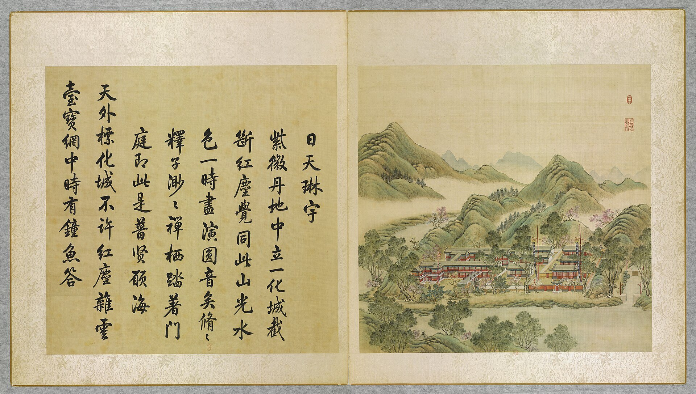
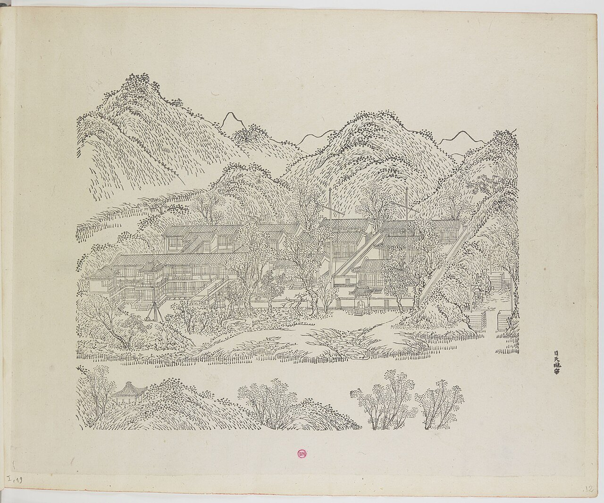
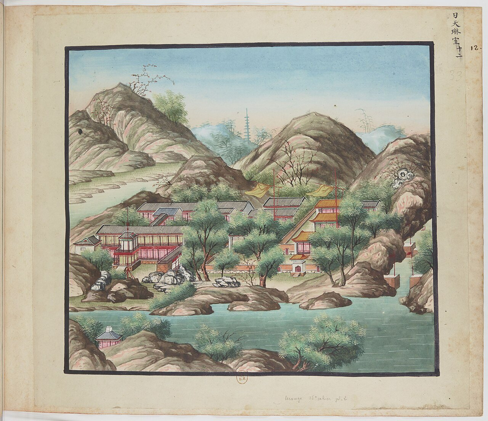
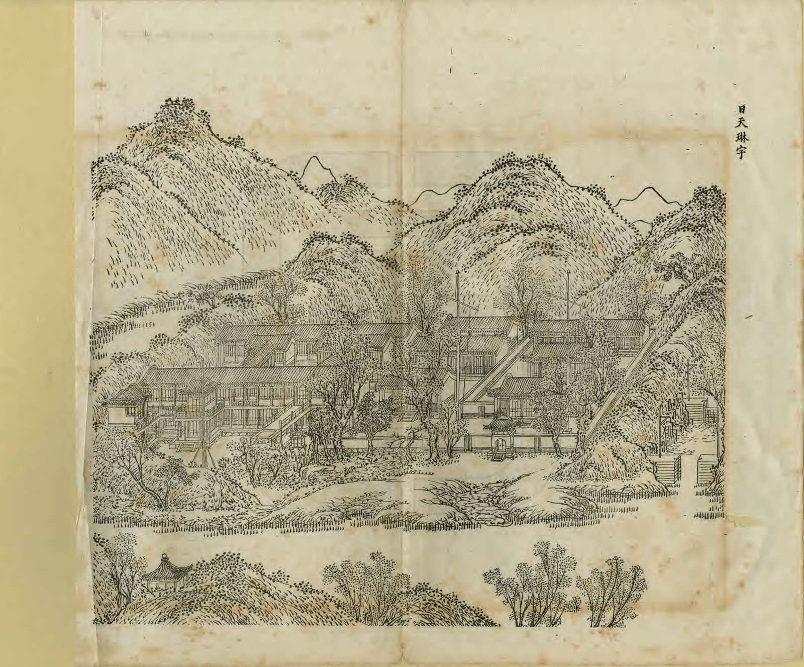
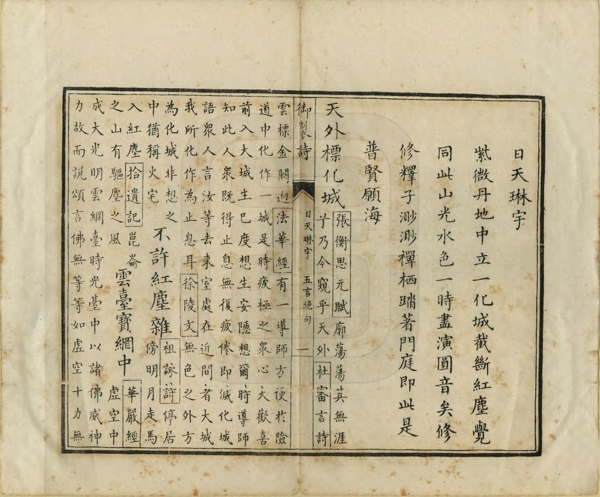

<!-- generated:start (scripts/building_pages.py): do not edit between these markers -->

# YM19: 日天琳宇 Ritian Linyu

A Buddhist Temple (Sun Heaven Topaz Roof) · Yuanming Yuan

**3D object:** 19 boxes. Open it: `/reconstruction/3d.html?b=YM19`

## What we know

- **Name:** 日天琳宇 Ritian Linyu (S05, S02, S08, S41, S47, S01 · confidence B)
- **English:** A Buddhist Temple (Sun Heaven Topaz Roof) (S05, S02, S08, S41, S47, S01)
- **Written on the plan:** 日天琳宇 / 瑞应宫 (S01 · confidence B)
- **Garden:** Yuanming Yuan (S05, S02, S08, S41, S47, S01)
- **Type:** scene (S05, S02, S08, S41, S47, S01 · confidence B)
- **Changed:** Differs on later plans (S41) (S05, S02, S08, S41, S47, S01)
- **Destroyed:** 1860 (S05, S02, S08, S41, S47, S01)
- **Position:** 40.00846, 116.28536. S01 sure (S01 · confidence B)
- **Note:** 規制皆仿雍和宫後佛樓式 [j81:27b]. 旧称佛楼 (S47). S47 also 雷神殿 关帝殿 玉皇殿 太岁坛 三神殿. Album does not show the 1860 state here (S41). (S05, S02, S08, S41, S47, S01)
- **Plan reader's note:** Faint 日天琳宇 at (1490,1930); 佛楼, 极乐世界, 楞严坛, 瑞应宫 in dark ink. Malone 19 at (1680,2165). (S01) *(research copy, not public)*
- **How it was read:** sure (S01) *(research copy, not public)*
- **Plan pixels:** 1600, 1985 (S01) *(research copy, not public)*

## Our model now

19 boxes stand in this compound, 19 on blocks drawn on the plan, 0 assumed. Its halls are listed below.

## Inside it (20)

- YM19-01 西前楼
- YM19-02 西后楼
- YM19-03 中前楼
- YM19-04 中后楼
- YM19-05 穿堂
- YM19-06 天桥
- YM19-07 灯亭
- YM19-08 东转角楼
- YM19-09 西转角楼
- YM19-10 楞严坛
- YM19-11 瑞应宫
- YM19-12 仁应殿
- YM19-13 和感殿
- YM19-14 晏安殿
- YM19-AW002
- YM19-B0330
- YM19-B0346
- YM19-B0347
- YM19-B0348
- YM19-N01 极乐世界

## Pictures (5)

- **P0019** (sure): 日天琳宇 Ritian linyu [Temple de Jade sous la clarté céleste] (圓明園四十景, 第19景) (1744 (BnF record: 1744年，清朝乾隆九年)). https://commons.wikimedia.org/wiki/File%3A%E5%9C%93%E6%98%8E%E5%9C%92%E5%9B%9B%E5%8D%81%E6%99%AF_-_%28%E6%B8%85%29%E5%94%90%E5%B2%B1%E3%80%81%E6%B2%88%E6%BA%90%E5%90%88%E7%95%AB_%3B_%28%E4%B9%BE%E9%9A%86%E5%90%9F%E8%AF%97%EF%BC%8C%E6%B1%AA%E7%94%B1%E6%95%A6%E4%BB%A3%E4%B9%A6%29_-_btv1b55008362z_%28058_of_124%29.jpg

  

- **P0072** (sure): 中国皇帝的宫殿与庙宇. 第12幅图, 日天琳宇 - (清)孙祜、沈源Ritian linyu - (Qing)Sun Hu, Shen Yuan (1745 (Commons, from the BnF record)). https://commons.wikimedia.org/wiki/File%3A%E4%B8%AD%E5%9B%BD%E7%9A%87%E5%B8%9D%E7%9A%84%E5%AE%AB%E6%AE%BF%E4%B8%8E%E5%BA%99%E5%AE%87._%E7%AC%AC12%E5%B9%85%E5%9B%BE%2C_%E6%97%A5%E5%A4%A9%E7%90%B3%E5%AE%87_-_%28%E6%B8%85%29%E5%AD%99%E7%A5%9C%E3%80%81%E6%B2%88%E6%BA%90Ritian_linyu_-_%28Qing%29Sun_Hu%2C_Shen_Yuan_-_btv1b10520683k.jpg

  

- **P0112** (sure): 海淀(镇)：中国皇帝的行宫. 第12幅图, 日天琳室(日天琳宇)Ritian linyu (1750-1792 (BnF, cb43831905b; ex coll. Bertin)). https://commons.wikimedia.org/wiki/File%3A%E6%B5%B7%E6%B7%80%28%E9%95%87%29%EF%BC%9A%E4%B8%AD%E5%9B%BD%E7%9A%87%E5%B8%9D%E7%9A%84%E8%A1%8C%E5%AE%AB._%E7%AC%AC12%E5%B9%85%E5%9B%BE%2C_%E6%97%A5%E5%A4%A9%E7%90%B3%E5%AE%A4%28%E6%97%A5%E5%A4%A9%E7%90%B3%E5%AE%87%29Ritian_linyu_-_btv1b10520705j.jpg

  

- **P0250** (sure): 日天琳宇 Ritian Linyu (御製圓明園圖詠, 1887 石印本, 上卷 (Commons 卷一), 第19景; printed title in the right margin of the picture) (光緒十三年 1887 (Commons/NLC record; colophon 光緒十三年七月天津石印書屋 in the SSID copy, S98 PDF p.2); design after the woodblock of 1745 by 孫祜 Sun Hu and 沈源 Shen Yuan). https://commons.wikimedia.org/wiki/File%3ANLC403-312001107375-14035_%E7%A6%A6%E5%88%B6%E5%9C%93%E6%98%8E%E5%9C%92%E5%9C%96%E8%A9%A0_%E5%8D%B7%E4%B8%80.pdf?page=90

  

- **P0526** (sure): 日天琳宇 Ritian Linyu: 乾隆 Qianlong's preface and poem with the courtiers' commentary, 御製圓明園圖詠 1887 (poem 1744 (乾隆九年); this printing 1887). https://commons.wikimedia.org/wiki/File%3ANLC403-312001107375-14035_%E7%A6%A6%E5%88%B6%E5%9C%93%E6%98%8E%E5%9C%92%E5%9C%96%E8%A9%A0_%E5%8D%B7%E4%B8%80.pdf?page=91

  

## Texts and drawings (12)

- **E1607** (poem, sure): 御製日天琳宇詩（圓明園四十景詩）. 1744 (乾隆九年) · printed in S05 j81:28b · S40. https://github.com/kanripo/KR2k0036/blob/master/KR2k0036_081.txt
  > 乾隆九年 御製日天琳宇詩 紫微丹地中立一化城截斷紅塵覺同此山光水色一時盡演圓音矣修修釋子渺渺禪棲踏著門庭即此是普賢願海 天外標化城不許紅塵襍雲臺寶網中時有鐘魚答
  A 'phantom city' set among the red and purple of the palace, cutting off the dust of the world. Here hill and water seem to speak the Buddha's voice, and quiet monks bring the vows of Samantabhadra to the threshold.
- **E1609** (text, sure): 日下舊聞考 日天琳宇. 1780s (乾隆 敕撰) · j81:27a-28b · S05. https://github.com/kanripo/KR2k0036/blob/master/KR2k0036_081.txt
  > 彚芳書院之南為日天琳宇西前樓下之正宇也其制有中前樓中後樓上下各七楹有西前樓西後樓上下各七楹前後樓間穿堂各三楹中前樓南有天橋與樓相屬天橋東南重簷八方者為燈亭西前樓南為東轉角樓又西稍南為西轉角樓中前樓之東垣内八方亭為楞嚴壇又東別院為瑞應宫前為仁應殿中為和感殿後為晏安殿（圓明園册）臣等謹按日天琳宇四十景之一額為皇上御書其規制皆仿雍和宫後佛樓式中前樓上奉闗帝世宗御書額曰極樂世界皇上御書額曰赫聲濯靈聨曰千載丹心扶大義兩間正氣䕶皇圖西前樓上奉玉皇大帝世宗御書額曰一天喜色皇上御書額曰總持元化聨曰地載無私宏槖鑰乾元資始肇綱維此外凡樓宇上下皆供佛像及諸神位瑞應宫諸殿皆祀龍神
  South of 彚芳書院, a temple group copied from the rear Buddha tower of 雍和宫 Yonghe Gong: paired front and rear towers of seven bays on two floors joined by passages, a 'sky bridge', an octagonal double-eaved lantern pavilion, 楞嚴壇, and 瑞應宫 with three halls to the dragon gods. Guandi and the Jade Emperor occupy the upper floors.
- **E2125** (text, sure): 日下舊聞考 园门 (十八门)、水闸三座. 1780s (乾隆 敕撰) · j80:6b-7b · S05. https://github.com/kanripo/KR2k0036/blob/master/KR2k0036_080.txt
  > 園内為門十八南曰大宫門曰左右門曰東西夾道門曰東西如意門曰福園門曰西南門曰水閘門曰藻園門東曰東樓門曰鐡門曰明春門曰隨墻門曰蘂珠宫門西曰隨墻門正北曰北樓門為閘三西南為一空進水閘東北為五空出水閘為一空出水閘（圓明園冊）臣等謹按圓明園之水發源玉泉山由西馬厰入進水閘支流派衍至園内日天琳宇桞浪聞鶯諸處之響水口水勢遂分西北高而東南低五空出水閘在明春門北一空出水閘在蘂珠宫北水出苑牆經長春園出七空閘東入清河
  Lists the eighteen garden gates by compass side (大宫門, 福園門, 藻園門, 明春門, 蘂珠宫門, 北樓門 and others) and the three sluices. The note traces the water: in from 玉泉山 Jade Spring Hill by the south-west one-opening inlet, splitting at 日天琳宇 and 桞浪聞鶯, falling from north-west to south-east, out through the five-opening and one-opening sluices and across Changchun Yuan to the seven-opening sluice 七空閘.
- **E0433** (text, sure): 徐樹鈞 圓明園詞序. 1871 (同治十年立秋), recording a visit of 四月十日 · preface, whole · S203. https://www.douban.com/group/topic/46378693/
  > 圆明园在京城西，出平则门三十里，畅春园北里许，世宗皇帝藩邸赐园也。圣祖常游豫西郊，次于丹棱沜，乐其川原，因明武清侯李伟清华园旧址，筑畅春园，藩邸赐园，故在其旁。雍正三年，乃大宫殿朝署之规以避暑听政，前临西山，环以西湖。湖水发源玉泉山，曰瓮山，度宫墙东流入清河，《水经注》所谓“蓟县西湖，绿水澄澹，燕之旧池”者也。东流为洗马沟，东南合高梁之水，故鱼稻饶衍，陂泉交绮。高宗皇帝嗣位，海宇殷阗，八方无事，每岁缔构，专饰园居。大驾南巡，流览湖山风景之胜，图画以归，若海宁安澜园、江宁瞻园、钱塘小有天园、吴县狮子林，皆仿其制，增制园中。列景四十，以四字题匾者为一胜区，一区之内，斋馆无数。复东拓长春，西辟清漪，离宫别馆，月榭风亭，属之西山，所费不计亿万。园地多明权珰别业，或传崇祯末，诸奄皆以珍宝窟宅于兹，乾隆间浚池，发金银数百万，时国运方兴，地不爱宝，上心悦豫，殚精构造，曲尽游观之妙，元明以来，未之闻也。每岁夏幸园中，冬初还宫，内廷大臣，赐第相望，文武侍从，并直园林，入直奏对，昕夕往来，络绎道路，历雍乾嘉道，百余年于兹矣。文宗初，粤寇踞金陵，盗贼蜂起，上初即位，求直言，得胜保、曾国藩、袁甲三三臣，既以塞 、程、徐、陆，先朝重望，相继倾覆，始擢用前言事者，各畀重任，三臣支柱，贼不犯畿。然迭胜迭败，东南数省，蹂躏无完土，上悯苍生之颠沛，慨左右之无人。九年冬，郊宿于斋宫，夜分痛哭，侍臣凄恻。大考翰詹，以宣室前席发题，忧心焦思，伤于祸乱，然后稍自抑解，寄于文酒。以宫中行止有节，尤喜园居，冬至入宫，初正即出。时园中传有四春之宠，皆汉女，分居亭馆，所谓杏花春、武陵春、牡丹春、海棠春者也。然上明于料兵，委权阃外，超次用人，海内称哲。而部寺诸臣，无所磨励，颇袭旧敝。晚得肃顺，敢言自任，故委以谋议。先是道光二十年，英吉利夷船，至广东香港，求通商不得，又以烧烟起衅，执政议和，予海关税银千八百万。英夷请立约，广督耆英，与期十年。届期而徐广缙督两广，夷使至广州，拒不许入，以受封爵，夷酋恨焉，志入广州。咸丰元 [ 九 ] 年，英吉利、法兰西、美利坚各国，乘粤寇鸱张，中国多故，复以轮舶直入大沽台。王僧格林沁，托团练之名，焚其二船，尽击走之。夷人知大皇帝无意于战，特臣民之私愤，乃潜至海岸，买马数千，募群盗为军，半年而成，再犯天津，称西洋马队，闻者恐栗，夷马步登岸，我未陈而敌骑长驱矣。十年六 [ 八 ] 月十六日，上方园居，闻夷骑至通州，仓卒率后嫔幸热河，道路初无供帐，途出密云，御食豆乳麦粥而已。十七日，英夷帅叩东便门，或有闭城者，闻炮而开，王公请和，和议将定。十九日，夷人至圆明园宫门，管园大臣文丰当门说止之，夷兵已去。文都统知奸民将起，环问守卫禁兵，无一在者，乃自索马还内，投福海死。奸人乘时纵火，入宫劫掠，夷人从之，各园皆火发，三昼夜不熄，非独我无官府诘问，夷帅亦不能知也。初英夷使臣巴夏里，已拘刑部，和议成，以礼释囚。于是巴夏里与英帅，各陈兵仗至礼部，订约五十七条，予以海关税银三千六百万，而夷人抵偿圆明园银二十万。王公奏言，未敢斥夷，文丰与主事惠丰，同死于园，不称殉节，但言遭兵燹而已。十一年七月，文宗晏驾热河，今上即位，奉两宫皇太后还京，垂帘十载，巨寇削平。而夷人通商江海，往来贸易，设通商王大臣，以接夷使。然常言：“某省士民毁天主教堂，某省不行其教，某省民教构衅。”日以难我，应之不暇，盖岌岌乎华夷杂处，又忽忽十有一年。园居荒墟，鞠为茂草，西山大寺，夷妇深居，予旅京师，恻然不敢过也。同治十年春，同年王壬父重至辇下，追话旧游，张子雨珊亦以计偕来，约访故宫，因驻守参将廖承恩许为道主。四月十日，命仆马同过绣漪桥，寻清漪园遗迹，颓垣断瓦，零乱榛芜，宫树苍苍，水鸣呜咽。由辇路登廓如亭，南望万寿山，但见牧童樵子，往来林莽间。暮从昆明湖归，桥上铜犀卧荆棘中，犀背御铭，琅然可诵。明日访守园者，得董监，自言：“年七十有余，自道光初入寺园中，今秩五品，居福园门旁。”导予等从瓦砾中，循出入贤良门而北，指勤政、光明、寿山、太和四殿遗址，前湖圆明寝殿五楹，后为奉三无私殿、九州清晏殿各七楹，坏壁犹立，拾级可寻。董监言：“东为天地一家春，后居也，西为乐安和，诸妃嫔贵人居也，洞天深处，皇子居也。清辉殿为文宗重建，与五福堂、镂月开云台、朗吟阁皆不可复识。”镂月开云者，即所谓牡丹春者也。世宗为皇子时，迎圣祖至赐园，而高宗年十二，以皇孙召侍左右，三天子福寿冠前古，集于一堂，高宗后制诗，尝夸乐之。经其废基，裴回惄焉。东渡湖，为苏堤、长春仙馆、藻园，又北为月地云居、舍卫城、日天琳宇、水木明瑟、濂溪乐处，仅约略指视所在。东北至香雪廊，阶前茅荻萧萧，废池可辩，有老监奉茶自石畔出，讶客所从来，颇似桃源人逢渔郎也。渡桥循福海西行，为平湖秋月，水光溶溶，一泻千顷。望蓬岛瑶台，岛上殿宇，犹存数楹，惜无方舟不达。其下流水潺湲，激石成响，董监示予：“此管园大臣文公死所也。”西北至双鹤斋，又西过规月桥，登绮吟堂，经采芝径，折而东，仍出双鹤斋。园中残毁几遍，独存此为劫灰之余，乱草侵阶，窗棂宛在，尤动人禾黍悲耳。双鹤斋西，为溪月松风，翠柏苍藤，沿流覆道，斜日在林，有老宫人驱羊豕下来。东过碧桐书院，地跨池上，东为金鳌，西为玉蝀，坊楔犹存。又东去，皆败坏难寻，遂不复往。莫色沈沈，栖乌乱飞，揖董监，出福园门，还于廖宅。廖，沣州人，字枫亭，少从塞尚阿、僧格林沁军，亦能言行间事，感予来游，颇尽宾主之欢。既夕言归，则礼部放榜日也。雨珊既落第南去，予与壬父每相过从，念言园游，辄惘惘不自得。壬父又曰：“园之盛时，纯皇勒记，必殷殷踵事之戒，然仁宗始罢南幸，宣宗尤忧国贫，秋狝之礼，辍而不举。惟夫张弛之道宜及，嘉道时，补纯皇倦勤之功，而内外大臣，惟务慎节，监司宽厚，牧令昏庸，讳盗容奸，以为安静。八卦妖徒，连兵十载，无生天主，教目滋繁，由游民轻法，刑废不用故也。江淮行宫，既皆斥卖，国之所患，岂在乏财。”又曰：“燕地经安史戎马之迹，爰及辽金，近沙漠之风矣。明太宗以燕王旧居，不务改宅，仍而至今，地利竭矣。又园居单外，非所以驻万乘，废而不居，盖亦时宜。” 予曰：“然，前年御史德泰，请按户亩鳞次捐输，复修园宫。大臣以侈端将启，请旨切责，谪戍未行，愤悔自死。自此莫敢言园居者。而比年备办大婚，费已千万，结彩宫门，至十余万，公奏朝廷动用钱粮，婚以成礼，岂在华饰，若前明户部司官得以谏争，予且建言矣。又予闻慈安太后在文宗时，有脱簪之谏，《关雎》《车舝》之贤，中兴之由也。又园宫未焚前一岁，妖言传上坐寝殿，见白须老翁，自称园神，请辞而去，上梦中加神二品阶，明日，至祠谕祀之，未一期而园毁，岂能定欤？子能诗者，达于政事，曷以风人之意，备《繁霜》《云汉》之采？”于是壬父为《圆明园词》一篇。而周学士（即大学士周祖培）、潘侍郎见之，并叹其伤心感人，笔墨通于情性。予以此诗可传后来，虑夫代远年逝，传闻失实，词中所述，罔有征者，乃为文以序之。同治十年立秋日，长沙徐树钧撰。
  A walk through the ruins eleven years after the destruction, guided by an old eunuch who had served since the 1820s. It says which sites could still be read, and that 雙鶴齋 with its surroundings alone stood, as did some rooms on 蓬島瑶臺 and the 金鼇 and 玉蝀 arches. Its account of 1860 credits the first fires to local robbers, which differs from the British and French record in S02.
- **E1608** (poem, sure): 日天琳宇. 乾隆九年 (1744) · v2 p.181, under 日天琳宇; source ref 2-686 · S361. https://www.yuanmingyuanpark.cn/xs/yjbg/202008/P020200803382343267004.pdf#page=184
  > 紫微丹地，中立一化城。截断红尘，觉同此山光水色，一时尽演圆音矣。修修释子，渺渺禅栖。踏著门庭，即此是普贤愿海。天外标化城，不许红尘杂。云台宝网中，时有钟鱼答。
  Poem 日天琳宇 by the Qianlong Emperor, 1744, filed by the editors under 日天琳宇.
- **E1610** (description, sure): Scene 19, 日天琳宇 Ritian Linyu. 1934 · p.89 · S02. https://archive.org/details/historyofpekings00malo
  > Two-story buildings, connected by a bridge at the level of the second floor, and another bridge running out to a high rockery distinguished this temple.
  A Buddhist temple of two-storey buildings linked by a bridge at second-floor level, and a second bridge out to a high rockery.
- **E1011** (description, sure): Site status table, about 2011: nothing visible, or built over. c. 2011 · 系列06 repost, status table · S356. https://blog.sina.com.cn/s/blog_c27029650101itzz.html
  Same table. In it the first group shows no visible remains; 得全阁, 流香渚, 凤麟洲, 涵秋馆, 蔚藻堂, 中和堂, 敷春堂 and 心镜轩 have service buildings on them, and 含晖楼, 澄心堂, 延寿寺, 清夏堂 and 喜雨山房 are occupied by other institutions. 澹泊宁静 and several others have been dug since, so this is out of date for them.
- **E1611** (description, sure): 日天琳宇 瑞应宫, 雷神殿, 关帝, 玉皇, 太岁坛, 三神殿 (S47 section 2.4). 2012, citing archive and Qing texts · p.112, p.121; table rows 6-11 · S47. https://www.dpm.org.cn/Uploads/File/2018/06/15/u5b23730ae0e5a.pdf
  瑞应宫 forms the east court in three depths behind a gate: 仁应殿, 和感殿, 晏安殿, the largest dragon-god temple of the three gardens, with a 斗坛. 晏安殿 went from seven to nine bays in 1788 to add a thunder-god room in its east side bays. Guandi stood upstairs in the middle front building, the Jade Emperor upstairs in the west one; a 太岁坛 stood at the south-west corner, a late plan marks a 三神殿 in the east wing of the forecourt.
- **E1612** (description, sure): 圆明园五朝御制诗文集注 v2, editors' note on 日天琳宇. 2020 edition · v2 p.181 · S361. https://www.yuanmingyuanpark.cn/xs/yjbg/202008/P020200803382343267004.pdf#page=184
  Called the Buddha towers, after the rear tower of 雍和宫, rebuilt in mid-Qianlong: four towers of seven bays on two floors, with 太岁坛, 楞严坛, 佛楼七堂, and 瑞应宫, three halls to the dragon gods. Rites were reduced in 1839.
- **E1745** (description, sure, search index only): 鱼跃鸢飞; 西峰秀色; 鸿慈永祜; 日天琳宇; 汇芳书院; 蓬岛瑶台; 廓然大公 (search-index text). n.d. · mhymy jqjs, tag and ysltd pages · S340. https://www.mhymy.com/ymss/jqjs/ymy
  Short notes: 鱼跃鸢飞 inside 大北门, Yongzheng, about 2,500 m2; 西峰秀色 on an islet north of 舍卫城, 1728, open only west toward the hills; 安佑宫 1740-43, its marble columns now at Peking University and the National Library; 日天琳宇 the 佛楼, early Yongzheng; 汇芳书院 1742; 廓然大公 320 x 160 m, lost in 1900.
- **E1613** (drawing, sure): 《国家图书馆藏样式雷图档·圆明园卷初编》: 日天琳宇. mostly 道光, 咸丰, 同治 per the publisher · 初编 目录: 日天琳宇, pp.293-298 · S13. https://www.nlcpress.com/ProductView.aspx?Id=7642
  The printed facsimile of the National Library of China's Yangshi Lei sheets has a section on this place at pp.293-298 (6 pages, section length worked out from the next heading); sheet titles and numbers are in the volume, ordered from a library.
- **E1614** (drawing, sure): 日天琳宇总平面图 (图名: 佛楼). 道咸时期 · 国家图书馆善本部 样020-2号 · S310. https://www.mhymy.com/dasl/ysltd/8498.html
  Presentation plan of the Buddhist tower compound of Ritian Linyu, Daoguang-Xianfeng, 664x472 mm, ink and light colour with red and yellow slips. No image here; the site may ask a small payment for the full record.

**On the plan:** Drawn on the plan of the gardens (S01), labelled 日天琳宇 / 瑞应宫. https://artmuseum.princeton.edu/collections/objects/138657

## Reconstructions by others (1)

Modern interpretation, not evidence.
- **R0023** (render, sure, search index only): [清华]日天琳宇. 清华大学建筑学院 郭黛姮 team (site tag "[清华]"), 清华大学 (as tagged "[清华]" on mhymy; the site does not state more in what was seen). https://www.mhymy.com/szfy/12998.html Research-only: link card.

## Surviving comparable buildings, not this building (2)

- **T020** 后佛楼 (雍和宫 东书院) Back Buddha Tower, east library court, Yonghe Gong, 雍和宫 Yonghe Gong, Beijing. Ours was copied from it, confidence A, standing: no. Paired two-storey buildings of 7 bays joined by galleries and bridges, a tower-shrine type Basis: S05 j.81 f.27b: 日天琳宇 「其规制皆仿雍和宫后佛楼式」. 王志伟 2017 (S403) calls the Yonghe tower a copy of ours instead; the Qing text wins, see question row. https://github.com/kanripo/KR2k0036
- **T019** 万福阁 with 永康阁, 延绥阁 Wanfu Ge with its side towers, 雍和宫 Yonghe Gong, Beijing. Comparable: same court, era or type, confidence C, standing: yes. The form S05 describes for ours, seen in the same temple: towers with bridges Basis: S05 j.81 f.27b: ours copies the Yonghe 后佛楼, joined by bridges 天桥. S422 (雍和宫): 万福阁 3 storeys, 7 bays, double 歇山, with side towers joined by flying bridges: stands in the same temple. No text says it is related. https://zh.wikipedia.org/wiki/雍和宫
  - P0687: Beijing 2009-0998. https://commons.wikimedia.org/wiki/File:Beijing_2009-0998.jpg

## Evidence for the set of buildings

- Reconstructions and comparables for the whole garden, 圆明园 Yuanming Yuan: see GARDEN-YM

## Open questions

- Q1: Target state
- Q18: Plan labels vs text names at 藻园, 月地云居, 日天琳宇 etc
- Q59: Twin claims to hold loosely
- Q128: The gouaches of 1750-92 (S77, P0101-P0140) recolour systematically

<!-- generated:end -->

## Notes

<!-- Yours: regeneration never touches this part. It goes on the public site; what you write below a line holding only %% private %% stays in the research copy. -->
