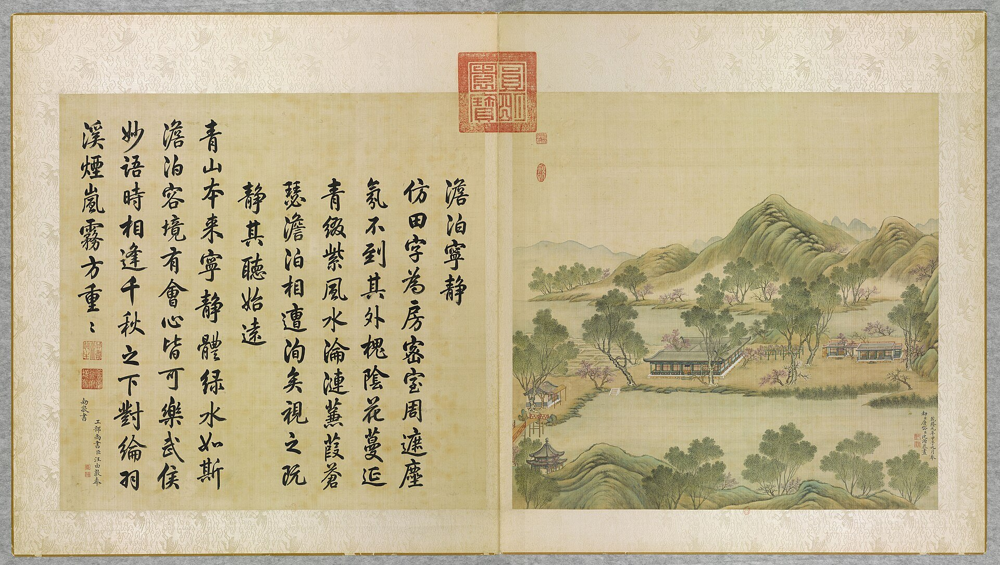

<!-- generated:start (scripts/building_pages.py): do not edit between these markers -->

# YM20-01: 田字殿 Tianzi Dian

Yuanming Yuan

**3D object:** 1 box. Open it: `/reconstruction/3d.html?b=YM20-01`

**Part of:** YM20 澹泊宁静

## What we know

- **Name:** 田字殿 Tianzi Dian (S05, S01, S137 · confidence B)
- **Written on the plan:** ?泊清静 (S01 · confidence B)
- **Garden:** Yuanming Yuan (S05, S01, S137)
- **Type:** other (S05, S01, S137 · confidence B)
- **Destroyed:** 1860 (S05, S01, S137)
- **Position:** 40.00781, 116.29008. S01 sure (S01 · confidence B)
- **Bays:** 33 rooms, each 4.48 m square in the texts / 8x10 on the plan (S05, S01, S137)
- **Size in the inventory:** 39.2 × 49.2 m. S01 plan px / hall scale (S01)
- **Note:** 田-plan. function: hall on a 田 plan with four gates; towers on the east and north sides (S05, j81:29a). (S05, S01, S137)
- **Plan reader's note:** 田 plan, four courts. About 7 bays each side, counted roughly. (S01) *(research copy, not public)*
- **How it was read:** sure (S01) *(research copy, not public)*
- **Plan pixels:** 3466, 2508 (S01) *(research copy, not public)*

## Our model now

On the block drawn on the Qing plan S01: position and frontage from the plan, heights and roof from the typology of its hall class, its form drawn by the hall kit. It will be updated as the research goes on.

- **Box:** 39.2 × 49.2 m, grand hall
- **Heights:** platform 0.55 m, eave 4.23 m, ridge 10.03 m above the ground
- **Roof:** hip-and-gable 歇山, rolled ridge 卷棚, 3 parallel rolls 勾连搭, grey tile
- **Faces:** 175.7° from north
- **Own figures:** platform 0.55 m (a, B, S137); column 3.68 m (a, B, S139)
- **Drawn:** by the hall kit: 8 bays, the middle widest, a porch all round, steps on the front, left, 歇山 hip-and-gable with a rolled ridge 卷棚, grey tile, bracket sets 斗拱 as a painted band. From its own figures and readings where the dossier gives them (platform: 0.55 m, a B, S137; column: 3.68 m, a B, S139; bays: central 4.48 m, side 4.83 m, a B, S137; tiles read: halls.csv S08 A), the rest from the typology of its hall class.
- **Confidence:** B

## Pictures (1)

- **P0020** (likely): 澹泊寧静 Danbo ningjing [Détachement et sérénité] (圓明園四十景, 第20景) (1744 (BnF record: 1744年，清朝乾隆九年)). https://commons.wikimedia.org/wiki/File%3A%E5%9C%93%E6%98%8E%E5%9C%92%E5%9B%9B%E5%8D%81%E6%99%AF._%E7%AC%AC%E4%BA%8C%E5%8D%81%E6%99%AF_%28%E4%B8%8A%E5%86%8C%EF%BC%8C%E7%AC%AC%E4%BA%8C%E5%8D%81%E5%B9%85%E5%9B%BE%29%2C_%E6%BE%B9%E6%B3%8A%E5%AF%A7%E9%9D%99_-_%28%E6%B8%85%29%E5%94%90%E5%B2%B1%E3%80%81%E6%B2%88%E6%BA%90%E5%90%88%E7%95%AB_%3B_%28%E4%B9%BE%E9%9A%86%E5%90%9F%E8%AF%97%EF%BC%8C%E6%B1%AA%E7%94%B1%E6%95%A6%E4%BB%A3%E4%B9%A6%29Danbo_ningjing_-_%28Qing%29Tang_Dai%2C_Shen_Yuan_he_hua_-_btv1b55008334m.jpg

  

## Texts and drawings (7)

- **E1633** (text, sure): 日下舊聞考 澹泊宁静. 1780s (乾隆 敕撰) · j81:29a-30a · S05. https://github.com/kanripo/KR2k0036/blob/master/KR2k0036_081.txt
  > 日天琳宇迤東稍南稻田彌望河水周環中有田字式殿凡四門其東北面皆有樓北樓正宇為澹泊寧静東為曙光樓殿之東門外為翠扶樓西門外別垣内宇為多稼軒南向七楹其東臨稻畦者前為觀稼軒後為怡情悦目為稻香亭又東稍北為溪山不盡為蘭溪隱玉多稼軒西池南為水精域西偏為静香屋為招鶴磴池後東北為寸碧西北為引勝正北為互妙樓（圓明園冊）臣等謹按澹泊寧静四十景之一額為皇上御書南門額曰亦復佳西門額曰得山水趣北廊後額曰麥雨稻風與曙光樓額皆御書多稼軒觀稼軒怡情悅目稻香亭溪山不盡蘭溪隱玉諸額皆世宗御書多稼軒聨曰風裊爐烟移晝漏月臨書幌正宵衣又曰厥惟艱哉載芟載柞籌穡事亦既勤止曰暘曰雨驗農時皆皇上御書
  Rice fields ringed by water, with a hall on a 田 plan of four gates at the centre: 澹泊寧静. Around it 曙光樓, 翠扶樓, and a western court with the seven-bay 多稼軒, 觀稼軒, 怡情悦目, 稻香亭, 溪山不盡, 蘭溪隱玉, 水精域, 静香屋, 招鶴磴, 寸碧, 引勝 and 互妙樓.
- **E1646** (text, sure): 日下舊聞考: 田字殿. 1780s (乾隆 敕撰) · j81:29a · S05. https://github.com/kanripo/KR2k0036
  > 河水周環中有田字式殿凡四門 ... 北樓正宇為澹泊寧静
- **E1639** (description, sure): Scene 20, 澹泊宁静 Danbo Ningjing, the Field Character Building. 1934 · p.89 · S02. https://archive.org/details/historyofpekings00malo
  > Like the Swastika Building, it is in the form of a Chinese character.
  A building in the form of 田, about a quarter mile east of 日天琳宇, where rice was grown round it.
- **E1638** (description, likely): Six paintings, VI: probably 澹泊宁静 Danbo Ningjing. before 1799 · p.206, Tableau VI · S258. https://archive.org/details/BIUSante_40644
  > Le bâtiment le plus considérable est composé de quatre faces semblables, qui renferment une cour quarrée, divisée elle-même en quatre autres petites cours par deux bâtiments en croix.
  The 田 plan on a long narrow island, with two flat-roofed pavilions on the right and a trellis arbour.
- **E1643** (archaeology, sure): 圆明园遗址考古有重大发现, 中国日报网. 2020-12-16 · news · S139. https://cn.chinadaily.com.cn/a/202012/16/WS5fd95d4aa3101e7ce9735684.html
  First season of 2020, about 500 m2: 9 rooms located, with steps, pegs, kerb stones and drains; first use of plant archaeology in the garden. Scene about 140 x 160 m, 26,000 m2, 1,350 m2 of buildings. The excavators say the basic data agree with the documents (rooms 4.48 m, eaves columns 3.68 m).
- **E1644** (archaeology, sure): 澹泊宁静 三期发掘, 中新网 徐婧. 2022-11-04 · news, 张中华 · S137. https://www.chinanews.com.cn/cul/2022/11-04/9887558.shtml
  Three seasons from 2020 exposed the whole base of the 田字房 hall: 33 rooms each 4.48 m square, gallery 1.28 m, base standing about 0.55 m, with column bases, floor bricks, drains, steps and pebble aprons. Base, courtyards and paths show heavy burning, which the archaeologists link to the 1860 fire. Paddy of the imperial rice fields was also found.
- **E1645** (archaeology, sure): 澹泊宁静遗址发掘获重要成果, 光明日报 via 中新网. 2022-11-14 · news, 张中华, 高勇 · S138. https://www.chinanews.com.cn/cul/2022/11-14/9893900.shtml
  The 2022 season opened six rooms and the south-west courtyard of 田字房. Floor bricks 40 cm square; courtyards in blue stone slabs; a trench shows nine rammed layers over cedar pegs; a brick drain with sticky-rice mortar was built in with the wall footings. Almost all surviving bricks and slabs are cracked and reddened by fire.

**On the plan:** Drawn on the plan of the gardens (S01), labelled ?泊清静 (? marks an unread character), 8x10 cells. https://artmuseum.princeton.edu/collections/objects/138657

## Evidence for the set of buildings

- Evidence for the whole compound 澹泊宁静: see YM20
- Reconstructions and comparables for the whole garden, 圆明园 Yuanming Yuan: see GARDEN-YM
- Standing buildings comparable to a grand hall (not this building): see CLASS-grand_hall

## Open questions

- Q182: Typology, grand_hall heights

<!-- generated:end -->

## Notes

<!-- Yours: regeneration never touches this part. It goes on the public site; what you write below a line holding only %% private %% stays in the research copy. -->
