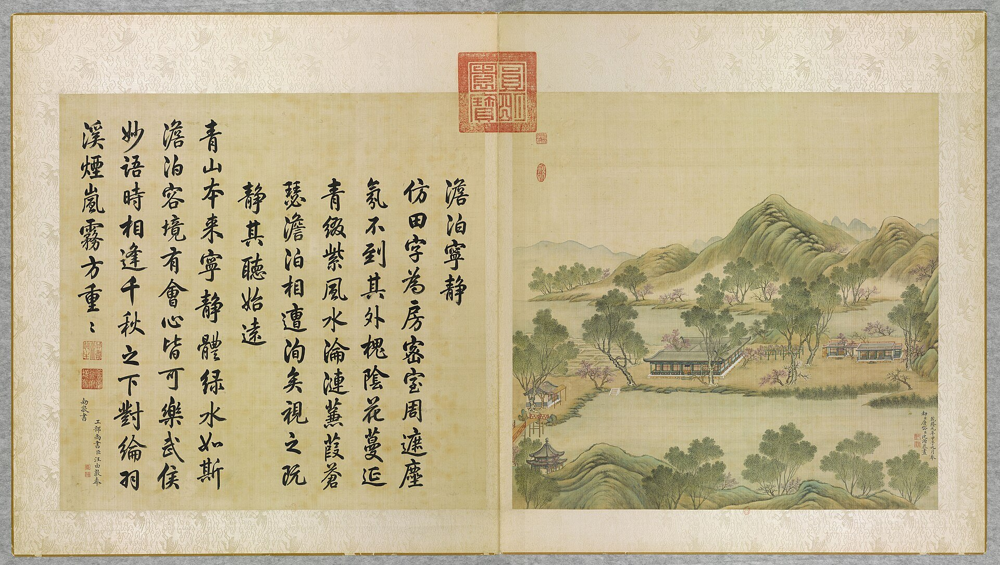
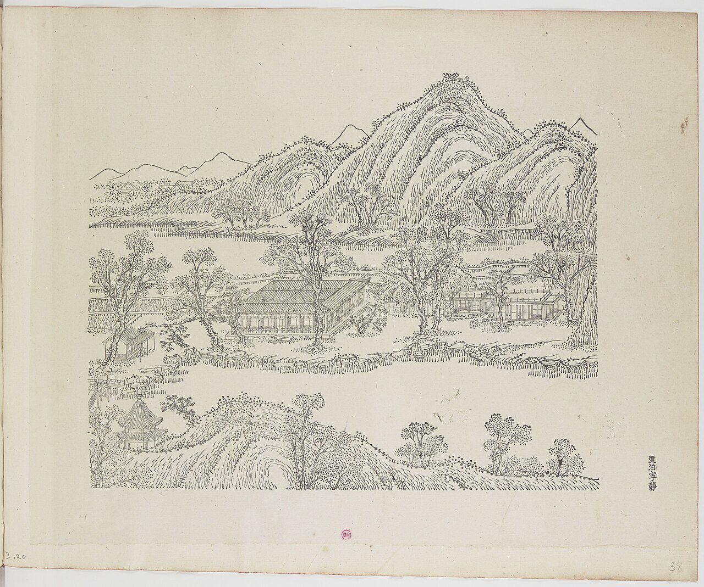
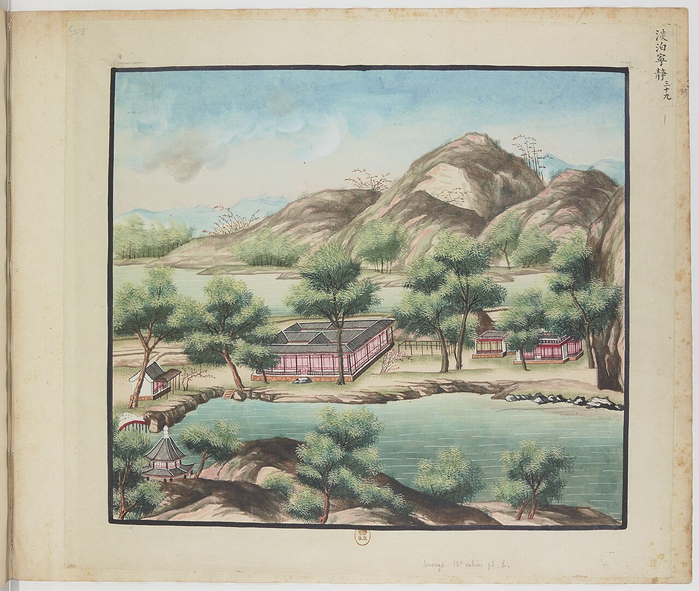
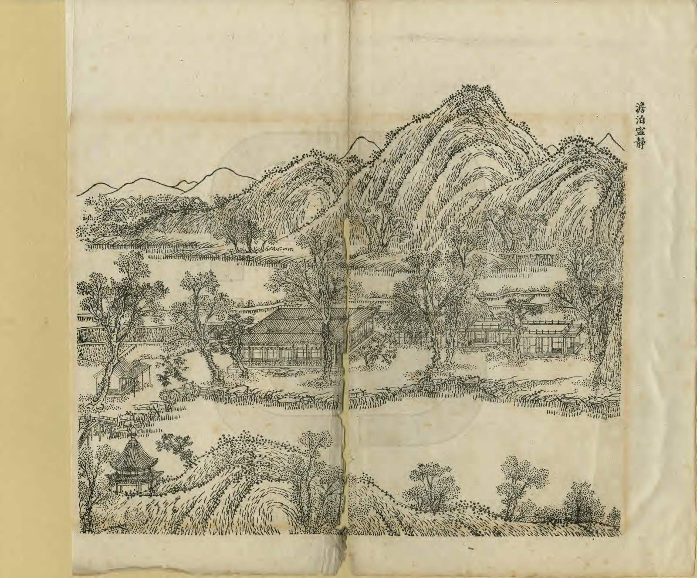
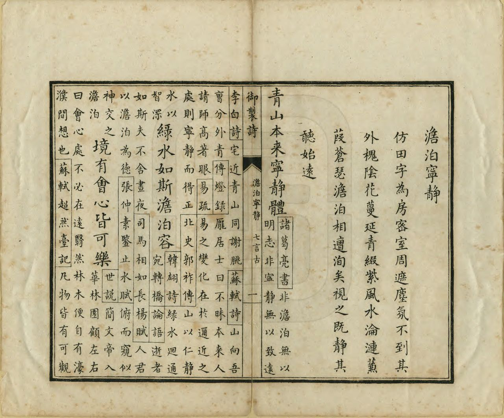

<!-- generated:start (scripts/building_pages.py): do not edit between these markers -->

# YM20: 澹泊宁静 Danbo Ningjing

The "Field" Character Building (Placid, Contented, Peaceful, Quiet) · Yuanming Yuan

**3D object:** 10 boxes. Open it: `/reconstruction/3d.html?b=YM20`

## What we know

- **Name:** 澹泊宁静 Danbo Ningjing (S05, S02, S08, S42, S01, S361 · confidence A)
- **English:** The "Field" Character Building (Placid, Contented, Peaceful, Quiet) (S05, S02, S08, S42, S01, S361)
- **Written on the plan:** ?泊清静 (S01 · confidence A)
- **Garden:** Yuanming Yuan (S05, S02, S08, S42, S01, S361)
- **Type:** scene (S05, S02, S08, S42, S01, S361 · confidence A)
- **Built:** 雍正五年 1727 (S42) (S05, S02, S08, S42, S01, S361)
- **Destroyed:** 1860 (S05, S02, S08, S42, S01, S361)
- **Position:** 40.00781, 116.29008. S01 sure (S01 · confidence B)
- **Plan reader's note:** Malone 20 at (3595,2595) and the 田 plan. Label reads ?泊清静: third character looks like 清, not 宁 (text 澹泊宁静). Polygon also takes the walled yard of 多稼轩 at the west end, per j81:29a, and the fields between. (S01) *(research copy, not public)*
- **How it was read:** sure (S01) *(research copy, not public)*
- **Plan pixels:** 3466, 2507 (S01) *(research copy, not public)*

## Our model now

10 boxes stand in this compound, 10 on blocks drawn on the plan, 0 assumed. Its halls are listed below.

## Inside it (16)

- YM20-01 田字殿
- YM20-02 曙光楼
- YM20-03 翠扶楼
- YM20-04 多稼轩
- YM20-05 观稼轩
- YM20-06 怡情悦目
- YM20-07 稻香亭
- YM20-08 溪山不尽
- YM20-09 兰溪隐玉
- YM20-10 水精域
- YM20-11 静香屋
- YM20-12 招鹤磴
- YM20-13 寸碧亭
- YM20-14 引胜
- YM20-15 互妙楼
- YM20-B0410

## Pictures (5)

- **P0020** (sure): 澹泊寧静 Danbo ningjing [Détachement et sérénité] (圓明園四十景, 第20景) (1744 (BnF record: 1744年，清朝乾隆九年)). https://commons.wikimedia.org/wiki/File%3A%E5%9C%93%E6%98%8E%E5%9C%92%E5%9B%9B%E5%8D%81%E6%99%AF._%E7%AC%AC%E4%BA%8C%E5%8D%81%E6%99%AF_%28%E4%B8%8A%E5%86%8C%EF%BC%8C%E7%AC%AC%E4%BA%8C%E5%8D%81%E5%B9%85%E5%9B%BE%29%2C_%E6%BE%B9%E6%B3%8A%E5%AF%A7%E9%9D%99_-_%28%E6%B8%85%29%E5%94%90%E5%B2%B1%E3%80%81%E6%B2%88%E6%BA%90%E5%90%88%E7%95%AB_%3B_%28%E4%B9%BE%E9%9A%86%E5%90%9F%E8%AF%97%EF%BC%8C%E6%B1%AA%E7%94%B1%E6%95%A6%E4%BB%A3%E4%B9%A6%29Danbo_ningjing_-_%28Qing%29Tang_Dai%2C_Shen_Yuan_he_hua_-_btv1b55008334m.jpg

  

- **P0097** (sure): 中国皇帝的宫殿与庙宇. 第38幅图, 澹泊寧静 - (清)孙祜、沈源Danbo ningjing - (Qing)Sun Hu, Shen Yuan (1745 (Commons, from the BnF record)). https://commons.wikimedia.org/wiki/File%3A%E4%B8%AD%E5%9B%BD%E7%9A%87%E5%B8%9D%E7%9A%84%E5%AE%AB%E6%AE%BF%E4%B8%8E%E5%BA%99%E5%AE%87._%E7%AC%AC38%E5%B9%85%E5%9B%BE%2C_%E6%BE%B9%E6%B3%8A%E5%AF%A7%E9%9D%99_-_%28%E6%B8%85%29%E5%AD%99%E7%A5%9C%E3%80%81%E6%B2%88%E6%BA%90Danbo_ningjing_-_%28Qing%29Sun_Hu%2C_Shen_Yuan_-_btv1b10520685g.jpg

  

- **P0139** (sure): 海淀(镇)：中国皇帝的行宫. 第39幅图, 淡泊寧静Danbo ningjing (1750-1792 (BnF, cb43831905b; ex coll. Bertin)). https://commons.wikimedia.org/wiki/File%3A%E6%B5%B7%E6%B7%80%28%E9%95%87%29%EF%BC%9A%E4%B8%AD%E5%9B%BD%E7%9A%87%E5%B8%9D%E7%9A%84%E8%A1%8C%E5%AE%AB._%E7%AC%AC39%E5%B9%85%E5%9B%BE%2C_%E6%B7%A1%E6%B3%8A%E5%AF%A7%E9%9D%99Danbo_ningjing_-_btv1b105207060.jpg

  

- **P0251** (sure): 澹泊寧靜 Danbo Ningjing (御製圓明園圖詠, 1887 石印本, 上卷 (Commons 卷一), 第20景; printed title in the right margin of the picture) (光緒十三年 1887 (Commons/NLC record; colophon 光緒十三年七月天津石印書屋 in the SSID copy, S98 PDF p.2); design after the woodblock of 1745 by 孫祜 Sun Hu and 沈源 Shen Yuan). https://commons.wikimedia.org/wiki/File%3ANLC403-312001107375-14035_%E7%A6%A6%E5%88%B6%E5%9C%93%E6%98%8E%E5%9C%92%E5%9C%96%E8%A9%A0_%E5%8D%B7%E4%B8%80.pdf?page=93

  

- **P0527** (sure): 澹泊寧靜 Danbo Ningjing: 乾隆 Qianlong's preface and poem with the courtiers' commentary, 御製圓明園圖詠 1887 (poem 1744 (乾隆九年); this printing 1887). https://commons.wikimedia.org/wiki/File%3ANLC403-312001107375-14035_%E7%A6%A6%E5%88%B6%E5%9C%93%E6%98%8E%E5%9C%92%E5%9C%96%E8%A9%A0_%E5%8D%B7%E4%B8%80.pdf?page=94

  

## Texts and drawings (45)

- **E1618** (poem, sure): 御製澹泊寧静詩（圓明園四十景詩）. 1744 (乾隆九年) · printed in S05 j81:30a-30b · S40. https://github.com/kanripo/KR2k0036/blob/master/KR2k0036_081.txt
  > 乾隆九年 御製澹泊寧静詩 仿田字為房密室周遮塵氛不到其外槐隂花蔓延青綴紫風水淪漣蒹葭蒼瑟澹泊相遭洵矣視之既靜其聽始逺 青山本來寧静體綠水如斯澹泊容境有會心皆可樂武侯妙語時相逢千載之下對綸羽溪烟嵐霧方重重
  Rooms on the plan of the character 田, close-walled against dust. Outside, shade trees and flowers, rippling water and reeds. He finds calm itself in looking and listening.
- **E1620** (poem, sure): 御製多稼軒十景詩（有序）. 1759 (乾隆二十四年) · j81:30b-33b · S05. https://github.com/kanripo/KR2k0036/blob/master/KR2k0036_081.txt
  > 乾隆二十四年御製多稼軒十景詩（有序）　一天好雨恰送黄梅九夏新涼初延綠籞豈羨北忩笑傲溯兹軒之得名言占南畝菑畬思惟稼以為寳時也髙髙下下各選勝以成區色色形形咸對時而有作虚亭致爽浄域祛炎屋留五架之儲琴書有託磴引三盤之趣風月為鄰嶺畔樓髙界畫晨光乍霽洲中磯小拍浮晚漲還添池沼並宜詩述者敢忘文囿禽魚紛可繪卑之詎擬華林題拈連𩔖十章律取分裁五字要以指歸斯在聊隨喜雨命篇矧夫景仰長存如藉嘉禾紀嵗云爾　樸室數楹面勢庨豁東牖臨水田座席間與農父老較晴量雨顔曰多稼皇考御筆也　徑入翠雲曲忩含老屋深數畦水田趣一脈戚農心庭竹張真畫階泉滴暗琴當簷懸聖藻每至起予欽（右多稼軒）　出多稼軒假山嶙峋嶻嶭尺寸千里盤石磴而上縳竹為亭名曰寸碧　攢蹙翠瓊表翼然亭子涼騁觀延綠墅勝㮣學黄岡竹架炎偏爽花棚静益香每來期黙識不必展縑緗（右寸碧亭）　石溪方可半畝朗榭臨之飛泉淙淙有聲杜甫詩云心在水精域信能傳神　絡石縈林邈飛湍雲錦淙嵐扉沿得得花雨落重重可遲（去聲）平橋步恰聞逺寺鐘只疑幽絶處仿彿賛公逢（右水精域）　水精域之西一室蕭然柳宗元所謂視之既靜者於斯屋有會心焉　洞房含窈窕芸席足清嘉書史道腴味林泉靜致賒迎風聽竹籟過雨展蕉芽鼻觀獨深永名言未可（口右静香力書屋）　憩於室忩為宜登於磴臺為宜此軒在臺上不施户牖故觀稼恒於此　敞榭崇基表鱗塍俯水田鋤雲將笠雨箱萬復倉千要以知艱設寧因綴景傳璇題標兩字家法訓祈年（右觀稼軒）　迴廊接小亭獨出水中時弄竿綫不在得魚否耳　階下水潺湲春鯈出水閒綸竿偶可試網罟定須刪潛躍淵將渚噞喁往復還當年寓渭上此日仰牆間（右釣魚磯）　岈然窪然之間羽客彳亍緩步雖不招之而意有顧惜弗去者矣　篆文苔磴滿鶴蹟印來斜未可乘軒駕雅宜㸃畫义樂㸔長（上聲）毛羽意喜寓烟霞何必孤山側偏稱處士家（右招鶴磴）　山之妙在擁樓而樓之妙在納山映帶氣求此互妙之所以得名也　層構單椒上前峯復列屏吸呼通顥氣表裏接山靈静樂宜情性筌蹄冺色形環中得深造可以玩羲經（右互妙樓）　一月千川寧獨此一池然一池之月即千川之月也朅爾靜悟不異當時指月佛詮　穿池貯淨水孤月喜居之秋夕寥蕭際春宵淡蕩時一將千豈別半與滿無私金口説如是瞠乎詎易窺（右印月池）　印月池之右別為一沼有閘通水育熱河美鯽魚數百頭取擕為便　文鱗千許頭靈籞恣優游濯㦸常㸔樂投竿不亟求闖萍隄影動戯藻浪花浮在沼曾憑賞常虞奉此羞（右濯鱗沼）
  Ten poems with prefaces on 多稼軒 and its parts, including 寸碧亭, 水精域, 静香屋, 招鶴磴 and others on to 印月池 and 濯鱗沼. Each preface says what stands where: rock stream, bamboo-roofed pavilion, and a pond of Rehe carp reached by a sluice.
- **E1633** (text, sure): 日下舊聞考 澹泊宁静. 1780s (乾隆 敕撰) · j81:29a-30a · S05. https://github.com/kanripo/KR2k0036/blob/master/KR2k0036_081.txt
  > 日天琳宇迤東稍南稻田彌望河水周環中有田字式殿凡四門其東北面皆有樓北樓正宇為澹泊寧静東為曙光樓殿之東門外為翠扶樓西門外別垣内宇為多稼軒南向七楹其東臨稻畦者前為觀稼軒後為怡情悦目為稻香亭又東稍北為溪山不盡為蘭溪隱玉多稼軒西池南為水精域西偏為静香屋為招鶴磴池後東北為寸碧西北為引勝正北為互妙樓（圓明園冊）臣等謹按澹泊寧静四十景之一額為皇上御書南門額曰亦復佳西門額曰得山水趣北廊後額曰麥雨稻風與曙光樓額皆御書多稼軒觀稼軒怡情悅目稻香亭溪山不盡蘭溪隱玉諸額皆世宗御書多稼軒聨曰風裊爐烟移晝漏月臨書幌正宵衣又曰厥惟艱哉載芟載柞籌穡事亦既勤止曰暘曰雨驗農時皆皇上御書
  Rice fields ringed by water, with a hall on a 田 plan of four gates at the centre: 澹泊寧静. Around it 曙光樓, 翠扶樓, and a western court with the seven-bay 多稼軒, 觀稼軒, 怡情悦目, 稻香亭, 溪山不盡, 蘭溪隱玉, 水精域, 静香屋, 招鶴磴, 寸碧, 引勝 and 互妙樓.
- **E1619** (poem, sure): 多稼轩: 乾隆二十四年 poem of the Qianlong Emperor. 乾隆二十四年 (1759), date from the compilation · p.237 item (2), under 多稼轩 · S360. https://www.yuanmingyuanpark.cn/xs/yjbg/202007/P020200730387572832602.pdf#page=237
  > 径入翠云曲，窗含老屋深。数畦水田趣，一脉戚农心。庭竹张真画，阶泉滴暗琴。当檐悬圣藻，每至起予钦。
  Poem of the Qianlong Emperor at 多稼轩, 1759, on the harvest. Year as given by the compilation.
- **E1621** (poem, sure): 翠扶楼: 乾隆二十四年 poem of the Qianlong Emperor. 乾隆二十四年 (1759), date from the compilation · p.237 item (1), under 翠扶楼 · S360. https://www.yuanmingyuanpark.cn/xs/yjbg/202007/P020200730387572832602.pdf#page=237
  > 翠蔚偨池閜砢间，红楼高出俯前山。底须游目役神思，静领几余片刻闲。
  Poem of the Qianlong Emperor at 翠扶楼, 1759. Year as given by the compilation.
- **E1622** (poem, sure): 稻香亭: 乾隆二十五年 poem of the Qianlong Emperor. 乾隆二十五年 (1760), date from the compilation · p.240 item (1), under 稻香亭 · S360. https://www.yuanmingyuanpark.cn/xs/yjbg/202007/P020200730387572832602.pdf#page=240
  > 每岁秋搜举，恒过熟稻时。兹方迟启跸，恰值促常期。遍陇黄云蔚，迎亭紫玉蕤。肯教鹦鹉啄，寜数蕙兰披。何必范云论，因怀杜甫诗。腰镰农父入，凭槛近臣知。乍见空云水，惟忻如栉茨。关心真惬望，可口欲流脂。三字瞻宸翰，五言纪昊慈。更希八纮遍，永祝万仓斯。
  Poem of the Qianlong Emperor at 稻香亭, 1760. Year as given by the compilation.
- **E1647** (poem, sure): 题多稼轩. 乾隆二十五年 (1760) · v2 p.190, under 映水兰香; source ref 7-337 · S361. https://www.yuanmingyuanpark.cn/xs/yjbg/202008/P020200803382343267004.pdf#page=193
  > 轩名多稼久留贻，结构年深稍葺治。栋宇从新适可耳，仓箱有庆恰逢之。应缘重穑天心示，益凛知艰圣训垂。宁即一园将一省，绥丰九㝢永祈斯。
  Poem 题多稼轩 by the Qianlong Emperor, 1760, filed by the editors under 映水兰香.
- **E1651** (poem, sure): 稻香亭观获十韵. 乾隆二十五年 (1760) · v2 p.190, under 映水兰香; source ref 7-337 · S361. https://www.yuanmingyuanpark.cn/xs/yjbg/202008/P020200803382343267004.pdf#page=193
  > 每岁秋蒐举，恒过熟稻时。兹方迟启跸，恰值促常期。遍陇黄云蔚，迎亭紫玉蕤。肯教鹦鹉啄，宁数蕙兰披。何必范云论，因怀杜甫诗。腰镰农父入，凭槛近臣知。乍见空云水，惟忻如栉茨。关心真惬望，可口欲流脂。三字瞻宸翰，五言纪昊慈。更希八紘遍，永祝万仓斯。
  Poem 稻香亭观获十韵 by the Qianlong Emperor, 1760, filed by the editors under 映水兰香.
- **E1659** (poem, sure): 题互妙楼. 乾隆二十五年 (1760) · v2 p.189, under 映水兰香; source ref 7-273 · S361. https://www.yuanmingyuanpark.cn/xs/yjbg/202008/P020200803382343267004.pdf#page=192
  > 阴阳动静互为根，智水仁山众妙门。楼上雅宜读周易，当前成性契存存。
  Poem 题互妙楼 by the Qianlong Emperor, 1760, filed by the editors under 映水兰香.
- **E1623** (poem, sure): 稻香亭: 乾隆二十六年 poem of the Qianlong Emperor. 乾隆二十六年 (1761), date from the compilation · p.240 item (2), under 稻香亭 · S360. https://www.yuanmingyuanpark.cn/xs/yjbg/202007/P020200730387572832602.pdf#page=240
  > 雨滋稻町插新秧，较早常年一月强。苗矣秀乎秀矣实，此时敢拟即云香。
  Poem of the Qianlong Emperor at 稻香亭, 1761. Year as given by the compilation.
- **E1624** (poem, sure): 稻香亭: 乾隆二十九年 poem of the Qianlong Emperor. 乾隆二十九年 (1764), date from the compilation · p.240 item (3), under 稻香亭 · S360. https://www.yuanmingyuanpark.cn/xs/yjbg/202007/P020200730387572832602.pdf#page=240
  > 旸雨幸时若，黍徐兆岁多。芃苗长亩异，结实羃塍罗。黄欲云中染，香从风处过。弄田占有喜，寰海愿均和。
  Poem of the Qianlong Emperor at 稻香亭, 1764. Year as given by the compilation.
- **E1652** (poem, sure): 稻香亭. 乾隆二十九年 (1764) · v2 p.191, under 映水兰香; source ref 8-825 · S361. https://www.yuanmingyuanpark.cn/xs/yjbg/202008/P020200803382343267004.pdf#page=194
  > 旸雨幸时若，黍稌兆岁多。芃苗长亩异，结实羃塍罗。黄欲云中染，香从风处过。弄田占有喜，寰海愿均和。
  Poem 稻香亭 by the Qianlong Emperor, 1764, filed by the editors under 映水兰香.
- **E1656** (poem, sure): 招鹤磴口号. 乾隆二十九年 (1764) · v2 p.191, under 映水兰香; source ref 8-853 · S361. https://www.yuanmingyuanpark.cn/xs/yjbg/202008/P020200803382343267004.pdf#page=194
  > 放去何须招使回，无过缀景籞园隈。羡梁稻者原堪致，真鹤应知未肯来。
  Poem 招鹤磴口号 by the Qianlong Emperor, 1764, filed by the editors under 映水兰香.
- **E1649** (poem, sure): 观稼轩. 乾隆三十五年 (1770) · v2 p.193, under 映水兰香 · S361. https://www.yuanmingyuanpark.cn/xs/yjbg/202008/P020200803382343267004.pdf#page=196
  > 台上敞轩无户牖，为因拾级便遐观。兴锄时节知还早，一以懒登一怯寒。
  Poem 观稼轩 by the Qianlong Emperor, 1770, filed by the editors under 映水兰香.
- **E1654** (poem, sure): 静香屋. 乾隆三十五年 (1770) · v2 p.193, under 映水兰香 · S361. https://www.yuanmingyuanpark.cn/xs/yjbg/202008/P020200803382343267004.pdf#page=196
  > 精舍避风还向阳，虽然近水了无凉。盆梅几朵才舒蕊，此是卉中真静香。
  Poem 静香屋 by the Qianlong Emperor, 1770, filed by the editors under 映水兰香.
- **E1657** (poem, sure): 招鹤磴. 乾隆三十五年 (1770) · v2 p.193, under 映水兰香 · S361. https://www.yuanmingyuanpark.cn/xs/yjbg/202008/P020200803382343267004.pdf#page=196
  > 长翼翱翔得自由，磴间驻步小淹留。胎仙偶下还应笑，岂是林家张氏流。
  Poem 招鹤磴 by the Qianlong Emperor, 1770, filed by the editors under 映水兰香.
- **E1658** (poem, sure): 寸碧亭. 乾隆三十五年 (1770) · v2 p.192, under 映水兰香 · S361. https://www.yuanmingyuanpark.cn/xs/yjbg/202008/P020200803382343267004.pdf#page=195
  > 小小假山耸碧嵸，登临亦自兴无穷。南华第二篇尝读，尺寸还如千里同。
  Poem 寸碧亭 by the Qianlong Emperor, 1770, filed by the editors under 映水兰香.
- **E1660** (poem, sure): 互妙楼. 乾隆三十五年 (1770) · v2 p.194, under 映水兰香 · S361. https://www.yuanmingyuanpark.cn/xs/yjbg/202008/P020200803382343267004.pdf#page=197
  > 楼据半山山护楼，烟云映带若相酬。妙于动静为根处，太极成篇义训周。
  Poem 互妙楼 by the Qianlong Emperor, 1770, filed by the editors under 映水兰香.
- **E1625** (poem, sure): 翠扶楼: 乾隆五十五年 poem of the Qianlong Emperor. 乾隆五十五年 (1790), date from the compilation · p.237 item (2), under 翠扶楼 · S360. https://www.yuanmingyuanpark.cn/xs/yjbg/202007/P020200730387572832602.pdf#page=237
  > 草木方萌芽，翠意斯犹远。小楼似孤名，而实无所损。去者纵已过，来者正其宛。现在亦弗住，试看光阴衮。底须循目前，害不观厥本。
  Poem of the Qianlong Emperor at 翠扶楼, 1790, on the view. Year as given by the compilation.
- **E1650** (poem, sure): 观稼轩. 乾隆五十六年 (1791) · v2 p.196, under 映水兰香 · S361. https://www.yuanmingyuanpark.cn/xs/yjbg/202008/P020200803382343267004.pdf#page=199
  > 台上疏轩不设棂，便于观稼验农经。兴锄时节知犹未，一意四时那有停。
  Poem 观稼轩 by the Qianlong Emperor, 1791, filed by the editors under 映水兰香.
- **E1653** (poem, sure): 水精域. 乾隆五十六年 (1791) · v2 p.195, under 映水兰香 · S361. https://www.yuanmingyuanpark.cn/xs/yjbg/202008/P020200803382343267004.pdf#page=198
  > 假山之罅流真瀑，真假其间辨实难。杜氏诗和赵家画，不期双美一时观。
  Poem 水精域 by the Qianlong Emperor, 1791, filed by the editors under 映水兰香.
- **E1655** (poem, sure): 静香屋. 乾隆五十六年 (1791) · v2 p.195, under 映水兰香 · S361. https://www.yuanmingyuanpark.cn/xs/yjbg/202008/P020200803382343267004.pdf#page=198
  > 书屋临溪方十尺，初春冰冻不波呈。田田未吐水华远，真是静香善副名。
  Poem 静香屋 by the Qianlong Emperor, 1791, filed by the editors under 映水兰香.
- **E1626** (poem, sure): 水晶域: 嘉庆二年 poem of the Jiaqing Emperor. 嘉庆二年 (1797), date from the compilation · p.240 item (2), under 水晶域 · S360. https://www.yuanmingyuanpark.cn/xs/yjbg/202007/P020200730387572832602.pdf#page=240
  > 寸心常湛然，如在水晶域。澄澈烛毫芒，静虚斯动直。遇物成见消，顺应非苛刻。涵养涤渊源，尘滓岂能惑。 疏浚本自修，开导防茅塞。返观内照功，明通育才德。
  Poem of the Jiaqing Emperor at 水晶域, 1797, on the view. Year as given by the compilation.
- **E1627** (poem, sure): 多稼轩: 嘉庆九年 poem of the Jiaqing Emperor. 嘉庆九年 (1804), date from the compilation · p.239 item (17), under 多稼轩 · S360. https://www.yuanmingyuanpark.cn/xs/yjbg/202007/P020200730387572832602.pdf#page=239
  > 御园辟地阡陌连，学稼欲探其大略。课晴量雨愿协和，收麦耘禾验时若。食乃民天在务农。艰难力穑邦本托，疆理弄田祖泽深，示俭知依勉守约。（御园隙地垦为广亩种植麦禾，课雨晴验丰歉，知稼穑之艰难，厪三农之作苦，盖即近征远之意也。兹地为皇祖所辟知依示俭，寓意精深，每当几暇来临，目击如云，不觉勤民之念与肯获之心并切尔。）
  Poem of the Jiaqing Emperor at 多稼轩, 1804, on the harvest. Year as given by the compilation.
- **E1628** (poem, sure): 澹泊宁静. 嘉庆九年 (1804) · v2 p.183, under 澹泊宁静; source ref 3-14 · S361. https://www.yuanmingyuanpark.cn/xs/yjbg/202008/P020200803382343267004.pdf#page=186
  > 澹泊以明志，宁静以致远。武侯妙立言，后世为政本。责己养寸田，持躬勤自返。受益惟集虚，骄矜满招损。鉴临理兆民，王化起宫壶。不为天下先，慈俭勉素悃。
  Poem 澹泊宁静 by the Jiaqing Emperor, 1804, filed by the editors under 澹泊宁静.
- **E1629** (poem, sure): 多稼轩: 嘉庆十二年 poem of the Jiaqing Emperor. 嘉庆十二年 (1807), date from the compilation · p.239 item (19), under 多稼轩 · S360. https://www.yuanmingyuanpark.cn/xs/yjbg/202007/P020200730387572832602.pdf#page=239
  > 御园多弄田，观稼盼甘雨。知依穑事先，深意仰皇祖。漫咏花木芳，惟厪耕耘苦。我考衷敬承，劭农渥泽普。渺躬守前谟，垦辟无旷土。应念徧敷滋，自天锡多祜。（是轩与鳞塍清甽相对，作田家朴野之景。盖此处为园中弄田一区也，人君欲知稼穑艰难而不能亲越陌阡，日与蓑笠咨耘耨也。乃于苑囿中广辟菑畲，俾上林庄农垦治之时，其穮蓘勤，其灌输自初莳秧苗以至䆉䅉铚刈。其间课雨晴，占物候，可于随时游览片壤锄犂究悉甫田之丰啬，耕夫之劳苦矣。我皇祖念切民依而置此轩，我皇考肯获惟勤常时省览，予习闻彝训式谷，是思能不于粒食之源，亹劭农重谷之家法乎？）
  Poem of the Jiaqing Emperor at 多稼轩, 1807, on the harvest. Year as given by the compilation.
- **E1630** (poem, sure): 水晶域: 嘉庆十二年 poem of the Jiaqing Emperor. 嘉庆十二年 (1807), date from the compilation · p.241 item (4), under 水晶域 · S360. https://www.yuanmingyuanpark.cn/xs/yjbg/202007/P020200730387572832602.pdf#page=241
  > 寸心应万事，磨炼屏牵萦。物我何区别，公私辨浊清。韬光能烛暗，处晦始观明。灵域中涵养，澄辉彻水晶。
  Poem of the Jiaqing Emperor at 水晶域, 1807, on the view. Year as given by the compilation.
- **E1631** (poem, sure): 澹泊宁静. 嘉庆十二年 (1807) · v2 p.183, under 澹泊宁静; source ref 3-347 · S361. https://www.yuanmingyuanpark.cn/xs/yjbg/202008/P020200803382343267004.pdf#page=186
  > 奎文揭四字，治法尽兼该。处静群才集，求宁庶事恢。圣功贻万古，心镜耀三台。小子承基业，守成日凛哉。
  Poem 澹泊宁静 by the Jiaqing Emperor, 1807, filed by the editors under 澹泊宁静.
- **E1632** (poem, sure): 水晶域: 嘉庆十五年 poem of the Jiaqing Emperor. 嘉庆十五年 (1810), date from the compilation · p.240 item (1), under 水晶域 · S360. https://www.yuanmingyuanpark.cn/xs/yjbg/202007/P020200730387572832602.pdf#page=240
  > 高下回廊接，小轩容膝安。曲池漾清藻，奇石激惊湍。苔厚晴仍润，松深夏亦寒。心神澄静域，点笔倚虚栏。
  Poem of the Jiaqing Emperor at 水晶域, 1810, on the view. Year as given by the compilation.
- **E1648** (poem, sure): 多稼轩劝农诗（342）. year not parsed · v2 p.185, under 映水兰香 · S361. https://www.yuanmingyuanpark.cn/xs/yjbg/202008/P020200803382343267004.pdf#page=188
  > 夜来新雨过，畿甸绿平铺。克尽农桑力，方无饥冻虞。蚕筐携织妇，麦饭饱田夫。坐对春光晚，催耕听鸟呼。
  Poem 多稼轩劝农诗（342） by the  Emperor, filed by the editors under 映水兰香.
- **E1639** (description, sure): Scene 20, 澹泊宁静 Danbo Ningjing, the Field Character Building. 1934 · p.89 · S02. https://archive.org/details/historyofpekings00malo
  > Like the Swastika Building, it is in the form of a Chinese character.
  A building in the form of 田, about a quarter mile east of 日天琳宇, where rice was grown round it.
- **E1638** (description, likely): Six paintings, VI: probably 澹泊宁静 Danbo Ningjing. before 1799 · p.206, Tableau VI · S258. https://archive.org/details/BIUSante_40644
  > Le bâtiment le plus considérable est composé de quatre faces semblables, qui renferment une cour quarrée, divisée elle-même en quatre autres petites cours par deux bâtiments en croix.
  The 田 plan on a long narrow island, with two flat-roofed pavilions on the right and a trellis arbour.
- **E1731** (description, guess): Attiret: the farming quarter. 1743 · [pp.31-32] · S157. https://faculty.bard.edu/~louis/gardens/attiretaccount.html
  > There you see Fields, Meadows, Farm-houses, and little scatter'd Cottages; with Oxen, Ploughs, and all the Necessaries for Husbandry.
  A quarter set apart for farming, within the garden. S02 pp.89-91 places rice fields round scenes 20 to 26; which scenes it means is a guess.
- **E1011** (description, sure): Site status table, about 2011: nothing visible, or built over. c. 2011 · 系列06 repost, status table · S356. https://blog.sina.com.cn/s/blog_c27029650101itzz.html
  Same table. In it the first group shows no visible remains; 得全阁, 流香渚, 凤麟洲, 涵秋馆, 蔚藻堂, 中和堂, 敷春堂 and 心镜轩 have service buildings on them, and 含晖楼, 澄心堂, 延寿寺, 清夏堂 and 喜雨山房 are occupied by other institutions. 澹泊宁静 and several others have been dug since, so this is out of date for them.
- **E1634** (description, sure): 圆明园百景史事分景汇编: 多稼轩. 1753-1820 · from p.237, under 澹泊宁静 · S360. https://www.yuanmingyuanpark.cn/xs/yjbg/202007/P020200730387572832602.pdf#page=237
  A note of 1807 calls it the farm-scene part of the garden, and in 1769 Qianlong put the 耕作 and 蚕织 scrolls here, with 贵织山堂 to the north. 多稼轩: 26 dated items, 1753-1820, of which 23 poems and 3 court records (Qianlong, Jiaqing); recurring themes: the harvest, the view. First dated 1753, last dated 1820.
- **E1635** (description, sure): 圆明园百景史事分景汇编: 翠扶楼. 1759-1790 · from p.237, under 澹泊宁静 · S360. https://www.yuanmingyuanpark.cn/xs/yjbg/202007/P020200730387572832602.pdf#page=237
  翠扶楼: 2 dated items, 1759-1790, of which 2 poems (Qianlong); recurring themes: the view. First dated 1759, last dated 1790.
- **E1636** (description, sure): 圆明园百景史事分景汇编: 稻香亭. 1760-1764 · from p.240, under 澹泊宁静 · S360. https://www.yuanmingyuanpark.cn/xs/yjbg/202007/P020200730387572832602.pdf#page=240
  稻香亭: 3 dated items, 1760-1764, of which 3 poems (Qianlong). First dated 1760, last dated 1764.
- **E1637** (description, sure): 圆明园百景史事分景汇编: 水晶域. 1797-1810 · from p.240, under 澹泊宁静 · S360. https://www.yuanmingyuanpark.cn/xs/yjbg/202007/P020200730387572832602.pdf#page=240
  水晶域: 4 dated items, 1797-1810, of which 4 poems (Jiaqing); recurring themes: the view. First dated 1797, last dated 1810.
- **E1640** (description, sure): 圆明园五朝御制诗文集注 v2, editors' note on 澹泊宁静. 2020 edition · v2 p.182 · S361. https://www.yuanmingyuanpark.cn/xs/yjbg/202008/P020200803382343267004.pdf#page=185
  Built 1727: a 田字 hall with four gates, towers on the east and north, plaques on each side, and 翠扶楼 outside the east gate.
- **E1641** (description, sure): 圆明园百景史事分景汇编: 澹泊宁静. undated · from p.236, under 澹泊宁静 · S360. https://www.yuanmingyuanpark.cn/xs/yjbg/202007/P020200730387572832602.pdf#page=236
  The compiler describes a 田字 plan hall, standing by early Yongzheng, with a throne and bed, rice fields north and 翠扶楼 to the east. 澹泊宁静: short note in the compilation, no dated items.
- **E1670** (description, likely): 圆明园五朝御制诗文集注 v2, editors' note on 映水兰香. 2020 edition · v2 p.185 · S361. https://www.yuanmingyuanpark.cn/xs/yjbg/202008/P020200803382343267004.pdf#page=188
  A farm-themed garden rebuilt in mid-Qianlong: seven-bay 多稼轩, 观稼轩, 稻香亭, 水晶域, 寸碧亭, 静香屋, 互妙楼, 引胜轩, the triangular 招鹤磴. Qianlong named ten scenes; Cheng Qi's copy of Lou Shu's 耕织图 was kept here.
- **E1642** (drawing, sure): 《国家图书馆藏样式雷图档·圆明园卷初编》: 澹泊宁静. mostly 道光, 咸丰, 同治 per the publisher · 初编 目录: 澹泊宁静, p.266 · S13. https://www.nlcpress.com/ProductView.aspx?Id=7642
  The printed facsimile of the National Library of China's Yangshi Lei sheets has a section on this place at p.266 (1 pages, section length worked out from the next heading); sheet titles and numbers are in the volume, ordered from a library.
- **E1643** (archaeology, sure): 圆明园遗址考古有重大发现, 中国日报网. 2020-12-16 · news · S139. https://cn.chinadaily.com.cn/a/202012/16/WS5fd95d4aa3101e7ce9735684.html
  First season of 2020, about 500 m2: 9 rooms located, with steps, pegs, kerb stones and drains; first use of plant archaeology in the garden. Scene about 140 x 160 m, 26,000 m2, 1,350 m2 of buildings. The excavators say the basic data agree with the documents (rooms 4.48 m, eaves columns 3.68 m).
- **E1644** (archaeology, sure): 澹泊宁静 三期发掘, 中新网 徐婧. 2022-11-04 · news, 张中华 · S137. https://www.chinanews.com.cn/cul/2022/11-04/9887558.shtml
  Three seasons from 2020 exposed the whole base of the 田字房 hall: 33 rooms each 4.48 m square, gallery 1.28 m, base standing about 0.55 m, with column bases, floor bricks, drains, steps and pebble aprons. Base, courtyards and paths show heavy burning, which the archaeologists link to the 1860 fire. Paddy of the imperial rice fields was also found.
- **E1645** (archaeology, sure): 澹泊宁静遗址发掘获重要成果, 光明日报 via 中新网. 2022-11-14 · news, 张中华, 高勇 · S138. https://www.chinanews.com.cn/cul/2022/11-14/9893900.shtml
  The 2022 season opened six rooms and the south-west courtyard of 田字房. Floor bricks 40 cm square; courtyards in blue stone slabs; a trench shows nine rammed layers over cedar pegs; a brick drain with sticky-rice mortar was built in with the wall footings. Almost all surviving bricks and slabs are cracked and reddened by fire.

**On the plan:** Drawn on the plan of the gardens (S01), labelled ?泊清静 (? marks an unread character). https://artmuseum.princeton.edu/collections/objects/138657

## Open questions

- Q20: Name variants
- Q40: 多稼轩 YM20-04
- Q45: Halls in the texts with no row

<!-- generated:end -->

## Notes

<!-- Yours: regeneration never touches this part. It goes on the public site; what you write below a line holding only %% private %% stays in the research copy. -->
