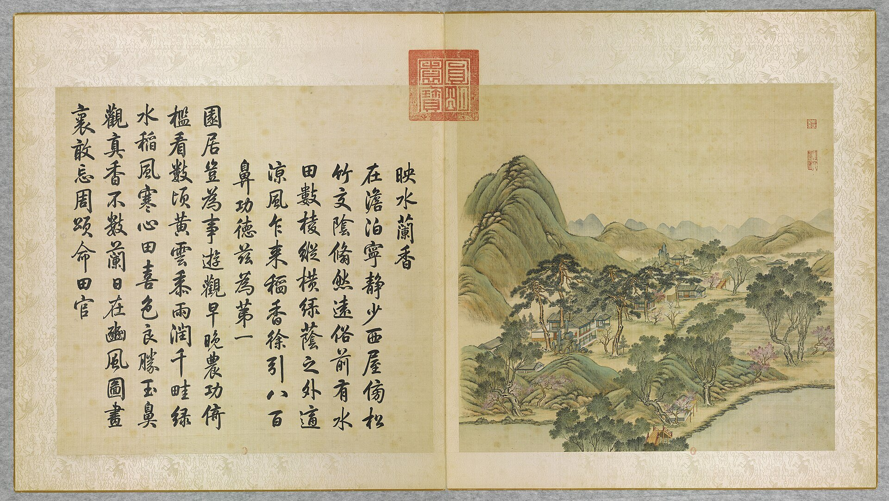
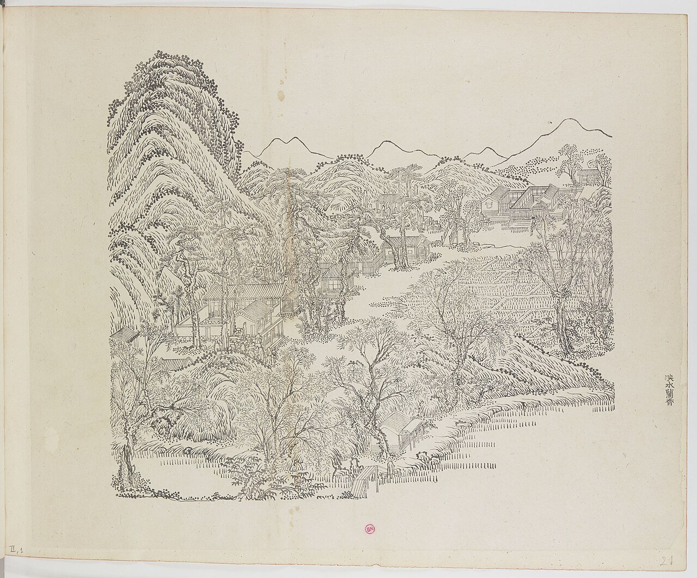
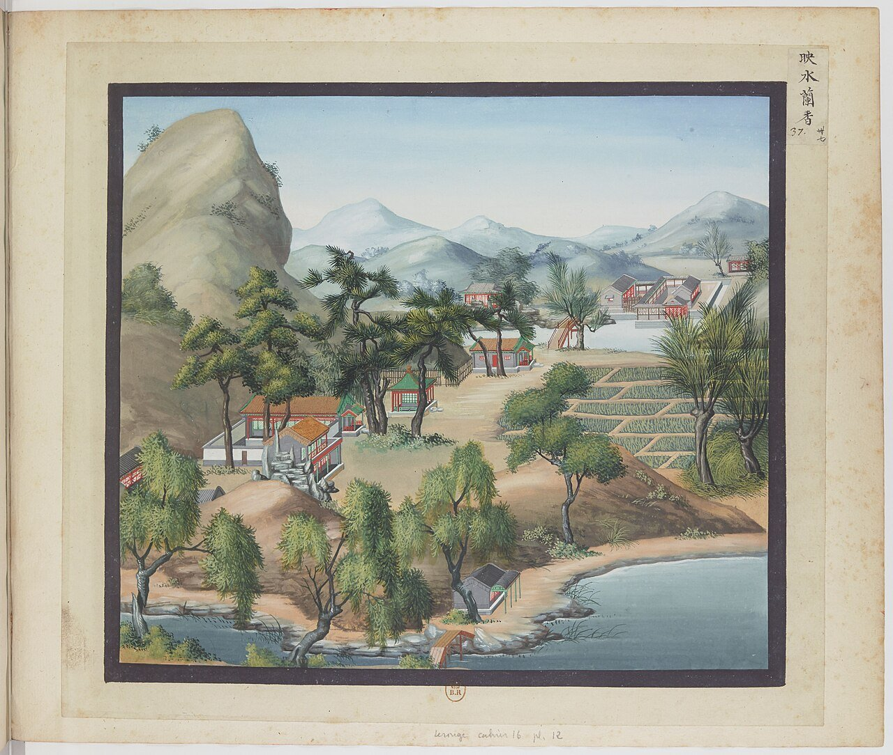
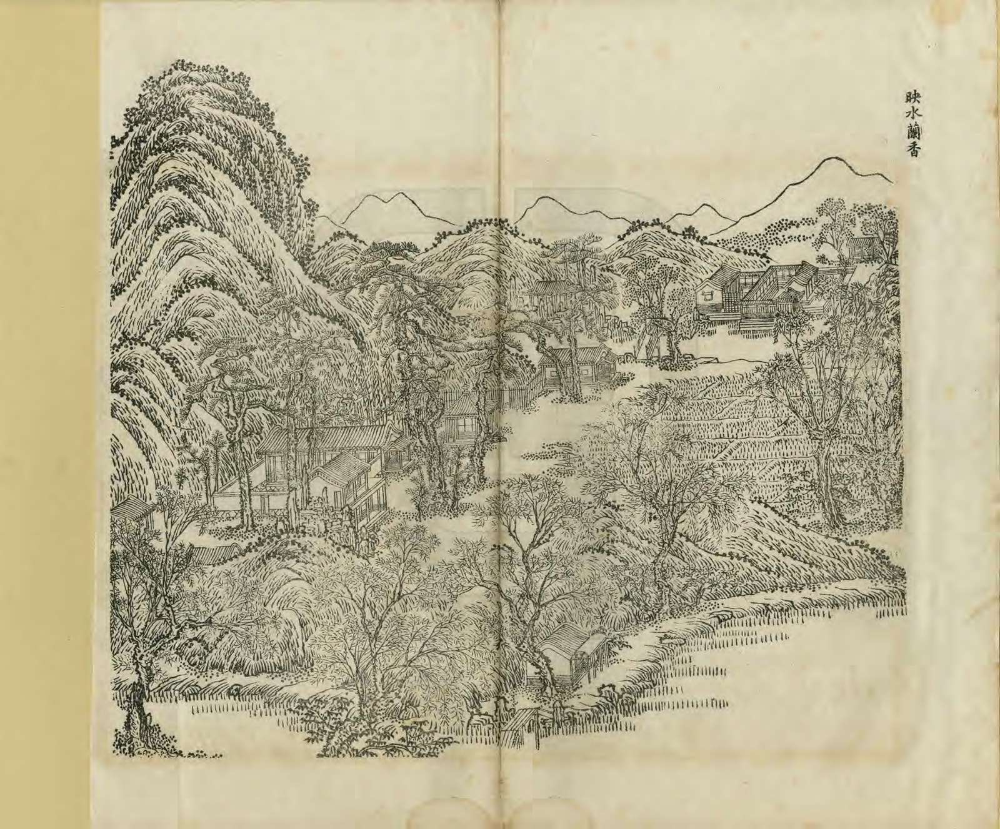
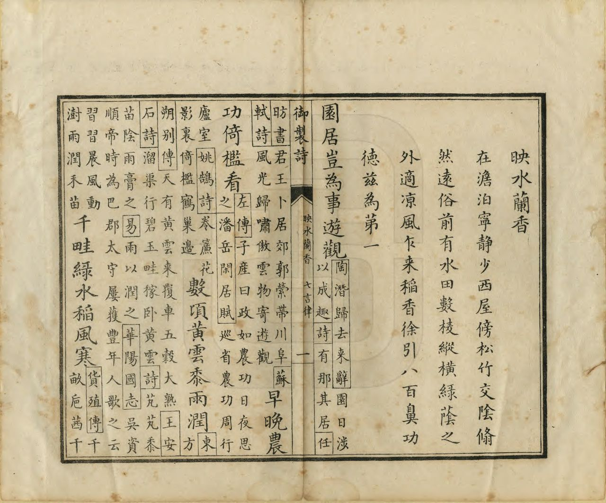

<!-- generated:start (scripts/building_pages.py): do not edit between these markers -->

# YM21: 映水兰香 Yingshui Lanxiang

Ying Shui Lan Hsiang (Reflections on the Water and the Fragrance of Iris) · Yuanming Yuan

**3D object:** 4 boxes. Open it: `/reconstruction/3d.html?b=YM21`

## What we know

- **Name:** 映水兰香 Yingshui Lanxiang (S05, S02, S08, S01 · confidence A)
- **English:** Ying Shui Lan Hsiang (Reflections on the Water and the Fragrance of Iris) (S05, S02, S08, S01)
- **Garden:** Yuanming Yuan (S05, S02, S08, S01)
- **Type:** scene (S05, S02, S08, S01 · confidence A)
- **Destroyed:** 1860 (S05, S02, S08, S01)
- **Position:** 40.00761, 116.28888. S01 likely (S01 · confidence B)
- **Plan reader's note:** Malone 21 at (3050,2500) sits between the 多稼轩 yard and this islet. I could not find a five-bay west-facing hall that fits 映水兰香, so the centre is this islet only. 印月池 and 知耕织 lie north, inside the YM22 polygon. See notes. (S01) *(research copy, not public)*
- **How it was read:** likely (S01) *(research copy, not public)*
- **Plan pixels:** 2965, 2555 (S01) *(research copy, not public)*

## Our model now

4 boxes stand in this compound, 4 on blocks drawn on the plan, 0 assumed. Its halls are listed below.

## Inside it (8)

- YM21-01 映水兰香殿
- YM21-02 钓鱼矶
- YM21-03 印月池
- YM21-04 知耕织
- YM21-05 濯鳞沼
- YM21-06 贵织山堂
- YM21-B0430
- YM21-B0444

## Pictures (5)

- **P0021** (sure): 映水蘭香 Yingshui lanxiang [Reflet de l'onde, fragrance des orchidées] (圓明園四十景, 第21景) (1744 (BnF record: 1744年，清朝乾隆九年)). https://commons.wikimedia.org/wiki/File%3A%E5%9C%93%E6%98%8E%E5%9C%92%E5%9B%9B%E5%8D%81%E6%99%AF._%E7%AC%AC%E4%BA%8C%E5%8D%81%E4%B8%80%E6%99%AF_%28%E4%B8%8B%E5%86%8C%EF%BC%8C%E7%AC%AC%E4%B8%80%E5%B9%85%E5%9B%BE%29%2C_%E6%98%A0%E6%B0%B4%E8%98%AD%E9%A6%99_-_%28%E6%B8%85%29%E5%94%90%E5%B2%B1%E3%80%81%E6%B2%88%E6%BA%90%E5%90%88%E7%95%AB_%3B_%28%E4%B9%BE%E9%9A%86%E5%90%9F%E8%AF%97%EF%BC%8C%E6%B1%AA%E7%94%B1%E6%95%A6%E4%BB%A3%E4%B9%A6%29Yingshui_lanxiang_-_%28Qing%29Tang_Dai%2C_Shen_Yuan_he_hua_-_btv1b550083352.jpg

  

- **P0081** (sure): 中国皇帝的宫殿与庙宇. 第21幅图, 映水蘭香 - (清)孙祜、沈源Yingshui lanxiang - (Qing)Sun Hu, Shen Yuan (1745 (Commons, from the BnF record)). https://commons.wikimedia.org/wiki/File%3A%E4%B8%AD%E5%9B%BD%E7%9A%87%E5%B8%9D%E7%9A%84%E5%AE%AB%E6%AE%BF%E4%B8%8E%E5%BA%99%E5%AE%87._%E7%AC%AC21%E5%B9%85%E5%9B%BE%2C_%E6%98%A0%E6%B0%B4%E8%98%AD%E9%A6%99_-_%28%E6%B8%85%29%E5%AD%99%E7%A5%9C%E3%80%81%E6%B2%88%E6%BA%90Yingshui_lanxiang_-_%28Qing%29Sun_Hu%2C_Shen_Yuan_-_btv1b105206841.jpg

  

- **P0137** (sure): 海淀(镇)：中国皇帝的行宫. 第37幅图, 映水蘭香Yingshui lanxiang (1750-1792 (BnF, cb43831905b; ex coll. Bertin)). https://commons.wikimedia.org/wiki/File%3A%E6%B5%B7%E6%B7%80%28%E9%95%87%29%EF%BC%9A%E4%B8%AD%E5%9B%BD%E7%9A%87%E5%B8%9D%E7%9A%84%E8%A1%8C%E5%AE%AB._%E7%AC%AC37%E5%B9%85%E5%9B%BE%2C_%E6%98%A0%E6%B0%B4%E8%98%AD%E9%A6%99Yingshui_lanxiang_-_btv1b10520707f.jpg

  

- **P0252** (sure): 映水蘭香 Yingshui Lanxiang (御製圓明園圖詠, 1887 石印本, 下卷 (Commons 卷二), 第21景; printed title in the right margin of the picture) (光緒十三年 1887 (Commons/NLC record; colophon 光緒十三年七月天津石印書屋 in the SSID copy, S98 PDF p.2); design after the woodblock of 1745 by 孫祜 Sun Hu and 沈源 Shen Yuan). https://commons.wikimedia.org/wiki/File%3ANLC403-312001107375-14034_%E7%A6%A6%E5%88%B6%E5%9C%93%E6%98%8E%E5%9C%92%E5%9C%96%E8%A9%A0_%E5%8D%B7%E4%BA%8C.pdf?page=4

  

- **P0528** (sure): 映水蘭香 Yingshui Lanxiang: 乾隆 Qianlong's preface and poem with the courtiers' commentary, 御製圓明園圖詠 1887 (poem 1744 (乾隆九年); this printing 1887). https://commons.wikimedia.org/wiki/File%3ANLC403-312001107375-14034_%E7%A6%A6%E5%88%B6%E5%9C%93%E6%98%8E%E5%9C%92%E5%9C%96%E8%A9%A0_%E5%8D%B7%E4%BA%8C.pdf?page=5

  

## Texts and drawings (22)

- **E1663** (poem, sure): 御製映水蘭香詩（圓明園四十景詩）. 1744 (乾隆九年) · printed in S05 j81:34a-34b · S40. https://github.com/kanripo/KR2k0036/blob/master/KR2k0036_081.txt
  > 乾隆九年 御製映水蘭香詩 在澹泊寧静少西屋旁松竹交隂翛然逺俗前有水田數棱縱横綠䕃之外適涼風乍來稻香徐引八百鼻功德兹為第一 園居豈為事遊觀早晩農功倚檻㸔數頃黄雲黍雨潤千畦綠水稻風寒心田喜色良勝玉鼻觀真香不數蘭日在豳風圖畫裏敢忘周頌命田官
  Just west of 澹泊寧静, pine and bamboo shade a house far from common life. Paddy lies in front, and when a cool breeze comes, the scent of rice is the finest he knows.
- **E1666** (text, sure): 日下舊聞考 映水兰香. 1780s (乾隆 敕撰) · j81:33b-34a · S05. https://github.com/kanripo/KR2k0036/blob/master/KR2k0036_081.txt
  > 澹泊寧静度河橋而西為映水蘭香西向五楹東南為釣魚磯北為印月池池北為知耕織又北稍東為濯鱗沼映水蘭香西南為貴織山堂祀蠶神（圓明園册）臣等謹按映水蘭香四十景之一額為皇上御書釣魚磯印月池知耕織濯鱗沼貴織山堂諸額皆世宗御書
  West across the stream: 映水蘭香, five bays facing west, with the 釣魚磯, 印月池, 知耕織, 濯鱗沼 and 貴織山堂, a shrine to the silkworm spirit.
- **E1661** (poem, likely): 世宗 耕織軒 (園景十二詠). before 1723 (雍邸集, printed as written while a prince) · KR4f0002_026:3b · S200. https://github.com/kanripo/KR4f0002/blob/master/KR4f0002_026.txt
  > 耕織軒 軒亭開面面原隰對畇畇禾稼迎窓緑桑麻窣地新簷星窺織火渠水界田畛辛苦農蠶事歌詩可繋豳
  Prince's poem on a pavilion open on all sides over fields of grain and mulberry. Tied by inference to 映水蘭香, which has the plaque 知耕織.
- **E1662** (poem, sure): 钓鱼矶: 乾隆七年 poem of the Qianlong Emperor. 乾隆七年 (1742), date from the compilation · p.241 item (1), under 钓鱼矶 · S360. https://www.yuanmingyuanpark.cn/xs/yjbg/202007/P020200730387572832602.pdf#page=241
  > 新蒲绿水泳文鳞，偶坐花矶理钓纶。笑我尘心无好梦，几曾得遇渭濵人。
  Poem of the Qianlong Emperor at 钓鱼矶, 1742, on the view. Year as given by the compilation.
- **E1664** (poem, sure): 钓鱼矶: 乾隆十八年 poem of the Qianlong Emperor. 乾隆十八年 (1753), date from the compilation · p.241 item (2), under 钓鱼矶 · S360. https://www.yuanmingyuanpark.cn/xs/yjbg/202007/P020200730387572832602.pdf#page=241
  > 十景西湖名早传，御园柳浪亦称旃。栗留几啭无端聴，讶似清波门那边。
  Poem of the Qianlong Emperor at 钓鱼矶, 1753, on the view. Year as given by the compilation.
- **E1675** (poem, sure): 印月池. 乾隆二十四年 (1759) · v2 p.189, under 映水兰香 · S361. https://www.yuanmingyuanpark.cn/xs/yjbg/202008/P020200803382343267004.pdf#page=192
  > 一月千川，宁独此一池然？一池之月，即千川之月也，朅尔静悟，不异当时指月佛诠。穿池贮净水，孤月喜居之。秋夕寥萧际，春宵澹荡时。一将千岂别，半与满无私。金口说如是，瞠乎讵易窥。
  Poem 印月池 by the Qianlong Emperor, 1759, filed by the editors under 映水兰香.
- **E1673** (poem, sure): 钓鱼矶. 乾隆三十五年 (1770) · v2 p.193, under 映水兰香 · S361. https://www.yuanmingyuanpark.cn/xs/yjbg/202008/P020200803382343267004.pdf#page=196
  > 平铺冰镜满春池，那有文鱗水面披。依旧内人竿线候，笑他知例不知时。
  Poem 钓鱼矶 by the Qianlong Emperor, 1770, filed by the editors under 映水兰香.
- **E1676** (poem, sure): 印月池. 乾隆三十五年 (1770) · v2 p.194, under 映水兰香 · S361. https://www.yuanmingyuanpark.cn/xs/yjbg/202008/P020200803382343267004.pdf#page=197
  > 水亦为池冰亦池，月轮印岂择乎斯。不波翻觉澄端正，却似枯禅入定时。
  Poem 印月池 by the Qianlong Emperor, 1770, filed by the editors under 映水兰香.
- **E1677** (poem, sure): 濯鳞沼. 乾隆三十五年 (1770) · v2 p.194, under 映水兰香 · S361. https://www.yuanmingyuanpark.cn/xs/yjbg/202008/P020200803382343267004.pdf#page=197
  > 载阳暖未十分融，临沼休猜名付空。试向一层冰下看，文鳞依旧濯其中。
  Poem 濯鳞沼 by the Qianlong Emperor, 1770, filed by the editors under 映水兰香.
- **E1665** (poem, sure): 钓鱼矶: 乾隆四十一年 poem of the Qianlong Emperor. 乾隆四十一年 (1776), date from the compilation · p.241 item (3), under 钓鱼矶 · S360. https://www.yuanmingyuanpark.cn/xs/yjbg/202007/P020200730387572832602.pdf#page=241
  > 园中无不有，矶有钓鱼名。铗笑食无尔，竿嫌水至清。便因取意适，未觉罢心营。我独思贤策，戒哉徒羡情。
  Poem of the Qianlong Emperor at 钓鱼矶, 1776, on the view. Year as given by the compilation.
- **E1674** (poem, sure): 钓鱼矶. 乾隆五十六年 (1791) · v2 p.196, under 映水兰香 · S361. https://www.yuanmingyuanpark.cn/xs/yjbg/202008/P020200803382343267004.pdf#page=199
  > 缀景无妨称钓鱼，一时别解顿生予。稼因辛苦中期得，缘木求斯固胜诸。
  Poem 钓鱼矶 by the Qianlong Emperor, 1791, filed by the editors under 映水兰香.
- **E1678** (poem, sure): 濯鳞沼. 乾隆五十六年 (1791) · v2 p.197, under 映水兰香 · S361. https://www.yuanmingyuanpark.cn/xs/yjbg/202008/P020200803382343267004.pdf#page=200
  > 贞元大造本无私，一气棣通万物知。冻沼虽迟论鱼乐，其鳞却近负冰时。
  Poem 濯鳞沼 by the Qianlong Emperor, 1791, filed by the editors under 映水兰香.
- **E1668** (description, sure): Scene 21, 映水兰香 Yingshui Lanxiang. 1934 · p.89 · S02. https://archive.org/details/historyofpekings00malo
  > A group of houses, ornamental rocks and bamboo under the tall pines where the fragrance of the nearby rice fields is wafted by the gentle breeze.
  Houses, rocks and bamboo under tall pines beside the rice fields.
- **E1731** (description, guess): Attiret: the farming quarter. 1743 · [pp.31-32] · S157. https://faculty.bard.edu/~louis/gardens/attiretaccount.html
  > There you see Fields, Meadows, Farm-houses, and little scatter'd Cottages; with Oxen, Ploughs, and all the Necessaries for Husbandry.
  A quarter set apart for farming, within the garden. S02 pp.89-91 places rice fields round scenes 20 to 26; which scenes it means is a guess.
- **E1011** (description, sure): Site status table, about 2011: nothing visible, or built over. c. 2011 · 系列06 repost, status table · S356. https://blog.sina.com.cn/s/blog_c27029650101itzz.html
  Same table. In it the first group shows no visible remains; 得全阁, 流香渚, 凤麟洲, 涵秋馆, 蔚藻堂, 中和堂, 敷春堂 and 心镜轩 have service buildings on them, and 含晖楼, 澄心堂, 延寿寺, 清夏堂 and 喜雨山房 are occupied by other institutions. 澹泊宁静 and several others have been dug since, so this is out of date for them.
- **E1669** (description, sure): 映水兰香 贵织山堂, 天神坛 (S47 section 2.5). 2012, citing archive and Qing texts · p.113; table rows 12-13 · S47. https://www.dpm.org.cn/Uploads/File/2018/06/15/u5b23730ae0e5a.pdf
  贵织山堂 is a small free-standing three-bay hip-and-gable hall for the silk-worm deity, with green columns on the album leaf; silkworm rearing began in the garden in 1729. A 天神坛, three bays, stood south of the scene in the wall ring, by Yangshi Lei plans and a list of 1794.
- **E1667** (description, sure): 圆明园百景史事分景汇编: 钓鱼矶. 1742-1776 · from p.241, under 映水兰香 · S360. https://www.yuanmingyuanpark.cn/xs/yjbg/202007/P020200730387572832602.pdf#page=241
  钓鱼矶: 3 dated items, 1742-1776, of which 3 poems (Qianlong); recurring themes: the view. First dated 1742, last dated 1776.
- **E1670** (description, sure): 圆明园五朝御制诗文集注 v2, editors' note on 映水兰香. 2020 edition · v2 p.185 · S361. https://www.yuanmingyuanpark.cn/xs/yjbg/202008/P020200803382343267004.pdf#page=188
  A farm-themed garden rebuilt in mid-Qianlong: seven-bay 多稼轩, 观稼轩, 稻香亭, 水晶域, 寸碧亭, 静香屋, 互妙楼, 引胜轩, the triangular 招鹤磴. Qianlong named ten scenes; Cheng Qi's copy of Lou Shu's 耕织图 was kept here.
- **E1671** (description, sure, search index only): 映水兰香 scene card. n.d. · mhymy jqjs 11643 · S340. https://www.mhymy.com/ymss/jqjs/11643.html
  West of 澹泊宁静: paddy, a weaving shop and fish ponds. Names 多稼轩 as its main building, roofed in slate, where Qianlong watched farming.
- **E1672** (drawing, sure): 《国家图书馆藏样式雷图档·圆明园卷初编》: 映水兰香. mostly 道光, 咸丰, 同治 per the publisher · 初编 目录: 映水兰香, pp.263-265 · S13. https://www.nlcpress.com/ProductView.aspx?Id=7642
  The printed facsimile of the National Library of China's Yangshi Lei sheets has a section on this place at pp.263-265 (3 pages, section length worked out from the next heading); sheet titles and numbers are in the volume, ordered from a library.
- **E2479** (drawing, sure): 映水兰香总平面图. 不详 · 国家图书馆善本部 样044-3号 · S310. https://www.mhymy.com/dasl/ysltd/9288.html
  Overall plan of 映水兰香, 619x424 mm, ink, light colour, yellow slips, presentation sheet, undated. Free text only quotes 日下旧闻考 and the 1759 rebuilding of 多稼轩.
- **E2262** (plan, sure): 圆明园新证, 端木泓: dated additions shown on plan 1704. post n.d. · tables 1 and 2 · S337. http://iqh.ruc.edu.cn/old/qdhjylyjzx/xszl/xstl/1c9094aef4f041148f15883c7c266cb9.htm
  Tables of when things were added, drawn from archives to date the plan's layers: 藻园 1752, 廓然大公 eight views 1754, 春雨轩 1755, 藏密楼 1758, 多稼轩 ten views 1759, 紫碧山房 1760, 安澜园 and 澄练楼 1763, 若帆之阁 1764, 汇万总春之庙 1769, 文源阁 1775, 法源楼 1779; after: 兰亭八柱 1779, 知过堂 1782, 课农轩 1816, 涵月楼 1827. The most useful single dating table found.

**On the plan:** Its place is drawn on the plan of the gardens (S01), with no name written. https://artmuseum.princeton.edu/collections/objects/138657

## Reconstructions by others (1)

Modern interpretation, not evidence.
- **R0119** (drawing, sure): Abb. 20, 映水兰香 Yingshui Lanxiang (Szene 131), Lage und Grundriss. Shuang Zhang, TU Berlin, 2004. https://doi.org/10.14279/depositonce-566 Research-only: link card.

## Evidence for the set of buildings

- Reconstructions and comparables for the whole garden, 圆明园 Yuanming Yuan: see GARDEN-YM

## Open questions

- Q13: Weak identifications
- Q32: OSM errors
- Q40: 多稼轩 YM20-04
- Q167: YM20 / YM21

<!-- generated:end -->

## Notes

<!-- Yours: regeneration never touches this part. It goes on the public site; what you write below a line holding only %% private %% stays in the research copy. -->
