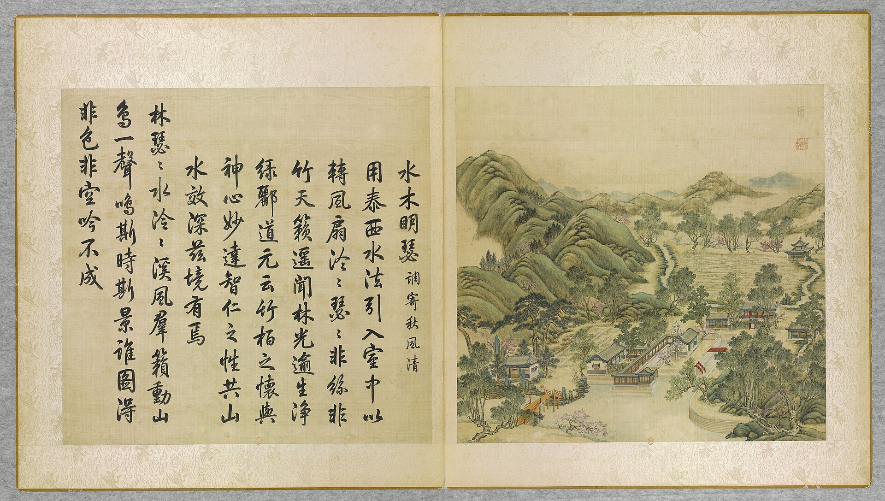
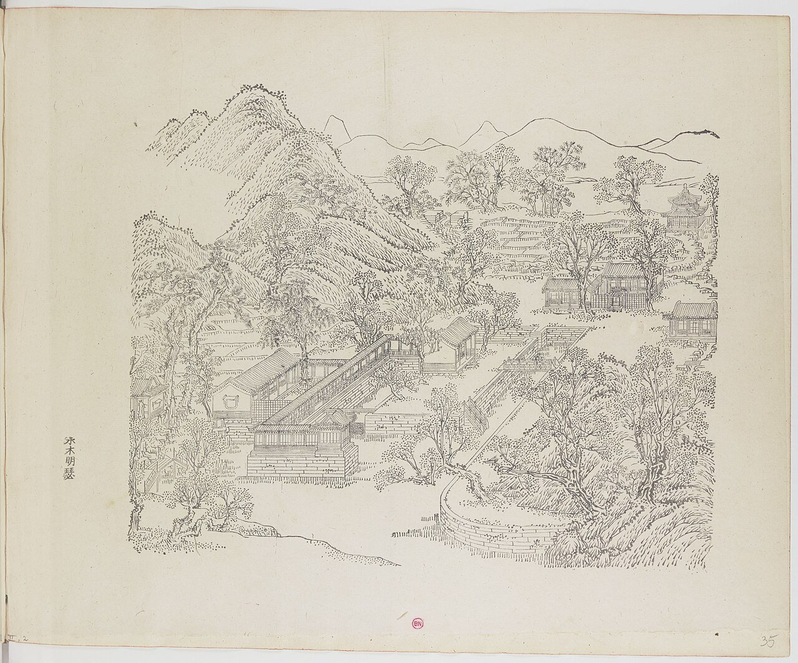
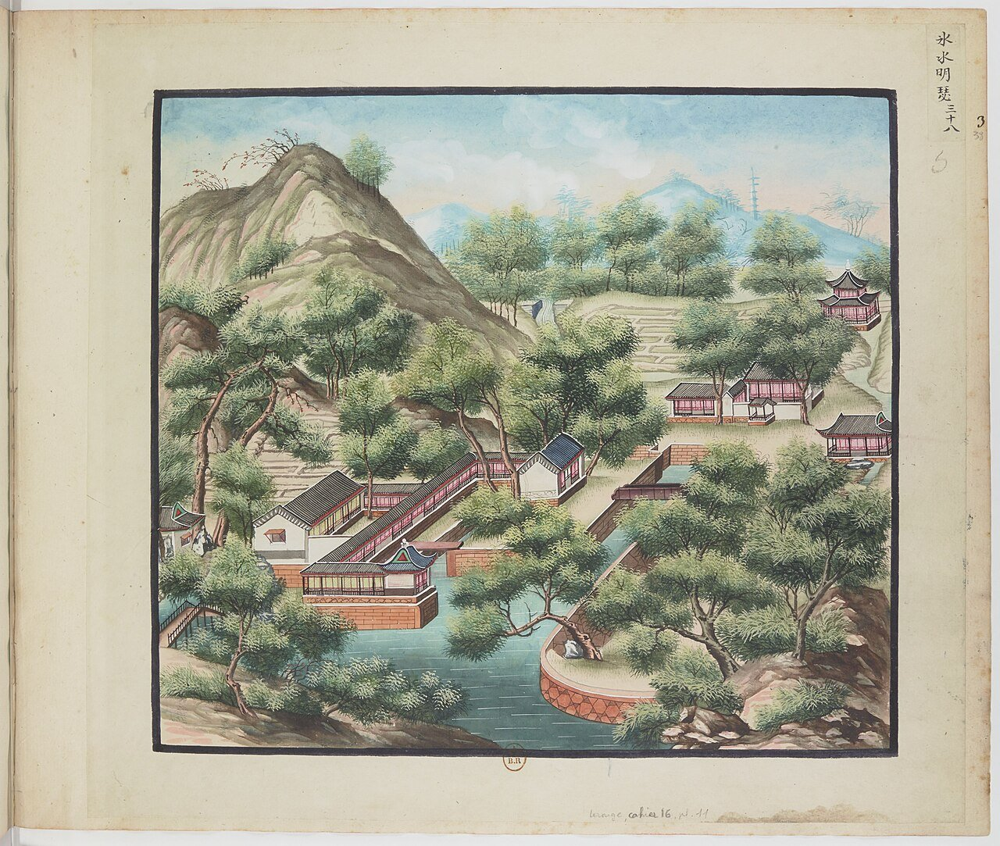
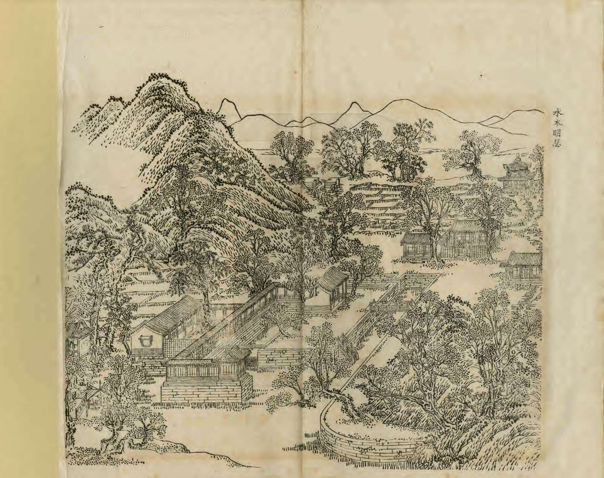
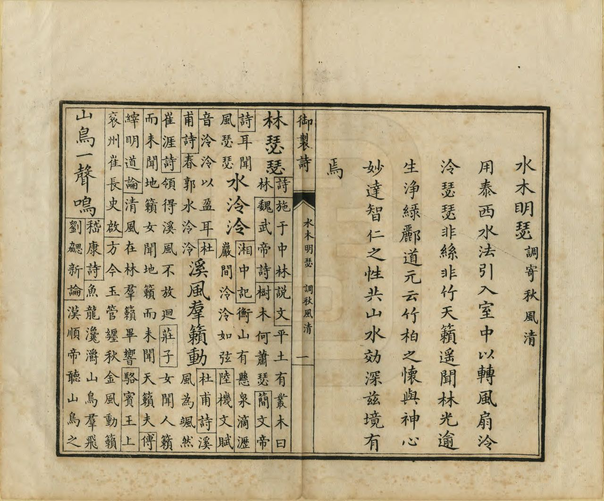

<!-- generated:start (scripts/building_pages.py): do not edit between these markers -->

# YM22: 水木明瑟 Shuimu Mingse

Shui Mu Ming Se (A Stream and Trees and a Bright Lute) · Yuanming Yuan

**3D object:** 5 boxes. Open it: `/reconstruction/3d.html?b=YM22`

## What we know

- **Name:** 水木明瑟 Shuimu Mingse (S05, S02, S08, S42, S01 · confidence A)
- **English:** Shui Mu Ming Se (A Stream and Trees and a Bright Lute) (S05, S02, S08, S42, S01)
- **Garden:** Yuanming Yuan (S05, S02, S08, S42, S01)
- **Type:** scene (S05, S02, S08, S42, S01 · confidence A)
- **Built:** 雍正时期 (S42) (S05, S02, S08, S42, S01)
- **Changed:** Rice fields and double-roof pavilion in the album background replaced by 文源阁 1774 (S02 p.89) (S05, S02, S08, S42, S01)
- **Destroyed:** 1860 (S05, S02, S08, S42, S01)
- **Position:** 40.00899, 116.29032. S01 sure (S01 · confidence B)
- **Note:** Rixia gives no hall list. 用泰西水法引入室中以轉風扇 [j81:35a-b]; Malone p.89 over a water channel. S42: 主体 丰乐轩, 水木明瑟殿 俗称风扇房. S41: 四达亭 drawn in this album leaf. (S05, S02, S08, S42, S01)
- **Plan reader's note:** Label under B0362, Malone 22 at (3513,2025). Also holds 丰乐轩 and 印月池. (S01) *(research copy, not public)*
- **How it was read:** sure (S01) *(research copy, not public)*
- **Plan pixels:** 3623, 1961 (S01) *(research copy, not public)*

## Our model now

5 boxes stand in this compound, 5 on blocks drawn on the plan, 0 assumed. Its halls are listed below.

## Inside it (5)

- YM22-01 水木明瑟殿
- YM22-02 丰乐轩
- YM22-B0335
- YM22-B0336
- YM22-N01

## Pictures (5)

- **P0022** (sure): 水木明瑟 Shuimu mingse [Reflet limpide de l'onde, son grave du bois] (圓明園四十景, 第22景) (1744 (BnF record: 1744年，清朝乾隆九年)). https://commons.wikimedia.org/wiki/File%3A%E5%9C%93%E6%98%8E%E5%9C%92%E5%9B%9B%E5%8D%81%E6%99%AF_-_%28%E6%B8%85%29%E5%94%90%E5%B2%B1%E3%80%81%E6%B2%88%E6%BA%90%E5%90%88%E7%95%AB_%3B_%28%E4%B9%BE%E9%9A%86%E5%90%9F%E8%AF%97%EF%BC%8C%E6%B1%AA%E7%94%B1%E6%95%A6%E4%BB%A3%E4%B9%A6%29_-_btv1b55008362z_%28067_of_124%29.jpg

  

- **P0094** (sure): 中国皇帝的宫殿与庙宇. 第35幅图, 水木明瑟 - (清)孙祜、沈源Shuimu mingse - (Qing)Sun Hu, Shen Yuan (1745 (Commons, from the BnF record)). https://commons.wikimedia.org/wiki/File%3A%E4%B8%AD%E5%9B%BD%E7%9A%87%E5%B8%9D%E7%9A%84%E5%AE%AB%E6%AE%BF%E4%B8%8E%E5%BA%99%E5%AE%87._%E7%AC%AC35%E5%B9%85%E5%9B%BE%2C_%E6%B0%B4%E6%9C%A8%E6%98%8E%E7%91%9F_-_%28%E6%B8%85%29%E5%AD%99%E7%A5%9C%E3%80%81%E6%B2%88%E6%BA%90Shuimu_mingse_-_%28Qing%29Sun_Hu%2C_Shen_Yuan_-_btv1b10520686x.jpg

  

- **P0138** (sure): 海淀(镇)：中国皇帝的行宫. 第38幅图, 水木明瑟Shuimu mingse (1750-1792 (BnF, cb43831905b; ex coll. Bertin)). https://commons.wikimedia.org/wiki/File%3A%E6%B5%B7%E6%B7%80%28%E9%95%87%29%EF%BC%9A%E4%B8%AD%E5%9B%BD%E7%9A%87%E5%B8%9D%E7%9A%84%E8%A1%8C%E5%AE%AB._%E7%AC%AC38%E5%B9%85%E5%9B%BE%2C_%E6%B0%B4%E6%9C%A8%E6%98%8E%E7%91%9FShuimu_mingse_-_btv1b10520708w.jpg

  

- **P0253** (sure): 水木明瑟 Shuimu Mingse (御製圓明園圖詠, 1887 石印本, 下卷 (Commons 卷二), 第22景; printed title in the right margin of the picture) (光緒十三年 1887 (Commons/NLC record; colophon 光緒十三年七月天津石印書屋 in the SSID copy, S98 PDF p.2); design after the woodblock of 1745 by 孫祜 Sun Hu and 沈源 Shen Yuan). https://commons.wikimedia.org/wiki/File%3ANLC403-312001107375-14034_%E7%A6%A6%E5%88%B6%E5%9C%93%E6%98%8E%E5%9C%92%E5%9C%96%E8%A9%A0_%E5%8D%B7%E4%BA%8C.pdf?page=7

  

- **P0529** (sure): 水木明瑟 Shuimu Mingse: 乾隆 Qianlong's preface and poem with the courtiers' commentary, 御製圓明園圖詠 1887 (poem 1744 (乾隆九年); this printing 1887). https://commons.wikimedia.org/wiki/File%3ANLC403-312001107375-14034_%E7%A6%A6%E5%88%B6%E5%9C%93%E6%98%8E%E5%9C%92%E5%9C%96%E8%A9%A0_%E5%8D%B7%E4%BA%8C.pdf?page=8

  

## Texts and drawings (13)

- **E1679** (poem, sure): 御製水木明瑟詞（調寄秋風清）（圓明園四十景詩）. 1744 (乾隆九年) · printed in S05 j81:35a-35b · S40. https://github.com/kanripo/KR2k0036/blob/master/KR2k0036_081.txt
  > 乾隆九年 御製水木明瑟詞（調寄秋風清） 用泰西水法引入室中以轉風扇泠泠瑟瑟非絲非竹天籟遙聞林光逾生淨綠酈道元云竹柏之懷與神心妙達智仁之性共山水效深兹境有焉 林瑟瑟水泠泠溪風羣籟動山鳥一聲鳴斯時斯景誰圖得非色非空吟不成
  A European water device, 泰西水法, is piped into the room to turn fans. The clear sound is neither string nor bamboo, and the woods look greener. He cites 酈道元 on how water and trees move the mind.
- **E1683** (text, sure): 日下舊聞考 水木明瑟. 1780s (乾隆 敕撰) · j81:35a · S05. https://github.com/kanripo/KR2k0036/blob/master/KR2k0036_081.txt
  > 映水蘭香東北為水木明瑟（圓明園册）臣等謹按水木明瑟四十景之一額為皇上御書世宗御書額曰一溪清水引風涼
  North-east of 映水蘭香: 水木明瑟. The passage names little else; the note records a second plaque by Yongzheng, 一溪清水引風涼.
- **E0433** (text, sure): 徐樹鈞 圓明園詞序. 1871 (同治十年立秋), recording a visit of 四月十日 · preface, whole · S203. https://www.douban.com/group/topic/46378693/
  > 圆明园在京城西，出平则门三十里，畅春园北里许，世宗皇帝藩邸赐园也。圣祖常游豫西郊，次于丹棱沜，乐其川原，因明武清侯李伟清华园旧址，筑畅春园，藩邸赐园，故在其旁。雍正三年，乃大宫殿朝署之规以避暑听政，前临西山，环以西湖。湖水发源玉泉山，曰瓮山，度宫墙东流入清河，《水经注》所谓“蓟县西湖，绿水澄澹，燕之旧池”者也。东流为洗马沟，东南合高梁之水，故鱼稻饶衍，陂泉交绮。高宗皇帝嗣位，海宇殷阗，八方无事，每岁缔构，专饰园居。大驾南巡，流览湖山风景之胜，图画以归，若海宁安澜园、江宁瞻园、钱塘小有天园、吴县狮子林，皆仿其制，增制园中。列景四十，以四字题匾者为一胜区，一区之内，斋馆无数。复东拓长春，西辟清漪，离宫别馆，月榭风亭，属之西山，所费不计亿万。园地多明权珰别业，或传崇祯末，诸奄皆以珍宝窟宅于兹，乾隆间浚池，发金银数百万，时国运方兴，地不爱宝，上心悦豫，殚精构造，曲尽游观之妙，元明以来，未之闻也。每岁夏幸园中，冬初还宫，内廷大臣，赐第相望，文武侍从，并直园林，入直奏对，昕夕往来，络绎道路，历雍乾嘉道，百余年于兹矣。文宗初，粤寇踞金陵，盗贼蜂起，上初即位，求直言，得胜保、曾国藩、袁甲三三臣，既以塞 、程、徐、陆，先朝重望，相继倾覆，始擢用前言事者，各畀重任，三臣支柱，贼不犯畿。然迭胜迭败，东南数省，蹂躏无完土，上悯苍生之颠沛，慨左右之无人。九年冬，郊宿于斋宫，夜分痛哭，侍臣凄恻。大考翰詹，以宣室前席发题，忧心焦思，伤于祸乱，然后稍自抑解，寄于文酒。以宫中行止有节，尤喜园居，冬至入宫，初正即出。时园中传有四春之宠，皆汉女，分居亭馆，所谓杏花春、武陵春、牡丹春、海棠春者也。然上明于料兵，委权阃外，超次用人，海内称哲。而部寺诸臣，无所磨励，颇袭旧敝。晚得肃顺，敢言自任，故委以谋议。先是道光二十年，英吉利夷船，至广东香港，求通商不得，又以烧烟起衅，执政议和，予海关税银千八百万。英夷请立约，广督耆英，与期十年。届期而徐广缙督两广，夷使至广州，拒不许入，以受封爵，夷酋恨焉，志入广州。咸丰元 [ 九 ] 年，英吉利、法兰西、美利坚各国，乘粤寇鸱张，中国多故，复以轮舶直入大沽台。王僧格林沁，托团练之名，焚其二船，尽击走之。夷人知大皇帝无意于战，特臣民之私愤，乃潜至海岸，买马数千，募群盗为军，半年而成，再犯天津，称西洋马队，闻者恐栗，夷马步登岸，我未陈而敌骑长驱矣。十年六 [ 八 ] 月十六日，上方园居，闻夷骑至通州，仓卒率后嫔幸热河，道路初无供帐，途出密云，御食豆乳麦粥而已。十七日，英夷帅叩东便门，或有闭城者，闻炮而开，王公请和，和议将定。十九日，夷人至圆明园宫门，管园大臣文丰当门说止之，夷兵已去。文都统知奸民将起，环问守卫禁兵，无一在者，乃自索马还内，投福海死。奸人乘时纵火，入宫劫掠，夷人从之，各园皆火发，三昼夜不熄，非独我无官府诘问，夷帅亦不能知也。初英夷使臣巴夏里，已拘刑部，和议成，以礼释囚。于是巴夏里与英帅，各陈兵仗至礼部，订约五十七条，予以海关税银三千六百万，而夷人抵偿圆明园银二十万。王公奏言，未敢斥夷，文丰与主事惠丰，同死于园，不称殉节，但言遭兵燹而已。十一年七月，文宗晏驾热河，今上即位，奉两宫皇太后还京，垂帘十载，巨寇削平。而夷人通商江海，往来贸易，设通商王大臣，以接夷使。然常言：“某省士民毁天主教堂，某省不行其教，某省民教构衅。”日以难我，应之不暇，盖岌岌乎华夷杂处，又忽忽十有一年。园居荒墟，鞠为茂草，西山大寺，夷妇深居，予旅京师，恻然不敢过也。同治十年春，同年王壬父重至辇下，追话旧游，张子雨珊亦以计偕来，约访故宫，因驻守参将廖承恩许为道主。四月十日，命仆马同过绣漪桥，寻清漪园遗迹，颓垣断瓦，零乱榛芜，宫树苍苍，水鸣呜咽。由辇路登廓如亭，南望万寿山，但见牧童樵子，往来林莽间。暮从昆明湖归，桥上铜犀卧荆棘中，犀背御铭，琅然可诵。明日访守园者，得董监，自言：“年七十有余，自道光初入寺园中，今秩五品，居福园门旁。”导予等从瓦砾中，循出入贤良门而北，指勤政、光明、寿山、太和四殿遗址，前湖圆明寝殿五楹，后为奉三无私殿、九州清晏殿各七楹，坏壁犹立，拾级可寻。董监言：“东为天地一家春，后居也，西为乐安和，诸妃嫔贵人居也，洞天深处，皇子居也。清辉殿为文宗重建，与五福堂、镂月开云台、朗吟阁皆不可复识。”镂月开云者，即所谓牡丹春者也。世宗为皇子时，迎圣祖至赐园，而高宗年十二，以皇孙召侍左右，三天子福寿冠前古，集于一堂，高宗后制诗，尝夸乐之。经其废基，裴回惄焉。东渡湖，为苏堤、长春仙馆、藻园，又北为月地云居、舍卫城、日天琳宇、水木明瑟、濂溪乐处，仅约略指视所在。东北至香雪廊，阶前茅荻萧萧，废池可辩，有老监奉茶自石畔出，讶客所从来，颇似桃源人逢渔郎也。渡桥循福海西行，为平湖秋月，水光溶溶，一泻千顷。望蓬岛瑶台，岛上殿宇，犹存数楹，惜无方舟不达。其下流水潺湲，激石成响，董监示予：“此管园大臣文公死所也。”西北至双鹤斋，又西过规月桥，登绮吟堂，经采芝径，折而东，仍出双鹤斋。园中残毁几遍，独存此为劫灰之余，乱草侵阶，窗棂宛在，尤动人禾黍悲耳。双鹤斋西，为溪月松风，翠柏苍藤，沿流覆道，斜日在林，有老宫人驱羊豕下来。东过碧桐书院，地跨池上，东为金鳌，西为玉蝀，坊楔犹存。又东去，皆败坏难寻，遂不复往。莫色沈沈，栖乌乱飞，揖董监，出福园门，还于廖宅。廖，沣州人，字枫亭，少从塞尚阿、僧格林沁军，亦能言行间事，感予来游，颇尽宾主之欢。既夕言归，则礼部放榜日也。雨珊既落第南去，予与壬父每相过从，念言园游，辄惘惘不自得。壬父又曰：“园之盛时，纯皇勒记，必殷殷踵事之戒，然仁宗始罢南幸，宣宗尤忧国贫，秋狝之礼，辍而不举。惟夫张弛之道宜及，嘉道时，补纯皇倦勤之功，而内外大臣，惟务慎节，监司宽厚，牧令昏庸，讳盗容奸，以为安静。八卦妖徒，连兵十载，无生天主，教目滋繁，由游民轻法，刑废不用故也。江淮行宫，既皆斥卖，国之所患，岂在乏财。”又曰：“燕地经安史戎马之迹，爰及辽金，近沙漠之风矣。明太宗以燕王旧居，不务改宅，仍而至今，地利竭矣。又园居单外，非所以驻万乘，废而不居，盖亦时宜。” 予曰：“然，前年御史德泰，请按户亩鳞次捐输，复修园宫。大臣以侈端将启，请旨切责，谪戍未行，愤悔自死。自此莫敢言园居者。而比年备办大婚，费已千万，结彩宫门，至十余万，公奏朝廷动用钱粮，婚以成礼，岂在华饰，若前明户部司官得以谏争，予且建言矣。又予闻慈安太后在文宗时，有脱簪之谏，《关雎》《车舝》之贤，中兴之由也。又园宫未焚前一岁，妖言传上坐寝殿，见白须老翁，自称园神，请辞而去，上梦中加神二品阶，明日，至祠谕祀之，未一期而园毁，岂能定欤？子能诗者，达于政事，曷以风人之意，备《繁霜》《云汉》之采？”于是壬父为《圆明园词》一篇。而周学士（即大学士周祖培）、潘侍郎见之，并叹其伤心感人，笔墨通于情性。予以此诗可传后来，虑夫代远年逝，传闻失实，词中所述，罔有征者，乃为文以序之。同治十年立秋日，长沙徐树钧撰。
  A walk through the ruins eleven years after the destruction, guided by an old eunuch who had served since the 1820s. It says which sites could still be read, and that 雙鶴齋 with its surroundings alone stood, as did some rooms on 蓬島瑶臺 and the 金鼇 and 玉蝀 arches. Its account of 1860 credits the first fires to local robbers, which differs from the British and French record in S02.
- **E1680** (poem, sure): 水木明瑟: 乾隆九年 poem of the Qianlong Emperor. 乾隆九年 (1744), date from the compilation · p.236 item (1), under 水木明瑟 · S360. https://www.yuanmingyuanpark.cn/xs/yjbg/202007/P020200730387572832602.pdf#page=236
  > 用泰西水法引入宫中以转飞扇，冷冷瑟瑟，非丝非竹，天籁遥闻，林光逾生净绿。
  Poem of the Qianlong Emperor at 水木明瑟, 1744. Year as given by the compilation.
- **E1681** (poem, sure): 水木明瑟: 嘉庆六年 poem of the Jiaqing Emperor. 嘉庆六年 (1801), date from the compilation · p.236 item (2), under 水木明瑟 · S360. https://www.yuanmingyuanpark.cn/xs/yjbg/202007/P020200730387572832602.pdf#page=236
  > 石渠引水来屋裹，盈科不息俯清泚。转机运箑凉自生，习习南熏座间起。循环无巳翻浪花，声戛涧泉溅绿纱。披襟陡忆军营众，触暑挥汗追余邪。身居广厦实惭恧，灾黎五载中泽宿。仁风广被陕楚川，乐业安宁共蒙福。“
  Poem of the Jiaqing Emperor at 水木明瑟, 1801, on the view. Year as given by the compilation.
- **E1682** (poem, sure): 水木明瑟歌. 嘉庆六年 (1801) · v2 p.206, under 水木明瑟; source ref 2-77 · S361. https://www.yuanmingyuanpark.cn/xs/yjbg/202008/P020200803382343267004.pdf#page=209
  > 石渠引水来屋里，盈科不息俯清泚。转机运箑凉自生，习习南薰座间起。循环无已翻浪花，声戛涧泉溅绿纱。披襟陡忆军营众，触暑挥汗追余邪。身居广厦实惭恧，灾黎五载中泽宿。仁风广被陕楚川，乐业安宁共蒙福。
  Poem 水木明瑟歌 by the Jiaqing Emperor, 1801, filed by the editors under 水木明瑟.
- **E1685** (description, sure): Scene 22, 水木明瑟 Shuimu Mingse. 1934 · p.89 · S02. https://archive.org/details/historyofpekings00malo
  > The building where this inscription was hung was built over a narrow water channel. In some way the current turned a revolving fan
  Built over a narrow channel; the current turned a revolving fan, whose sound the poems describe. On the site of the rice fields and the double-roofed pavilion behind it, 文源阁 was built many years later.
- **E1684** (description, sure): 圆明园百景史事分景汇编: 水木明瑟. 1744-1801 · from p.236, under 水木明瑟 · S360. https://www.yuanmingyuanpark.cn/xs/yjbg/202007/P020200730387572832602.pdf#page=236
  水木明瑟: 2 dated items, 1744-1801, of which 2 poems (Qianlong, Jiaqing); recurring themes: the view. First dated 1744, last dated 1801.
- **E1686** (description, sure): 圆明园五朝御制诗文集注 v2, editors' note on 水木明瑟. 2020 edition · v2 p.205 · S361. https://www.yuanmingyuanpark.cn/xs/yjbg/202008/P020200803382343267004.pdf#page=208
  A three-bay hall straddling a stream, where a Western water mechanism drove fans, hence 风扇房. Near it 印月池, 钓鱼矶 pavilion, a five-bay hall with plaques 丰乐轩 and 映水兰香, 贵织山堂 to the silkworm god, 知耕织, 濯鳞沼.
- **E1687** (description, sure, search index only): 水木明瑟 scene card. n.d. · mhymy jqjs 11649 · S340. https://www.mhymy.com/ymss/jqjs/11649.html
  North of 后湖, Yongzheng date. Main hall 丰乐轩 by the stream, and north-east of it the 水木明瑟 hall, nicknamed 风扇房 fan house: water drove fans inside to cool the room. A Taihu rock with Qianlong's verse now stands at the Summer Palace.
- **E1688** (drawing, sure): 《国家图书馆藏样式雷图档·圆明园卷初编》: 水木明瑟. mostly 道光, 咸丰, 同治 per the publisher · 初编 目录: 水木明瑟, pp.327-329 · S13. https://www.nlcpress.com/ProductView.aspx?Id=7642
  The printed facsimile of the National Library of China's Yangshi Lei sheets has a section on this place at pp.327-329 (3 pages, section length worked out from the next heading); sheet titles and numbers are in the volume, ordered from a library.
- **E1689** (drawing, sure): 水木明瑟殿平面图. 不详 · 国家图书馆善本部 样030-1号 · S310. https://www.mhymy.com/dasl/ysltd/8006.html
  Undated base plan of the three-bay hall built over a stream, the "fan room", 468x365 mm, ink, light colour and vermilion. No image here; the site may ask a small payment for the full record.
- **E2482** (drawing, sure): 水木明瑟风扇立面图. 不详 · 国家图书馆善本部 样007-18号 · S310. https://www.mhymy.com/dasl/ysltd/8002.html
  Elevation (working sheet, ink, undated) of the water-driven fan of the 水木明瑟 hall, which straddled a stream; the 风扇 sat over the channel in the east bay.

**On the plan:** Drawn on the plan of the gardens (S01), labelled 水木明瑟. https://artmuseum.princeton.edu/collections/objects/138657

## Reconstructions by others (3)

Modern interpretation, not evidence.
- **R0073** (3D model, likely): 《圆明园四十景数字化复原及应用》. 圆明园管理处 with 中央美院, 圆明园管理处; 中央美术学院, 2025. https://news.bjd.com.cn/2026/10/16/11997513.shtml Research-only: link card.
- **R0308** (paper figure, likely): 《圆明园新证》: reading of Palace Museum plan No. 1704, stripped of its later paste-ups to the Qianlong layout of about 1779. . http://iqh.ruc.edu.cn/old/qdhjylyjzx/xszl/xstl/1c9094aef4f041148f15883c7c266cb9.htm Research-only: link card.
- **R0309** (paper figure, likely): 《一幅样式雷圆明园全图的年代推断》: NLC plan 043-001 dated by the outlines of scenes. . http://iqh.ruc.edu.cn/old/qdhjylyjzx/xsdt/xsxl/794b73c241ef4fa79b8d6720f31bac13.htm Research-only: link card.

## Surviving comparable buildings, not this building (1)

- **T021** 水竹居 Shuizhu Ju, 扬州 Yangzhou. Ours was copied from it, confidence C, standing: no. Nothing yet Basis: S434 (tourist text): 水木明瑟 is modelled on 扬州 水竹居. Doubtful: S05 j.81 f.35a has Qianlong's poem on this hall in 乾隆九年 (1744), seven years before his first southern tour (S400: 1751), and it gives another reason for the place: 泰西水法 driving fans. https://www.visitbeijing.com.cn/article/47QkVhww6K6

## Evidence for the set of buildings

- Reconstructions and comparables for the whole garden, 圆明园 Yuanming Yuan: see GARDEN-YM

## Open questions

- Q1: Target state
- Q39: 丰乐轩 YM22-02
- Q59: Twin claims to hold loosely
- Q289: The double lines round 文源阁 and the rice fields north-west of 水木明瑟

<!-- generated:end -->

## Notes

<!-- Yours: regeneration never touches this part. It goes on the public site; what you write below a line holding only %% private %% stays in the research copy. -->
