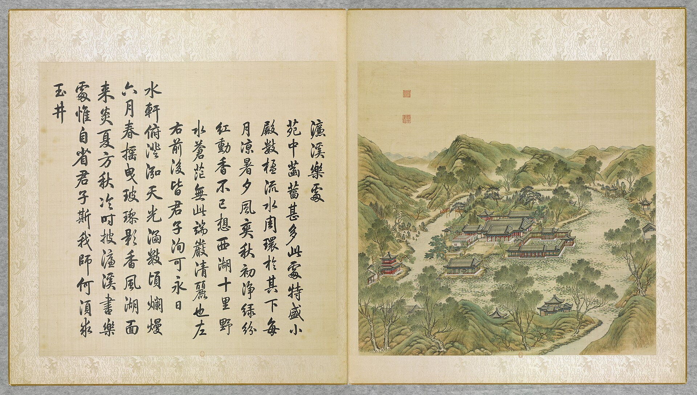

<!-- generated:start (scripts/building_pages.py): do not edit between these markers -->

# YM23-01: 慎修思永 Shenxiu Siyong

Yuanming Yuan

**3D object:** 1 box. Open it: `/reconstruction/3d.html?b=YM23-01`

**Part of:** YM23 濂溪乐处

## What we know

- **Name:** 慎修思永 Shenxiu Siyong (S05, S43, S06, S01, S360, S361, S337, S310 · confidence B)
- **Garden:** Yuanming Yuan (S05, S43, S06, S01, S360, S361, S337, S310)
- **Type:** residence (S05, S43, S06, S01, S360, S361, S337, S310 · confidence B)
- **Built:** by 1760 (first dated item) (S05, S43, S06, S01, S360, S361, S337, S310)
- **Destroyed:** survived 1860 per 1873 survey (S06); survived 1860; lost around 1900 (S05, S43, S06, S01, S360, S361, S337, S310)
- **Position:** 40.00938, 116.28784. S01 sure (S01 · confidence B)
- **Bays:** 9 in the texts / 8x1 on the plan (S05, S43, S06, S01, S360, S361, S337, S310)
- **Size in the inventory:** 35.52 × 25.4 m. stated: S310, mhymy ysltd 10092 (慎修思永装修平面图, NLC 样027-11-1, after 1784), metres as printed (S01)
- **Note:** S43: 正殿九间前后抱厦各五间; indoor Western stage by 1739. bays: 9, annexes of 5 front and back (S361, v2 p.208). after1860: survived 1860 with 知过堂 (刘敦桢's list) (S337, E0451). (S05, S43, S06, S01, S360, S361, S337, S310)
- **Plan reader's note:** Label south of hall. About 9 bays along the main line match text. Detection fragmented, see blocks_fix. (S01) *(research copy, not public)*
- **How it was read:** sure (S01) *(research copy, not public)*
- **Plan pixels:** 2593, 1665 (S01) *(research copy, not public)*

## Our model now

On the block drawn on the Qing plan S01: position and frontage from the plan, heights and roof from the typology of its hall class, its form drawn by the hall kit. It will be updated as the research goes on.

- **Box:** 40.98 × 24.08 m, grand hall
- **Heights:** platform 0.96 m, eave 4.96 m, ridge 13.47 m above the ground
- **Roof:** hip-and-gable 歇山, rolled ridge 卷棚, grey tile
- **Faces:** 178.5° from north
- **Fit:** reduced towards the size drawn on the plan, to stand clear of its neighbours or the water
- **Own figures:** platform 0.96 m (a, B, S310); column 4 m (a, B, S310)
- **Drawn:** by the hall kit: 9 bays, the middle widest, a porch all round, steps on the back, front, left, 歇山 hip-and-gable with a rolled ridge 卷棚, grey tile, bracket sets 斗拱 as a painted band. From its own figures and readings where the dossier gives them (platform: 0.96 m, a B, S310; column: 4.0 m, a B, S310; bays: central 4.48 m, side 4.16 m, end 3.84 m, a B, S310; porch: 1.92 m, a B, S310), the rest from the typology of its hall class.
- **Confidence:** B

## Pictures (1)

- **P0023** (likely): 濂溪樂處 Lianxi lechu [Où Lianxi éprouve de la joie] (圓明園四十景, 第23景) (1744 (BnF record: 1744年，清朝乾隆九年)). https://commons.wikimedia.org/wiki/File%3A%E5%9C%93%E6%98%8E%E5%9C%92%E5%9B%9B%E5%8D%81%E6%99%AF._%E7%AC%AC%E4%BA%8C%E5%8D%81%E4%B8%89%E6%99%AF_%28%E4%B8%8B%E5%86%8C%2C_%E7%AC%AC%E4%B8%89%E5%B9%85%E5%9B%BE%29%2C_%E6%BF%82%E6%BA%AA%E6%A8%82%E8%99%95_-_%28%E6%B8%85%29%E5%94%90%E5%B2%B1%E3%80%81%E6%B2%88%E6%BA%90%E5%90%88%E7%95%AB_%3B_%28%E4%B9%BE%E9%9A%86%E5%90%9F%E8%AF%97%EF%BC%8C%E6%B1%AA%E7%94%B1%E6%95%A6%E4%BB%A3%E4%B9%A6%29Lianxi_lechu_-_%28Qing%29Tang_Dai%2C_Shen_Yuan_he_hua_-_btv1b55008337z.jpg

  

## Texts and drawings (12)

- **E1703** (text, sure): 日下舊聞考 濂溪乐处. 1780s (乾隆 敕撰) · j82:1a-1b · S05. https://github.com/kanripo/KR2k0036/blob/master/KR2k0036_082.txt
  > 水木明瑟西北環池帶河為濓溪樂處正殿九楹後為雲香清勝東垣為芰荷深處折而東北為香雪廊其東有樓為雲霞舒卷樓北亭為臨泉（圓明園冊）臣等謹按濓溪樂處四十景之一額為皇上御書殿檐額曰慎修思永聫曰與古人相對左圖右書偕造物者遊仰觀俯察與雲香清勝諸額皆御書香雪廊臨泉二額世宗御書
  North-west of 水木明瑟, within pond and stream: 濓溪樂處 with a nine-bay main hall, 雲香清勝, 芰荷深處, 香雪廊, 雲霞舒卷 and 臨泉 pavilion.
- **E1696** (poem, likely): 題知過堂: 知过堂 made from 云香清胜, 1782. 乾隆四十七年 1782 · KR4f0005_369:20a · S201. https://github.com/kanripo/KR4f0005
  > 去冬山東巡撫國泰呈進雕漆櫺檻屏扇等什以其費工無益甚不愜懐傳㫖嚴行申飭苐念成器不毁又不肯因此添建大屋不得已於慎修思永殿後舊有之雲香清勝室接楹裝用
  Reads the unread label of S01: Qianlong joins 云香清胜 behind 慎修思永 to hold lacquer screens sent by the Shandong governor, and names it 知过堂. So 知?堂 is not a late name.
- **E0451** (text, likely): 圆明园遗址的遗产价值与申遗构想: the buildings left after 1860, citing 刘敦桢 1933. post n.d. · ylfj, note 34: 刘敦桢, 同治重修圆明园史料, 营造学社汇刊 1933(2) · S337. http://iqh.ruc.edu.cn/old/qdhjylyjzx/xszl/ylfj/9a322b5384ab4c17af0dd577d4f96ca6.htm
  Lists 17 buildings left after the burning of 1860, after 刘敦桢: 紫碧山房, 顺木天, 鱼跃鸢飞, 课农轩, 藏舟坞, 慎修思永, 知过堂, 双鹤斋, 蓬岛瑶台, 魁星楼, 文昌阁, 林渊锦镜, 春雨轩; 海岳开襟; 庄严法界, 正觉寺 and a 大宫门 in 万春园. The paper's aim is to hold any new display to this 1860 state.
- **E1692** (poem, sure): 慎修思永: 乾隆二十五年 poem of the Qianlong Emperor. 乾隆二十五年 (1760), date from the compilation · p.247 item (1), under 慎修思永 · S360. https://www.yuanmingyuanpark.cn/xs/yjbg/202007/P020200730387572832602.pdf#page=247
  > 廸德初申旨，修身继进详。举端惟致谨，挈要在谋长。言行慎防失，弼谟允叶臧。诸亲既和睦，百姓以平章。嘉矣皋陈善，懿㢤禹拜昌。高山景仰止，勿逮愿云蘉。
  Poem of the Qianlong Emperor at 慎修思永, 1760. Year as given by the compilation.
- **E1695** (poem, sure): 知过堂: 乾隆四十七年 poem of the Qianlong Emperor. 乾隆四十七年 (1782), date from the compilation · p.247 item (1), under 知过堂 · S360. https://www.yuanmingyuanpark.cn/xs/yjbg/202007/P020200730387572832602.pdf#page=247
  > 去年著论曾自讼，匪逞虚文敬畏存。谁谓庸臣贡漆饰，（去冬山东巡抚国泰呈进雕漆、棂槛、屏扇等什以其费工无益，甚不惬怀传旨严行申饬，苐念成器不毁又不肯因此添建大屋。不得已于慎修思永殿。后旧有之云香清胜室接楹装用，并泐所著《知过论》于壁，遂以名堂云。）仍因旧室构松轩。知非早过伯玉岁，作戒常思卫武言。摛藻染毫泐堂壁，斯多愧那待他论。
  Qianlong, 1782: his note tells how the lacquer screens from governor 国泰 went into the old 云香清胜室 behind 慎修思永, and his essay was carved on the wall.
- **E1716** (poem, sure): 慎修思永. 嘉庆元年 (1796) · v2 p.214, under 濂溪乐处; source ref 1-126 · S361. https://www.yuanmingyuanpark.cn/xs/yjbg/202008/P020200803382343267004.pdf#page=217
  > 古训始修身，敬慎致思永。其本在正心，分阴加三省。天君统万灵，知诱宜尽屏。检束偶或乖，寸田将放骋。御园西北隅，文轩远尘境。题额示后人，仰赡时自警。齐治扩于斯，未可略弛逞。百禩守训言，玉烛常辉炳。
  Poem 慎修思永 by the Jiaqing Emperor, 1796, filed by the editors under 濂溪乐处.
- **E1700** (poem, sure): 慎修思永: 嘉庆三年 poem of the Jiaqing Emperor. 嘉庆三年 (1798), date from the compilation · p.247 item (2), under 慎修思永 · S360. https://www.yuanmingyuanpark.cn/xs/yjbg/202007/P020200730387572832602.pdf#page=247
  > 御园春景最富饶，草色初青柳展条。拏舟暂泊普济渡，循岸北转又易桡。殿额仰瞻书四字，大哉包括修齐义。不欺屋漏凛其难，内省常存方寸地。为君更念庶政修，欲使寰海遵王猷。自顾薄德思勉励，日聆父训泽渥优。几余游览有所得，奎翰辉煌垂法则。敬承心德本诸身，式廓太和抚万国。
  Poem of the Jiaqing Emperor at 慎修思永, 1798, on the view. Year as given by the compilation.
- **E1702** (poem, sure): 慎修思永: 嘉庆二十年 poem of the Jiaqing Emperor. 嘉庆二十年 (1815), date from the compilation · p.247 item (6), under 慎修思永 · S360. https://www.yuanmingyuanpark.cn/xs/yjbg/202007/P020200730387572832602.pdf#page=247
  > 皋陶陈法戒，大禹拜昌言。题额垂谟训，钦承固本原。心身修宥密，政治勿纷烦。宽猛必相济，用中奥义存。
  Poem of the Jiaqing Emperor at 慎修思永, 1815, on remembering his forebears. Year as given by the compilation.
- **E1715** (poem, likely): 赋得慎修思永. 乾隆二十五年 (1760) · v2 p.209, under 濂溪乐处; source ref 7-303 · S361. https://www.yuanmingyuanpark.cn/xs/yjbg/202008/P020200803382343267004.pdf#page=212
  > 迪德初申旨，修身继进详。举端惟致谨，挈要在谋长。言行慎防失，弼谟允叶臧。诸亲既和睦，百姓以平章。嘉矣皋陈善，懿哉禹拜昌。髙山景仰止，勿逮愿云蘉。
  Poem 赋得慎修思永 by the Qianlong Emperor, 1760, filed by the editors under 濂溪乐处.
- **E1705** (description, sure): 圆明园百景史事分景汇编: 慎修思永. 1760-1815 · from p.246, under 濂溪乐处 · S360. https://www.yuanmingyuanpark.cn/xs/yjbg/202007/P020200730387572832602.pdf#page=246
  慎修思永: 6 dated items, 1760-1815, of which 6 poems (Qianlong, Jiaqing); recurring themes: the view, remembering his forebears. First dated 1760, last dated 1815.
- **E1709** (description, sure): 圆明园五朝御制诗文集注 v2, editors' note on 濂溪乐处. 2020 edition · v2 p.208 · S361. https://www.yuanmingyuanpark.cn/xs/yjbg/202008/P020200803382343267004.pdf#page=211
  An island residence with a nine-bay hall 慎修思永 and annexes of five, 芰荷深处, 香雪廊, 烟云舒卷 tower, 得月 and 临泉 pavilions, 水云居, 荷香书屋, 延云殿, seven-bay 知过堂 and 墨光亭. The editors say 慎修思永 and 知过堂 survived 1860 and were lost around 1900.
- **E2474** (drawing, sure): 慎修思永装修平面图 (图名: 慎修思永). 乾隆四十九年 (1784) 之后 · 国家图书馆善本部 样027-11-1号 · S310. https://www.mhymy.com/dasl/ysltd/10092.html
  Interior plan of the nine-bay three-roof hall 慎修思永 of 濂溪乐处, 451x324 mm, ink and yellow slips, presentation sheet, after 1784; the record gives bay widths, roof depths, column and platform height (dim rows) and an interior with a western-style stage and a Buddhist chapel upstairs.

**On the plan:** Drawn on the plan of the gardens (S01), labelled 慎修思永, 8x1 cells. https://artmuseum.princeton.edu/collections/objects/138657

## Evidence for the set of buildings

- Evidence for the whole compound 濂溪乐处: see YM23
- Reconstructions and comparables for the whole garden, 圆明园 Yuanming Yuan: see GARDEN-YM
- Standing buildings comparable to a grand hall (not this building): see CLASS-grand_hall

## Open questions

- Q47: How much burned, and when
- Q138: E0451 (刘敦桢 via S337) lists 17 buildings left after 1860, eight of them in wave-2 scenes (Y
- Q182: Typology, grand_hall heights

<!-- generated:end -->

## Notes

<!-- Yours: regeneration never touches this part. It goes on the public site; what you write below a line holding only %% private %% stays in the research copy. -->
