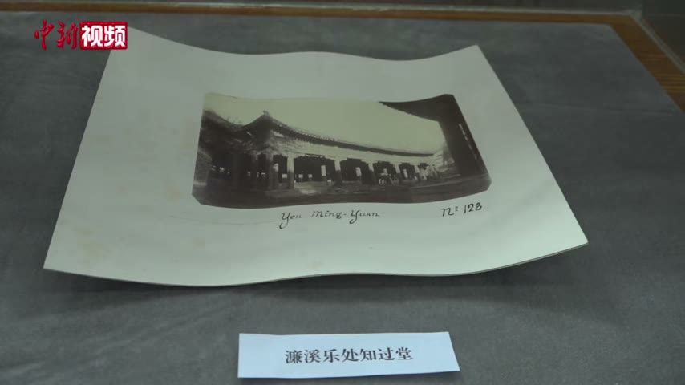

<!-- generated:start (scripts/building_pages.py): do not edit between these markers -->

# YM23-N01: 知过堂 Zhiguo Tang

Yuanming Yuan

**3D object:** 1 box. Open it: `/reconstruction/3d.html?b=YM23-N01`

**Part of:** YM23 濂溪乐处

## What we know

- **Name:** 知过堂 Zhiguo Tang (S01, S360, S361, S201 · confidence B)
- **Written on the plan:** 知?堂 (S01 · confidence B)
- **Garden:** Yuanming Yuan (S01, S360, S361, S201)
- **Type:** other (S01, S360, S361, S201 · confidence B)
- **Built:** 1782 in the old 云香清胜室 (S01, S360, S361, S201)
- **Destroyed:** survived 1860; lost around 1900 (S01, S360, S361, S201)
- **Position:** 40.00966, 116.28784. S01 sure (S01 · confidence B)
- **Bays:** 7 in the texts / 8x2 on the plan (S01, S360, S361, S201)
- **Size in the inventory:** 40.0 × 19.6 m. S01 plan px / hall scale (S01)
- **Plan reader's note:** Label on the east side of the hall: 知, second char 过 likely, 堂. Not in inventory. (S01) *(research copy, not public)*
- **How it was read:** sure (S01) *(research copy, not public)*
- **Plan pixels:** 2596, 1526 (S01) *(research copy, not public)*

## Our model now

On the block drawn on the Qing plan S01: position and frontage from the plan, heights and roof from the typology of its hall class, its form drawn by the hall kit. It will be updated as the research goes on.

- **Box:** 40 × 19.6 m, grand hall
- **Heights:** platform 0.59 m, eave 4.76 m, ridge 11.69 m above the ground
- **Roof:** hip-and-gable 歇山, rolled ridge 卷棚, grey tile
- **Faces:** 178.2° from north
- **Drawn:** by the hall kit: 7 bays, the middle widest, a porch all round, steps on the front, right, 歇山 hip-and-gable with a rolled ridge 卷棚, grey tile, bracket sets 斗拱 as a painted band. Drawn from the typology of its hall class, not from a picture of this hall (assumed, C).
- **Confidence:** B

## Pictures (1)

- **P0711** (likely): 濂溪乐处知过堂 (exhibition label); mount inscribed Yen-Ming-Yuan Nº 128 (1882, as said in the clip by 刘阳 Liu Yang (S650); S651 gives 1882 for Semalle). https://commons.wikimedia.org/wiki/File:2021-02-24_圆明园中西建筑如何过渡_未彻底损毁前珍贵影像公布.webm Research-only: link card.

  

## Texts and drawings (4)

- **E1696** (poem, sure): 題知過堂: 知过堂 made from 云香清胜, 1782. 乾隆四十七年 1782 · KR4f0005_369:20a · S201. https://github.com/kanripo/KR4f0005
  > 去冬山東巡撫國泰呈進雕漆櫺檻屏扇等什以其費工無益甚不愜懐傳㫖嚴行申飭苐念成器不毁又不肯因此添建大屋不得已於慎修思永殿後舊有之雲香清勝室接楹裝用
  Reads the unread label of S01: Qianlong joins 云香清胜 behind 慎修思永 to hold lacquer screens sent by the Shandong governor, and names it 知过堂. So 知?堂 is not a late name.
- **E1720** (poem, likely): 题知过堂. 乾隆五十年 (1785) · v2 p.211, under 濂溪乐处; source ref 15-411 · S361. https://www.yuanmingyuanpark.cn/xs/yjbg/202008/P020200803382343267004.pdf#page=214
  > 人苦不知过，既知改为贵。弗改已为非，甚者文与遂。繄我颜斯堂，已阅两三岁。不吝成汤心，未能伯玉志。我胥企之哉，摛辞志深愧。
  Poem 题知过堂 by the Qianlong Emperor, 1785, filed by the editors under 濂溪乐处.
- **E1721** (poem, likely): 题知过堂. 乾隆五十一年 (1786) · v2 p.211, under 濂溪乐处; source ref 16-553 · S361. https://www.yuanmingyuanpark.cn/xs/yjbg/202008/P020200803382343267004.pdf#page=214
  > 向阳处必得春早，莩甲旋看绿到荄。自是一元资以始，可欣万寓与之皆。梅心柳眼侵寻问，江砚宣毫次第排。知过由来贵改过，空言改亦有何佳。
  Poem 题知过堂 by the Qianlong Emperor, 1786, filed by the editors under 濂溪乐处.
- **E1709** (description, sure): 圆明园五朝御制诗文集注 v2, editors' note on 濂溪乐处. 2020 edition · v2 p.208 · S361. https://www.yuanmingyuanpark.cn/xs/yjbg/202008/P020200803382343267004.pdf#page=211
  An island residence with a nine-bay hall 慎修思永 and annexes of five, 芰荷深处, 香雪廊, 烟云舒卷 tower, 得月 and 临泉 pavilions, 水云居, 荷香书屋, 延云殿, seven-bay 知过堂 and 墨光亭. The editors say 慎修思永 and 知过堂 survived 1860 and were lost around 1900.

**On the plan:** Drawn on the plan of the gardens (S01), labelled 知?堂 (? marks an unread character), 8x2 cells. https://artmuseum.princeton.edu/collections/objects/138657

## Evidence for the set of buildings

- Evidence for the whole compound 濂溪乐处: see YM23
- Reconstructions and comparables for the whole garden, 圆明园 Yuanming Yuan: see GARDEN-YM
- Standing buildings comparable to a grand hall (not this building): see CLASS-grand_hall

## Open questions

- Q3: Which state does S01 draw?
- Q38: Unread labels settled by a text
- Q47: How much burned, and when
- Q54: Timber buildings standing in 1882 (Round 5)
- Q138: E0451 (刘敦桢 via S337) lists 17 buildings left after 1860, eight of them in wave-2 scenes (Y

<!-- generated:end -->

## Notes

<!-- Yours: regeneration never touches this part. It goes on the public site; what you write below a line holding only %% private %% stays in the research copy. -->
