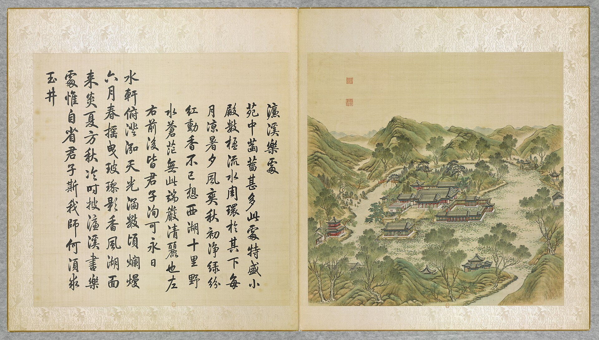
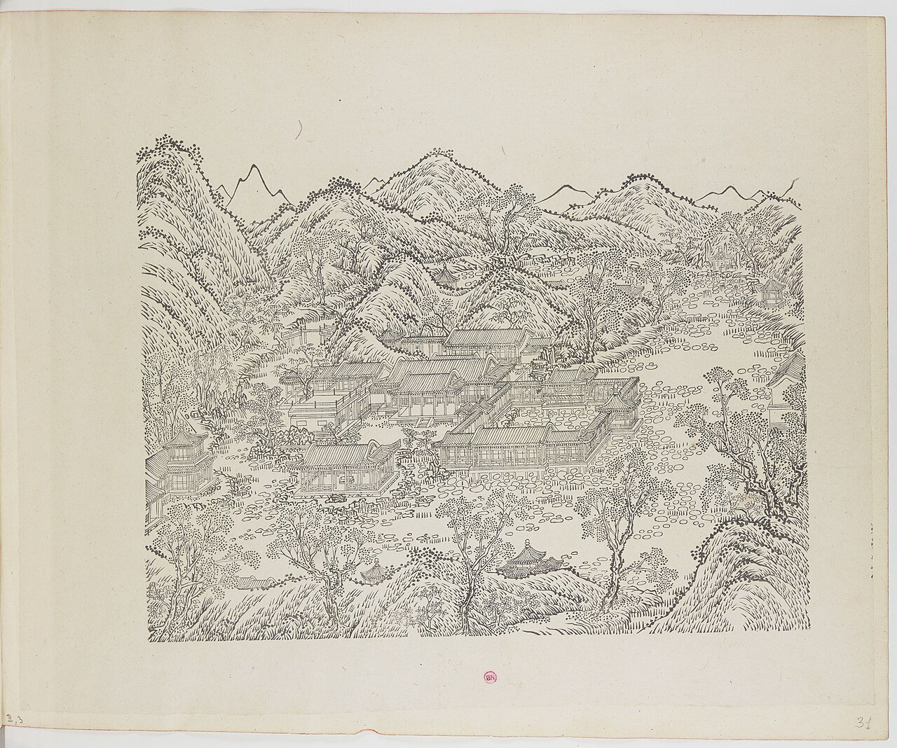
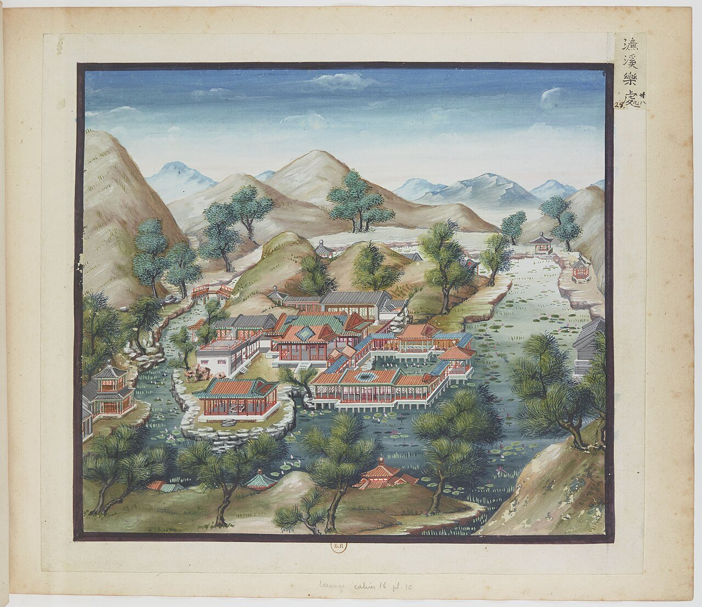
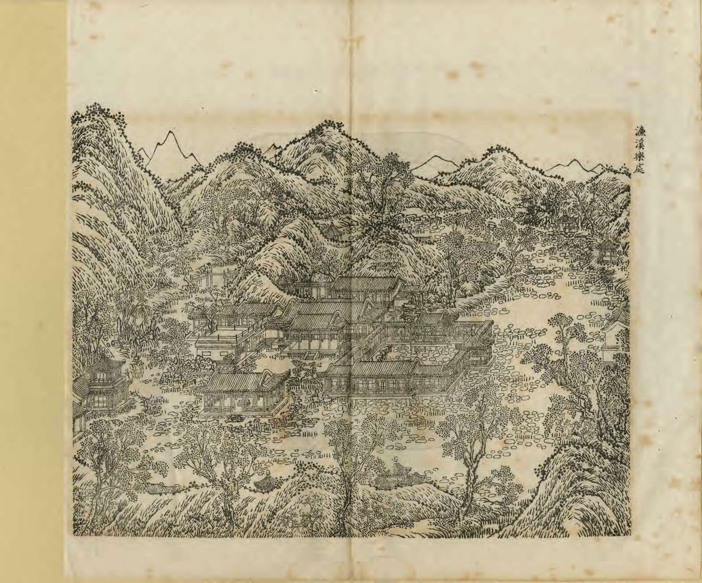
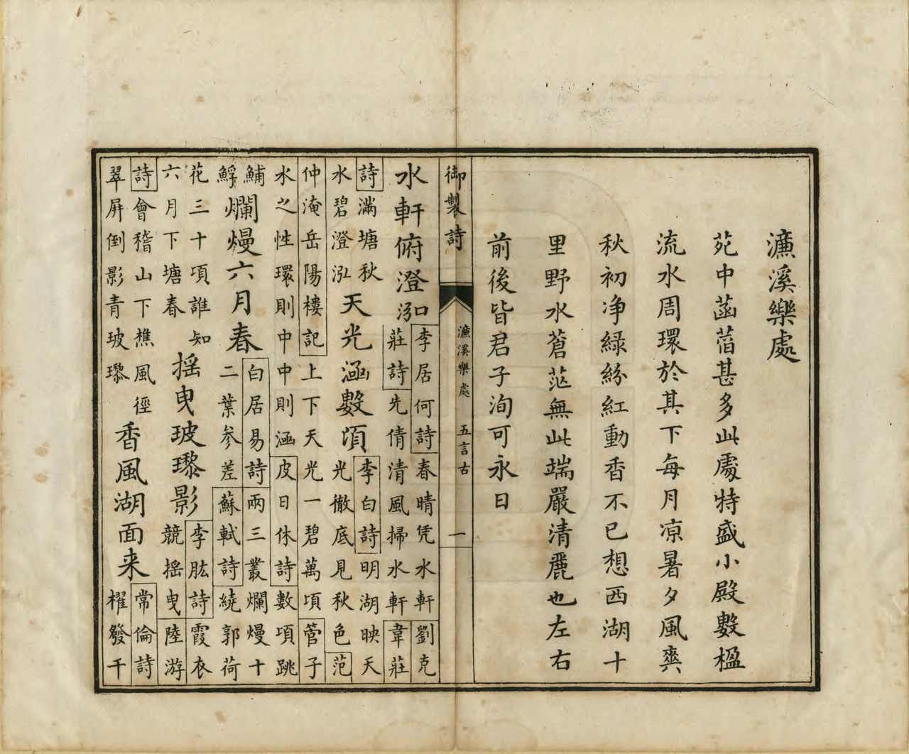

<!-- generated:start (scripts/building_pages.py): do not edit between these markers -->

# YM23: 濂溪乐处 Lianxi Lechu

Lien Hsi Lo Ch'u (the Happy Place of Falling Streams) · Yuanming Yuan

**3D object:** 11 boxes. Open it: `/reconstruction/3d.html?b=YM23`

## What we know

- **Name:** 濂溪乐处 Lianxi Lechu (S05, S02, S08, S41, S43, S01 · confidence B)
- **English:** Lien Hsi Lo Ch'u (the Happy Place of Falling Streams) (S05, S02, S08, S41, S43, S01)
- **Written on the plan:** 慎修思永 / 知?堂 / 水云居 (S01 · confidence B)
- **Garden:** Yuanming Yuan (S05, S02, S08, S41, S43, S01)
- **Type:** scene (S05, S02, S08, S41, S43, S01 · confidence B)
- **Built:** 雍正 (慎修思永 S43) (S05, S02, S08, S41, S43, S01)
- **Changed:** Water porch and rocky pavilion removed before the official map (S02 p.91); differs on plans (S41) (S05, S02, S08, S41, S43, S01)
- **Destroyed:** 1860; 慎修思永 and 知过堂 on the 1873 survival list (S06) (S05, S02, S08, S41, S43, S01)
- **Position:** 40.00941, 116.28781. S01 sure (S01 · confidence B)
- **Note:** Largest garden in a garden (S06). Album does not show the 1860 state here (S41). (S05, S02, S08, S41, S43, S01)
- **Plan reader's note:** Malone 23 at (2715,1660); 慎修思永 written below the nine-bay main hall. The temple part is split off as NEW-ym_west-02, the eastern strip as NEW-ym_west-03. (S01) *(research copy, not public)*
- **How it was read:** sure (S01) *(research copy, not public)*
- **Plan pixels:** 2580, 1650 (S01) *(research copy, not public)*

## Our model now

11 boxes stand in this compound, 11 on blocks drawn on the plan, 0 assumed. Its halls are listed below.

## Inside it (18)

- YM23-01 慎修思永
- YM23-02 云香清胜
- YM23-03 芰荷深处
- YM23-04 香雪廊
- YM23-05 云霞舒卷楼
- YM23-06 临泉亭
- YM23-07 汇万总春之庙
- YM23-08 蕃育群芳
- YM23-09 香远益清楼
- YM23-10 乐天和
- YM23-11 味真书屋
- YM23-12 池水共心月同明
- YM23-13 普济桥
- YM23-B0248
- YM23-B0316
- YM23-N01 知过堂
- YM23-N02 墨?亭
- YM23-N03 水云居

## Pictures (5)

- **P0023** (sure): 濂溪樂處 Lianxi lechu [Où Lianxi éprouve de la joie] (圓明園四十景, 第23景) (1744 (BnF record: 1744年，清朝乾隆九年)). https://commons.wikimedia.org/wiki/File%3A%E5%9C%93%E6%98%8E%E5%9C%92%E5%9B%9B%E5%8D%81%E6%99%AF._%E7%AC%AC%E4%BA%8C%E5%8D%81%E4%B8%89%E6%99%AF_%28%E4%B8%8B%E5%86%8C%2C_%E7%AC%AC%E4%B8%89%E5%B9%85%E5%9B%BE%29%2C_%E6%BF%82%E6%BA%AA%E6%A8%82%E8%99%95_-_%28%E6%B8%85%29%E5%94%90%E5%B2%B1%E3%80%81%E6%B2%88%E6%BA%90%E5%90%88%E7%95%AB_%3B_%28%E4%B9%BE%E9%9A%86%E5%90%9F%E8%AF%97%EF%BC%8C%E6%B1%AA%E7%94%B1%E6%95%A6%E4%BB%A3%E4%B9%A6%29Lianxi_lechu_-_%28Qing%29Tang_Dai%2C_Shen_Yuan_he_hua_-_btv1b55008337z.jpg

  

- **P0090** (sure): 中国皇帝的宫殿与庙宇. 第31幅图, 濂溪樂處 - (清)孙祜、沈源Lianxi lechu - (Qing)Sun Hu, Shen Yuan (1745 (Commons, from the BnF record)). https://commons.wikimedia.org/wiki/File%3A%E4%B8%AD%E5%9B%BD%E7%9A%87%E5%B8%9D%E7%9A%84%E5%AE%AB%E6%AE%BF%E4%B8%8E%E5%BA%99%E5%AE%87._%E7%AC%AC31%E5%B9%85%E5%9B%BE%2C_%E6%BF%82%E6%BA%AA%E6%A8%82%E8%99%95_-_%28%E6%B8%85%29%E5%AD%99%E7%A5%9C%E3%80%81%E6%B2%88%E6%BA%90Lianxi_lechu_-_%28Qing%29Sun_Hu%2C_Shen_Yuan_-_btv1b10520687c.jpg

  

- **P0128** (sure): 海淀(镇)：中国皇帝的行宫. 第28幅图, 濂溪樂處Lianxi lechu (1750-1792 (BnF, cb43831905b; ex coll. Bertin)). https://commons.wikimedia.org/wiki/File%3A%E6%B5%B7%E6%B7%80%28%E9%95%87%29%EF%BC%9A%E4%B8%AD%E5%9B%BD%E7%9A%87%E5%B8%9D%E7%9A%84%E8%A1%8C%E5%AE%AB._%E7%AC%AC28%E5%B9%85%E5%9B%BE%2C_%E6%BF%82%E6%BA%AA%E6%A8%82%E8%99%95Lianxi_lechu_-_btv1b10520714h.jpg

  

- **P0254** (sure): 濂溪樂處 Lianxi Lechu (御製圓明園圖詠, 1887 石印本, 下卷 (Commons 卷二), 第23景; printed title in the right margin of the picture) (光緒十三年 1887 (Commons/NLC record; colophon 光緒十三年七月天津石印書屋 in the SSID copy, S98 PDF p.2); design after the woodblock of 1745 by 孫祜 Sun Hu and 沈源 Shen Yuan). https://commons.wikimedia.org/wiki/File%3ANLC403-312001107375-14034_%E7%A6%A6%E5%88%B6%E5%9C%93%E6%98%8E%E5%9C%92%E5%9C%96%E8%A9%A0_%E5%8D%B7%E4%BA%8C.pdf?page=10

  

- **P0530** (sure): 濂溪樂處 Lianxi Lechu: 乾隆 Qianlong's preface and poem with the courtiers' commentary, 御製圓明園圖詠 1887 (poem 1744 (乾隆九年); this printing 1887). https://commons.wikimedia.org/wiki/File%3ANLC403-312001107375-14034_%E7%A6%A6%E5%88%B6%E5%9C%93%E6%98%8E%E5%9C%92%E5%9C%96%E8%A9%A0_%E5%8D%B7%E4%BA%8C.pdf?page=11

  

## Texts and drawings (38)

- **E1690** (poem, sure): 御製濓溪樂處詩（圓明園四十景詩）. 1744 (乾隆九年) · printed in S05 j82:1b-2a · S40. https://github.com/kanripo/KR2k0036/blob/master/KR2k0036_082.txt
  > 乾隆九年 御製濓溪樂處詩 苑中菡萏甚多此處特盛小殿數楹流水周環於其下每月涼暑夕風爽秋初淨緑紛紅動香不已想西湖十里野水蒼茫無此端嚴清麗也左右前後皆君子洵可永日 水軒俯澄泓天光涵數頃爛漫六月春摇曳玻瓈影香風湖面來炎夏方秋冷時披濓溪書樂處惟自省君子斯我師何須求玉井
  Lotus grows everywhere in the garden but most thickly here. A small hall of several bays stands with water flowing all around below, and on cool nights the green and red shift and scent the air, purer than 西湖 West Lake. All round is 'the gentleman', the lotus.
- **E1703** (text, sure): 日下舊聞考 濂溪乐处. 1780s (乾隆 敕撰) · j82:1a-1b · S05. https://github.com/kanripo/KR2k0036/blob/master/KR2k0036_082.txt
  > 水木明瑟西北環池帶河為濓溪樂處正殿九楹後為雲香清勝東垣為芰荷深處折而東北為香雪廊其東有樓為雲霞舒卷樓北亭為臨泉（圓明園冊）臣等謹按濓溪樂處四十景之一額為皇上御書殿檐額曰慎修思永聫曰與古人相對左圖右書偕造物者遊仰觀俯察與雲香清勝諸額皆御書香雪廊臨泉二額世宗御書
  North-west of 水木明瑟, within pond and stream: 濓溪樂處 with a nine-bay main hall, 雲香清勝, 芰荷深處, 香雪廊, 雲霞舒卷 and 臨泉 pavilion.
- **E1704** (text, sure): 日下舊聞考 濂溪乐处. 1780s (乾隆 敕撰) · j82:2a-2b · S05. https://github.com/kanripo/KR2k0036/blob/master/KR2k0036_082.txt
  > 濓溪樂處之南為彚萬總春之廟正殿為蕃育羣芳五楹殿東北樓為香逺益清樓西為樂天和為味真書屋又西為池水共心月同明廟東沿山徑出為普濟橋（圓明園册）臣等謹按彚萬總春之廟以祀花神殿樓諸額皆皇上御書池水共心月同明額世宗御書
  South of 濓溪樂處: the flower-spirit temple 彚萬總春之廟, with the five-bay 蕃育羣芳, 香逺益清, 樂天和, 味真書屋, 池水共心月同明 and the 普濟橋.
- **E1696** (poem, sure): 題知過堂: 知过堂 made from 云香清胜, 1782. 乾隆四十七年 1782 · KR4f0005_369:20a · S201. https://github.com/kanripo/KR4f0005
  > 去冬山東巡撫國泰呈進雕漆櫺檻屏扇等什以其費工無益甚不愜懐傳㫖嚴行申飭苐念成器不毁又不肯因此添建大屋不得已於慎修思永殿後舊有之雲香清勝室接楹裝用
  Reads the unread label of S01: Qianlong joins 云香清胜 behind 慎修思永 to hold lacquer screens sent by the Shandong governor, and names it 知过堂. So 知?堂 is not a late name.
- **E0433** (text, sure): 徐樹鈞 圓明園詞序. 1871 (同治十年立秋), recording a visit of 四月十日 · preface, whole · S203. https://www.douban.com/group/topic/46378693/
  > 圆明园在京城西，出平则门三十里，畅春园北里许，世宗皇帝藩邸赐园也。圣祖常游豫西郊，次于丹棱沜，乐其川原，因明武清侯李伟清华园旧址，筑畅春园，藩邸赐园，故在其旁。雍正三年，乃大宫殿朝署之规以避暑听政，前临西山，环以西湖。湖水发源玉泉山，曰瓮山，度宫墙东流入清河，《水经注》所谓“蓟县西湖，绿水澄澹，燕之旧池”者也。东流为洗马沟，东南合高梁之水，故鱼稻饶衍，陂泉交绮。高宗皇帝嗣位，海宇殷阗，八方无事，每岁缔构，专饰园居。大驾南巡，流览湖山风景之胜，图画以归，若海宁安澜园、江宁瞻园、钱塘小有天园、吴县狮子林，皆仿其制，增制园中。列景四十，以四字题匾者为一胜区，一区之内，斋馆无数。复东拓长春，西辟清漪，离宫别馆，月榭风亭，属之西山，所费不计亿万。园地多明权珰别业，或传崇祯末，诸奄皆以珍宝窟宅于兹，乾隆间浚池，发金银数百万，时国运方兴，地不爱宝，上心悦豫，殚精构造，曲尽游观之妙，元明以来，未之闻也。每岁夏幸园中，冬初还宫，内廷大臣，赐第相望，文武侍从，并直园林，入直奏对，昕夕往来，络绎道路，历雍乾嘉道，百余年于兹矣。文宗初，粤寇踞金陵，盗贼蜂起，上初即位，求直言，得胜保、曾国藩、袁甲三三臣，既以塞 、程、徐、陆，先朝重望，相继倾覆，始擢用前言事者，各畀重任，三臣支柱，贼不犯畿。然迭胜迭败，东南数省，蹂躏无完土，上悯苍生之颠沛，慨左右之无人。九年冬，郊宿于斋宫，夜分痛哭，侍臣凄恻。大考翰詹，以宣室前席发题，忧心焦思，伤于祸乱，然后稍自抑解，寄于文酒。以宫中行止有节，尤喜园居，冬至入宫，初正即出。时园中传有四春之宠，皆汉女，分居亭馆，所谓杏花春、武陵春、牡丹春、海棠春者也。然上明于料兵，委权阃外，超次用人，海内称哲。而部寺诸臣，无所磨励，颇袭旧敝。晚得肃顺，敢言自任，故委以谋议。先是道光二十年，英吉利夷船，至广东香港，求通商不得，又以烧烟起衅，执政议和，予海关税银千八百万。英夷请立约，广督耆英，与期十年。届期而徐广缙督两广，夷使至广州，拒不许入，以受封爵，夷酋恨焉，志入广州。咸丰元 [ 九 ] 年，英吉利、法兰西、美利坚各国，乘粤寇鸱张，中国多故，复以轮舶直入大沽台。王僧格林沁，托团练之名，焚其二船，尽击走之。夷人知大皇帝无意于战，特臣民之私愤，乃潜至海岸，买马数千，募群盗为军，半年而成，再犯天津，称西洋马队，闻者恐栗，夷马步登岸，我未陈而敌骑长驱矣。十年六 [ 八 ] 月十六日，上方园居，闻夷骑至通州，仓卒率后嫔幸热河，道路初无供帐，途出密云，御食豆乳麦粥而已。十七日，英夷帅叩东便门，或有闭城者，闻炮而开，王公请和，和议将定。十九日，夷人至圆明园宫门，管园大臣文丰当门说止之，夷兵已去。文都统知奸民将起，环问守卫禁兵，无一在者，乃自索马还内，投福海死。奸人乘时纵火，入宫劫掠，夷人从之，各园皆火发，三昼夜不熄，非独我无官府诘问，夷帅亦不能知也。初英夷使臣巴夏里，已拘刑部，和议成，以礼释囚。于是巴夏里与英帅，各陈兵仗至礼部，订约五十七条，予以海关税银三千六百万，而夷人抵偿圆明园银二十万。王公奏言，未敢斥夷，文丰与主事惠丰，同死于园，不称殉节，但言遭兵燹而已。十一年七月，文宗晏驾热河，今上即位，奉两宫皇太后还京，垂帘十载，巨寇削平。而夷人通商江海，往来贸易，设通商王大臣，以接夷使。然常言：“某省士民毁天主教堂，某省不行其教，某省民教构衅。”日以难我，应之不暇，盖岌岌乎华夷杂处，又忽忽十有一年。园居荒墟，鞠为茂草，西山大寺，夷妇深居，予旅京师，恻然不敢过也。同治十年春，同年王壬父重至辇下，追话旧游，张子雨珊亦以计偕来，约访故宫，因驻守参将廖承恩许为道主。四月十日，命仆马同过绣漪桥，寻清漪园遗迹，颓垣断瓦，零乱榛芜，宫树苍苍，水鸣呜咽。由辇路登廓如亭，南望万寿山，但见牧童樵子，往来林莽间。暮从昆明湖归，桥上铜犀卧荆棘中，犀背御铭，琅然可诵。明日访守园者，得董监，自言：“年七十有余，自道光初入寺园中，今秩五品，居福园门旁。”导予等从瓦砾中，循出入贤良门而北，指勤政、光明、寿山、太和四殿遗址，前湖圆明寝殿五楹，后为奉三无私殿、九州清晏殿各七楹，坏壁犹立，拾级可寻。董监言：“东为天地一家春，后居也，西为乐安和，诸妃嫔贵人居也，洞天深处，皇子居也。清辉殿为文宗重建，与五福堂、镂月开云台、朗吟阁皆不可复识。”镂月开云者，即所谓牡丹春者也。世宗为皇子时，迎圣祖至赐园，而高宗年十二，以皇孙召侍左右，三天子福寿冠前古，集于一堂，高宗后制诗，尝夸乐之。经其废基，裴回惄焉。东渡湖，为苏堤、长春仙馆、藻园，又北为月地云居、舍卫城、日天琳宇、水木明瑟、濂溪乐处，仅约略指视所在。东北至香雪廊，阶前茅荻萧萧，废池可辩，有老监奉茶自石畔出，讶客所从来，颇似桃源人逢渔郎也。渡桥循福海西行，为平湖秋月，水光溶溶，一泻千顷。望蓬岛瑶台，岛上殿宇，犹存数楹，惜无方舟不达。其下流水潺湲，激石成响，董监示予：“此管园大臣文公死所也。”西北至双鹤斋，又西过规月桥，登绮吟堂，经采芝径，折而东，仍出双鹤斋。园中残毁几遍，独存此为劫灰之余，乱草侵阶，窗棂宛在，尤动人禾黍悲耳。双鹤斋西，为溪月松风，翠柏苍藤，沿流覆道，斜日在林，有老宫人驱羊豕下来。东过碧桐书院，地跨池上，东为金鳌，西为玉蝀，坊楔犹存。又东去，皆败坏难寻，遂不复往。莫色沈沈，栖乌乱飞，揖董监，出福园门，还于廖宅。廖，沣州人，字枫亭，少从塞尚阿、僧格林沁军，亦能言行间事，感予来游，颇尽宾主之欢。既夕言归，则礼部放榜日也。雨珊既落第南去，予与壬父每相过从，念言园游，辄惘惘不自得。壬父又曰：“园之盛时，纯皇勒记，必殷殷踵事之戒，然仁宗始罢南幸，宣宗尤忧国贫，秋狝之礼，辍而不举。惟夫张弛之道宜及，嘉道时，补纯皇倦勤之功，而内外大臣，惟务慎节，监司宽厚，牧令昏庸，讳盗容奸，以为安静。八卦妖徒，连兵十载，无生天主，教目滋繁，由游民轻法，刑废不用故也。江淮行宫，既皆斥卖，国之所患，岂在乏财。”又曰：“燕地经安史戎马之迹，爰及辽金，近沙漠之风矣。明太宗以燕王旧居，不务改宅，仍而至今，地利竭矣。又园居单外，非所以驻万乘，废而不居，盖亦时宜。” 予曰：“然，前年御史德泰，请按户亩鳞次捐输，复修园宫。大臣以侈端将启，请旨切责，谪戍未行，愤悔自死。自此莫敢言园居者。而比年备办大婚，费已千万，结彩宫门，至十余万，公奏朝廷动用钱粮，婚以成礼，岂在华饰，若前明户部司官得以谏争，予且建言矣。又予闻慈安太后在文宗时，有脱簪之谏，《关雎》《车舝》之贤，中兴之由也。又园宫未焚前一岁，妖言传上坐寝殿，见白须老翁，自称园神，请辞而去，上梦中加神二品阶，明日，至祠谕祀之，未一期而园毁，岂能定欤？子能诗者，达于政事，曷以风人之意，备《繁霜》《云汉》之采？”于是壬父为《圆明园词》一篇。而周学士（即大学士周祖培）、潘侍郎见之，并叹其伤心感人，笔墨通于情性。予以此诗可传后来，虑夫代远年逝，传闻失实，词中所述，罔有征者，乃为文以序之。同治十年立秋日，长沙徐树钧撰。
  A walk through the ruins eleven years after the destruction, guided by an old eunuch who had served since the 1820s. It says which sites could still be read, and that 雙鶴齋 with its surroundings alone stood, as did some rooms on 蓬島瑶臺 and the 金鼇 and 玉蝀 arches. Its account of 1860 credits the first fires to local robbers, which differs from the British and French record in S02.
- **E1698** (poem, likely): 水雲居 (poems of 1789 and 1794). 乾隆五十四年 1789; 五十九年 1794 · KR4f0005_436:27a; KR4f0005_479:3a · S201. https://github.com/kanripo/KR4f0005
  > 御湖雖弗寛頗具滄波趣水雲本一家然各有時遇
  Two poems with this title, in runs on garden halls: 1789 between 養和室 and 耕雲堂, on the 御湖. S41 puts 水云居 on the island part of 濂溪乐处. So it is a name of late Qianlong at the latest, not a late dating clue.
- **E1691** (poem, sure): 濂溪乐处. 乾隆九年 (1744) · v2 p.208, under 濂溪乐处; source ref 2-686 · S361. https://www.yuanmingyuanpark.cn/xs/yjbg/202008/P020200803382343267004.pdf#page=211
  > 苑中菡萏甚多，此处特盛。小殿数楹，流水周环于其下。每月凉暑夕，风爽秋初，净绿纷红，动香不已。想西湖十里，野水苍茫，无此端严清丽也。左右前后皆君子，洵可永日。水轩俯澄泓，天光涵数顷。烂漫六月春，摇曳玻璃影。香风湖面来，炎夏方秋冷。时披濂溪书，乐处惟自省。君子斯我师，何须求玉井。
  Poem 濂溪乐处 by the Qianlong Emperor, 1744, filed by the editors under 濂溪乐处.
- **E1692** (poem, sure): 慎修思永: 乾隆二十五年 poem of the Qianlong Emperor. 乾隆二十五年 (1760), date from the compilation · p.247 item (1), under 慎修思永 · S360. https://www.yuanmingyuanpark.cn/xs/yjbg/202007/P020200730387572832602.pdf#page=247
  > 廸德初申旨，修身继进详。举端惟致谨，挈要在谋长。言行慎防失，弼谟允叶臧。诸亲既和睦，百姓以平章。嘉矣皋陈善，懿㢤禹拜昌。高山景仰止，勿逮愿云蘉。
  Poem of the Qianlong Emperor at 慎修思永, 1760. Year as given by the compilation.
- **E1715** (poem, sure): 赋得慎修思永. 乾隆二十五年 (1760) · v2 p.209, under 濂溪乐处; source ref 7-303 · S361. https://www.yuanmingyuanpark.cn/xs/yjbg/202008/P020200803382343267004.pdf#page=212
  > 迪德初申旨，修身继进详。举端惟致谨，挈要在谋长。言行慎防失，弼谟允叶臧。诸亲既和睦，百姓以平章。嘉矣皋陈善，懿哉禹拜昌。髙山景仰止，勿逮愿云蘉。
  Poem 赋得慎修思永 by the Qianlong Emperor, 1760, filed by the editors under 濂溪乐处.
- **E1693** (poem, sure): 味真书屋: 乾隆三十五年 poem of the Qianlong Emperor. 乾隆三十五年 (1770), date from the compilation · p.249 item (1), under 味真书屋 · S360. https://www.yuanmingyuanpark.cn/xs/yjbg/202007/P020200730387572832602.pdf#page=249
  > 曲转回廊处，明窗浄几陈。琴尊亦弗藉，翰墨雅相亲。汲古以时懋，居今勉日新。诗书有真味，知味㝎何人。
  Poem of the Qianlong Emperor at 味真书屋, 1770, on reading. Year as given by the compilation.
- **E1718** (poem, sure): 味真书屋. 乾隆三十五年 (1770) · v3 p.149, under 汇万总春之庙; source ref 10-654 · S361. https://www.yuanmingyuanpark.cn/xs/yjbg/202008/P020200803382569071850.pdf#page=152
  > 曲转回廊处，明窗净几陈。琴尊亦弗藉，翰墨雅宜亲。汲古以时懋，居今勉日新。诗书有真味，知味定何人。
  Poem 味真书屋 by the Qianlong Emperor, 1770, filed by the editors under 汇万总春之庙.
- **E1694** (poem, sure): 味真书屋: 乾隆三十九年 poem of the Qianlong Emperor. 乾隆三十九年 (1774), date from the compilation · p.249 item (2), under 味真书屋 · S360. https://www.yuanmingyuanpark.cn/xs/yjbg/202007/P020200730387572832602.pdf#page=249
  > 邺侯三万巻夸富，四库而今望若洋。试问屋中味真者，真知其味在何章。
  Poem of the Qianlong Emperor at 味真书屋, 1774, on reading. Year as given by the compilation.
- **E1719** (poem, sure): 味真书屋. 乾隆三十九年 (1774) · v3 p.150, under 汇万总春之庙; source ref 12-528 · S361. https://www.yuanmingyuanpark.cn/xs/yjbg/202008/P020200803382569071850.pdf#page=153
  > 邺侯三万卷夸富，四库而今望若洋。试问屋中味真者，真知其味在何章。
  Poem 味真书屋 by the Qianlong Emperor, 1774, filed by the editors under 汇万总春之庙.
- **E1695** (poem, sure): 知过堂: 乾隆四十七年 poem of the Qianlong Emperor. 乾隆四十七年 (1782), date from the compilation · p.247 item (1), under 知过堂 · S360. https://www.yuanmingyuanpark.cn/xs/yjbg/202007/P020200730387572832602.pdf#page=247
  > 去年著论曾自讼，匪逞虚文敬畏存。谁谓庸臣贡漆饰，（去冬山东巡抚国泰呈进雕漆、棂槛、屏扇等什以其费工无益，甚不惬怀传旨严行申饬，苐念成器不毁又不肯因此添建大屋。不得已于慎修思永殿。后旧有之云香清胜室接楹装用，并泐所著《知过论》于壁，遂以名堂云。）仍因旧室构松轩。知非早过伯玉岁，作戒常思卫武言。摛藻染毫泐堂壁，斯多愧那待他论。
  Qianlong, 1782: his note tells how the lacquer screens from governor 国泰 went into the old 云香清胜室 behind 慎修思永, and his essay was carved on the wall.
- **E1697** (poem, sure): 知过堂: 乾隆四十八年 poem of the Qianlong Emperor. 乾隆四十八年 (1783), date from the compilation · p.247 item (2), under 知过堂 · S360. https://www.yuanmingyuanpark.cn/xs/yjbg/202007/P020200730387572832602.pdf#page=247
  > 成事由来不说乎，何当漆饰贡纱厨。既怜弃置成废物，聊与廓营因旧模。（上年以国泰所进雕漆、屏扇等件 成器不毁弃置可惜，因于旧有之云香清胜室接楹装用，详见前题知过堂诗并，。）坐傍明窗欣律暖，看余曲砌识韶苏。接楹堂以知过额，试曰过曾知也无。
  Poem of the Qianlong Emperor at 知过堂, 1783, on reading. Year as given by the compilation.
- **E1720** (poem, sure): 题知过堂. 乾隆五十年 (1785) · v2 p.211, under 濂溪乐处; source ref 15-411 · S361. https://www.yuanmingyuanpark.cn/xs/yjbg/202008/P020200803382343267004.pdf#page=214
  > 人苦不知过，既知改为贵。弗改已为非，甚者文与遂。繄我颜斯堂，已阅两三岁。不吝成汤心，未能伯玉志。我胥企之哉，摛辞志深愧。
  Poem 题知过堂 by the Qianlong Emperor, 1785, filed by the editors under 濂溪乐处.
- **E1721** (poem, sure): 题知过堂. 乾隆五十一年 (1786) · v2 p.211, under 濂溪乐处; source ref 16-553 · S361. https://www.yuanmingyuanpark.cn/xs/yjbg/202008/P020200803382343267004.pdf#page=214
  > 向阳处必得春早，莩甲旋看绿到荄。自是一元资以始，可欣万寓与之皆。梅心柳眼侵寻问，江砚宣毫次第排。知过由来贵改过，空言改亦有何佳。
  Poem 题知过堂 by the Qianlong Emperor, 1786, filed by the editors under 濂溪乐处.
- **E1722** (poem, sure): 水云居. 乾隆五十四年 (1789) · v2 p.212, under 濂溪乐处; source ref 17-36 · S361. https://www.yuanmingyuanpark.cn/xs/yjbg/202008/P020200803382343267004.pdf#page=215
  > 御湖虽弗宽，颇具沧波趣。水云本一家，然各有时遇。春之水云艰，夏之水云屡。艰每愿其来，屡每愿其去。水云岂有意，而人殊好恶。好恶分公私，即公亦情附。谁能去安排，忘情任其素。
  Poem 水云居 by the Qianlong Emperor, 1789, filed by the editors under 濂溪乐处.
- **E1699** (poem, sure): 味真书屋: 乾隆五十七年 poem of the Qianlong Emperor. 乾隆五十七年 (1792), date from the compilation · p.249 item (7), under 味真书屋 · S360. https://www.yuanmingyuanpark.cn/xs/yjbg/202007/P020200730387572832602.pdf#page=249
  > 书屋称味真，味真讵易语。奚祇工点窜，实贵絜规矩。行苟勿合言，虚车饰徒汝。龆龄至耄 耋，岂非日里许。真味真得乎，自嘲识愧所。
  Poem of the Qianlong Emperor at 味真书屋, 1792, on reading. Year as given by the compilation.
- **E1723** (poem, sure): 水云居. 乾隆五十九年 (1794) · v2 p.213, under 濂溪乐处; source ref 18-716 · S361. https://www.yuanmingyuanpark.cn/xs/yjbg/202008/P020200803382343267004.pdf#page=216
  > 有本水原流止异，无心云或去来时。任其不竞及迟者，我岂能如杜老诗
  Poem 水云居 by the Qianlong Emperor, 1794, filed by the editors under 濂溪乐处.
- **E1716** (poem, sure): 慎修思永. 嘉庆元年 (1796) · v2 p.214, under 濂溪乐处; source ref 1-126 · S361. https://www.yuanmingyuanpark.cn/xs/yjbg/202008/P020200803382343267004.pdf#page=217
  > 古训始修身，敬慎致思永。其本在正心，分阴加三省。天君统万灵，知诱宜尽屏。检束偶或乖，寸田将放骋。御园西北隅，文轩远尘境。题额示后人，仰赡时自警。齐治扩于斯，未可略弛逞。百禩守训言，玉烛常辉炳。
  Poem 慎修思永 by the Jiaqing Emperor, 1796, filed by the editors under 濂溪乐处.
- **E1700** (poem, sure): 慎修思永: 嘉庆三年 poem of the Jiaqing Emperor. 嘉庆三年 (1798), date from the compilation · p.247 item (2), under 慎修思永 · S360. https://www.yuanmingyuanpark.cn/xs/yjbg/202007/P020200730387572832602.pdf#page=247
  > 御园春景最富饶，草色初青柳展条。拏舟暂泊普济渡，循岸北转又易桡。殿额仰瞻书四字，大哉包括修齐义。不欺屋漏凛其难，内省常存方寸地。为君更念庶政修，欲使寰海遵王猷。自顾薄德思勉励，日聆父训泽渥优。几余游览有所得，奎翰辉煌垂法则。敬承心德本诸身，式廓太和抚万国。
  Poem of the Jiaqing Emperor at 慎修思永, 1798, on the view. Year as given by the compilation.
- **E1717** (poem, sure): 汇万总春之庙. 嘉庆三年 (1798) · v3 p.153, under 汇万总春之庙; source ref 1-320 · S361. https://www.yuanmingyuanpark.cn/xs/yjbg/202008/P020200803382569071850.pdf#page=156
  > 庙制仿西湖，云楣天藻敷。长欣春浩荡，永沐泽涵濡。应候光风转，含滋好雨符。东皇施妙术，锦绣满京都。
  Poem 汇万总春之庙 by the Jiaqing Emperor, 1798, filed by the editors under 汇万总春之庙.
- **E1701** (poem, sure): 知过堂: 嘉庆十四年 poem of the Jiaqing Emperor. 嘉庆十四年 (1809), date from the compilation · p.249 item (10), under 知过堂 · S360. https://www.yuanmingyuanpark.cn/xs/yjbg/202007/P020200730387572832602.pdf#page=249
  > 用人理兆民，任贤图抚字。误信小有才，授职每偾事。废法耽逸安，见利即忘义。惩戒循宪章，职守时更易。无补于地方，有损于政治。斯实予咎悠，自述儆心志。瞻额益惭惶，奕叶慈训志。既知必改之，庶几少贻累。
  Poem of the Jiaqing Emperor at 知过堂, 1809. Year as given by the compilation.
- **E1702** (poem, sure): 慎修思永: 嘉庆二十年 poem of the Jiaqing Emperor. 嘉庆二十年 (1815), date from the compilation · p.247 item (6), under 慎修思永 · S360. https://www.yuanmingyuanpark.cn/xs/yjbg/202007/P020200730387572832602.pdf#page=247
  > 皋陶陈法戒，大禹拜昌言。题额垂谟训，钦承固本原。心身修宥密，政治勿纷烦。宽猛必相济，用中奥义存。
  Poem of the Jiaqing Emperor at 慎修思永, 1815, on remembering his forebears. Year as given by the compilation.
- **E1708** (description, sure): Scene 23, 濂溪乐处 Lianxi Lechu. 1934 · p.91 · S02. https://archive.org/details/historyofpekings00malo
  > But the map does locate a stone foundation to represent a boat which stood in the water near the south shore of the lake. The Temple of the Goddess of Flowers stood on the narrow strip of land south of the lake and faced southward upon a canal.
  Island buildings with a long covered porch on piles, a hollow square over the lotus pond; two small waterfalls; hills behind. The Official Map does not show the porch or the open pavilion south of the island, probably removed by then, but shows a stone boat foundation near the south shore. 花神庙 on the strip south of the lake, facing a canal.
- **E1011** (description, sure): Site status table, about 2011: nothing visible, or built over. c. 2011 · 系列06 repost, status table · S356. https://blog.sina.com.cn/s/blog_c27029650101itzz.html
  Same table. In it the first group shows no visible remains; 得全阁, 流香渚, 凤麟洲, 涵秋馆, 蔚藻堂, 中和堂, 敷春堂 and 心镜轩 have service buildings on them, and 含晖楼, 澄心堂, 延寿寺, 清夏堂 and 喜雨山房 are occupied by other institutions. 澹泊宁静 and several others have been dug since, so this is out of date for them.
- **E1711** (description, sure): 圆明园汇万总春之庙与江南民间的花神信仰. post n.d. · lswh · S337. http://iqh.ruc.edu.cn/old/qdhjylyjzx/xszl/wxda/1a25b4c6cad94722826b29f2a88250d8.htm
  Sets the flower god temple 汇万总春之庙 beside the Jiangnan cult, chiefly the West Lake 花神庙 湖山春社 of 1731 built by 李卫, and the 竹素园 of 1732 next to it.
- **E1705** (description, sure): 圆明园百景史事分景汇编: 慎修思永. 1760-1815 · from p.246, under 濂溪乐处 · S360. https://www.yuanmingyuanpark.cn/xs/yjbg/202007/P020200730387572832602.pdf#page=246
  慎修思永: 6 dated items, 1760-1815, of which 6 poems (Qianlong, Jiaqing); recurring themes: the view, remembering his forebears. First dated 1760, last dated 1815.
- **E1706** (description, sure): 圆明园百景史事分景汇编: 味真书屋. 1770-1792 · from p.249, under 濂溪乐处 · S360. https://www.yuanmingyuanpark.cn/xs/yjbg/202007/P020200730387572832602.pdf#page=249
  味真书屋: 7 dated items, 1770-1792, of which 7 poems (Qianlong); recurring themes: reading. First dated 1770, last dated 1792.
- **E1707** (description, sure): 圆明园百景史事分景汇编: 知过堂. 1782-1809 · from p.247, under 濂溪乐处 · S360. https://www.yuanmingyuanpark.cn/xs/yjbg/202007/P020200730387572832602.pdf#page=247
  When Qianlong rebuked governor 国泰 in 1781 for carved lacquer screens, he had them fitted into the old 云香清胜室 behind 慎修思永 rather than add a hall, and carved his essay 知过论 on the wall. A note of 1793 says no new works were under way, only upkeep. 知过堂: 10 dated items, 1782-1809, of which 10 poems (Qianlong, Jiaqing); recurring themes: reading, remembering his forebears. First dated 1782, last dated 1809.
- **E1709** (description, sure): 圆明园五朝御制诗文集注 v2, editors' note on 濂溪乐处. 2020 edition · v2 p.208 · S361. https://www.yuanmingyuanpark.cn/xs/yjbg/202008/P020200803382343267004.pdf#page=211
  An island residence with a nine-bay hall 慎修思永 and annexes of five, 芰荷深处, 香雪廊, 烟云舒卷 tower, 得月 and 临泉 pavilions, 水云居, 荷香书屋, 延云殿, seven-bay 知过堂 and 墨光亭. The editors say 慎修思永 and 知过堂 survived 1860 and were lost around 1900.
- **E1710** (description, sure): 圆明园五朝御制诗文集注 v3, editors' note on 汇万总春之庙. 2020 edition · v3 p.148 · S361. https://www.yuanmingyuanpark.cn/xs/yjbg/202008/P020200803382569071850.pdf#page=151
  The flower-god temple garden on the south shore of 濂溪乐处, from early Qianlong: five-bay 蕃育群芳, tower with plaques 涵虚朗鉴 and 香远益清, 乐天和, 味真书屋, an open hall 池水共心月同明, and the boat-shaped 宝莲航.
- **E1712** (description, sure): 圆明园百景史事分景汇编: 濂溪乐处. undated · from p.246, under 濂溪乐处 · S360. https://www.yuanmingyuanpark.cn/xs/yjbg/202007/P020200730387572832602.pdf#page=246
  The compiler describes a big island in a lake ringed by hills, with a main hall 慎修思永: nine bays in three rolls with galleries round and annexes north and south, so a cross plan. 濂溪乐处: short note in the compilation, no dated items.
- **E1713** (description, sure, search index only): 濂溪乐处 scene card. n.d. · mhymy jqjs 11653 · S340. https://www.mhymy.com/ymss/jqjs/11653.html
  North of the garden, a large island among lake and streams, with lotus, hills all round.
- **E1714** (drawing, sure): 《国家图书馆藏样式雷图档·圆明园卷初编》: 濂溪乐处（汇万总春之庙附）. mostly 道光, 咸丰, 同治 per the publisher · 初编 目录: 濂溪乐处（汇万总春之庙附）, pp.300-320 · S13. https://www.nlcpress.com/ProductView.aspx?Id=7642
  The printed facsimile of the National Library of China's Yangshi Lei sheets has a section on this place at pp.300-320 (21 pages, section length worked out from the next heading); sheet titles and numbers are in the volume, ordered from a library.
- **E2262** (plan, sure): 圆明园新证, 端木泓: dated additions shown on plan 1704. post n.d. · tables 1 and 2 · S337. http://iqh.ruc.edu.cn/old/qdhjylyjzx/xszl/xstl/1c9094aef4f041148f15883c7c266cb9.htm
  Tables of when things were added, drawn from archives to date the plan's layers: 藻园 1752, 廓然大公 eight views 1754, 春雨轩 1755, 藏密楼 1758, 多稼轩 ten views 1759, 紫碧山房 1760, 安澜园 and 澄练楼 1763, 若帆之阁 1764, 汇万总春之庙 1769, 文源阁 1775, 法源楼 1779; after: 兰亭八柱 1779, 知过堂 1782, 课农轩 1816, 涵月楼 1827. The most useful single dating table found.
- **E0562** (reconstruction, likely): 《“再造”一个圆明园》, Tsinghua news. n.d. · 媒体清华 · S342. https://www.tsinghua.edu.cn/info/1182/39662.htm
  郭黛姮's research from 2000 with students including 贺艳; the digital work from 2009 by 清城睿现. They traced remains by bicycle: steps at 上下天光, cave and rockery at 杏花春馆, timber piles at 濂溪乐处. A clear account of method, without pictures to take.

**On the plan:** Drawn on the plan of the gardens (S01), labelled 慎修思永 / 知?堂 / 水云居 (? marks an unread character). https://artmuseum.princeton.edu/collections/objects/138657

## Open questions

- Q1: Target state

<!-- generated:end -->

## Notes

<!-- Yours: regeneration never touches this part. It goes on the public site; what you write below a line holding only %% private %% stays in the research copy. -->
