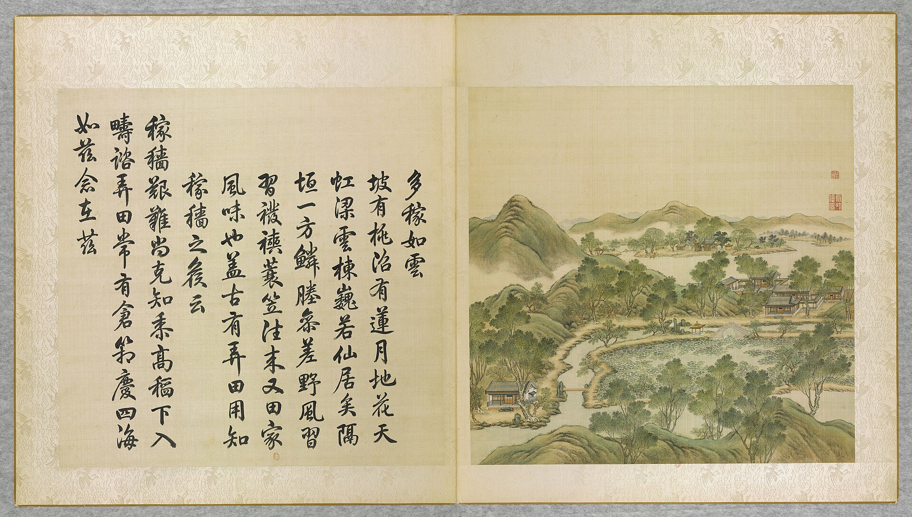

<!-- generated:start (scripts/building_pages.py): do not edit between these markers -->

# YM24-01: 多稼如云正宇 Duojia Ruyun zhengyu

Yuanming Yuan

**3D object:** 1 box. Open it: `/reconstruction/3d.html?b=YM24-01`

**Part of:** YM24 多稼如云

## What we know

- **Name:** 多稼如云正宇 Duojia Ruyun zhengyu (S05, S01 · confidence B)
- **Garden:** Yuanming Yuan (S05, S01)
- **Type:** other (S05, S01 · confidence B)
- **Destroyed:** 1860 (S05, S01)
- **Position:** 40.01115, 116.28812. S01 likely (S01 · confidence B)
- **Bays:** 5 in the texts / 3x1 on the plan (S05, S01)
- **Size in the inventory:** 17.2 × 9.7 m. S01 plan px / hall scale (S01)
- **Plan reader's note:** 正宇 five bays match text; box short, see blocks_fix. (S01) *(research copy, not public)*
- **How it was read:** likely (S01) *(research copy, not public)*
- **Plan pixels:** 2774, 798 (S01) *(research copy, not public)*

## Our model now

On the block drawn on the Qing plan S01: position and frontage from the plan, heights and roof from the typology of its hall class, its form drawn by the hall kit. It will be updated as the research goes on.

- **Box:** 17.2 × 9.7 m, main hall
- **Heights:** platform 0.7 m, eave 4.4 m, ridge 7.73 m above the ground
- **Roof:** hip-and-gable 歇山, rolled ridge 卷棚, grey tile
- **Faces:** 174.5° from north
- **Drawn:** by the hall kit: 5 bays, the middle widest, a porch front and back, steps on the back, front, 歇山 hip-and-gable with a rolled ridge 卷棚, grey tile, a painted beam under the eave. Drawn from the typology of its hall class, not from a picture of this hall (assumed, C).
- **Confidence:** B

## Pictures (1)

- **P0024** (likely): 多稼如雲 Duojia ruyun [Une abondante récolte à l'image des nuées] (圓明園四十景, 第24景) (1744 (BnF record: 1744年，清朝乾隆九年)). https://commons.wikimedia.org/wiki/File%3A%E5%9C%93%E6%98%8E%E5%9C%92%E5%9B%9B%E5%8D%81%E6%99%AF._%E7%AC%AC%E4%BA%8C%E5%8D%81%E5%9B%9B%E6%99%AF_%28%E4%B8%8B%E5%86%8C%2C_%E7%AC%AC%E5%9B%9B%E5%B9%85%E5%9B%BE%29%2C_%E5%A4%9A%E7%A8%BC%E5%A6%82%E9%9B%B2_-_%28%E6%B8%85%29%E5%94%90%E5%B2%B1%E3%80%81%E6%B2%88%E6%BA%90%E5%90%88%E7%95%AB_%3B_%28%E4%B9%BE%E9%9A%86%E5%90%9F%E8%AF%97%EF%BC%8C%E6%B1%AA%E7%94%B1%E6%95%A6%E4%BB%A3%E4%B9%A6%29Duojia_ruyun_-_%28Qing%29Tang_Dai%2C_Shen_Yuan_he_hua_-_btv1b55008338d.jpg

  

## Texts and drawings (1)

- **E1730** (text, sure): 日下舊聞考 多稼如云. 1780s (乾隆 敕撰) · j82:2b-3a · S05. https://github.com/kanripo/KR2k0036/blob/master/KR2k0036_082.txt
  > 濓溪樂處迤北對河外稻塍者為多稼如雲正宇五楹前宇為芰荷香正宇東稍南有室為湛緑（圓明園册）臣等謹按多稼如雲四十景之一軒額興芰荷香湛緑皆御書
  North of 濓溪樂處, facing paddies across the stream: 多稼如雲, a five-bay main range, 芰荷香 in front and 湛緑 to the east.

**On the plan:** Drawn on the plan of the gardens (S01) with no label, 3x1 cells: a building stood here, its name unknown. https://artmuseum.princeton.edu/collections/objects/138657

## Evidence for the set of buildings

- Evidence for the whole compound 多稼如云: see YM24
- Reconstructions and comparables for the whole garden, 圆明园 Yuanming Yuan: see GARDEN-YM
- Standing buildings comparable to a main hall (not this building): see CLASS-main_hall

## Open questions

None that name it.

<!-- generated:end -->

## Notes

<!-- Yours: regeneration never touches this part. It goes on the public site; what you write below a line holding only %% private %% stays in the research copy. -->
