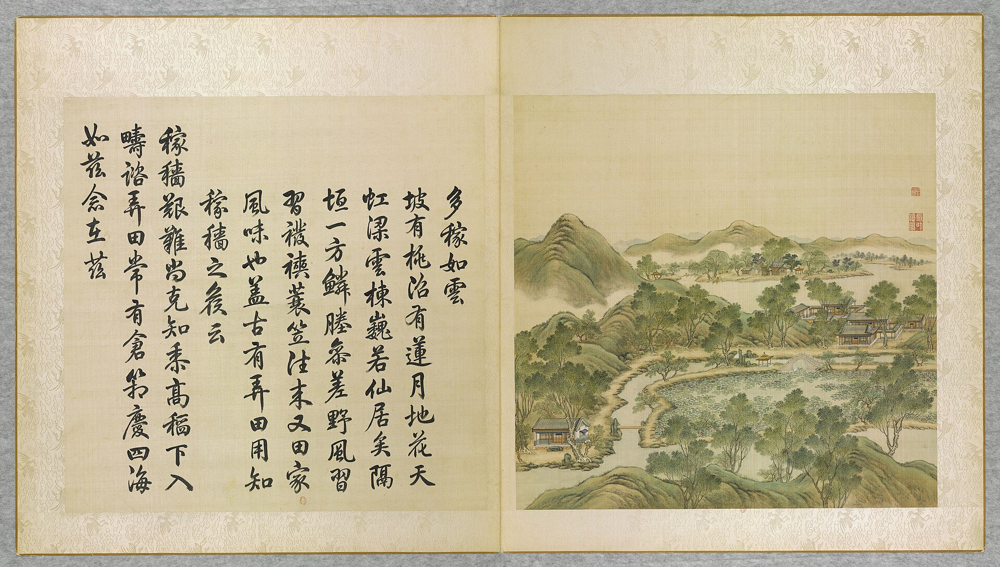
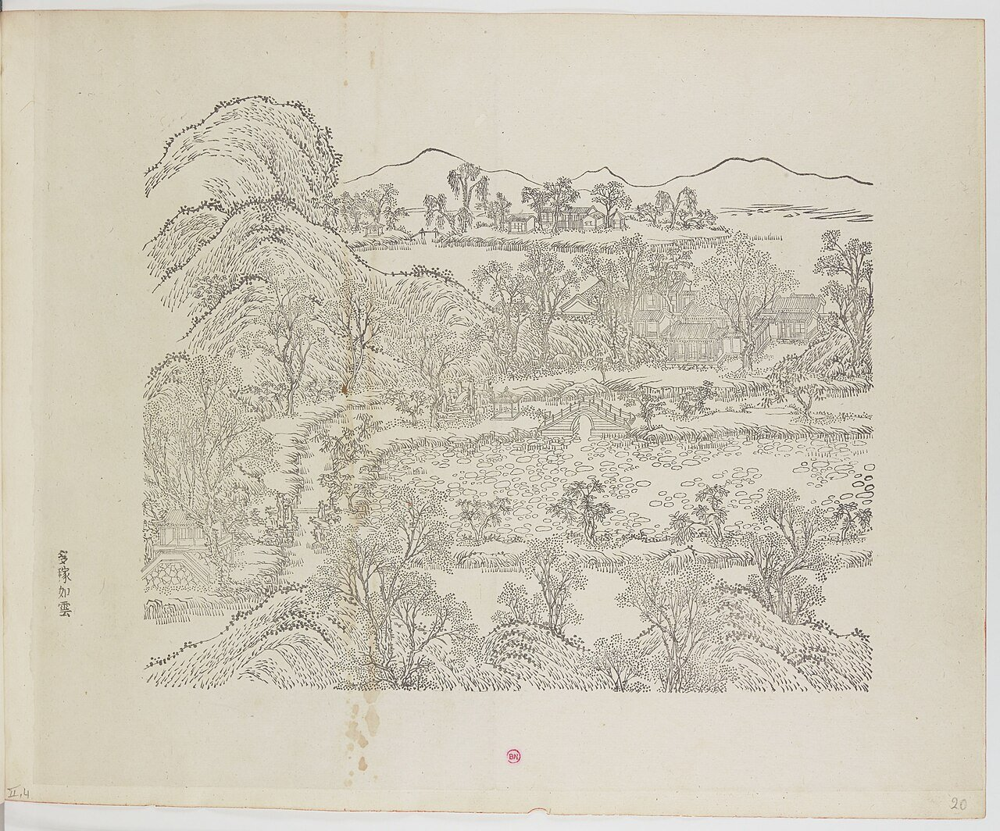
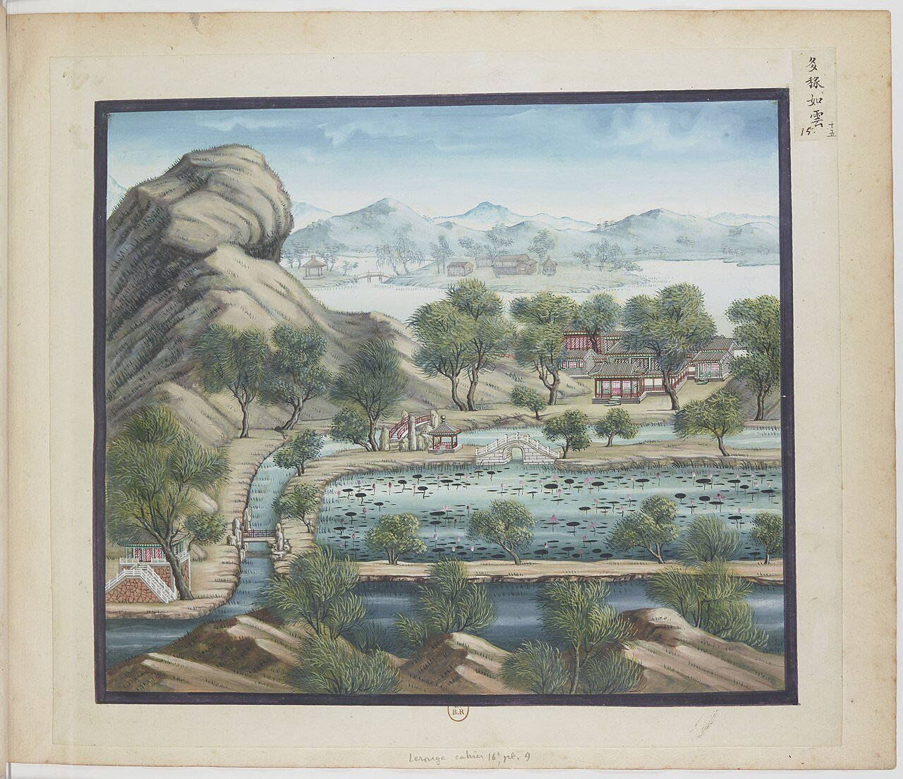
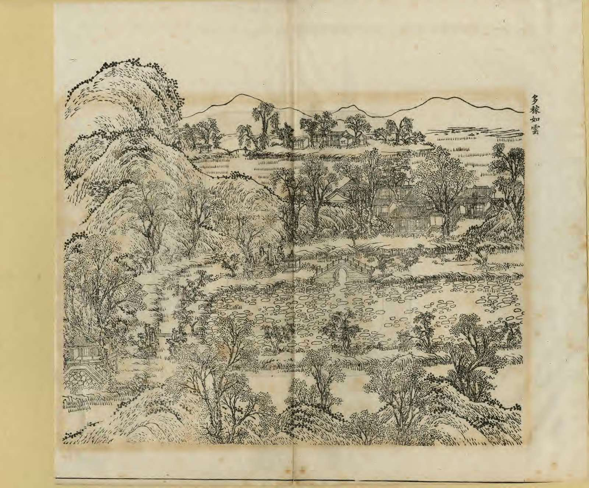
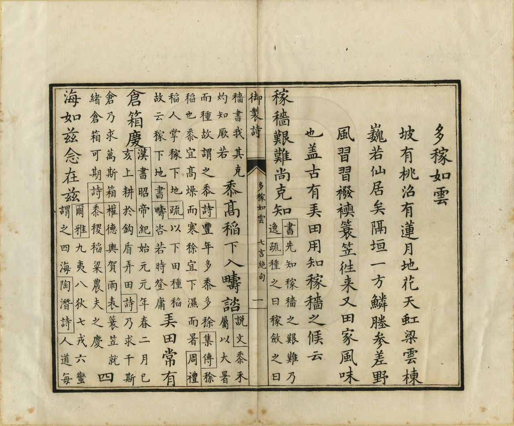

<!-- generated:start (scripts/building_pages.py): do not edit between these markers -->

# YM24: 多稼如云 Duojia Ruyun

To Chia Ju Yun (Crops Bountiful as the Clouds) · Yuanming Yuan

**3D object:** 7 boxes. Open it: `/reconstruction/3d.html?b=YM24`

## What we know

- **Name:** 多稼如云 Duojia Ruyun (S05, S02, S08, S41, S01, S360 · confidence B)
- **English:** To Chia Ju Yun (Crops Bountiful as the Clouds) (S05, S02, S08, S41, S01, S360)
- **Written on the plan:** 芰荷香 (S01 · confidence B)
- **Garden:** Yuanming Yuan (S05, S02, S08, S41, S01, S360)
- **Type:** scene (S05, S02, S08, S41, S01, S360 · confidence B)
- **Built:** by 1744 (first dated item) (S05, S02, S08, S41, S01, S360)
- **Changed:** Differs on later plans (S41) (S05, S02, S08, S41, S01, S360)
- **Destroyed:** 1860 (S05, S02, S08, S41, S01, S360)
- **Position:** 40.01116, 116.28811. S01 sure (S01 · confidence B)
- **Note:** Album does not show the 1860 state here (S41). (S05, S02, S08, S41, S01, S360)
- **Plan reader's note:** Malone 24 sits in the field to the south at (2610,1065). Label 芰荷香 is in the court. Text: 前宇 is 芰荷香, matches. (S01) *(research copy, not public)*
- **How it was read:** sure (S01) *(research copy, not public)*
- **Plan pixels:** 2773, 797 (S01) *(research copy, not public)*

## Our model now

7 boxes stand in this compound, 7 on blocks drawn on the plan, 0 assumed. Its halls are listed below.

## Inside it (7)

- YM24-01 多稼如云正宇
- YM24-02 芰荷香
- YM24-03 湛绿
- YM24-B0073
- YM24-B0074
- YM24-B0103
- YM24-B0105

## Pictures (5)

- **P0024** (sure): 多稼如雲 Duojia ruyun [Une abondante récolte à l'image des nuées] (圓明園四十景, 第24景) (1744 (BnF record: 1744年，清朝乾隆九年)). https://commons.wikimedia.org/wiki/File%3A%E5%9C%93%E6%98%8E%E5%9C%92%E5%9B%9B%E5%8D%81%E6%99%AF._%E7%AC%AC%E4%BA%8C%E5%8D%81%E5%9B%9B%E6%99%AF_%28%E4%B8%8B%E5%86%8C%2C_%E7%AC%AC%E5%9B%9B%E5%B9%85%E5%9B%BE%29%2C_%E5%A4%9A%E7%A8%BC%E5%A6%82%E9%9B%B2_-_%28%E6%B8%85%29%E5%94%90%E5%B2%B1%E3%80%81%E6%B2%88%E6%BA%90%E5%90%88%E7%95%AB_%3B_%28%E4%B9%BE%E9%9A%86%E5%90%9F%E8%AF%97%EF%BC%8C%E6%B1%AA%E7%94%B1%E6%95%A6%E4%BB%A3%E4%B9%A6%29Duojia_ruyun_-_%28Qing%29Tang_Dai%2C_Shen_Yuan_he_hua_-_btv1b55008338d.jpg

  

- **P0080** (sure): 中国皇帝的宫殿与庙宇. 第20幅图, 多稼如雲 - (清)孙祜、沈源Duojia ruyun - (Qing)Sun Hu, Shen Yuan (1745 (Commons, from the BnF record)). https://commons.wikimedia.org/wiki/File%3A%E4%B8%AD%E5%9B%BD%E7%9A%87%E5%B8%9D%E7%9A%84%E5%AE%AB%E6%AE%BF%E4%B8%8E%E5%BA%99%E5%AE%87._%E7%AC%AC20%E5%B9%85%E5%9B%BE%2C_%E5%A4%9A%E7%A8%BC%E5%A6%82%E9%9B%B2_-_%28%E6%B8%85%29%E5%AD%99%E7%A5%9C%E3%80%81%E6%B2%88%E6%BA%90Duojia_ruyun_-_%28Qing%29Sun_Hu%2C_Shen_Yuan_-_btv1b10520688t.jpg

  

- **P0115** (sure): 海淀(镇)：中国皇帝的行宫. 第15幅图, 多稼如雲Duojia ruyun (1750-1792 (BnF, cb43831905b; ex coll. Bertin)). https://commons.wikimedia.org/wiki/File%3A%E6%B5%B7%E6%B7%80%28%E9%95%87%29%EF%BC%9A%E4%B8%AD%E5%9B%BD%E7%9A%87%E5%B8%9D%E7%9A%84%E8%A1%8C%E5%AE%AB._%E7%AC%AC15%E5%B9%85%E5%9B%BE%2C_%E5%A4%9A%E7%A8%BC%E5%A6%82%E9%9B%B2Duojia_ruyun_-_btv1b105207132.jpg

  

- **P0255** (sure): 多稼如雲 Duojia Ruyun (御製圓明園圖詠, 1887 石印本, 下卷 (Commons 卷二), 第24景; printed title in the right margin of the picture) (光緒十三年 1887 (Commons/NLC record; colophon 光緒十三年七月天津石印書屋 in the SSID copy, S98 PDF p.2); design after the woodblock of 1745 by 孫祜 Sun Hu and 沈源 Shen Yuan). https://commons.wikimedia.org/wiki/File%3ANLC403-312001107375-14034_%E7%A6%A6%E5%88%B6%E5%9C%93%E6%98%8E%E5%9C%92%E5%9C%96%E8%A9%A0_%E5%8D%B7%E4%BA%8C.pdf?page=13

  

- **P0531** (sure): 多稼如雲 Duojia Ruyun: 乾隆 Qianlong's preface and poem with the courtiers' commentary, 御製圓明園圖詠 1887 (poem 1744 (乾隆九年); this printing 1887). https://commons.wikimedia.org/wiki/File%3ANLC403-312001107375-14034_%E7%A6%A6%E5%88%B6%E5%9C%93%E6%98%8E%E5%9C%92%E5%9C%96%E8%A9%A0_%E5%8D%B7%E4%BA%8C.pdf?page=14

  

## Texts and drawings (14)

- **E1724** (poem, sure): 御製多稼如雲詩（圓明園四十景詩）. 1744 (乾隆九年) · printed in S05 j82:3a-3b · S40. https://github.com/kanripo/KR2k0036/blob/master/KR2k0036_082.txt
  > 乾隆九年 御製多稼如雲詩 坡有桃沼有蓮月地花天虹梁雲棟巍若仙居矣隔垣一方鱗塍參差野風習習襏襫蓑笠往來又田家風味也葢古有弄田用知稼穡之候云 稼穡艱難尚克知黍高稻下入疇諮弄田常有倉箱慶四海如兹念在兹
  After the peach slopes, lotus ponds and cloud-high buildings comes a walled plot of fish-scale fields, with farmers in rain capes coming and going. It is a modern 弄田, the plot the ancients kept to learn the seasons of farming.
- **E1730** (text, sure): 日下舊聞考 多稼如云. 1780s (乾隆 敕撰) · j82:2b-3a · S05. https://github.com/kanripo/KR2k0036/blob/master/KR2k0036_082.txt
  > 濓溪樂處迤北對河外稻塍者為多稼如雲正宇五楹前宇為芰荷香正宇東稍南有室為湛緑（圓明園册）臣等謹按多稼如雲四十景之一軒額興芰荷香湛緑皆御書
  North of 濓溪樂處, facing paddies across the stream: 多稼如雲, a five-bay main range, 芰荷香 in front and 湛緑 to the east.
- **E1725** (poem, sure): 多稼如云: 嘉庆元年 poem of the Jiaqing Emperor. 嘉庆元年 (1796), date from the compilation · p.250 item (2), under 多稼如云 · S360. https://www.yuanmingyuanpark.cn/xs/yjbg/202007/P020200730387572832602.pdf#page=250
  > 永夏塞湖对君子，御园秋末有余芳。离披绿盖仍摇影，可识仙寰岁月长。讬根清净出泥中，回忆幽香送晚风。花谢花开视平等，幻成色相立虚空。
  Poem of the Jiaqing Emperor at 多稼如云, 1796, on the view. Year as given by the compilation.
- **E1726** (poem, sure): 多稼如云: 嘉庆二年 poem of the Jiaqing Emperor. 嘉庆二年 (1797), date from the compilation · p.250 item (3), under 多稼如云 · S360. https://www.yuanmingyuanpark.cn/xs/yjbg/202007/P020200730387572832602.pdf#page=250
  > 塞苑嘉莲每岁咏，御园静植未能观。根仍茂密花全谢，一例西风落叶残。想象芙蕖拓净姿，朱华万柄耀朝曦。经霜摇落同芦苇，转瞬田田又满池。
  Poem of the Jiaqing Emperor at 多稼如云, 1797, on the view. Year as given by the compilation.
- **E1727** (poem, sure): 芰荷香北望. 嘉庆七年 (1802) · v2 p.229, under 多稼如云; source ref 2-105 · S361. https://www.yuanmingyuanpark.cn/xs/yjbg/202008/P020200803382343267004.pdf#page=232
  > 蜃窗纳远景，春宇绘闲云。老树留曦影，轻风叠水纹。岚光相映带，淑霭互氤氲。农作期将近，耕畬事克勤。
  Poem 芰荷香北望 by the Jiaqing Emperor, 1802, filed by the editors under 多稼如云.
- **E1729** (poem, sure): 多稼如云: 嘉庆十二年 poem of the Jiaqing Emperor. 嘉庆十二年 (1807), date from the compilation · p.251 item (6), under 多稼如云 · S360. https://www.yuanmingyuanpark.cn/xs/yjbg/202007/P020200730387572832602.pdf#page=251
  > 十亩池塘万柄莲，花中君子品清妍。远香淡雅临风细，静影翩翻映日鲜。灿灿朱英出泥垢，亭亭翠盖罥波烟。虚庭茂对欣蕃育，净植含芳徧锦涟。
  Poem of the Jiaqing Emperor at 多稼如云, 1807, on the view. Year as given by the compilation.
- **E1728** (poem, likely): 多稼如云 四首以题为韵. 嘉庆八年 (1803) · v2 p.230, under 多稼如云; source ref 2-230 · S361. https://www.yuanmingyuanpark.cn/xs/yjbg/202008/P020200803382343267004.pdf#page=233
  > 问余有何乐，所乐在时和。省岁筹晴雨，力田茂麦禾。生民纪周雅，良耜载豳歌。珠玉诚无用，惟祈万宝多。
  Poem 多稼如云 四首以题为韵 by the Jiaqing Emperor, 1803, filed by the editors under 多稼如云.
- **E1733** (description, sure): Scene 24, 多稼如云 Duojia Ruyun. 1934 · p.91 · S02. https://archive.org/details/historyofpekings00malo
  > There were extensive rice fields in this part of the garden.
  A few small buildings looking over lotus ponds, peach trees on a hillside and rice fields.
- **E1731** (description, guess): Attiret: the farming quarter. 1743 · [pp.31-32] · S157. https://faculty.bard.edu/~louis/gardens/attiretaccount.html
  > There you see Fields, Meadows, Farm-houses, and little scatter'd Cottages; with Oxen, Ploughs, and all the Necessaries for Husbandry.
  A quarter set apart for farming, within the garden. S02 pp.89-91 places rice fields round scenes 20 to 26; which scenes it means is a guess.
- **E1011** (description, sure): Site status table, about 2011: nothing visible, or built over. c. 2011 · 系列06 repost, status table · S356. https://blog.sina.com.cn/s/blog_c27029650101itzz.html
  Same table. In it the first group shows no visible remains; 得全阁, 流香渚, 凤麟洲, 涵秋馆, 蔚藻堂, 中和堂, 敷春堂 and 心镜轩 have service buildings on them, and 含晖楼, 澄心堂, 延寿寺, 清夏堂 and 喜雨山房 are occupied by other institutions. 澹泊宁静 and several others have been dug since, so this is out of date for them.
- **E1734** (description, sure): 多稼如云, yaffin 系列09. c. 2011 · scene 24 · S356. https://blog.sina.com.cn/s/blog_65fec3ab0100sv4p.html
  Lead: Yongzheng date, first called 观稼轩, north-east of 汇芳书院, with a large lotus pond in the south. Qianlong dined here with his mother; Jiaqing was lodged here on his accession. Unverified.
- **E1732** (description, sure): 圆明园百景史事分景汇编: 多稼如云. 1744-1807 · from p.250, under 多稼如云 · S360. https://www.yuanmingyuanpark.cn/xs/yjbg/202007/P020200730387572832602.pdf#page=250
  多稼如云: 6 dated items, 1744-1807, of which 5 poems and 1 court records (Qianlong, Jiaqing); recurring themes: the view. First dated 1744, last dated 1807.
- **E1735** (description, sure): 圆明园五朝御制诗文集注 v2, editors' note on 多稼如云. 2020 edition · v2 p.223 · S361. https://www.yuanmingyuanpark.cn/xs/yjbg/202008/P020200803382343267004.pdf#page=226
  A farm scene: five-bay main hall, 颐和书屋, 湛渌, and the south hall 芰荷香 over a lotus pond, which held a set of the recut 淳化阁帖 and the 西洋楼 engravings.
- **E1736** (drawing, sure): 《国家图书馆藏样式雷图档·圆明园卷初编》: 多稼如云. mostly 道光, 咸丰, 同治 per the publisher · 初编 目录: 多稼如云, p.356 · S13. https://www.nlcpress.com/ProductView.aspx?Id=7642
  The printed facsimile of the National Library of China's Yangshi Lei sheets has a section on this place at p.356 (1 pages, section length worked out from the next heading); sheet titles and numbers are in the volume, ordered from a library.

**On the plan:** Drawn on the plan of the gardens (S01), labelled 芰荷香. https://artmuseum.princeton.edu/collections/objects/138657

## Reconstructions by others (1)

Modern interpretation, not evidence.
- **R0073** (3D model, sure): 《圆明园四十景数字化复原及应用》. 圆明园管理处 with 中央美院, 圆明园管理处; 中央美术学院, 2025. https://news.bjd.com.cn/2026/10/16/11997513.shtml Research-only: link card.

## Surviving comparable buildings, not this building (1)

- **T022** 耕织图 Gengzhi Tu, 颐和园 Summer Palace. Comparable: same court, era or type, confidence C, standing: rebuilt 1886. Farm scene in a palace Basis: S422 (耕织图, 颐和园): Qianlong named a rural part of Qingyi Yuan after the Song album; rural scenes at YM24, YM21, YM26 per S05 j.82 f.4ff. https://zh.wikipedia.org/wiki/颐和园
  - P0688: Binfeng Bridge in Summer Palace 2022. https://commons.wikimedia.org/wiki/File:Binfeng_Bridge_in_Summer_Palace_2022.jpg

## Evidence for the set of buildings

- Reconstructions and comparables for the whole garden, 圆明园 Yuanming Yuan: see GARDEN-YM

## Open questions

- Q1: Target state
- Q209: Lotus at 曲院风荷 and 平湖秋月

<!-- generated:end -->

## Notes

<!-- Yours: regeneration never touches this part. It goes on the public site; what you write below a line holding only %% private %% stays in the research copy. -->
