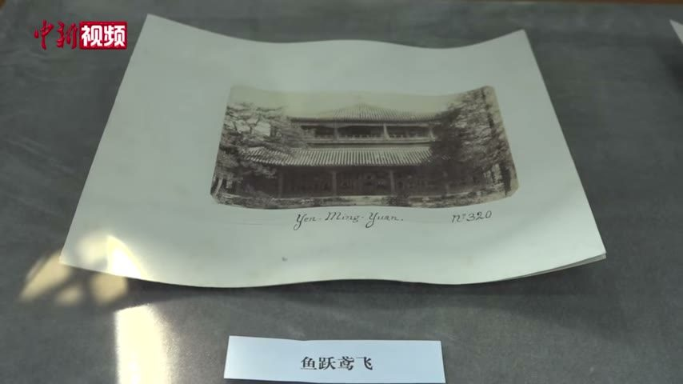

<!-- generated:start (scripts/building_pages.py): do not edit between these markers -->

# YM25-01: 鱼跃鸢飞殿 Yuyue Yuanfei Dian

Yuanming Yuan

**3D object:** 1 box. Open it: `/reconstruction/3d.html?b=YM25-01`

**Part of:** YM25 鱼跃鸢飞

## What we know

- **Name:** 鱼跃鸢飞殿 Yuyue Yuanfei Dian (S05, S02, S01 · confidence B)
- **Garden:** Yuanming Yuan (S05, S02, S01)
- **Type:** other (S05, S02, S01 · confidence B)
- **Destroyed:** survived 1860 per 1873 survey (S06) (S05, S02, S01)
- **Position:** 40.01186, 116.29262. S01 sure (S01 · confidence B)
- **Bays:** 5 per side in the texts / 6x5 on the plan (S05, S02, S01)
- **Size in the inventory:** 25.8 × 28.7 m. S01 plan px / hall scale (S01)
- **Storeys:** 2 (S05, S02, S01)
- **Note:** Malone p.91: 2-storey with windows on all sides; S06 五楹方殿. (S05, S02, S01)
- **Plan reader's note:** Five bays per side. Box 6x5 by detection; I count 5 each way against the text. (S01) *(research copy, not public)*
- **How it was read:** sure (S01) *(research copy, not public)*
- **Plan pixels:** 4774, 646 (S01) *(research copy, not public)*

## Our model now

A plain box on the block drawn on the Qing plan S01: position and frontage from the plan, heights and roof from the typology of its hall class. It will be updated as the research goes on.

- **Box:** 25.8 × 28.7 m, main hall
- **Heights:** platform 0.45 m, eave 5.95 m, ridge 8.63 m above the ground
- **Roof:** hip-and-gable 歇山, rolled ridge 卷棚, 4 parallel rolls 勾连搭, grey tile
- **Faces:** 174.8° from north
- **Confidence:** B

## Pictures (1)

- **P0713** (likely): 鱼跃鸢飞 (exhibition label); mount inscribed Yen-Ming-Yuan (1882, as said in the clip by 刘阳 Liu Yang (S650); S651 gives 1882 for Semalle). https://commons.wikimedia.org/wiki/File:2021-02-24_圆明园中西建筑如何过渡_未彻底损毁前珍贵影像公布.webm Research-only: link card.

  

## Texts and drawings (2)

- **E1741** (text, sure): 日下舊聞考 鱼跃鸢飞. 1780s (乾隆 敕撰) · j82:3b-4b · S05. https://github.com/kanripo/KR2k0036/blob/master/KR2k0036_082.txt
  > 多稼如雲東北為魚躍鳶飛四面為門各五楹東廂為暢觀軒西南為鋪翠環流樓南有室為傳妙又南出山口為多子亭（明圓園册）臣等謹按魚躍鳶飛四十景之一額為世宗御書鋪翠環流之北額曰溪山曰曲徑泉聲與傳妙多子亭諸額皆世宗御書魚躍鳶飛東門額曰嵐光曙色南曰綺疏文照北曰澗溜調琴與暢觀軒諸額皆皇上御書
  North-east of 多稼如雲: 魚躍鳶飛, a hall with a five-bay gate range on each of its four sides, with 暢觀軒, 鋪翠環流, 傳妙 and 多子亭 beyond a gap in the hills. The note gives the plaques on each face.
- **E1743** (description, likely): Scene 25, 鱼跃鸢飞 Yuyue Yuanfei. 1934 · p.91 · S02. https://archive.org/details/historyofpekings00malo
  > The stream made a bend leaving a promontory on which was built a two-story building with windows on all sides.
  A two-storey building with windows on all sides, on a promontory in a bend of the stream, with views over rice fields and villages.

**On the plan:** Drawn on the plan of the gardens (S01) with no label, 6x5 cells: a building stood here, its name unknown. https://artmuseum.princeton.edu/collections/objects/138657

## Evidence for the set of buildings

- Evidence for the whole compound 鱼跃鸢飞: see YM25
- Reconstructions and comparables for the whole garden, 圆明园 Yuanming Yuan: see GARDEN-YM
- Standing buildings comparable to a main hall (not this building): see CLASS-main_hall

## Open questions

- Q54: Timber buildings standing in 1882 (Round 5)

<!-- generated:end -->

## Notes

<!-- Yours: regeneration never touches this part. It goes on the public site; what you write below a line holding only %% private %% stays in the research copy. -->
