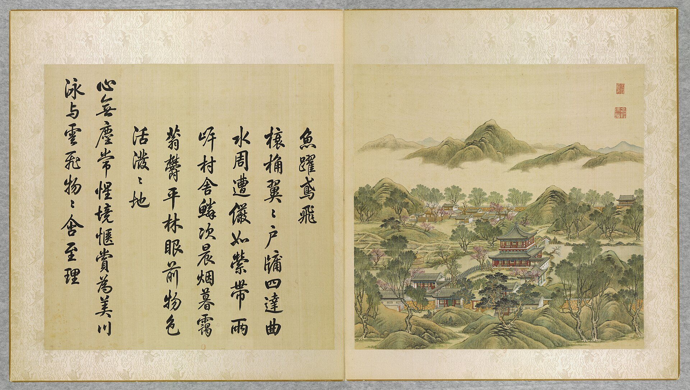
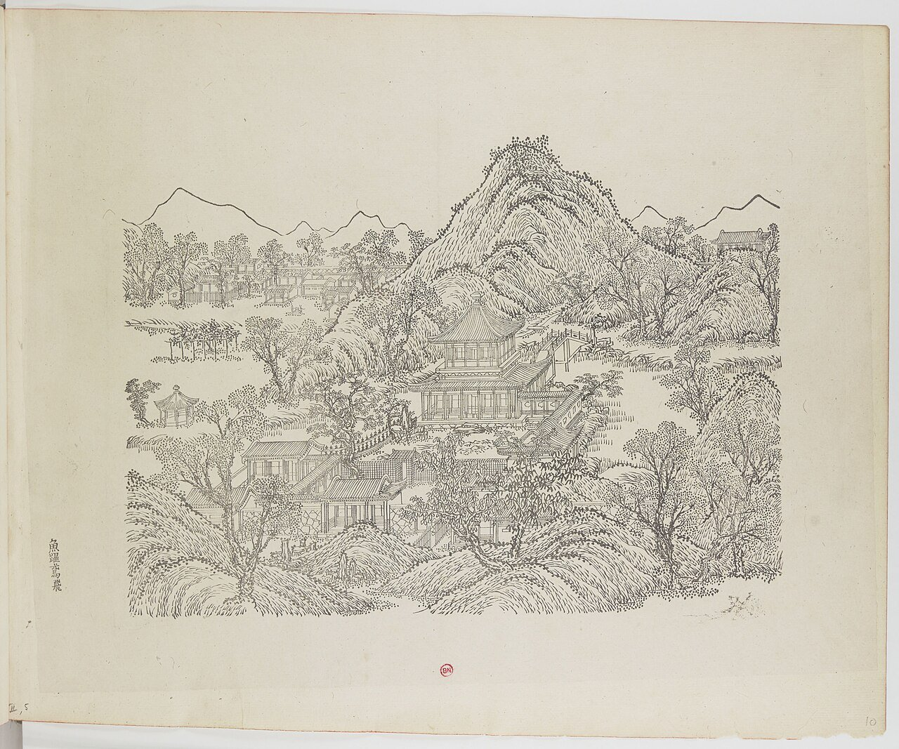
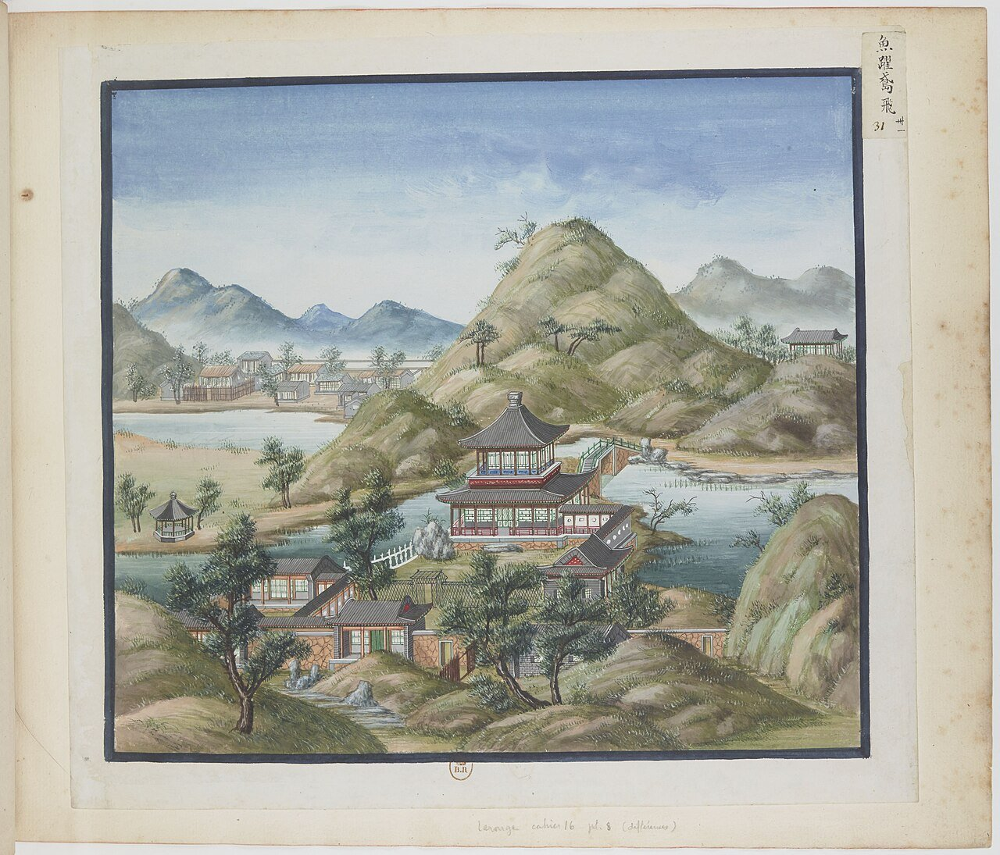
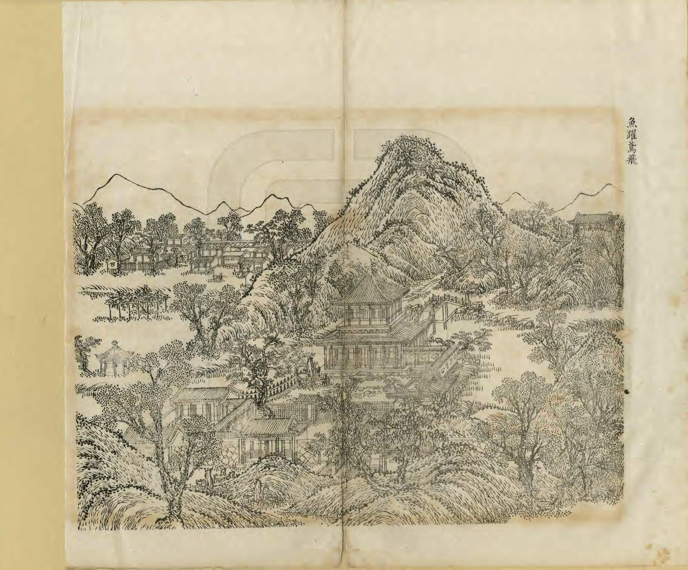
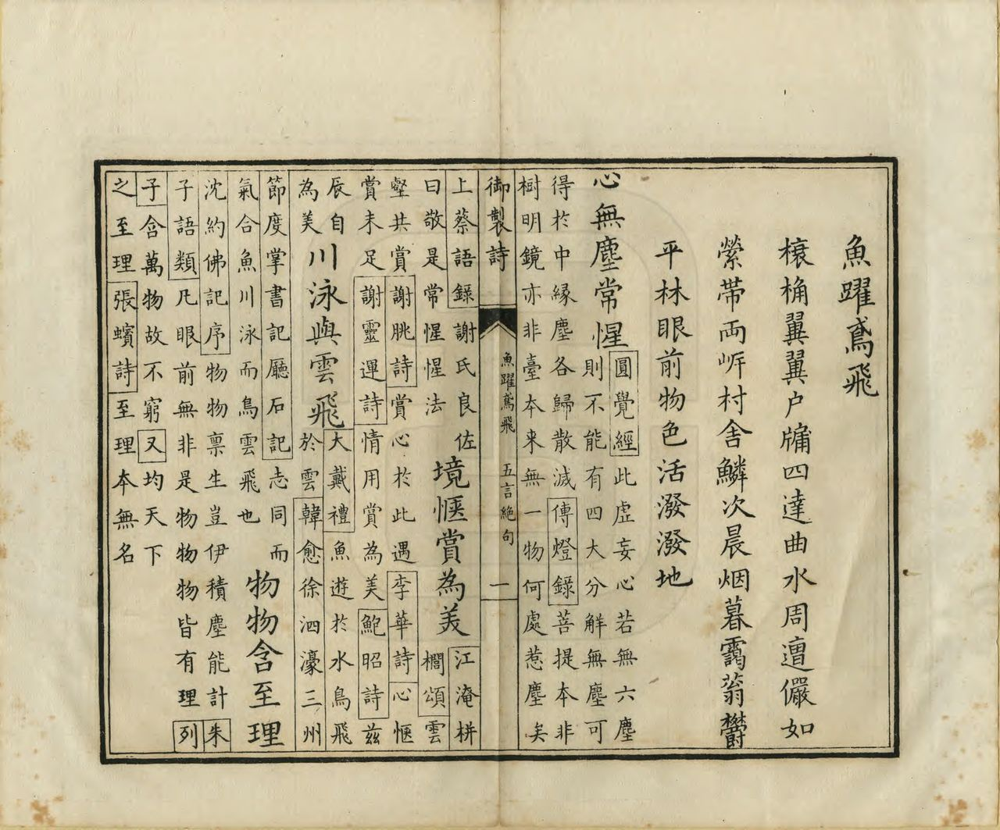
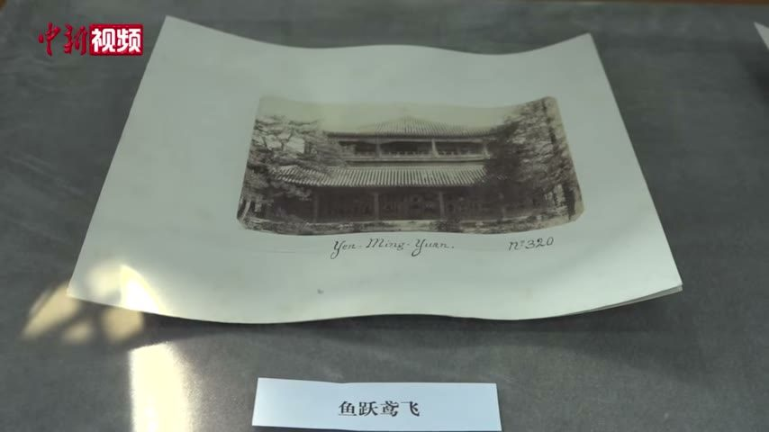

<!-- generated:start (scripts/building_pages.py): do not edit between these markers -->

# YM25: 鱼跃鸢飞 Yuyue Yuanfei

Yu Yueh Yo Fei (Fishes Leap and Birds Fly) · Yuanming Yuan

**3D object:** 12 boxes. Open it: `/reconstruction/3d.html?b=YM25`

## What we know

- **Name:** 鱼跃鸢飞 Yuyue Yuanfei (S05, S02, S08, S06, S01, S337, S360, S361, S310 · confidence A)
- **English:** Yu Yueh Yo Fei (Fishes Leap and Birds Fly) (S05, S02, S08, S06, S01, S337, S360, S361, S310)
- **Garden:** Yuanming Yuan (S05, S02, S08, S06, S01, S337, S360, S361, S310)
- **Type:** scene (S05, S02, S08, S06, S01, S337, S360, S361, S310 · confidence A)
- **Built:** by 1790 (first dated item); 雍正朝; plaque for the scene ordered 雍正九年三月 (1731) (S05, S02, S08, S06, S01, S337, S360, S361, S310)
- **Destroyed:** 1860; on the 1873 survival list (S06); survived 1860; later loss; survived 1860; lost around 1900 (S05, S02, S08, S06, S01, S337, S360, S361, S310)
- **Position:** 40.01186, 116.29262. S01 sure (S01 · confidence B)
- **Storeys:** 2 (S05, S02, S08, S06, S01, S337, S360, S361, S310)
- **Note:** S06 also misprints 鱼跃莺飞. pyramidal (four-sided) (S360, p.250 lead). after1860: survived 1860 (刘敦桢's list) (S337, E0451). (S05, S02, S08, S06, S01, S337, S360, S361, S310)
- **Plan reader's note:** Big 6x5 hall on a promontory, stream bending round: matches Malone 25. Rocks and crescent screen SE. (S01) *(research copy, not public)*
- **How it was read:** sure (S01) *(research copy, not public)*
- **Plan pixels:** 4774, 646 (S01) *(research copy, not public)*

## Our model now

12 boxes stand in this compound, 12 on blocks drawn on the plan, 0 assumed. Its halls are listed below.

## Inside it (12)

- YM25-01 鱼跃鸢飞殿
- YM25-02 畅观轩
- YM25-03 铺翠环流
- YM25-04 传妙
- YM25-05 多子亭
- YM25-B0108
- YM25-B0109
- YM25-B0110
- YM25-B0112
- YM25-B0113
- YM25-B0114
- YM25-B0115

## Pictures (6)

- **P0025** (sure): 魚躍鳶飛 Yuyue yuanfei [Frétillent les poissons, volent les milans] (圓明園四十景, 第25景) (1744 (BnF record: 1744年，清朝乾隆九年)). https://commons.wikimedia.org/wiki/File%3A%E5%9C%93%E6%98%8E%E5%9C%92%E5%9B%9B%E5%8D%81%E6%99%AF._%E7%AC%AC%E4%BA%8C%E5%8D%81%E4%BA%94%E6%99%AF_%28%E4%B8%8B%E5%86%8C%2C_%E7%AC%AC%E4%BA%94%E5%B9%85%E5%9B%BE%29%2C_%E9%AD%9A%E8%BA%8D%E9%B3%B6%E9%A3%9B_-_%28%E6%B8%85%29%E5%94%90%E5%B2%B1%E3%80%81%E6%B2%88%E6%BA%90%E5%90%88%E7%95%AB_%3B_%28%E4%B9%BE%E9%9A%86%E5%90%9F%E8%AF%97%EF%BC%8C%E6%B1%AA%E7%94%B1%E6%95%A6%E4%BB%A3%E4%B9%A6%29Yuyue_yuanfei_-_%28Qing%29Tang_Dai%2C_Shen_Yuan_he_hua_-_btv1b55008339v.jpg

  

- **P0070** (sure): 中国皇帝的宫殿与庙宇. 第10幅图, 魚躍鳶飛 - (清)孙祜、沈源Yuyue yuanfei - (Qing)Sun Hu, Shen Yuan (1745 (Commons, from the BnF record)). https://commons.wikimedia.org/wiki/File%3A%E4%B8%AD%E5%9B%BD%E7%9A%87%E5%B8%9D%E7%9A%84%E5%AE%AB%E6%AE%BF%E4%B8%8E%E5%BA%99%E5%AE%87._%E7%AC%AC10%E5%B9%85%E5%9B%BE%2C_%E9%AD%9A%E8%BA%8D%E9%B3%B6%E9%A3%9B_-_%28%E6%B8%85%29%E5%AD%99%E7%A5%9C%E3%80%81%E6%B2%88%E6%BA%90Yuyue_yuanfei_-_%28Qing%29Sun_Hu%2C_Shen_Yuan_-_btv1b10520690n.jpg

  

- **P0131** (sure): 海淀(镇)：中国皇帝的行宫. 第31幅图, 魚躍鳶飛Yuyue yuanfei (1750-1792 (BnF, cb43831905b; ex coll. Bertin)). https://commons.wikimedia.org/wiki/File%3A%E6%B5%B7%E6%B7%80%28%E9%95%87%29%EF%BC%9A%E4%B8%AD%E5%9B%BD%E7%9A%87%E5%B8%9D%E7%9A%84%E8%A1%8C%E5%AE%AB._%E7%AC%AC31%E5%B9%85%E5%9B%BE%2C_%E9%AD%9A%E8%BA%8D%E9%B3%B6%E9%A3%9BYuyue_yuanfei_-_btv1b10520715z.jpg

  

- **P0256** (sure): 魚躍鳶飛 Yuyue Yuanfei (御製圓明園圖詠, 1887 石印本, 下卷 (Commons 卷二), 第25景; printed title in the right margin of the picture) (光緒十三年 1887 (Commons/NLC record; colophon 光緒十三年七月天津石印書屋 in the SSID copy, S98 PDF p.2); design after the woodblock of 1745 by 孫祜 Sun Hu and 沈源 Shen Yuan). https://commons.wikimedia.org/wiki/File%3ANLC403-312001107375-14034_%E7%A6%A6%E5%88%B6%E5%9C%93%E6%98%8E%E5%9C%92%E5%9C%96%E8%A9%A0_%E5%8D%B7%E4%BA%8C.pdf?page=16

  

- **P0532** (sure): 魚躍鳶飛 Yuyue Yuanfei: 乾隆 Qianlong's preface and poem with the courtiers' commentary, 御製圓明園圖詠 1887 (poem 1744 (乾隆九年); this printing 1887). https://commons.wikimedia.org/wiki/File%3ANLC403-312001107375-14034_%E7%A6%A6%E5%88%B6%E5%9C%93%E6%98%8E%E5%9C%92%E5%9C%96%E8%A9%A0_%E5%8D%B7%E4%BA%8C.pdf?page=17

  

- **P0713** (likely): 鱼跃鸢飞 (exhibition label); mount inscribed Yen-Ming-Yuan (1882, as said in the clip by 刘阳 Liu Yang (S650); S651 gives 1882 for Semalle). https://commons.wikimedia.org/wiki/File:2021-02-24_圆明园中西建筑如何过渡_未彻底损毁前珍贵影像公布.webm Research-only: link card.

  

## Texts and drawings (14)

- **E1737** (poem, sure): 御製魚躍鳶飛詩（圓明園四十景詩）. 1744 (乾隆九年) · printed in S05 j82:4b · S40. https://github.com/kanripo/KR2k0036/blob/master/KR2k0036_082.txt
  > 乾隆九年 御製魚躍鳶飛詩 榱桷翼翼户牖四達曲水周遭儼如縈帶兩岸村舍鱗次晨烟暮靄蓊鬱平林眼前物色活潑潑地 心無塵常惺境愜賞為美川泳與雲飛物物含至理
  Broad eaves, doors open on all sides, a winding stream like a sash, and on both banks villages under dawn and dusk mist among dense trees. He finds everything here alive and at ease.
- **E1741** (text, sure): 日下舊聞考 鱼跃鸢飞. 1780s (乾隆 敕撰) · j82:3b-4b · S05. https://github.com/kanripo/KR2k0036/blob/master/KR2k0036_082.txt
  > 多稼如雲東北為魚躍鳶飛四面為門各五楹東廂為暢觀軒西南為鋪翠環流樓南有室為傳妙又南出山口為多子亭（明圓園册）臣等謹按魚躍鳶飛四十景之一額為世宗御書鋪翠環流之北額曰溪山曰曲徑泉聲與傳妙多子亭諸額皆世宗御書魚躍鳶飛東門額曰嵐光曙色南曰綺疏文照北曰澗溜調琴與暢觀軒諸額皆皇上御書
  North-east of 多稼如雲: 魚躍鳶飛, a hall with a five-bay gate range on each of its four sides, with 暢觀軒, 鋪翠環流, 傳妙 and 多子亭 beyond a gap in the hills. The note gives the plaques on each face.
- **E0451** (text, sure): 圆明园遗址的遗产价值与申遗构想: the buildings left after 1860, citing 刘敦桢 1933. post n.d. · ylfj, note 34: 刘敦桢, 同治重修圆明园史料, 营造学社汇刊 1933(2) · S337. http://iqh.ruc.edu.cn/old/qdhjylyjzx/xszl/ylfj/9a322b5384ab4c17af0dd577d4f96ca6.htm
  Lists 17 buildings left after the burning of 1860, after 刘敦桢: 紫碧山房, 顺木天, 鱼跃鸢飞, 课农轩, 藏舟坞, 慎修思永, 知过堂, 双鹤斋, 蓬岛瑶台, 魁星楼, 文昌阁, 林渊锦镜, 春雨轩; 海岳开襟; 庄严法界, 正觉寺 and a 大宫门 in 万春园. The paper's aim is to hold any new display to this 1860 state.
- **E1738** (poem, sure): 鱼跃鸢飞. 乾隆九年 (1744) · v2 p.235, under 鱼跃鸢飞; source ref 2-687 · S361. https://www.yuanmingyuanpark.cn/xs/yjbg/202008/P020200803382343267004.pdf#page=238
  > 榱桷翼翼，戸牖四达。曲水周遭，俨如萦带。两岸村舍鳞次，晨烟暮霭，蓊郁平林，眼前物色，活泼泼地。心无尘常惺，境惬赏为美。川泳与云飞，物物含至理。
  Poem 鱼跃鸢飞 by the Qianlong Emperor, 1744, filed by the editors under 鱼跃鸢飞.
- **E1739** (poem, sure): 鱼跃鸢飞: 乾隆五十五年 poem of the Qianlong Emperor. 乾隆五十五年 (1790), date from the compilation · p.250 item (1), under 鱼跃鸢飞 · S360. https://www.yuanmingyuanpark.cn/xs/yjbg/202007/P020200730387572832602.pdf#page=250
  > 斋有窗棂轩则无，畅观得号以斯夫。观宁树石景佳也，畅在雨旸时若乎。役目戒深铭敢忘，从心学浅矩难踰。御寒偶设菱花牖，更厌玻璃几片糊。
  Poem of the Qianlong Emperor at 鱼跃鸢飞, 1790, on the view. Year as given by the compilation.
- **E1740** (poem, sure): 鱼跃鸢飞: 乾隆六十年 poem of the Qianlong Emperor. 乾隆六十年 (1795), date from the compilation · p.250 item (2), under 鱼跃鸢飞 · S360. https://www.yuanmingyuanpark.cn/xs/yjbg/202007/P020200730387572832602.pdf#page=250
  > 迟吐叶林无碍望，苍山新水也宜看。曰三洪范常忧我，自审何曾一畅观。
  Poem of the Qianlong Emperor at 鱼跃鸢飞, 1795, on the view. Year as given by the compilation.
- **E1524** (description, sure): 玉明 侍游御園記 (in 蕉軒隨錄). 1856 (咸豐六年七月二十一日) · 蕉軒隨錄, 御園侍游 (line 336 of the corpus file) · S210. https://github.com/garychowcmu/daizhigev20/blob/master/史藏/志存记录/蕉轩随录.txt
  > ◎御园侍游玉将军（明）有《侍游御园记》，成竹坪同年（林）曾属予代作跋语，恭书于后。按，《记》云：“咸丰六年秋七月二十一日，奉旨：本日散朝后，著玉明、肃顺自备鞍马，午初一刻进西南门，在山高水长伺候。有顷，上从内乘船，至山高水长后阁扇下船，出前门，谕玉明、肃顺暨珠勒亨、西拉布、托云、德勒格尔、伊勒东阿等脱去外褂。上乘马，命七臣随行。自山高水长游藻园，至厂地，过汇芳书院，复由紫碧山房至鱼跃鸢飞少坐。过蕊珠宫门，至黄花磴进茶毕，往西洋楼海宴堂，至转马台，过小角门，至狮子林清淑斋赏饭。左右四卓，命七臣坐，并奉温谕可饱食，非外边筵宴比也。上命膳房先给七臣面各一器，上进面，复进饭，颁赏御用菜蔬，七臣叩头谢。上进粥，复赏粥毕。随驾起行，由宝相寺、法慧寺、谐奇趣过明春门，至雷峰夕照马头，坐如在天上船，游福海。上命笔砚作诗毕，至渊氵亭镜澈马头下船。进丽春门骑马，由旧园东墙根过敷春堂，游西大堤汉城关，至含辉楼下马，命七臣散归。玉明自道光十一年由侍卫擢厕御前二十余年，仰邀优渥，得遍瞻御园盛景。欣感之余，谨作记以纪荣遇。”
  A rare first-hand record of a day in the garden four years before its destruction. The emperor takes seven officials by a named route from 山高水長 through 藻園, 彚芳書院, 紫碧山房 and 魚躍鳶飛, past 蕊珠宫門, on to 海宴堂 in the 西洋樓, a meal at 清淑齋 in 獅子林, 寳相寺, 法慧寺, 諧奇趣, by boat on 福海, then 敷春堂 and 含暉楼. All were standing then.
- **E1743** (description, sure): Scene 25, 鱼跃鸢飞 Yuyue Yuanfei. 1934 · p.91 · S02. https://archive.org/details/historyofpekings00malo
  > The stream made a bend leaving a promontory on which was built a two-story building with windows on all sides.
  A two-storey building with windows on all sides, on a promontory in a bend of the stream, with views over rice fields and villages.
- **E1011** (description, sure): Site status table, about 2011: nothing visible, or built over. c. 2011 · 系列06 repost, status table · S356. https://blog.sina.com.cn/s/blog_c27029650101itzz.html
  Same table. In it the first group shows no visible remains; 得全阁, 流香渚, 凤麟洲, 涵秋馆, 蔚藻堂, 中和堂, 敷春堂 and 心镜轩 have service buildings on them, and 含晖楼, 澄心堂, 延寿寺, 清夏堂 and 喜雨山房 are occupied by other institutions. 澹泊宁静 and several others have been dug since, so this is out of date for them.
- **E2396** (description, sure): 鱼跃鸢飞总平面图, list card. special/yslt, card of ysltd/11992 · S310. https://www.mhymy.com/special/yslt
  The site's card for this plan places the 鱼跃鸢飞 Yuyue Yuanfei scene just inside 大北门 Da Beimen, the Great North Gate, which it says was also called 北楼门 Beilou Men; this is the site's modern description, not a statement read on the sheet.
- **E1742** (description, sure): 圆明园百景史事分景汇编: 鱼跃鸢飞. 1790-1795 · from p.250, under 鱼跃鸢飞 · S360. https://www.yuanmingyuanpark.cn/xs/yjbg/202007/P020200730387572832602.pdf#page=250
  The compiler describes a two-storey tower with a pyramidal roof and doors on all four sides, Yongzheng's plaque, big enough to dominate the low buildings of the north. 鱼跃鸢飞: 2 dated items, 1790-1795, of which 2 poems (Qianlong); recurring themes: the view. First dated 1790, last dated 1795.
- **E1744** (description, sure): 圆明园五朝御制诗文集注 v2, editors' note on 鱼跃鸢飞. 2020 edition · v2 p.235 · S361. https://www.yuanmingyuanpark.cn/xs/yjbg/202008/P020200803382343267004.pdf#page=238
  Built under Yongzheng, inside the great north gate: a double-eaved tower of two floors astride a stream, five bays each way with doors on four sides, plaques on each. 畅观轩, 铺翠环流, 传妙, 多子亭 stand by it. It survived 1860 and was lost around 1900, say the editors.
- **E1745** (description, sure, search index only): 鱼跃鸢飞; 西峰秀色; 鸿慈永祜; 日天琳宇; 汇芳书院; 蓬岛瑶台; 廓然大公 (search-index text). n.d. · mhymy jqjs, tag and ysltd pages · S340. https://www.mhymy.com/ymss/jqjs/ymy
  Short notes: 鱼跃鸢飞 inside 大北门, Yongzheng, about 2,500 m2; 西峰秀色 on an islet north of 舍卫城, 1728, open only west toward the hills; 安佑宫 1740-43, its marble columns now at Peking University and the National Library; 日天琳宇 the 佛楼, early Yongzheng; 汇芳书院 1742; 廓然大公 320 x 160 m, lost in 1900.
- **E1746** (drawing, sure, search index only): 鱼跃鸢飞总平面图 (图名: 鱼跃鸢飞尺寸). 乾隆四十年之后, 道光十一年之前 · 国家图书馆善本部 样045-1号 · S310. https://www.mhymy.com/dasl/ysltd/11992.html
  Sheet titled 鱼跃鸢飞尺寸 (839x577 mm, 底样, after 1775 and before 1831, 样045-1号) but, per the record, it writes only 五十七丈七尺七寸 (184.9 m) at the north-west and north-east corners and some plank-bridge sizes; no building sizes.

**On the plan:** Its place is drawn on the plan of the gardens (S01), with no name written. https://artmuseum.princeton.edu/collections/objects/138657

## Reconstructions by others (1)

Modern interpretation, not evidence.
- **R0090** (render, likely): 鱼跃鸢飞, image 757 in a gallery. posted 2019. https://www.thepaper.cn/newsDetail_forward_3323921 Research-only: link card.

## Evidence for the set of buildings

- Reconstructions and comparables for the whole garden, 圆明园 Yuanming Yuan: see GARDEN-YM

## Open questions

- Q9: Bay counts, plan against text
- Q20: Name variants
- Q47: How much burned, and when
- Q54: Timber buildings standing in 1882 (Round 5)
- Q138: E0451 (刘敦桢 via S337) lists 17 buildings left after 1860, eight of them in wave-2 scenes (Y

<!-- generated:end -->

## Notes

<!-- Yours: regeneration never touches this part. It goes on the public site; what you write below a line holding only %% private %% stays in the research copy. -->
