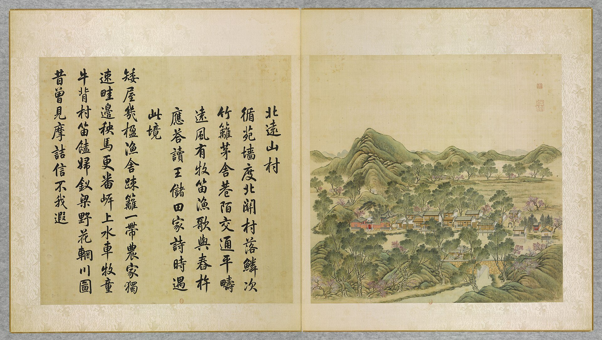
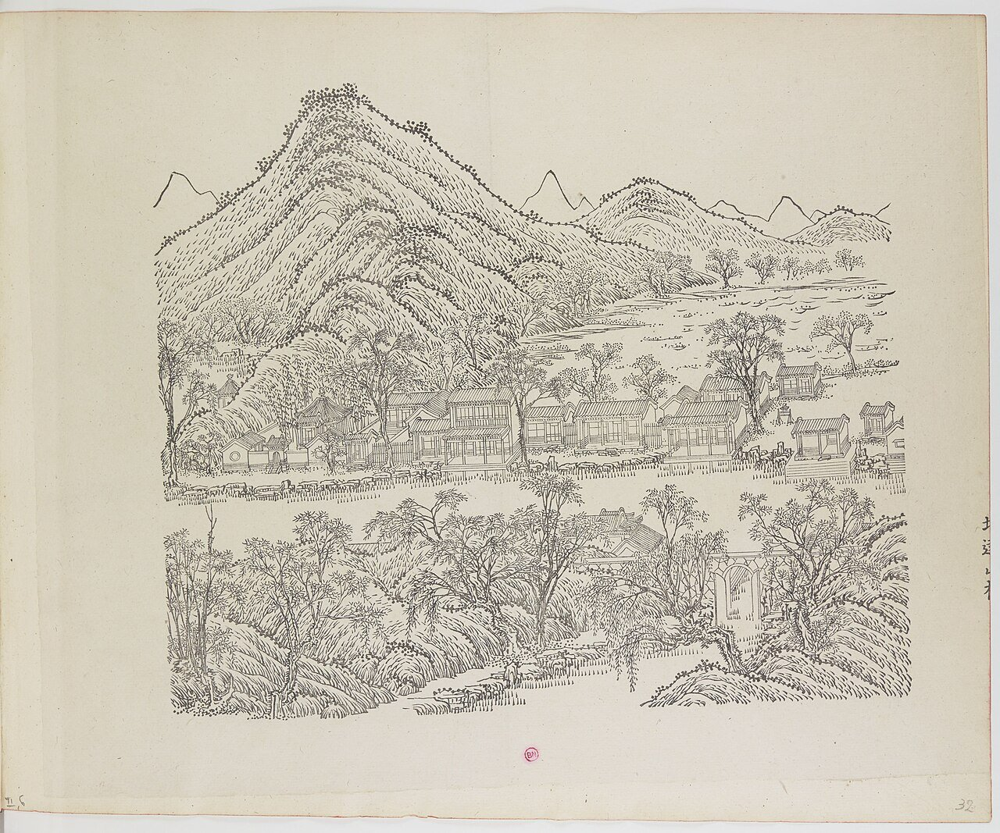
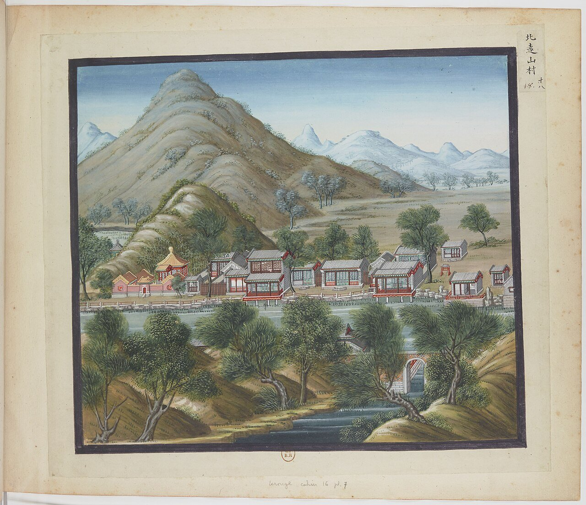
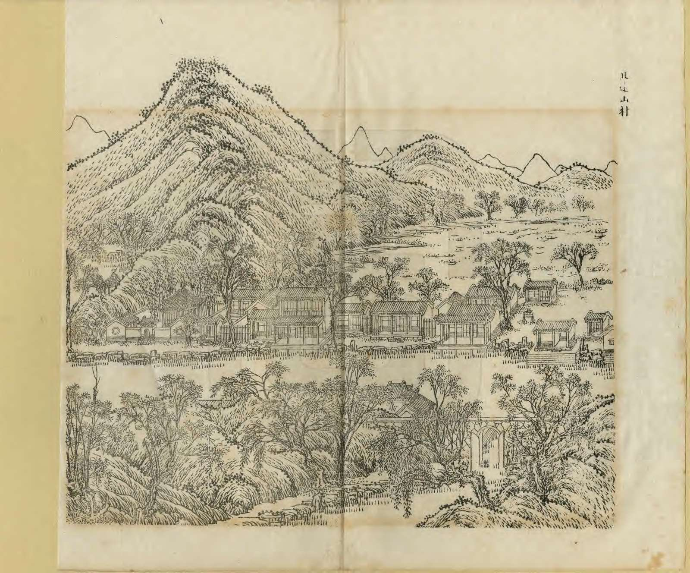
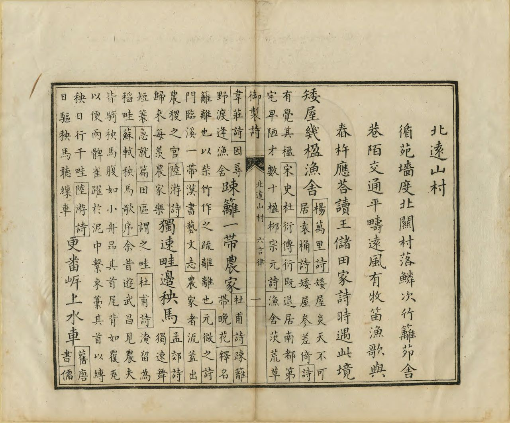

<!-- generated:start (scripts/building_pages.py): do not edit between these markers -->

# YM26: 北远山村 Beiyuan Shancun

Pei Yuan Shan T'sun (Village of the Distant Northern Mountains) · Yuanming Yuan

**3D object:** 8 boxes. Open it: `/reconstruction/3d.html?b=YM26`

## What we know

- **Name:** 北远山村 Beiyuan Shancun (S05, S02, S08, S01, S360, S361 · confidence A)
- **English:** Pei Yuan Shan T'sun (Village of the Distant Northern Mountains) (S05, S02, S08, S01, S360, S361)
- **Garden:** Yuanming Yuan (S05, S02, S08, S01, S360, S361)
- **Type:** scene (S05, S02, S08, S01, S360, S361 · confidence A)
- **Built:** by 1742 (first dated item) (S05, S02, S08, S01, S360, S361)
- **Changed:** 课农轩 rebuilt 1817 as a hall of 5 bays, 2 rolls, front annex (S05, S02, S08, S01, S360, S361)
- **Destroyed:** 课农轩, 观音庵 and service rooms survived 1860; lost around 1900 (S05, S02, S08, S01, S360, S361)
- **Position:** 40.01160, 116.29408. S01 sure (S01 · confidence B)
- **Plan reader's note:** Label at (5630,840), Malone 26 at (5440,843). South row along the stream. Halls not labelled. (S01) *(research copy, not public)*
- **How it was read:** sure (S01) *(research copy, not public)*
- **Plan pixels:** 5420, 850 (S01) *(research copy, not public)*

## Our model now

8 boxes stand in this compound, 8 on blocks drawn on the plan, 0 assumed. Its halls are listed below.

## Inside it (15)

- YM26-01 兰野
- YM26-02 绘雨精舍
- YM26-03 水村图
- YM26-04 皆春阁
- YM26-05 稻凉楼
- YM26-06 涉趣楼
- YM26-07 湛虚书屋
- YM26-B0079
- YM26-B0080
- YM26-B0081
- YM26-B0082
- YM26-B0083
- YM26-B0116
- YM26-B0117
- YM26-B0118

## Pictures (5)

- **P0026** (sure): 北遠山村 Beiyuan shancun [Village montagnard au loin, au septentrion] (圓明園四十景, 第26景) (1744 (BnF record: 1744年，清朝乾隆九年)). https://commons.wikimedia.org/wiki/File%3A%E5%9C%93%E6%98%8E%E5%9C%92%E5%9B%9B%E5%8D%81%E6%99%AF._%E7%AC%AC%E4%BA%8C%E5%8D%81%E5%85%AD%E6%99%AF_%28%E4%B8%8B%E5%86%8C%EF%BC%8C%E7%AC%AC%E5%85%AD%E5%B9%85%E5%9B%BE%29%2C_%E5%8C%97%E9%81%A0%E5%B1%B1%E6%9D%91_-_%28%E6%B8%85%29%E5%94%90%E5%B2%B1%E3%80%81%E6%B2%88%E6%BA%90%E5%90%88%E7%95%AB_%3B_%28%E4%B9%BE%E9%9A%86%E5%90%9F%E8%AF%97%EF%BC%8C%E6%B1%AA%E7%94%B1%E6%95%A6%E4%BB%A3%E4%B9%A6%29Beiyuan_shancun_-_%28Qing%29Tang_Dai%2C_Shen_Yuan_he_hua_-_btv1b550083407.jpg

  

- **P0091** (sure): 中国皇帝的宫殿与庙宇. 第32幅图, 北遠山村 - (清)孙祜、沈源Beiyuan shancun - (Qing)Sun Hu, Shen Yuan (1745 (Commons, from the BnF record)). https://commons.wikimedia.org/wiki/File%3A%E4%B8%AD%E5%9B%BD%E7%9A%87%E5%B8%9D%E7%9A%84%E5%AE%AB%E6%AE%BF%E4%B8%8E%E5%BA%99%E5%AE%87._%E7%AC%AC32%E5%B9%85%E5%9B%BE%2C_%E5%8C%97%E9%81%A0%E5%B1%B1%E6%9D%91_-_%28%E6%B8%85%29%E5%AD%99%E7%A5%9C%E3%80%81%E6%B2%88%E6%BA%90Beiyuan_shancun_-_%28Qing%29Sun_Hu%2C_Shen_Yuan_-_btv1b105206898.jpg

  

- **P0118** (sure): 海淀(镇)：中国皇帝的行宫. 第18幅图, 北遠山村Beiyuan shancun (1750-1792 (BnF, cb43831905b; ex coll. Bertin)). https://commons.wikimedia.org/wiki/File%3A%E6%B5%B7%E6%B7%80%28%E9%95%87%29%EF%BC%9A%E4%B8%AD%E5%9B%BD%E7%9A%87%E5%B8%9D%E7%9A%84%E8%A1%8C%E5%AE%AB._%E7%AC%AC18%E5%B9%85%E5%9B%BE%2C_%E5%8C%97%E9%81%A0%E5%B1%B1%E6%9D%91Beiyuan_shancun_-_btv1b10520716d.jpg

  

- **P0257** (sure): 北遠山村 Beiyuan Shancun (御製圓明園圖詠, 1887 石印本, 下卷 (Commons 卷二), 第26景; printed title in the right margin of the picture) (光緒十三年 1887 (Commons/NLC record; colophon 光緒十三年七月天津石印書屋 in the SSID copy, S98 PDF p.2); design after the woodblock of 1745 by 孫祜 Sun Hu and 沈源 Shen Yuan). https://commons.wikimedia.org/wiki/File%3ANLC403-312001107375-14034_%E7%A6%A6%E5%88%B6%E5%9C%93%E6%98%8E%E5%9C%92%E5%9C%96%E8%A9%A0_%E5%8D%B7%E4%BA%8C.pdf?page=18

  

- **P0533** (sure): 北遠山村 Beiyuan Shancun: 乾隆 Qianlong's preface and poem with the courtiers' commentary, 御製圓明園圖詠 1887 (poem 1744 (乾隆九年); this printing 1887). https://commons.wikimedia.org/wiki/File%3ANLC403-312001107375-14034_%E7%A6%A6%E5%88%B6%E5%9C%93%E6%98%8E%E5%9C%92%E5%9C%96%E8%A9%A0_%E5%8D%B7%E4%BA%8C.pdf?page=19

  

## Texts and drawings (26)

- **E1749** (poem, sure): 御製北逺山村詩（圓明園四十景詩）. 1744 (乾隆九年) · printed in S05 j82:5b-6a · S40. https://github.com/kanripo/KR2k0036/blob/master/KR2k0036_082.txt
  > 乾隆九年 御製北逺山村詩 循苑牆度北闗村落鱗次竹籬茅舎巷陌交通平疇逺風有牧□漁歌與舂杵應答讀王儲田家詩時遇此境 矮屋㡬楹漁舎疎籬一帶農家獨速畦邊秧馬更番岸上水車牧童牛背村□饁婦釵梁野花輞川圖昔曾見摩詰信不我遐
  Beyond the garden wall's north gate, a village of bamboo fences and thatch with lanes between. Level fields stretch away; herdsmen's and fishers' songs answer the pestles, as in 王儲 Wang Chu's farmstead verse.
- **E1753** (text, sure): 日下舊聞考 北远山村. 1780s (乾隆 敕撰) · j82:5a-5b · S05. https://github.com/kanripo/KR2k0036/blob/master/KR2k0036_082.txt
  > 魚躍鳶飛之東禾疇彌望河南北岸仿農居村市者為北逺山村北岸石垣西偏為蘭野後為繪雨精舍其西南為水村圖又西有樓前後相屬前為皆春閣後為稻涼樓又西為涉趣樓右為湛虛書屋（圓明園册）臣等謹按北逺山村四十景之一兹額及蘭野繪雨精舎諸額皆皇上御書水村圖聫曰魚躍鳶飛參物理耕田鑿井樂民和亦御書
  East of 魚躍鳶飛, grain fields and a mock farm village on both banks of a stream: 北逺山村 with 蘭野, 繪雨精舍, 水村圖, the linked 皆春閣 and 稻涼樓, 涉趣樓 and 湛虛書屋.
- **E1747** (poem, sure): 北远山村: 乾隆七年 poem of the Qianlong Emperor. 乾隆七年 (1742), date from the compilation · p.251 item (1), under 北远山村 · S360. https://www.yuanmingyuanpark.cn/xs/yjbg/202007/P020200730387572832602.pdf#page=251
  > 亭皋淡寒林，坂原余残菊。山村学溪荘，竹篱围茅屋。欲验农功勤，时寓几余目。值此三冬初，乐彼五糓熟。
  Poem of the Qianlong Emperor at 北远山村, 1742. Year as given by the compilation.
- **E1748** (poem, sure): 北远山村: 乾隆八年 poem of the Qianlong Emperor. 乾隆八年 (1743), date from the compilation · p.252 item (3), under 北远山村 · S360. https://www.yuanmingyuanpark.cn/xs/yjbg/202007/P020200730387572832602.pdf#page=252
  > 苇㟁沙汀曲复斜，溪村一棹玩清嘉。田间野老骑秧马，术上牯牛转水车。试舞鹤雏双羽襹，学讴牧竖数声哑。迎眸好景披图画，何异游仙泛若耶。”“西山凝黛望中遥，时有轻云出岫飘。润逼林皋当首夏，甘流泉乳想余姚。苏轼诗。 （余姚古县亦何有龙井白泉甘胜乳）连天树色清依槛，得雨溪声涨到桥。寄语方壶员峤客，好携烟侣共呼招。烟容水态罨篷窗，无恙轻风挂竹䉶。出埭玉勹纔个个，掠空沙燕故双双。僧归野寺闲行杖，人过山村远吠尨。日暮西峰飞雨脚，拟听彻夜乱珠摐。
  Poem of the Qianlong Emperor at 北远山村, 1743, on boating. Year as given by the compilation.
- **E1761** (poem, sure): 皆春阁. 乾隆二十五年 (1760) · v2 p.243, under 北远山村; source ref 7-364 · S361. https://www.yuanmingyuanpark.cn/xs/yjbg/202008/P020200803382343267004.pdf#page=246
  > 小阁构山村，皆春义可论。一编读周易，四德首乾元。宁谓花无谢，应知道有根。熙熙虽未逮，景仰志犹存。
  Poem 皆春阁 by the Qianlong Emperor, 1760, filed by the editors under 北远山村.
- **E1765** (poem, sure): 题涉趣楼. 乾隆二十五年 (1760) · v2 p.243, under 北远山村; source ref 7-364 · S361. https://www.yuanmingyuanpark.cn/xs/yjbg/202008/P020200803382343267004.pdf#page=246
  > 偶额书楼曰涉趣，山容水态满名园。渊明语只能从半，志在重华辟四门。
  Poem 题涉趣楼 by the Qianlong Emperor, 1760, filed by the editors under 北远山村.
- **E1766** (poem, sure): 题湛虚书屋. 乾隆二十五年 (1760) · v2 p.242, under 北远山村; source ref 7-363 · S361. https://www.yuanmingyuanpark.cn/xs/yjbg/202008/P020200803382343267004.pdf#page=245
  > 桑苎村中茅草屋，闲来就读亦观耕。半窗受日虚而朗，一水护门湛且清。范缓倪迂法如是，王丞杜老句多情。圃场获罢心方慰，又对同云望六霙。
  Poem 题湛虚书屋 by the Qianlong Emperor, 1760, filed by the editors under 北远山村.
- **E1759** (poem, sure): 绘雨精舍作. 乾隆二十六年 (1761) · v2 p.243, under 北远山村; source ref 8-379 · S361. https://www.yuanmingyuanpark.cn/xs/yjbg/202008/P020200803382343267004.pdf#page=246
  > 精舍寻常以雨称，今朝生面又堪凭。增池润埒皆同调，缀树糊篁此绝胜。青帝化机原后素，天公绘事实多能。
  Poem 绘雨精舍作 by the Qianlong Emperor, 1761, filed by the editors under 北远山村.
- **E1760** (poem, sure): 题绘雨精舍. 乾隆二十六年 (1761) · v2 p.243, under 北远山村; source ref 8-416 · S361. https://www.yuanmingyuanpark.cn/xs/yjbg/202008/P020200803382343267004.pdf#page=246
  > 森森银竹矗烟空，绘事东皇有独工。乱织素丝非后素，即看红杏是新红。峰峦入咏油云外，蓑笠催耕润野中。记得栖霞驻春跸，山房佳致宛相同
  Poem 题绘雨精舍 by the Qianlong Emperor, 1761, filed by the editors under 北远山村.
- **E1763** (poem, sure): 稻凉楼. 乾隆二十六年 (1761) · v2 p.244, under 北远山村; source ref 8-444 · S361. https://www.yuanmingyuanpark.cn/xs/yjbg/202008/P020200803382343267004.pdf#page=247
  > 绿塍浑是水云乡，触目知耕复课桑。此处不须称避暑，北窗常引稻风凉。
  Poem 稻凉楼 by the Qianlong Emperor, 1761, filed by the editors under 北远山村.
- **E1762** (poem, sure): 戏题皆春阁. 乾隆二十八年 (1763) · v2 p.244, under 北远山村; source ref 8-631 · S361. https://www.yuanmingyuanpark.cn/xs/yjbg/202008/P020200803382343267004.pdf#page=247
  > 青阳有意到根荄，造物无心栽者培。彩胜华灯都在架，笑予过节始言来。
  Poem 戏题皆春阁 by the Qianlong Emperor, 1763, filed by the editors under 北远山村.
- **E1767** (poem, sure): 戏题湛虚书屋. 乾隆三十八年 (1773) · v2 p.246, under 北远山村; source ref 11-435 · S361. https://www.yuanmingyuanpark.cn/xs/yjbg/202008/P020200803382343267004.pdf#page=249
  > 水天映座澹如如，偶到循名自愧予。较量应输书屋者，湛然恒此守其虚。水村图（11-437）
  Poem 戏题湛虚书屋 by the Qianlong Emperor, 1773, filed by the editors under 北远山村.
- **E1764** (poem, sure): 稻凉楼口号. 乾隆五十四年 (1789) · v2 p.249, under 北远山村; source ref 17-49 · S361. https://www.yuanmingyuanpark.cn/xs/yjbg/202008/P020200803382343267004.pdf#page=252
  > 稻迟浸种水干沟，鳞町空空徒映楼。欲待乘凉闲拾级，年来避暑付名留
  Poem 稻凉楼口号 by the Qianlong Emperor, 1789, filed by the editors under 北远山村.
- **E1752** (poem, sure): 北远山村: 道光三年 poem of the Daoguang Emperor. 道光三年 (1823), date from the compilation · p.252 item (11), under 北远山村 · S360. https://www.yuanmingyuanpark.cn/xs/yjbg/202007/P020200730387572832602.pdf#page=252
  > 今晨更喜十分晴，放棹平湖万象清。几转碧溪最深处，田家风景系予情。日午停桡曲涧滨，高低文石势嶙峋。试登层阁舒遐瞩，廑念畿南失业民。
  Poem of the Daoguang Emperor at 北远山村, 1823, on boating. Year as given by the compilation.
- **E1750** (poem, likely): 由北远山村泛舟至耕云堂观水田成什. 嘉庆十二年 (1807) · v3 p.193, under 若帆之阁; source ref 3-348 · S361. https://www.yuanmingyuanpark.cn/xs/yjbg/202008/P020200803382569071850.pdf#page=196
  > 清溪曲折泛轻航，岸沚汀兰互绚芳。林幄蝉声如和答，水村农事正匆忙。三耘冒暑诚非易，百谷登场候最长。欲识田功岂学稼，豳风雅绘在山堂。
  Poem 由北远山村泛舟至耕云堂观水田成什 by the Jiaqing Emperor, 1807, filed by the editors under 若帆之阁.
- **E1751** (poem, likely): 北远山村泛舟至耕云堂即景成什. 嘉庆十五年 (1810) · v3 p.193, under 若帆之阁; source ref 4-254 · S361. https://www.yuanmingyuanpark.cn/xs/yjbg/202008/P020200803382569071850.pdf#page=196
  > 几转溪湾到水门，扁舟缓度北山村。烟笼柳岸汀洲暗，风拂稻畦稏翻。亦有浴波遍鹅鸭，岂同留客足鸡豚。田家景物御园备，探讨民艰重本原。
  Poem 北远山村泛舟至耕云堂即景成什 by the Jiaqing Emperor, 1810, filed by the editors under 若帆之阁.
- **E1755** (description, sure): Scene 26, 北远山村 Beiyuan Shancun. 1934 · p.91 · S02. https://archive.org/details/historyofpekings00malo
  > This was a row of farmers' houses by the stream near the north gate of the garden. A few houses in the row, built on piles over the water, and some bamboo fences were more reminiscent of the south
  A row of farmers' houses by the stream near the north gate, some on piles over the water, with bamboo fences.
- **E1011** (description, sure): Site status table, about 2011: nothing visible, or built over. c. 2011 · 系列06 repost, status table · S356. https://blog.sina.com.cn/s/blog_c27029650101itzz.html
  Same table. In it the first group shows no visible remains; 得全阁, 流香渚, 凤麟洲, 涵秋馆, 蔚藻堂, 中和堂, 敷春堂 and 心镜轩 have service buildings on them, and 含晖楼, 澄心堂, 延寿寺, 清夏堂 and 喜雨山房 are occupied by other institutions. 澹泊宁静 and several others have been dug since, so this is out of date for them.
- **E2352** (description, sure): 课农轩: rebuilt from 北远山村. post 2024; on Yangshi Lei plans · 三幅样式雷 section 二; 圆明园新证 table · S337. http://iqh.ruc.edu.cn/old/qdhjylyjzx/xszl/jzys/59b83e20f7ab4840b746a6208a550939.htm
  课农轩 replaced 皆春阁 and neighbouring buildings of 北远山村 in 1816-17 by these two articles. It stood after 1860 and served works of 1896. S47 p.126 records offerings at its 观音庵 in 1861.
- **E2379** (description, likely): 贾珺 on 北远山村 龙王庙, later 观音庵. 2012 · S47 p.113 and table row 15 · S47. https://www.dpm.org.cn/Uploads/File/2018/06/15/u5b23730ae0e5a.pdf
  North-west of 北远山村: octagonal pyramid-roof hall with a one-bay south porch, built 1733 for Yongzheng's tablet of the rain god, from 1734 a dragon-king temple, later 观音庵, date unknown. The plan's 观音庵 is a round building on a mound just inside the north gate, about 55 m from the listed centre of YM26 (own calculation): it fits form, place and name. S47 fig.7 shows it.
- **E2156** (description, likely): 圆明园买卖街钩沉. post n.d. · hwyj · S115. http://iqh.ruc.edu.cn/old/qdhjylyjzx/xszl/hwyj/4115411323ba4429a9ecc9ae5b2bc2e5.htm
  The two shop streets. 同乐园's runs over 130 m north-south, split by a stream and 双桥, to the south of 舍卫城, in place by 1744. 含经堂's, dug in 2001-02, has a base 135.65 x about 6.3 m and 28 stoves, so perhaps eating houses. It has 40 shop bays in 9 units, against 10 buildings on the Yangshi Lei plan.
- **E1754** (description, sure): 圆明园百景史事分景汇编: 北远山村. 1742-1823 · from p.251, under 北远山村 · S360. https://www.yuanmingyuanpark.cn/xs/yjbg/202007/P020200730387572832602.pdf#page=251
  The compiler describes a water gate at the south-east with Qianlong's stone plaque, low farm courts with mulberries for silkworms, and 课农轩, rebuilt in 1817 as a five-bay, two-roll hall with a front annex, with 观音庵 to the west. 北远山村: 11 dated items, 1742-1823, of which 11 poems (Qianlong, Jiaqing, Daoguang); recurring themes: boating, the view, the harvest. First dated 1742, last dated 1823.
- **E1756** (description, sure): 圆明园五朝御制诗文集注 v2, editors' note on 北远山村. 2020 edition · v2 p.237 · S361. https://www.yuanmingyuanpark.cn/xs/yjbg/202008/P020200803382343267004.pdf#page=240
  A village scene from late Yongzheng, the garden's silk-farming quarter from 1729. Five-bay 课农轩 with a three-bay annex was built in 1817 on the sites of 皆春阁, 稻凉楼, 涉趣楼 and 湛虚书屋. West of it the octagonal 观音庵, once a dragon-king temple; also 水村图, 绘雨精舍, 兰野, 观澜亭. Some survived 1860 under guard.
- **E1757** (drawing, sure): 《国家图书馆藏样式雷图档·圆明园卷初编》: 北远山村（课农轩）. mostly 道光, 咸丰, 同治 per the publisher · 初编 目录: 北远山村（课农轩）, pp.397-404 · S13. https://www.nlcpress.com/ProductView.aspx?Id=7642
  The printed facsimile of the National Library of China's Yangshi Lei sheets has a section on this place at pp.397-404 (8 pages, section length worked out from the next heading); sheet titles and numbers are in the volume, ordered from a library.
- **E1758** (drawing, sure): 北远山村总平面图 (图名: 课农轩). 嘉庆年间 · 国家图书馆善本部 样040-1号 · S310. https://www.mhymy.com/dasl/ysltd/7678.html
  Jiaqing-period plan of the Beiyuan Shancun scene under the title Kenong Xuan, 791x592 mm. No image here; the site may ask a small payment for the full record.
- **E2470** (drawing, likely): 样式雷烫样 of the Tongzhi repair of Yuanming Yuan (list by site). 同治 (1873-74) for most, per the report · Lei family models, now chiefly 故宫博物院; the report does not give numbers · S920. https://www.thepaper.cn/newsDetail_forward_2201516
  The Lei family card models cover Yuanming Yuan, Wanchun Yuan, the Summer Palace and others; most of the Yuanming Yuan ones were made for Tongzhi's repair: the whole central (九洲清晏) axis, 泉石自娱, 同乐堂, 上下天光, 思顺堂, 天地一家春; in the north 恒春堂, 课农轩, 廓然大公; in the south 勤政殿; in the west 万方安和. Period objects of 1873-74, not of 1860: they show the Tongzhi design, which kept many old names but changed forms.

**On the plan:** Drawn on the plan of the gardens (S01), labelled 北远山村. https://artmuseum.princeton.edu/collections/objects/138657

## Reconstructions by others (5)

Modern interpretation, not evidence.
- **R0073** (3D model, likely): 《圆明园四十景数字化复原及应用》. 圆明园管理处 with 中央美院, 圆明园管理处; 中央美术学院, 2025. https://news.bjd.com.cn/2026/10/16/11997513.shtml Research-only: link card.
- **R0002** (paper figure, likely): 三幅样式雷圆明园河道全图辨析: west road of 九洲清晏 after 1828. after 2024. http://iqh.ruc.edu.cn/old/qdhjylyjzx/xszl/jzys/59b83e20f7ab4840b746a6208a550939.htm Research-only: link card.
- **R0308** (paper figure, sure): 《圆明园新证》: reading of Palace Museum plan No. 1704, stripped of its later paste-ups to the Qianlong layout of about 1779. . http://iqh.ruc.edu.cn/old/qdhjylyjzx/xszl/xstl/1c9094aef4f041148f15883c7c266cb9.htm Research-only: link card.
- **R0309** (paper figure, likely): 《一幅样式雷圆明园全图的年代推断》: NLC plan 043-001 dated by the outlines of scenes. . http://iqh.ruc.edu.cn/old/qdhjylyjzx/xsdt/xsxl/794b73c241ef4fa79b8d6720f31bac13.htm Research-only: link card.
- **R0310** (paper figure, likely): 《“样式雷”图与圆明园》: survey of about 1700 Yangshi Lei plans, naming scenes changed after 1744. assumed: the author of 《圆明园变迁史探微》. http://iqh.ruc.edu.cn/old/qdhjylyjzx/xszl/ylfj/7c89633b1d0247b7bd91da2ff25c61f8.htm Research-only: link card.

## Evidence for the set of buildings

- Reconstructions and comparables for the whole garden, 圆明园 Yuanming Yuan: see GARDEN-YM

## Open questions

- Q136: YM26 / YM51

<!-- generated:end -->

## Notes

<!-- Yours: regeneration never touches this part. It goes on the public site; what you write below a line holding only %% private %% stays in the research copy. -->
