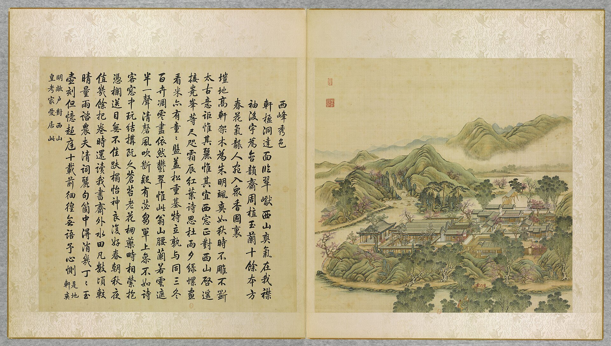
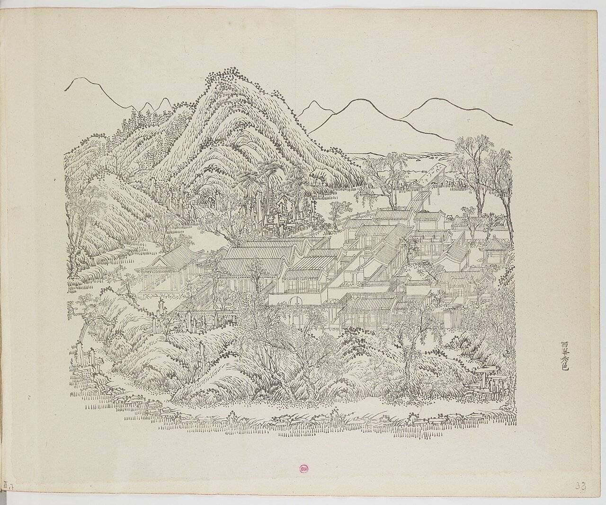
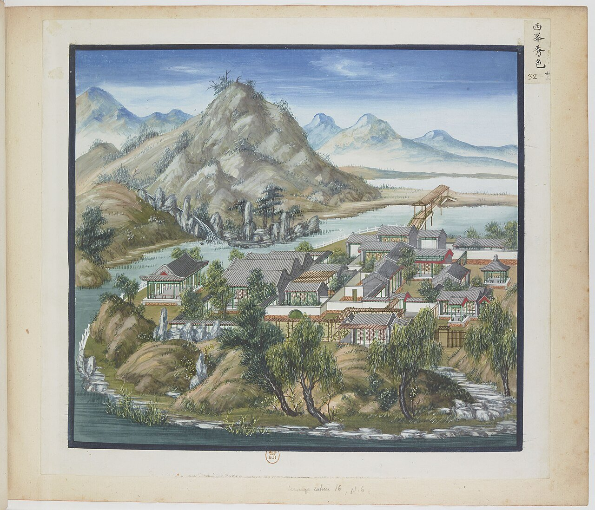
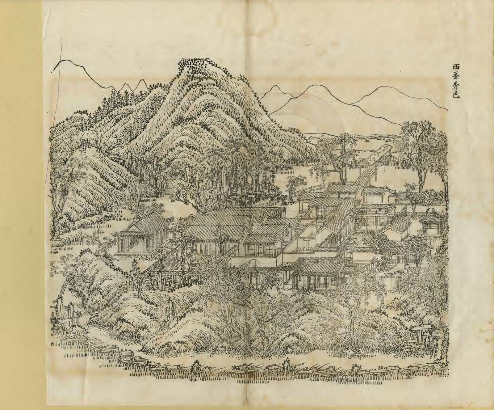
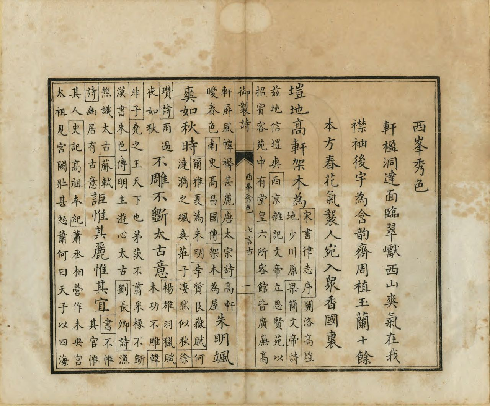

<!-- generated:start (scripts/building_pages.py): do not edit between these markers -->

# YM27: 西峰秀色 Xifeng Xiuse

Hsi Feng Hsiu Se (the Elegant Color of the Western Peaks) · Yuanming Yuan

**3D object:** 13 boxes. Open it: `/reconstruction/3d.html?b=YM27`

## What we know

- **Name:** 西峰秀色 Xifeng Xiuse (S05, S02, S08, S43, S01, S361 · confidence A)
- **English:** Hsi Feng Hsiu Se (the Elegant Color of the Western Peaks) (S05, S02, S08, S43, S01, S361)
- **Garden:** Yuanming Yuan (S05, S02, S08, S43, S01, S361)
- **Type:** scene (S05, S02, S08, S43, S01, S361 · confidence A)
- **Built:** 雍正六年 1728 (S43) (S05, S02, S08, S43, S01, S361)
- **Destroyed:** 1860 (S05, S02, S08, S43, S01, S361)
- **Position:** 40.01057, 116.29200. S01 sure (S01 · confidence B)
- **Note:** Yongzheng favourite [j82:7b-8a]. West-facing. Theatre from the start (S43). (S05, S02, S08, S43, S01, S361)
- **Plan reader's note:** Label at (4385,1330) on the west side, hall faces W. Scroll gap at x 4305 just west: 小匡庐 across the river is on the other side. (S01) *(research copy, not public)*
- **How it was read:** sure (S01) *(research copy, not public)*
- **Plan pixels:** 4422, 1277 (S01) *(research copy, not public)*

## Our model now

13 boxes stand in this compound, 13 on blocks drawn on the plan, 0 assumed. Its halls are listed below.

## Inside it (16)

- YM27-01 西峰秀色轩
- YM27-02 小匡庐
- YM27-03 龙王庙
- YM27-04 含韵斋
- YM27-05 一堂和气
- YM27-06 自得轩
- YM27-07 岚镜舫
- YM27-08 花港观鱼
- YM27-B0164
- YM27-B0189
- YM27-B0190
- YM27-B0191
- YM27-B0192
- YM27-B0208
- YM27-B0209
- YM27-B0210

## Pictures (5)

- **P0027** (sure): 西峰秀色 Xifeng xiuse [Couleurs d'élégance dans les montagnes de l'Ouest] (圓明園四十景, 第27景) (1744 (BnF record: 1744年，清朝乾隆九年)). https://commons.wikimedia.org/wiki/File%3A%E5%9C%93%E6%98%8E%E5%9C%92%E5%9B%9B%E5%8D%81%E6%99%AF._%E7%AC%AC%E4%BA%8C%E5%8D%81%E4%B8%83%E6%99%AF_%28%E4%B8%8B%E5%86%8C%EF%BC%8C%E7%AC%AC%E4%B8%83%E5%B9%85%E5%9B%BE%29%2C_%E8%A5%BF%E5%B3%B0%E7%A7%80%E8%89%B2_-_%28%E6%B8%85%29%E5%94%90%E5%B2%B1%E3%80%81%E6%B2%88%E6%BA%90%E5%90%88%E7%95%AB_%3B_%28%E4%B9%BE%E9%9A%86%E5%90%9F%E8%AF%97%EF%BC%8C%E6%B1%AA%E7%94%B1%E6%95%A6%E4%BB%A3%E4%B9%A6%29Xifeng_xiuse_-_%28Qing%29Tang_Dai%2C_Shen_Yuan_he_hua_-_btv1b55008341p.jpg

  

- **P0092** (sure): 中国皇帝的宫殿与庙宇. 第33幅图, 西峯秀色 - (清)孙祜、沈源Xifeng xiuse - (Qing)Sun Hu, Shen Yuan (1745 (Commons, from the BnF record)). https://commons.wikimedia.org/wiki/File%3A%E4%B8%AD%E5%9B%BD%E7%9A%87%E5%B8%9D%E7%9A%84%E5%AE%AB%E6%AE%BF%E4%B8%8E%E5%BA%99%E5%AE%87._%E7%AC%AC33%E5%B9%85%E5%9B%BE%2C_%E8%A5%BF%E5%B3%AF%E7%A7%80%E8%89%B2_-_%28%E6%B8%85%29%E5%AD%99%E7%A5%9C%E3%80%81%E6%B2%88%E6%BA%90Xifeng_xiuse_-_%28Qing%29Sun_Hu%2C_Shen_Yuan_-_btv1b105206913.jpg

  

- **P0132** (sure): 海淀(镇)：中国皇帝的行宫. 第32幅图, 西峯秀色Xifeng xiuse (1750-1792 (BnF, cb43831905b; ex coll. Bertin)). https://commons.wikimedia.org/wiki/File%3A%E6%B5%B7%E6%B7%80%28%E9%95%87%29%EF%BC%9A%E4%B8%AD%E5%9B%BD%E7%9A%87%E5%B8%9D%E7%9A%84%E8%A1%8C%E5%AE%AB._%E7%AC%AC32%E5%B9%85%E5%9B%BE%2C_%E8%A5%BF%E5%B3%AF%E7%A7%80%E8%89%B2Xifeng_xiuse_-_btv1b10520717v.jpg

  

- **P0258** (sure): 西峯秀色 Xifeng Xiuse (御製圓明園圖詠, 1887 石印本, 下卷 (Commons 卷二), 第27景; printed title in the right margin of the picture) (光緒十三年 1887 (Commons/NLC record; colophon 光緒十三年七月天津石印書屋 in the SSID copy, S98 PDF p.2); design after the woodblock of 1745 by 孫祜 Sun Hu and 沈源 Shen Yuan). https://commons.wikimedia.org/wiki/File%3ANLC403-312001107375-14034_%E7%A6%A6%E5%88%B6%E5%9C%93%E6%98%8E%E5%9C%92%E5%9C%96%E8%A9%A0_%E5%8D%B7%E4%BA%8C.pdf?page=21

  

- **P0534** (sure): 西峯秀色 Xifeng Xiuse: 乾隆 Qianlong's preface and poem with the courtiers' commentary, 御製圓明園圖詠 1887 (poem 1744 (乾隆九年); this printing 1887). https://commons.wikimedia.org/wiki/File%3ANLC403-312001107375-14034_%E7%A6%A6%E5%88%B6%E5%9C%93%E6%98%8E%E5%9C%92%E5%9C%96%E8%A9%A0_%E5%8D%B7%E4%BA%8C.pdf?page=22

  

## Texts and drawings (39)

- **E1769** (poem, sure): 御製西峯秀色詩（圓明園四十景詩）. 1744 (乾隆九年) · printed in S05 j82:7a-8a · S40. https://github.com/kanripo/KR2k0036/blob/master/KR2k0036_082.txt
  > 乾隆九年 御製西峯秀色詩 軒楹洞達面臨翠巘西山爽氣在我襟袖後宇為含韻齋周植玉蘭十餘本方春花氣襲人宛入衆香國裏 嵦地高軒架木為朱明颯爽如秋時不雕不斵太古意詎惟其麗惟其宜西窻正對西山啟遥接嶢峯等尺咫霜辰紅葉詩思杜雨夕緑螺畫㸔米亦有童童盤葢松重基特立孰與同三冬百卉凋零盡依然鬱翠惟此翁山腰蘭若雲遮半一聲清磬風吹㫁疑有苾蒭單上參不如詩客窻中玩結搆既久蒼苔老花棚藥畤相縈抱慿欄送目無不佳趺榻怡神良復好春朝秋夜值㡬餘把卷時還讀我書齋外水田凡數頃較晴量雨諮農夫清詞麗句箇中得消幾丁丁玉壺刻但憶趨庭十載前徊徨無語予心惻（是地軒爽明敞戸對西山皇考最愛居此）
  Open bays face green peaks, so the air of the Western Hills reaches his sleeves. 含韻齋 at the rear is ringed by a dozen or more magnolias that scent the air in spring. The poem closes by noting this was his father's favourite place.
- **E1781** (text, sure): 日下舊聞考 西峰秀色. 1780s (乾隆 敕撰) · j82:6b-7a · S05. https://github.com/kanripo/KR2k0036/blob/master/KR2k0036_082.txt
  > 北逺山村西南有室臨河西向為西峯秀色河西松巒峻峙為小匡廬後有龍王廟西峯秀色之東為含韻齋又東為一堂和氣又東南為自得軒後垣東為嵐鏡舫西為花港觀魚（圓明園册）臣等謹按西峯秀色四十景之一兹額及含韻齋一堂和氣自得軒額皆世宗御書嵐鏡舫花港觀魚諸額皆皇上御書
  A room facing west on the river: 西峯秀色, with the pine rock 小匡廬 and a 龍王廟 across the water, 含韻齋, 一堂和氣, 自得軒, 嵐鏡舫 and 花港觀魚.
- **E1782** (text, sure): 養吉齋叢錄 卷十四. mid-19th c. (printed 1890s), on earlier reigns · 卷十四, line 958 of the corpus file · S202. https://raw.githubusercontent.com/garychowcmu/daizhigev20/master/%E5%8F%B2%E8%97%8F/%E5%BF%97%E5%AD%98%E8%AE%B0%E5%BD%95/%E5%85%BB%E5%90%89%E6%96%8B%E4%B8%9B%E5%BD%95.txt
  > 西峰秀色，为御园四十景之一，七夕巧筵，曩时常设于此，有彩棚蛛盒之胜。乾隆御制诗云：「西峰秀色霭宵烟，又试新秋乞巧筵。」盖纪实也。
  The seventh-night feast was often held at 西峯秀色, with coloured sheds.
- **E1768** (poem, sure): 小匡庐: 乾隆二年 poem of the Qianlong Emperor. 乾隆二年 (1737), date from the compilation · p.245 item (1), under 小匡庐 · S360. https://www.yuanmingyuanpark.cn/xs/yjbg/202007/P020200730387572832602.pdf#page=245
  > 恠石苍龙似，飞泉玉练如。天然隔尘境，最数小匡庐。众木颇蓊欎，青松逈出群。时有微风至， 萧萧天籁闻。挂为瀑布寒，散作菱花皎。谁点星星黒，云中一飞鸟。池亭架波上，俯视流泉泚。何用披南华，即此当秋水。仰有阴可乘，俯有鱼可钓。中有静观人，悠然发长啸。暑雨思民怨，薫风想舜琴。乘闲此小憩，抚景媿吾心。
  Poem of the Qianlong Emperor at 小匡庐, 1737, on the view. Year as given by the compilation.
- **E1794** (poem, sure): 小匡庐六首. 乾隆三年 (1738) · v2 p.258, under 西峰秀色; source ref 1-424 · S361. https://www.yuanmingyuanpark.cn/xs/yjbg/202008/P020200803382343267004.pdf#page=261
  > 怪石苍龙似，飞泉玉练如。天然隔尘境，最数小匡庐。众木颇蓊郁，青松迥出群。时有微风至，萧萧天籁闻。挂为瀑布寒，散作菱花皎。谁点星星黑，云中一飞鸟。池亭架波上，俯视流泉泚。何用披南华，即此当秋水。
  Poem 小匡庐六首 by the Qianlong Emperor, 1738, filed by the editors under 西峰秀色.
- **E1792** (poem, sure): 西峰秀色. 乾隆九年 (1744) · v2 p.260, under 西峰秀色; source ref 2-687 · S361. https://www.yuanmingyuanpark.cn/xs/yjbg/202008/P020200803382343267004.pdf#page=263
  > 轩楹洞达，面临翠巘。西山爽气，在我襟袖。后宇为含韵斋，周植玉兰十余本。方春花气袭人，宛入众香国里。垲地高轩架木为，朱明飒爽如秋时。不雕不斵太古意，讵惟其丽惟其宜。西窗正对西山启，遥接峣峰等尺咫。霜辰红叶诗思杜，雨夕绿螺画看米。亦有童童盘盖松，重基特立孰与同。三冬百卉凋零尽，依然郁翠惟此翁。山腰兰若云遮半，一声清磬风吹断。疑有苾刍单上参，不如诗客窗中玩。结构既久苍苔老，花棚药畤相萦抱。凭栏送目无不佳，趺榻怡神良复好。春朝秋夜值几余，把卷时还读我书。斋外水田凡数顷，较晴量雨谘农夫。清词丽句个中得，消几丁丁玉壶刻。但忆趋庭十载前，徊徨无语予心恻
  Poem 西峰秀色 by the Qianlong Emperor, 1744, filed by the editors under 西峰秀色.
- **E1796** (poem, sure): 含韵斋木兰. 乾隆九年 (1744) · v2 p.259, under 西峰秀色; source ref 2-669 · S361. https://www.yuanmingyuanpark.cn/xs/yjbg/202008/P020200803382343267004.pdf#page=262
  > 东风早似醺，玉树尚芳芬。落莫心空度，徘徊意转欣。分来馡座雾，留得罨窗云。春色谁无分，游蜂镇日纷。
  Poem 含韵斋木兰 by the Qianlong Emperor, 1744, filed by the editors under 西峰秀色.
- **E1770** (poem, sure): 含韵斋: 乾隆十年 poem of the Qianlong Emperor. 乾隆十年 (1745), date from the compilation · p.244 item (1), under 含韵斋 · S360. https://www.yuanmingyuanpark.cn/xs/yjbg/202007/P020200730387572832602.pdf#page=244
  > 江郎才思谢家娇，几许春光著意描。含韵斋中三月半，翠罂银管不相饶。 （圆明园含韵斋木兰极盛）
  Poem of the Qianlong Emperor at 含韵斋, 1745, on the view. Year as given by the compilation.
- **E1797** (poem, sure): 含韵斋玉兰. 乾隆十一年 (1746) · v2 p.260, under 西峰秀色; source ref 2-809 · S361. https://www.yuanmingyuanpark.cn/xs/yjbg/202008/P020200803382343267004.pdf#page=263
  > 桃魂杏魄逐香尘，玉树临风尚占春。讵是幽斋能驻景，应缘搁笔待诗人。花开花谢悟根尘，底事凋秋底艳春。待诏风流重得晤，玉兰堂里玉兰人。
  Poem 含韵斋玉兰 by the Qianlong Emperor, 1746, filed by the editors under 西峰秀色.
- **E1798** (poem, sure): 自得轩. 乾隆二十三年 (1758) · v2 p.262, under 西峰秀色; source ref 6-599 · S361. https://www.yuanmingyuanpark.cn/xs/yjbg/202008/P020200803382343267004.pdf#page=265
  > 蜃窗绨几静无尘，鸟语花香乐有真。万物当春皆自得，给求养欲厪吾民。
  Poem 自得轩 by the Qianlong Emperor, 1758, filed by the editors under 西峰秀色.
- **E1771** (poem, sure): 自得轩: 乾隆二十六年 poem of the Qianlong Emperor. 乾隆二十六年 (1761), date from the compilation · p.243 item (1), under 自得轩 · S360. https://www.yuanmingyuanpark.cn/xs/yjbg/202007/P020200730387572832602.pdf#page=243
  > 女萝施松上，特立颇艰致。独树见此花，亭亭与他异。植之自得轩，繄予有深意。表贞殊凡品，扶弱成良器。傅架引其蔓，弗使众木厕。吐艳既盈庭，铺阴亦满砌。雨余芳润潄，自得义真契。鐡中有铮铮，卉谱徐宣类。
  Poem of the Qianlong Emperor at 自得轩, 1761, on the view. Year as given by the compilation.
- **E1799** (poem, sure): 自得轩. 乾隆二十九年 (1764) · v2 p.265, under 西峰秀色; source ref 8-752 · S361. https://www.yuanmingyuanpark.cn/xs/yjbg/202008/P020200803382343267004.pdf#page=268
  > 宝额焕楣檐，因文理趣拈。圣人能自得，小子叹前瞻。灯事收银烛，年光发绣帘。优游翰墨苑，觉此足沈潜。
  Poem 自得轩 by the Qianlong Emperor, 1764, filed by the editors under 西峰秀色.
- **E1800** (poem, sure): 岚镜舫. 乾隆二十九年 (1764) · v2 p.265, under 西峰秀色; source ref 8-817 · S361. https://www.yuanmingyuanpark.cn/xs/yjbg/202008/P020200803382343267004.pdf#page=268
  > 近岸木兰横，飘飘意与轻。云舟曾不动，阅水亦如行。幻里浮岚影，想中鼓枻声。因知号真者，何莫浪安名。
  Poem 岚镜舫 by the Qianlong Emperor, 1764, filed by the editors under 西峰秀色.
- **E1772** (poem, sure): 含韵斋: 乾隆三十四年 poem of the Qianlong Emperor. 乾隆三十四年 (1769), date from the compilation · p.245 item (8), under 含韵斋 · S360. https://www.yuanmingyuanpark.cn/xs/yjbg/202007/P020200730387572832602.pdf#page=245
  > 弹苞舒萼遍枝头，昨日犹踈今日稠。景色荅春争一刻，轩斋含韵自千秋。六株玉树发前墀，王谢家多风雅儿。批判韶光应是尔，云何木笔属辛夷。玉兰色白辛夷紫，白朵原从紫接成。不问花师不知故，由来记载鲜精评。（按：玉兰取辛夷木本接植之即成，花师皆云玉兰虽有白花而小且丛条不成树，欲花朵大而成树必须取辛夷接植，而辛夷不以玉兰接之则仍紫花，是辛夷、玉兰本相近，然群芳谱及诗人率别辛夷、玉兰若泾渭，而以木笔属之辛夷。今观二花尖锐形态毕同，独紫白异色耳。若以拟笔不与白而与紫，吾以为不然。）
  Poem of the Qianlong Emperor at 含韵斋, 1769, on the view. Year as given by the compilation.
- **E1773** (poem, sure): 含韵斋: 乾隆五十年 poem of the Qianlong Emperor. 乾隆五十年 (1785), date from the compilation · p.245 item (11), under 含韵斋 · S360. https://www.yuanmingyuanpark.cn/xs/yjbg/202007/P020200730387572832602.pdf#page=245
  > 春风到御园，六树暎文轩。久拟双三逸，曾消五七言。（斋前玉兰六株，向以竹溪六逸拟之五七言均有题咏。）性真惟是韵，态雅岂伤繁。一体辛夷本，频因格物论。（辛夷开紫花以玉兰接枝则开白花，种花者云玉兰虽有白花而小且丛条不成树，欲花大成树必须辛夷接植。若辛夷不以玉兰接之则仍紫花也。是以己丑诗云玉兰色白辛夷紫，白朵原从紫接成。乃群芳谱及诗人皆以木笔専属辛夷未为允惬，屡经考订见历年咏玉兰诗注。然予意究以木笔属之玉兰为是，以其白而雅且香，辛夷花紫且无香也。）
  Poem of the Qianlong Emperor at 含韵斋, 1785, on the view. Year as given by the compilation.
- **E1774** (poem, sure): 自得轩: 乾隆五十年 poem of the Qianlong Emperor. 乾隆五十年 (1785), date from the compilation · p.243 item (6), under 自得轩 · S360. https://www.yuanmingyuanpark.cn/xs/yjbg/202007/P020200730387572832602.pdf#page=243
  > 自得则居安，奎文示义寛。（此轩乃皇考御笔额也）放弥六合界，巻退寸心官。希圣岂其易，为君欲识难。（园 中勤政殿为君难扁额，亦皇考御笔。）勤䖍勖家法，摛什作箴看。
  Poem of the Qianlong Emperor at 自得轩, 1785, on reading. Year as given by the compilation.
- **E1775** (poem, sure): 自得轩: 乾隆五十六年 poem of the Qianlong Emperor. 乾隆五十六年 (1791), date from the compilation · p.244 item (9), under 自得轩 · S360. https://www.yuanmingyuanpark.cn/xs/yjbg/202007/P020200730387572832602.pdf#page=244
  > 新正颇有暇，御园偶搜咏。懿此自得轩，额文笔垂圣。（轩名皇考御书）题句虽已多，每题会殊境。问今会于何，造道语思孟。居安资之深，左右逢源应。幼龄所熟读，八十行未证。斯不宜惭乎，自讼勉自镜。
  Poem of the Qianlong Emperor at 自得轩, 1791, on the view. Year as given by the compilation.
- **E1801** (poem, sure): 岚镜舫. 乾隆五十六年 (1791) · v2 p.271, under 西峰秀色; source ref 17-319 · S361. https://www.yuanmingyuanpark.cn/xs/yjbg/202008/P020200803382343267004.pdf#page=274
  > 室肖舫曰舫，溪似镜曰镜。镜舫本虚名，室溪乃实称。因悟虚与实，究孰为真境。而岚亦浮阴，适来与之映。如释迦拈花，迦叶笑以应。
  Poem 岚镜舫 by the Qianlong Emperor, 1791, filed by the editors under 西峰秀色.
- **E1776** (poem, sure): 小匡庐: 嘉庆元年 poem of the Jiaqing Emperor. 嘉庆元年 (1796), date from the compilation · p.246 item (2), under 小匡庐 · S360. https://www.yuanmingyuanpark.cn/xs/yjbg/202007/P020200730387572832602.pdf#page=246
  > 缩地传仙术，匡庐即眼前。恍逢真面目，别有小山川。过雨增新涨，凌霞蹙锦涟。亭应标潄玉，峡拟号开先。珠络千重结，晶帘百道悬。临风飞素练，映日漾金莲。汩汩崖根出，泠泠石罅溅。盈科终不住，观水可通禅。
  Poem of the Jiaqing Emperor at 小匡庐, 1796, on the view. Year as given by the compilation.
- **E1777** (poem, sure): 西峰秀色: 嘉庆元年 poem of the Jiaqing Emperor. 嘉庆元年 (1796), date from the compilation · p.242 item (2), under 西峰秀色 · S360. https://www.yuanmingyuanpark.cn/xs/yjbg/202007/P020200730387572832602.pdf#page=242
  > 太行千里卫神京。层叠峰岩耸翠迎。云外浮岚虚牖接，雨余秀色小窗呈。阶前渐觉花香转，林际徐闻鸟语清。罨画远山来眼底，都含新润景充盈。
  Poem of the Jiaqing Emperor at 西峰秀色, 1796, on the view. Year as given by the compilation.
- **E1778** (poem, sure): 西峰秀色: 嘉庆元年 poem of the Jiaqing Emperor. 嘉庆元年 (1796), date from the compilation · p.242 item (3), under 西峰秀色 · S360. https://www.yuanmingyuanpark.cn/xs/yjbg/202007/P020200730387572832602.pdf#page=242
  > 浮岚飞翠入窗中，景纳苍茫百里通。枫染锦屏凝绛雪，柳拖金缕舞回风。参差远岫开青障，层叠晴霞散碧空。未得遍探岩壑美，凭虚览胜赏心同。
  Poem of the Jiaqing Emperor at 西峰秀色, 1796, on the view. Year as given by the compilation.
- **E1795** (poem, sure): 小匡庐. 嘉庆元年 (1796) · v2 p.272, under 西峰秀色; source ref 1-132 · S361. https://www.yuanmingyuanpark.cn/xs/yjbg/202008/P020200803382343267004.pdf#page=275
  > 散步寻源过赤栏，清音悦耳俯流湍。悬崖飞瀑帘初卷，激石鸣琴拍未残。有本盈科探学海，无心问景偶观澜。坐看云起期符愿，凝盼苍茫望远峦。
  Poem 小匡庐 by the Jiaqing Emperor, 1796, filed by the editors under 西峰秀色.
- **E1793** (poem, sure): 西峰秀色. 嘉庆二年 (1797) · v2 p.272, under 西峰秀色; source ref 1-219 · S361. https://www.yuanmingyuanpark.cn/xs/yjbg/202008/P020200803382343267004.pdf#page=275
  > 蜃窗纳景列西峰，叠叠烟岚槛外供。大岭脉遥来自晋，阴崖雪厚积由冬。开襟远岫苍茫接，倒影寒潭紫翠浓。更上层楼延秀色，云蒸霞蔚百千重。
  Poem 西峰秀色 by the Jiaqing Emperor, 1797, filed by the editors under 西峰秀色.
- **E1779** (poem, sure): 小匡庐: 嘉庆六年 poem of the Jiaqing Emperor. 嘉庆六年 (1801), date from the compilation · p.246 item (6), under 小匡庐 · S360. https://www.yuanmingyuanpark.cn/xs/yjbg/202007/P020200730387572832602.pdf#page=246
  > 匡庐真面谁曾见，大小徒从眼界分。石磴嶙峋悬玉瀑，寒光摇动一溪云。汲彼注兹总人力，虽云小道亦堪观。应知住手即干涸，须识克勤事最难。
  Poem of the Jiaqing Emperor at 小匡庐, 1801, on the view. Year as given by the compilation.
- **E1802** (poem, sure): 自花港观鱼放舟至耕云堂. 嘉庆十年 (1805) · v3 p.192, under 若帆之阁; source ref 3-99 · S361. https://www.yuanmingyuanpark.cn/xs/yjbg/202008/P020200803382569071850.pdf#page=195
  > 柳展长条桃灼华，川湄岩角灿明霞。扁舟试放溪亭北，恍似寻芳溯若耶。
  Poem 自花港观鱼放舟至耕云堂 by the Jiaqing Emperor, 1805, filed by the editors under 若帆之阁.
- **E1780** (poem, sure): 西峰秀色: 嘉庆十六年 poem of the Jiaqing Emperor. 嘉庆十六年 (1811), date from the compilation · p.243 item (14), under 西峰秀色 · S360. https://www.yuanmingyuanpark.cn/xs/yjbg/202007/P020200730387572832602.pdf#page=243
  > 远峰飞秀入帘拢，试启西窗坐画中。霞绚层崖光映日，云生高岭气凌空。溟蒙红润花溪甘，泽漾青连柳岸风。夏景清和心静契，虔祈甘泽莆田充。
  Poem of the Jiaqing Emperor at 西峰秀色, 1811, on the view. Year as given by the compilation.
- **E1786** (description, sure): Scene 27, 西峰秀色 Xifeng Xiuse. 1934 · p.91 · S02. https://archive.org/details/historyofpekings00malo
  > Instead of facing south, as did most buildings in North China, both inside and outside the palace, the open pavilion, for which this group was named, faced west across the low rice fields,
  Open pavilion facing west across low rice fields; ten to twenty magnolias in the court behind it. Yongzheng liked to live here.
- **E1011** (description, sure): Site status table, about 2011: nothing visible, or built over. c. 2011 · 系列06 repost, status table · S356. https://blog.sina.com.cn/s/blog_c27029650101itzz.html
  Same table. In it the first group shows no visible remains; 得全阁, 流香渚, 凤麟洲, 涵秋馆, 蔚藻堂, 中和堂, 敷春堂 and 心镜轩 have service buildings on them, and 含晖楼, 澄心堂, 延寿寺, 清夏堂 and 喜雨山房 are occupied by other institutions. 澹泊宁静 and several others have been dug since, so this is out of date for them.
- **E1787** (description, sure): 西峰秀色 龙王庙 (S47 section 2.9). 2012, citing archive and Qing texts · p.114; table row 16 · S47. https://www.dpm.org.cn/Uploads/File/2018/06/15/u5b23730ae0e5a.pdf
  West of the stream behind the rockery called 小匡庐: three-bay hanging-gable hall, back to the hill, facing west, clear on the album leaf.
- **E1783** (description, sure): 圆明园百景史事分景汇编: 小匡庐. 1737-1801 · from p.245, under 西峰秀色 · S360. https://www.yuanmingyuanpark.cn/xs/yjbg/202007/P020200730387572832602.pdf#page=245
  小匡庐: 6 dated items, 1737-1801, of which 6 poems (Qianlong, Jiaqing); recurring themes: the view. First dated 1737, last dated 1801.
- **E1784** (description, sure): 圆明园百景史事分景汇编: 含韵斋. 1745-1785 · from p.244, under 西峰秀色 · S360. https://www.yuanmingyuanpark.cn/xs/yjbg/202007/P020200730387572832602.pdf#page=244
  含韵斋: 11 dated items, 1745-1785, of which 11 poems (Qianlong); recurring themes: the view. First dated 1745, last dated 1785.
- **E1785** (description, sure): 圆明园百景史事分景汇编: 自得轩. 1761-1791 · from p.243, under 西峰秀色 · S360. https://www.yuanmingyuanpark.cn/xs/yjbg/202007/P020200730387572832602.pdf#page=243
  自得轩: 9 dated items, 1761-1791, of which 8 poems and 1 court records (Qianlong); recurring themes: the view, reading. First dated 1761, last dated 1791.
- **E1788** (description, sure): 圆明园五朝御制诗文集注 v2, editors' note on 西峰秀色. 2020 edition · v2 p.258 · S361. https://www.yuanmingyuanpark.cn/xs/yjbg/202008/P020200803382343267004.pdf#page=261
  Of 1728, Yongzheng's favourite. A three-bay open hall facing west, once with a stage for the Double Seventh; 含韵斋 of five bays in three rolls; 玉兰堂, 自得轩, 小隐亭, twelve-bay 岚镜舫, a seven-bay hall 花港观鱼 over the river, 长青洲, the 小匡庐 cascade.
- **E1789** (description, sure): 圆明园百景史事分景汇编: 西峰秀色. undated · from p.241, under 西峰秀色 · S360. https://www.yuanmingyuanpark.cn/xs/yjbg/202007/P020200730387572832602.pdf#page=241
  The compiler describes the main hall 含韵斋 as five bays in three rolls with galleries and magnolias, an open hall to the west and, across the water, the small cascade 小匡庐. 西峰秀色: short note in the compilation, no dated items.
- **E1745** (description, sure, search index only): 鱼跃鸢飞; 西峰秀色; 鸿慈永祜; 日天琳宇; 汇芳书院; 蓬岛瑶台; 廓然大公 (search-index text). n.d. · mhymy jqjs, tag and ysltd pages · S340. https://www.mhymy.com/ymss/jqjs/ymy
  Short notes: 鱼跃鸢飞 inside 大北门, Yongzheng, about 2,500 m2; 西峰秀色 on an islet north of 舍卫城, 1728, open only west toward the hills; 安佑宫 1740-43, its marble columns now at Peking University and the National Library; 日天琳宇 the 佛楼, early Yongzheng; 汇芳书院 1742; 廓然大公 320 x 160 m, lost in 1900.
- **E1790** (drawing, sure): 《国家图书馆藏样式雷图档·圆明园卷初编》: 西峰秀色. mostly 道光, 咸丰, 同治 per the publisher · 初编 目录: 西峰秀色, pp.354-355 · S13. https://www.nlcpress.com/ProductView.aspx?Id=7642
  The printed facsimile of the National Library of China's Yangshi Lei sheets has a section on this place at pp.354-355 (2 pages, section length worked out from the next heading); sheet titles and numbers are in the volume, ordered from a library.
- **E1791** (drawing, sure): 西峰秀色总平面图. 乾隆中叶 · 国家图书馆善本部 样039-1号 · S310. https://www.mhymy.com/dasl/ysltd/11099.html
  Mid-Qianlong base plan of the Xifeng Xiuse scene, 1093x870 mm, ink and light colour, with the cascade. No image here; the site may ask a small payment for the full record.
- **E2481** (drawing, sure): 小匡庐水法结构图 (图名: 小匡庐). 不详 · 国家图书馆善本部 样142-008号 · S310. https://www.mhymy.com/dasl/ysltd/7364.html
  Presentation sheet, ink and light colour, of the waterworks of the 小匡庐 cascade in 西峰秀色 (fountain made early Yongzheng, name cut on the rock 1738).
- **E1086** (plan, sure, search index only): Yangshi Lei plan cards on 梦回圆明园: 勤政殿平面图, 西峰秀色总平面图, 安佑宫室内布置图, 映清斋平面图, 绮春园宫门区平面图, 敷春堂殿平面图, 敷春堂东南所平面图, 涵秋馆地盘图, 四宜书屋(绮春园)平面图, 河道泊岸总平面图, 长春园样式雷河道图, 西洋楼水法图, 御制廓然大公八景诗图. Qing · dasl/ysltd: 11009, 11099, 7659, 9716, 7496, 12232, 9879, 7704, 13985, 9509, 6902, 7643; dasl 11675 · S340. https://www.mhymy.com/dasl/ysltd/11009.html
  Titles seen in the index, drawings not opened. Pattern: https://www.mhymy.com/dasl/ysltd/<id>.html.

**On the plan:** Drawn on the plan of the gardens (S01), labelled 西峰秀色. https://artmuseum.princeton.edu/collections/objects/138657

## Reconstructions by others (1)

Modern interpretation, not evidence.
- **R0073** (3D model, likely): 《圆明园四十景数字化复原及应用》. 圆明园管理处 with 中央美院, 圆明园管理处; 中央美术学院, 2025. https://news.bjd.com.cn/2026/10/16/11997513.shtml Research-only: link card.

## Surviving comparable buildings, not this building (1)

- **T023** 花港观鱼 Huagang Guanyu, 西湖 杭州 Hangzhou. Ours was copied from it, confidence B, standing: yes. Name only Basis: S434: built after the West Lake scene (tourist text). S05 j.82 f.7a: plaque by Qianlong at 西峰秀色. S416: Qianlong took the Ten Scenes to court gardens. https://www.visitbeijing.com.cn/article/47QkVhww6K6
  - P0661: Huagang Guanyu. https://commons.wikimedia.org/wiki/File:Huagang_Guanyu.jpg
  - P0662: Haoshangle Corridor in 2023. https://commons.wikimedia.org/wiki/File:Haoshangle_Corridor_in_2023.jpg

## Evidence for the set of buildings

- Reconstructions and comparables for the whole garden, 圆明园 Yuanming Yuan: see GARDEN-YM

## Open questions

- Q132: YM27

<!-- generated:end -->

## Notes

<!-- Yours: regeneration never touches this part. It goes on the public site; what you write below a line holding only %% private %% stays in the research copy. -->
