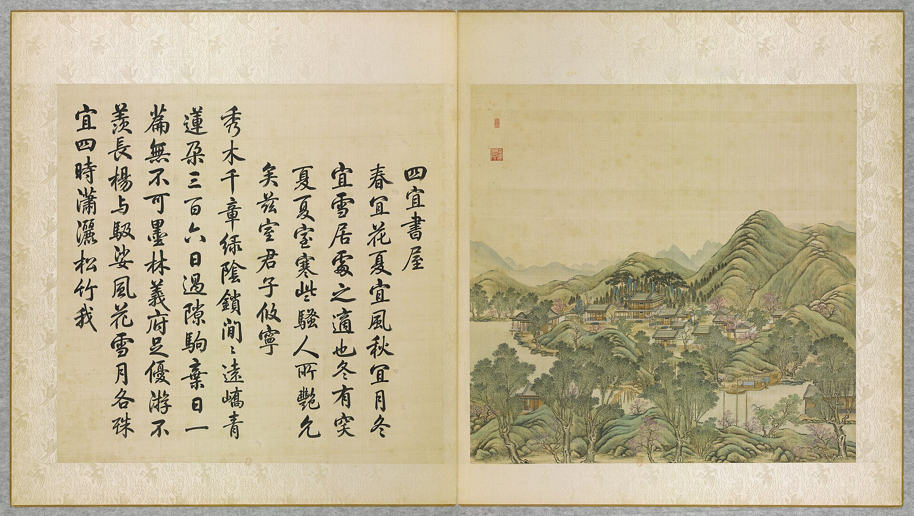

<!-- generated:start (scripts/building_pages.py): do not edit between these markers -->

# YM28-11: 船坞 Chuanwu

Yuanming Yuan

**3D object:** 8 boxes. Open it: `/reconstruction/3d.html?b=YM28-11`

**Part of:** YM28 四宜书屋

## What we know

- **Name:** 船坞 Chuanwu (S05, S01 · confidence B)
- **Garden:** Yuanming Yuan (S05, S01)
- **Type:** other (S05, S01 · confidence B)
- **Destroyed:** 1860 (S05, S01)
- **Position:** 40.01148, 116.29629. S01 sure (S01 · confidence B)
- **Bays:** 11x1 on the plan (S05, S01)
- **Size in the inventory:** 37.6 × 6.6 m. S01 plan px / hall scale (S01)
- **Note:** Boat houses, 2+2. S02 p.92 near 福海. (S05, S01)
- **Plan reader's note:** Two groups, each 4 rows: text 东西船坞各二所. (S01) *(research copy, not public)*
- **How it was read:** sure (S01) *(research copy, not public)*
- **Plan pixels:** 6396, 1079 (S01) *(research copy, not public)*

## Our model now

A plain box on the block drawn on the Qing plan S01: position and frontage from the plan, heights and roof from the typology of its hall class. It will be updated as the research goes on.

- **1 ×:** small house: 37.6 × 6.6 m, eave 3.2 m, ridge 5.46 m
- **1 ×:** small house: 45.14 × 6 m, eave 3.2 m, ridge 5.25 m
- **1 ×:** small house: 45.41 × 6.9 m, eave 3.2 m, ridge 5.56 m
- **1 ×:** small house: 47.1 × 7.3 m, eave 3.2 m, ridge 5.7 m
- **1 ×:** small house: 40.01 × 6.6 m, eave 3.2 m, ridge 5.46 m
- **1 ×:** small house: 42.66 × 6.3 m, eave 3.2 m, ridge 5.36 m
- **1 ×:** small house: 47.4 × 7.6 m, eave 3.2 m, ridge 5.8 m
- **1 ×:** small house: 50.7 × 6.9 m, eave 3.2 m, ridge 5.56 m
- **Confidence:** B

## Pictures (1)

- **P0028** (guess): 四宜書屋 Siyi shuwu [Étude des Quatre Aptitudes] (圓明園四十景, 第28景) (1744 (BnF record: 1744年，清朝乾隆九年)). https://commons.wikimedia.org/wiki/File%3A%E5%9C%93%E6%98%8E%E5%9C%92%E5%9B%9B%E5%8D%81%E6%99%AF_-_%28%E6%B8%85%29%E5%94%90%E5%B2%B1%E3%80%81%E6%B2%88%E6%BA%90%E5%90%88%E7%95%AB_%3B_%28%E4%B9%BE%E9%9A%86%E5%90%9F%E8%AF%97%EF%BC%8C%E6%B1%AA%E7%94%B1%E6%95%A6%E4%BB%A3%E4%B9%A6%29_-_btv1b55008362z_%28085_of_124%29.jpg

  

## Texts and drawings (3)

- **E1815** (text, sure): 日下舊聞考 四宜书屋. 1780s (乾隆 敕撰) · j82:8a-9a · S05. https://github.com/kanripo/KR2k0036/blob/master/KR2k0036_082.txt
  > 西峯秀色迤東東西船塢各二所北岸為四宜書屋五楹即安瀾園之正宇東南為葄經館又南為采芳洲其後為飛睇亭東北為緑帷舫四宜書屋西南為無邊風月之閣又西南為涵秋堂北為烟月清真樓樓西稍南為逺秀山房樓北度曲橋為染霞樓（圓明園册）臣等謹按四宜書屋四十景之一額為世宗御書皇上即於其地畧仿海寧陳氏安瀾園之意因以命名詳御製安瀾園記並御製安瀾園十景詩恭録卷内葄經館諸額皆御書
  Past paired boathouses: the five-bay 四宜書屋, the main range of the 安瀾園 Anlan Yuan, with 葄經館, 采芳洲, 飛睇亭, 緑帷舫, 無邊風月之閣, 涵秋堂, 烟月清真樓, 逺秀山房 and 染霞樓. The note says it was modelled on the 陳 family garden at 海寧 Haining.
- **E2391** (text, sure): 《日下舊聞考》 on 船塢 in 西峯秀色 and 蕊珠宫. 乾隆, 1780s · j82:8a, 12b · S05. https://www.kanripo.org/text/KR2k0036/082
  > 西峯秀色迤東東西船塢各二所 / 噦鸞殿東為蕊珠宫宫南船塢後有龍王廟
  Four boathouses east of 西峰秀色 and one south of 蕊珠宫. YM85 is not 蕊珠宫's dock per the plan note: no text found for it.
- **E2392** (description, guess): 贾珺 on the 四宜书屋 dock as a shrine. 2012 · S47 table row 20; p.113 · S47. https://www.dpm.org.cn/Uploads/File/2018/06/15/u5b23730ae0e5a.pdf
  A hanging-gable dock south-east of 四宜书屋 housed tablets of wind, cloud, thunder and rain gods from Yongzheng's time; the rain-god tablet moved out in 1733. Which dock of YM82 is meant is not said.

**On the plan:** Drawn on the plan of the gardens (S01), labelled 船坞, 11x1 cells. https://artmuseum.princeton.edu/collections/objects/138657

## Evidence for the set of buildings

- Evidence for the whole compound 四宜书屋: see YM28
- Reconstructions and comparables for the whole garden, 圆明园 Yuanming Yuan: see GARDEN-YM
- Standing buildings comparable to a small house (not this building): see CLASS-small_house

## Open questions

None that name it.

<!-- generated:end -->

## Notes

<!-- Yours: regeneration never touches this part. It goes on the public site; what you write below a line holding only %% private %% stays in the research copy. -->
