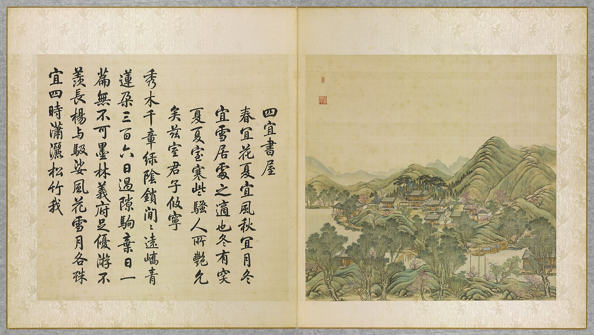
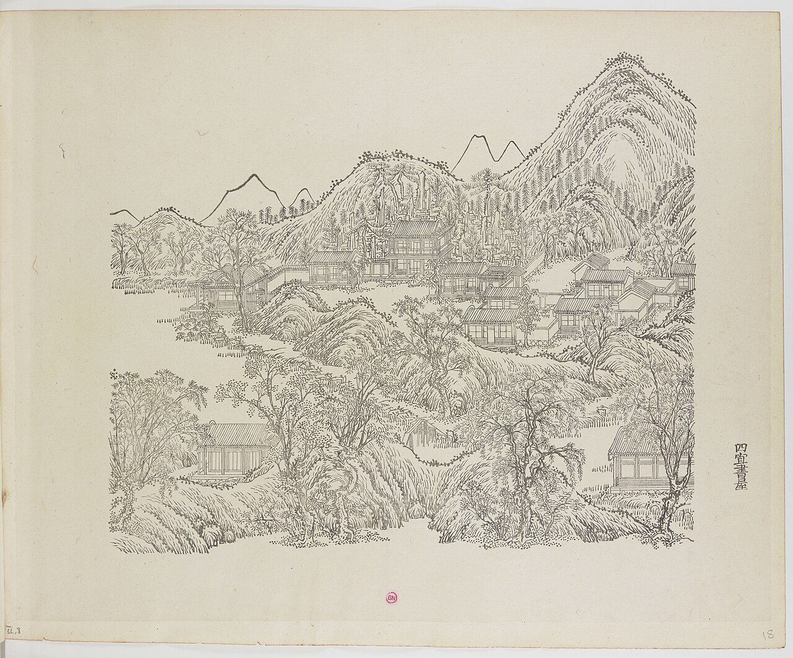
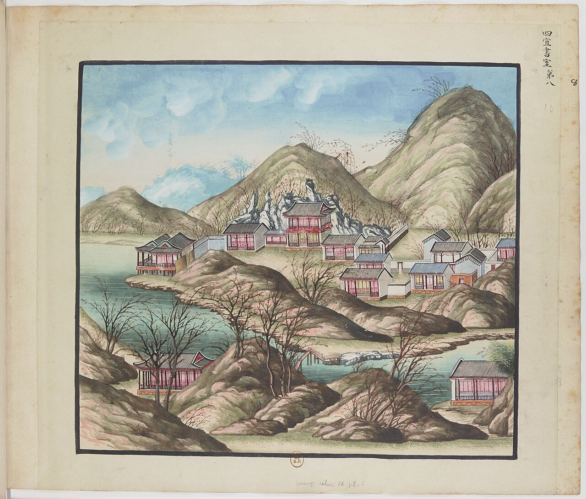
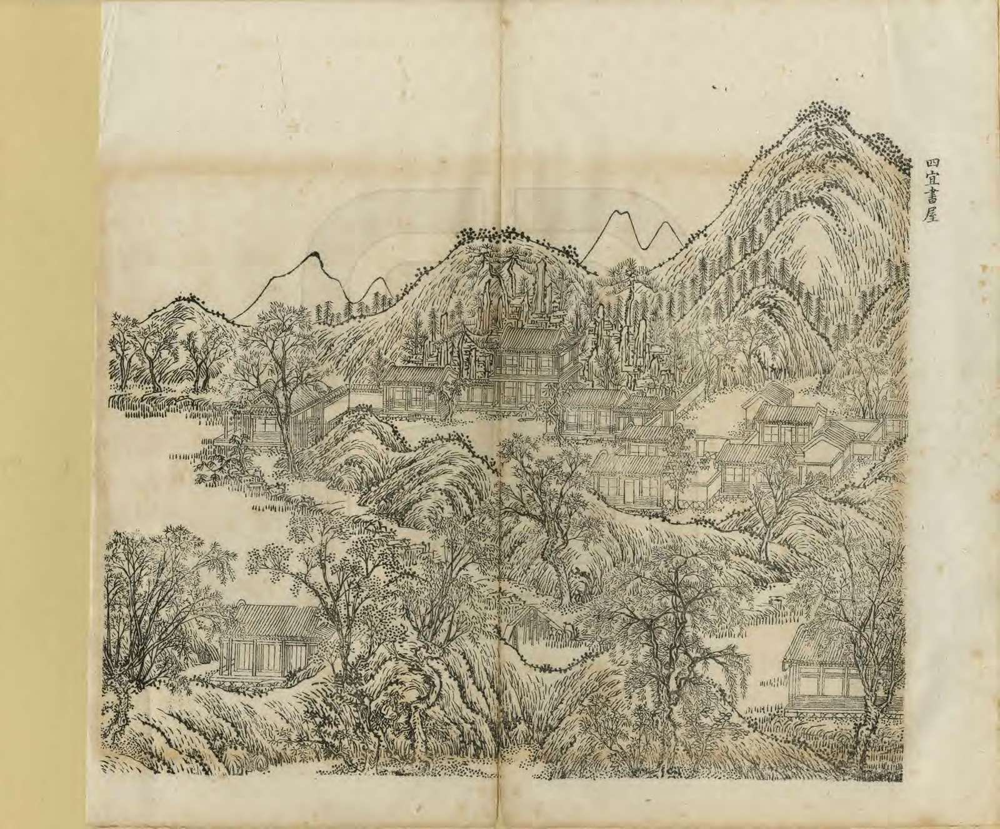
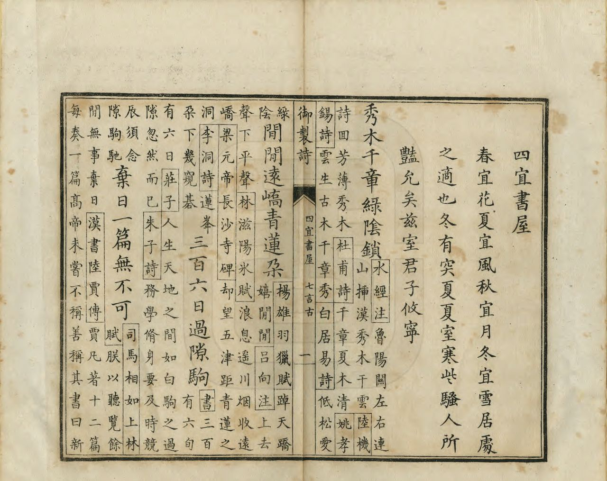

<!-- generated:start (scripts/building_pages.py): do not edit between these markers -->

# YM28: 四宜书屋 Siyi Shuwu

Ssu I Shu Wu (the Library of the Four Delights) · Yuanming Yuan

**3D object:** 26 boxes. Open it: `/reconstruction/3d.html?b=YM28`

## What we know

- **Name:** 四宜书屋 Siyi Shuwu (S05, S02, S08, S01 · confidence A)
- **English:** Ssu I Shu Wu (the Library of the Four Delights) (S05, S02, S08, S01)
- **Written on the plan:** 安澜园 (S01 · confidence A)
- **Garden:** Yuanming Yuan (S05, S02, S08, S01)
- **Type:** scene (S05, S02, S08, S01 · confidence A)
- **Changed:** Remodelled after Haining 隅园 (安澜园) c. 1762-64 [j82:9a; poems 1764] (S05, S02, S08, S01)
- **Destroyed:** 1860 (S05, S02, S08, S01)
- **Position:** 40.01156, 116.29574. S01 sure (S01 · confidence B)
- **Note:** After 1762 also 安瀾園. Not to be confused with QC 四宜书屋. Album shows the pre-安澜园 state. (S05, S02, S08, S01)
- **Plan reader's note:** Label 安澜园 (6190,1060), not 四宜书屋; the text says 四宜书屋 is the main hall of 安澜园. Malone 28 at (6150,1205). (S01) *(research copy, not public)*
- **How it was read:** sure (S01) *(research copy, not public)*
- **Plan pixels:** 6163, 990 (S01) *(research copy, not public)*

## Our model now

26 boxes stand in this compound, 26 on blocks drawn on the plan, 0 assumed. Its halls are listed below.

## Inside it (28)

- YM28-01 四宜书屋殿
- YM28-02 葄经馆
- YM28-03 采芳洲
- YM28-04 飞睇亭
- YM28-05 绿帷舫
- YM28-06 无边风月之阁
- YM28-07 涵秋堂
- YM28-08 烟月清真楼
- YM28-09 远秀山房
- YM28-10 染霞楼
- YM28-11 船坞
- YM28-B0084
- YM28-B0085
- YM28-B0086
- YM28-B0119
- YM28-B0120
- YM28-B0121
- YM28-B0122
- YM28-B0134
- YM28-B0135
- YM28-B0137
- YM28-B0138
- YM28-B0139
- YM28-B0140
- YM28-B0141
- YM28-B0165
- YM28-B0166
- YM28-B0167

## Pictures (5)

- **P0028** (sure): 四宜書屋 Siyi shuwu [Étude des Quatre Aptitudes] (圓明園四十景, 第28景) (1744 (BnF record: 1744年，清朝乾隆九年)). https://commons.wikimedia.org/wiki/File%3A%E5%9C%93%E6%98%8E%E5%9C%92%E5%9B%9B%E5%8D%81%E6%99%AF_-_%28%E6%B8%85%29%E5%94%90%E5%B2%B1%E3%80%81%E6%B2%88%E6%BA%90%E5%90%88%E7%95%AB_%3B_%28%E4%B9%BE%E9%9A%86%E5%90%9F%E8%AF%97%EF%BC%8C%E6%B1%AA%E7%94%B1%E6%95%A6%E4%BB%A3%E4%B9%A6%29_-_btv1b55008362z_%28085_of_124%29.jpg

  

- **P0078** (sure): 中国皇帝的宫殿与庙宇. 第18幅图, 四宜書屋 - (清)孙祜、沈源Siyi shuwu - (Qing)Sun Hu, Shen Yuan (1745 (Commons, from the BnF record)). https://commons.wikimedia.org/wiki/File%3A%E4%B8%AD%E5%9B%BD%E7%9A%87%E5%B8%9D%E7%9A%84%E5%AE%AB%E6%AE%BF%E4%B8%8E%E5%BA%99%E5%AE%87._%E7%AC%AC18%E5%B9%85%E5%9B%BE%2C_%E5%9B%9B%E5%AE%9C%E6%9B%B8%E5%B1%8B_-_%28%E6%B8%85%29%E5%AD%99%E7%A5%9C%E3%80%81%E6%B2%88%E6%BA%90Siyi_shuwu_-_%28Qing%29Sun_Hu%2C_Shen_Yuan_-_btv1b10520692j.jpg

  

- **P0108** (sure): 海淀(镇)：中国皇帝的行宫. 第8幅图, 四宜書屋Siyi shuwu (1750-1792 (BnF, cb43831905b; ex coll. Bertin)). https://commons.wikimedia.org/wiki/File%3A%E6%B5%B7%E6%B7%80%28%E9%95%87%29%EF%BC%9A%E4%B8%AD%E5%9B%BD%E7%9A%87%E5%B8%9D%E7%9A%84%E8%A1%8C%E5%AE%AB._%E7%AC%AC8%E5%B9%85%E5%9B%BE%2C_%E5%9B%9B%E5%AE%9C%E6%9B%B8%E5%B1%8BSiyi_shuwu_-_btv1b105207189.jpg

  

- **P0259** (sure): 四宜書屋 Siyi Shuwu (御製圓明園圖詠, 1887 石印本, 下卷 (Commons 卷二), 第28景; printed title in the right margin of the picture) (光緒十三年 1887 (Commons/NLC record; colophon 光緒十三年七月天津石印書屋 in the SSID copy, S98 PDF p.2); design after the woodblock of 1745 by 孫祜 Sun Hu and 沈源 Shen Yuan). https://commons.wikimedia.org/wiki/File%3ANLC403-312001107375-14034_%E7%A6%A6%E5%88%B6%E5%9C%93%E6%98%8E%E5%9C%92%E5%9C%96%E8%A9%A0_%E5%8D%B7%E4%BA%8C.pdf?page=28

  

- **P0535** (sure): 四宜書屋 Siyi Shuwu: 乾隆 Qianlong's preface and poem with the courtiers' commentary, 御製圓明園圖詠 1887 (poem 1744 (乾隆九年); this printing 1887). https://commons.wikimedia.org/wiki/File%3ANLC403-312001107375-14034_%E7%A6%A6%E5%88%B6%E5%9C%93%E6%98%8E%E5%9C%92%E5%9C%96%E8%A9%A0_%E5%8D%B7%E4%BA%8C.pdf?page=29

  

## Texts and drawings (40)

- **E1804** (poem, sure): 御製四宜書屋詩（圓明園四十景詩）. 1744 (乾隆九年) · printed in S05 j82:10a · S40. https://github.com/kanripo/KR2k0036/blob/master/KR2k0036_082.txt
  > 乾隆九年 御製四宜書屋詩 春宜花夏宜風秋宜月冬宜雪居處之適也冬有□厦夏室寒些騷人所艷允矣兹室君子攸寧 秀木千章緑隂鎻間間逺嶠青蓮朶三百六旬過隙駒棄日一篇無不可墨林義府足優游不羡長楊與馺娑風花雪月各殊宜四時瀟灑松竹我
  Spring suits flowers, summer breeze, autumn moon, winter snow. With warm rooms for winter and cool for summer, this room is a quiet home for a gentleman in every season.
- **E1814** (text, sure): 御製安瀾園記. c. 1762-64 (壬午 and 二十年 in the text) · j82:9a-10a · S05. https://github.com/kanripo/KR2k0036/blob/master/KR2k0036_082.txt
  > 御製安瀾園記　安瀾園者壬午幸海寧所賜陳氏隅園之名也陳氏之園何以名御園葢喜其結搆致佳圖以歸園既成爰數典而仍其名也然則剏歟曰非也就四宜書屋左右前後畧經位置即與陳園曲折如一無二也四宜書屋者圓明園四十景之一既圖既咏至於今已厯二十年也土木之工二十年斯弊故就修葺之便稍為更移費不侈而一舉兩得也彼以安瀾晹額則因近海塘似與此無涉也然帝王家天下薄海之内均予戸庭也況予繾念塘工旬有報而月有圖所謂魚鱗土備南坍北漲諸形勢無不欲悉安瀾之願實無時不厪於懐也由其亭臺則思至鹽官者以籌海塘而願其瀾之安也不寧惟是凡長江洪河與夫南北之濟運清黄之交滙何一非予宵旰切切闗心者亦胥願其瀾之安也是則予之以安瀾名是園者固非遊情泉石之為而實蒿目桑麻之計所謂在此不在彼也
  Explains the name 安瀾園: granted in 壬午 (1762) to the 陳 garden at 海寧, then copied by altering 四宜書屋 during a repair after twenty years. The name is a wish for the sea walls and the Yellow River and Grand Canal, not pleasure, he says.
- **E1809** (poem, sure): 御製安瀾園十詠（園别有記）. 1764 (乾隆二十九年) · j82:10a-12a · S05. https://github.com/kanripo/KR2k0036/blob/master/KR2k0036_082.txt
  > 乾隆二十九年御製安瀾園十詠（園别有記）　入園門樸室三間背倚峯屏右臨池鏡顔曰葄經不減陳氏藏書樓也　縆年黙記復潛神那擬班家戯答賓枕藉亦非耽博古欲推實政善安民（右葄經館）　為圓明園四十景之一因嵗久修葺畧為更置宛然鹽官安瀾園皇考御額在焉　春夏秋冬無不宜所宜樂總讀書時何須千里鹽官憶即景吾方勉近思（右四宜書屋）　界域有邊風月則無邊輕拂朗照中吾不知為在御園在海寧矣　月藉風清摇籟影風邀明月奏琅音三千界外三千界蹤跡無邊那可尋（右無邊風月之閣）　西臨長河波光翻影動摇楣梠間坐此可悟南華　堂襟西向額含秋金水相生厥有由不論何時此偶坐總如爽氣面前浮（右涵秋堂）　房築假山上而逺納西山秀色所謂全賔全主近低微逺見遥髙峯側嶺横翠莫韜此即泰山一指喻重華明目為（去聲）斯勞（右逺秀山房）　名曰染霞而實近水每來常愛坐此　池上層樓敞紫甍水中樓影亦含清自知不是餐霞侣孤負横楣浪與名（右染霞樓）　曲廊宛轉搆水上偶一慿檻煙水在襟袖間何必真舫　臨水何妨即舫之成隂樹是緑油帷了無逐浪為行止那有隨風作轉移（右緑帷舫）　一峯秀拔亭據其上每當縱望園外稻塍千頃皆在目中直與農夫田父共較雨量晴矣　低俯鱗塍迥據山犁雲鋤雨繪民艱問應飛睇於何處只在隅園咫尺間（右飛睇亭）　四宜書屋之後延樓髙敞不施厨障為納煙月契神處又似在陳氏竹堂月閣間　一輪古月真無匹幾縷空煙清莫加朗照輕籠寥廓表便成句亦謝雕華（右煙月清真樓）　是芳皆可采不必學楚騷注意蘭荃　澄波之上敞軒臨䔩䔩芊芊滿碧潯是藥文殊胥命采此芳寧向楚騷尋（右采芳洲）
  Ten poems with short prefaces on the 安瀾園 rooms, each giving a position: 葄經館 inside the gate, 涵秋堂 on the west river, 逺秀山房 on rockwork, 染霞樓, 緑帷舫 on the water, 飛睇亭 on a peak over paddies, 煙月清真樓 behind 四宜書屋, 采芳洲.
- **E1815** (text, sure): 日下舊聞考 四宜书屋. 1780s (乾隆 敕撰) · j82:8a-9a · S05. https://github.com/kanripo/KR2k0036/blob/master/KR2k0036_082.txt
  > 西峯秀色迤東東西船塢各二所北岸為四宜書屋五楹即安瀾園之正宇東南為葄經館又南為采芳洲其後為飛睇亭東北為緑帷舫四宜書屋西南為無邊風月之閣又西南為涵秋堂北為烟月清真樓樓西稍南為逺秀山房樓北度曲橋為染霞樓（圓明園册）臣等謹按四宜書屋四十景之一額為世宗御書皇上即於其地畧仿海寧陳氏安瀾園之意因以命名詳御製安瀾園記並御製安瀾園十景詩恭録卷内葄經館諸額皆御書
  Past paired boathouses: the five-bay 四宜書屋, the main range of the 安瀾園 Anlan Yuan, with 葄經館, 采芳洲, 飛睇亭, 緑帷舫, 無邊風月之閣, 涵秋堂, 烟月清真樓, 逺秀山房 and 染霞樓. The note says it was modelled on the 陳 family garden at 海寧 Haining.
- **E1816** (text, sure): 日下舊聞考: 四宜书屋. 1780s (乾隆 敕撰) · j82:8a · S05. https://github.com/kanripo/KR2k0036
  > 西峯秀色迤東 ... 北岸為四宜書屋
- **E1813** (poem, guess): 世宗 暮春四宜堂咏懐. 雍正 (四宜堂集, undated) · KR4f0002_030:10a-10b · S200. https://github.com/kanripo/KR4f0002/blob/master/KR4f0002_030.txt
  > 暮春四宜堂咏懐 花繁如錦草如茵雨細風輕物候新朱邸舞筵成往事斑衣戲綵久凝塵萬㡬宵旰忙中趣百嵗光隂夢裏真不問春歸何處去惟聼燕語報芳辰
  Late spring at 四宜堂 after his accession: he contrasts the former feasts of his princely days with the work of ruling. Whether this hall is the later 四宜書屋 is unproven.
- **E1803** (poem, sure): 四宜书屋: 乾隆九年 poem of the Qianlong Emperor. 乾隆九年 (1744), date from the compilation · p.266 item (1), under 四宜书屋 · S360. https://www.yuanmingyuanpark.cn/xs/yjbg/202007/P020200730387572832602.pdf#page=266
  > 秀木千章绿阴锁，闲闲远峤青莲朵。三百六日过隙驹，弃日一篇无不可。墨林义府足优游，不羡长杨与馺娑。风花雪月各殊宜，四时潇洒松竹我。
  Poem of the Qianlong Emperor at 四宜书屋, 1744, on reading and snow. Year as given by the compilation.
- **E1805** (poem, sure): 四宜书屋. 乾隆二十八年 (1763) · v2 p.279, under 四宜书屋; source ref 8-664 · S361. https://www.yuanmingyuanpark.cn/xs/yjbg/202008/P020200803382343267004.pdf#page=282
  > 朴斫三间足，攸芋四季佳。堪消机政暇，仰缅圣人怀。山色迎眸静，禽音入听谐。愿言肯堂构，未得识根荄。
  Poem 四宜书屋 by the Qianlong Emperor, 1763, filed by the editors under 四宜书屋.
- **E1823** (poem, sure): 题葄经馆. 乾隆二十八年 (1763) · v2 p.280, under 四宜书屋; source ref 8-665 · S361. https://www.yuanmingyuanpark.cn/xs/yjbg/202008/P020200803382343267004.pdf#page=283
  > 书馆信攸宁，新名曰葄经。无忘惟好学，有暇每来停。沼剌削蒲绿，芸馡汗简青。个中如尚友，李揆足芳型。
  Poem 题葄经馆 by the Qianlong Emperor, 1763, filed by the editors under 四宜书屋.
- **E1825** (poem, sure): 采芳洲. 乾隆二十八年 (1763) · v2 p.281, under 四宜书屋; source ref 8-673 · S361. https://www.yuanmingyuanpark.cn/xs/yjbg/202008/P020200803382343267004.pdf#page=284
  > 远映云林近俯池，群芳生意总含滋。楚骚称物如相拟，采采吾方念在兹。
  Poem 采芳洲 by the Qianlong Emperor, 1763, filed by the editors under 四宜书屋.
- **E1829** (poem, sure): 绿帷舫. 乾隆二十八年 (1763) · v2 p.280, under 四宜书屋; source ref 8-665 · S361. https://www.yuanmingyuanpark.cn/xs/yjbg/202008/P020200803382343267004.pdf#page=283
  > 傍水林斋叶吐齐，烟舲疑挂绿帷低。设如借与青莲李，应是风流到剡溪。
  Poem 绿帷舫 by the Qianlong Emperor, 1763, filed by the editors under 四宜书屋.
- **E1830** (poem, sure): 绿帷舫. 乾隆二十八年 (1763) · v2 p.283, under 四宜书屋; source ref 8-732 · S361. https://www.yuanmingyuanpark.cn/xs/yjbg/202008/P020200803382343267004.pdf#page=286
  > 不受波澜具舫意，一般烟雨泛湖心。载将书画宜何往，只在潇湘深处寻。
  Poem 绿帷舫 by the Qianlong Emperor, 1763, filed by the editors under 四宜书屋.
- **E1831** (poem, sure): 无边风月之阁. 乾隆二十八年 (1763) · v2 p.279, under 四宜书屋; source ref 8-665 · S361. https://www.yuanmingyuanpark.cn/xs/yjbg/202008/P020200803382343267004.pdf#page=282
  > 清风明月无尽藏，千秋公物何拘方。高阁之中非享帚，高阁之外随探囊。乍思玉局赋赤壁，又若青莲歌襄阳。咄哉无逸是我所，安能效彼恒徜徉。
  Poem 无边风月之阁 by the Qianlong Emperor, 1763, filed by the editors under 四宜书屋.
- **E1832** (poem, sure): 无边风月之阁. 乾隆二十八年 (1763) · v2 p.283, under 四宜书屋; source ref 8-729 · S361. https://www.yuanmingyuanpark.cn/xs/yjbg/202008/P020200803382343267004.pdf#page=286
  > 阁高目远山来席，叶落林疏水彻天。风月何曾逐时异，恰宜即景玩无边。
  Poem 无边风月之阁 by the Qianlong Emperor, 1763, filed by the editors under 四宜书屋.
- **E1833** (poem, sure): 涵秋堂六韵. 乾隆二十八年 (1763) · v2 p.282, under 四宜书屋; source ref 8-727 · S361. https://www.yuanmingyuanpark.cn/xs/yjbg/202008/P020200803382343267004.pdf#page=285
  > 水堂向择西，西岭入檐低。金颢辨方叶，玉衡协纪齐。兰风蛩响切，桂月䨲辉䨑。镜影开空廓，练光披配藜。敛云出河汉，敲日作玻瓈。底事消清暇，豳风一卷携。
  Poem 涵秋堂六韵 by the Qianlong Emperor, 1763, filed by the editors under 四宜书屋.
- **E1835** (poem, sure): 题烟月清真楼. 乾隆二十八年 (1763) · v2 p.281, under 四宜书屋; source ref 8-666 · S361. https://www.yuanmingyuanpark.cn/xs/yjbg/202008/P020200803382343267004.pdf#page=284
  > 春烟淡荡罥柳丝，春月徘徊临华池。不嫌冉冉互映带，雅宜淰淰相逶迤。轻笼那碍虚明委，朗照兼之点缀绮。两层楼室四面窗，俯畅遥吟无不美。真为清体清真用，烟月名殊其实共。底须秉烛与飞觞，大块文章工错综。
  Poem 题烟月清真楼 by the Qianlong Emperor, 1763, filed by the editors under 四宜书屋.
- **E1837** (poem, sure): 远秀山房. 乾隆二十八年 (1763) · v2 p.280, under 四宜书屋; source ref 8-665 · S361. https://www.yuanmingyuanpark.cn/xs/yjbg/202008/P020200803382343267004.pdf#page=283
  > 山房来远秀，宜望复宜餐。朝暮岚和霭，杉枫翠与丹。虚明无尽藏，遥绪可探端。缅想陶征士，方当五字安。
  Poem 远秀山房 by the Qianlong Emperor, 1763, filed by the editors under 四宜书屋.
- **E1839** (poem, sure): 题染霞楼. 乾隆二十八年 (1763) · v2 p.281, under 四宜书屋; source ref 8-673 · S361. https://www.yuanmingyuanpark.cn/xs/yjbg/202008/P020200803382343267004.pdf#page=284
  > 既雨偏欣晴亦佳，御园景物与清皆。凭楼几片轻霞染，却异南昌作赋怀。
  Poem 题染霞楼 by the Qianlong Emperor, 1763, filed by the editors under 四宜书屋.
- **E1807** (poem, sure): 得趣书屋: 乾隆二十九年 poem of the Qianlong Emperor. 乾隆二十九年 (1764), date from the compilation · p.268 item (1), under 得趣书屋 · S360. https://www.yuanmingyuanpark.cn/xs/yjbg/202007/P020200730387572832602.pdf#page=268
  > 今古读书人，盖已无央数。问无央数人，几人得书趣。或焚膏继晷，或削柳扫树。或不求甚解，或记忆细故。其趣在自知，其得非外骛。繄我所宜味，典谟垂法度。孜孜尚弗逮，逢源那余裕。
  Poem of the Qianlong Emperor at 得趣书屋, 1764, on reading. Year as given by the compilation.
- **E1808** (poem, sure): 得趣书屋: 乾隆二十九年 poem of the Qianlong Emperor. 乾隆二十九年 (1764), date from the compilation · p.268 item (2), under 得趣书屋 · S360. https://www.yuanmingyuanpark.cn/xs/yjbg/202007/P020200730387572832602.pdf#page=268
  > 书斋号得趣，藉问趣若何。春阶茸芳草，夏池馥浄荷。月竹秋玲珑，雪树冬婆娑。四时趣如此，此亦何足多。伊余别有托，趣不在研摩。宣尼为君难，三字垂金科。诚觉其趣长，躬行励切磋。
  Poem of the Qianlong Emperor at 得趣书屋, 1764, on reading. Year as given by the compilation.
- **E1836** (poem, sure): 烟月清真楼. 乾隆二十九年 (1764) · v2 p.284, under 四宜书屋; source ref 8-763 · S361. https://www.yuanmingyuanpark.cn/xs/yjbg/202008/P020200803382343267004.pdf#page=287
  > 春月真谁比，春烟清以嘉。宁须轻拂柳，且未淡笼花。凝处半轮映，挂时一缕斜。古来两契友，风韵特无加。
  Poem 烟月清真楼 by the Qianlong Emperor, 1764, filed by the editors under 四宜书屋.
- **E1840** (poem, sure): 题染霞楼. 乾隆二十九年 (1764) · v2 p.285, under 四宜书屋; source ref 8-782 · S361. https://www.yuanmingyuanpark.cn/xs/yjbg/202008/P020200803382343267004.pdf#page=288
  > 屋不丹青喜朴清，何来浅绛染飞甍。徐因天末驰睎远，翻得霞光觌面迎。夏沼荷花休假藉，秋林枫叶漫鲜明。无须更读兴公赋，缩地居然此赤城。
  Poem 题染霞楼 by the Qianlong Emperor, 1764, filed by the editors under 四宜书屋.
- **E1824** (poem, sure): 葄经馆. 乾隆三十一年 (1766) · v2 p.292, under 四宜书屋 · S361. https://www.yuanmingyuanpark.cn/xs/yjbg/202008/P020200803382343267004.pdf#page=295
  > 绨几绳床足净神，常陪石友与龙宾。安澜原写隅园概，遐想因之忆浙民。
  Poem 葄经馆 by the Qianlong Emperor, 1766, filed by the editors under 四宜书屋.
- **E1826** (poem, sure): 采芳洲. 乾隆三十一年 (1766) · v2 p.294, under 四宜书屋 · S361. https://www.yuanmingyuanpark.cn/xs/yjbg/202008/P020200803382343267004.pdf#page=297
  > 三架疏轩碧水临，青蒲白芷满沙浔。其中亦有芳堪采，岂必定从九畹寻。
  Poem 采芳洲 by the Qianlong Emperor, 1766, filed by the editors under 四宜书屋.
- **E1827** (poem, sure): 飞睇亭. 乾隆三十一年 (1766) · v2 p.293, under 四宜书屋 · S361. https://www.yuanmingyuanpark.cn/xs/yjbg/202008/P020200803382343267004.pdf#page=296
  > 四柱小亭冠假山，朴成不费斫雕艰。偶然陟步凭虚楯，雨笠风蓑指顾间。
  Poem 飞睇亭 by the Qianlong Emperor, 1766, filed by the editors under 四宜书屋.
- **E1838** (poem, sure): 远秀山房. 乾隆三十一年 (1766) · v2 p.293, under 四宜书屋 · S361. https://www.yuanmingyuanpark.cn/xs/yjbg/202008/P020200803382343267004.pdf#page=296
  > 园山因迥屋为高，照自远含秀内韬。坐卷珠帘闲揽结，几曾步履觉微劳。
  Poem 远秀山房 by the Qianlong Emperor, 1766, filed by the editors under 四宜书屋.
- **E1828** (poem, sure): 飞睇亭. 乾隆三十三年 (1768) · v2 p.296, under 四宜书屋 · S361. https://www.yuanmingyuanpark.cn/xs/yjbg/202008/P020200803382343267004.pdf#page=299
  > 一朵芙蓉四柱孤，遐观近揽总成图。盐官飞睇非游目，迩日塘沙涨也无。
  Poem 飞睇亭 by the Qianlong Emperor, 1768, filed by the editors under 四宜书屋.
- **E1834** (poem, sure): 涵秋堂. 乾隆三十三年 (1768) · v2 p.296, under 四宜书屋 · S361. https://www.yuanmingyuanpark.cn/xs/yjbg/202008/P020200803382343267004.pdf#page=299
  > 有水澄空有竹萧，四时秋意满轩寮。安澜设以陈园拟，八月何当看海潮。
  Poem 涵秋堂 by the Qianlong Emperor, 1768, filed by the editors under 四宜书屋.
- **E1810** (poem, sure): 得趣书屋: 乾隆五十三年 poem of the Qianlong Emperor. 乾隆五十三年 (1788), date from the compilation · p.269 item (11), under 得趣书屋 · S360. https://www.yuanmingyuanpark.cn/xs/yjbg/202007/P020200730387572832602.pdf#page=269
  > 三万非夸富缥缃，潄于六艺润而芳。得斯趣者盖艰矣，然亦非艰在自蘉。
  Poem of the Qianlong Emperor at 得趣书屋, 1788, on reading. Year as given by the compilation.
- **E1811** (poem, sure): 四宜书屋: 嘉庆元年 poem of the Jiaqing Emperor. 嘉庆元年 (1796), date from the compilation · p.267 item (6), under 四宜书屋 · S360. https://www.yuanmingyuanpark.cn/xs/yjbg/202007/P020200730387572832602.pdf#page=267
  > 十景昨成咏，非关佳境敷。石柴卫民固，坍涨顺流趋。 （海塘向系柴工庚子岁皇父南巡阅视于老盐仓一带，旧有柴塘后一律改建石塘，仍留旧柴塘以为重门，保障如法砌筑海波，永靖又浙省迤南诸山联络，海潮可资抵御。若海宁一带地势平衍，正当北岸之冲沙势，南坍北涨则塘工巩固，皆蒙我皇父训示，周详上协天心顺派永庆。 ）奠璧谢神佑，搴茭免吏呼。安澜忆丰汛，吉兆愿名符。（丰汛六堡偶有侵滋，皇父指示河臣开浚，引河督工镶筑，现在节届霜降正值水落之时，自可即日工成以符安澜之意。 ）
  Poem of the Jiaqing Emperor at 四宜书屋, 1796, on the view. Year as given by the compilation.
- **E1812** (poem, sure): 四宜书屋: 嘉庆八年 poem of the Jiaqing Emperor. 嘉庆八年 (1803), date from the compilation · p.267 item (8), under 四宜书屋 · S360. https://www.yuanmingyuanpark.cn/xs/yjbg/202007/P020200730387572832602.pdf#page=267
  > 海宁怆忆昔随銮，恍若花从镜裹看。追慕当年蒙厚泽，至今每月报安澜。 （兹园权舆于海宁陈氏皇考幸浙阅视海塘，屡经临莅于庚子岁复饬于老盐仓一带改建石塘至癸卯竣工。其旧有柴塘仍随宜修筑以资保障，自此海若恬波安澜永副矣。）万几敬理勤无逸，六府时修治倍难。永守先言罢巡幸，兆民宁谧沐恩宽。（举大事有迟速之宜，惟敬与明乃能机宜悉协。皇考六度南巡后曾制南巡记详论及之，并中训后人一不如此，未可言南巡圣意深远所当永守勿替者也。）
  Poem of the Jiaqing Emperor at 四宜书屋, 1803, on the view. Year as given by the compilation.
- **E1806** (poem, likely): 题四宜书屋. 乾隆二十八年 (1763) · v2 p.282, under 四宜书屋; source ref 8-727 · S361. https://www.yuanmingyuanpark.cn/xs/yjbg/202008/P020200803382343267004.pdf#page=285
  > 旧屋重修葺，无多点缀为。松窗就老干，菊砌绕新蕤。霜落澄池底，林疏露巘姿。如询即景句，端是与秋宜。
  Poem 题四宜书屋 by the Qianlong Emperor, 1763, filed by the editors under 四宜书屋.
- **E1819** (description, sure): Scene 28, 四宜书屋 Siyi Shuwu. 1934 · p.92 · S02. https://archive.org/details/historyofpekings00malo
  > Ch'ien Lung copied this garden from the plans of the An Lan Yuan, or Garden of Peaceful Waves, belonging to the Ch'ien family, in Hai Ning, which he visited and enjoyed.
  Copied from 安澜园 of the Chen family at Haining (Malone romanizes the family as Ch'ien). Very close to the boathouses north of 福海.
- **E1011** (description, sure): Site status table, about 2011: nothing visible, or built over. c. 2011 · 系列06 repost, status table · S356. https://blog.sina.com.cn/s/blog_c27029650101itzz.html
  Same table. In it the first group shows no visible remains; 得全阁, 流香渚, 凤麟洲, 涵秋馆, 蔚藻堂, 中和堂, 敷春堂 and 心镜轩 have service buildings on them, and 含晖楼, 澄心堂, 延寿寺, 清夏堂 and 喜雨山房 are occupied by other institutions. 澹泊宁静 and several others have been dug since, so this is out of date for them.
- **E1817** (description, sure): 圆明园百景史事分景汇编: 四宜书屋. 1744-1815 · from p.266, under 安澜园 · S360. https://www.yuanmingyuanpark.cn/xs/yjbg/202007/P020200730387572832602.pdf#page=266
  Notes of 1796 and 1803 link this hall of 安澜园 to the Chen family garden at Haining, which Qianlong saw on inspecting the sea wall. 四宜书屋: 14 dated items, 1744-1815, of which 13 poems and 1 court records (Qianlong, Jiaqing); recurring themes: reading, the view, daily residence there. First dated 1744, last dated 1815.
- **E1818** (description, sure): 圆明园百景史事分景汇编: 得趣书屋. 1764-1788 · from p.268, under 安澜园 · S360. https://www.yuanmingyuanpark.cn/xs/yjbg/202007/P020200730387572832602.pdf#page=268
  得趣书屋: 11 dated items, 1764-1788, of which 11 poems (Qianlong); recurring themes: reading. First dated 1764, last dated 1788.
- **E1820** (description, sure): 圆明园五朝御制诗文集注 v2, editors' note on 四宜书屋. 2020 edition · v2 p.278 · S361. https://www.yuanmingyuanpark.cn/xs/yjbg/202008/P020200803382343267004.pdf#page=281
  First 春宇舒和; rebuilt in mid-Qianlong after the Chen family garden at Haining as 安澜园. A five-bay main hall, 葄经馆, 飞睇亭, 涵雅斋, 采芳洲, 无边风月之阁, 涵秋堂, 云涛亭, 烟月清真楼, 远秀山房, 绿帷舫, 染霞楼, 得趣书屋, 啸竹轩, 挹香室. The great boat dock 藏舟坞 adjoins.
- **E1821** (description, sure): 圆明园五朝御制诗文集注 v4, editors' note on 四宜书屋. 2020 edition · v4 p.293 · S361. https://www.yuanmingyuanpark.cn/xs/yjbg/202008/P020200803382796786124.pdf#page=296
  First 春宇舒和; rebuilt in mid-Qianlong after the Chen family garden at Haining as 安澜园. A five-bay main hall, 葄经馆, 飞睇亭, 涵雅斋, 采芳洲, 无边风月之阁, 涵秋堂, 云涛亭, 烟月清真楼, 远秀山房, 绿帷舫, 染霞楼, 得趣书屋, 啸竹轩, 挹香室. The great boat dock 藏舟坞 adjoins.
- **E1822** (drawing, sure): 《国家图书馆藏样式雷图档·圆明园卷初编》: 四宜书屋. mostly 道光, 咸丰, 同治 per the publisher · 初编 目录: 四宜书屋, pp.437-440 · S13. https://www.nlcpress.com/ProductView.aspx?Id=7642
  The printed facsimile of the National Library of China's Yangshi Lei sheets has a section on this place at pp.437-440 (4 pages, section length worked out from the next heading); sheet titles and numbers are in the volume, ordered from a library.
- **E2262** (plan, sure): 圆明园新证, 端木泓: dated additions shown on plan 1704. post n.d. · tables 1 and 2 · S337. http://iqh.ruc.edu.cn/old/qdhjylyjzx/xszl/xstl/1c9094aef4f041148f15883c7c266cb9.htm
  Tables of when things were added, drawn from archives to date the plan's layers: 藻园 1752, 廓然大公 eight views 1754, 春雨轩 1755, 藏密楼 1758, 多稼轩 ten views 1759, 紫碧山房 1760, 安澜园 and 澄练楼 1763, 若帆之阁 1764, 汇万总春之庙 1769, 文源阁 1775, 法源楼 1779; after: 兰亭八柱 1779, 知过堂 1782, 课农轩 1816, 涵月楼 1827. The most useful single dating table found.

**On the plan:** Drawn on the plan of the gardens (S01), labelled 安澜园. https://artmuseum.princeton.edu/collections/objects/138657

## Open questions

- Q1: Target state
- Q11: Qichun Yuan's thirty scenes
- Q45: Halls in the texts with no row

<!-- generated:end -->

## Notes

<!-- Yours: regeneration never touches this part. It goes on the public site; what you write below a line holding only %% private %% stays in the research copy. -->
