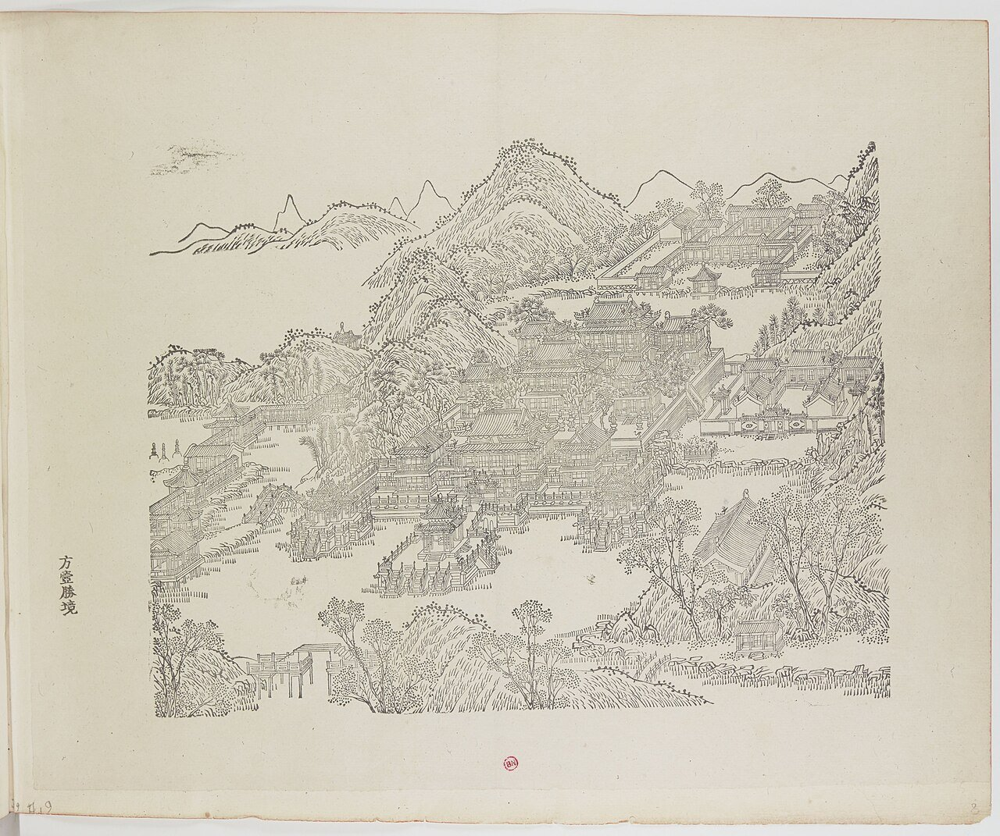
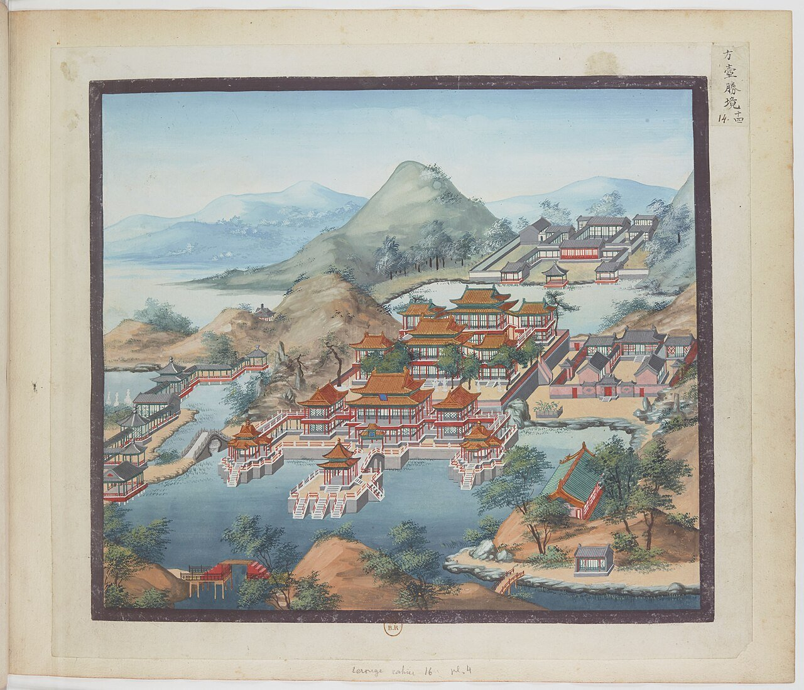
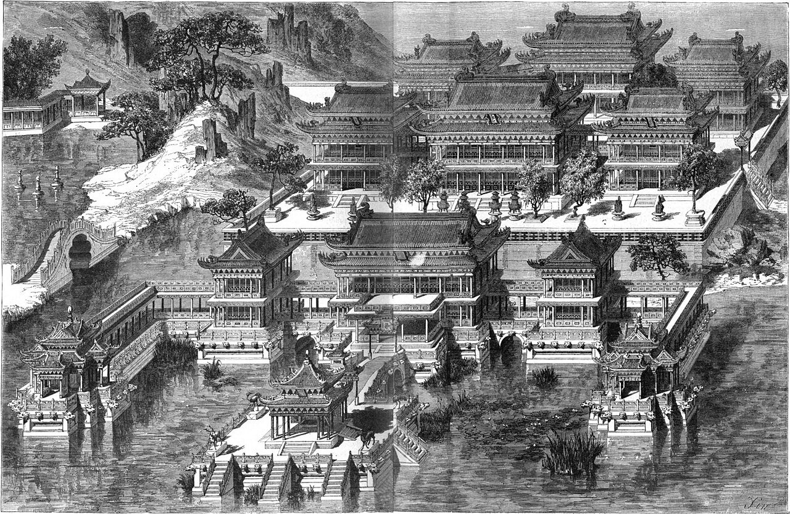
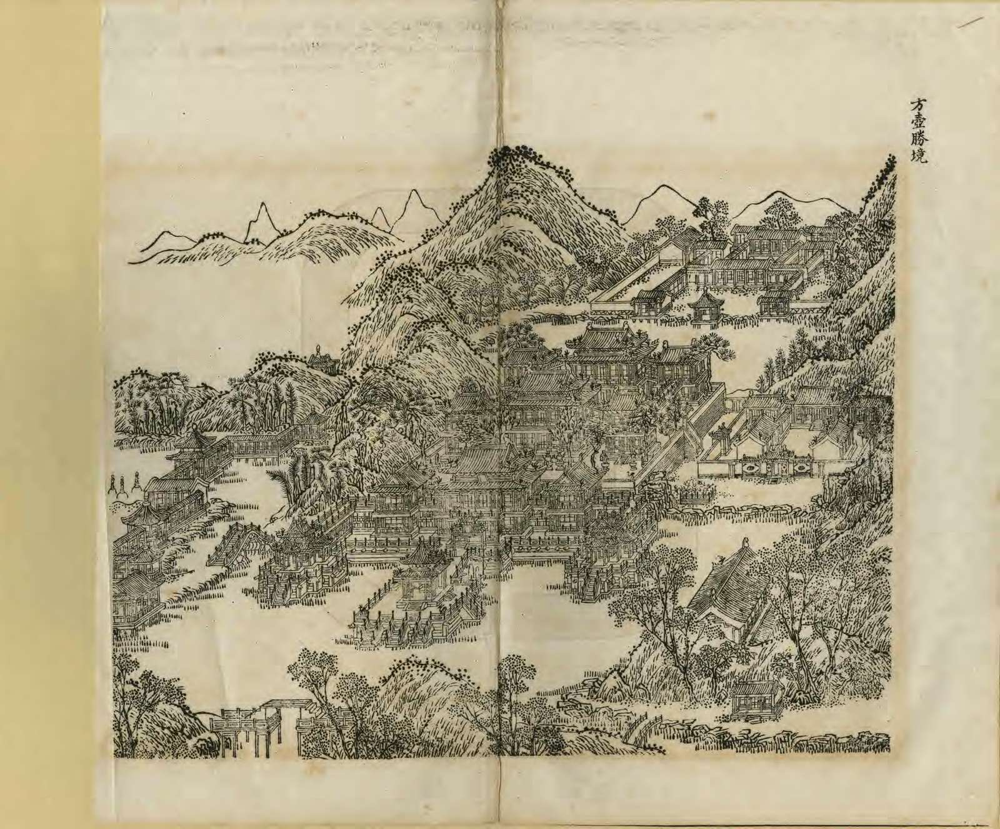
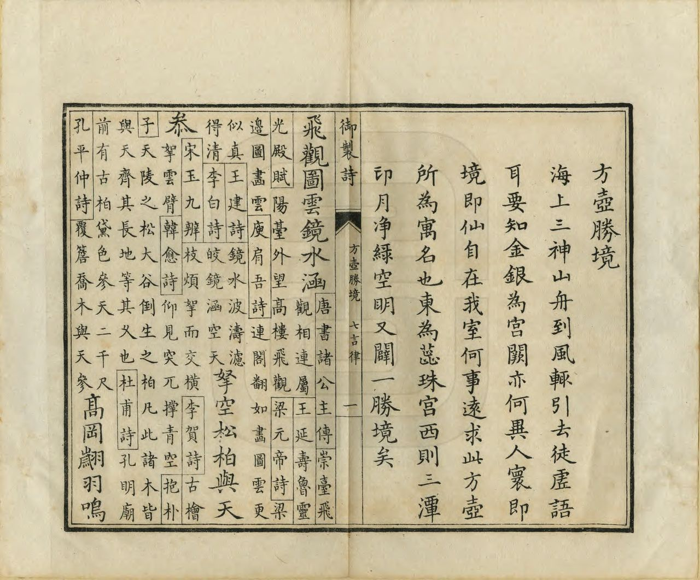
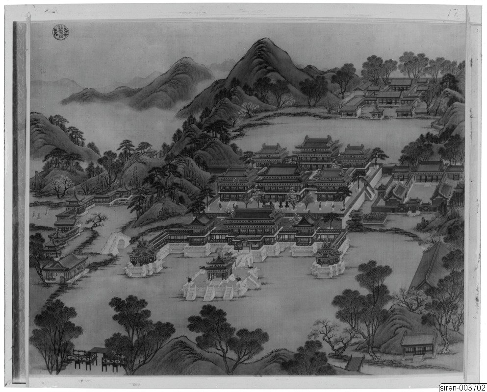
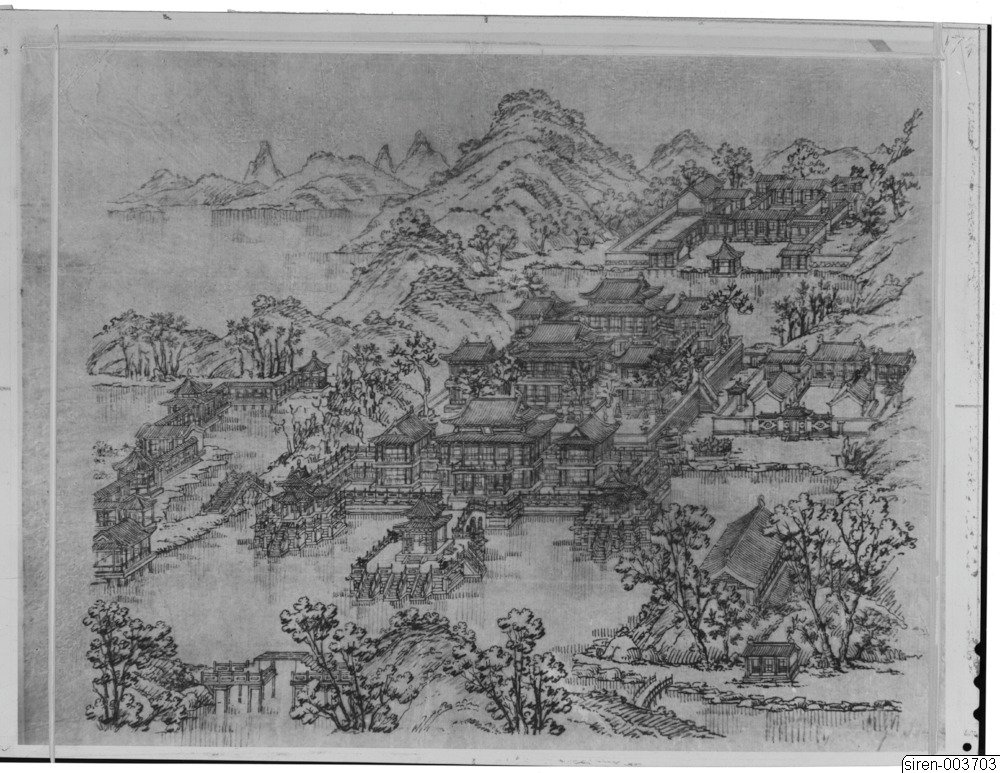
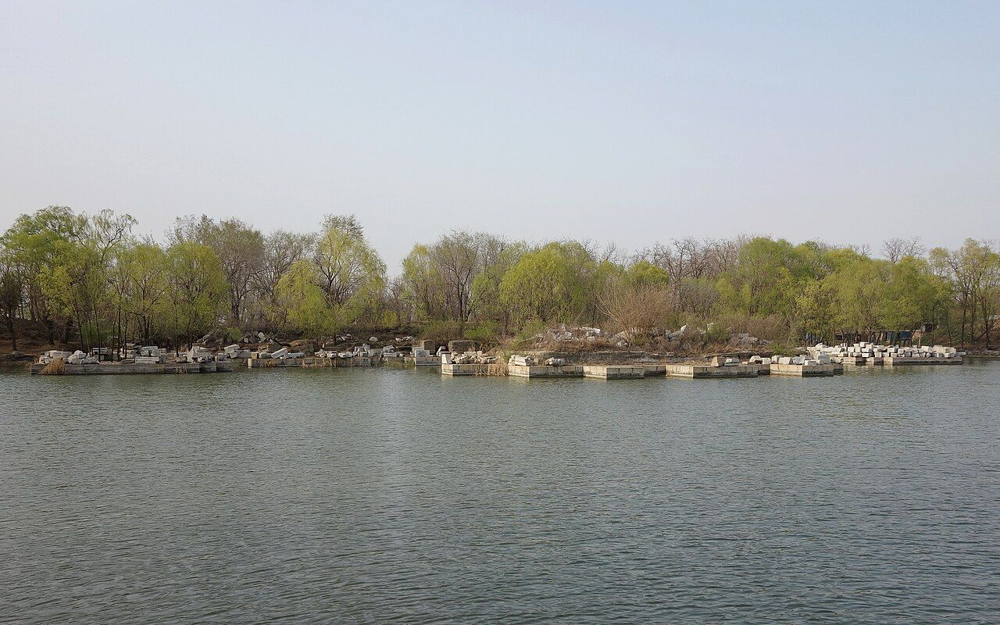
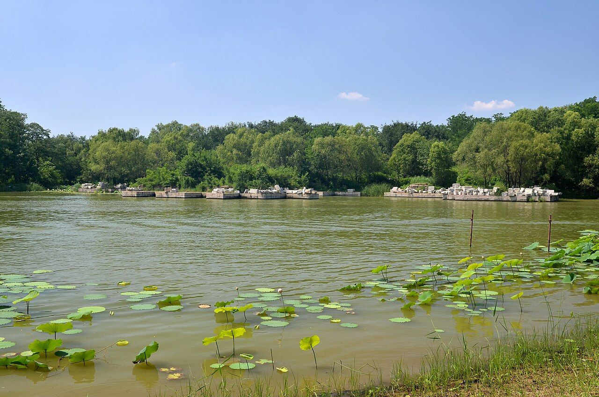

<!-- generated:start (scripts/building_pages.py): do not edit between these markers -->

# YM29: 方壶胜境 Fanghu Shengjing

Fang Hu Sheng Ching (Elevated Region of the Square Pot) · Yuanming Yuan

**3D object:** 23 boxes. Open it: `/reconstruction/3d.html?b=YM29`

## What we know

- **Name:** 方壶胜境 Fanghu Shengjing (S05, S02, S08, S06, S01, S361 · confidence A)
- **English:** Fang Hu Sheng Ching (Elevated Region of the Square Pot) (S05, S02, S08, S06, S01, S361)
- **Garden:** Yuanming Yuan (S05, S02, S08, S06, S01, S361)
- **Type:** scene (S05, S02, S08, S06, S01, S361 · confidence A)
- **Built:** 乾隆五年 1740 (S02 p.93); 乾隆三年 1738 per S06 (S05, S02, S08, S06, S01, S361)
- **Destroyed:** 1860; masonry pulled down later (S02 p.218) (S05, S02, S08, S06, S01, S361)
- **Position:** 40.01175, 116.30038. S01 sure (S01 · confidence B)
- **Bays:** three halls of 5 on two floors, with 3-bay side towers in the texts (S05, S02, S08, S06, S01, S361)
- **Note:** Malone: 12 buildings of golden glazed tile, terraces, 3 pavilions over water. S06: 2000+ Buddhist images. (S05, S02, S08, S06, S01, S361)
- **Plan reader's note:** Label (8170,1290); Malone 29 at (7965,1380). Polygon takes in the terrace, 3 lake pavilions, 蕊珠宫, slot dock and 龙王庙, and part of the lake. (S01) *(research copy, not public)*
- **How it was read:** sure (S01) *(research copy, not public)*
- **Plan pixels:** 8037, 1142 (S01) *(research copy, not public)*

## Our model now

23 boxes stand in this compound, 23 on blocks drawn on the plan, 0 assumed. Its halls are listed below.

## Inside it (25)

- YM29-01 方壶胜境楼
- YM29-02 坊座
- YM29-03 三亭 (月台)
- YM29-04 哕鸾殿
- YM29-05 琼华楼
- YM29-06 蕊珠宫
- YM29-07 船坞
- YM29-08 龙王庙
- YM29-AE005
- YM29-AE006
- YM29-AE007
- YM29-AE037
- YM29-B0126
- YM29-B0127
- YM29-B0129
- YM29-B0130
- YM29-B0131
- YM29-B0146
- YM29-B0173
- YM29-B0175
- YM29-B0176
- YM29-B0177
- YM29-B0178
- YM29-N01
- YM29-N02

## Pictures (10)

- **P0029** (sure): 方壺勝境 Fanghu shengjing [Site merveilleux du Vase carré] (圓明園四十景, 第29景) (1744 (BnF record: 1744年，清朝乾隆九年)). https://commons.wikimedia.org/wiki/File%3A%E5%9C%93%E6%98%8E%E5%9C%92%E5%9B%9B%E5%8D%81%E6%99%AF_-_%28%E6%B8%85%29%E5%94%90%E5%B2%B1%E3%80%81%E6%B2%88%E6%BA%90%E5%90%88%E7%95%AB_%3B_%28%E4%B9%BE%E9%9A%86%E5%90%9F%E8%AF%97%EF%BC%8C%E6%B1%AA%E7%94%B1%E6%95%A6%E4%BB%A3%E4%B9%A6%29_-_btv1b55008362z_%28088_of_124%29.jpg

  

- **P0068** (sure): 中国皇帝的宫殿与庙宇. 第8幅图, 方壺勝境 - (清)孙祜、沈源Fanghu shengjing - (Qing)Sun Hu, Shen Yuan (1745 (Commons, from the BnF record)). https://commons.wikimedia.org/wiki/File%3A%E4%B8%AD%E5%9B%BD%E7%9A%87%E5%B8%9D%E7%9A%84%E5%AE%AB%E6%AE%BF%E4%B8%8E%E5%BA%99%E5%AE%87._%E7%AC%AC8%E5%B9%85%E5%9B%BE%2C_%E6%96%B9%E5%A3%BA%E5%8B%9D%E5%A2%83_-_%28%E6%B8%85%29%E5%AD%99%E7%A5%9C%E3%80%81%E6%B2%88%E6%BA%90Fanghu_shengjing_-_%28Qing%29Sun_Hu%2C_Shen_Yuan_-_btv1b105206930.jpg

  

- **P0114** (sure): 海淀(镇)：中国皇帝的行宫. 第14幅图, 方壺勝境Fanghu shengjing (1750-1792 (BnF, cb43831905b; ex coll. Bertin)). https://commons.wikimedia.org/wiki/File%3A%E6%B5%B7%E6%B7%80%28%E9%95%87%29%EF%BC%9A%E4%B8%AD%E5%9B%BD%E7%9A%87%E5%B8%9D%E7%9A%84%E8%A1%8C%E5%AE%AB._%E7%AC%AC14%E5%B9%85%E5%9B%BE%2C_%E6%96%B9%E5%A3%BA%E5%8B%9D%E5%A2%83Fanghu_shengjing_-_btv1b105206305.jpg

  

- **P0146** (sure): Le Tour du monde 10: Fang-hou-ching-king, or the Site without rival, pp. 104-105 (1 July 1864 (Commons)). https://commons.wikimedia.org/wiki/File%3ALe_Tour_du_monde-10-p104-105.jpg

  

- **P0260** (sure): 方壺勝境 Fanghu Shengjing (御製圓明園圖詠, 1887 石印本, 下卷 (Commons 卷二), 第29景; printed title in the right margin of the picture) (光緒十三年 1887 (Commons/NLC record; colophon 光緒十三年七月天津石印書屋 in the SSID copy, S98 PDF p.2); design after the woodblock of 1745 by 孫祜 Sun Hu and 沈源 Shen Yuan). https://commons.wikimedia.org/wiki/File%3ANLC403-312001107375-14034_%E7%A6%A6%E5%88%B6%E5%9C%93%E6%98%8E%E5%9C%92%E5%9C%96%E8%A9%A0_%E5%8D%B7%E4%BA%8C.pdf?page=31

  

- **P0536** (sure): 方壺勝境 Fanghu Shengjing: 乾隆 Qianlong's preface and poem with the courtiers' commentary, 御製圓明園圖詠 1887 (poem 1744 (乾隆九年); this printing 1887). https://commons.wikimedia.org/wiki/File%3ANLC403-312001107375-14034_%E7%A6%A6%E5%88%B6%E5%9C%93%E6%98%8E%E5%9C%92%E5%9C%96%E8%A9%A0_%E5%8D%B7%E4%BA%8C.pdf?page=32

  

- **P0201** (sure): Sirén, Enligt text under Pl. 178 Kinas trädgårdar Vol. I: Yuanmingyuan. Fanghu Shengjing. Detta stora byggnadskomplex, som reste sig på en hög marmorterrass strax norr om Fuhai, uppfördes 17 (undated by holder; Sirén's second trip 1921-23 for this group). http://kulturarvsdata.se/SMVK-OM/Bildarkiv/198811 Research-only: link card.

  

- **P0202** (sure): Sirén, Enligt text under  Pl. 179 Kinas trädgårdar Vol. I: Yuanmingyuan. Fanghu Shengjing. Detta stora byggnadskomplex, som reste sig på en hög marmorterrass strax norr om Fuhai, uppfördes 1 (undated by holder; Sirén's second trip 1921-23 for this group). http://kulturarvsdata.se/SMVK-OM/Bildarkiv/198812 Research-only: link card.

  

- **P0383** (sure): Yuanmingyuan Fanghu Shengjing 20130414.JPG (2013-04-14 16:49:18 (Commons DateTimeOriginal)). https://commons.wikimedia.org/wiki/File:Yuanmingyuan_Fanghu_Shengjing_20130414.JPG

  

- **P0384** (sure): Yuanmingyuan Fanghu Shengjing 20120715.JPG (2012-07-15 (Commons DateTimeOriginal)). https://commons.wikimedia.org/wiki/File:Yuanmingyuan_Fanghu_Shengjing_20120715.JPG

  

## Texts and drawings (19)

- **E1842** (poem, sure): 御製方壺勝境詩（圓明園四十景詩）. 1744 (乾隆九年) · printed in S05 j82:13a-13b · S40. https://github.com/kanripo/KR2k0036/blob/master/KR2k0036_082.txt
  > 乾隆九年 御製方壺勝境詩 海上三神山舟到風輒引去徒妄語耳要知金銀為宫闕亦何異人寰即境即仙自在我室何事逺求此方壺所為寓名也東為蕊珠宫西則三潭印月淨渌空明又闢一勝境矣 飛觀圖雲鏡水涵拏空松栢與天參高岡翽羽鳴應六曲渚寒蟾印有三魯匠營心非美事齊人搤掔只虛談爭如茅土仙人宅十二金堂比不慙
  Sailors never reach the three sacred isles of the sea, he says, so gold and silver palaces might as well stand here. 蕊珠宫 lies east; 三潭印月 lies to the west on clear water, another fine place.
- **E1847** (text, sure): 日下舊聞考 方壶胜境. 1780s (乾隆 敕撰) · j82:12a-13a · S05. https://github.com/kanripo/KR2k0036/blob/master/KR2k0036_082.txt
  > 四宜書屋之東臨池樓宇為方壺勝境上下各五楹南建坊座二其北樓宇為噦鸞殿又北為瓊華樓噦鸞殿東為蕊珠宫宫南船塢後有龍王廟（圓明園册）臣等謹按方壺勝境四十景之一額為皇上御書坊座南額曰芝田日永曰閬苑春深北曰鳯鳴珠樹曰鹿夀靈臺方壺勝境樓宇上額曰宜春殿曰敬勝怠噦鸞殿樓宇上額曰用厥中曰有真賞在瓊華樓額曰潄芳潤及蕊珠宫額皆御書
  East of 四宜書屋 on the water: 方壺勝境, five bays on two floors, with two archways to the south, 噦鸞殿 and 瓊華樓 behind, 蕊珠宫 to the east, a boathouse and a 龍王廟. The note gives each plaque.
- **E1841** (poem, sure): 方壶胜境: 乾隆七年 poem of the Qianlong Emperor. 乾隆七年 (1742), date from the compilation · p.269 item (1), under 方壶胜境 · S360. https://www.yuanmingyuanpark.cn/xs/yjbg/202007/P020200730387572832602.pdf#page=269
  > 梧竹萧森列几株，文轩长日丽清都。蕉心抽绿画千轴，荷瓣漂红霞一湖。绕栋初闻子母燕，乘波群浴帝王鳬。对时育物歌薫意，兴与诗人别体殊。
  Poem of the Qianlong Emperor at 方壶胜境, 1742, on the view. Year as given by the compilation.
- **E1858** (poem, sure): 琼华楼对雨. 乾隆七年 (1742) · v2 p.329, under 方壶胜境; source ref 2-533 · S361. https://www.yuanmingyuanpark.cn/xs/yjbg/202008/P020200803382343267004.pdf#page=332
  > 飒爽檐帷生薄寒，梧桐枝上玉阑干。云飞别岫当轩暗，雨过前溪隔座看。声泻池荷吟凤管，点催檐瓦弄珠丸。西山拟望秋晴黛，烟屿鸥波正渺漫。
  Poem 琼华楼对雨 by the Qianlong Emperor, 1742, filed by the editors under 方壶胜境.
- **E1843** (poem, sure): 方壶胜境: 乾隆四十年 poem of the Qianlong Emperor. 乾隆四十年 (1775), date from the compilation · p.269 item (3), under 方壶胜境 · S360. https://www.yuanmingyuanpark.cn/xs/yjbg/202007/P020200730387572832602.pdf#page=269
  > 胜境拟方壶（方壶 胜境为圆明园四十景之一殿居其中），网轩宝额扶。顾名试思义，育物每廑吾。即此春宜者，寜无隅向乎。几闲吟五字，怡与愧犹俱。
  Poem of the Qianlong Emperor at 方壶胜境, 1775, on the view. Year as given by the compilation.
- **E1844** (poem, sure): 方壶胜境: 乾隆五十四年 poem of the Qianlong Emperor. 乾隆五十四年 (1789), date from the compilation · p.270 item (6), under 方壶胜境 · S360. https://www.yuanmingyuanpark.cn/xs/yjbg/202007/P020200730387572832602.pdf#page=270
  > 春为元也善之长，惟是一宜无不宜。朵殿顾名每思义，寰区发号必先施。（每于隔岁冬底驰询各省督抚有无偏灾应行加赈之处，至岁首即先颁发恩旨以普春祺。）安怀老㓜常廑彼，彩贴华镫岂乐斯。舒迭群雍奉粤宛，同民台者共登之。
  Poem of the Qianlong Emperor at 方壶胜境, 1789, on the view. Year as given by the compilation.
- **E1845** (poem, sure): 方壶胜境. 嘉庆元年 (1796) · v2 p.332, under 方壶胜境; source ref 1-174 · S361. https://www.yuanmingyuanpark.cn/xs/yjbg/202008/P020200803382343267004.pdf#page=335
  > 载籍徒夸山海异，由来胜境在人间。阁如翔凤雕栏护，桥若飞龙扣砌环。圆峤方壶难玩赏，琪花瑶草漫追攀。应嗤秦汉求仙鄙，徐福扁舟尚未还。
  Poem 方壶胜境 by the Jiaqing Emperor, 1796, filed by the editors under 方壶胜境.
- **E1846** (poem, sure): 方壶胜境. 嘉庆二年 (1797) · v2 p.333, under 方壶胜境; source ref 1-276 · S361. https://www.yuanmingyuanpark.cn/xs/yjbg/202008/P020200803382343267004.pdf#page=336
  > 三山无路谁能到，五利文成总妄言。楼阁巍峩拟胜境，神仙缥缈实虚论。餐霞吸雾浮词屏，食德饮和至道存。即此游观为法戒，保民守正示根原。
  Poem 方壶胜境 by the Jiaqing Emperor, 1797, filed by the editors under 方壶胜境.
- **E1850** (description, sure): Scene 29, 方壶胜境 Fanghu Shengjing. 1934 · pp.92-93 · S02. https://archive.org/details/historyofpekings00malo
  > On this terrace there were two large buildings and four smaller side buildings, all of two stories and with elevated walks connecting their second stories.
  Upper brick-faced terrace: two large and four smaller two-storey buildings linked at upper level. Lower terrace on the lake: three two-storey buildings. A bridge and two piers to three small terraces with open pavilions, marble balustrades and steps for the barge. Twelve buildings with golden glazed tile. Built 1740 (Tse Li vol. 2 p.33, vol. 20 p.8). Smaller palace to the east, another across the lake north, boathouse.
- **E1849** (description, likely): Six paintings, III: 方壶胜境 Fanghu Shengjing. before 1799 · pp.197-200, Tableau III · S258. https://archive.org/details/BIUSante_40644
  > A l'exception des trois pavillons en saillie sur les eaux, tous les autres bâtiments ont un premier étage.
  Three parallel ranges with upper floors, a quay with three projections carrying pavilions, octagonal paving, a pailou at the foot of the first stair, steps to the water, a long winding gallery over a canal. Fits Malone p.92 closely.
- **E1851** (description, sure): 方壶胜境 南 龙王庙 (S47 section 2.11). 2012, citing archive and Qing texts · p.115; table row 22 · S47. https://www.dpm.org.cn/Uploads/File/2018/06/15/u5b23730ae0e5a.pdf
  South of 蕊珠宫 behind the boat dock, north of 涵虚朗鉴 and close to the five-arch sluice: three bays, hanging gable with ridge and finials, facing south; before 1744 by the album.
- **E1853** (description, sure): 清帝笔下的圆明园方壶胜景. post n.d. · lswh · S337. http://iqh.ruc.edu.cn/old/qdhjylyjzx/xszl/jzys/8eedf2043350479c84c87e87172be371.htm
  Reads Qianlong's and Jiaqing's poems on 方壶胜境 Fanghu Shengjing, built 1738 in the north-east of 福海. Names the books that describe its plan; notes many building bases survive. No excavation is mentioned.
- **E1848** (description, sure): 圆明园百景史事分景汇编: 方壶胜境. 1742-1818 · from p.269, under 方壶胜境 · S360. https://www.yuanmingyuanpark.cn/xs/yjbg/202007/P020200730387572832602.pdf#page=269
  方壶胜境: 12 dated items, 1742-1818, of which 12 poems (Qianlong, Jiaqing); recurring themes: the view. First dated 1742, last dated 1818.
- **E1852** (description, sure): 圆明园五朝御制诗文集注 v2, editors' note on 方壶胜境. 2020 edition · v2 p.328 · S361. https://www.yuanmingyuanpark.cn/xs/yjbg/202008/P020200803382343267004.pdf#page=331
  A temple garden from early Qianlong: on a high terrace in the water the double-eaved 迎薰亭 with 集瑞亭 and 凝祥亭, then three five-bay towers 宜春殿, 哕鸾殿, 琼华楼, each with paired side towers. The note counts 2,235 Buddha images in the nine towers. East court 蕊珠宫; 三潭印月 to the west.
- **E1854** (drawing, sure): 《国家图书馆藏样式雷图档·圆明园卷初编》: 方壶胜境. mostly 道光, 咸丰, 同治 per the publisher · 初编 目录: 方壶胜境, pp.419-433 · S13. https://www.nlcpress.com/ProductView.aspx?Id=7642
  The printed facsimile of the National Library of China's Yangshi Lei sheets has a section on this place at pp.419-433 (15 pages, section length worked out from the next heading); sheet titles and numbers are in the volume, ordered from a library.
- **E1855** (drawing, sure, search index only): 方壶胜境平面图 (图名: 方壶胜境北路). 道光后期 · 国家图书馆善本部 样042-2号 · S310. https://www.mhymy.com/dasl/ysltd/8298.html
  Late-Daoguang presentation plan of the north range of Fanghu Shengjing, ink and light colour. No image here; the site may ask a small payment for the full record.
- **E1856** (drawing, sure, search index only): 方壶胜境铜龙、凤立样底图. S310. https://www.mhymy.com/tag/1101
  Elevation base sheet for the bronze dragons and phoenixes at Fanghu Shengjing, title seen as a related item; own page URL, shelf number and date not seen. No image here; the site may ask a small payment for the full record.
- **E1857** (plan, sure): 《圆明园四十景》图的价值: 方壶胜境 leaf. 2020 · jzys · S337. http://iqh.ruc.edu.cn/old/qdhjylyjzx/xszl/jzys/8eef05885c3e4279ae0132f1a37a13c9.htm
  Says the 方壶胜境 leaf also shows its neighbours: 蕊珠宫 east, the three small stone pagodas and pavilions of 三潭印月 west, 天宇空明 north, two timber bridges south. So one leaf can witness several objects.
- **E1877** (plan, likely): 三幅样式雷圆明园河道全图辨析: earth moved. 2024 · NLC 043, changes between plans, item 9 · S337. http://iqh.ruc.edu.cn/old/qdhjylyjzx/xszl/jzys/59b83e20f7ab4840b746a6208a550939.htm
  One listed change between plans: the hill at 澡身浴德 was removed and earth was added beside 藏舟坞, south-east of 方壶胜境, and east of 三潭印月, spoil from dredging being the usual source. Useful for the hills layer on the east shore.

**On the plan:** Drawn on the plan of the gardens (S01), labelled 方壶胜境. https://artmuseum.princeton.edu/collections/objects/138657

## Reconstructions by others (5)

Modern interpretation, not evidence.
- **R0095** (render, likely): 方壶胜境, image 768 in a gallery. posted 2019. https://www.thepaper.cn/newsDetail_forward_3323921 Research-only: link card.
- **R0009** (3D model, likely): 《“再造”一个圆明园》, Tsinghua news. 郭黛姮, 贺艳 and team, 清华大学; 清城睿现. https://www.tsinghua.edu.cn/info/1182/39662.htm Research-only: link card.
- **R0121** (drawing, sure): Abb. 25, 方壶胜境 Fanghu Shengjing (Szene 141), Lageplan und Grundriss. Shuang Zhang, TU Berlin, 2004. https://doi.org/10.14279/depositonce-566 Research-only: link card.
- **R0054** (video, likely): 人文清华讲坛 lecture 20 Oct 2020 with 3D renders of 方壶胜境, 西洋楼 and 海晏堂. 人文清华 (poster); 郭黛姮 team (maker), 清华大学, 2020. https://www.thepaper.cn/newsDetail_forward_9648060 Research-only: link card.
- **R0180** (paper figure, likely, search index only): Multi-dimensional Element Graph Construction and Spatial Representation of Gardens in the Fuhai Area of Yuanmingyuan. Yuchao Cao, Nan Zhang, 风景园林 Landscape Architecture, 2025. https://doi.org/10.3724/j.fjyl.202407270414 Research-only: link card.

## Surviving comparable buildings, not this building (1)

- **T026** 排云殿 佛香阁 建筑群 Paiyun Dian and Foxiang Ge group, 颐和园 Summer Palace. Comparable: same court, era or type, confidence C, standing: rebuilt 1886. Glazed halls climbing from water to a tower Basis: No text pairs them. Reason: 方壶胜境 rises from a lake on a terrace, glazed (S08, S122, S05 j.82 f.12b), as this group does (S422). https://zh.wikipedia.org/wiki/颐和园
  - P0612: 排云殿. https://commons.wikimedia.org/wiki/File:%E6%8E%92%E4%BA%91%E6%AE%BF.jpg

## Evidence for the set of buildings

- Reconstructions and comparables for the whole garden, 圆明园 Yuanming Yuan: see GARDEN-YM

## Open questions

- Q17: Halls in the texts and not on the plan
- Q25: Other dates

<!-- generated:end -->

## Notes

<!-- Yours: regeneration never touches this part. It goes on the public site; what you write below a line holding only %% private %% stays in the research copy. -->
