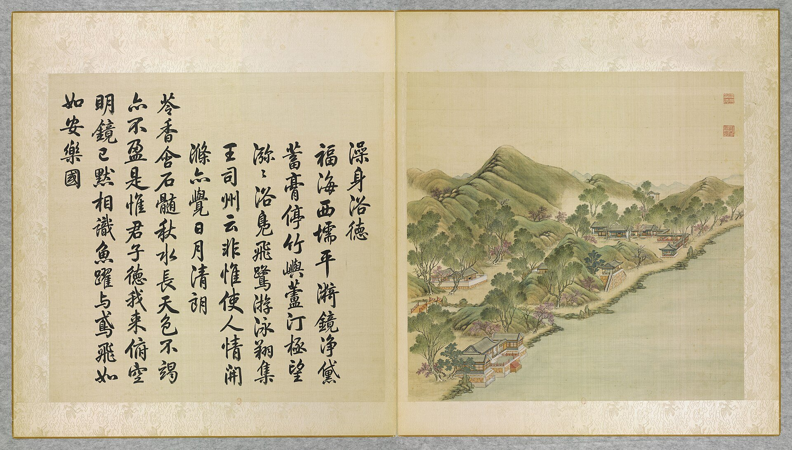
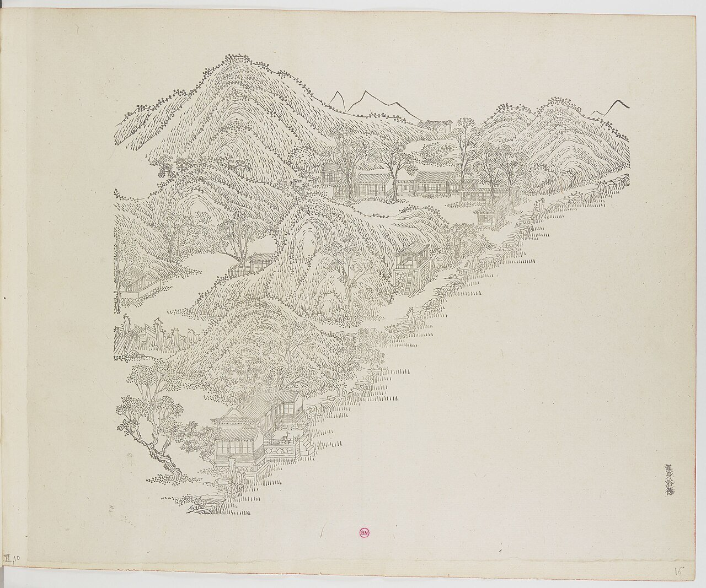
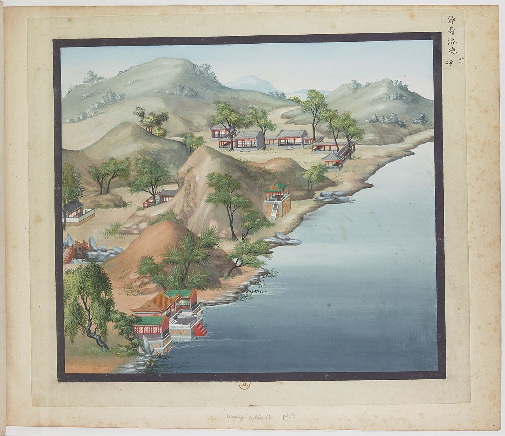
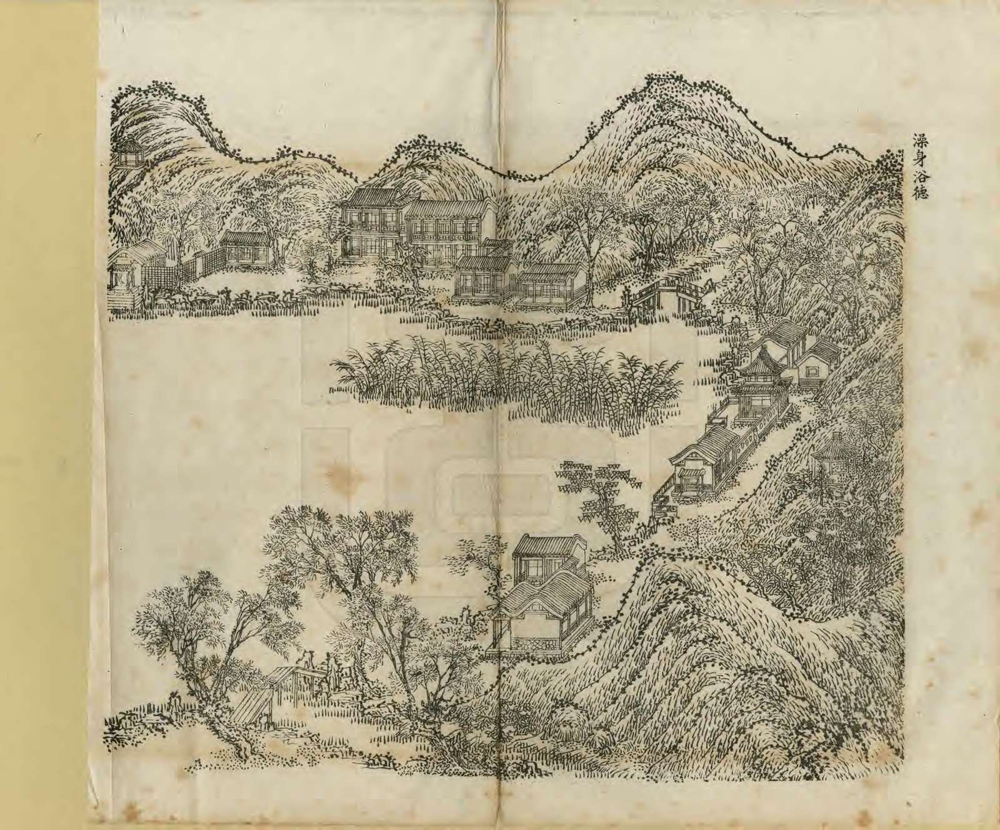
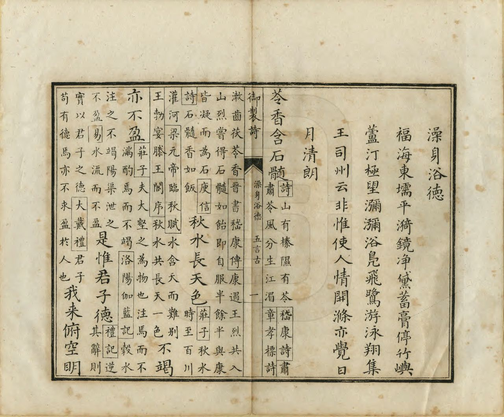
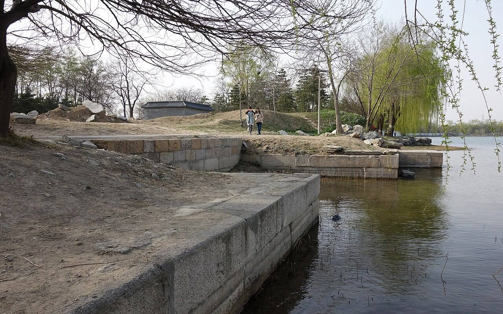

<!-- generated:start (scripts/building_pages.py): do not edit between these markers -->

# YM30: 澡身浴德 Zaoshen Yude

Bathe the Person and Cleanse the Heart · Yuanming Yuan

**3D object:** 19 boxes. Open it: `/reconstruction/3d.html?b=YM30`

## What we know

- **Name:** 澡身浴德 Zaoshen Yude (S05, S02, S08, S01 · confidence A)
- **English:** Bathe the Person and Cleanse the Heart (S05, S02, S08, S01)
- **Written on the plan:** 澄虚榭 (S01 · confidence A)
- **Garden:** Yuanming Yuan (S05, S02, S08, S01)
- **Type:** scene (S05, S02, S08, S01 · confidence A)
- **Destroyed:** 1860 (S05, S02, S08, S01)
- **Position:** 40.00615, 116.29525. S01 sure (S01 · confidence B)
- **Plan reader's note:** Label is 澄虚榭, not 澡身浴德; text: 即澄虚榭. Malone wrote 36 here at (5590,3400); his 30 stands by 雷峰夕照. Numbers 30 and 36 ARE swapped on the plan. Polygon takes both islands, joined at the ?澜渡 crossing (text: 度河桥 to 望瀛洲). (S01) *(research copy, not public)*
- **How it was read:** sure (S01) *(research copy, not public)*
- **Plan pixels:** 5490, 3730 (S01) *(research copy, not public)*

## Our model now

19 boxes stand in this compound, 19 on blocks drawn on the plan, 0 assumed. Its halls are listed below.

## Inside it (21)

- YM30-01 澄虚榭
- YM30-02 含清晖
- YM30-03 涵妙识
- YM30-04 静香馆
- YM30-05 解愠书屋
- YM30-06 旷然阁
- YM30-07 望瀛洲
- YM30-08 深柳读书堂
- YM30-09 溪月松风
- YM30-AE032
- YM30-B0495
- YM30-B0496
- YM30-B0553
- YM30-B0575
- YM30-B0576
- YM30-B0577
- YM30-B0578
- YM30-B0681
- YM30-B0702
- YM30-N01 延真院
- YM30-N02 溪山?画

## Pictures (6)

- **P0030** (sure): 澡身浴徳 Zaoshen yude [Se purifier le corps pour s'imprégner des vertus] (圓明園四十景, 第30景) (1744 (BnF record: 1744年，清朝乾隆九年)). https://commons.wikimedia.org/wiki/File%3A%E5%9C%93%E6%98%8E%E5%9C%92%E5%9B%9B%E5%8D%81%E6%99%AF._%E7%AC%AC%E4%B8%89%E5%8D%81%E6%99%AF_%28%E4%B8%8B%E5%86%8C%EF%BC%8C%E7%AC%AC%E5%8D%81%E5%B9%85%E5%9B%BE%29%2C_%E6%BE%A1%E8%BA%AB%E6%B5%B4%E5%BE%B3_-_%28%E6%B8%85%29%E5%94%90%E5%B2%B1%E3%80%81%E6%B2%88%E6%BA%90%E5%90%88%E7%95%AB_%3B_%28%E4%B9%BE%E9%9A%86%E5%90%9F%E8%AF%97%EF%BC%8C%E6%B1%AA%E7%94%B1%E6%95%A6%E4%BB%A3%E4%B9%A6%29Zaoshen_yude_-_%28Qing%29Tang_Dai%2C_Shen_Yuan_he_hua_-_btv1b55008345g.jpg

  

- **P0076** (sure): 中国皇帝的宫殿与庙宇. 第16幅图, 澡身浴徳 - (清)孙祜、沈源Zaoshen yude - (Qing)Sun Hu, Shen Yuan (1745 (Commons, from the BnF record)). https://commons.wikimedia.org/wiki/File%3A%E4%B8%AD%E5%9B%BD%E7%9A%87%E5%B8%9D%E7%9A%84%E5%AE%AB%E6%AE%BF%E4%B8%8E%E5%BA%99%E5%AE%87._%E7%AC%AC16%E5%B9%85%E5%9B%BE%2C_%E6%BE%A1%E8%BA%AB%E6%B5%B4%E5%BE%B3_-_%28%E6%B8%85%29%E5%AD%99%E7%A5%9C%E3%80%81%E6%B2%88%E6%BA%90Zaoshen_yude_-_%28Qing%29Sun_Hu%2C_Shen_Yuan_-_btv1b105207009.jpg

  

- **P0124** (sure): 海淀(镇)：中国皇帝的行宫. 第24幅图, 澡身浴徳Zaoshen yude (1750-1792 (BnF, cb43831905b; ex coll. Bertin)). https://commons.wikimedia.org/wiki/File%3A%E6%B5%B7%E6%B7%80%28%E9%95%87%29%EF%BC%9A%E4%B8%AD%E5%9B%BD%E7%9A%87%E5%B8%9D%E7%9A%84%E8%A1%8C%E5%AE%AB._%E7%AC%AC24%E5%B9%85%E5%9B%BE%2C_%E6%BE%A1%E8%BA%AB%E6%B5%B4%E5%BE%B3Zaoshen_yude_-_btv1b10520634z.jpg

  

- **P0261** (sure): 澡身浴德 Zaoshen Yude (御製圓明園圖詠, 1887 石印本, 下卷 (Commons 卷二), 第30景; printed title in the right margin of the picture) (光緒十三年 1887 (Commons/NLC record; colophon 光緒十三年七月天津石印書屋 in the SSID copy, S98 PDF p.2); design after the woodblock of 1745 by 孫祜 Sun Hu and 沈源 Shen Yuan). https://commons.wikimedia.org/wiki/File%3ANLC403-312001107375-14034_%E7%A6%A6%E5%88%B6%E5%9C%93%E6%98%8E%E5%9C%92%E5%9C%96%E8%A9%A0_%E5%8D%B7%E4%BA%8C.pdf?page=35

  

- **P0537** (sure): 澡身浴德 Zaoshen Yude: 乾隆 Qianlong's preface and poem with the courtiers' commentary, 御製圓明園圖詠 1887 (poem 1744 (乾隆九年); this printing 1887). https://commons.wikimedia.org/wiki/File%3ANLC403-312001107375-14034_%E7%A6%A6%E5%88%B6%E5%9C%93%E6%98%8E%E5%9C%92%E5%9C%96%E8%A9%A0_%E5%8D%B7%E4%BA%8C.pdf?page=36

  

- **P0385** (sure): 澡身浴德遗址 20130414.jpg (2013-04-14 16:23:27 (Commons DateTimeOriginal)). https://commons.wikimedia.org/wiki/File:%E6%BE%A1%E8%BA%AB%E6%B5%B4%E5%BE%B7%E9%81%97%E5%9D%80_20130414.jpg

  

## Texts and drawings (38)

- **E1859** (poem, sure): 御製澡身浴徳詩（圓明園四十景詩）. 1744 (乾隆九年) · printed in S05 j82:14b · S40. https://github.com/kanripo/KR2k0036/blob/master/KR2k0036_082.txt
  > 乾隆九年 御製澡身浴徳詩 福海西壖平漪鏡淨黛蓄膏停竹嶼蘆汀極望瀰瀰浴鳬飛鷺游泳翔集王司州云非惟使人情開滌亦覺日月清朗 芩香含石髓秋水長天色不竭亦不盈是惟君子徳我來俯空明鏡已黙相識魚躍與鳶飛如如安樂國
  The west shore of 福海: water calm as a mirror, bamboo islets and reed banks, ducks and egrets. He cites 王司州 on how such a view clears both the feelings and the very sun and moon.
- **E1869** (text, sure): 日下舊聞考 澡身浴德. 1780s (乾隆 敕撰) · j82:15a · S05. https://github.com/kanripo/KR2k0036/blob/master/KR2k0036_082.txt
  > 澡身浴徳之北度河橋為望瀛洲其北為深桞讀書堂堂北為溪月松風（圓明園册）臣等謹按望瀛洲額皇上御書深桞讀書堂溪月松風額皆世宗御書
  North over a bridge from 澡身浴徳: 望瀛洲, then 深桞讀書堂 and 溪月松風.
- **E1870** (text, sure): 日下舊聞考 澡身浴德、福海. 1780s (乾隆 敕撰) · j82:14a-14b · S05. https://github.com/kanripo/KR2k0036/blob/master/KR2k0036_082.txt
  > 澡身浴徳在福海西南隅即澄虛榭正宇三楹東嚮南為含清暉北為涵妙識折而西向為静香館又西為解愠書屋西南為曠然閣（圓明園册）臣等謹按福海亦稱東湖周廣凡數頃澡身浴徳四十景之一也額為皇上御書聫曰好雨知時岑巒添逺碧薰風叶奏殿閣有餘清亦御書
  In the south-west corner of 福海: 澡身浴徳, the three-bay 澄虛榭 facing east, with 含清暉, 涵妙識, 静香館, 解愠書屋 and 曠然閣. The note calls 福海 also 東湖 East Lake, several qing around.
- **E1890** (poem, likely): 世宗 深栁讀書堂 (園景十二詠). before 1723 (雍邸集, printed as written while a prince) · KR4f0002_026:2b-3a · S200. https://github.com/kanripo/KR4f0002/blob/master/KR4f0002_026.txt
  > 深栁讀書堂 欝欝千株栁隂隂覆草堂飄絲拂硯石飛絮㸃琴牀鶯囀春枝暖蟬鳴秋葉凉夜來窓月影掩映簡編香
  One of Yongzheng's twelve garden poems written while a prince: a thatched hall under a thousand willows, with catkins on the inkstone and the qin. Rixia j82:15a puts 深桞讀書堂 at 澡身浴徳, while Qianlong's 1755 note says 雙鶴齋 was once called this, so the place is not settled.
- **E1892** (poem, likely): 世宗 深栁讀書堂消夏. 雍正 (四宜堂集, undated) · KR4f0002_030:9a · S200. https://github.com/kanripo/KR4f0002/blob/master/KR4f0002_030.txt
  > 深栁讀書堂消夏 麴塵綠染萬條絲窣地濃隂暑暗移旋漬霜毫鋪玉版細研荷露寫新詩一天月色畵圗古兩部蛙聲鼓吹竒瀟灑樓臺臨碧水夜深倒影静垂垂
  Summer at 深栁讀書堂: willow shade, and a tower reflected in clear water at night.
- **E1893** (poem, likely): 世宗 深栁讀書堂避暑. 雍正 (四宜堂集, undated) · KR4f0002_030:15a-15b · S200. https://github.com/kanripo/KR4f0002/blob/master/KR4f0002_030.txt
  > 深栁讀書堂避暑 三庚節届祝融臨閒對明忩閲古箴樹杪鶯喉調妙曲檻邉蝶翅舞芳襟嫩荷香逺風頻逓深栁隂重暑不侵移榻簾前何所思要賡觧阜入虞琴
  Escaping the heat at 深栁讀書堂: birds, butterflies, scented lotus and a couch by the blind.
- **E1887** (poem, sure): 望瀛洲亭子. 乾隆十八年 (1753) · v2 p.337, under 澡身浴德; source ref 5-155 · S361. https://www.yuanmingyuanpark.cn/xs/yjbg/202008/P020200803382343267004.pdf#page=340
  > 骤雨过河源，碧天爽气来。落景照东宇，赤城赩崔嵬。非烟亦非云，如楼复如台。虹桥若可蹑，佺羡相追陪。亭子琳池西，望瀛名久哉。今朝乃领要，俨然见蓬莱。可望不可即，劳者非仙才。
  Poem 望瀛洲亭子 by the Qianlong Emperor, 1753, filed by the editors under 澡身浴德.
- **E1860** (poem, sure): 澄虚榭: 乾隆二十四年 poem of the Qianlong Emperor. 乾隆二十四年 (1759), date from the compilation · p.259 item (1), under 澄虚榭 · S360. https://www.yuanmingyuanpark.cn/xs/yjbg/202007/P020200730387572832602.pdf#page=259
  > 朗榭临碧湖，漭沆不计里。因居岸之西，待月恒于此。罗落迤东林，掩暎金盘子。须臾升其杪，翻影漾湖水。天水月胥虚，谁与分别是。三闲独无言，了然洞妙理。
  Poem of the Qianlong Emperor at 澄虚榭, 1759, on the view. Year as given by the compilation.
- **E1861** (poem, sure): 望瀛洲: 乾隆二十九年 poem of the Qianlong Emperor. 乾隆二十九年 (1764), date from the compilation · p.261 item (1), under 望瀛洲 · S360. https://www.yuanmingyuanpark.cn/xs/yjbg/202007/P020200730387572832602.pdf#page=261
  > 湖心构舎䂓三岛，湖岸开亭号望瀛。标榜莫猜出想象，便真壶峤也虚名。早觉真痴鄙汉帝，那更幻乐羡唐臣。可知名利场中客，不是神仙队里人。东海金波一缕丝，须臾玉镜大千披。仙家日月迅如此，望彼瀛洲亦底为。
  Poem of the Qianlong Emperor at 望瀛洲, 1764, on the view. Year as given by the compilation.
- **E1862** (poem, sure): 解愠书屋: 乾隆二十九年 poem of the Qianlong Emperor. 乾隆二十九年 (1764), date from the compilation · p.262 item (1), under 解愠书屋 · S360. https://www.yuanmingyuanpark.cn/xs/yjbg/202007/P020200730387572832602.pdf#page=262
  > 书屋樾凉多，偏宜夏节过。问名惟解愠，抚序正南讹。匪悦一躬适，所期万姓和。仪型在心法，讵曰五弦歌。
  Poem of the Qianlong Emperor at 解愠书屋, 1764, on reading. Year as given by the compilation.
- **E1863** (poem, sure): 解愠书屋: 乾隆二十九年 poem of the Qianlong Emperor. 乾隆二十九年 (1764), date from the compilation · p.262 item (2), under 解愠书屋 · S360. https://www.yuanmingyuanpark.cn/xs/yjbg/202007/P020200730387572832602.pdf#page=262
  > 选题额柍桭，虞帝昔闻遵。解愠言何易，民碞畏是真。稍欣暑雨过，披得爽风新。万宝西成后，庶几鲜馑贫。
  Poem of the Qianlong Emperor at 解愠书屋, 1764, on reading. Year as given by the compilation.
- **E1881** (poem, sure): 静香馆. 乾隆二十九年 (1764) · v2 p.341, under 澡身浴德; source ref 8-808 · S361. https://www.yuanmingyuanpark.cn/xs/yjbg/202008/P020200803382343267004.pdf#page=344
  > 回廊多曲折，闲馆致幽深。药蕊飘清馥，桐柯布翠阴。鱼飞常入镜，蝉韵自调琴。嗅复翳根静，云香何处寻。
  Poem 静香馆 by the Qianlong Emperor, 1764, filed by the editors under 澡身浴德.
- **E1883** (poem, sure): 解愠书屋. 乾隆二十九年 (1764) · v2 p.341, under 澡身浴德; source ref 8-825 · S361. https://www.yuanmingyuanpark.cn/xs/yjbg/202008/P020200803382343267004.pdf#page=344
  > 选题额柍枨，虞帝昔闻遵。解愠言何易，民碞畏是真。稍欣暑雨过，披得爽风新。万宝西成后，庶几鲜馑贫。
  Poem 解愠书屋 by the Qianlong Emperor, 1764, filed by the editors under 澡身浴德.
- **E1885** (poem, sure): 旷然阁. 乾隆二十九年 (1764) · v2 p.340, under 澡身浴德; source ref 8-808 · S361. https://www.yuanmingyuanpark.cn/xs/yjbg/202008/P020200803382343267004.pdf#page=343
  > 室里那知更有楼，拾梯登喜俯沧洲。春秋风月因心会，上下水天与目谋。籁爽每从窗处度，波光常向座间浮。旷然设问相宜句，顺应惟兹任物酬。
  Poem 旷然阁 by the Qianlong Emperor, 1764, filed by the editors under 澡身浴德.
- **E1895** (poem, sure): 赋得溪月松风叠旧作韵. 乾隆二十九年 (1764) · v2 p.339, under 澡身浴德; source ref 8-790 · S361. https://www.yuanmingyuanpark.cn/xs/yjbg/202008/P020200803382343267004.pdf#page=342
  > 松风四季总相宜，溪月三间常映楣。云似画时偏惬照，欲吟诗际恰摅思。天行浩浩几余乐，圣仰循循从末悲。虽曰瞠乎宁不懋，况兹精义示贻遗。
  Poem 赋得溪月松风叠旧作韵 by the Qianlong Emperor, 1764, filed by the editors under 澡身浴德.
- **E1884** (poem, sure): 解愠书屋作歌. 乾隆三十年 (1765) · v2 p.342, under 澡身浴德; source ref 9-102 · S361. https://www.yuanmingyuanpark.cn/xs/yjbg/202008/P020200803382343267004.pdf#page=345
  > 我思虞廷，去尧之世未曰遥。不识不知，其民淳朴之风犹应饶。云何舜帝挥五弦，尔日乃有“南风谣”。愠者不平之气或致怨，而胡有于重华之际，欲借薰风消。是知昊代不如羲年，非虚语。大禹下车泣罪，心诚焦。何况三千载，递降于斯时也。岂可与古相较，风俗之淳浇。吁哉，民碞实可畏，愠岂易解哉。吾惟对此惭旰宵。
  Poem 解愠书屋作歌 by the Qianlong Emperor, 1765, filed by the editors under 澡身浴德.
- **E1882** (poem, sure): 静香馆. 乾隆三十二年 (1767) · v2 p.343, under 澡身浴德; source ref 9-323 · S361. https://www.yuanmingyuanpark.cn/xs/yjbg/202008/P020200803382343267004.pdf#page=346
  > 曲廊偏有趣，闲馆致无华。可以消清暇，於焉味静嘉。砌花常递馥，林鸟亦非哗。新筍才抽叶，墙头几个斜。
  Poem 静香馆 by the Qianlong Emperor, 1767, filed by the editors under 澡身浴德.
- **E1878** (poem, sure): 澄虚榭. 乾隆四十六年 (1781) · v2 p.345, under 澡身浴德; source ref 14-474 · S361. https://www.yuanmingyuanpark.cn/xs/yjbg/202008/P020200803382343267004.pdf#page=348
  > 惟虚故能澄，是乃言乎水。春寒冰未消，而榭亦对此。然无碍其澄，冰水原一理。照影静弗动，更觉此
  Poem 澄虚榭 by the Qianlong Emperor, 1781, filed by the editors under 澡身浴德.
- **E1879** (poem, sure): 澄虚榭. 乾隆四十七年 (1782) · v2 p.346, under 澡身浴德; source ref 14-595 · S361. https://www.yuanmingyuanpark.cn/xs/yjbg/202008/P020200803382343267004.pdf#page=349
  > 水榭俯平湖，澄虚在眼前。循名今略殊，以犹结冰坚。责实邻无当，而予有进焉。冰下非水乎，其虚自依然。更协中孚义，即景悟羲编。
  Poem 澄虚榭 by the Qianlong Emperor, 1782, filed by the editors under 澡身浴德.
- **E1886** (poem, sure): 旷然阁. 乾隆四十七年 (1782) · v2 p.346, under 澡身浴德; source ref 14-599 · S361. https://www.yuanmingyuanpark.cn/xs/yjbg/202008/P020200803382343267004.pdf#page=349
  > 层阁高临冻浦边，嫩阳积素玉生烟。沿堤细柳犹迟放，纵目真教意旷然。
  Poem 旷然阁 by the Qianlong Emperor, 1782, filed by the editors under 澡身浴德.
- **E1888** (poem, sure): 恭和御制望瀛洲歌元韵（106）. 乾隆五十三年 (1788) · v4 p.400, under 春熙院 · S361. https://www.yuanmingyuanpark.cn/xs/yjbg/202008/P020200803382796786124.pdf#page=403
  > 蓬瀛競侈谈，缥缈何人到。安期与羡门，海峤空诱导。垂裳远屏不经词，轩榭楼台聊试为。清波万顷涵上下，景光瀰漫纹沦漪。福海之中树金阙，轻风吹浪看滂渤。遥峰倒映漠漠云，平林低蘸亭亭月。空明镜澈四面环，始信神山在世间。圣人几闻舒茂对，中流放櫂超尘寰。仁智娱情亦云偶，观澜察理撝谦受。泽润生民寿宇恢，丰稔盈宁欢九有。
  Poem 恭和御制望瀛洲歌元韵（106） by the Qianlong Emperor, 1788, filed by the editors under 春熙院.
- **E1891** (poem, sure): 深柳读书堂. 乾隆五十三年 (1788) · v4 p.370, under 春熙院 · S361. https://www.yuanmingyuanpark.cn/xs/yjbg/202008/P020200803382796786124.pdf#page=373
  > 郁郁千株柳，阴阴覆草堂。飘丝拂砚石，飞絮点琴床。莺啭春枝暖，蝉鸣秋叶凉。夜来窗月影，掩映简编香。
  Poem 深柳读书堂 by the Qianlong Emperor, 1788, filed by the editors under 春熙院.
- **E1864** (poem, sure): 望瀛洲: 嘉庆三年 poem of the Jiaqing Emperor. 嘉庆三年 (1798), date from the compilation · p.261 item (4), under 望瀛洲 · S360. https://www.yuanmingyuanpark.cn/xs/yjbg/202007/P020200730387572832602.pdf#page=261
  > 渤海之东有蓬莱，方丈瀛洲三岛开。祥麟威凤共翔集，琪英瑶草连琼台。道书敷衍总虚诞，谁见骖鸾次玉管。驻颜炼药事荒唐，食德饮和路平坦。四得堂记圣意申，求仙自昔皆痴人。位禄名寿天所赐，九旬纯嘏万福臻。（人君统御万方，位禄名皆可自主，所 不能必者惟寿。是以英君谊辟多有惑于方士长生久视之术恣意求仙者，不知寿与位禄名皆申命。自天惟德是，视我皇父克天德以作元命，不惟深斥求仙。即服饵引导之说，亦摈而不用圣制四得论。谓五福寿居首明福之所。先四得寿居，后明德之能。久惟圣能之惟，圣受之兹寿。近期颐康疆纯，嘏方引于亿万，万年而无量。御园游望，瀛洲延览之余深有会乎，寓境而弗滞于境也。 ）
  Poem of the Jiaqing Emperor at 望瀛洲, 1798, on the view. Year as given by the compilation.
- **E1880** (poem, sure): 含清晖室咏【乾】. 嘉庆三年 (1798) · v2 p.354, under 澡身浴德; source ref 19-289 · S361. https://www.yuanmingyuanpark.cn/xs/yjbg/202008/P020200803382343267004.pdf#page=357
  > 清晖含得一轩中，四季虽同致不同。幸是逢年心略慰，依然盼捷意犹忡。满窗暖爱赵衰日，三面雄辞宋玉风。旧咏新题一瞬目，三年惭愧迅无穷。
  Poem 含清晖室咏【乾】 by the Jiaqing Emperor, 1798, filed by the editors under 澡身浴德.
- **E1865** (poem, sure): 望瀛洲: 嘉庆十年 poem of the Jiaqing Emperor. 嘉庆十年 (1805), date from the compilation · p.262 item (7), under 望瀛洲 · S360. https://www.yuanmingyuanpark.cn/xs/yjbg/202007/P020200730387572832602.pdf#page=262
  > 方亭临福海，百顷漾晴澜。天阔闲云远，波深夏画寒。涵霞浮密樾，倒影印虚峦。即境心神谧，蓬瀛画里看。
  Poem of the Jiaqing Emperor at 望瀛洲, 1805, on the view. Year as given by the compilation.
- **E1866** (poem, sure): 解愠书屋: 嘉庆十年 poem of the Jiaqing Emperor. 嘉庆十年 (1805), date from the compilation · p.263 item (6), under 解愠书屋 · S360. https://www.yuanmingyuanpark.cn/xs/yjbg/202007/P020200730387572832602.pdf#page=263
  > 清风解暑气，烦热可顿除。民艰恐难达，心愠无时舒。尘市何湫隘，自愧居广居。藐躬承孝训，永念授玺初。庶姓苦贫乏，衣食未饶余。变时待天眷，大有丰年书。
  Poem of the Jiaqing Emperor at 解愠书屋, 1805, on reading and escaping the heat. Year as given by the compilation.
- **E1867** (poem, sure): 澄虚榭: 嘉庆十三年 poem of the Jiaqing Emperor. 嘉庆十三年 (1808), date from the compilation · p.260 item (18), under 澄虚榭 · S360. https://www.yuanmingyuanpark.cn/xs/yjbg/202007/P020200730387572832602.pdf#page=260
  > 时若雨旸感昊慈，御园度节守前规。所欣三辅逢年兆， 偶阅九龙竞渡嬉。昆弟协心国有庆，君臣一德政咸宜。联情行赏宴同乐，云岫风箫念岂移。（端阳日于福海中龙舟竞渡，并命诸王大臣等预观锡以宴赉，亦系先朝旧规，不过例陈节事，共庆佳辰。然皆于办事后定时观览，从未竟日留连。且亦须雨旸时若之年，方始循例饬办。予事事敬承家法不敢稍渝，本年春夏以来感沐天慈三辅，频叨两泽兆丰有象。故兹堂升联情，用示慈惠至。于所陈各戏正如云岫风箫，适然相值而已。 ）
  Poem of the Jiaqing Emperor at 澄虚榭, 1808. Year as given by the compilation.
- **E1868** (poem, sure): 澄虚榭: 嘉庆二十三年 poem of the Jiaqing Emperor. 嘉庆二十三年 (1818), date from the compilation · p.261 item (20), under 澄虚榭 · S360. https://www.yuanmingyuanpark.cn/xs/yjbg/202007/P020200730387572832602.pdf#page=261
  > 千顷波光绕榭澄，蜃窗小憩得临凭。风含锦縠往还叠，日射金鳞远近乘。杨柳披熏碧条漾，楼台倒影翠奁凝。凌虚可望三山境，福被寰瀛勉敬承。
  Poem of the Jiaqing Emperor at 澄虚榭, 1818, on the view. Year as given by the compilation.
- **E1894** (poem, sure): 深柳读书堂消夏（348）. year not parsed · v2 p.336, under 澡身浴德 · S361. https://www.yuanmingyuanpark.cn/xs/yjbg/202008/P020200803382343267004.pdf#page=339
  > 曲尘绿染万条丝，窣地浓阴暑暗移。旋渍霜毫铺玉版，细研荷露写新诗。一天月色画图古，雨部蛙声鼓吹奇。潇洒楼台临碧水，夜深倒影静垂垂。
  Poem 深柳读书堂消夏（348） by the  Emperor, filed by the editors under 澡身浴德.
- **E1874** (description, sure): Scenes 30, 31, 33, 36, 37: the shores of 福海. 1934 · p.93 · S02. https://archive.org/details/historyofpekings00malo
  > These scenes show scattered houses, pavilions, terraces, and bridges which occupied the narrow strip of shore and the surrounding hills on the north, east, and west of the Happy Sea.
  澡身浴德, 平湖秋月, 接秀山房, 涵虚朗鉴, 廓然大公: scattered houses, pavilions, terraces and bridges on the shore strip and hills north, east and west of 福海. Malone gives no more for these five.
- **E2366** (description, guess): Attiret: shores of 福海, aviaries and fish. 1743 · [pp.17-20] · S157. https://faculty.bard.edu/~louis/gardens/attiretaccount.html
  > It takes up a very large Space; and is all surrounded with a Lattice-work of Brass-wire: in which the Openings are so very fine and small, as to prevent the fish from wandering into the main waters.
  Quays of smooth stone or rock-work, terraces, palaces rising in tiers, groves of several kinds. Network houses half in the water for waterfowl, small menageries, and the largest fish reservoir, closed by brass wire. Which shore is not stated.
- **E2000** (description, sure): Site status table, about 2011: scattered remains only. c. 2011 · 系列06 repost, status table · S356. https://blog.sina.com.cn/s/blog_c27029650101itzz.html
  Scenes with only scattered, incomplete building remains in the same table. 方壶胜境 is listed separately as the one with fairly complete remains not yet tidied up. 紫碧山房, 舍卫城 and 如园 have been dug since.
- **E1871** (description, sure): 圆明园百景史事分景汇编: 澄虚榭. 1759-1818 · from p.259, under 澡身浴德 · S360. https://www.yuanmingyuanpark.cn/xs/yjbg/202007/P020200730387572832602.pdf#page=259
  澄虚榭: 20 dated items, 1759-1818, of which 20 poems (Qianlong, Jiaqing); recurring themes: the view. First dated 1759, last dated 1818.
- **E1872** (description, sure): 圆明园百景史事分景汇编: 望瀛洲. 1764-1805 · from p.261, under 澡身浴德 · S360. https://www.yuanmingyuanpark.cn/xs/yjbg/202007/P020200730387572832602.pdf#page=261
  望瀛洲: 7 dated items, 1764-1805, of which 7 poems (Qianlong, Jiaqing); recurring themes: the view. First dated 1764, last dated 1805.
- **E1873** (description, sure): 圆明园百景史事分景汇编: 解愠书屋. 1764-1805 · from p.262, under 澡身浴德 · S360. https://www.yuanmingyuanpark.cn/xs/yjbg/202007/P020200730387572832602.pdf#page=262
  解愠书屋: 6 dated items, 1764-1805, of which 6 poems (Qianlong, Jiaqing); recurring themes: reading, escaping the heat. First dated 1764, last dated 1805.
- **E1875** (description, sure): 圆明园五朝御制诗文集注 v2, editors' note on 澡身浴德. 2020 edition · v2 p.336 · S361. https://www.yuanmingyuanpark.cn/xs/yjbg/202008/P020200803382343267004.pdf#page=339
  A three-bay hall 澄虚榭 facing east at the south-west of 福海, with 含清晖, 涵妙识, 静香馆, 解愠书屋, 旷然阁 near. North are 延真院, 溪山罨画, the square 望瀛洲, 深柳读书堂, 溪月松风. Emperors watched the dragon boats from here.
- **E1876** (description, sure): 圆明园百景史事分景汇编: 澡身浴德. undated · from p.258, under 澡身浴德 · S360. https://www.yuanmingyuanpark.cn/xs/yjbg/202007/P020200730387572832602.pdf#page=258
  The compiler describes 澄虚榭, a three-bay hall facing east at the south-west of 福海, and the square shore pavilion 望瀛洲 from which Qianlong watched dragon boats; Jiaqing watched from 澄虚榭. 澡身浴德: short note in the compilation, no dated items.
- **E1877** (plan, sure): 三幅样式雷圆明园河道全图辨析: earth moved. 2024 · NLC 043, changes between plans, item 9 · S337. http://iqh.ruc.edu.cn/old/qdhjylyjzx/xszl/jzys/59b83e20f7ab4840b746a6208a550939.htm
  One listed change between plans: the hill at 澡身浴德 was removed and earth was added beside 藏舟坞, south-east of 方壶胜境, and east of 三潭印月, spoil from dredging being the usual source. Useful for the hills layer on the east shore.

**On the plan:** Drawn on the plan of the gardens (S01), labelled 澄虚榭. https://artmuseum.princeton.edu/collections/objects/138657

## Reconstructions by others (3)

Modern interpretation, not evidence.
- **R0073** (3D model, likely): 《圆明园四十景数字化复原及应用》. 圆明园管理处 with 中央美院, 圆明园管理处; 中央美术学院, 2025. https://news.bjd.com.cn/2026/10/16/11997513.shtml Research-only: link card.
- **R0002** (paper figure, likely): 三幅样式雷圆明园河道全图辨析: west road of 九洲清晏 after 1828. after 2024. http://iqh.ruc.edu.cn/old/qdhjylyjzx/xszl/jzys/59b83e20f7ab4840b746a6208a550939.htm Research-only: link card.
- **R0310** (paper figure, likely): 《“样式雷”图与圆明园》: survey of about 1700 Yangshi Lei plans, naming scenes changed after 1744. assumed: the author of 《圆明园变迁史探微》. http://iqh.ruc.edu.cn/old/qdhjylyjzx/xszl/ylfj/7c89633b1d0247b7bd91da2ff25c61f8.htm Research-only: link card.

## Evidence for the set of buildings

- Reconstructions and comparables for the whole garden, 圆明园 Yuanming Yuan: see GARDEN-YM

## Open questions

- Q90: YM31
- Q129: The brief says the album views are roughly from the south
- Q203: Water layer and shores
- Q217: 深柳读书堂

<!-- generated:end -->

## Notes

<!-- Yours: regeneration never touches this part. It goes on the public site; what you write below a line holding only %% private %% stays in the research copy. -->
