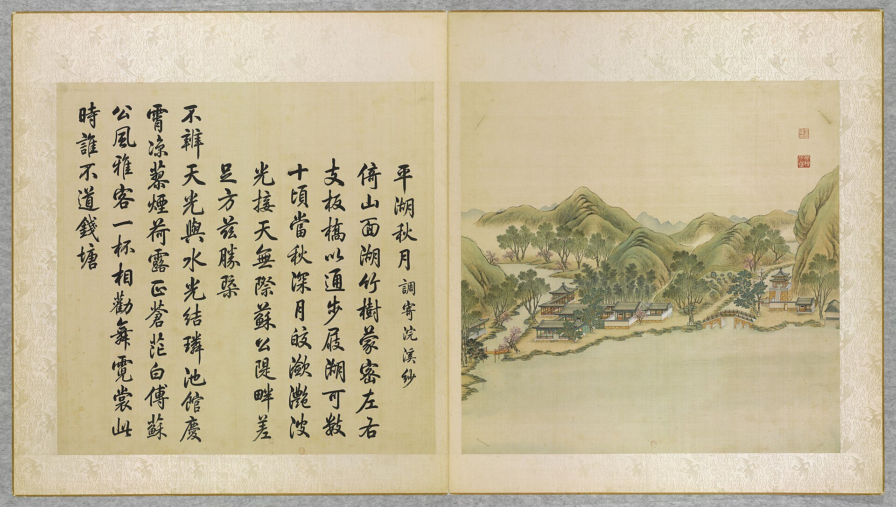

<!-- generated:start (scripts/building_pages.py): do not edit between these markers -->

# YM31-01: 平湖秋月正宇 Pinghu Qiuyue zhengyu

Yuanming Yuan

**3D object:** 1 box. Open it: `/reconstruction/3d.html?b=YM31-01`

**Part of:** YM31 平湖秋月

## What we know

- **Name:** 平湖秋月正宇 Pinghu Qiuyue zhengyu (S05, S01, S360 · confidence B)
- **Written on the plan:** 平湖秋月 (S01 · confidence B)
- **Garden:** Yuanming Yuan (S05, S01, S360)
- **Type:** other (S05, S01, S360 · confidence B)
- **Built:** by 1744 (first dated item) (S05, S01, S360)
- **Destroyed:** 1860 (S05, S01, S360)
- **Position:** 40.01019, 116.29565. S01 sure (S01 · confidence B)
- **Bays:** 3 in the texts / 4x4 on the plan (S05, S01, S360)
- **Size in the inventory:** 18.7 × 30.5 m. S01 plan px / hall scale (S01)
- **Plan reader's note:** Text 正宇三楹; plan grid 4x4. (S01) *(research copy, not public)*
- **How it was read:** sure (S01) *(research copy, not public)*
- **Plan pixels:** 6053, 1700 (S01) *(research copy, not public)*

## Our model now

A plain box on the block drawn on the Qing plan S01: position and frontage from the plan, heights and roof from the typology of its hall class. It will be updated as the research goes on.

- **Box:** 18.7 × 30.5 m, grand hall
- **Heights:** platform 1.22 m, eave 6.34 m, ridge 11.76 m above the ground
- **Roof:** hip-and-gable 歇山, rolled ridge 卷棚, 2 parallel rolls 勾连搭, grey tile
- **Faces:** 173.7° from north
- **Confidence:** B

## Pictures (1)

- **P0031** (likely): 平湖秋月 Pinghu qiuyue [Lune d'automne sur le lac Serein] (圓明園四十景, 第31景) (1744 (BnF record: 1744年，清朝乾隆九年)). https://commons.wikimedia.org/wiki/File%3A%E5%9C%93%E6%98%8E%E5%9C%92%E5%9B%9B%E5%8D%81%E6%99%AF._%E7%AC%AC%E4%B8%89%E5%8D%81%E4%B8%80%E6%99%AF_%28%E4%B8%8B%E5%86%8C%EF%BC%8C%E7%AC%AC%E5%8D%81%E4%B8%80%E5%B9%85%E5%9B%BE%29%2C_%E5%B9%B3%E6%B9%96%E7%A7%8B%E6%9C%88_-_%28%E6%B8%85%29%E5%94%90%E5%B2%B1%E3%80%81%E6%B2%88%E6%BA%90%E5%90%88%E7%95%AB_%3B_%28%E4%B9%BE%E9%9A%86%E5%90%9F%E8%AF%97%EF%BC%8C%E6%B1%AA%E7%94%B1%E6%95%A6%E4%BB%A3%E4%B9%A6%29Pinghu_qiuyue_-_%28Qing%29Tang_Dai%2C_Shen_Yuan_he_hua_-_btv1b55008346x.jpg

  

## Texts and drawings (6)

- **E1912** (text, sure): 日下舊聞考 平湖秋月、福海. 1780s (乾隆 敕撰) · j82:15b · S05. https://github.com/kanripo/KR2k0036/blob/master/KR2k0036_082.txt
  > 平湖秋月在福海西北隅正宇三楹西為流水音東北出山口臨河為花嶼蘭皋折而東南度橋為兩峯挿雲又東南為山水樂其北為君子軒為藏密樓（圓明園册）臣等謹按平湖秋月四十景之一額為世宗御書流水音花嶼蘭皋諸額為皇上御書
  In the north-west corner of 福海: 平湖秋月, three bays, with 流水音, 花嶼蘭皋, 兩峯挿雲, 山水樂, 君子軒 and 藏密樓.
- **E1896** (poem, likely): 御製平湖秋月詞（調寄浣溪紗）（圓明園四十景詩）. 1744 (乾隆九年) · printed in S05 j82:15b-16a · S40. https://github.com/kanripo/KR2k0036/blob/master/KR2k0036_082.txt
  > 乾隆九年 御製平湖秋月詞（調寄浣溪紗） 倚山面湖竹樹䝉密左右支板橋以通步屐湖可數十頃當秋深月皎㶑灧波光接天無際蘇公隄畔差足方兹勝概 不辨天光與水光結璘池館慶宵涼蓼煙荷露正蒼茫　白傅蘇公風雅客一杯相勸舞霓裳此時誰不道錢塘
  Set against a hill and facing the lake, with dense bamboo and plank bridges on either side. The lake runs to tens of qing, and on deep autumn nights moon and water merge, close to the view by 蘇公隄 Su Causeway.
- **E1909** (poem, sure): 平湖秋月: 道光三年 poem of the Daoguang Emperor. 道光三年 (1823), date from the compilation · p.263 item (1), under 平湖秋月 · S360. https://www.yuanmingyuanpark.cn/xs/yjbg/202007/P020200730387572832602.pdf#page=263
  > 平湖日午泛轻航，飒飒南风喜送凉。鸣籁青松遮碧嶂，含芳紫槿映虚堂。倏看雨脚疎还密，乍听雷声隐复扬。四望溟蒙涵妙景，瀛洲图书水中央。
  Poem of the Daoguang Emperor at 平湖秋月, 1823, on rain and the view. Year as given by the compilation.
- **E1910** (poem, sure): 平湖秋月: 道光四年 poem of the Daoguang Emperor. 道光四年 (1824), date from the compilation · p.263 item (2), under 平湖秋月 · S360. https://www.yuanmingyuanpark.cn/xs/yjbg/202007/P020200730387572832602.pdf#page=263
  > 已欣春雪遍沾濡，何幸甘霖润似酥。近户点波声淅沥，隔溪羃树影模糊。新正嘉泽真难遇，开岁鸿慈沐更殊。预庆来牟兆丰稔，虚窗对处寸心愉。
  Poem of the Daoguang Emperor at 平湖秋月, 1824, on rain and the harvest. Year as given by the compilation.
- **E1911** (poem, sure): 平湖秋月: 咸丰七年 poem of the Xianfeng Emperor. 咸丰七年 (1857), date from the compilation · p.263 item (7), under 平湖秋月 · S360. https://www.yuanmingyuanpark.cn/xs/yjbg/202007/P020200730387572832602.pdf#page=263
  > 鹜望平湖雨似麻，丝丝作势趁 风斜。一痕湿霭横林幄，无限凉飔透户纱。饼饵添香田畔麦，臙脂挹润槛前花。屡膺吴眷弥增惕，从此旬沾徧迩遐。
  Poem of the Xianfeng Emperor at 平湖秋月, 1857, on rain and the view. Year as given by the compilation.
- **E1913** (description, sure): 圆明园百景史事分景汇编: 平湖秋月. 1744-1857 · from p.263, under 平湖秋月 · S360. https://www.yuanmingyuanpark.cn/xs/yjbg/202007/P020200730387572832602.pdf#page=263
  平湖秋月: 8 dated items, 1744-1857, of which 7 poems and 1 court records (Qianlong, Daoguang, Xianfeng); recurring themes: the view, rain, the harvest. First dated 1744, last dated 1857.

**On the plan:** Drawn on the plan of the gardens (S01), labelled 平湖秋月, 4x4 cells. https://artmuseum.princeton.edu/collections/objects/138657

## Evidence for the set of buildings

- Evidence for the whole compound 平湖秋月: see YM31
- Reconstructions and comparables for the whole garden, 圆明园 Yuanming Yuan: see GARDEN-YM
- Standing buildings comparable to a grand hall (not this building): see CLASS-grand_hall

## Open questions

None that name it.

<!-- generated:end -->

## Notes

<!-- Yours: regeneration never touches this part. It goes on the public site; what you write below a line holding only %% private %% stays in the research copy. -->
