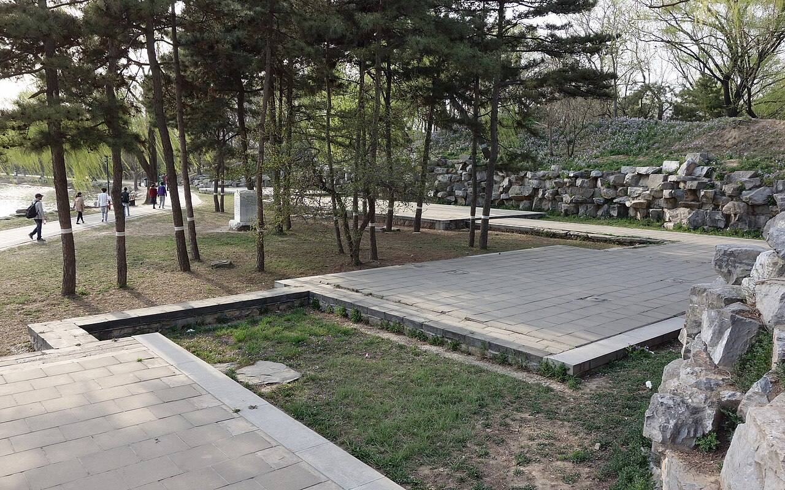

<!-- generated:start (scripts/building_pages.py): do not edit between these markers -->

# YM31-07: 藏密楼 Cangmi Lou

Yuanming Yuan

**3D object:** 1 box. Open it: `/reconstruction/3d.html?b=YM31-07`

**Part of:** YM31 平湖秋月

## What we know

- **Name:** 藏密楼 Cangmi Lou (S05, S01, S111 · confidence B)
- **Garden:** Yuanming Yuan (S05, S01, S111)
- **Type:** tower (S05, S01, S111 · confidence B)
- **Built:** early Qianlong, named 1758 (S05, S01, S111)
- **Destroyed:** 1860 (S05, S01, S111)
- **Position:** 40.01095, 116.29819. S01 likely (S01 · confidence B)
- **Bays:** 3 in the texts (S05, S01, S111)
- **Plan reader's note:** Label touches the NE corner of B0240. S111: 南向三间歇山楼. North half has a round end at a rock-lined path. The block may hold both 轩 and 楼. OSM 藏密楼 maps far off at (7765,1626). [shares block B0240 with YM31-06] (S01) *(research copy, not public)*
- **How it was read:** likely (S01) *(research copy, not public)*
- **Plan pixels:** 7172, 1494 (S01) *(research copy, not public)*

## Our model now

A plain box on the block drawn on the Qing plan S01: position and frontage from the plan, heights and roof from the typology of its hall class. It will be updated as the research goes on.

- **Box:** 15.1 × 21.1 m, main hall
- **Heights:** platform 0.7 m, eave 4.4 m, ridge 8.02 m above the ground
- **Roof:** hip-and-gable 歇山, rolled ridge 卷棚, 2 parallel rolls 勾连搭, grey tile
- **Faces:** 176.8° from north
- **Confidence:** B

## Pictures (1)

- **P0386** (sure): 藏密楼 20130414.JPG (2013-04-14 16:46:26 (Commons DateTimeOriginal)). https://commons.wikimedia.org/wiki/File:%E8%97%8F%E5%AF%86%E6%A5%BC_20130414.JPG

  

## Texts and drawings (10)

- **E1912** (text, sure): 日下舊聞考 平湖秋月、福海. 1780s (乾隆 敕撰) · j82:15b · S05. https://github.com/kanripo/KR2k0036/blob/master/KR2k0036_082.txt
  > 平湖秋月在福海西北隅正宇三楹西為流水音東北出山口臨河為花嶼蘭皋折而東南度橋為兩峯挿雲又東南為山水樂其北為君子軒為藏密樓（圓明園册）臣等謹按平湖秋月四十景之一額為世宗御書流水音花嶼蘭皋諸額為皇上御書
  In the north-west corner of 福海: 平湖秋月, three bays, with 流水音, 花嶼蘭皋, 兩峯挿雲, 山水樂, 君子軒 and 藏密樓.
- **E1898** (poem, sure): 藏密楼: 乾隆二十四年 poem of the Qianlong Emperor. 乾隆二十四年 (1759), date from the compilation · p.264 item (1), under 藏密楼 · S360. https://www.yuanmingyuanpark.cn/xs/yjbg/202007/P020200730387572832602.pdf#page=264
  > 屋里通云磴，檐头出月轩。往来悦神智，阖辟具乾坤。真得壶中趣，堪忘象外言。俯凭千顷碧，是我洗心源。
  Poem of the Qianlong Emperor at 藏密楼, 1759, on the view. Year as given by the compilation.
- **E1900** (poem, sure): 藏密楼: 乾隆二十五年 poem of the Qianlong Emperor. 乾隆二十五年 (1760), date from the compilation · p.264 item (2), under 藏密楼 · S360. https://www.yuanmingyuanpark.cn/xs/yjbg/202007/P020200730387572832602.pdf#page=264
  > 丹梯拾级因高迥，绿牖凭虚纳远通。闭户恰宜读周易，庶几津逮洗心同。
  Poem of the Qianlong Emperor at 藏密楼, 1760. Year as given by the compilation.
- **E1923** (poem, sure): 藏密楼. 乾隆二十五年 (1760) · v2 p.368, under 澡身浴德; source ref 7-303 · S361. https://www.yuanmingyuanpark.cn/xs/yjbg/202008/P020200803382343267004.pdf#page=371
  > 丹梯拾级因髙迥，绿牖凭虚纳远通。闭户恰宜读周易，庶几津逮洗心同。
  Poem 藏密楼 by the Qianlong Emperor, 1760, filed by the editors under 澡身浴德.
- **E1924** (poem, sure): 藏密楼. 乾隆二十六年 (1761) · v2 p.368, under 澡身浴德; source ref 8-422 · S361. https://www.yuanmingyuanpark.cn/xs/yjbg/202008/P020200803382343267004.pdf#page=371
  > 宣尼十翼称藏密，艺祖诸门乃洞开。诠易求心不求迹，田何阳叔可能哉。
  Poem 藏密楼 by the Qianlong Emperor, 1761, filed by the editors under 澡身浴德.
- **E1904** (poem, sure): 藏密楼: 乾隆五十八年 poem of the Qianlong Emperor. 乾隆五十八年 (1793), date from the compilation · p.264 item (4), under 藏密楼 · S360. https://www.yuanmingyuanpark.cn/xs/yjbg/202007/P020200730387572832602.pdf#page=264
  > 委宛得层居，遂以蔵密名。斯虽述易言，而吾更有评。潜修贵洗心，明扬要通情。大公而顺应，夫岂独善能。吉凶同民患，继言理实明。
  Poem of the Qianlong Emperor at 藏密楼, 1793, on reading. Year as given by the compilation.
- **E1216** (description, sure): Site status table, about 2011: remains tidied up. c. 2011 · 系列06 repost, status table · S356. https://blog.sina.com.cn/s/blog_c27029650101itzz.html
  A blogger's table of what was then visible. These scenes have building remains that have been cleared and tidied. Dated about 2011, so digs since then are not reflected.
- **E2017** (description, sure): 老北京的记忆(125): 涵虚朗鉴 and 接秀山房, quoting 《圆明园百景图志》. 2017 · post 125 · S111. https://blog.sina.com.cn/s/blog_88741e0d0102x6gc.html
  Gives scene sizes and hall by hall measures: 涵虚朗鉴 200 x 60 m, 接秀山房 250 x 50 m. 接秀山房 became 观澜堂 in late Jiaqing. 1855 interior drawing at the NLC. Notes the names of the east-shore scenes were swapped around 1744, and that some modern plans mislabel the halls.
- **E1915** (description, sure): 圆明园百景史事分景汇编: 藏密楼. 1759-1793 · from p.264, under 平湖秋月 · S360. https://www.yuanmingyuanpark.cn/xs/yjbg/202007/P020200730387572832602.pdf#page=264
  藏密楼: 4 dated items, 1759-1793, of which 4 poems (Qianlong); recurring themes: reading, the view. First dated 1759, last dated 1793.
- **E2262** (plan, sure): 圆明园新证, 端木泓: dated additions shown on plan 1704. post n.d. · tables 1 and 2 · S337. http://iqh.ruc.edu.cn/old/qdhjylyjzx/xszl/xstl/1c9094aef4f041148f15883c7c266cb9.htm
  Tables of when things were added, drawn from archives to date the plan's layers: 藻园 1752, 廓然大公 eight views 1754, 春雨轩 1755, 藏密楼 1758, 多稼轩 ten views 1759, 紫碧山房 1760, 安澜园 and 澄练楼 1763, 若帆之阁 1764, 汇万总春之庙 1769, 文源阁 1775, 法源楼 1779; after: 兰亭八柱 1779, 知过堂 1782, 课农轩 1816, 涵月楼 1827. The most useful single dating table found.

**On the plan:** Drawn on the plan of the gardens (S01), labelled 藏密楼. https://artmuseum.princeton.edu/collections/objects/138657

## Evidence for the set of buildings

- Evidence for the whole compound 平湖秋月: see YM31
- Reconstructions and comparables for the whole garden, 圆明园 Yuanming Yuan: see GARDEN-YM

## Open questions

- Q18: Plan labels vs text names at 藻园, 月地云居, 日天琳宇 etc
- Q41: 藏密楼 YM31-07, 松风阁 YM81

<!-- generated:end -->

## Notes

<!-- Yours: regeneration never touches this part. It goes on the public site; what you write below a line holding only %% private %% stays in the research copy. -->
