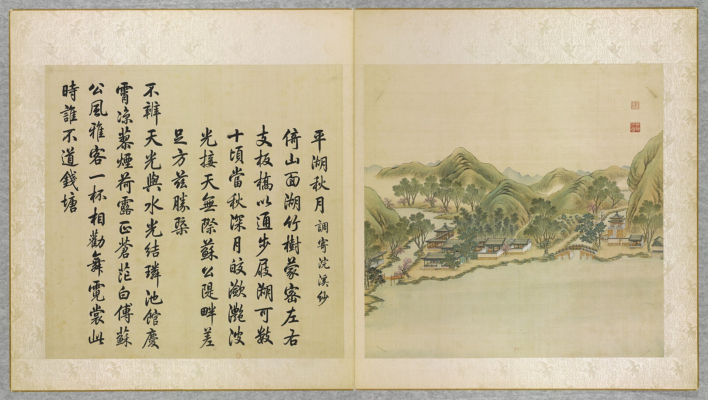
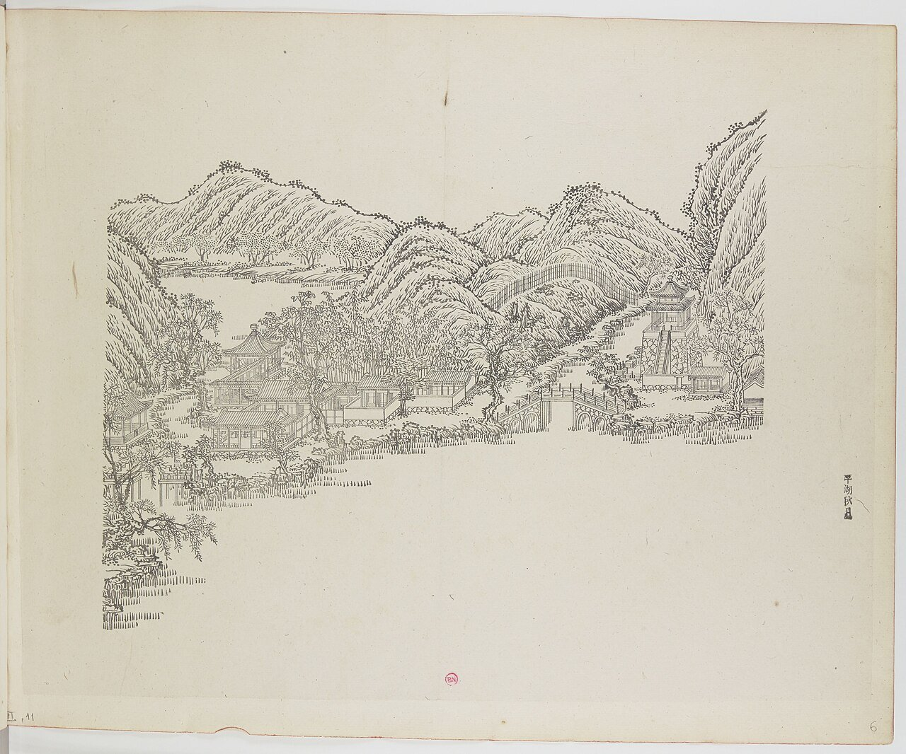
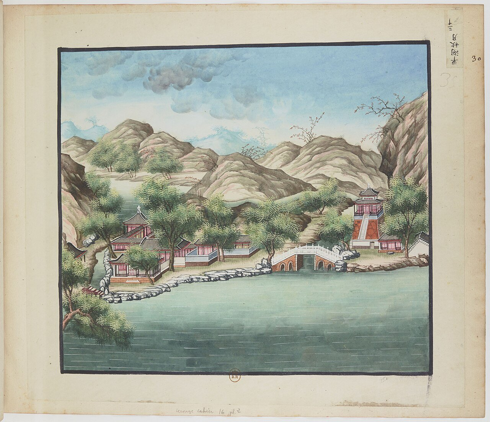
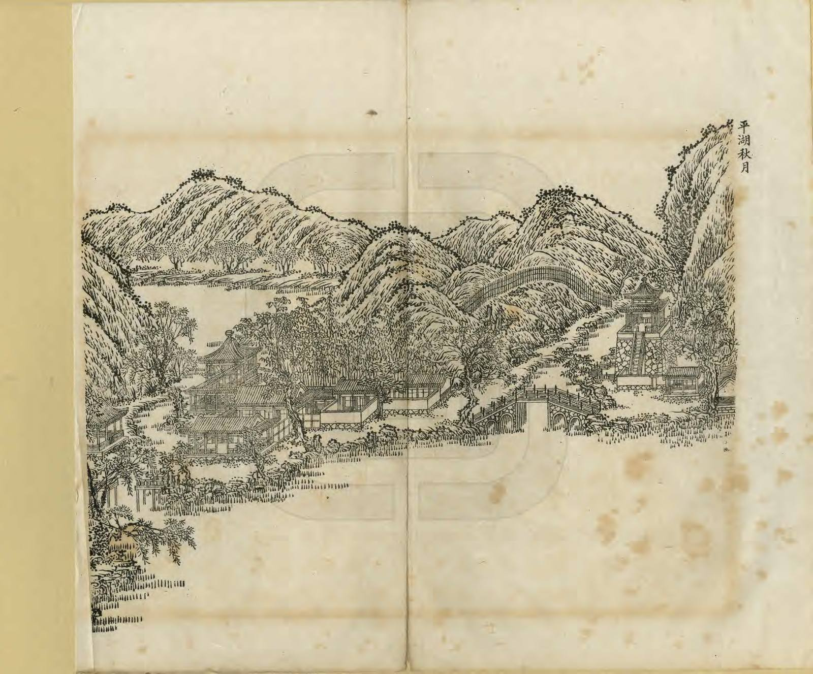
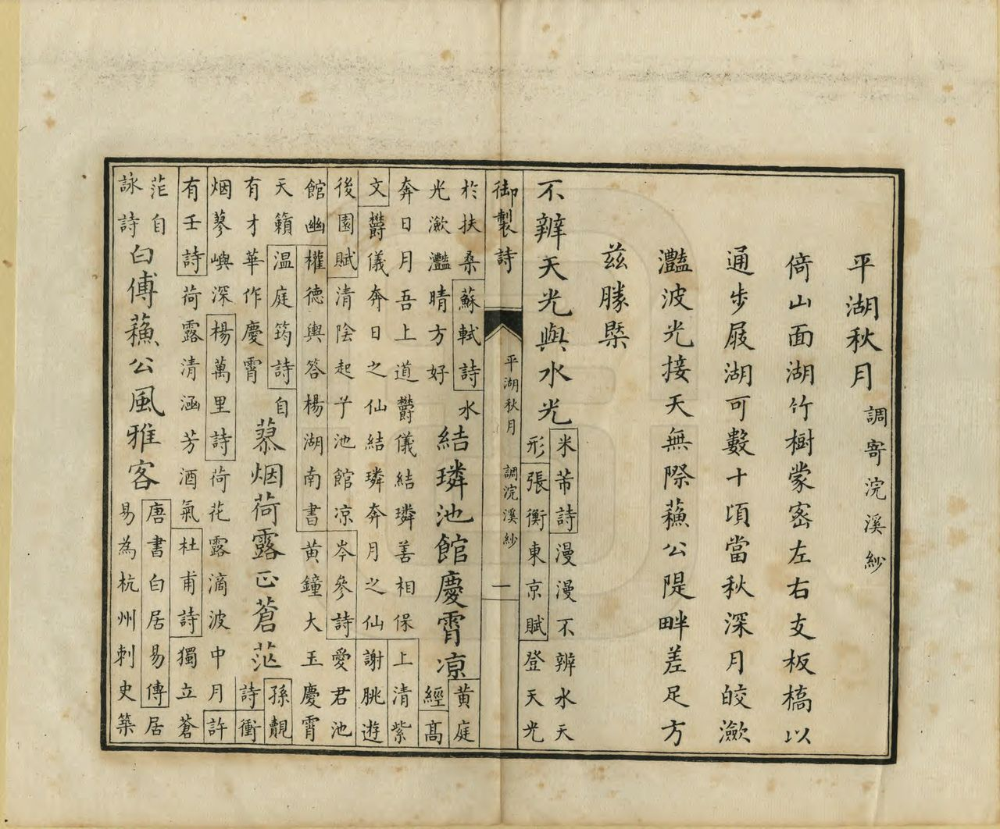
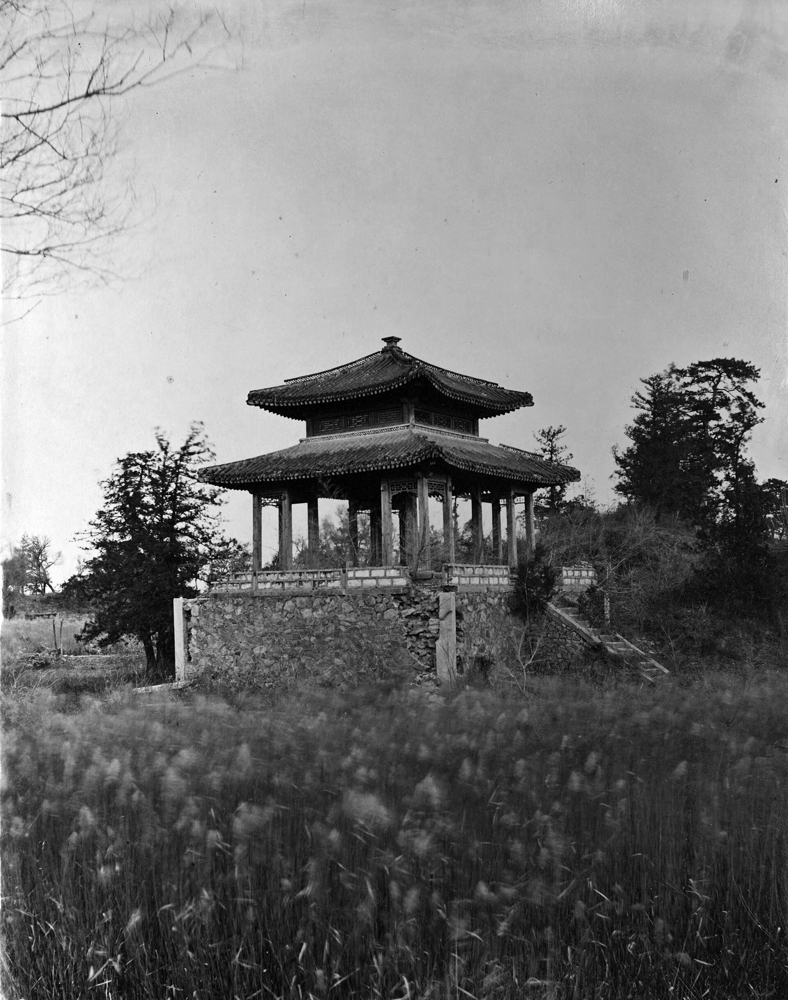
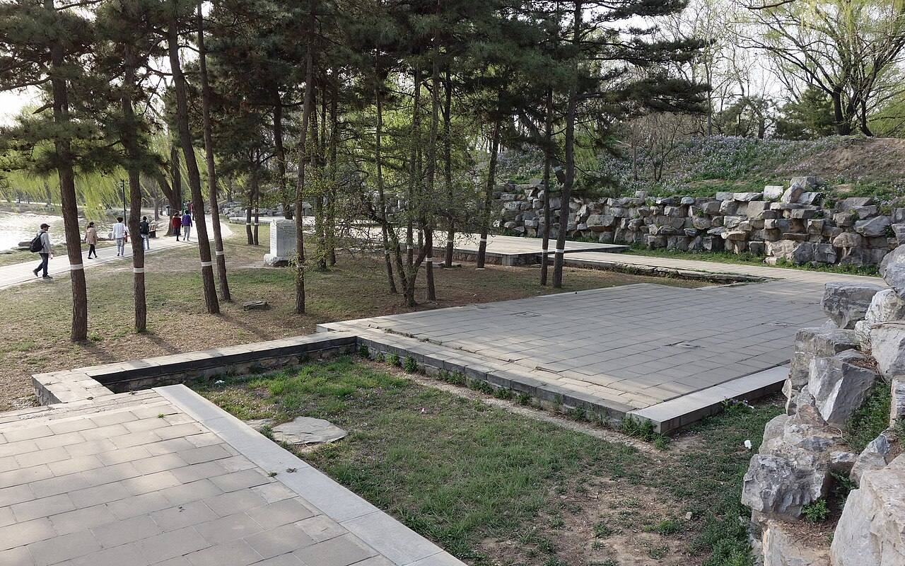

<!-- generated:start (scripts/building_pages.py): do not edit between these markers -->

# YM31: 平湖秋月 Pinghu Qiuyue

Level Lake and Autumn Moon · Yuanming Yuan

**3D object:** 11 boxes. Open it: `/reconstruction/3d.html?b=YM31`

## What we know

- **Name:** 平湖秋月 Pinghu Qiuyue (S05, S02, S08, S01, S360 · confidence A)
- **English:** Level Lake and Autumn Moon (S05, S02, S08, S01, S360)
- **Garden:** Yuanming Yuan (S05, S02, S08, S01, S360)
- **Type:** scene (S05, S02, S08, S01, S360 · confidence A)
- **Changed:** 1810 part rebuilt, new plaque 镜远洲 (S05, S02, S08, S01, S360)
- **Destroyed:** 1860 (S05, S02, S08, S01, S360)
- **Position:** 40.01019, 116.29565. S01 sure (S01 · confidence B)
- **Plan reader's note:** Label (6120,1710), Malone 31 at (5995,1800). Polygon runs along the north shore to 藏密楼 because the text lists 山水乐, 君子轩, 藏密楼 under it. S111 files 藏密楼 under 涵虚朗鉴 instead. (S01) *(research copy, not public)*
- **How it was read:** sure (S01) *(research copy, not public)*
- **Plan pixels:** 6053, 1700 (S01) *(research copy, not public)*

## Our model now

11 boxes stand in this compound, 11 on blocks drawn on the plan, 0 assumed. Its halls are listed below.

## Inside it (13)

- YM31-01 平湖秋月正宇
- YM31-02 流水音
- YM31-03 花屿兰皋
- YM31-04 两峰插云
- YM31-05 山水乐
- YM31-06 君子轩
- YM31-07 藏密楼
- YM31-B0259
- YM31-B0260
- YM31-B0261
- YM31-B0262
- YM31-B0263
- YM31-N01 松风梦月

## Pictures (7)

- **P0031** (sure): 平湖秋月 Pinghu qiuyue [Lune d'automne sur le lac Serein] (圓明園四十景, 第31景) (1744 (BnF record: 1744年，清朝乾隆九年)). https://commons.wikimedia.org/wiki/File%3A%E5%9C%93%E6%98%8E%E5%9C%92%E5%9B%9B%E5%8D%81%E6%99%AF._%E7%AC%AC%E4%B8%89%E5%8D%81%E4%B8%80%E6%99%AF_%28%E4%B8%8B%E5%86%8C%EF%BC%8C%E7%AC%AC%E5%8D%81%E4%B8%80%E5%B9%85%E5%9B%BE%29%2C_%E5%B9%B3%E6%B9%96%E7%A7%8B%E6%9C%88_-_%28%E6%B8%85%29%E5%94%90%E5%B2%B1%E3%80%81%E6%B2%88%E6%BA%90%E5%90%88%E7%95%AB_%3B_%28%E4%B9%BE%E9%9A%86%E5%90%9F%E8%AF%97%EF%BC%8C%E6%B1%AA%E7%94%B1%E6%95%A6%E4%BB%A3%E4%B9%A6%29Pinghu_qiuyue_-_%28Qing%29Tang_Dai%2C_Shen_Yuan_he_hua_-_btv1b55008346x.jpg

  

- **P0066** (sure): 中国皇帝的宫殿与庙宇. 第6幅图, 平湖秋月 - (清)孙祜、沈源Pinghu qiuyue - (Qing)Sun Hu, Shen Yuan (1745 (Commons, from the BnF record)). https://commons.wikimedia.org/wiki/File%3A%E4%B8%AD%E5%9B%BD%E7%9A%87%E5%B8%9D%E7%9A%84%E5%AE%AB%E6%AE%BF%E4%B8%8E%E5%BA%99%E5%AE%87._%E7%AC%AC6%E5%B9%85%E5%9B%BE%2C_%E5%B9%B3%E6%B9%96%E7%A7%8B%E6%9C%88_-_%28%E6%B8%85%29%E5%AD%99%E7%A5%9C%E3%80%81%E6%B2%88%E6%BA%90Pinghu_qiuyue_-_%28Qing%29Sun_Hu%2C_Shen_Yuan_-_btv1b10520699p.jpg

  

- **P0130** (sure): 海淀(镇)：中国皇帝的行宫. 第30幅图, 平湖秋月Pinghu qiuyue (1750-1792 (BnF, cb43831905b; ex coll. Bertin)). https://commons.wikimedia.org/wiki/File%3A%E6%B5%B7%E6%B7%80%28%E9%95%87%29%EF%BC%9A%E4%B8%AD%E5%9B%BD%E7%9A%87%E5%B8%9D%E7%9A%84%E8%A1%8C%E5%AE%AB._%E7%AC%AC30%E5%B9%85%E5%9B%BE%2C_%E5%B9%B3%E6%B9%96%E7%A7%8B%E6%9C%88Pinghu_qiuyue_-_btv1b10520636v.jpg

  

- **P0262** (sure): 平湖秋月 Pinghu Qiuyue (御製圓明園圖詠, 1887 石印本, 下卷 (Commons 卷二), 第31景; printed title in the right margin of the picture) (光緒十三年 1887 (Commons/NLC record; colophon 光緒十三年七月天津石印書屋 in the SSID copy, S98 PDF p.2); design after the woodblock of 1745 by 孫祜 Sun Hu and 沈源 Shen Yuan). https://commons.wikimedia.org/wiki/File%3ANLC403-312001107375-14034_%E7%A6%A6%E5%88%B6%E5%9C%93%E6%98%8E%E5%9C%92%E5%9C%96%E8%A9%A0_%E5%8D%B7%E4%BA%8C.pdf?page=38

  

- **P0538** (sure): 平湖秋月 Pinghu Qiuyue: 乾隆 Qianlong's preface and poem with the courtiers' commentary, 御製圓明園圖詠 1887 (poem 1744 (乾隆九年); this printing 1887). https://commons.wikimedia.org/wiki/File%3ANLC403-312001107375-14034_%E7%A6%A6%E5%88%B6%E5%9C%93%E6%98%8E%E5%9C%92%E5%9C%96%E8%A9%A0_%E5%8D%B7%E4%BA%8C.pdf?page=39

  

- **P0161** (likely): 北京城外圓明園之凉亭現時破爛 (print caption) (circa 1879 (Commons)). https://commons.wikimedia.org/wiki/File%3A%E5%8C%97%E4%BA%AC%E5%9F%8E%E5%A4%96%E5%9C%93%E6%98%8E%E5%9C%92%E4%B9%8B%E5%87%89%E4%BA%AD%E7%8F%BE%E6%99%82%E7%A0%B4%E7%88%9B.jpg

  

- **P0386** (sure): 藏密楼 20130414.JPG (2013-04-14 16:46:26 (Commons DateTimeOriginal)). https://commons.wikimedia.org/wiki/File:%E8%97%8F%E5%AF%86%E6%A5%BC_20130414.JPG

  

## Texts and drawings (37)

- **E1896** (poem, sure): 御製平湖秋月詞（調寄浣溪紗）（圓明園四十景詩）. 1744 (乾隆九年) · printed in S05 j82:15b-16a · S40. https://github.com/kanripo/KR2k0036/blob/master/KR2k0036_082.txt
  > 乾隆九年 御製平湖秋月詞（調寄浣溪紗） 倚山面湖竹樹䝉密左右支板橋以通步屐湖可數十頃當秋深月皎㶑灧波光接天無際蘇公隄畔差足方兹勝概 不辨天光與水光結璘池館慶宵涼蓼煙荷露正蒼茫　白傅蘇公風雅客一杯相勸舞霓裳此時誰不道錢塘
  Set against a hill and facing the lake, with dense bamboo and plank bridges on either side. The lake runs to tens of qing, and on deep autumn nights moon and water merge, close to the view by 蘇公隄 Su Causeway.
- **E1912** (text, sure): 日下舊聞考 平湖秋月、福海. 1780s (乾隆 敕撰) · j82:15b · S05. https://github.com/kanripo/KR2k0036/blob/master/KR2k0036_082.txt
  > 平湖秋月在福海西北隅正宇三楹西為流水音東北出山口臨河為花嶼蘭皋折而東南度橋為兩峯挿雲又東南為山水樂其北為君子軒為藏密樓（圓明園册）臣等謹按平湖秋月四十景之一額為世宗御書流水音花嶼蘭皋諸額為皇上御書
  In the north-west corner of 福海: 平湖秋月, three bays, with 流水音, 花嶼蘭皋, 兩峯挿雲, 山水樂, 君子軒 and 藏密樓.
- **E0415** (poem, sure): 王闓運 圓明園詞. 1871 (同治十年) · whole poem; copy without the 自注 · S203. https://www.douban.com/group/topic/46378693/
  > 宜春苑中萤火飞，建章长乐柳十围。 离宫从来奉游豫，皇居那复在郊圻？ 旧池澄绿流燕蓟，洗马高梁游牧地。 北藩本镇故元都，西山自拥兴王气。 九衢尘起暗连天，辰极星移北斗边。 沟洫填淤成斥卤，宫庭映带觅泉原。 渟泓稍见丹棱泮，陂陀先起畅春园。 畅春风光秀南苑，霓旌凤盖长游宴。 地灵不惜瓮山湖，天题更创圆明殿。 圆明始赐在潜龙，因回邸第作郊宫。 十八篱门随曲涧，七楹正殿倚乔松。 轩堂四十皆依水，山石参差尽亚风。 甘泉避暑因留跸，长杨扈从且弢弓。 纯皇缵业当全盛，江海无波待游幸。 行所留连赏四园，画师写放开双境。 谁道江南风景佳，移天缩地在君怀。 当时只拟成灵囿，小费何曾数露台。 殷勤毋佚箴骄念，岂意元皇失恭俭！ 秋狝俄闻罢木兰，妖氛暗已传离坎。 吏治陵迟民困痛，长鲸跋浪海波枯。 始惊计吏忧财赋，欲卖行宫助转输。 沉吟五十年前事，厝火薪边然已至。 揭竿敢欲犯阿房，探丸早见诛文吏。 此时先帝见忧危，诏选三臣出视师。 宣室无人侍前席，郊坛有恨哭遗黎。 年年辇路看春草，处处伤心对花鸟。 玉女投壶强笑歌，金杯掷酒连昏晓。 四时景物爱郊居，玄冬入内望春初。 袅袅四春随凤辇，沉沉五夜递铜鱼。 内装颇学崔家髻，讽谏频除姜后珥。 玉路旋悲车毂鸣，金銮莫问残灯事。 鼎湖弓剑恨空还，郊垒风烟一炬间。 玉泉悲咽昆明塞，惟有铜犀守荆棘。 青芝岫里狐夜啼，绣漪桥下鱼空泣。 何人老监福园门，曾缀朝班奉至尊。 昔日暄阗厌朝贵，于今寂寞喜游人。 游人朝贵殊暄寂，偶来无复金闺客。 贤良门闭有残砖，光明殿毁寻颓壁。 文宗新构清辉堂，为近前湖纳晓光。 妖梦林神辞二品，佛城舍卫散诸方。 湖中蒲稗依依长，阶前蒿艾萧萧响。 枯树重抽盗作薪，游鳞暂跃惊逢网。 别有开云镂月台，太平三圣昔同来。 宁知乱竹侵苔落，不见春风泣露开。 平湖西去轩亭在，题壁银钩连倒薤。 金梯步步度莲花，绿窗处处留蠃黛。 当时仓卒动铃驼，守宫上直余嫔娥。 芦笳短吹随秋月，豆粥长饥望热河。 上东门开胡雏过，正有王公班道左。 敌兵未爇雍门荻，牧童已见骊山火。 应怜蓬岛一孤臣，欲持高洁比灵均。 丞相避兵生取节，徒人拒寇死当门。 即今福海冤如海，谁信神州尚有神！ 百年成毁何匆促，四海荒残如在目。 丹城紫禁犹可归，岂闻江燕巢林木？ 废宇倾基君好看，艰危始识中兴难。 已惩御史言修复，休遣中官织锦纨。 锦纨枉竭江南赋，鸳文龙爪新还故。 总饶结彩大宫门，何如旧日西湖路。 西湖地薄比郇瑕，武清暂住已倾家。 惟应鱼稻资民利，莫教莺柳斗宫花。 词臣讵解论都赋，挽辂难移幸雒车。 相如徒有上林颂，不遇良时空自嗟。
  A long lament on the garden's rise and destruction. It names the eighteen fence gates, the seven-bay main hall and forty halls by water, then the ruined 賢良門 and 光明殿, the new 清輝堂 of Xianfeng, 舍衛城, 鏤月開雲, and 福海 where the official 文豐 died.
- **E0433** (text, sure): 徐樹鈞 圓明園詞序. 1871 (同治十年立秋), recording a visit of 四月十日 · preface, whole · S203. https://www.douban.com/group/topic/46378693/
  > 圆明园在京城西，出平则门三十里，畅春园北里许，世宗皇帝藩邸赐园也。圣祖常游豫西郊，次于丹棱沜，乐其川原，因明武清侯李伟清华园旧址，筑畅春园，藩邸赐园，故在其旁。雍正三年，乃大宫殿朝署之规以避暑听政，前临西山，环以西湖。湖水发源玉泉山，曰瓮山，度宫墙东流入清河，《水经注》所谓“蓟县西湖，绿水澄澹，燕之旧池”者也。东流为洗马沟，东南合高梁之水，故鱼稻饶衍，陂泉交绮。高宗皇帝嗣位，海宇殷阗，八方无事，每岁缔构，专饰园居。大驾南巡，流览湖山风景之胜，图画以归，若海宁安澜园、江宁瞻园、钱塘小有天园、吴县狮子林，皆仿其制，增制园中。列景四十，以四字题匾者为一胜区，一区之内，斋馆无数。复东拓长春，西辟清漪，离宫别馆，月榭风亭，属之西山，所费不计亿万。园地多明权珰别业，或传崇祯末，诸奄皆以珍宝窟宅于兹，乾隆间浚池，发金银数百万，时国运方兴，地不爱宝，上心悦豫，殚精构造，曲尽游观之妙，元明以来，未之闻也。每岁夏幸园中，冬初还宫，内廷大臣，赐第相望，文武侍从，并直园林，入直奏对，昕夕往来，络绎道路，历雍乾嘉道，百余年于兹矣。文宗初，粤寇踞金陵，盗贼蜂起，上初即位，求直言，得胜保、曾国藩、袁甲三三臣，既以塞 、程、徐、陆，先朝重望，相继倾覆，始擢用前言事者，各畀重任，三臣支柱，贼不犯畿。然迭胜迭败，东南数省，蹂躏无完土，上悯苍生之颠沛，慨左右之无人。九年冬，郊宿于斋宫，夜分痛哭，侍臣凄恻。大考翰詹，以宣室前席发题，忧心焦思，伤于祸乱，然后稍自抑解，寄于文酒。以宫中行止有节，尤喜园居，冬至入宫，初正即出。时园中传有四春之宠，皆汉女，分居亭馆，所谓杏花春、武陵春、牡丹春、海棠春者也。然上明于料兵，委权阃外，超次用人，海内称哲。而部寺诸臣，无所磨励，颇袭旧敝。晚得肃顺，敢言自任，故委以谋议。先是道光二十年，英吉利夷船，至广东香港，求通商不得，又以烧烟起衅，执政议和，予海关税银千八百万。英夷请立约，广督耆英，与期十年。届期而徐广缙督两广，夷使至广州，拒不许入，以受封爵，夷酋恨焉，志入广州。咸丰元 [ 九 ] 年，英吉利、法兰西、美利坚各国，乘粤寇鸱张，中国多故，复以轮舶直入大沽台。王僧格林沁，托团练之名，焚其二船，尽击走之。夷人知大皇帝无意于战，特臣民之私愤，乃潜至海岸，买马数千，募群盗为军，半年而成，再犯天津，称西洋马队，闻者恐栗，夷马步登岸，我未陈而敌骑长驱矣。十年六 [ 八 ] 月十六日，上方园居，闻夷骑至通州，仓卒率后嫔幸热河，道路初无供帐，途出密云，御食豆乳麦粥而已。十七日，英夷帅叩东便门，或有闭城者，闻炮而开，王公请和，和议将定。十九日，夷人至圆明园宫门，管园大臣文丰当门说止之，夷兵已去。文都统知奸民将起，环问守卫禁兵，无一在者，乃自索马还内，投福海死。奸人乘时纵火，入宫劫掠，夷人从之，各园皆火发，三昼夜不熄，非独我无官府诘问，夷帅亦不能知也。初英夷使臣巴夏里，已拘刑部，和议成，以礼释囚。于是巴夏里与英帅，各陈兵仗至礼部，订约五十七条，予以海关税银三千六百万，而夷人抵偿圆明园银二十万。王公奏言，未敢斥夷，文丰与主事惠丰，同死于园，不称殉节，但言遭兵燹而已。十一年七月，文宗晏驾热河，今上即位，奉两宫皇太后还京，垂帘十载，巨寇削平。而夷人通商江海，往来贸易，设通商王大臣，以接夷使。然常言：“某省士民毁天主教堂，某省不行其教，某省民教构衅。”日以难我，应之不暇，盖岌岌乎华夷杂处，又忽忽十有一年。园居荒墟，鞠为茂草，西山大寺，夷妇深居，予旅京师，恻然不敢过也。同治十年春，同年王壬父重至辇下，追话旧游，张子雨珊亦以计偕来，约访故宫，因驻守参将廖承恩许为道主。四月十日，命仆马同过绣漪桥，寻清漪园遗迹，颓垣断瓦，零乱榛芜，宫树苍苍，水鸣呜咽。由辇路登廓如亭，南望万寿山，但见牧童樵子，往来林莽间。暮从昆明湖归，桥上铜犀卧荆棘中，犀背御铭，琅然可诵。明日访守园者，得董监，自言：“年七十有余，自道光初入寺园中，今秩五品，居福园门旁。”导予等从瓦砾中，循出入贤良门而北，指勤政、光明、寿山、太和四殿遗址，前湖圆明寝殿五楹，后为奉三无私殿、九州清晏殿各七楹，坏壁犹立，拾级可寻。董监言：“东为天地一家春，后居也，西为乐安和，诸妃嫔贵人居也，洞天深处，皇子居也。清辉殿为文宗重建，与五福堂、镂月开云台、朗吟阁皆不可复识。”镂月开云者，即所谓牡丹春者也。世宗为皇子时，迎圣祖至赐园，而高宗年十二，以皇孙召侍左右，三天子福寿冠前古，集于一堂，高宗后制诗，尝夸乐之。经其废基，裴回惄焉。东渡湖，为苏堤、长春仙馆、藻园，又北为月地云居、舍卫城、日天琳宇、水木明瑟、濂溪乐处，仅约略指视所在。东北至香雪廊，阶前茅荻萧萧，废池可辩，有老监奉茶自石畔出，讶客所从来，颇似桃源人逢渔郎也。渡桥循福海西行，为平湖秋月，水光溶溶，一泻千顷。望蓬岛瑶台，岛上殿宇，犹存数楹，惜无方舟不达。其下流水潺湲，激石成响，董监示予：“此管园大臣文公死所也。”西北至双鹤斋，又西过规月桥，登绮吟堂，经采芝径，折而东，仍出双鹤斋。园中残毁几遍，独存此为劫灰之余，乱草侵阶，窗棂宛在，尤动人禾黍悲耳。双鹤斋西，为溪月松风，翠柏苍藤，沿流覆道，斜日在林，有老宫人驱羊豕下来。东过碧桐书院，地跨池上，东为金鳌，西为玉蝀，坊楔犹存。又东去，皆败坏难寻，遂不复往。莫色沈沈，栖乌乱飞，揖董监，出福园门，还于廖宅。廖，沣州人，字枫亭，少从塞尚阿、僧格林沁军，亦能言行间事，感予来游，颇尽宾主之欢。既夕言归，则礼部放榜日也。雨珊既落第南去，予与壬父每相过从，念言园游，辄惘惘不自得。壬父又曰：“园之盛时，纯皇勒记，必殷殷踵事之戒，然仁宗始罢南幸，宣宗尤忧国贫，秋狝之礼，辍而不举。惟夫张弛之道宜及，嘉道时，补纯皇倦勤之功，而内外大臣，惟务慎节，监司宽厚，牧令昏庸，讳盗容奸，以为安静。八卦妖徒，连兵十载，无生天主，教目滋繁，由游民轻法，刑废不用故也。江淮行宫，既皆斥卖，国之所患，岂在乏财。”又曰：“燕地经安史戎马之迹，爰及辽金，近沙漠之风矣。明太宗以燕王旧居，不务改宅，仍而至今，地利竭矣。又园居单外，非所以驻万乘，废而不居，盖亦时宜。” 予曰：“然，前年御史德泰，请按户亩鳞次捐输，复修园宫。大臣以侈端将启，请旨切责，谪戍未行，愤悔自死。自此莫敢言园居者。而比年备办大婚，费已千万，结彩宫门，至十余万，公奏朝廷动用钱粮，婚以成礼，岂在华饰，若前明户部司官得以谏争，予且建言矣。又予闻慈安太后在文宗时，有脱簪之谏，《关雎》《车舝》之贤，中兴之由也。又园宫未焚前一岁，妖言传上坐寝殿，见白须老翁，自称园神，请辞而去，上梦中加神二品阶，明日，至祠谕祀之，未一期而园毁，岂能定欤？子能诗者，达于政事，曷以风人之意，备《繁霜》《云汉》之采？”于是壬父为《圆明园词》一篇。而周学士（即大学士周祖培）、潘侍郎见之，并叹其伤心感人，笔墨通于情性。予以此诗可传后来，虑夫代远年逝，传闻失实，词中所述，罔有征者，乃为文以序之。同治十年立秋日，长沙徐树钧撰。
  A walk through the ruins eleven years after the destruction, guided by an old eunuch who had served since the 1820s. It says which sites could still be read, and that 雙鶴齋 with its surroundings alone stood, as did some rooms on 蓬島瑶臺 and the 金鼇 and 玉蝀 arches. Its account of 1860 credits the first fires to local robbers, which differs from the British and French record in S02.
- **E1897** (poem, sure): 君子轩: 乾隆二十四年 poem of the Qianlong Emperor. 乾隆二十四年 (1759), date from the compilation · p.264 item (1), under 君子轩 · S360. https://www.yuanmingyuanpark.cn/xs/yjbg/202007/P020200730387572832602.pdf#page=264
  > 吾亦爱箖箊，琅玕绕砌除。自将俗事远，如与善人居。古月度时白，清风拂处虚。从来戒旨酒，嵇阮岂希渠。
  Poem of the Qianlong Emperor at 君子轩, 1759, on the view. Year as given by the compilation.
- **E1898** (poem, sure): 藏密楼: 乾隆二十四年 poem of the Qianlong Emperor. 乾隆二十四年 (1759), date from the compilation · p.264 item (1), under 藏密楼 · S360. https://www.yuanmingyuanpark.cn/xs/yjbg/202007/P020200730387572832602.pdf#page=264
  > 屋里通云磴，檐头出月轩。往来悦神智，阖辟具乾坤。真得壶中趣，堪忘象外言。俯凭千顷碧，是我洗心源。
  Poem of the Qianlong Emperor at 藏密楼, 1759, on the view. Year as given by the compilation.
- **E1921** (poem, sure): 君子轩. 乾隆二十四年 (1759) · v2 p.367, under 澡身浴德; source ref 6-729 · S361. https://www.yuanmingyuanpark.cn/xs/yjbg/202008/P020200803382343267004.pdf#page=370
  > 吾亦爱箖箊，琅玕饶砌除。自将俗事远，如与善人居。古月度时白，清风拂处虚。从来戒旨酒，嵇阮岂希渠。
  Poem 君子轩 by the Qianlong Emperor, 1759, filed by the editors under 澡身浴德.
- **E1899** (poem, sure): 夏隐亭: 乾隆二十五年 poem of the Qianlong Emperor. 乾隆二十五年 (1760), date from the compilation · p.265 item (1), under 夏隐亭 · S360. https://www.yuanmingyuanpark.cn/xs/yjbg/202007/P020200730387572832602.pdf#page=265
  > 小亭名夏隐，叶密藏檐宇。匪慕彼黄公，乃自我作古。
  Poem of the Qianlong Emperor at 夏隐亭, 1760, on escaping the heat. Year as given by the compilation.
- **E1900** (poem, sure): 藏密楼: 乾隆二十五年 poem of the Qianlong Emperor. 乾隆二十五年 (1760), date from the compilation · p.264 item (2), under 藏密楼 · S360. https://www.yuanmingyuanpark.cn/xs/yjbg/202007/P020200730387572832602.pdf#page=264
  > 丹梯拾级因高迥，绿牖凭虚纳远通。闭户恰宜读周易，庶几津逮洗心同。
  Poem of the Qianlong Emperor at 藏密楼, 1760. Year as given by the compilation.
- **E1923** (poem, sure): 藏密楼. 乾隆二十五年 (1760) · v2 p.368, under 澡身浴德; source ref 7-303 · S361. https://www.yuanmingyuanpark.cn/xs/yjbg/202008/P020200803382343267004.pdf#page=371
  > 丹梯拾级因髙迥，绿牖凭虚纳远通。闭户恰宜读周易，庶几津逮洗心同。
  Poem 藏密楼 by the Qianlong Emperor, 1760, filed by the editors under 澡身浴德.
- **E1901** (poem, sure): 君子轩: 乾隆二十六年 poem of the Qianlong Emperor. 乾隆二十六年 (1761), date from the compilation · p.264 item (2), under 君子轩 · S360. https://www.yuanmingyuanpark.cn/xs/yjbg/202007/P020200730387572832602.pdf#page=264
  > 万个围三间，过雨翠如洗。入秋意已凉，筛月光犹美。风度曲江张，潇洒山东李。更有胜人处，自不道君子。
  Poem of the Qianlong Emperor at 君子轩, 1761, on rain and the view. Year as given by the compilation.
- **E1924** (poem, sure): 藏密楼. 乾隆二十六年 (1761) · v2 p.368, under 澡身浴德; source ref 8-422 · S361. https://www.yuanmingyuanpark.cn/xs/yjbg/202008/P020200803382343267004.pdf#page=371
  > 宣尼十翼称藏密，艺祖诸门乃洞开。诠易求心不求迹，田何阳叔可能哉。
  Poem 藏密楼 by the Qianlong Emperor, 1761, filed by the editors under 澡身浴德.
- **E1922** (poem, sure): 君子轩. 乾隆二十九年 (1764) · v2 p.369, under 澡身浴德; source ref 8-763 · S361. https://www.yuanmingyuanpark.cn/xs/yjbg/202008/P020200803382343267004.pdf#page=372
  > 一迳入琅玕，三间藏宛委。众芳尚迟迟，万个只如此。标形皆玉亭，作响乃金止。雅宜风月契，宁藉龙凤比。惟斯不改度，信足称君子。
  Poem 君子轩 by the Qianlong Emperor, 1764, filed by the editors under 澡身浴德.
- **E1902** (poem, sure): 夏隐亭: 乾隆四十七年 poem of the Qianlong Emperor. 乾隆四十七年 (1782), date from the compilation · p.265 item (2), under 夏隐亭 · S360. https://www.yuanmingyuanpark.cn/xs/yjbg/202007/P020200730387572832602.pdf#page=265
  > 四山秃树阴未鎻，亭故翼然当面呈。 （夏隐者谓四面皆树，至夏则亭隐而不见也。 ）设使质之夏小海，此时其隐恐难成。
  Poem of the Qianlong Emperor at 夏隐亭, 1782, on escaping the heat. Year as given by the compilation.
- **E1903** (poem, sure): 夏隐亭: 乾隆五十八年 poem of the Qianlong Emperor. 乾隆五十八年 (1793), date from the compilation · p.265 item (6), under 夏隐亭 · S360. https://www.yuanmingyuanpark.cn/xs/yjbg/202007/P020200730387572832602.pdf#page=265
  > 一亭四面绕林枝，常见惟应隐夏时。设以风流人比拟，是诚灵宝贾希之。
  Poem of the Qianlong Emperor at 夏隐亭, 1793, on escaping the heat. Year as given by the compilation.
- **E1904** (poem, sure): 藏密楼: 乾隆五十八年 poem of the Qianlong Emperor. 乾隆五十八年 (1793), date from the compilation · p.264 item (4), under 藏密楼 · S360. https://www.yuanmingyuanpark.cn/xs/yjbg/202007/P020200730387572832602.pdf#page=264
  > 委宛得层居，遂以蔵密名。斯虽述易言，而吾更有评。潜修贵洗心，明扬要通情。大公而顺应，夫岂独善能。吉凶同民患，继言理实明。
  Poem of the Qianlong Emperor at 藏密楼, 1793, on reading. Year as given by the compilation.
- **E1905** (poem, sure): 君子轩: 乾隆六十年 poem of the Qianlong Emperor. 乾隆六十年 (1795), date from the compilation · p.264 item (6), under 君子轩 · S360. https://www.yuanmingyuanpark.cn/xs/yjbg/202007/P020200730387572832602.pdf#page=264
  > 曲径琅玕步以徐，书轩片刻适闲居。植中底合称君子，有节依然心复虚。
  Poem of the Qianlong Emperor at 君子轩, 1795, on the view. Year as given by the compilation.
- **E1919** (poem, sure): 流水音. 嘉庆二年 (1797) · v2 p.371, under 澡身浴德; source ref 1-280 · S361. https://www.yuanmingyuanpark.cn/xs/yjbg/202008/P020200803382343267004.pdf#page=374
  > 叠石注溪汇碧浔，坐听流水出清音。琮琤韵激波仍活，戛击声连池更深。玩世漫论巢父耳，怀人思入伯牙琴。澄潭玉宇光相印，一室空明契静心。
  Poem 流水音 by the Jiaqing Emperor, 1797, filed by the editors under 澡身浴德.
- **E1920** (poem, sure): 流水音. 嘉庆三年 (1798) · v2 p.372, under 澡身浴德; source ref 1-322 · S361. https://www.yuanmingyuanpark.cn/xs/yjbg/202008/P020200803382343267004.pdf#page=375
  > 叠石崚嶒泉细注，泠然岩底出清音。静聆逸调来空外，一洗筝琶俗韵侵。
  Poem 流水音 by the Jiaqing Emperor, 1798, filed by the editors under 澡身浴德.
- **E1906** (poem, sure): 镜远洲: 嘉庆十五年 poem of the Jiaqing Emperor. 嘉庆十五年 (1810), date from the compilation · p.265 item (1), under 镜远洲 · S360. https://www.yuanmingyuanpark.cn/xs/yjbg/202007/P020200730387572832602.pdf#page=265
  > 百顷平湖印素秋，新成芳墅镜清流。霞光迭绮白苹渚，波影含风红蓼洲。细飏菊香低砌下，高翻雁字远峰头。天澄时洽田功毕，佳景欣从物外求。
  Jiaqing, 1810, on the rebuilt part of 平湖秋月 with its new plaque.
- **E1907** (poem, sure): 镜远洲: 嘉庆十五年 poem of the Jiaqing Emperor. 嘉庆十五年 (1810), date from the compilation · p.265 item (2), under 镜远洲 · S360. https://www.yuanmingyuanpark.cn/xs/yjbg/202007/P020200730387572832602.pdf#page=265
  > 千顷苍茫秋水清，开奁宝铙现光明。远含洲渚一庭纳，高印云霞九宇莹。林外峰峦舒右臂，波心台榭即东瀛。游观适可娱几睱，习字拈题养性情。
  Poem of the Jiaqing Emperor at 镜远洲, 1810, on the view. Year as given by the compilation.
- **E1908** (poem, sure): 镜远洲: 嘉庆二十五年 poem of the Jiaqing Emperor. 嘉庆二十五年 (1820), date from the compilation · p.266 item (12), under 镜远洲 · S360. https://www.yuanmingyuanpark.cn/xs/yjbg/202007/P020200730387572832602.pdf#page=266
  > 春水波涵远，光浮一鉴中。风添细缯绿，日叠锦鳞红。澄澈心源印，虚明眼界融。韶华满上苑，丽景蔼长空。
  Poem of the Jiaqing Emperor at 镜远洲, 1820, on the view. Year as given by the compilation.
- **E1909** (poem, sure): 平湖秋月: 道光三年 poem of the Daoguang Emperor. 道光三年 (1823), date from the compilation · p.263 item (1), under 平湖秋月 · S360. https://www.yuanmingyuanpark.cn/xs/yjbg/202007/P020200730387572832602.pdf#page=263
  > 平湖日午泛轻航，飒飒南风喜送凉。鸣籁青松遮碧嶂，含芳紫槿映虚堂。倏看雨脚疎还密，乍听雷声隐复扬。四望溟蒙涵妙景，瀛洲图书水中央。
  Poem of the Daoguang Emperor at 平湖秋月, 1823, on rain and the view. Year as given by the compilation.
- **E1910** (poem, sure): 平湖秋月: 道光四年 poem of the Daoguang Emperor. 道光四年 (1824), date from the compilation · p.263 item (2), under 平湖秋月 · S360. https://www.yuanmingyuanpark.cn/xs/yjbg/202007/P020200730387572832602.pdf#page=263
  > 已欣春雪遍沾濡，何幸甘霖润似酥。近户点波声淅沥，隔溪羃树影模糊。新正嘉泽真难遇，开岁鸿慈沐更殊。预庆来牟兆丰稔，虚窗对处寸心愉。
  Poem of the Daoguang Emperor at 平湖秋月, 1824, on rain and the harvest. Year as given by the compilation.
- **E1911** (poem, sure): 平湖秋月: 咸丰七年 poem of the Xianfeng Emperor. 咸丰七年 (1857), date from the compilation · p.263 item (7), under 平湖秋月 · S360. https://www.yuanmingyuanpark.cn/xs/yjbg/202007/P020200730387572832602.pdf#page=263
  > 鹜望平湖雨似麻，丝丝作势趁 风斜。一痕湿霭横林幄，无限凉飔透户纱。饼饵添香田畔麦，臙脂挹润槛前花。屡膺吴眷弥增惕，从此旬沾徧迩遐。
  Poem of the Xianfeng Emperor at 平湖秋月, 1857, on rain and the view. Year as given by the compilation.
- **E1874** (description, sure): Scenes 30, 31, 33, 36, 37: the shores of 福海. 1934 · p.93 · S02. https://archive.org/details/historyofpekings00malo
  > These scenes show scattered houses, pavilions, terraces, and bridges which occupied the narrow strip of shore and the surrounding hills on the north, east, and west of the Happy Sea.
  澡身浴德, 平湖秋月, 接秀山房, 涵虚朗鉴, 廓然大公: scattered houses, pavilions, terraces and bridges on the shore strip and hills north, east and west of 福海. Malone gives no more for these five.
- **E2366** (description, guess): Attiret: shores of 福海, aviaries and fish. 1743 · [pp.17-20] · S157. https://faculty.bard.edu/~louis/gardens/attiretaccount.html
  > It takes up a very large Space; and is all surrounded with a Lattice-work of Brass-wire: in which the Openings are so very fine and small, as to prevent the fish from wandering into the main waters.
  Quays of smooth stone or rock-work, terraces, palaces rising in tiers, groves of several kinds. Network houses half in the water for waterfowl, small menageries, and the largest fish reservoir, closed by brass wire. Which shore is not stated.
- **E1216** (description, sure): Site status table, about 2011: remains tidied up. c. 2011 · 系列06 repost, status table · S356. https://blog.sina.com.cn/s/blog_c27029650101itzz.html
  A blogger's table of what was then visible. These scenes have building remains that have been cleared and tidied. Dated about 2011, so digs since then are not reflected.
- **E2001** (description, sure): 夹镜鸣琴; 平湖秋月, yaffin 系列11. c. 2011 · scenes 31, 35 · S356. https://blog.sina.com.cn/s/blog_65fec3ab0100svoj.html
  Lead: 夹镜鸣琴, 4,000 m2, south shore of 福海, Yongzheng date, from a Li Bai line on two waters and twin bridges. 平湖秋月, 20,000 m2, north shore, named after the West Lake view, Yongzheng date, three-bay main hall.
- **E1913** (description, sure): 圆明园百景史事分景汇编: 平湖秋月. 1744-1857 · from p.263, under 平湖秋月 · S360. https://www.yuanmingyuanpark.cn/xs/yjbg/202007/P020200730387572832602.pdf#page=263
  平湖秋月: 8 dated items, 1744-1857, of which 7 poems and 1 court records (Qianlong, Daoguang, Xianfeng); recurring themes: the view, rain, the harvest. First dated 1744, last dated 1857.
- **E1914** (description, sure): 圆明园百景史事分景汇编: 君子轩. 1759-1795 · from p.264, under 平湖秋月 · S360. https://www.yuanmingyuanpark.cn/xs/yjbg/202007/P020200730387572832602.pdf#page=264
  君子轩: 6 dated items, 1759-1795, of which 6 poems (Qianlong); recurring themes: the view, rain. First dated 1759, last dated 1795.
- **E1915** (description, sure): 圆明园百景史事分景汇编: 藏密楼. 1759-1793 · from p.264, under 平湖秋月 · S360. https://www.yuanmingyuanpark.cn/xs/yjbg/202007/P020200730387572832602.pdf#page=264
  藏密楼: 4 dated items, 1759-1793, of which 4 poems (Qianlong); recurring themes: reading, the view. First dated 1759, last dated 1793.
- **E1916** (description, sure): 圆明园百景史事分景汇编: 夏隐亭. 1760-1793 · from p.265, under 平湖秋月 · S360. https://www.yuanmingyuanpark.cn/xs/yjbg/202007/P020200730387572832602.pdf#page=265
  夏隐亭: 6 dated items, 1760-1793, of which 6 poems (Qianlong); recurring themes: escaping the heat, the view. First dated 1760, last dated 1793.
- **E1917** (description, sure): 圆明园百景史事分景汇编: 镜远洲. 1810-1820 · from p.265, under 平湖秋月 · S360. https://www.yuanmingyuanpark.cn/xs/yjbg/202007/P020200730387572832602.pdf#page=265
  In 1810 Jiaqing rebuilt part of 平湖秋月 and gave it this new plaque; he wrote on the lake view here every year to 1820. It has no row in the building list. 镜远洲: 12 dated items, 1810-1820, of which 12 poems (Jiaqing); recurring themes: the view, snow, escaping the heat. First dated 1810, last dated 1820.
- **E1918** (drawing, sure): 《国家图书馆藏样式雷图档·圆明园卷初编》: 平湖秋月. mostly 道光, 咸丰, 同治 per the publisher · 初编 目录: 平湖秋月, p.441 · S13. https://www.nlcpress.com/ProductView.aspx?Id=7642
  The printed facsimile of the National Library of China's Yangshi Lei sheets has a section on this place at p.441 (1 pages, section length worked out from the next heading); sheet titles and numbers are in the volume, ordered from a library.
- **E0540** (drawing, sure, search index only): 圆明园河道泊岸总平面图. 乾隆四十至四十九年, 嘉庆八至十六年间局部修改 (dating on the record) · 国家图书馆善本部 样043-1号 · S310. https://www.mhymy.com/dasl/ysltd/9509.html
  Plan of Yuanming Yuan's waterways and embankments, c. 1775-84 with changes between 1803 and 1811, about 1:200, damaged in places, with a sketch of Zao Yuan in the lower right corner. No image here; the site may ask a small payment for the full record.
- **E0548** (plan, sure): 三幅样式雷圆明园河道全图辨析. 2024-06-18 post · NLC 043-001, -002, -003 · S337. http://iqh.ruc.edu.cn/old/qdhjylyjzx/xszl/jzys/59b83e20f7ab4840b746a6208a550939.htm
  Dates three NLC Yangshi Lei water-course plans (about 1:2000) by the changes they show. It lists dated works: 1803 channel from 宁和镇 to 秀清村; 1810 镜远洲 at 平湖秋月; 1811 恒春堂; after 1828 清晖阁 replaced by 湛静斋; 1831 慎德堂; 1836 九州清晏殿 reduced to five bays with 同道堂 added west; 1846 洞天深处 four courts to two.

**On the plan:** Drawn on the plan of the gardens (S01), labelled 平湖秋月. https://artmuseum.princeton.edu/collections/objects/138657

## Open questions

- Q41: 藏密楼 YM31-07, 松风阁 YM81
- Q45: Halls in the texts with no row

<!-- generated:end -->

## Notes

<!-- Yours: regeneration never touches this part. It goes on the public site; what you write below a line holding only %% private %% stays in the research copy. -->
