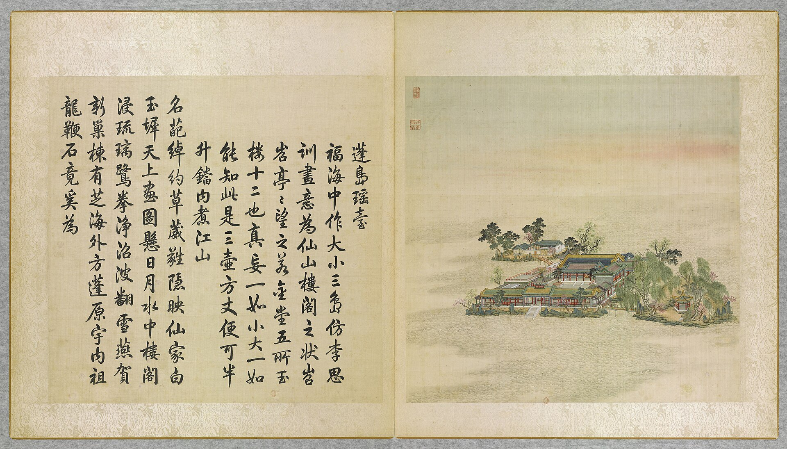

<!-- generated:start (scripts/building_pages.py): do not edit between these markers -->

# YM32-01: 门 Men

Yuanming Yuan

**3D object:** 1 box. Open it: `/reconstruction/3d.html?b=YM32-01`

**Part of:** YM32 蓬岛瑶台

## What we know

- **Name:** 门 Men (S05, S01 · confidence B)
- **Garden:** Yuanming Yuan (S05, S01)
- **Type:** gate (S05, S01 · confidence B)
- **Destroyed:** 1860 (S05, S01)
- **Position:** 40.00797, 116.29825. S01 likely (S01 · confidence B)
- **Bays:** 3 in the texts (S05, S01)
- **Size in the inventory:** 48.3 × 12.7 m. S01 plan px / hall scale (S01)
- **Note:** 額 鏡中閣. (S05, S01)
- **Plan reader's note:** South range. Text 门三楹南向: gate is mid-range, steps at (6985,3098). Range is more than a gate. (S01) *(research copy, not public)*
- **How it was read:** likely (S01) *(research copy, not public)*
- **Plan pixels:** 6981, 3061 (S01) *(research copy, not public)*

## Our model now

A plain box on the block drawn on the Qing plan S01: position and frontage from the plan, heights and roof from the typology of its hall class. It will be updated as the research goes on.

- **Box:** 41.34 × 11.74 m, gate hall
- **Heights:** platform 0.77 m, eave 4.47 m, ridge 8.66 m above the ground
- **Roof:** hip-and-gable 歇山, rolled ridge 卷棚, grey tile
- **Faces:** 169° from north
- **Fit:** reduced towards the size drawn on the plan, to stand clear of its neighbours or the water; moved 0.9 m
- **Confidence:** B

## Pictures (1)

- **P0032** (likely): 蓬島瑶臺 Pengdao yaotai [Terrasse de jade sur l'île d'Immortalité] (圓明園四十景, 第32景) (1744 (BnF record: 1744年，清朝乾隆九年)). https://commons.wikimedia.org/wiki/File%3A%E5%9C%93%E6%98%8E%E5%9C%92%E5%9B%9B%E5%8D%81%E6%99%AF_-_%28%E6%B8%85%29%E5%94%90%E5%B2%B1%E3%80%81%E6%B2%88%E6%BA%90%E5%90%88%E7%95%AB_%3B_%28%E4%B9%BE%E9%9A%86%E5%90%9F%E8%AF%97%EF%BC%8C%E6%B1%AA%E7%94%B1%E6%95%A6%E4%BB%A3%E4%B9%A6%29_-_btv1b55008362z_%28097_of_124%29.jpg

  

## Texts and drawings (1)

- **E1933** (text, sure): 日下舊聞考 蓬岛瑶台、福海. 1780s (乾隆 敕撰) · j82:16b-17a · S05. https://github.com/kanripo/KR2k0036/blob/master/KR2k0036_082.txt
  > 蓬島瑶臺在福海中央門三楹南嚮正殿七楹殿前東為暢襟樓西為神洲三島東偏為隨安室西偏為日日平安報好音由蓬島瑶臺東南度橋為東島有亭為瀛海仙山西北度橋為北島正宇三楹（圓明園册）臣等謹按蓬島瑶臺四十景之一舊名蓬萊洲後易今名額為皇上御書門額曰鏡中閣與暢襟樓隨安室額皆御書神洲三島日日平安報好音瀛海仙山諸額皆世宗御書
  Centre of 福海: a three-bay gate facing south and seven-bay main hall, with 暢襟樓, 神洲三島, 隨安室 and 日日平安報好音; bridges to an east isle with the pavilion 瀛海仙山 and a north isle with a three-bay range. Formerly 蓬萊洲.

**On the plan:** Drawn on the plan of the gardens (S01) with no label: a building stood here, its name unknown. https://artmuseum.princeton.edu/collections/objects/138657

## Evidence for the set of buildings

- Evidence for the whole compound 蓬岛瑶台: see YM32
- Reconstructions and comparables for the whole garden, 圆明园 Yuanming Yuan: see GARDEN-YM
- Standing buildings comparable to a gate hall (not this building): see CLASS-gate_hall

## Open questions

None that name it.

<!-- generated:end -->

## Notes

<!-- Yours: regeneration never touches this part. It goes on the public site; what you write below a line holding only %% private %% stays in the research copy. -->
